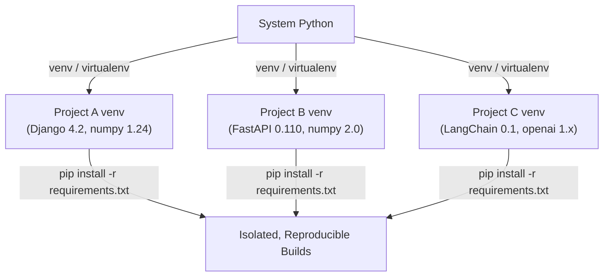

# Python Virtual Environments

## Overview

A **Python virtual environment** is an isolated Python runtime that has its own interpreter, libraries, and scripts — completely separate from the system-wide Python installation and other virtual environments. It is the foundational tool for reproducible, conflict-free Python development.

In production-grade systems — whether you're building RAG pipelines, AI agents, backend APIs, or enterprise ERP integrations — virtual environments are non-negotiable. They ensure that dependency versions are pinned, portable, and auditable.

---

## Why It Matters




---

## Simple Example

### Creating and Using a Virtual Environment

```bash
# Create a virtual environment
python -m venv .venv

# Activate it (Linux/macOS)
source .venv/bin/activate

# Activate it (Windows PowerShell)
.venv\Scripts\Activate.ps1

# Install a package
pip install requests

# Freeze dependencies
pip freeze > requirements.txt

# Deactivate
deactivate
```

**Explanation:**
- `python -m venv .venv` creates a `.venv` directory containing a self-contained Python interpreter and `pip`.
- Activating the environment modifies `PATH` so that `python` and `pip` point to the isolated environment.
- `pip freeze` captures the exact versions of all installed packages.

**Expected output after `pip freeze`:**
```
certifi==2024.2.2
charset-normalizer==3.3.2
idna==3.6
requests==2.31.0
urllib3==2.2.1
```

---

## Intermediate Example

### Project Setup with `requirements.txt` and `.env`

```
my_project/
├── .venv/
├── .env
├── requirements.txt
├── requirements-dev.txt
└── src/
    └── main.py
```

```text
# requirements.txt
fastapi==0.110.0
uvicorn==0.29.0
pydantic==2.6.4
python-dotenv==1.0.1

# requirements-dev.txt
pytest==8.1.1
httpx==0.27.0
black==24.3.0
```

```python
# src/main.py
from dotenv import load_dotenv
import os

load_dotenv()

DATABASE_URL = os.getenv("DATABASE_URL", "sqlite:///./default.db")
print(f"Connecting to: {DATABASE_URL}")
```

```bash
# Reproduce the environment on a new machine
python -m venv .venv
source .venv/bin/activate
pip install -r requirements.txt
pip install -r requirements-dev.txt
```

**Explanation:**
- Separating `requirements.txt` (production) from `requirements-dev.txt` (dev/test tools) keeps production images lean.
- `python-dotenv` loads environment variables from `.env` without polluting the system environment.

**Expected behavior:** The app starts with the correct database URL loaded from `.env`, and the environment is fully reproducible on any machine.

---

## Advanced / Architect-Level Example

### Multi-Environment Strategy for a GenAI / RAG System

**Problem context:** You are building a production RAG pipeline with multiple services: an ingestion worker, an API server, and a fine-tuning job. Each has different, potentially conflicting dependencies. You need reproducible builds for CI/CD, Docker, and local development.

```
rag_platform/
├── services/
│   ├── ingestion/
│   │   ├── .venv/
│   │   ├── requirements.txt        # langchain, unstructured, chromadb
│   │   └── Dockerfile
│   ├── api/
│   │   ├── .venv/
│   │   ├── requirements.txt        # fastapi, openai, pydantic
│   │   └── Dockerfile
│   └── finetuning/
│       ├── .venv/
│       ├── requirements.txt        # torch, transformers, datasets
│       └── Dockerfile
├── pyproject.toml                  # shared tooling config
└── Makefile
```

```makefile
# Makefile
setup-ingestion:
	cd services/ingestion && python -m venv .venv && \
	.venv/bin/pip install --upgrade pip && \
	.venv/bin/pip install -r requirements.txt

setup-api:
	cd services/api && python -m venv .venv && \
	.venv/bin/pip install --upgrade pip && \
	.venv/bin/pip install -r requirements.txt

setup-all: setup-ingestion setup-api
```

```dockerfile
# services/api/Dockerfile
FROM python:3.11-slim

WORKDIR /app
COPY requirements.txt .
RUN pip install --no-cache-dir -r requirements.txt
COPY . .
CMD ["uvicorn", "main:app", "--host", "0.0.0.0", "--port", "8000"]
```

```python
# services/api/requirements.txt (pinned with hashes for security)
# Generated via: pip-compile --generate-hashes requirements.in
fastapi==0.110.0 \
    --hash=sha256:...
openai==1.14.3 \
    --hash=sha256:...
```

**Explanation:**
- Each service has its own isolated environment, preventing `torch` from polluting the lightweight API service.
- Docker images use `--no-cache-dir` to keep image sizes small.
- Hash-pinned requirements (via `pip-tools`) prevent supply-chain attacks.

**Design trade-offs:**
| Approach | Pros | Cons |
|---|---|---|
| `venv` per service | Simple, built-in | Manual management |
| `poetry` | Lock files, dependency groups | Learning curve |
| `conda` | Handles non-Python deps (CUDA) | Heavy, slower |
| `uv` | Extremely fast, Rust-based | Newer ecosystem |

---

## Common Mistakes

### 1. Committing the `.venv` directory to version control
- **Problem:** The `.venv` folder contains platform-specific binaries and absolute paths. It will not work on another machine and bloats the repository.
- **Better approach:** Add `.venv/` to `.gitignore`. Commit only `requirements.txt` or `pyproject.toml`.

### 2. Using `pip freeze > requirements.txt` in a polluted global environment
- **Problem:** Captures every globally installed package, not just what the project needs.
- **Better approach:** Always freeze from within an activated, clean virtual environment.

### 3. Not pinning dependency versions
- **Problem:** `pip install fastapi` installs the latest version. A future `pip install` on a new machine may pull a breaking version.
- **Better approach:** Pin versions (`fastapi==0.110.0`) or use `pip-tools` / `poetry` to generate lock files.

### 4. Activating the wrong environment
- **Problem:** Running `python` or `pip` without activating the venv installs packages globally.
- **Better approach:** Use `which python` (Linux/macOS) or `Get-Command python` (PowerShell) to verify the active interpreter.

### 5. Mixing `pip` and `conda` in the same environment
- **Problem:** Can cause dependency resolution conflicts and broken environments.
- **Better approach:** Choose one package manager per environment and stick to it.

---

## Best Practices

- **Always use a virtual environment** — even for small scripts.
- **Name your environment consistently** — `.venv` is the modern convention (recognized by VS Code, PyCharm, etc.).
- **Use `pip-tools`** (`pip-compile` + `pip-sync`) or **`poetry`** for deterministic lock files in production.
- **Separate dev and prod dependencies** — use `requirements-dev.txt` or `[tool.poetry.dev-dependencies]`.
- **Use `python -m venv`** (built-in) over `virtualenv` unless you need Python 2 support.
- **Upgrade `pip` immediately** after creating a new venv: `pip install --upgrade pip`.
- **Use `uv`** for speed-critical CI pipelines — it is 10–100x faster than `pip`.
- **Document environment setup** in `README.md` or a `Makefile`.

---

## Performance Considerations

Virtual environments themselves have **no runtime performance impact** — they are just directory structures that redirect `PATH`. The Python interpreter runs at the same speed regardless.

Performance considerations arise during **environment creation and package installation**:
- `pip install` can be slow for large dependency trees (e.g., PyTorch, TensorFlow).
- **`uv`** (written in Rust) resolves and installs packages dramatically faster than `pip`.
- Use `--no-cache-dir` in Docker to avoid stale cache layers.
- Use `pip install --only-binary :all:` to avoid compiling C extensions from source.

---

## Testing Strategy

Virtual environments are infrastructure, not application code. Testing focuses on **environment reproducibility**.

```python
# tests/test_environment.py
import importlib
import subprocess
import sys

def test_required_packages_importable():
    """Ensure all critical packages are installed and importable."""
    required = ["fastapi", "pydantic", "openai"]
    for package in required:
        mod = importlib.import_module(package)
        assert mod is not None, f"{package} is not importable"

def test_python_version():
    """Enforce minimum Python version."""
    assert sys.version_info >= (3, 11), "Python 3.11+ required"

def test_no_debug_packages_in_prod():
    """Ensure dev-only packages are not installed in production."""
    result = subprocess.run(
        [sys.executable, "-m", "pip", "show", "pytest"],
        capture_output=True, text=True
    )
    # In a production Docker image, pytest should not be present
    # This test would be skipped in dev environments
    pass
```

```bash
# Run in CI after environment setup
pytest tests/test_environment.py -v
```

---

## Debugging Tips

- **`which python` / `where python`** — verify you're using the venv interpreter.
- **`pip list`** — see all installed packages in the active environment.
- **`pip show <package>`** — check the installed version and location of a specific package.
- **`python -m site`** — shows the site-packages directory being used.
- **`VIRTUAL_ENV` environment variable** — if set, you're inside a virtual environment.
- **VS Code**: Select the correct interpreter via `Ctrl+Shift+P` → "Python: Select Interpreter" → choose `.venv`.
- **`pip check`** — detects broken dependency requirements in the current environment.
- **Recreate from scratch** when environments become corrupted: `rm -rf .venv && python -m venv .venv`.

---

## Interview Questions

### Beginner
1. **What is a Python virtual environment?**
   *An isolated Python runtime with its own interpreter and packages, separate from the system Python.*

2. **How do you create a virtual environment?**
   *`python -m venv .venv`*

3. **Why should you not commit the `.venv` folder to Git?**
   *It contains platform-specific binaries and absolute paths that won't work on other machines.*

4. **What does `pip freeze` do?**
   *It outputs all installed packages and their exact versions in the current environment.*

5. **How do you activate a virtual environment on Windows PowerShell?**
   *`.venv\Scripts\Activate.ps1`*

### Intermediate
1. **What is the difference between `requirements.txt` and a lock file (e.g., `poetry.lock`)?**
   *`requirements.txt` lists direct dependencies (possibly with version ranges); a lock file pins every transitive dependency to an exact version for full reproducibility.*

2. **What is `pip-tools` and why use it?**
   *`pip-tools` provides `pip-compile` (generates a pinned `requirements.txt` from a `requirements.in`) and `pip-sync` (installs exactly what's in the lock file, removing extras). It gives reproducibility without the full overhead of Poetry.*

3. **How do you handle different dependency sets for development vs. production?**
   *Use separate files (`requirements.txt`, `requirements-dev.txt`) or dependency groups in `pyproject.toml`.*

4. **What is `uv` and how does it differ from `pip`?**
   *`uv` is a Rust-based Python package installer and resolver that is 10–100x faster than `pip`. It is a drop-in replacement for `pip` and `pip-tools`.*

5. **How do virtual environments interact with Docker?**
   *In Docker, the container itself provides isolation, so a venv is optional. However, using a venv inside Docker can prevent accidental system package pollution and makes the build more explicit.*

### Advanced / Architect-Level
1. **How would you design a dependency management strategy for a monorepo with 5 Python microservices?**
   *Use per-service `pyproject.toml` with `poetry` or `uv` workspaces. Share common internal packages as local path dependencies. Use a CI matrix to test each service independently. Pin all dependencies in lock files.*

2. **What are hash-pinned requirements and why are they important for security?**
   *Hash-pinned requirements (generated by `pip-compile --generate-hashes`) include the SHA-256 hash of each downloaded wheel/sdist. `pip` verifies the hash before installing, preventing supply-chain attacks where a malicious package is substituted.*

3. **How does `conda` differ from `venv` for AI/ML workloads?**
   *`conda` manages non-Python dependencies (e.g., CUDA, MKL, HDF5) and can create environments with specific Python versions. `venv` only manages Python packages. For GPU-accelerated ML, `conda` or `mamba` is often preferred.*

4. **Explain the `PYTHONPATH` variable and how it interacts with virtual environments.**
   *`PYTHONPATH` adds directories to Python's module search path. If set incorrectly, it can cause a venv to import packages from outside the environment, breaking isolation. Best practice: avoid setting `PYTHONPATH` globally; use proper package installation instead.*

5. **How would you implement environment validation in a CI/CD pipeline?**
   *Add a step that runs `pip check` (detects broken deps), verifies `python --version`, imports critical packages, and compares `pip freeze` output against the committed lock file using `pip-sync --dry-run` or a custom diff script.*

---

## Key Takeaways

- Virtual environments provide **dependency isolation** — the foundation of reproducible Python projects.
- Use `.venv` as the standard directory name; add it to `.gitignore`.
- **Pin dependencies** using `pip-tools`, `poetry`, or `uv` for production systems.
- Separate **production** and **development** dependencies.
- In Docker, use `--no-cache-dir` and consider hash-pinned requirements for security.
- `uv` is the modern, fast alternative to `pip` for CI/CD pipelines.
- Virtual environments have **zero runtime performance overhead**.
- Always verify your active interpreter with `which python` before installing packages.

---

## Mini Project Idea

### Project: `envguard` — Environment Validation CLI Tool

**Goal:** Build a CLI tool that validates a Python project's virtual environment against its `requirements.txt`, reports missing or mismatched packages, and optionally auto-fixes them.

**Features:**
- Parse `requirements.txt` and compare against `pip list` output.
- Report: missing packages, version mismatches, extra packages.
- `--fix` flag to run `pip install -r requirements.txt`.
- `--strict` flag to fail if any extra packages are present (useful in CI).
- JSON output mode for integration with CI dashboards.

**Suggested folder structure:**
```
envguard/
├── .venv/
├── pyproject.toml
├── README.md
├── src/
│   └── envguard/
│       ├── __init__.py
│       ├── cli.py          # argparse / typer CLI entry point
│       ├── checker.py      # core comparison logic
│       └── reporter.py     # output formatting
└── tests/
    ├── test_checker.py
    └── test_reporter.py
```

**Extension ideas:**
- Support `pyproject.toml` and `poetry.lock` parsing.
- Add a `--export` flag to generate a clean `requirements.txt` from the current environment.
- Integrate as a pre-commit hook.
- Add a GitHub Actions workflow template.

---

## Final Summary

Mastering Python virtual environments is the first step toward becoming a reliable Python architect. It instills the discipline of **dependency isolation**, **reproducibility**, and **environment-as-code** — principles that scale from a single script to a 50-service microservices platform. Architects who understand the full toolchain (`venv`, `pip-tools`, `poetry`, `uv`, Docker layering, and CI validation) can design systems that are deployable, auditable, and secure. Every production incident caused by a "works on my machine" dependency conflict is a virtual environment problem in disguise.
