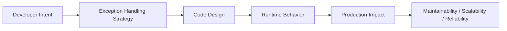
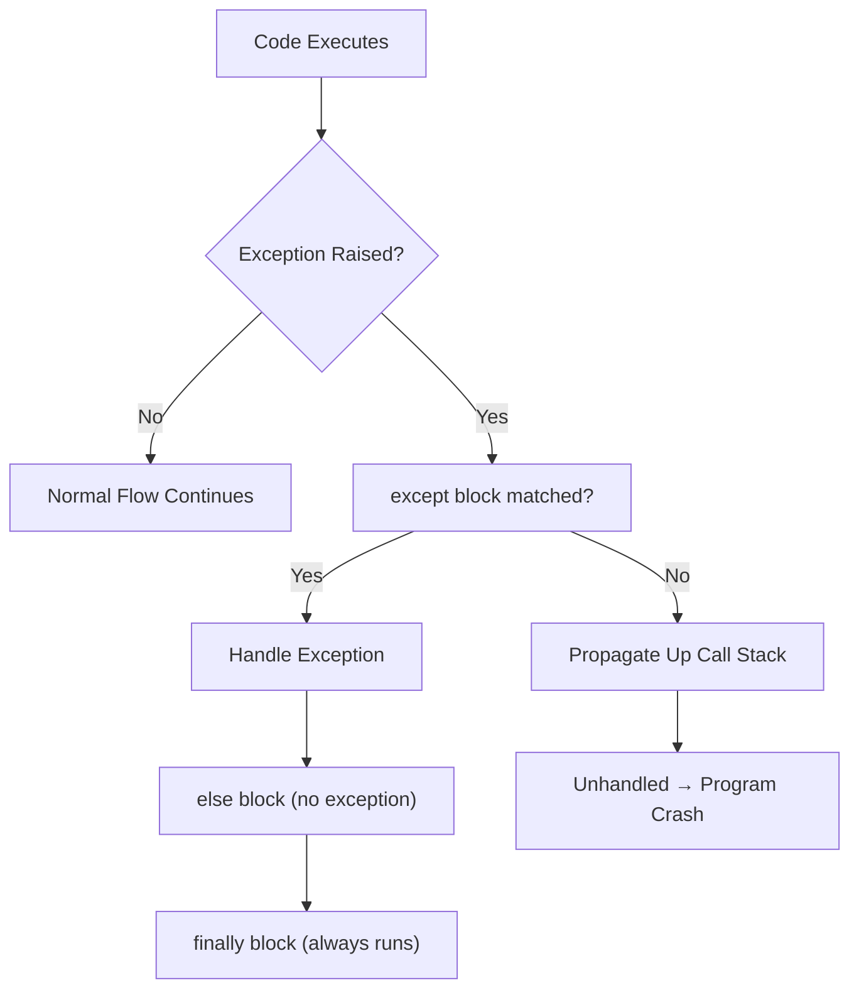

# Exception Handling

## Overview

**Exception handling** is Python's structured mechanism for responding to runtime errors — conditions that disrupt the normal flow of a program. Rather than crashing, a well-designed system catches exceptions, logs them, recovers gracefully, or propagates them with enriched context.

In production systems — AI agents, RAG pipelines, backend APIs, and enterprise integrations — exception handling is the difference between a resilient service and a fragile one. It is not just about preventing crashes; it is about **observability**, **fault tolerance**, and **user trust**.

---

## Why It Matters





---

## Simple Example

```python
# Basic try/except/else/finally
def divide(a: float, b: float) -> float:
    try:
        result = a / b
    except ZeroDivisionError as e:
        print(f"Error: Cannot divide by zero — {e}")
        return 0.0
    else:
        print("Division successful.")
        return result
    finally:
        print("divide() execution complete.")

print(divide(10, 2))
print(divide(10, 0))
```

**Explanation:**
- `try` — the block where exceptions may occur.
- `except ZeroDivisionError` — catches only the specific error type.
- `else` — runs only if no exception was raised.
- `finally` — always runs, regardless of outcome (ideal for cleanup).

**Expected output:**
```
Division successful.
divide() execution complete.
5.0
Error: Cannot divide by zero — division by zero
divide() execution complete.
0.0
```

---

## Intermediate Example

### API Data Fetching with Layered Exception Handling

```python
import requests
from requests.exceptions import ConnectionError, Timeout, HTTPError
import logging

logging.basicConfig(level=logging.INFO)
logger = logging.getLogger(__name__)

def fetch_user(user_id: int) -> dict:
    url = f"https://jsonplaceholder.typicode.com/users/{user_id}"
    try:
        response = requests.get(url, timeout=5)
        response.raise_for_status()  # Raises HTTPError for 4xx/5xx
        return response.json()
    except Timeout:
        logger.error("Request timed out for user_id=%s", user_id)
        raise
    except ConnectionError:
        logger.error("Network connection failed for user_id=%s", user_id)
        raise
    except HTTPError as e:
        logger.error("HTTP error %s for user_id=%s", e.response.status_code, user_id)
        raise
    except Exception as e:
        logger.exception("Unexpected error fetching user_id=%s", user_id)
        raise

# Usage
try:
    user = fetch_user(1)
    print(user["name"])
except Exception:
    print("Could not retrieve user. Please try again later.")
```

**Explanation:**
- Specific exceptions are caught first (most specific → least specific).
- `raise` re-raises the exception after logging, preserving the stack trace.
- `logger.exception()` automatically includes the traceback.
- The caller decides how to handle the failure (retry, fallback, user message).

**Expected behavior:** On success, prints the user's name. On failure, logs the error with context and surfaces a clean message to the caller.

---

## Advanced / Architect-Level Example

### Resilient Exception Handling in a RAG Pipeline

**Problem context:** A RAG pipeline fetches documents from multiple sources (vector DB, SQL, external API). Each source can fail independently. The system must: log failures with trace IDs, retry transient errors, skip failed sources gracefully, and never expose internal errors to the end user.

```python
import logging
import time
import uuid
from typing import Optional
from dataclasses import dataclass, field

logger = logging.getLogger(__name__)

# --- Custom Exception Hierarchy ---
class RAGPipelineError(Exception):
    """Base exception for all RAG pipeline errors."""

class DocumentSourceError(RAGPipelineError):
    """Raised when a document source fails."""
    def __init__(self, source: str, reason: str):
        self.source = source
        self.reason = reason
        super().__init__(f"Source '{source}' failed: {reason}")

class TransientError(DocumentSourceError):
    """Transient errors that may succeed on retry."""

class PermanentError(DocumentSourceError):
    """Permanent errors that should not be retried."""

# --- Retry Decorator ---
def retry(max_attempts: int = 3, delay: float = 1.0, exceptions=(TransientError,)):
    def decorator(func):
        def wrapper(*args, **kwargs):
            for attempt in range(1, max_attempts + 1):
                try:
                    return func(*args, **kwargs)
                except exceptions as e:
                    if attempt == max_attempts:
                        logger.error("All %d retry attempts exhausted: %s", max_attempts, e)
                        raise
                    logger.warning("Attempt %d failed (%s). Retrying in %.1fs...", attempt, e, delay)
                    time.sleep(delay)
        return wrapper
    return decorator

# --- Document Sources ---
@retry(max_attempts=3, delay=0.5, exceptions=(TransientError,))
def fetch_from_vector_db(query: str) -> list[str]:
    # Simulate transient failure
    raise TransientError("vector_db", "Connection pool exhausted")

def fetch_from_sql(query: str) -> list[str]:
    return [f"SQL result for: {query}"]

def fetch_from_api(query: str) -> list[str]:
    raise PermanentError("external_api", "API key revoked")

# --- Orchestrator ---
@dataclass
class RAGResult:
    trace_id: str = field(default_factory=lambda: str(uuid.uuid4()))
    documents: list[str] = field(default_factory=list)
    errors: list[str] = field(default_factory=list)

def retrieve_documents(query: str) -> RAGResult:
    result = RAGResult()
    sources = [
        ("vector_db", fetch_from_vector_db),
        ("sql", fetch_from_sql),
        ("external_api", fetch_from_api),
    ]
    for name, fetcher in sources:
        try:
            docs = fetcher(query)
            result.documents.extend(docs)
            logger.info("[%s] Source '%s' returned %d docs", result.trace_id, name, len(docs))
        except RAGPipelineError as e:
            result.errors.append(str(e))
            logger.error("[%s] Source '%s' failed: %s", result.trace_id, name, e)
        except Exception as e:
            result.errors.append(f"Unexpected error from {name}")
            logger.exception("[%s] Unexpected error from source '%s'", result.trace_id, name)

    return result

# Usage
result = retrieve_documents("What is RAG?")
print(f"Documents: {result.documents}")
print(f"Errors: {result.errors}")
```

**Explanation:**
- A custom exception hierarchy (`RAGPipelineError → DocumentSourceError → Transient/Permanent`) enables precise handling.
- The `retry` decorator handles transient failures transparently.
- The orchestrator catches all source errors, logs them with a trace ID, and continues — partial results are better than no results.
- The caller receives a structured `RAGResult` with both documents and error context.

**Design trade-offs:**
| Approach | Pros | Cons |
|---|---|---|
| Catch-all `except Exception` | Simple | Hides bugs, hard to debug |
| Specific exception hierarchy | Precise, testable | More upfront design |
| Retry decorator | Reusable, clean | Can mask permanent errors if misconfigured |
| Structured result object | Caller has full context | More complex API |

---

## Common Mistakes

### 1. Bare `except:` clause
- **Problem:** Catches `SystemExit`, `KeyboardInterrupt`, and `GeneratorExit` — things you should never suppress.
- **Better approach:** Use `except Exception:` at minimum, or specific exception types.

### 2. Silently swallowing exceptions
```python
# Bad
try:
    process()
except Exception:
    pass  # Silent failure — impossible to debug

# Good
try:
    process()
except Exception as e:
    logger.exception("process() failed: %s", e)
    raise
```

### 3. Catching too broadly too early
- **Problem:** Catching `Exception` in a low-level function prevents the caller from making informed decisions.
- **Better approach:** Let exceptions propagate; catch them at the appropriate boundary (e.g., API handler, task runner).

### 4. Losing the original traceback with bare `raise Exception(...)`
```python
# Bad — loses original traceback
except ValueError:
    raise RuntimeError("Something went wrong")

# Good — chains exceptions
except ValueError as e:
    raise RuntimeError("Something went wrong") from e
```

### 5. Using exceptions for flow control
- **Problem:** Raising and catching exceptions for normal logic (e.g., using `StopIteration` manually) is slow and unreadable.
- **Better approach:** Use conditional logic (`if/else`) for expected outcomes; reserve exceptions for truly exceptional conditions.

---

## Best Practices

- **Be specific** — catch the most specific exception type possible.
- **Always log with context** — include relevant IDs, inputs, and the exception message.
- **Use exception chaining** (`raise X from Y`) to preserve root cause.
- **Use `finally` for cleanup** — closing files, releasing locks, rolling back transactions.
- **Define a custom exception hierarchy** for your domain — it makes error handling precise and testable.
- **Never silence exceptions** in production code without explicit justification.
- **Separate concerns** — low-level functions raise; high-level orchestrators catch and decide.
- **Use `contextlib.suppress`** only for truly ignorable errors (e.g., deleting a file that may not exist).

---

## Performance Considerations

Exception handling in Python has a **low overhead when no exception is raised** — the `try` block itself is nearly free. The cost is incurred only when an exception is actually thrown and caught.

- **Avoid using exceptions for flow control** in hot loops — use `if/else` instead.
- **`try/except` is faster than `if/else` for the "success" path** in some cases (EAFP — Easier to Ask Forgiveness than Permission), which is idiomatic Python.
- Stack unwinding during exception propagation has measurable cost in deep call stacks.
- `logger.exception()` captures the full traceback — avoid calling it in tight loops.

---

## Testing Strategy

```python
# tests/test_exception_handling.py
import pytest
from unittest.mock import patch

def test_divide_by_zero_returns_zero():
    from mymodule import divide
    assert divide(10, 0) == 0.0

def test_divide_success():
    from mymodule import divide
    assert divide(10, 2) == 5.0

def test_fetch_user_raises_on_timeout():
    from mymodule import fetch_user
    with patch("requests.get", side_effect=requests.exceptions.Timeout):
        with pytest.raises(requests.exceptions.Timeout):
            fetch_user(1)

def test_rag_pipeline_continues_on_source_failure():
    from mymodule import retrieve_documents
    result = retrieve_documents("test query")
    # SQL source should succeed even if others fail
    assert any("SQL result" in doc for doc in result.documents)
    assert len(result.errors) > 0  # Some sources failed

def test_exception_chaining_preserves_cause():
    try:
        try:
            raise ValueError("original")
        except ValueError as e:
            raise RuntimeError("wrapped") from e
    except RuntimeError as e:
        assert isinstance(e.__cause__, ValueError)
```

---

## Debugging Tips

- **Read the full traceback** — Python tracebacks show the exact file, line, and call chain.
- **Use `traceback.print_exc()`** or `logger.exception()` to capture tracebacks in logs.
- **`sys.exc_info()`** — returns `(type, value, traceback)` of the current exception.
- **Exception chaining** (`__cause__`, `__context__`) — inspect `e.__cause__` to find the root error.
- **`pdb.post_mortem()`** — drops into the debugger at the point of an unhandled exception.
- **`faulthandler`** module — enables crash dumps for segfaults and hard crashes.
- In async code, unhandled exceptions in tasks are silently dropped — always `await` tasks or attach `.add_done_callback()`.

---

## Interview Questions

### Beginner
1. **What is the difference between `except Exception` and bare `except:`?**
   *`except Exception` catches all standard exceptions but not system-exiting ones (`SystemExit`, `KeyboardInterrupt`). Bare `except:` catches everything, including those.*

2. **What does the `finally` block do?**
   *It always executes, whether or not an exception was raised — ideal for cleanup (closing files, releasing resources).*

3. **What is the `else` clause in a `try` block?**
   *It runs only if no exception was raised in the `try` block.*

4. **How do you re-raise an exception?**
   *Use `raise` (bare) inside an `except` block to re-raise the current exception.*

5. **What does `raise ValueError("bad input") from e` do?**
   *It raises a new `ValueError` and chains it to the original exception `e`, preserving the root cause.*

### Intermediate
1. **What is exception chaining and why is it important?**
   *Exception chaining (`raise X from Y`) links a new exception to its cause, preserving the full error context. Without it, the root cause is lost when wrapping exceptions.*

2. **When should you use `contextlib.suppress`?**
   *For truly ignorable errors, e.g., `with suppress(FileNotFoundError): os.remove(path)`. Never use it to hide bugs.*

3. **What is the EAFP principle?**
   *"Easier to Ask Forgiveness than Permission" — try the operation and handle the exception, rather than checking preconditions. It is idiomatic Python and often faster.*

4. **How do you handle exceptions in a `with` statement?**
   *The context manager's `__exit__` method receives the exception info. If it returns `True`, the exception is suppressed.*

5. **What is `sys.excepthook` used for?**
   *It is called for unhandled exceptions. You can replace it to add global error logging or crash reporting.*

### Advanced / Architect-Level
1. **How would you design a global exception handler for a FastAPI application?**
   *Use `@app.exception_handler(ExceptionType)` or middleware. Log with trace IDs, return structured error responses (RFC 7807 Problem Details), and never expose internal stack traces to clients.*

2. **How do you handle exceptions in `asyncio` tasks?**
   *Unhandled exceptions in `asyncio.Task` are silently dropped unless you `await` the task or use `.add_done_callback()`. Use `asyncio.gather(..., return_exceptions=True)` to collect all results/exceptions.*

3. **Describe a custom exception hierarchy for a payment processing system.**
   *`PaymentError → (AuthorizationError, InsufficientFundsError, NetworkError → TransientNetworkError)`. This allows callers to catch at the right level of specificity and enables retry logic for transient errors only.*

4. **What are the trade-offs between returning error codes vs. raising exceptions?**
   *Exceptions enforce handling (callers can't ignore them easily), carry rich context, and integrate with Python's control flow. Error codes are simpler for performance-critical code and cross-language APIs. In Python, exceptions are idiomatic.*

5. **How would you implement circuit-breaker pattern using exceptions?**
   *Track consecutive failures in a shared state object. After N failures, raise a `CircuitOpenError` immediately without attempting the operation. After a timeout, allow one probe request. Libraries like `pybreaker` implement this pattern.*

---

## Key Takeaways

- Use **specific exception types** — never bare `except:`.
- Always **log with context** before re-raising or suppressing.
- Use **exception chaining** (`from e`) to preserve root causes.
- `finally` is for **cleanup**, `else` is for **success-only logic**.
- Design a **custom exception hierarchy** for domain-specific errors.
- **Never silence exceptions** without explicit, documented justification.
- In async code, **always handle task exceptions** explicitly.
- Exception handling is a **first-class architectural concern**, not an afterthought.

---

## Mini Project Idea

### Project: `resilient-fetcher` — Fault-Tolerant HTTP Client with Structured Error Reporting

**Goal:** Build a production-grade HTTP client wrapper that handles all common failure modes, retries transient errors, and returns structured results with full error context.

**Features:**
- Custom exception hierarchy: `FetchError → (TimeoutError, RateLimitError, AuthError, ServerError)`.
- Retry with exponential backoff for transient errors.
- Structured `FetchResult` dataclass with `data`, `error`, `attempts`, `duration`.
- Global request logging with trace IDs.
- Circuit breaker after N consecutive failures.

**Suggested folder structure:**
```
resilient_fetcher/
├── .venv/
├── pyproject.toml
├── src/
│   └── resilient_fetcher/
│       ├── __init__.py
│       ├── client.py        # Main HTTP client
│       ├── exceptions.py    # Custom exception hierarchy
│       ├── retry.py         # Retry / backoff logic
│       └── circuit.py       # Circuit breaker
└── tests/
    ├── test_client.py
    ├── test_retry.py
    └── test_circuit.py
```

**Extension ideas:**
- Add async support with `httpx`.
- Integrate with `structlog` for structured JSON logging.
- Export metrics (failure rate, retry count) to Prometheus.
- Add a CLI for testing endpoints.

---

## Final Summary

Mastering exception handling transforms a Python developer into a reliability engineer. It is not enough to make code work in the happy path — production systems must degrade gracefully, surface actionable errors, and recover from transient failures automatically. Architects who design clear exception hierarchies, enforce structured logging, and apply patterns like retry and circuit breaker build systems that are observable, resilient, and maintainable at scale. Every unhandled exception in production is a design decision that was deferred — exception handling is where that debt is paid.
