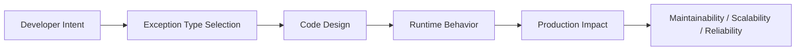
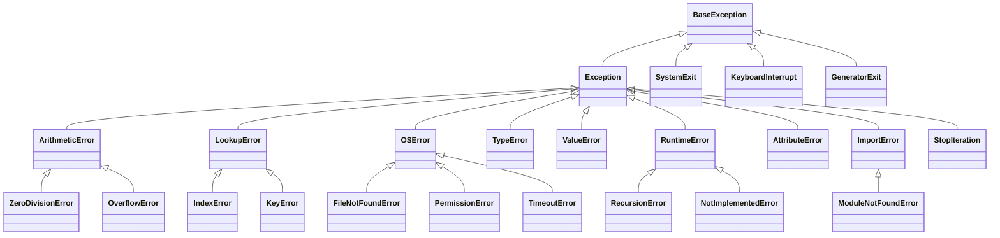

# Error and Exception Types

## Overview

Python has a rich, hierarchical taxonomy of built-in error and exception types. Understanding this hierarchy — what each type means, when it is raised, and how to handle it — is essential for writing precise, maintainable, and production-safe code.

Every exception in Python is an instance of a class that ultimately inherits from `BaseException`. The two main branches are `Exception` (for recoverable errors) and system-exiting exceptions (`SystemExit`, `KeyboardInterrupt`, `GeneratorExit`). Knowing the difference between these branches is the foundation of correct exception handling.

---

## Why It Matters





---

## Simple Example

```python
# Demonstrating common built-in exception types

# TypeError — wrong type passed to an operation
try:
    result = "hello" + 5
except TypeError as e:
    print(f"TypeError: {e}")

# ValueError — right type, wrong value
try:
    number = int("not_a_number")
except ValueError as e:
    print(f"ValueError: {e}")

# IndexError — list index out of range
try:
    items = [1, 2, 3]
    print(items[10])
except IndexError as e:
    print(f"IndexError: {e}")

# KeyError — dict key not found
try:
    data = {"name": "Alice"}
    print(data["age"])
except KeyError as e:
    print(f"KeyError: {e}")

# ZeroDivisionError
try:
    x = 10 / 0
except ZeroDivisionError as e:
    print(f"ZeroDivisionError: {e}")

# AttributeError — object has no such attribute
try:
    x = None
    x.upper()
except AttributeError as e:
    print(f"AttributeError: {e}")
```

**Expected output:**
```
TypeError: can only concatenate str (not "int") to str
ValueError: invalid literal for int() with base 10: 'not_a_number'
IndexError: list index out of range
KeyError: 'age'
ZeroDivisionError: division by zero
AttributeError: 'NoneType' object has no attribute 'upper'
```

---

## Intermediate Example

### Mapping Exception Types to HTTP Status Codes in a FastAPI App

```python
from fastapi import FastAPI, HTTPException, Request
from fastapi.responses import JSONResponse
import logging

logger = logging.getLogger(__name__)
app = FastAPI()

# Map Python exception types to HTTP status codes
EXCEPTION_STATUS_MAP = {
    ValueError: 400,
    TypeError: 400,
    KeyError: 404,
    FileNotFoundError: 404,
    PermissionError: 403,
    NotImplementedError: 501,
    TimeoutError: 504,
}

@app.exception_handler(Exception)
async def global_exception_handler(request: Request, exc: Exception) -> JSONResponse:
    status_code = EXCEPTION_STATUS_MAP.get(type(exc), 500)
    logger.exception("Unhandled exception on %s: %s", request.url, exc)
    return JSONResponse(
        status_code=status_code,
        content={"error": type(exc).__name__, "detail": str(exc)},
    )

@app.get("/users/{user_id}")
async def get_user(user_id: str):
    if not user_id.isdigit():
        raise ValueError(f"user_id must be numeric, got: {user_id!r}")
    if user_id == "0":
        raise KeyError(f"User with id=0 not found")
    return {"user_id": user_id, "name": "Alice"}
```

**Explanation:**
- A global exception handler maps Python's built-in exception types to appropriate HTTP status codes.
- This pattern centralizes error translation, keeping route handlers clean.
- `logger.exception()` captures the full traceback for debugging.

**Expected behavior:**
- `GET /users/abc` → 400 `{"error": "ValueError", "detail": "user_id must be numeric..."}`
- `GET /users/0` → 404 `{"error": "KeyError", "detail": "User with id=0 not found"}`

---

## Advanced / Architect-Level Example

### Exception Type Registry for a Plugin-Based AI Agent Framework

**Problem context:** You are building an extensible AI agent framework where plugins can register their own exception types. The framework must route exceptions to the correct handler, log them with structured metadata, and decide whether to retry, skip, or abort the agent run.

```python
from __future__ import annotations
import logging
from dataclasses import dataclass, field
from typing import Callable, Type

logger = logging.getLogger(__name__)

# --- Exception Hierarchy ---
class AgentError(Exception):
    """Base for all agent framework errors."""
    retryable: bool = False

class ToolExecutionError(AgentError):
    """A tool (plugin) failed during execution."""
    retryable = True

class ToolTimeoutError(ToolExecutionError):
    """A tool exceeded its time limit."""
    retryable = True

class ToolAuthError(ToolExecutionError):
    """A tool failed due to authentication."""
    retryable = False

class PlanningError(AgentError):
    """The agent's planning step failed."""
    retryable = False

class ContextWindowExceededError(AgentError):
    """Input exceeded the LLM's context window."""
    retryable = False

# --- Exception Handler Registry ---
@dataclass
class ExceptionHandlerRegistry:
    _handlers: dict[Type[Exception], Callable] = field(default_factory=dict)

    def register(self, exc_type: Type[Exception]):
        def decorator(func: Callable):
            self._handlers[exc_type] = func
            return func
        return decorator

    def handle(self, exc: Exception) -> str:
        for exc_type, handler in self._handlers.items():
            if isinstance(exc, exc_type):
                return handler(exc)
        return f"Unregistered exception: {type(exc).__name__}: {exc}"

registry = ExceptionHandlerRegistry()

@registry.register(ToolTimeoutError)
def handle_timeout(exc: ToolTimeoutError) -> str:
    logger.warning("Tool timed out. Will retry: %s", exc)
    return "retry"

@registry.register(ToolAuthError)
def handle_auth(exc: ToolAuthError) -> str:
    logger.error("Tool auth failed. Aborting: %s", exc)
    return "abort"

@registry.register(ContextWindowExceededError)
def handle_context(exc: ContextWindowExceededError) -> str:
    logger.error("Context window exceeded. Truncating input: %s", exc)
    return "truncate"

# --- Agent Runner ---
def run_agent_step(tool_name: str, simulate_error: Type[AgentError] | None = None):
    try:
        if simulate_error:
            raise simulate_error(f"Simulated error in tool '{tool_name}'")
        return f"Tool '{tool_name}' succeeded."
    except AgentError as exc:
        action = registry.handle(exc)
        logger.info("Action taken: %s", action)
        if not exc.retryable:
            raise
        return f"Will retry after: {exc}"

# Test
print(run_agent_step("web_search", simulate_error=ToolTimeoutError))
print(run_agent_step("sql_query", simulate_error=ContextWindowExceededError))
```

**Explanation:**
- A custom exception hierarchy encodes domain semantics (`retryable` flag).
- The `ExceptionHandlerRegistry` decouples exception types from handling logic — plugins can register their own handlers.
- The agent runner uses `isinstance` checks (via the registry) to dispatch to the correct handler.

**Design trade-offs:**
| Approach | Pros | Cons |
|---|---|---|
| `isinstance` dispatch | Respects inheritance | Order-sensitive |
| Registry pattern | Extensible, decoupled | More boilerplate |
| `match` statement (3.10+) | Readable | No inheritance matching |

---

## Common Mistakes

### 1. Catching `Exception` when you mean `BaseException`
- **Problem:** `SystemExit` and `KeyboardInterrupt` inherit from `BaseException`, not `Exception`. Catching `Exception` correctly lets these through.
- **Better approach:** Use `except Exception` for application errors. Only catch `BaseException` in top-level shutdown handlers.

### 2. Confusing `OSError` aliases
- **Problem:** `IOError`, `EnvironmentError`, and `WindowsError` are all aliases for `OSError` in Python 3. Using them interchangeably causes confusion.
- **Better approach:** Always use `OSError` (or its specific subclasses like `FileNotFoundError`).

### 3. Not knowing the exception hierarchy
- **Problem:** Catching `LookupError` when you only want `KeyError` — or vice versa — leads to over- or under-catching.
- **Better approach:** Know the hierarchy. `LookupError` catches both `KeyError` and `IndexError`.

### 4. Raising `Exception` directly
- **Problem:** `raise Exception("something failed")` gives callers no way to handle it specifically.
- **Better approach:** Raise the most specific built-in type, or define a custom exception.

### 5. Ignoring `StopIteration` propagation in generators
- **Problem:** In Python 3.7+, `StopIteration` raised inside a generator is converted to `RuntimeError`. Catching it incorrectly breaks generator protocols.
- **Better approach:** Use `return` to stop a generator, not `raise StopIteration`.

---

## Best Practices

- **Know the full exception hierarchy** — use `help('exceptions')` or the Python docs.
- **Catch the most specific type** that makes sense for your use case.
- **Use `OSError` subclasses** (`FileNotFoundError`, `PermissionError`) for file/network operations.
- **Use `ValueError`** for invalid argument values; **`TypeError`** for wrong argument types.
- **Use `NotImplementedError`** in abstract methods (not `pass`).
- **Use `RuntimeError`** as a last resort for unexpected runtime conditions.
- **Never catch `SystemExit` or `KeyboardInterrupt`** unless you are writing a top-level application shutdown handler.
- **Document which exceptions your functions raise** in docstrings.

---

## Performance Considerations

The exception type hierarchy itself has no performance impact. Performance considerations are the same as for exception handling in general:

- Raising and catching exceptions is slower than conditional checks — avoid using exceptions for normal flow control.
- `isinstance` checks against exception types are fast (O(depth of hierarchy)).
- Deep exception hierarchies (10+ levels) have negligible overhead in practice.

---

## Testing Strategy

```python
# tests/test_exception_types.py
import pytest

def test_type_error_on_wrong_type():
    with pytest.raises(TypeError):
        "hello" + 5

def test_value_error_on_invalid_input():
    with pytest.raises(ValueError, match="invalid literal"):
        int("abc")

def test_key_error_on_missing_key():
    d = {"a": 1}
    with pytest.raises(KeyError) as exc_info:
        _ = d["b"]
    assert exc_info.value.args[0] == "b"

def test_file_not_found_error():
    with pytest.raises(FileNotFoundError):
        open("/nonexistent/path/file.txt")

def test_custom_exception_is_subclass():
    class MyError(ValueError):
        pass
    with pytest.raises(ValueError):  # Catches subclass
        raise MyError("test")

def test_exception_hierarchy():
    assert issubclass(FileNotFoundError, OSError)
    assert issubclass(KeyError, LookupError)
    assert issubclass(ZeroDivisionError, ArithmeticError)
    assert issubclass(ModuleNotFoundError, ImportError)
```

---

## Debugging Tips

- **`type(exc).__mro__`** — shows the full Method Resolution Order (inheritance chain) of an exception.
- **`issubclass(FileNotFoundError, OSError)`** — verify hierarchy relationships at the REPL.
- **`help('exceptions')`** — prints the full built-in exception hierarchy in the Python REPL.
- **`traceback.format_exc()`** — returns the current traceback as a string for logging.
- **`sys.exc_info()`** — returns `(type, value, traceback)` of the active exception.
- When you see `RuntimeError: generator raised StopIteration`, you have a `StopIteration` leaking out of a generator — use `return` instead.
- When you see `RecursionError`, check for infinite recursion or increase `sys.setrecursionlimit()` (with caution).

---

## Interview Questions

### Beginner
1. **What is the root of Python's exception hierarchy?**
   *`BaseException`. All exceptions inherit from it.*

2. **What is the difference between `Exception` and `BaseException`?**
   *`Exception` is the base for all recoverable application errors. `BaseException` also includes `SystemExit`, `KeyboardInterrupt`, and `GeneratorExit`, which should not normally be caught.*

3. **What exception is raised when you access a list with an out-of-range index?**
   *`IndexError`.*

4. **What is the parent class of both `IndexError` and `KeyError`?**
   *`LookupError`.*

5. **What exception does `int("abc")` raise?**
   *`ValueError`.*

### Intermediate
1. **What is the difference between `TypeError` and `ValueError`?**
   *`TypeError` is raised when an operation is applied to an object of the wrong type. `ValueError` is raised when the type is correct but the value is inappropriate.*

2. **What are the subclasses of `OSError`?**
   *`FileNotFoundError`, `PermissionError`, `IsADirectoryError`, `TimeoutError`, `ConnectionError` (and its subclasses), among others.*

3. **Why was `IOError` deprecated in Python 3?**
   *It was merged into `OSError`. `IOError` is now just an alias for `OSError`.*

4. **What happens when `StopIteration` is raised inside a generator in Python 3.7+?**
   *It is converted to `RuntimeError: generator raised StopIteration` (PEP 479). Use `return` to stop a generator.*

5. **What is `NotImplementedError` used for?**
   *To mark abstract methods in base classes that subclasses must implement. It signals "this method exists but has no implementation here."*

### Advanced / Architect-Level
1. **How would you design an exception hierarchy for a multi-tenant SaaS platform?**
   *`AppError → (TenantError → (TenantNotFoundError, TenantSuspendedError), BillingError → (PaymentFailedError, SubscriptionExpiredError), DataError → (ValidationError, IntegrityError)). Each layer catches at the appropriate boundary.*

2. **How does Python's exception hierarchy support the Liskov Substitution Principle?**
   *Catching a parent exception type (e.g., `LookupError`) handles all subclasses (`KeyError`, `IndexError`). Code that handles `LookupError` works correctly for any subclass — this is LSP applied to exception handling.*

3. **What is the `__cause__` vs `__context__` attribute on exceptions?**
   *`__cause__` is set explicitly via `raise X from Y` (explicit chaining). `__context__` is set implicitly when an exception is raised while another is being handled. Both preserve the error chain.*

4. **How would you implement a global exception type registry in a plugin framework?**
   *Use a dictionary mapping exception types to handler callables. Plugins register their exception types at import time. The framework iterates the registry using `isinstance` checks to find the correct handler.*

5. **What are `ExceptionGroup` and `except*` (Python 3.11+)?**
   *`ExceptionGroup` wraps multiple exceptions raised concurrently (e.g., in `asyncio.TaskGroup`). `except*` syntax allows handling specific exception types within a group, enabling fine-grained handling of concurrent failures.*

---

## Key Takeaways

- Python's exception hierarchy is rooted at `BaseException`; application code should catch `Exception` or its subclasses.
- **Never catch `SystemExit` or `KeyboardInterrupt`** in application logic.
- Know the key groupings: `LookupError` (Index/Key), `ArithmeticError` (ZeroDiv/Overflow), `OSError` (File/Permission/Timeout).
- Use **specific exception types** to enable precise handling and clear intent.
- `StopIteration` inside generators becomes `RuntimeError` in Python 3.7+ — use `return`.
- `ExceptionGroup` and `except*` (Python 3.11+) handle concurrent exception scenarios.
- Document which exceptions your public APIs raise.

---

## Mini Project Idea

### Project: `exception-explorer` — Interactive Exception Hierarchy Visualizer

**Goal:** Build a CLI tool that visualizes Python's exception hierarchy as a tree, shows which exceptions a given code snippet might raise, and suggests the correct `except` clause.

**Features:**
- Print the full `BaseException` hierarchy as an ASCII tree.
- Given an exception class name, show its full MRO.
- Analyze a Python file and list all `raise` statements with their exception types.
- Suggest the most specific `except` clause for a given set of exceptions.

**Suggested folder structure:**
```
exception_explorer/
├── .venv/
├── pyproject.toml
├── src/
│   └── exception_explorer/
│       ├── __init__.py
│       ├── cli.py           # typer CLI
│       ├── hierarchy.py     # exception tree builder
│       └── analyzer.py      # AST-based raise statement finder
└── tests/
    ├── test_hierarchy.py
    └── test_analyzer.py
```

**Extension ideas:**
- Add a web UI with an interactive tree (using `rich` or a simple HTML export).
- Support custom exception classes defined in user code.
- Integrate with `mypy` to detect uncaught exceptions statically.

---

## Final Summary

A deep understanding of Python's exception type hierarchy is a hallmark of a senior Python engineer. It enables precise error handling, clean API design, and resilient systems. Architects who know when to use `ValueError` vs. `TypeError`, how `OSError` subclasses map to system errors, and how to design domain-specific hierarchies build codebases that are self-documenting, testable, and maintainable. The exception hierarchy is not just a reference — it is a design language for communicating failure modes.
