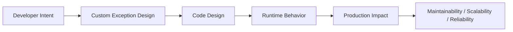
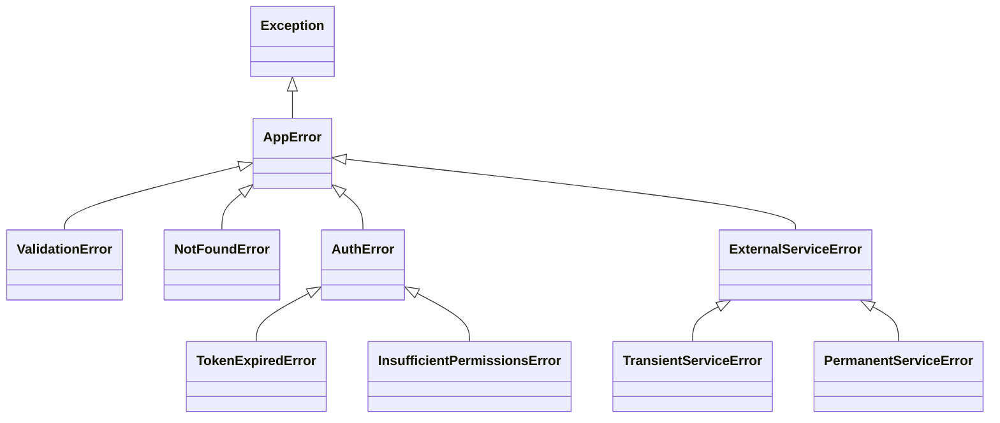

# Custom Exceptions

## Overview

**Custom exceptions** are user-defined exception classes that extend Python's built-in exception hierarchy. They allow you to express domain-specific error conditions with precision, carry structured metadata, and enable callers to handle errors at exactly the right level of specificity.

In production systems — AI agents, RAG pipelines, enterprise APIs, and ERP integrations — custom exceptions are the vocabulary of your error domain. They transform vague `RuntimeError: something went wrong` messages into precise, actionable, and testable signals.

---

## Why It Matters





---

## Simple Example

```python
# Defining and raising a custom exception

class InsufficientFundsError(Exception):
    """Raised when a withdrawal exceeds the available balance."""

    def __init__(self, balance: float, amount: float):
        self.balance = balance
        self.amount = amount
        super().__init__(
            f"Cannot withdraw {amount:.2f}. Available balance: {balance:.2f}"
        )

class BankAccount:
    def __init__(self, balance: float):
        self.balance = balance

    def withdraw(self, amount: float) -> None:
        if amount > self.balance:
            raise InsufficientFundsError(self.balance, amount)
        self.balance -= amount
        print(f"Withdrew {amount:.2f}. New balance: {self.balance:.2f}")

account = BankAccount(100.0)
account.withdraw(30.0)

try:
    account.withdraw(200.0)
except InsufficientFundsError as e:
    print(f"Error: {e}")
    print(f"  Balance: {e.balance}, Attempted: {e.amount}")
```

**Explanation:**
- `InsufficientFundsError` carries structured data (`balance`, `amount`) as attributes.
- The `__init__` calls `super().__init__()` with a human-readable message.
- Callers can access `.balance` and `.amount` for programmatic handling (e.g., logging, UI display).

**Expected output:**
```
Withdrew 30.00. New balance: 70.00
Error: Cannot withdraw 200.00. Available balance: 70.00
  Balance: 70.0, Attempted: 200.0
```

---

## Intermediate Example

### Domain Exception Hierarchy for a REST API

```python
from dataclasses import dataclass
from typing import Optional
import logging

logger = logging.getLogger(__name__)

# --- Exception Hierarchy ---
class AppError(Exception):
    """Base exception for all application errors."""
    http_status: int = 500
    error_code: str = "INTERNAL_ERROR"

    def to_dict(self) -> dict:
        return {
            "error_code": self.error_code,
            "message": str(self),
            "http_status": self.http_status,
        }

class ValidationError(AppError):
    http_status = 400
    error_code = "VALIDATION_ERROR"

    def __init__(self, field: str, reason: str):
        self.field = field
        self.reason = reason
        super().__init__(f"Validation failed on '{field}': {reason}")

class NotFoundError(AppError):
    http_status = 404
    error_code = "NOT_FOUND"

    def __init__(self, resource: str, identifier):
        self.resource = resource
        self.identifier = identifier
        super().__init__(f"{resource} with id={identifier!r} not found")

class AuthError(AppError):
    http_status = 401
    error_code = "AUTH_ERROR"

class TokenExpiredError(AuthError):
    error_code = "TOKEN_EXPIRED"

    def __init__(self):
        super().__init__("Authentication token has expired. Please log in again.")

# --- Service Layer ---
def get_user(user_id: int) -> dict:
    if not isinstance(user_id, int):
        raise ValidationError("user_id", "must be an integer")
    if user_id <= 0:
        raise ValidationError("user_id", "must be a positive integer")
    if user_id == 999:
        raise NotFoundError("User", user_id)
    return {"id": user_id, "name": "Alice"}

# --- API Handler (simulated) ---
def handle_request(user_id):
    try:
        user = get_user(user_id)
        return {"status": "ok", "data": user}
    except AppError as e:
        logger.warning("AppError: %s", e.to_dict())
        return {"status": "error", **e.to_dict()}

print(handle_request(1))
print(handle_request("abc"))
print(handle_request(999))
```

**Explanation:**
- `AppError` defines `http_status` and `error_code` as class attributes — subclasses override them.
- `to_dict()` provides a serializable representation for API responses.
- The handler catches `AppError` (the base) and delegates formatting to the exception itself.

**Expected output:**
```
{'status': 'ok', 'data': {'id': 1, 'name': 'Alice'}}
{'status': 'error', 'error_code': 'VALIDATION_ERROR', 'message': "Validation failed on 'user_id': must be an integer", 'http_status': 400}
{'status': 'error', 'error_code': 'NOT_FOUND', 'message': 'User with id=999 not found', 'http_status': 404}
```

---

## Advanced / Architect-Level Example

### Structured Exception System for an Enterprise ERP Integration

**Problem context:** You are building an ERP integration layer that connects to SAP, Salesforce, and a custom inventory system. Each system has its own failure modes. You need a unified exception model that: carries structured metadata, supports serialization to JSON for audit logs, enables retry decisions, and maps to HTTP status codes for the API layer.

```python
from __future__ import annotations
import json
import uuid
from dataclasses import dataclass, field, asdict
from datetime import datetime, timezone
from typing import Optional, Any

# --- Structured Error Metadata ---
@dataclass
class ErrorContext:
    trace_id: str = field(default_factory=lambda: str(uuid.uuid4()))
    timestamp: str = field(default_factory=lambda: datetime.now(timezone.utc).isoformat())
    system: Optional[str] = None
    operation: Optional[str] = None
    metadata: dict[str, Any] = field(default_factory=dict)

# --- Base Exception ---
class ERPError(Exception):
    """Base exception for all ERP integration errors."""
    http_status: int = 500
    error_code: str = "ERP_ERROR"
    retryable: bool = False

    def __init__(self, message: str, context: Optional[ErrorContext] = None):
        super().__init__(message)
        self.context = context or ErrorContext()

    def to_dict(self) -> dict:
        return {
            "error_code": self.error_code,
            "message": str(self),
            "http_status": self.http_status,
            "retryable": self.retryable,
            "context": asdict(self.context),
        }

    def to_json(self) -> str:
        return json.dumps(self.to_dict(), indent=2)

# --- Specific Exception Types ---
class ERPConnectionError(ERPError):
    http_status = 503
    error_code = "ERP_CONNECTION_ERROR"
    retryable = True

class ERPAuthenticationError(ERPError):
    http_status = 401
    error_code = "ERP_AUTH_ERROR"
    retryable = False

class ERPDataValidationError(ERPError):
    http_status = 422
    error_code = "ERP_VALIDATION_ERROR"
    retryable = False

    def __init__(self, message: str, field: str, value: Any, context: Optional[ErrorContext] = None):
        super().__init__(message, context)
        self.field = field
        self.value = value

    def to_dict(self) -> dict:
        d = super().to_dict()
        d["field"] = self.field
        d["value"] = str(self.value)
        return d

class ERPRateLimitError(ERPError):
    http_status = 429
    error_code = "ERP_RATE_LIMIT"
    retryable = True

    def __init__(self, message: str, retry_after: int = 60, context: Optional[ErrorContext] = None):
        super().__init__(message, context)
        self.retry_after = retry_after

    def to_dict(self) -> dict:
        d = super().to_dict()
        d["retry_after"] = self.retry_after
        return d

# --- Integration Layer ---
def sync_inventory_to_sap(product_id: str, quantity: int) -> dict:
    ctx = ErrorContext(system="SAP", operation="inventory_sync", metadata={"product_id": product_id})

    if not product_id:
        raise ERPDataValidationError(
            "product_id cannot be empty",
            field="product_id",
            value=product_id,
            context=ctx,
        )
    if quantity < 0:
        raise ERPDataValidationError(
            "quantity must be non-negative",
            field="quantity",
            value=quantity,
            context=ctx,
        )
    # Simulate rate limit
    if product_id == "RATE_LIMITED":
        raise ERPRateLimitError("SAP API rate limit exceeded", retry_after=30, context=ctx)

    return {"status": "synced", "product_id": product_id, "quantity": quantity}

# --- Usage ---
for product_id, qty in [("P001", 100), ("", 50), ("P002", -5), ("RATE_LIMITED", 10)]:
    try:
        result = sync_inventory_to_sap(product_id, qty)
        print(f"Success: {result}")
    except ERPError as e:
        print(f"ERPError [{e.error_code}]: {e}")
        print(f"  Retryable: {e.retryable}")
        if isinstance(e, ERPRateLimitError):
            print(f"  Retry after: {e.retry_after}s")
```

**Explanation:**
- `ErrorContext` is a dataclass that carries trace ID, timestamp, system name, and arbitrary metadata — fully serializable.
- Each exception type encodes `http_status`, `error_code`, and `retryable` as class attributes.
- `to_dict()` / `to_json()` enable direct use in API responses and audit logs.
- The integration layer creates context at the call site, giving each exception full observability.

**Design trade-offs:**
| Approach | Pros | Cons |
|---|---|---|
| Class attributes for metadata | Clean, inheritable | Less flexible per-instance |
| Dataclass context object | Structured, serializable | More boilerplate |
| Exception as value object | Rich, self-describing | Heavier than simple strings |
| Flat exception hierarchy | Simple | Hard to catch at right level |

---

## Common Mistakes

### 1. Not calling `super().__init__()`
```python
# Bad — message is lost
class MyError(Exception):
    def __init__(self, msg):
        self.msg = msg  # Forgot super().__init__(msg)

# Good
class MyError(Exception):
    def __init__(self, msg):
        super().__init__(msg)
        self.msg = msg
```

### 2. Inheriting directly from `BaseException`
- **Problem:** Your custom exception won't be caught by `except Exception`, which is the standard catch-all.
- **Better approach:** Inherit from `Exception` (or a more specific built-in) unless you have a very specific reason.

### 3. Creating too many exception types
- **Problem:** A flat list of 50 exception classes with no hierarchy is hard to use and maintain.
- **Better approach:** Design a hierarchy. Callers can catch at the base level or drill down as needed.

### 4. Putting business logic in exception classes
- **Problem:** Exception classes should carry data, not execute logic.
- **Better approach:** Keep exceptions as data containers. Put retry logic, logging, and recovery in handlers.

### 5. Using generic exceptions for domain errors
```python
# Bad — no way to handle specifically
raise Exception("User not found")

# Good
raise NotFoundError("User", user_id)
```

---

## Best Practices

- **Always inherit from `Exception`** (or a specific subclass) for application exceptions.
- **Always call `super().__init__(message)`** to set the exception message.
- **Carry structured data** as instance attributes (not just a string message).
- **Design a hierarchy** — one base class per domain, specific subclasses for each error type.
- **Add `to_dict()` / `to_json()`** for exceptions that cross API or service boundaries.
- **Use class attributes** (`http_status`, `error_code`, `retryable`) for metadata that is the same for all instances of a type.
- **Document your exceptions** — list them in module docstrings and function signatures.
- **Keep exception classes in a dedicated module** (e.g., `exceptions.py`) for discoverability.

---

## Performance Considerations

Custom exceptions have **no meaningful performance overhead** compared to built-in exceptions. The cost of raising and catching an exception is the same regardless of whether it is built-in or custom.

The only consideration: if your exception `__init__` performs expensive operations (e.g., network calls, file I/O), that cost is incurred every time the exception is raised. Keep `__init__` lightweight — store data, don't compute.

---

## Testing Strategy

```python
# tests/test_custom_exceptions.py
import pytest
from mymodule.exceptions import (
    AppError, ValidationError, NotFoundError, TokenExpiredError
)

def test_validation_error_message():
    exc = ValidationError("email", "invalid format")
    assert "email" in str(exc)
    assert "invalid format" in str(exc)
    assert exc.field == "email"
    assert exc.reason == "invalid format"

def test_validation_error_is_app_error():
    exc = ValidationError("x", "bad")
    assert isinstance(exc, AppError)
    assert isinstance(exc, Exception)

def test_not_found_error_attributes():
    exc = NotFoundError("User", 42)
    assert exc.resource == "User"
    assert exc.identifier == 42
    assert exc.http_status == 404

def test_token_expired_is_auth_error():
    from mymodule.exceptions import AuthError
    exc = TokenExpiredError()
    assert isinstance(exc, AuthError)
    assert exc.http_status == 401

def test_to_dict_contains_required_keys():
    exc = ValidationError("name", "too short")
    d = exc.to_dict()
    assert "error_code" in d
    assert "message" in d
    assert "http_status" in d

def test_exception_raised_correctly():
    with pytest.raises(ValidationError) as exc_info:
        raise ValidationError("age", "must be positive")
    assert exc_info.value.field == "age"

def test_exception_chaining():
    try:
        try:
            raise ValueError("original")
        except ValueError as e:
            raise NotFoundError("User", 1) from e
    except NotFoundError as e:
        assert isinstance(e.__cause__, ValueError)
```

---

## Debugging Tips

- **`type(exc).__mro__`** — inspect the full inheritance chain of a custom exception.
- **`vars(exc)`** — see all instance attributes on an exception object.
- **`exc.args`** — the tuple of arguments passed to `Exception.__init__()`.
- **`exc.__cause__`** and **`exc.__context__`** — inspect exception chaining.
- If your exception is not being caught, check: (1) is it inheriting from `Exception`? (2) is the `except` clause specific enough?
- Use `pytest.raises(MyError)` with `exc_info.value` to assert on exception attributes in tests.
- Add `__repr__` to your exception classes for cleaner REPL and log output.

---

## Interview Questions

### Beginner
1. **How do you define a custom exception in Python?**
   *Create a class that inherits from `Exception` (or a subclass): `class MyError(Exception): pass`.*

2. **Why should you call `super().__init__(message)` in a custom exception?**
   *To set the exception's message, which is stored in `self.args` and displayed in tracebacks.*

3. **What is the benefit of a custom exception over raising `Exception("message")`?**
   *Custom exceptions can be caught specifically, carry structured data, and communicate intent clearly.*

4. **How do you add custom attributes to an exception?**
   *Define `__init__`, set attributes (`self.field = field`), and call `super().__init__(message)`.*

5. **What base class should most custom exceptions inherit from?**
   *`Exception` (not `BaseException`).*

### Intermediate
1. **How do you design a custom exception hierarchy for a domain?**
   *Create a base `DomainError(Exception)` class, then specific subclasses for each error type. Use class attributes for shared metadata.*

2. **What is the purpose of class-level attributes like `http_status` on exception classes?**
   *They provide metadata that is the same for all instances of that exception type, enabling generic handlers to act without inspecting the message.*

3. **How do you make a custom exception serializable to JSON?**
   *Add a `to_dict()` method that returns a dictionary of all relevant attributes, and a `to_json()` method that calls `json.dumps(self.to_dict())`.*

4. **When should a custom exception be retryable?**
   *When the failure is transient (network timeout, rate limit, temporary unavailability). Encode this as a `retryable: bool` class attribute.*

5. **How do you test that a function raises a specific custom exception with specific attributes?**
   *Use `pytest.raises(MyError) as exc_info`, then assert on `exc_info.value.attribute`.*

### Advanced / Architect-Level
1. **How would you design a cross-service exception model for a microservices architecture?**
   *Define a shared `errors` package with a base `ServiceError` and domain-specific subclasses. Each exception serializes to a standard JSON schema (error_code, message, trace_id). Services deserialize incoming errors and re-raise the appropriate local exception type.*

2. **How do custom exceptions support the Open/Closed Principle?**
   *New error types can be added (new subclasses) without modifying existing handlers that catch the base class. The system is open for extension, closed for modification.*

3. **What is the trade-off between rich exception objects and simple string messages?**
   *Rich exceptions carry structured data (field names, IDs, retry hints) that enable programmatic handling, better logging, and cleaner APIs. Simple strings are easier to create but force callers to parse messages — fragile and untestable.*

4. **How would you implement exception translation at a service boundary?**
   *At the boundary (e.g., an HTTP client wrapper), catch external exceptions (e.g., `requests.HTTPError`) and re-raise them as domain exceptions (`raise ExternalServiceError(...) from e`). This keeps domain code free of infrastructure concerns.*

5. **How do `__reduce__` and pickling interact with custom exceptions?**
   *Python pickles exceptions by calling `__reduce__`. If your `__init__` has non-default arguments, you may need to implement `__reduce__` or ensure all `__init__` args are stored in `self.args`. This matters for multiprocessing and distributed task queues (Celery).*

---

## Key Takeaways

- Custom exceptions are **domain vocabulary** — they make error conditions explicit and precise.
- Always inherit from `Exception`; always call `super().__init__(message)`.
- **Carry structured data** as instance attributes for programmatic handling.
- Design a **hierarchy** — one base per domain, specific subclasses per error type.
- Use **class attributes** for metadata (`http_status`, `error_code`, `retryable`).
- Add **`to_dict()`** for exceptions that cross API or service boundaries.
- Keep exception classes in a **dedicated `exceptions.py`** module.
- Custom exceptions have **no performance overhead** — use them freely.

---

## Mini Project Idea

### Project: `domain-errors` — Reusable Custom Exception Framework

**Goal:** Build a reusable Python package that provides a base exception class with structured metadata, serialization, HTTP status mapping, and retry hints — ready to use in any production Python project.

**Features:**
- `DomainError` base class with `error_code`, `http_status`, `retryable`, `trace_id`.
- `ErrorContext` dataclass for structured metadata.
- `to_dict()` and `to_json()` serialization.
- Pre-built subclasses: `ValidationError`, `NotFoundError`, `AuthError`, `RateLimitError`, `ServiceUnavailableError`.
- FastAPI integration: automatic exception handler that converts `DomainError` to JSON responses.
- pytest fixtures for testing exception attributes.

**Suggested folder structure:**
```
domain_errors/
├── .venv/
├── pyproject.toml
├── src/
│   └── domain_errors/
│       ├── __init__.py
│       ├── base.py          # DomainError, ErrorContext
│       ├── common.py        # Pre-built exception types
│       └── integrations/
│           └── fastapi.py   # FastAPI exception handler
└── tests/
    ├── test_base.py
    ├── test_common.py
    └── test_fastapi.py
```

**Extension ideas:**
- Add Pydantic model for exception serialization/deserialization.
- Support OpenTelemetry trace ID injection.
- Generate OpenAPI error response schemas from exception classes.
- Add a Starlette middleware for automatic exception logging.

---

## Final Summary

Custom exceptions are one of the most powerful tools in a Python architect's toolkit. They transform opaque runtime failures into precise, structured, and actionable signals. A well-designed exception hierarchy is self-documenting, testable, and extensible — it communicates the failure domain as clearly as the data model communicates the success domain. Architects who invest in a thoughtful exception design build systems where errors are first-class citizens: observable, recoverable, and never surprising.
