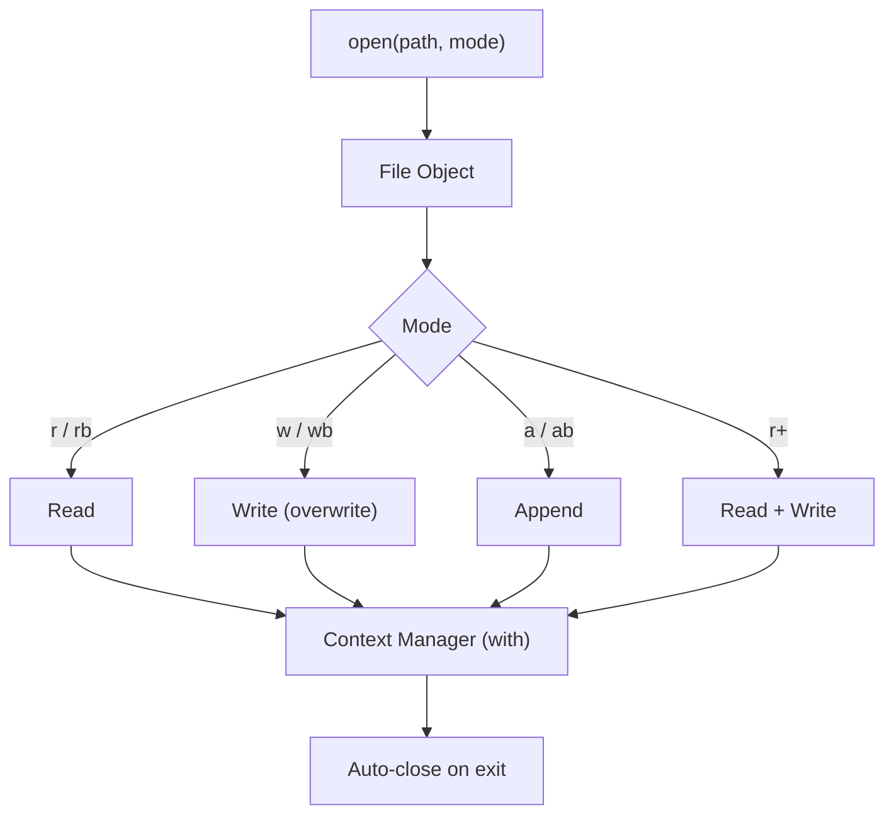

# File I/O

## Overview

**File I/O** (Input/Output) in Python covers reading from and writing to files — text files, binary files, CSV, JSON, and more. Python's built-in `open()` function, combined with context managers and the `pathlib` and `os` modules, provides a complete, Pythonic toolkit for file operations.

In production systems — data pipelines, RAG document ingestion, configuration loading, audit logging, and ERP integrations — file I/O is a foundational skill. Doing it correctly means handling encoding, buffering, errors, and resource cleanup reliably.

---

## Why It Matters




---

## Simple Example

```python
from pathlib import Path

# Writing a text file
path = Path("hello.txt")
path.write_text("Hello, World!\nLine 2\n", encoding="utf-8")

# Reading a text file
content = path.read_text(encoding="utf-8")
print(content)

# Reading line by line (memory-efficient)
with open(path, "r", encoding="utf-8") as f:
    for line in f:
        print(line.strip())

# Appending to a file
with open(path, "a", encoding="utf-8") as f:
    f.write("Line 3\n")

print(path.read_text(encoding="utf-8"))
```

**Explanation:**
- `pathlib.Path` is the modern, object-oriented way to work with file paths.
- `write_text` / `read_text` are convenient one-liners for small files.
- `with open(...)` ensures the file is closed even if an exception occurs.
- Iterating over a file object reads line by line — memory-efficient for large files.

**Expected output:**
```
Hello, World!
Line 2

Hello, World!
Line 2
Hello, World!
Line 2
Line 3
```

---

## Intermediate Example

### CSV and JSON File Processing

```python
import csv
import json
from pathlib import Path
from typing import Any

# --- CSV ---
def write_csv(path: Path, rows: list[dict]) -> None:
    if not rows:
        return
    with open(path, "w", newline="", encoding="utf-8") as f:
        writer = csv.DictWriter(f, fieldnames=rows[0].keys())
        writer.writeheader()
        writer.writerows(rows)

def read_csv(path: Path) -> list[dict]:
    with open(path, "r", newline="", encoding="utf-8") as f:
        return list(csv.DictReader(f))

# --- JSON ---
def write_json(path: Path, data: Any, indent: int = 2) -> None:
    with open(path, "w", encoding="utf-8") as f:
        json.dump(data, f, indent=indent, ensure_ascii=False)

def read_json(path: Path) -> Any:
    with open(path, "r", encoding="utf-8") as f:
        return json.load(f)

# --- Usage ---
employees = [
    {"id": 1, "name": "Alice", "role": "Engineer"},
    {"id": 2, "name": "Bob", "role": "Architect"},
]

csv_path = Path("employees.csv")
json_path = Path("employees.json")

write_csv(csv_path, employees)
write_json(json_path, employees)

loaded_csv = read_csv(csv_path)
loaded_json = read_json(json_path)

print("CSV:", loaded_csv)
print("JSON:", loaded_json)
```

**Explanation:**
- `csv.DictWriter` / `DictReader` work with dictionaries — no manual column indexing.
- `newline=""` is required for CSV on Windows to prevent double newlines.
- `ensure_ascii=False` in `json.dump` preserves Unicode characters.
- Both functions use context managers for safe resource handling.

**Expected output:**
```
CSV: [{'id': '1', 'name': 'Alice', 'role': 'Engineer'}, {'id': '2', 'name': 'Bob', 'role': 'Architect'}]
JSON: [{'id': 1, 'name': 'Alice', 'role': 'Engineer'}, {'id': 2, 'name': 'Bob', 'role': 'Architect'}]
```

---

## Advanced / Architect-Level Example

### Streaming Document Ingestion Pipeline for RAG

**Problem context:** A RAG pipeline must ingest thousands of large text documents from a directory, chunk them, and write structured JSONL output for embedding. Files may be large (100MB+), so streaming is required. The pipeline must handle encoding errors, skip corrupt files, and produce an audit log.

```python
from __future__ import annotations
import json
import logging
from dataclasses import dataclass, asdict
from pathlib import Path
from typing import Iterator
import hashlib

logger = logging.getLogger(__name__)

@dataclass
class DocumentChunk:
    doc_id: str
    chunk_index: int
    text: str
    source_file: str
    char_count: int

def compute_doc_id(path: Path) -> str:
    """Stable document ID based on file path."""
    return hashlib.sha256(str(path).encode()).hexdigest()[:16]

def stream_chunks(
    path: Path,
    chunk_size: int = 1000,
    overlap: int = 100,
) -> Iterator[DocumentChunk]:
    """Stream text chunks from a file without loading it entirely into memory."""
    doc_id = compute_doc_id(path)
    buffer = ""
    chunk_index = 0

    try:
        with open(path, "r", encoding="utf-8", errors="replace") as f:
            for line in f:
                buffer += line
                while len(buffer) >= chunk_size:
                    chunk_text = buffer[:chunk_size]
                    yield DocumentChunk(
                        doc_id=doc_id,
                        chunk_index=chunk_index,
                        text=chunk_text,
                        source_file=str(path),
                        char_count=len(chunk_text),
                    )
                    buffer = buffer[chunk_size - overlap:]
                    chunk_index += 1
        # Yield remaining buffer
        if buffer.strip():
            yield DocumentChunk(
                doc_id=doc_id,
                chunk_index=chunk_index,
                text=buffer,
                source_file=str(path),
                char_count=len(buffer),
            )
    except OSError as e:
        logger.error("Failed to read %s: %s", path, e)

def ingest_directory(
    input_dir: Path,
    output_path: Path,
    audit_path: Path,
    chunk_size: int = 1000,
) -> dict:
    """Ingest all .txt files from a directory, write JSONL output and audit log."""
    stats = {"files_processed": 0, "files_failed": 0, "total_chunks": 0}

    with open(output_path, "w", encoding="utf-8") as out_f, \
         open(audit_path, "w", encoding="utf-8") as audit_f:

        for txt_file in sorted(input_dir.glob("**/*.txt")):
            try:
                chunk_count = 0
                for chunk in stream_chunks(txt_file, chunk_size=chunk_size):
                    out_f.write(json.dumps(asdict(chunk), ensure_ascii=False) + "\n")
                    chunk_count += 1

                audit_f.write(json.dumps({
                    "file": str(txt_file),
                    "status": "ok",
                    "chunks": chunk_count,
                }) + "\n")

                stats["files_processed"] += 1
                stats["total_chunks"] += chunk_count
                logger.info("Processed %s → %d chunks", txt_file.name, chunk_count)

            except Exception as e:
                logger.exception("Unexpected error processing %s", txt_file)
                audit_f.write(json.dumps({
                    "file": str(txt_file),
                    "status": "error",
                    "error": str(e),
                }) + "\n")
                stats["files_failed"] += 1

    return stats

# Usage
input_dir = Path("documents")
input_dir.mkdir(exist_ok=True)
(input_dir / "sample.txt").write_text("A" * 3000, encoding="utf-8")

stats = ingest_directory(
    input_dir=input_dir,
    output_path=Path("chunks.jsonl"),
    audit_path=Path("audit.jsonl"),
)
print(stats)
```

**Explanation:**
- `stream_chunks` reads line by line — never loads the full file into memory.
- `errors="replace"` handles encoding errors gracefully (replaces bad bytes with `?`).
- JSONL (JSON Lines) format is ideal for streaming large datasets.
- The audit log records per-file status for observability and reprocessing.
- `open()` with multiple context managers (`with A, B:`) keeps both files open simultaneously.

**Design trade-offs:**
| Approach | Pros | Cons |
|---|---|---|
| `read_text()` | Simple | Loads entire file into memory |
| Line-by-line iteration | Memory-efficient | More complex chunking logic |
| `mmap` | Fastest for random access | Complex API |
| `pathlib` vs `os.path` | Modern, readable | `pathlib` is slightly slower for bulk ops |

---

## Common Mistakes

### 1. Not using a context manager
```python
# Bad — file may not be closed on exception
f = open("data.txt")
data = f.read()
f.close()

# Good
with open("data.txt", encoding="utf-8") as f:
    data = f.read()
```

### 2. Not specifying encoding
- **Problem:** `open()` uses the system default encoding (varies by OS). On Windows, this is often `cp1252`, not `utf-8`.
- **Better approach:** Always specify `encoding="utf-8"` explicitly.

### 3. Using `"w"` mode when you mean `"a"`
- **Problem:** `"w"` truncates the file on open — existing content is lost.
- **Better approach:** Use `"a"` to append, `"w"` only when you intend to overwrite.

### 4. Reading large files with `read()` or `readlines()`
- **Problem:** Loads the entire file into memory — can cause OOM errors on large files.
- **Better approach:** Iterate over the file object line by line, or use chunked reading.

### 5. Hardcoding path separators
```python
# Bad — breaks on Windows
path = "data/files/input.txt"

# Good — cross-platform
from pathlib import Path
path = Path("data") / "files" / "input.txt"
```

---

## Best Practices

- **Always use `with open(...)`** — never manually call `f.close()`.
- **Always specify `encoding="utf-8"`** (or the appropriate encoding).
- **Use `pathlib.Path`** instead of string paths and `os.path`.
- **Use `newline=""`** when writing CSV files.
- **Stream large files** — iterate line by line or use chunked reads.
- **Use `errors="replace"` or `errors="ignore"`** for files with unknown encoding.
- **Use `Path.write_text()` / `Path.read_text()`** for simple one-shot operations.
- **Use JSONL** for large structured datasets — one JSON object per line.
- **Validate file existence** with `path.exists()` before reading.
- **Use atomic writes** (write to a temp file, then rename) for critical data.

---

## Performance Considerations

- **`read()`** loads the entire file — fast for small files, dangerous for large ones.
- **Line-by-line iteration** is memory-efficient and nearly as fast as `read()` for sequential access.
- **`io.BufferedReader`** with a large buffer size improves throughput for binary files.
- **`mmap`** (memory-mapped files) provides the fastest random access to large files.
- **`pathlib.Path.read_text()`** is convenient but slightly slower than `open()` for repeated calls.
- **SSD vs. HDD** — I/O speed is dominated by hardware; Python overhead is minimal for large files.
- **Avoid `f.readlines()`** for large files — it loads all lines into a list in memory.

```python
# Fastest way to count lines in a large file
with open("large.txt", "rb") as f:
    line_count = sum(1 for _ in f)
```

---

## Testing Strategy

```python
# tests/test_file_io.py
import pytest
from pathlib import Path
import json

def test_write_and_read_text(tmp_path):
    file = tmp_path / "test.txt"
    file.write_text("hello\nworld\n", encoding="utf-8")
    content = file.read_text(encoding="utf-8")
    assert content == "hello\nworld\n"

def test_csv_round_trip(tmp_path):
    from mymodule import write_csv, read_csv
    path = tmp_path / "data.csv"
    rows = [{"name": "Alice", "age": "30"}, {"name": "Bob", "age": "25"}]
    write_csv(path, rows)
    loaded = read_csv(path)
    assert loaded == rows

def test_json_round_trip(tmp_path):
    from mymodule import write_json, read_json
    path = tmp_path / "data.json"
    data = {"key": "value", "numbers": [1, 2, 3]}
    write_json(path, data)
    loaded = read_json(path)
    assert loaded == data

def test_stream_chunks_yields_correct_count(tmp_path):
    from mymodule import stream_chunks
    doc = tmp_path / "doc.txt"
    doc.write_text("A" * 2500, encoding="utf-8")
    chunks = list(stream_chunks(doc, chunk_size=1000, overlap=0))
    assert len(chunks) == 3  # 1000 + 1000 + 500

def test_missing_file_raises_file_not_found():
    with pytest.raises(FileNotFoundError):
        with open("/nonexistent/path.txt") as f:
            f.read()

def test_encoding_error_handled(tmp_path):
    from mymodule import stream_chunks
    bad_file = tmp_path / "bad.txt"
    bad_file.write_bytes(b"Hello \xff World")  # Invalid UTF-8 byte
    chunks = list(stream_chunks(bad_file))
    assert len(chunks) > 0  # errors="replace" should handle it
```

---

## Debugging Tips

- **`path.exists()`** — check if a file exists before opening.
- **`path.stat().st_size`** — check file size before reading.
- **`file.tell()`** — get the current position in the file (useful for debugging partial reads).
- **`file.seek(0)`** — reset to the beginning of the file.
- **`UnicodeDecodeError`** — almost always an encoding mismatch. Try `encoding="utf-8"`, `"latin-1"`, or `errors="replace"`.
- **`PermissionError`** — check file permissions with `ls -la` (Linux) or file properties (Windows).
- **`OSError: [Errno 28] No space left on device`** — disk full; check with `df -h`.
- Use `chardet` or `charset-normalizer` to detect file encoding automatically.

---

## Interview Questions

### Beginner
1. **How do you open a file for reading in Python?**
   *`with open("file.txt", "r", encoding="utf-8") as f: content = f.read()`*

2. **What is the difference between `"w"` and `"a"` mode?**
   *`"w"` overwrites the file (truncates on open); `"a"` appends to the end.*

3. **Why should you use `with open(...)` instead of `open()` + `close()`?**
   *The `with` statement guarantees the file is closed even if an exception occurs.*

4. **How do you read a file line by line?**
   *Iterate over the file object: `for line in f:`*

5. **What does `encoding="utf-8"` do?**
   *It specifies the character encoding used to decode bytes from the file into Python strings.*

### Intermediate
1. **What is the difference between text mode and binary mode?**
   *Text mode (`"r"`, `"w"`) decodes bytes to strings using the specified encoding and translates newlines. Binary mode (`"rb"`, `"wb"`) reads/writes raw bytes with no translation.*

2. **How do you write a CSV file correctly on Windows?**
   *Use `newline=""` in `open()` to prevent `csv.writer` from adding extra blank lines: `open(path, "w", newline="", encoding="utf-8")`.*

3. **What is `pathlib.Path` and why is it preferred over `os.path`?**
   *`pathlib.Path` is an object-oriented, cross-platform path API. It supports `/` for path joining, has methods like `.read_text()`, `.glob()`, `.mkdir()`, and is more readable than `os.path` string manipulation.*

4. **How do you perform an atomic file write?**
   *Write to a temporary file in the same directory, then use `os.replace(tmp, final)` (atomic on POSIX). This prevents partial writes from corrupting the target file.*

5. **What is JSONL format and when should you use it?**
   *JSONL (JSON Lines) stores one JSON object per line. It is ideal for large datasets, streaming processing, and append-only logs because you can process it line by line without loading the entire file.*

### Advanced / Architect-Level
1. **How would you design a fault-tolerant file ingestion pipeline for 1 million documents?**
   *Use a queue (e.g., Redis, SQS) to distribute files across workers. Each worker streams chunks, writes to JSONL, and records progress in a checkpoint file. On failure, resume from the last checkpoint. Use atomic writes for output files.*

2. **What is `mmap` and when would you use it?**
   *`mmap` maps a file directly into virtual memory, allowing random access without loading the entire file. Use it for large binary files where you need random access (e.g., database files, large embeddings).*

3. **How do you handle file locking in a multi-process Python application?**
   *Use `fcntl.flock()` (POSIX) or the `filelock` library (cross-platform) to acquire exclusive or shared locks before reading/writing shared files.*

4. **What are the trade-offs between storing data in files vs. a database?**
   *Files are simpler, portable, and fast for sequential access. Databases provide ACID transactions, indexing, concurrent access, and query capabilities. For large-scale production, databases are preferred; files are suitable for configuration, logs, and batch exports.*

5. **How would you implement a rotating log file writer without using the `logging` module?**
   *Track file size after each write. When it exceeds the limit, close the current file, rename it with a timestamp suffix, and open a new file. Use file locking for thread safety.*

---

## Key Takeaways

- **Always use `with open(...)`** — it guarantees file closure.
- **Always specify `encoding="utf-8"`** — never rely on system defaults.
- **Use `pathlib.Path`** for all path operations — it is cross-platform and readable.
- **Stream large files** — iterate line by line; never `read()` a 1GB file.
- **Use `newline=""`** for CSV files on all platforms.
- **Use JSONL** for large structured datasets.
- **Use atomic writes** for critical data files.
- File I/O errors (`FileNotFoundError`, `PermissionError`, `UnicodeDecodeError`) must be handled explicitly in production code.

---

## Mini Project Idea

### Project: `docstream` — Streaming Document Processor for RAG Pipelines

**Goal:** Build a CLI tool that ingests a directory of text/PDF/HTML files, chunks them, and outputs JSONL ready for embedding in a RAG pipeline.

**Features:**
- Support `.txt`, `.md`, `.json`, `.csv` input formats.
- Configurable chunk size and overlap.
- JSONL output with `doc_id`, `chunk_index`, `text`, `source_file`, `char_count`.
- Audit log with per-file status (ok/error/skipped).
- Progress bar using `tqdm`.
- Resume from checkpoint (skip already-processed files).

**Suggested folder structure:**
```
docstream/
├── .venv/
├── pyproject.toml
├── src/
│   └── docstream/
│       ├── __init__.py
│       ├── cli.py           # typer CLI
│       ├── readers/
│       │   ├── text.py
│       │   ├── markdown.py
│       │   └── csv_reader.py
│       ├── chunker.py       # Text chunking logic
│       └── writer.py        # JSONL writer
└── tests/
    ├── test_chunker.py
    └── test_readers.py
```

**Extension ideas:**
- Add PDF support with `pypdf` or `pdfplumber`.
- Add HTML support with `beautifulsoup4`.
- Parallelize ingestion with `concurrent.futures.ProcessPoolExecutor`.
- Add a `--watch` mode that monitors a directory for new files.

---

## Final Summary

Mastering File I/O in Python is foundational for any production engineer. It underpins data pipelines, configuration management, logging, and document processing. Architects who understand streaming, encoding, atomic writes, and cross-platform path handling build systems that are reliable, efficient, and maintainable. In the age of RAG and AI pipelines, the ability to ingest, chunk, and stream large document corpora efficiently is a direct competitive advantage.
