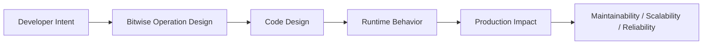
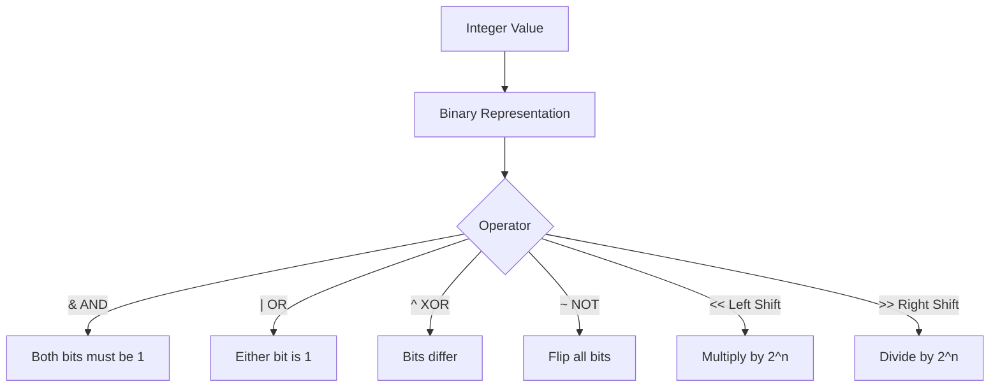

# Bitwise Operations

## Overview

**Bitwise operations** manipulate individual bits of integer values directly. Python supports the full set of bitwise operators: AND (`&`), OR (`|`), XOR (`^`), NOT (`~`), left shift (`<<`), and right shift (`>>`). Python integers are arbitrary-precision, so bitwise operations work on integers of any size.

While less common in high-level application code, bitwise operations are essential in systems programming, networking, cryptography, permission systems, feature flags, data compression, and performance-critical algorithms. In AI/ML contexts, they appear in embedding quantization, hash functions, and efficient set operations.

---

## Why It Matters





---

## Simple Example

```python
a = 0b1010  # 10 in decimal
b = 0b1100  # 12 in decimal

print(f"a          = {a:04b} ({a})")
print(f"b          = {b:04b} ({b})")
print(f"a & b      = {(a & b):04b} ({a & b})")   # AND
print(f"a | b      = {(a | b):04b} ({a | b})")   # OR
print(f"a ^ b      = {(a ^ b):04b} ({a ^ b})")   # XOR
print(f"~a         = {~a}")                        # NOT (two's complement)
print(f"a << 1     = {a << 1:04b} ({a << 1})")   # Left shift
print(f"a >> 1     = {a >> 1:04b} ({a >> 1})")   # Right shift

# Practical: check if a number is even or odd
for n in [0, 1, 2, 3, 7, 8]:
    parity = "even" if (n & 1) == 0 else "odd"
    print(f"{n} is {parity}")
```

**Explanation:**
- `&` (AND): both bits must be 1 → used for masking.
- `|` (OR): either bit is 1 → used for setting bits.
- `^` (XOR): bits differ → used for toggling and difference detection.
- `~` (NOT): flips all bits → result is `-(n+1)` due to two's complement.
- `<<` / `>>`: multiply/divide by powers of 2.

**Expected output:**
```
a          = 1010 (10)
b          = 1100 (12)
a & b      = 1000 (8)
a | b      = 1110 (14)
a ^ b      = 0110 (6)
~a         = -11
a << 1     = 10100 (20)
a >> 1     = 0101 (5)
0 is even
1 is odd
2 is even
3 is odd
7 is odd
8 is even
```

---

## Intermediate Example

### Unix-Style Permission System

```python
# Unix-style file permissions using bitwise flags
READ    = 0b100  # 4
WRITE   = 0b010  # 2
EXECUTE = 0b001  # 1

def grant(current: int, permission: int) -> int:
    return current | permission

def revoke(current: int, permission: int) -> int:
    return current & ~permission

def has_permission(current: int, permission: int) -> bool:
    return bool(current & permission)

def describe(permissions: int) -> str:
    parts = []
    if has_permission(permissions, READ):    parts.append("read")
    if has_permission(permissions, WRITE):   parts.append("write")
    if has_permission(permissions, EXECUTE): parts.append("execute")
    return ", ".join(parts) if parts else "none"

# Start with no permissions
perms = 0b000
print(f"Initial: {describe(perms)}")

perms = grant(perms, READ | WRITE)
print(f"After grant read+write: {describe(perms)}")

perms = grant(perms, EXECUTE)
print(f"After grant execute: {describe(perms)}")

perms = revoke(perms, WRITE)
print(f"After revoke write: {describe(perms)}")

print(f"Has read? {has_permission(perms, READ)}")
print(f"Has write? {has_permission(perms, WRITE)}")
```

**Explanation:**
- Each permission is a power of 2 (a single bit).
- `|` sets bits (grants permissions).
- `& ~` clears bits (revokes permissions).
- `&` tests bits (checks permissions).
- This pattern is used in Linux file systems, network protocols, and feature flag systems.

**Expected output:**
```
Initial: none
After grant read+write: read, write
After grant execute: read, write, execute
After revoke write: read, execute
Has read? True
Has write? False
```

---

## Advanced / Architect-Level Example

### Feature Flag System Using Bitwise Masks for a Multi-Tenant SaaS Platform

**Problem context:** A SaaS platform needs to enable/disable features per tenant using a compact, database-friendly representation. Features are stored as a single integer bitmask per tenant, enabling O(1) feature checks and efficient bulk queries.

```python
from __future__ import annotations
from enum import IntFlag, auto
from dataclasses import dataclass
from typing import Optional
import json

# --- Feature Flags as IntFlag ---
class Feature(IntFlag):
    NONE            = 0
    ANALYTICS       = auto()   # 1
    EXPORT_CSV      = auto()   # 2
    API_ACCESS      = auto()   # 4
    ADVANCED_SEARCH = auto()   # 8
    AI_ASSISTANT    = auto()   # 16
    CUSTOM_BRANDING = auto()   # 32
    SSO             = auto()   # 64

    # Convenience bundles
    STARTER  = ANALYTICS | EXPORT_CSV
    PRO      = STARTER | API_ACCESS | ADVANCED_SEARCH
    ENTERPRISE = PRO | AI_ASSISTANT | CUSTOM_BRANDING | SSO

@dataclass
class Tenant:
    tenant_id: str
    name: str
    _features: int = 0  # Stored as integer in DB

    @property
    def features(self) -> Feature:
        return Feature(self._features)

    def enable(self, feature: Feature) -> None:
        self._features |= feature.value

    def disable(self, feature: Feature) -> None:
        self._features &= ~feature.value

    def has(self, feature: Feature) -> bool:
        return bool(self._features & feature.value)

    def set_plan(self, plan: Feature) -> None:
        self._features = plan.value

    def to_dict(self) -> dict:
        return {
            "tenant_id": self.tenant_id,
            "name": self.name,
            "features_bitmask": self._features,
            "features_list": [f.name for f in Feature if f in self.features and f != Feature.NONE],
        }

# --- Usage ---
tenant = Tenant("t001", "Acme Corp")
tenant.set_plan(Feature.PRO)
print(f"PRO plan: {tenant.to_dict()}")

tenant.enable(Feature.AI_ASSISTANT)
print(f"After enabling AI: {tenant.to_dict()}")

tenant.disable(Feature.EXPORT_CSV)
print(f"After disabling CSV export: {tenant.to_dict()}")

print(f"Has API access? {tenant.has(Feature.API_ACCESS)}")
print(f"Has SSO? {tenant.has(Feature.SSO)}")

# Efficient bulk query simulation: find all tenants with AI_ASSISTANT
tenants = [
    Tenant("t001", "Acme", Feature.ENTERPRISE.value),
    Tenant("t002", "Beta", Feature.PRO.value),
    Tenant("t003", "Gamma", Feature.STARTER.value),
]
ai_tenants = [t for t in tenants if t.has(Feature.AI_ASSISTANT)]
print(f"Tenants with AI: {[t.name for t in ai_tenants]}")
```

**Explanation:**
- `IntFlag` (Python 3.6+) combines `int` and `Flag` — supports bitwise operations natively.
- `auto()` assigns powers of 2 automatically.
- The bitmask is stored as a single integer in the database — one column, O(1) check.
- Bulk queries use bitwise AND at the database level: `WHERE features & 16 != 0`.
- `IntFlag` members support `in` operator for membership testing.

**Design trade-offs:**
| Approach | Pros | Cons |
|---|---|---|
| Bitmask integer | Compact, fast, DB-friendly | Max 64 features (int64) |
| JSON array of strings | Readable, unlimited features | Slower queries, more storage |
| Separate feature table | Fully normalized | Complex queries, more joins |
| `IntFlag` enum | Type-safe, readable | Python-specific |

---

## Common Mistakes

### 1. Confusing `~` (bitwise NOT) with logical NOT
```python
# ~5 is NOT -6 in the logical sense
# ~5 = -(5+1) = -6 (two's complement)
print(~5)   # -6, not False or 0
print(not 5)  # False (logical NOT)
```

### 2. Using `^` for exponentiation
- **Problem:** `2 ^ 8` is XOR (result: 10), not `2**8` (256).
- **Better approach:** Use `**` for exponentiation.

### 3. Forgetting operator precedence
```python
# Bad — & has lower precedence than ==
if x & MASK == 0:  # Parsed as: x & (MASK == 0) → wrong!
    pass

# Good — use parentheses
if (x & MASK) == 0:
    pass
```

### 4. Using bitwise operators on floats
- **Problem:** Bitwise operators only work on integers. Applying them to floats raises `TypeError`.
- **Better approach:** Convert to `int` first if needed, or use `struct` for float bit manipulation.

### 5. Not using `IntFlag` for flag enumerations
- **Problem:** Raw integer constants are hard to read and maintain.
- **Better approach:** Use `enum.IntFlag` for named, composable flags.

---

## Best Practices

- **Use `IntFlag`** for flag/permission systems — it is readable, type-safe, and composable.
- **Always parenthesize** bitwise expressions in conditions: `(x & MASK) != 0`.
- **Use named constants** for bit masks — never use magic numbers like `0b00001000`.
- **Use `bin()`, `hex()`, `format(n, '08b')`** for debugging bit patterns.
- **Use `<<` and `>>`** for power-of-2 multiplication/division in performance-critical code.
- **Document bit layouts** for binary protocols and file formats.
- **Use `int.bit_length()`** and `int.bit_count()` (Python 3.10+) for bit analysis.

---

## Performance Considerations

Bitwise operations are among the **fastest operations in Python** — they map directly to CPU instructions. They are significantly faster than equivalent arithmetic or string operations.

```python
import timeit

# Bitwise check vs modulo for even/odd
bitwise = timeit.timeit("n & 1", setup="n = 12345", number=10_000_000)
modulo  = timeit.timeit("n % 2", setup="n = 12345", number=10_000_000)
print(f"Bitwise: {bitwise:.3f}s, Modulo: {modulo:.3f}s")
# Bitwise is typically 10-30% faster
```

- **Bitmask feature flags** are O(1) — far faster than set membership or JSON parsing.
- **Bit shifting** (`<< n`) is faster than `* (2**n)` for integer multiplication.
- **`int.bit_count()`** (Python 3.10+) counts set bits in O(1) using hardware popcount.

---

## Testing Strategy

```python
# tests/test_bitwise.py
import pytest
from mymodule import grant, revoke, has_permission, READ, WRITE, EXECUTE

def test_grant_permission():
    perms = grant(0, READ)
    assert has_permission(perms, READ)
    assert not has_permission(perms, WRITE)

def test_revoke_permission():
    perms = READ | WRITE | EXECUTE
    perms = revoke(perms, WRITE)
    assert has_permission(perms, READ)
    assert not has_permission(perms, WRITE)
    assert has_permission(perms, EXECUTE)

def test_xor_toggle():
    value = 0b1010
    mask  = 0b1111
    toggled = value ^ mask
    assert toggled == 0b0101
    assert (toggled ^ mask) == value  # XOR twice restores original

def test_left_shift_doubles():
    assert 1 << 4 == 16
    assert 3 << 2 == 12

def test_right_shift_halves():
    assert 16 >> 1 == 8
    assert 16 >> 4 == 1

def test_intflag_feature():
    from mymodule import Feature, Tenant
    t = Tenant("t1", "Test")
    t.set_plan(Feature.PRO)
    assert t.has(Feature.ANALYTICS)
    assert t.has(Feature.API_ACCESS)
    assert not t.has(Feature.SSO)

def test_bitwise_precedence():
    # Ensure parentheses are required
    x = 0b1010
    mask = 0b1000
    assert (x & mask) != 0  # Correct
    assert x & mask == 8    # Also correct (== has higher precedence than &... wait)
    # Actually: x & mask == 8 is parsed as x & (mask == 8) = 10 & True = 10 & 1 = 0
    # This is a known gotcha — always parenthesize
```

---

## Debugging Tips

- **`bin(n)`** — display integer as binary string: `bin(42)` → `'0b101010'`.
- **`hex(n)`** — display as hex: `hex(255)` → `'0xff'`.
- **`format(n, '08b')`** — zero-padded binary: `format(42, '08b')` → `'00101010'`.
- **`int.bit_length()`** — number of bits needed to represent the integer.
- **`int.bit_count()`** (Python 3.10+) — count of set bits (popcount).
- **Operator precedence** is a common source of bugs — always use parentheses in complex expressions.
- Use the Python REPL to interactively test bit patterns before writing production code.

---

## Interview Questions

### Beginner
1. **What does the `&` operator do?**
   *Bitwise AND — returns a new integer where each bit is 1 only if both operands have a 1 in that position.*

2. **How do you check if a number is even using bitwise operations?**
   *`(n & 1) == 0` — the least significant bit is 0 for even numbers.*

3. **What is the result of `~5` in Python?**
   *`-6` — bitwise NOT uses two's complement: `~n = -(n+1)`.*

4. **What does `1 << 3` evaluate to?**
   *`8` — left shift by 3 is equivalent to multiplying by `2^3`.*

5. **What is the difference between `^` and `**`?**
   *`^` is bitwise XOR; `**` is exponentiation.*

### Intermediate
1. **How do you set, clear, and test a specific bit?**
   *Set: `n |= (1 << bit)`. Clear: `n &= ~(1 << bit)`. Test: `bool(n & (1 << bit))`.*

2. **What is `IntFlag` and how does it differ from `IntEnum`?**
   *`IntFlag` supports bitwise operations (`|`, `&`, `^`, `~`) and is designed for flag combinations. `IntEnum` is for mutually exclusive integer constants.*

3. **How would you use XOR to swap two integers without a temporary variable?**
   *`a ^= b; b ^= a; a ^= b` — XOR swap. Note: this fails if `a` and `b` are the same variable.*

4. **What is a bitmask and how is it used?**
   *A bitmask is an integer used with `&` to isolate specific bits. E.g., `value & 0xFF` extracts the lowest 8 bits.*

5. **How do you count the number of set bits in an integer?**
   *`bin(n).count('1')` or `n.bit_count()` (Python 3.10+).*

### Advanced / Architect-Level
1. **How would you design a compact permission system for a multi-tenant SaaS using bitmasks?**
   *Use `IntFlag` with `auto()` for feature flags. Store the bitmask as an integer in the database. Use `WHERE features & flag_value != 0` for efficient bulk queries. Cap at 63 features for int64 compatibility.*

2. **How are bitwise operations used in hash functions and checksums?**
   *Hash functions (MD5, SHA) use XOR, AND, OR, and shifts extensively for mixing bits. CRC checksums use XOR with a polynomial. These operations are fast and provide good bit diffusion.*

3. **Explain how bitwise operations are used in neural network quantization.**
   *Quantized models (e.g., 1-bit or 4-bit weights) pack multiple values into a single integer. Bitwise operations extract individual values: `(packed >> (i * bits)) & mask`. This reduces memory and enables SIMD acceleration.*

4. **What is the significance of `n & (n-1)` in algorithms?**
   *`n & (n-1)` clears the lowest set bit of `n`. If the result is 0, `n` is a power of 2. This is used in bit manipulation algorithms and data structures like Fenwick trees.*

5. **How would you implement a Bloom filter using bitwise operations?**
   *A Bloom filter uses a bit array (integer or `bytearray`). To add an element, hash it with k hash functions and set the corresponding bits using `|`. To check membership, test all k bits using `&`. False positives are possible; false negatives are not.*

---

## Key Takeaways

- Bitwise operators (`&`, `|`, `^`, `~`, `<<`, `>>`) manipulate individual bits of integers.
- **`&`** masks/tests bits; **`|`** sets bits; **`^`** toggles bits; **`~`** inverts all bits.
- **Always parenthesize** bitwise expressions in conditions — operator precedence is a common bug source.
- **Use `IntFlag`** for named, composable flag systems.
- Bitwise operations are **extremely fast** — ideal for permission systems, feature flags, and protocol parsing.
- **`n & (n-1)`** clears the lowest set bit; **`n & 1`** checks parity.
- Python integers are arbitrary-precision — bitwise operations work on integers of any size.

---

## Mini Project Idea

### Project: `bitperm` — Bitwise Permission and Feature Flag Library

**Goal:** Build a reusable Python library for managing permissions and feature flags using bitmasks, with a clean API, database serialization, and audit logging.

**Features:**
- `PermissionSet` class backed by `IntFlag`.
- `grant()`, `revoke()`, `has()`, `toggle()` methods.
- Serialization to/from integer (for DB storage) and JSON (for API responses).
- Predefined permission bundles (e.g., `VIEWER`, `EDITOR`, `ADMIN`).
- Audit log: record every permission change with timestamp and actor.
- CLI tool to inspect and modify permission sets.

**Suggested folder structure:**
```
bitperm/
├── .venv/
├── pyproject.toml
├── src/
│   └── bitperm/
│       ├── __init__.py
│       ├── flags.py         # IntFlag definitions
│       ├── permission_set.py
│       └── audit.py
└── tests/
    ├── test_flags.py
    └── test_permission_set.py
```

**Extension ideas:**
- Add a Django/SQLAlchemy field type for storing bitmasks.
- Generate a human-readable permission diff between two bitmasks.
- Add a FastAPI endpoint for managing tenant permissions.
- Support 128-bit permission sets using Python's arbitrary-precision integers.

---

## Final Summary

Bitwise operations are a low-level but powerful tool in a Python architect's toolkit. They enable compact, efficient representations for permissions, feature flags, protocol fields, and algorithmic primitives. Architects who understand bitwise operations can design systems that are faster, more memory-efficient, and more expressive — from Unix-style permission models to neural network quantization. Mastering this topic bridges the gap between high-level Python and the hardware it runs on.
