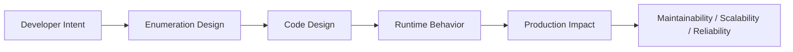
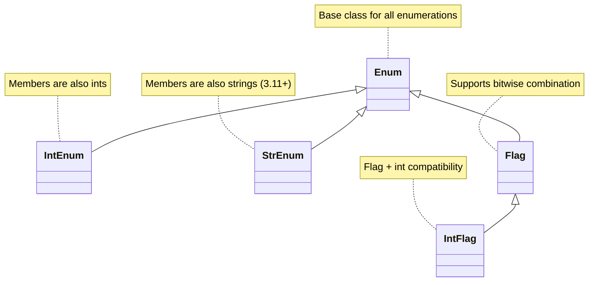

# Enumerations

## Overview

**Enumerations** (`enum`) in Python are a set of symbolic names bound to unique, constant values. They replace magic numbers and string constants with type-safe, self-documenting, and IDE-friendly identifiers. Python's `enum` module (introduced in Python 3.4) provides `Enum`, `IntEnum`, `Flag`, `IntFlag`, `StrEnum` (3.11+), and more.

In production systems — state machines, configuration, API contracts, database models, and AI agent workflows — enumerations are the difference between `status = "active"` (fragile) and `status = UserStatus.ACTIVE` (robust, refactorable, and testable).

---

## Why It Matters





---

## Simple Example

```python
from enum import Enum, auto

class Color(Enum):
    RED   = 1
    GREEN = 2
    BLUE  = 3

class Direction(Enum):
    NORTH = auto()
    SOUTH = auto()
    EAST  = auto()
    WEST  = auto()

# Accessing members
print(Color.RED)           # Color.RED
print(Color.RED.name)      # RED
print(Color.RED.value)     # 1
print(Color(2))            # Color.GREEN  (lookup by value)
print(Color["BLUE"])       # Color.BLUE   (lookup by name)

# Comparison
print(Color.RED == Color.RED)    # True
print(Color.RED == Color.GREEN)  # False
print(Color.RED is Color.RED)    # True (singletons)

# Iteration
for color in Color:
    print(f"{color.name}: {color.value}")

# auto() assigns sequential integers
print(list(Direction))
```

**Explanation:**
- `Enum` members are singletons — `Color.RED is Color.RED` is always `True`.
- `auto()` automatically assigns values (1, 2, 3, ...).
- Members can be looked up by value (`Color(2)`) or name (`Color["BLUE"]`).
- Enums are iterable.

**Expected output:**
```
Color.RED
RED
1
Color.GREEN
Color.BLUE
True
False
True
Color.RED: 1
Color.GREEN: 2
Color.BLUE: 3
[<Direction.NORTH: 1>, <Direction.SOUTH: 2>, <Direction.EAST: 3>, <Direction.WEST: 4>]
```

---

## Intermediate Example

### Order Status State Machine with `StrEnum`

```python
from enum import StrEnum, auto
from dataclasses import dataclass
from datetime import datetime

class OrderStatus(StrEnum):
    PENDING    = auto()   # "pending"
    CONFIRMED  = auto()   # "confirmed"
    SHIPPED    = auto()   # "shipped"
    DELIVERED  = auto()   # "delivered"
    CANCELLED  = auto()   # "cancelled"

# Valid transitions
TRANSITIONS: dict[OrderStatus, set[OrderStatus]] = {
    OrderStatus.PENDING:   {OrderStatus.CONFIRMED, OrderStatus.CANCELLED},
    OrderStatus.CONFIRMED: {OrderStatus.SHIPPED, OrderStatus.CANCELLED},
    OrderStatus.SHIPPED:   {OrderStatus.DELIVERED},
    OrderStatus.DELIVERED: set(),
    OrderStatus.CANCELLED: set(),
}

@dataclass
class Order:
    order_id: str
    status: OrderStatus = OrderStatus.PENDING

    def transition(self, new_status: OrderStatus) -> None:
        allowed = TRANSITIONS[self.status]
        if new_status not in allowed:
            raise ValueError(
                f"Cannot transition from {self.status!r} to {new_status!r}. "
                f"Allowed: {[s.value for s in allowed]}"
            )
        print(f"Order {self.order_id}: {self.status} → {new_status}")
        self.status = new_status

# Usage
order = Order("ORD-001")
order.transition(OrderStatus.CONFIRMED)
order.transition(OrderStatus.SHIPPED)
order.transition(OrderStatus.DELIVERED)

try:
    order.transition(OrderStatus.CANCELLED)  # Invalid
except ValueError as e:
    print(f"Error: {e}")

# StrEnum: members are strings — works directly with JSON, DB, etc.
import json
print(json.dumps({"status": order.status}))  # {"status": "delivered"}
```

**Explanation:**
- `StrEnum` (Python 3.11+) makes members both `Enum` and `str` — they serialize to strings automatically.
- The transition table enforces valid state machine transitions.
- `StrEnum` values work directly in JSON serialization, database queries, and string comparisons.

**Expected output:**
```
Order ORD-001: pending → confirmed
Order ORD-001: confirmed → shipped
Order ORD-001: shipped → delivered
Error: Cannot transition from 'delivered' to 'cancelled'. Allowed: []
{"status": "delivered"}
```

---

## Advanced / Architect-Level Example

### AI Agent Tool Registry with Enum-Driven Dispatch

**Problem context:** An AI agent framework uses enumerations to define tool types, capability levels, and execution modes. The enum drives tool registration, capability checking, and dispatch — making the system extensible, type-safe, and self-documenting.

```python
from __future__ import annotations
from enum import Enum, Flag, auto
from dataclasses import dataclass, field
from typing import Callable, Any
import logging

logger = logging.getLogger(__name__)

# --- Tool Categories ---
class ToolCategory(Enum):
    RETRIEVAL   = "retrieval"
    COMPUTATION = "computation"
    EXTERNAL    = "external"
    MEMORY      = "memory"

# --- Capability Flags ---
class ToolCapability(Flag):
    NONE        = 0
    READ        = auto()
    WRITE       = auto()
    NETWORK     = auto()
    PERSISTENT  = auto()
    ASYNC       = auto()

    # Bundles
    READ_ONLY   = READ
    READ_WRITE  = READ | WRITE
    FULL        = READ | WRITE | NETWORK | PERSISTENT | ASYNC

# --- Execution Mode ---
class ExecutionMode(Enum):
    SYNC  = "sync"
    ASYNC = "async"
    BATCH = "batch"

# --- Tool Descriptor ---
@dataclass
class ToolDescriptor:
    name: str
    category: ToolCategory
    capabilities: ToolCapability
    mode: ExecutionMode
    handler: Callable[..., Any]
    description: str = ""

# --- Tool Registry ---
class ToolRegistry:
    def __init__(self):
        self._tools: dict[str, ToolDescriptor] = {}

    def register(
        self,
        name: str,
        category: ToolCategory,
        capabilities: ToolCapability,
        mode: ExecutionMode = ExecutionMode.SYNC,
        description: str = "",
    ):
        def decorator(func: Callable) -> Callable:
            self._tools[name] = ToolDescriptor(
                name=name,
                category=category,
                capabilities=capabilities,
                mode=mode,
                handler=func,
                description=description,
            )
            logger.info("Registered tool: %s [%s]", name, category.value)
            return func
        return decorator

    def get(self, name: str) -> ToolDescriptor:
        if name not in self._tools:
            raise KeyError(f"Tool '{name}' not registered")
        return self._tools[name]

    def by_category(self, category: ToolCategory) -> list[ToolDescriptor]:
        return [t for t in self._tools.values() if t.category == category]

    def with_capability(self, capability: ToolCapability) -> list[ToolDescriptor]:
        return [t for t in self._tools.values() if capability in t.capabilities]

    def execute(self, name: str, **kwargs) -> Any:
        tool = self.get(name)
        logger.info("Executing tool: %s (mode=%s)", name, tool.mode.value)
        return tool.handler(**kwargs)

# --- Register Tools ---
registry = ToolRegistry()

@registry.register(
    "vector_search",
    category=ToolCategory.RETRIEVAL,
    capabilities=ToolCapability.READ | ToolCapability.NETWORK,
    description="Search vector database for relevant documents",
)
def vector_search(query: str, top_k: int = 5) -> list[str]:
    return [f"Doc {i}: result for '{query}'" for i in range(top_k)]

@registry.register(
    "calculator",
    category=ToolCategory.COMPUTATION,
    capabilities=ToolCapability.READ_ONLY,
    description="Evaluate mathematical expressions",
)
def calculator(expression: str) -> float:
    return eval(expression)  # Simplified; use safe eval in production

@registry.register(
    "memory_store",
    category=ToolCategory.MEMORY,
    capabilities=ToolCapability.READ_WRITE | ToolCapability.PERSISTENT,
    description="Store and retrieve agent memory",
)
def memory_store(action: str, key: str, value: str = "") -> str:
    return f"{action}({key}={value})"

# --- Usage ---
results = registry.execute("vector_search", query="What is RAG?", top_k=3)
print(results)

retrieval_tools = registry.by_category(ToolCategory.RETRIEVAL)
print(f"Retrieval tools: {[t.name for t in retrieval_tools]}")

network_tools = registry.with_capability(ToolCapability.NETWORK)
print(f"Network-capable tools: {[t.name for t in network_tools]}")

# Enum-driven capability check
tool = registry.get("memory_store")
print(f"memory_store can write: {ToolCapability.WRITE in tool.capabilities}")
print(f"memory_store is async: {ToolCapability.ASYNC in tool.capabilities}")
```

**Explanation:**
- `ToolCategory` (Enum) classifies tools — enables filtering and routing.
- `ToolCapability` (Flag) encodes composable capabilities — supports bitwise combination.
- `ExecutionMode` (Enum) drives dispatch logic (sync vs. async vs. batch).
- The registry uses enum values for filtering, capability checking, and logging.
- This pattern makes the agent framework self-documenting and extensible.

**Design trade-offs:**
| Approach | Pros | Cons |
|---|---|---|
| `Enum` for categories | Type-safe, IDE support | Fixed at definition time |
| `Flag` for capabilities | Composable, compact | Max 64 flags (int64) |
| `StrEnum` for API values | JSON-friendly | Python 3.11+ only |
| String constants | Simple | No type safety, typo-prone |

---

## Common Mistakes

### 1. Comparing enum members with `==` to raw values
```python
# Bad — may work with IntEnum but not Enum
if status == "active":  # Fragile string comparison
    pass

# Good
if status == UserStatus.ACTIVE:
    pass
```

### 2. Using `Enum` when you need `IntEnum` for DB/API compatibility
- **Problem:** `Enum` members are not integers — they won't work directly with integer DB columns.
- **Better approach:** Use `IntEnum` for integer-backed enums that interact with databases or C libraries.

### 3. Defining duplicate values (aliases)
```python
class Color(Enum):
    RED  = 1
    ROUGE = 1  # Alias for RED — not a new member!

print(list(Color))  # Only [Color.RED] — ROUGE is an alias
```
- **Better approach:** Use `@unique` decorator to prevent accidental aliases.

### 4. Mutating enum members
- **Problem:** Enum members are immutable by design. Attempting to set attributes raises `AttributeError`.
- **Better approach:** If you need mutable state, use a dataclass or regular class.

### 5. Not using `auto()` for sequential values
- **Problem:** Manually assigning `1, 2, 3, ...` is error-prone when inserting new members.
- **Better approach:** Use `auto()` for sequential values; only assign explicit values when the value has semantic meaning (e.g., HTTP status codes).

---

## Best Practices

- **Use `Enum`** for named constants with no arithmetic meaning.
- **Use `IntEnum`** when the integer value matters (DB columns, C interop, HTTP codes).
- **Use `StrEnum`** (Python 3.11+) for string-valued enums that serialize to JSON/DB.
- **Use `Flag` / `IntFlag`** for composable bit flags (permissions, capabilities).
- **Use `auto()`** for sequential values; use explicit values when the value is meaningful.
- **Use `@unique`** to prevent accidental duplicate values.
- **Add methods to enums** for domain logic (e.g., `is_terminal()`, `next_states()`).
- **Use `Enum` in type hints** — it enables IDE autocompletion and static analysis.
- **Store enum values (not names) in databases** — names can change during refactoring.

---

## Performance Considerations

Enum member access is **O(1)** — members are stored in a dictionary. Lookup by value (`Color(2)`) and by name (`Color["RED"]`) are both O(1).

Enums have a **small overhead** compared to raw integers or strings due to the object wrapper. In tight loops processing millions of items, consider using raw integers with named constants. For most production code, the overhead is negligible.

```python
import timeit
from enum import IntEnum

class Status(IntEnum):
    ACTIVE = 1

# IntEnum comparison is as fast as int comparison
t1 = timeit.timeit("Status.ACTIVE == 1", setup="from __main__ import Status", number=1_000_000)
t2 = timeit.timeit("1 == 1", number=1_000_000)
print(f"IntEnum: {t1:.3f}s, int: {t2:.3f}s")
```

---

## Testing Strategy

```python
# tests/test_enumerations.py
import pytest
from enum import unique
from mymodule import OrderStatus, TRANSITIONS, Order

def test_order_status_values():
    assert OrderStatus.PENDING == "pending"
    assert OrderStatus.DELIVERED == "delivered"

def test_valid_transition():
    order = Order("ORD-001")
    order.transition(OrderStatus.CONFIRMED)
    assert order.status == OrderStatus.CONFIRMED

def test_invalid_transition_raises():
    order = Order("ORD-001", status=OrderStatus.DELIVERED)
    with pytest.raises(ValueError, match="Cannot transition"):
        order.transition(OrderStatus.CANCELLED)

def test_enum_iteration():
    statuses = list(OrderStatus)
    assert OrderStatus.PENDING in statuses
    assert len(statuses) == 5

def test_enum_lookup_by_value():
    assert OrderStatus("shipped") == OrderStatus.SHIPPED

def test_enum_lookup_by_name():
    assert OrderStatus["CANCELLED"] == OrderStatus.CANCELLED

def test_enum_is_singleton():
    assert OrderStatus.PENDING is OrderStatus.PENDING

def test_str_enum_serializes_to_string():
    import json
    data = {"status": OrderStatus.SHIPPED}
    result = json.dumps(data)
    assert result == '{"status": "shipped"}'

def test_unique_decorator_prevents_duplicates():
    with pytest.raises(ValueError):
        @unique
        class BadEnum(OrderStatus):
            DUPLICATE = "pending"  # Duplicate value
```

---

## Debugging Tips

- **`list(MyEnum)`** — see all members.
- **`MyEnum.__members__`** — dictionary of all members including aliases.
- **`MyEnum(value)`** — look up by value; raises `ValueError` if not found.
- **`MyEnum[name]`** — look up by name; raises `KeyError` if not found.
- **`member.name`** and **`member.value`** — access name and value of any member.
- If an enum member is not found by value, check for aliases (duplicate values).
- Use `@unique` to catch duplicate values at class definition time.
- `StrEnum` members compare equal to their string values — useful for debugging JSON/DB mismatches.

---

## Interview Questions

### Beginner
1. **What is an enumeration in Python?**
   *A set of symbolic names bound to unique, constant values, defined using the `enum.Enum` class.*

2. **How do you access the name and value of an enum member?**
   *`member.name` for the name, `member.value` for the value.*

3. **What does `auto()` do in an enum?**
   *Automatically assigns sequential integer values (1, 2, 3, ...) to members.*

4. **How do you look up an enum member by its value?**
   *`MyEnum(value)` — e.g., `Color(2)` returns `Color.GREEN`.*

5. **What is the difference between `Enum` and `IntEnum`?**
   *`IntEnum` members are also integers and support arithmetic/comparison with ints. `Enum` members are not integers.*

### Intermediate
1. **What is `StrEnum` and when should you use it?**
   *`StrEnum` (Python 3.11+) makes members both `Enum` and `str`. Use it when enum values need to serialize directly to strings (JSON, DB, API responses).*

2. **What is the `@unique` decorator?**
   *It raises `ValueError` if any two members have the same value, preventing accidental aliases.*

3. **What is the difference between `Flag` and `IntFlag`?**
   *Both support bitwise combination. `IntFlag` members are also integers (compatible with int operations). `Flag` is stricter — members are not integers.*

4. **Can you add methods to an enum class?**
   *Yes. Methods defined in an enum class are available on all members: `def is_terminal(self): return self in {Status.DELIVERED, Status.CANCELLED}`.*

5. **How do you prevent an enum from being subclassed?**
   *Enums with members cannot be subclassed. Only enums without members (mixin bases) can be subclassed.*

### Advanced / Architect-Level
1. **How would you use enums to implement a state machine?**
   *Define states as enum members. Define a transition table as a `dict[State, set[State]]`. Validate transitions in a `transition()` method. Use `StrEnum` for DB/API compatibility.*

2. **How do enums interact with Pydantic and FastAPI?**
   *Pydantic v2 supports `Enum` fields natively. FastAPI uses enum values in OpenAPI schemas. `StrEnum` members serialize/deserialize as strings automatically.*

3. **What are the trade-offs between `Enum` and a module-level constant dictionary?**
   *Enums provide type safety, IDE support, iteration, and prevent invalid values. Dicts are more flexible but lack type safety. For production APIs and state machines, enums are strongly preferred.*

4. **How would you migrate a database column from string values to enum-backed values?**
   *Define a `StrEnum` with values matching the existing strings. Update the ORM model to use the enum type. Run a migration to validate existing data. The enum ensures no new invalid values are inserted.*

5. **How do you serialize and deserialize enums in a distributed system?**
   *Use `StrEnum` or `IntEnum` so values are primitive types. Serialize by value (not name) — names can change during refactoring. On deserialization, use `MyEnum(value)` with error handling for unknown values.*

---

## Key Takeaways

- Enums replace magic numbers and string constants with **type-safe, self-documenting** identifiers.
- Use **`Enum`** for named constants, **`IntEnum`** for integer-backed, **`StrEnum`** for string-backed, **`Flag`** for composable flags.
- **`auto()`** assigns sequential values automatically.
- **`@unique`** prevents accidental duplicate values.
- Enum members are **singletons** — identity comparison (`is`) works.
- **Add methods** to enums for domain logic (state transitions, validation).
- **Store values (not names)** in databases — names can change.
- Enums integrate naturally with **Pydantic, FastAPI, SQLAlchemy**, and JSON serialization.

---

## Mini Project Idea

### Project: `statemachine` — Enum-Driven State Machine Library

**Goal:** Build a reusable Python library for defining and executing state machines using enumerations, with transition validation, hooks, and persistence.

**Features:**
- `StateMachine` base class with enum-defined states.
- Declarative transition table.
- `on_enter` / `on_exit` hooks per state.
- Transition guards (conditions that must be true for a transition to proceed).
- Persistence: serialize/deserialize state to/from JSON.
- Audit log: record every transition with timestamp and actor.

**Suggested folder structure:**
```
statemachine/
├── .venv/
├── pyproject.toml
├── src/
│   └── statemachine/
│       ├── __init__.py
│       ├── machine.py       # StateMachine base class
│       ├── transitions.py   # Transition table and guards
│       └── audit.py         # Audit log
└── tests/
    ├── test_machine.py
    └── test_transitions.py
```

**Extension ideas:**
- Add async transition support.
- Generate a state diagram (Mermaid or Graphviz) from the transition table.
- Integrate with SQLAlchemy for persistent state storage.
- Add a FastAPI endpoint for triggering transitions via HTTP.

---

## Final Summary

Enumerations are a foundational tool for writing expressive, maintainable, and type-safe Python. They eliminate magic values, enforce valid states, and serve as the vocabulary of your domain model. Architects who use enums for state machines, permission systems, configuration, and API contracts build systems that are self-documenting, refactorable, and resilient to the class of bugs that arise from unconstrained string and integer values. Mastering Python's `enum` module — including `StrEnum`, `Flag`, and method-enriched enums — is a mark of production-grade Python craftsmanship.
