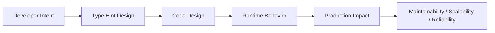
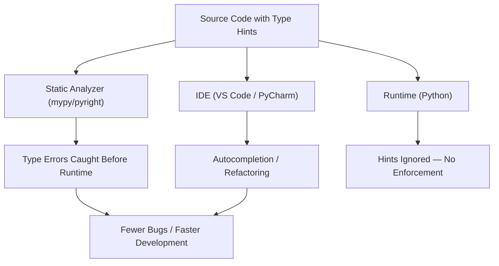

# Type Hints

## Overview

**Type hints** (also called type annotations) are a way to declare the expected types of variables, function parameters, and return values in Python. Introduced in PEP 484 (Python 3.5), they are purely informational at runtime — Python does not enforce them — but they enable static analysis tools (mypy, pyright, Pylance), IDE autocompletion, and documentation generation.

In production systems — AI agents, RAG pipelines, backend APIs, and enterprise applications — type hints are a force multiplier: they catch bugs before runtime, make code self-documenting, and enable confident refactoring at scale.

---

## Why It Matters





---

## Simple Example

```python
# Basic type hints for variables, parameters, and return types

def greet(name: str, times: int = 1) -> str:
    return (f"Hello, {name}!\n" * times).strip()

def add(a: int, b: int) -> int:
    return a + b

def is_adult(age: int) -> bool:
    return age >= 18

# Variable annotations
username: str = "alice"
score: float = 9.5
active: bool = True
tags: list[str] = ["python", "typing"]
config: dict[str, int] = {"timeout": 30, "retries": 3}

print(greet("Alice", 2))
print(add(3, 4))
print(is_adult(20))
```

**Explanation:**
- `name: str` annotates a parameter as a string.
- `-> str` annotates the return type.
- `list[str]` and `dict[str, int]` use built-in generics (Python 3.9+).
- Type hints are not enforced at runtime — `add(3, "4")` would still run (and fail).

**Expected output:**
```
Hello, Alice!
Hello, Alice!
7
True
```

---

## Intermediate Example

### Type Hints with `Optional`, `Union`, `Callable`, and `TypeVar`

```python
from typing import Optional, Union, Callable, TypeVar, Any
from collections.abc import Sequence

T = TypeVar("T")

# Optional — value can be None
def find_user(user_id: int) -> Optional[dict[str, Any]]:
    users = {1: {"name": "Alice"}, 2: {"name": "Bob"}}
    return users.get(user_id)  # Returns dict or None

# Union — multiple possible types (Python 3.10+: use X | Y syntax)
def process(value: Union[int, str]) -> str:
    return str(value).upper()

# Python 3.10+ union syntax
def process_modern(value: int | str) -> str:
    return str(value).upper()

# Callable — type hint for functions
def apply(func: Callable[[int, int], int], a: int, b: int) -> int:
    return func(a, b)

# TypeVar — generic functions
def first(items: Sequence[T]) -> Optional[T]:
    return items[0] if items else None

# Usage
user = find_user(1)
if user is not None:
    print(user["name"])

print(process(42))
print(process("hello"))
print(apply(lambda x, y: x + y, 3, 4))
print(first([10, 20, 30]))
print(first([]))
```

**Explanation:**
- `Optional[X]` is equivalent to `X | None` — the value may be absent.
- `Union[X, Y]` (or `X | Y` in Python 3.10+) allows multiple types.
- `Callable[[ArgTypes], ReturnType]` annotates function arguments.
- `TypeVar` enables generic functions that preserve type information.

**Expected output:**
```
Alice
42
HELLO
7
10
None
```

---

## Advanced / Architect-Level Example

### Type-Safe RAG Pipeline with Protocols, TypedDict, and Generic Classes

**Problem context:** A RAG pipeline has multiple interchangeable components (retrievers, rerankers, generators). You need a type-safe, extensible architecture where components can be swapped without breaking the type contract.

```python
from __future__ import annotations
from typing import TypeVar, Generic, Protocol, TypedDict, runtime_checkable
from dataclasses import dataclass
from collections.abc import Sequence

# --- TypedDict for structured data ---
class Document(TypedDict):
    doc_id: str
    text: str
    score: float
    metadata: dict[str, str]

class RAGResponse(TypedDict):
    query: str
    documents: list[Document]
    answer: str
    model: str

# --- Protocols for structural typing ---
@runtime_checkable
class Retriever(Protocol):
    def retrieve(self, query: str, top_k: int) -> list[Document]:
        ...

@runtime_checkable
class Reranker(Protocol):
    def rerank(self, query: str, documents: list[Document]) -> list[Document]:
        ...

@runtime_checkable
class Generator(Protocol):
    def generate(self, query: str, context: list[Document]) -> str:
        ...

# --- Generic Pipeline ---
RetrieverT = TypeVar("RetrieverT", bound=Retriever)
RerankerT  = TypeVar("RerankerT",  bound=Reranker)
GeneratorT = TypeVar("GeneratorT", bound=Generator)

@dataclass
class RAGPipeline(Generic[RetrieverT, RerankerT, GeneratorT]):
    retriever: RetrieverT
    reranker:  RerankerT
    generator: GeneratorT
    top_k: int = 5

    def run(self, query: str) -> RAGResponse:
        docs = self.retriever.retrieve(query, self.top_k)
        reranked = self.reranker.rerank(query, docs)
        answer = self.generator.generate(query, reranked)
        return RAGResponse(
            query=query,
            documents=reranked,
            answer=answer,
            model="rag-v1",
        )

# --- Concrete Implementations ---
class SimpleRetriever:
    def retrieve(self, query: str, top_k: int) -> list[Document]:
        return [
            Document(doc_id=f"d{i}", text=f"Doc {i} about {query}", score=1.0 - i * 0.1, metadata={})
            for i in range(top_k)
        ]

class PassthroughReranker:
    def rerank(self, query: str, documents: list[Document]) -> list[Document]:
        return sorted(documents, key=lambda d: d["score"], reverse=True)

class SimpleGenerator:
    def generate(self, query: str, context: list[Document]) -> str:
        texts = " ".join(d["text"] for d in context[:3])
        return f"Answer to '{query}' based on: {texts[:100]}..."

# --- Type-safe instantiation ---
pipeline: RAGPipeline[SimpleRetriever, PassthroughReranker, SimpleGenerator] = RAGPipeline(
    retriever=SimpleRetriever(),
    reranker=PassthroughReranker(),
    generator=SimpleGenerator(),
)

response = pipeline.run("What is RAG?")
print(f"Answer: {response['answer']}")
print(f"Top doc: {response['documents'][0]['text']}")

# Runtime protocol check
print(isinstance(SimpleRetriever(), Retriever))  # True
```

**Explanation:**
- `TypedDict` provides type-safe dictionary schemas — IDE and mypy understand the keys and value types.
- `Protocol` enables structural typing — any class with the right methods satisfies the protocol, without inheritance.
- `Generic[T]` makes `RAGPipeline` type-safe for any combination of components.
- `@runtime_checkable` allows `isinstance()` checks against protocols.
- This architecture is fully type-safe, extensible, and testable.

**Design trade-offs:**
| Approach | Pros | Cons |
|---|---|---|
| `Protocol` | Structural, no inheritance | Requires `@runtime_checkable` for isinstance |
| ABC | Explicit contract | Requires inheritance |
| `TypedDict` | Type-safe dicts | No methods, no validation |
| `dataclass` | Methods + type safety | More verbose than TypedDict |

---

## Common Mistakes

### 1. Using `list` instead of `list[T]` (Python 3.8 and below)
```python
# Bad (Python 3.8) — untyped list
def process(items: list) -> list:
    ...

# Good — typed list
from typing import List  # Python 3.8
def process(items: List[str]) -> List[str]:
    ...

# Best (Python 3.9+)
def process(items: list[str]) -> list[str]:
    ...
```

### 2. Using `Optional[X]` when you mean `X | None`
- Both are equivalent, but `X | None` (Python 3.10+) is more readable.
- **Better approach:** Use `X | None` in Python 3.10+; use `Optional[X]` for 3.8/3.9.

### 3. Annotating `Any` everywhere
- **Problem:** `Any` disables type checking — it is an escape hatch, not a solution.
- **Better approach:** Use `Any` only at genuine boundaries (e.g., JSON deserialization). Narrow the type as soon as possible.

### 4. Forgetting `from __future__ import annotations`
- **Problem:** In Python 3.9 and below, forward references (using a class before it is defined) cause `NameError`.
- **Better approach:** Add `from __future__ import annotations` at the top of the file to enable lazy evaluation of annotations.

### 5. Confusing `Sequence` with `list`
- **Problem:** Annotating a parameter as `list[str]` rejects tuples and other sequences.
- **Better approach:** Use `Sequence[str]` (from `collections.abc`) for read-only sequences; use `list[str]` only when you need mutability.

---

## Best Practices

- **Use built-in generics** (`list[str]`, `dict[str, int]`) in Python 3.9+; use `typing.List`, `typing.Dict` for 3.8.
- **Use `X | None`** instead of `Optional[X]` in Python 3.10+.
- **Use `Protocol`** for structural typing — prefer it over ABCs for duck-typed interfaces.
- **Use `TypedDict`** for typed dictionary schemas (API responses, config objects).
- **Use `TypeVar`** for generic functions and classes.
- **Use `Final`** for constants: `MAX_RETRIES: Final[int] = 3`.
- **Use `Literal`** for constrained string/int values: `mode: Literal["read", "write"]`.
- **Run `mypy` or `pyright`** in CI — type hints are only valuable if checked.
- **Add `from __future__ import annotations`** for forward references and performance.
- **Annotate public APIs completely** — internal helpers can be less strict.

---

## Performance Considerations

Type hints have **zero runtime performance impact** by default — they are stored as strings (with `from __future__ import annotations`) or as objects in `__annotations__`, but are not evaluated during normal execution.

The only performance consideration:
- **`get_type_hints()`** evaluates annotations at runtime — avoid calling it in hot paths.
- **Pydantic** and **dataclasses** use annotations for validation/initialization — this has a small overhead.
- **`@runtime_checkable` Protocol** `isinstance()` checks are slower than regular `isinstance()` — avoid in tight loops.

---

## Testing Strategy

```python
# tests/test_type_hints.py
# Type hints are tested via mypy/pyright in CI, not at runtime.
# Runtime tests focus on behavior, not types.

import pytest
from mymodule import find_user, process, first, RAGPipeline

def test_find_user_returns_dict_or_none():
    result = find_user(1)
    assert result is not None
    assert isinstance(result, dict)
    assert "name" in result

def test_find_user_returns_none_for_missing():
    result = find_user(999)
    assert result is None

def test_process_handles_int():
    assert process(42) == "42"

def test_process_handles_str():
    assert process("hello") == "HELLO"

def test_first_returns_first_element():
    assert first([10, 20, 30]) == 10

def test_first_returns_none_for_empty():
    assert first([]) is None

# mypy configuration (mypy.ini or pyproject.toml)
# [mypy]
# strict = true
# disallow_untyped_defs = true
# disallow_any_generics = true
```

```bash
# Run mypy in CI
mypy src/ --strict
```

---

## Debugging Tips

- **`reveal_type(x)`** — insert in source code; mypy prints the inferred type without running the code.
- **`__annotations__`** — inspect annotations on a function or class at runtime.
- **`typing.get_type_hints(func)`** — resolve forward references and return a dict of annotations.
- **`isinstance(obj, SomeProtocol)`** — works only with `@runtime_checkable` protocols.
- **mypy error codes** — e.g., `[arg-type]`, `[return-value]`, `[assignment]` — help pinpoint the issue.
- **VS Code Pylance** — hover over any variable to see its inferred type.
- If mypy reports `error: Need type annotation for "x"`, add an explicit annotation or use `cast()`.

---

## Interview Questions

### Beginner
1. **What are type hints in Python?**
   *Annotations that declare the expected types of variables, parameters, and return values. They are not enforced at runtime but enable static analysis.*

2. **How do you annotate a function that takes a string and returns an integer?**
   *`def func(s: str) -> int:`*

3. **What does `Optional[str]` mean?**
   *The value can be a `str` or `None`. Equivalent to `str | None` in Python 3.10+.*

4. **What is the difference between `list` and `list[str]` as a type hint?**
   *`list` is an untyped list (any elements). `list[str]` specifies that all elements are strings.*

5. **Do type hints affect runtime behavior?**
   *No. Python ignores type hints at runtime. They are only used by static analysis tools and IDEs.*

### Intermediate
1. **What is `TypeVar` and when do you use it?**
   *`TypeVar` defines a type variable for generic functions/classes. It allows the return type to match the input type: `T = TypeVar("T"); def identity(x: T) -> T: return x`.*

2. **What is the difference between `Protocol` and `ABC`?**
   *`Protocol` uses structural typing (duck typing) — any class with the right methods satisfies it, without inheritance. `ABC` requires explicit inheritance.*

3. **What is `TypedDict`?**
   *A way to define a dictionary with specific key names and value types. Enables type-safe access to dictionary fields.*

4. **What is `Literal` and when should you use it?**
   *`Literal["read", "write"]` constrains a value to a specific set of literals. Use it for mode strings, status codes, and other constrained values.*

5. **What is `from __future__ import annotations` and why use it?**
   *It makes all annotations lazy (stored as strings, not evaluated). This enables forward references and improves import performance.*

### Advanced / Architect-Level
1. **How would you design a type-safe plugin system using Protocols?**
   *Define a `Plugin` Protocol with required methods. Use `TypeVar` bound to `Plugin` for the registry. Plugins are registered by passing any object that structurally satisfies the protocol — no inheritance required.*

2. **What is `ParamSpec` and when is it useful?**
   *`ParamSpec` (Python 3.10+) captures the parameter types of a callable. It is used to type decorators that preserve the wrapped function's signature.*

3. **How does `mypy --strict` differ from default mypy?**
   *`--strict` enables all optional checks: `disallow_untyped_defs`, `disallow_any_generics`, `warn_return_any`, `no_implicit_optional`, etc. It enforces complete type coverage.*

4. **What is `TypeGuard` and how does it work?**
   *`TypeGuard[T]` is a return type for type narrowing functions. If the function returns `True`, mypy narrows the type of the checked variable to `T`.*

5. **How do you handle type hints for a function that accepts `**kwargs` of mixed types?**
   *Use `**kwargs: Any` for fully dynamic kwargs. For structured kwargs, use `TypedDict` with `Unpack` (Python 3.12+) or `**kwargs: Unpack[MyTypedDict]`.*

---

## Key Takeaways

- Type hints are **not enforced at runtime** — they require static analysis tools (mypy, pyright).
- Use **built-in generics** (`list[str]`, `dict[str, int]`) in Python 3.9+.
- Use **`X | None`** instead of `Optional[X]` in Python 3.10+.
- Use **`Protocol`** for structural typing; **`TypedDict`** for typed dicts; **`TypeVar`** for generics.
- **Run mypy/pyright in CI** — type hints are only valuable if checked.
- **`from __future__ import annotations`** enables forward references and lazy evaluation.
- Type hints are a **documentation and tooling investment** — they pay dividends in large codebases.

---

## Mini Project Idea

### Project: `typed-rag` — Fully Type-Annotated RAG Pipeline Skeleton

**Goal:** Build a production-ready, fully type-annotated RAG pipeline skeleton that serves as a reference architecture for type-safe AI systems.

**Features:**
- `Protocol`-based interfaces for `Retriever`, `Reranker`, `Generator`, `Embedder`.
- `TypedDict` schemas for `Document`, `Query`, `RAGResponse`.
- `Generic` `Pipeline[R, Re, G]` class.
- `mypy --strict` passing with zero errors.
- `pyright` passing in strict mode.
- Example implementations for each component.
- Full test suite with type-checked tests.

**Suggested folder structure:**
```
typed_rag/
├── .venv/
├── pyproject.toml
├── mypy.ini
├── src/
│   └── typed_rag/
│       ├── __init__.py
│       ├── protocols.py     # Retriever, Reranker, Generator protocols
│       ├── schemas.py       # TypedDict schemas
│       ├── pipeline.py      # Generic RAGPipeline
│       └── implementations/
│           ├── retriever.py
│           ├── reranker.py
│           └── generator.py
└── tests/
    ├── test_pipeline.py
    └── test_protocols.py
```

**Extension ideas:**
- Add `dataclass`-based schemas with Pydantic validation.
- Generate OpenAPI schemas from `TypedDict` definitions.
- Add a `mypy` plugin for custom type checking rules.
- Integrate with `beartype` for runtime type enforcement.

---

## Final Summary

Type hints are one of the highest-leverage investments in a Python codebase. They transform Python from a dynamically typed language into a language with optional static typing — giving you the flexibility of Python with the safety of typed languages. Architects who enforce type hints via mypy/pyright in CI, design with Protocols and TypedDicts, and use generics for reusable components build systems that are self-documenting, refactorable, and resilient to the class of bugs that only appear at runtime in untyped code. In large teams and long-lived codebases, type hints are not optional — they are essential.
