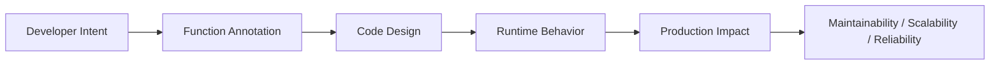
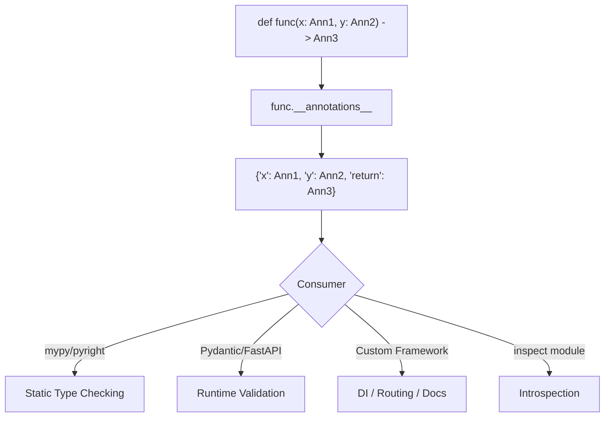

# Function Annotation

## Overview

**Function annotation** in Python is the mechanism for attaching metadata to function parameters and return values using the `:` and `->` syntax. Introduced in PEP 3107 (Python 3.0), annotations are stored in the function's `__annotations__` dictionary and are accessible at runtime.

While type hints (PEP 484) are the most common use of annotations, annotations are a general-purpose metadata mechanism — they can hold any Python object: types, strings, validators, documentation, or custom metadata objects. This makes them a powerful foundation for frameworks, dependency injection, validation libraries, and documentation generators.

---

## Why It Matters





---

## Simple Example

```python
# Basic function annotations

def add(x: int, y: int) -> int:
    return x + y

def greet(name: str, greeting: str = "Hello") -> str:
    return f"{greeting}, {name}!"

def process(data: list[str]) -> dict[str, int]:
    return {item: len(item) for item in data}

# Accessing annotations at runtime
print(add.__annotations__)
print(greet.__annotations__)

# Annotations are NOT enforced at runtime
result = add("3", "4")  # No error at runtime — returns "34"
print(result)

# inspect module for richer introspection
import inspect
sig = inspect.signature(add)
for name, param in sig.parameters.items():
    print(f"  {name}: annotation={param.annotation}, default={param.default}")
print(f"  return: {sig.return_annotation}")
```

**Explanation:**
- Annotations are stored in `__annotations__` as a dictionary.
- `"return"` is the key for the return annotation.
- Annotations are not enforced — they are metadata only.
- `inspect.signature()` provides a richer view of the function signature.

**Expected output:**
```
{'x': <class 'int'>, 'y': <class 'int'>, 'return': <class 'int'>}
{'name': <class 'str'>, 'greeting': <class 'str'>, 'return': <class 'str'>}
34
  x: annotation=<class 'int'>, default=<class 'inspect._empty'>
  y: annotation=<class 'int'>, default=<class 'inspect._empty'>
  return: <class 'int'>
```

---

## Intermediate Example

### Custom Annotation-Based Validator

```python
import inspect
from typing import get_type_hints, Any, Callable, TypeVar
from functools import wraps

F = TypeVar("F", bound=Callable)

def validate_types(func: F) -> F:
    """Decorator that enforces type annotations at runtime."""
    hints = get_type_hints(func)

    @wraps(func)
    def wrapper(*args, **kwargs):
        sig = inspect.signature(func)
        bound = sig.bind(*args, **kwargs)
        bound.apply_defaults()

        for param_name, value in bound.arguments.items():
            if param_name in hints:
                expected_type = hints[param_name]
                if not isinstance(value, expected_type):
                    raise TypeError(
                        f"Argument '{param_name}' must be {expected_type.__name__}, "
                        f"got {type(value).__name__}"
                    )
        result = func(*args, **kwargs)

        if "return" in hints and hints["return"] is not type(None):
            if not isinstance(result, hints["return"]):
                raise TypeError(
                    f"Return value must be {hints['return'].__name__}, "
                    f"got {type(result).__name__}"
                )
        return result

    return wrapper  # type: ignore

@validate_types
def divide(a: float, b: float) -> float:
    return a / b

@validate_types
def repeat(text: str, times: int) -> str:
    return text * times

# Valid calls
print(divide(10.0, 2.0))
print(repeat("hi", 3))

# Invalid calls
try:
    divide("10", 2.0)
except TypeError as e:
    print(f"TypeError: {e}")

try:
    repeat("hi", "3")
except TypeError as e:
    print(f"TypeError: {e}")
```

**Explanation:**
- `get_type_hints()` resolves forward references and returns the annotation dict.
- `inspect.signature().bind()` maps positional and keyword arguments to parameter names.
- The decorator enforces type annotations at runtime — useful for debugging and testing.
- `@wraps(func)` preserves the original function's metadata.

**Expected output:**
```
5.0
hihihi
TypeError: Argument 'a' must be float, got str
TypeError: Argument 'times' must be int, got str
```

---

## Advanced / Architect-Level Example

### Annotation-Driven Dependency Injection Container

**Problem context:** A backend framework needs a lightweight dependency injection (DI) container that uses function annotations to automatically resolve and inject dependencies. This is the pattern used by FastAPI, Typer, and many enterprise frameworks.

```python
from __future__ import annotations
import inspect
from typing import Any, Callable, TypeVar, get_type_hints
from dataclasses import dataclass

T = TypeVar("T")

# --- DI Container ---
class Container:
    def __init__(self):
        self._registry: dict[type, Callable] = {}
        self._singletons: dict[type, Any] = {}

    def register(self, interface: type, factory: Callable, singleton: bool = False):
        self._registry[interface] = (factory, singleton)

    def resolve(self, interface: type) -> Any:
        if interface in self._singletons:
            return self._singletons[interface]

        if interface not in self._registry:
            raise KeyError(f"No registration for {interface.__name__}")

        factory, is_singleton = self._registry[interface]
        instance = self._build(factory)

        if is_singleton:
            self._singletons[interface] = instance

        return instance

    def _build(self, factory: Callable) -> Any:
        """Resolve dependencies from annotations and build the object."""
        hints = get_type_hints(factory.__init__ if inspect.isclass(factory) else factory)
        sig = inspect.signature(factory.__init__ if inspect.isclass(factory) else factory)

        kwargs = {}
        for name, param in sig.parameters.items():
            if name == "self":
                continue
            if name in hints:
                dep_type = hints[name]
                kwargs[name] = self.resolve(dep_type)

        return factory(**kwargs)

    def inject(self, func: Callable[..., T]) -> Callable[..., T]:
        """Decorator: auto-inject dependencies from annotations."""
        hints = get_type_hints(func)
        sig = inspect.signature(func)

        def wrapper(*args, **kwargs):
            bound = sig.bind_partial(*args, **kwargs)
            for name, param in sig.parameters.items():
                if name not in bound.arguments and name in hints:
                    kwargs[name] = self.resolve(hints[name])
            return func(*args, **kwargs)

        return wrapper

# --- Domain Classes ---
@dataclass
class DatabaseConfig:
    url: str = "postgresql://localhost/mydb"

class Database:
    def __init__(self, config: DatabaseConfig):
        self.config = config
        print(f"Database connected to {config.url}")

    def query(self, sql: str) -> list[dict]:
        return [{"result": f"Row from: {sql}"}]

class UserRepository:
    def __init__(self, db: Database):
        self.db = db

    def find(self, user_id: int) -> dict:
        rows = self.db.query(f"SELECT * FROM users WHERE id={user_id}")
        return rows[0] if rows else {}

class UserService:
    def __init__(self, repo: UserRepository):
        self.repo = repo

    def get_user(self, user_id: int) -> dict:
        return self.repo.find(user_id)

# --- Wire up the container ---
container = Container()
container.register(DatabaseConfig, DatabaseConfig, singleton=True)
container.register(Database, Database, singleton=True)
container.register(UserRepository, UserRepository)
container.register(UserService, UserService)

# --- Resolve the full dependency graph ---
service = container.resolve(UserService)
user = service.get_user(42)
print(f"User: {user}")

# --- Inject into a standalone function ---
@container.inject
def handle_request(user_id: int, service: UserService) -> str:
    user = service.get_user(user_id)
    return f"Handling request for user: {user}"

print(handle_request(1))
```

**Explanation:**
- The container reads `__init__` annotations to discover dependencies.
- `get_type_hints()` resolves the annotation types.
- `inspect.signature().bind_partial()` maps provided args and identifies missing ones.
- The `@inject` decorator auto-fills missing parameters from the container.
- This is the core pattern behind FastAPI's `Depends()` and many enterprise DI frameworks.

**Design trade-offs:**
| Approach | Pros | Cons |
|---|---|---|
| Annotation-based DI | Zero boilerplate, self-documenting | Requires runtime introspection |
| Explicit wiring | Transparent, no magic | Verbose |
| `inject` library | Full-featured | External dependency |
| FastAPI `Depends` | Production-grade | Framework-specific |

---

## Common Mistakes

### 1. Confusing `__annotations__` with `get_type_hints()`
```python
from __future__ import annotations
from typing import get_type_hints

def func(x: int) -> str: ...

# __annotations__ returns raw strings when from __future__ import annotations is used
print(func.__annotations__)  # {'x': 'int', 'return': 'str'}

# get_type_hints() resolves them to actual types
print(get_type_hints(func))  # {'x': <class 'int'>, 'return': <class 'str'>}
```

### 2. Using annotations for non-type metadata without a framework
- **Problem:** Annotations like `x: "required"` are confusing if the codebase also uses type hints.
- **Better approach:** Use a dedicated metadata mechanism (e.g., `Field()` in Pydantic, `Annotated[]`).

### 3. Forgetting that annotations are not enforced
- **Problem:** Assuming `def func(x: int)` will reject non-integers.
- **Better approach:** Use a validation decorator, Pydantic, or `beartype` for runtime enforcement.

### 4. Using `Annotated` incorrectly
```python
from typing import Annotated

# Annotated[type, metadata] — first arg is the type, rest is metadata
def func(x: Annotated[int, "must be positive"]) -> None: ...
# The type is int; "must be positive" is metadata for frameworks to use
```

### 5. Calling `get_type_hints()` on methods without the class
- **Problem:** `get_type_hints(obj.method)` may fail for forward references.
- **Better approach:** Pass the class's `__globals__` or use `get_type_hints(Class.method, globalns=vars(module))`.

---

## Best Practices

- **Use `get_type_hints()`** instead of `__annotations__` when you need resolved types.
- **Use `Annotated[type, metadata]`** to attach extra metadata alongside type hints.
- **Use `inspect.signature()`** for full parameter introspection (defaults, kinds, annotations).
- **Use `@wraps(func)`** in decorators that wrap annotated functions to preserve `__annotations__`.
- **Document annotation conventions** in your framework — annotations are a contract.
- **Use `from __future__ import annotations`** for forward references and lazy evaluation.
- **Avoid overloading annotations** with non-type metadata in codebases that use mypy — use `Annotated` instead.

---

## Performance Considerations

- **`__annotations__`** access is O(1) — it is just a dictionary lookup.
- **`get_type_hints()`** evaluates string annotations and resolves forward references — has overhead. Cache the result if called frequently.
- **`inspect.signature()`** is relatively expensive — cache it for hot paths.
- **Runtime type validation** (via annotations) adds overhead proportional to the number of parameters. Use it in development/testing; consider disabling in production hot paths.

---

## Testing Strategy

```python
# tests/test_annotations.py
import pytest
import inspect
from typing import get_type_hints
from mymodule import divide, repeat, validate_types

def test_annotations_stored_correctly():
    hints = get_type_hints(divide)
    assert hints["a"] is float
    assert hints["b"] is float
    assert hints["return"] is float

def test_validate_types_passes_valid_args():
    assert divide(10.0, 2.0) == 5.0

def test_validate_types_rejects_wrong_type():
    with pytest.raises(TypeError, match="must be float"):
        divide("10", 2.0)

def test_validate_types_rejects_wrong_return():
    @validate_types
    def bad_return(x: int) -> str:
        return x  # Returns int, not str

    with pytest.raises(TypeError, match="Return value must be str"):
        bad_return(5)

def test_inspect_signature():
    sig = inspect.signature(divide)
    params = list(sig.parameters.keys())
    assert params == ["a", "b"]
    assert sig.return_annotation is float

def test_annotated_metadata():
    from typing import Annotated, get_type_hints
    def func(x: Annotated[int, "positive"]) -> None: ...
    hints = get_type_hints(func, include_extras=True)
    from typing import get_args
    assert get_args(hints["x"])[1] == "positive"
```

---

## Debugging Tips

- **`func.__annotations__`** — raw annotation dict (strings if `from __future__ import annotations`).
- **`get_type_hints(func)`** — resolved annotation dict (actual types).
- **`inspect.signature(func)`** — full signature with parameters, defaults, and annotations.
- **`inspect.Parameter.empty`** — sentinel for missing defaults/annotations.
- **`typing.get_args(hint)`** — extract type arguments from generic hints (e.g., `list[str]` → `(str,)`).
- **`typing.get_origin(hint)`** — get the origin of a generic hint (e.g., `list[str]` → `list`).
- If `get_type_hints()` raises `NameError`, a forward reference cannot be resolved — check that the referenced class is in scope.

---

## Interview Questions

### Beginner
1. **What is a function annotation in Python?**
   *Metadata attached to function parameters and return values using `:` and `->` syntax, stored in `__annotations__`.*

2. **Where are annotations stored?**
   *In the function's `__annotations__` dictionary.*

3. **Are annotations enforced at runtime?**
   *No. Python ignores annotations at runtime. They are metadata only.*

4. **What is the key for the return annotation in `__annotations__`?**
   *`"return"`.*

5. **What does `get_type_hints(func)` do differently from `func.__annotations__`?**
   *`get_type_hints()` resolves string annotations (forward references) to actual type objects.*

### Intermediate
1. **What is `Annotated` and how is it used?**
   *`Annotated[type, metadata]` attaches extra metadata to a type hint. Frameworks like Pydantic and FastAPI use it for validation rules, field descriptions, etc.*

2. **How does `inspect.signature()` differ from `__annotations__`?**
   *`inspect.signature()` provides the full parameter specification including defaults, parameter kinds (positional, keyword, etc.), and annotations. `__annotations__` only has the annotation dict.*

3. **How would you write a decorator that logs function calls using annotations?**
   *Use `get_type_hints()` to get parameter types, `inspect.signature().bind()` to map args to names, and log each parameter with its type and value.*

4. **What is `from __future__ import annotations` and how does it affect `__annotations__`?**
   *It makes all annotations lazy — stored as strings instead of evaluated objects. This enables forward references and improves import performance. Use `get_type_hints()` to resolve them.*

5. **How does FastAPI use function annotations?**
   *FastAPI reads parameter annotations to determine: path/query/body parameters, their types, validation rules (via `Annotated`), and dependency injection (via `Depends`). It generates OpenAPI schemas from annotations.*

### Advanced / Architect-Level
1. **How would you build a DI container using function annotations?**
   *Use `get_type_hints()` to discover parameter types. Resolve each type from the registry. Use `inspect.signature().bind()` to inject resolved dependencies. Cache singletons.*

2. **What is the difference between `__annotations__` and `typing.get_type_hints()` in the context of `from __future__ import annotations`?**
   *With `from __future__ import annotations`, `__annotations__` contains strings. `get_type_hints()` evaluates those strings in the correct namespace, returning actual type objects.*

3. **How does Pydantic use annotations for validation?**
   *Pydantic reads `__annotations__` on model classes, resolves types via `get_type_hints()`, and generates validators for each field. `Annotated` metadata (e.g., `Field(gt=0)`) provides additional constraints.*

4. **What are the security implications of using `eval()` to resolve annotations?**
   *`get_type_hints()` uses `eval()` internally to resolve string annotations. If user-controlled strings can reach `__annotations__`, this is a code injection risk. Always validate annotation sources in plugin systems.*

5. **How would you use annotations to implement a CLI argument parser?**
   *Read function annotations to determine argument types. Use `inspect.signature()` for defaults. Map Python types to CLI argument types (str→string, int→integer, bool→flag). This is exactly how `typer` and `click` work.*

---

## Key Takeaways

- Function annotations are stored in `__annotations__` and are **not enforced at runtime**.
- Use **`get_type_hints()`** to resolve forward references — not `__annotations__` directly.
- **`Annotated[type, metadata]`** attaches extra metadata for frameworks to consume.
- **`inspect.signature()`** provides full parameter introspection.
- Annotations power **type checking, DI, validation, routing, and documentation** in modern frameworks.
- **`from __future__ import annotations`** makes annotations lazy — always use `get_type_hints()` to resolve them.
- Annotations are a **general-purpose metadata mechanism** — not just for types.

---

## Mini Project Idea

### Project: `annotate-di` — Annotation-Driven Dependency Injection Framework

**Goal:** Build a lightweight, production-quality DI container that uses function annotations for automatic dependency resolution, with support for singletons, factories, and scoped lifetimes.

**Features:**
- `@injectable` decorator to mark classes as injectable.
- `Container.register(interface, implementation)` for explicit registration.
- `Container.resolve(type)` for automatic dependency resolution via annotations.
- Singleton, transient, and scoped lifetimes.
- `@inject` decorator for function-level injection.
- Circular dependency detection with clear error messages.

**Suggested folder structure:**
```
annotate_di/
├── .venv/
├── pyproject.toml
├── src/
│   └── annotate_di/
│       ├── __init__.py
│       ├── container.py     # DI container
│       ├── decorators.py    # @injectable, @inject
│       ├── lifetime.py      # Singleton, Transient, Scoped
│       └── exceptions.py    # CircularDependencyError, etc.
└── tests/
    ├── test_container.py
    └── test_decorators.py
```

**Extension ideas:**
- Add async factory support.
- Generate a dependency graph visualization (Mermaid/Graphviz).
- Add FastAPI integration as a `Depends`-compatible resolver.
- Support `Annotated` metadata for named bindings.

---

## Final Summary

Function annotations are the foundation of Python's modern type system and a powerful metadata mechanism for frameworks. Understanding how annotations work — how they are stored, resolved, and consumed — is essential for building frameworks, DI containers, validation libraries, and documentation generators. Architects who master annotations can design systems where the function signature itself is the contract: self-documenting, statically checkable, and dynamically introspectable. This is the pattern that powers FastAPI, Pydantic, Typer, and countless enterprise Python frameworks.
