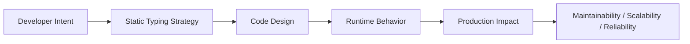
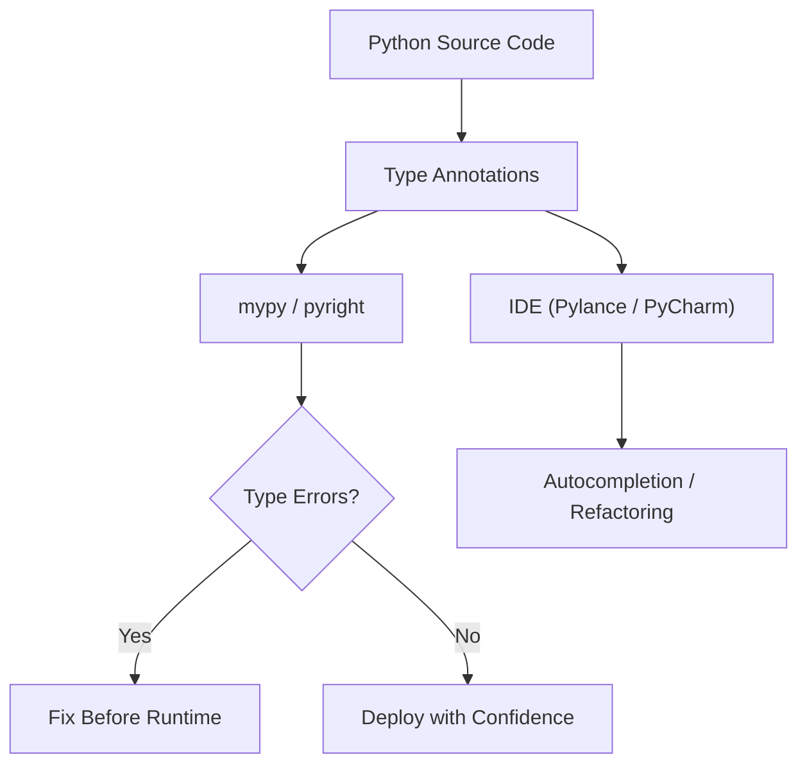

# Static Typing

## Overview

**Static typing** in Python refers to the practice of using type hints combined with static analysis tools — primarily **mypy** and **pyright** — to catch type errors before the code runs. Python remains dynamically typed at runtime, but static typing adds an optional compile-time-like safety layer.

Static typing is not a single feature but a discipline: writing type-annotated code, running a type checker in CI, and designing APIs with type safety in mind. In production systems — large codebases, team environments, AI pipelines, and enterprise backends — static typing is the difference between confident refactoring and fearful guessing.

---

## Why It Matters





---

## Simple Example

```python
# mypy: strict mode example

def calculate_discount(price: float, discount_pct: float) -> float:
    """Apply a percentage discount to a price."""
    if not 0 <= discount_pct <= 100:
        raise ValueError(f"discount_pct must be 0-100, got {discount_pct}")
    return price * (1 - discount_pct / 100)

def format_price(amount: float, currency: str = "USD") -> str:
    return f"{currency} {amount:.2f}"

# Type-safe usage
price = calculate_discount(99.99, 20.0)
print(format_price(price))

# mypy would catch this at analysis time:
# calculate_discount("99.99", 20)  # error: Argument 1 has incompatible type "str"; expected "float"
```

```bash
# Run mypy
mypy mymodule.py --strict
# Success: no issues found in 1 source file
```

**Explanation:**
- Type annotations declare the contract.
- `mypy --strict` enforces complete type coverage.
- Errors are caught before the code runs — no need to write a test for every type mismatch.

**Expected output:**
```
USD 79.99
```

---

## Intermediate Example

### Configuring mypy and pyright for a Production Project

```toml
# pyproject.toml

[tool.mypy]
python_version = "3.11"
strict = true
warn_return_any = true
warn_unused_ignores = true
disallow_untyped_defs = true
disallow_any_generics = true
no_implicit_optional = true
show_error_codes = true
exclude = ["tests/", "migrations/"]

[tool.pyright]
pythonVersion = "3.11"
typeCheckingMode = "strict"
reportMissingImports = true
reportMissingTypeStubs = false
```

```python
# src/myapp/models.py
from __future__ import annotations
from dataclasses import dataclass, field
from typing import Optional
from datetime import datetime

@dataclass
class User:
    user_id: int
    username: str
    email: str
    created_at: datetime = field(default_factory=datetime.utcnow)
    role: str = "viewer"
    last_login: Optional[datetime] = None

    def is_admin(self) -> bool:
        return self.role == "admin"

    def display_name(self) -> str:
        return f"{self.username} <{self.email}>"

# src/myapp/repository.py
from __future__ import annotations
from typing import Optional
from .models import User

class UserRepository:
    def __init__(self) -> None:
        self._store: dict[int, User] = {}

    def save(self, user: User) -> None:
        self._store[user.user_id] = user

    def find_by_id(self, user_id: int) -> Optional[User]:
        return self._store.get(user_id)

    def find_all(self) -> list[User]:
        return list(self._store.values())
```

```bash
# CI pipeline step
mypy src/ --strict
pyright src/
```

**Explanation:**
- `pyproject.toml` centralizes type checker configuration.
- `strict = true` in mypy enables all optional checks.
- `from __future__ import annotations` enables forward references.
- Both mypy and pyright are run in CI for maximum coverage.

---

## Advanced / Architect-Level Example

### Type-Safe Plugin Architecture with `TypeVar`, `Protocol`, and `overload`

**Problem context:** A data processing framework supports pluggable transformers. Each transformer takes a specific input type and returns a specific output type. The framework must be type-safe: the pipeline's type is inferred from the transformers it contains.

```python
from __future__ import annotations
from typing import TypeVar, Generic, Protocol, overload, Callable
from dataclasses import dataclass

# --- Type Variables ---
InputT  = TypeVar("InputT")
OutputT = TypeVar("OutputT")
MidT    = TypeVar("MidT")

# --- Transformer Protocol ---
class Transformer(Protocol[InputT, OutputT]):
    def transform(self, data: InputT) -> OutputT:
        ...

# --- Concrete Transformers ---
@dataclass
class TextNormalizer:
    lowercase: bool = True

    def transform(self, data: str) -> str:
        return data.lower() if self.lowercase else data

@dataclass
class Tokenizer:
    def transform(self, data: str) -> list[str]:
        return data.split()

@dataclass
class WordCounter:
    def transform(self, data: list[str]) -> dict[str, int]:
        counts: dict[str, int] = {}
        for word in data:
            counts[word] = counts.get(word, 0) + 1
        return counts

# --- Type-Safe Pipeline ---
class Pipeline(Generic[InputT, OutputT]):
    def __init__(self, transformer: Transformer[InputT, OutputT]) -> None:
        self._transformer = transformer

    def then(self, next_transformer: Transformer[OutputT, MidT]) -> Pipeline[InputT, MidT]:
        """Chain a new transformer, returning a new pipeline with updated types."""
        outer = self

        class ChainedTransformer:
            def transform(self, data: InputT) -> MidT:  # type: ignore[override]
                intermediate = outer._transformer.transform(data)
                return next_transformer.transform(intermediate)  # type: ignore[arg-type]

        return Pipeline(ChainedTransformer())

    def run(self, data: InputT) -> OutputT:
        return self._transformer.transform(data)

# --- overload for type-safe dispatch ---
@overload
def parse_value(value: str) -> str: ...
@overload
def parse_value(value: int) -> int: ...
@overload
def parse_value(value: float) -> float: ...

def parse_value(value: str | int | float) -> str | int | float:
    if isinstance(value, str):
        return value.strip()
    return value

# --- Usage ---
pipeline: Pipeline[str, dict[str, int]] = (
    Pipeline(TextNormalizer())
    .then(Tokenizer())
    .then(WordCounter())
)

result = pipeline.run("Hello World hello Python world")
print(result)

# Type-safe overloaded function
s: str = parse_value("  hello  ")
n: int = parse_value(42)
print(s, n)
```

**Explanation:**
- `Generic[InputT, OutputT]` makes `Pipeline` type-safe — the type flows through the chain.
- `Protocol[InputT, OutputT]` defines the transformer contract structurally.
- `@overload` provides type-safe dispatch for functions with multiple signatures.
- mypy/pyright infer the full pipeline type from the transformer chain.

**Design trade-offs:**
| Approach | Pros | Cons |
|---|---|---|
| `Generic` pipeline | Full type inference | Complex type signatures |
| `Protocol` | No inheritance required | Less IDE support than ABC |
| `@overload` | Precise per-signature types | Boilerplate |
| `Any` everywhere | Simple | Defeats the purpose |

---

## Common Mistakes

### 1. Using `# type: ignore` as a crutch
```python
# Bad — silences all errors on the line
result = some_function()  # type: ignore

# Better — use a specific error code
result = some_function()  # type: ignore[return-value]
```

### 2. Not running mypy in CI
- **Problem:** Type hints without a type checker are just documentation — they don't catch bugs.
- **Better approach:** Add `mypy src/ --strict` as a required CI step.

### 3. Annotating with `Any` to silence errors
- **Problem:** `Any` disables type checking for that variable — it is contagious.
- **Better approach:** Use `cast()` for unavoidable type coercions; narrow types with `isinstance()`.

### 4. Forgetting `py.typed` marker for libraries
- **Problem:** Without a `py.typed` file, mypy ignores your library's type hints.
- **Better approach:** Add an empty `py.typed` file to your package root and declare it in `pyproject.toml`.

### 5. Using mutable default arguments without `field(default_factory=...)`
```python
# Bad — mypy may not catch this, but it's a runtime bug
@dataclass
class Config:
    tags: list[str] = []  # Shared mutable default!

# Good
from dataclasses import field
@dataclass
class Config:
    tags: list[str] = field(default_factory=list)
```

---

## Best Practices

- **Run `mypy --strict` in CI** — make it a required check, not optional.
- **Use `pyright` alongside mypy** — they catch different errors.
- **Use `from __future__ import annotations`** in all modules.
- **Use `cast()` sparingly** — only when you know more than the type checker.
- **Use `TYPE_CHECKING`** guard for imports only needed for type hints (avoids circular imports).
- **Add `py.typed`** to all published packages.
- **Use `reveal_type(x)`** during development to inspect inferred types.
- **Annotate all public APIs completely** — internal helpers can be less strict.
- **Use `Final`** for constants, `ClassVar` for class-level attributes.

```python
from typing import TYPE_CHECKING
if TYPE_CHECKING:
    from mymodule import HeavyClass  # Only imported during type checking
```

---

## Performance Considerations

Static typing has **zero runtime performance impact** — type annotations are metadata only. The type checker runs at development/CI time, not at runtime.

The only runtime overhead:
- `get_type_hints()` evaluates annotations — cache results if called frequently.
- `isinstance()` checks for type narrowing are fast (O(1)).
- `beartype` (runtime type enforcement) adds overhead proportional to annotation complexity.

---

## Testing Strategy

```python
# tests/test_static_typing.py
# Static typing is tested by mypy/pyright, not pytest.
# pytest tests focus on runtime behavior.

# However, you can test type narrowing and runtime behavior:
import pytest
from mymodule import calculate_discount, UserRepository, User
from datetime import datetime

def test_calculate_discount_valid():
    assert calculate_discount(100.0, 20.0) == 80.0

def test_calculate_discount_zero():
    assert calculate_discount(100.0, 0.0) == 100.0

def test_calculate_discount_invalid_pct():
    with pytest.raises(ValueError):
        calculate_discount(100.0, 150.0)

def test_user_repository_type_safety():
    repo = UserRepository()
    user = User(1, "alice", "alice@example.com", datetime.utcnow())
    repo.save(user)
    found = repo.find_by_id(1)
    assert found is not None
    assert found.username == "alice"

def test_find_by_id_returns_none():
    repo = UserRepository()
    assert repo.find_by_id(999) is None
```

```bash
# CI pipeline
mypy src/ --strict
pyright src/
pytest tests/
```

---

## Debugging Tips

- **`reveal_type(x)`** — insert in source; mypy prints the inferred type.
- **`mypy --show-error-codes`** — shows error codes like `[arg-type]`, `[return-value]`.
- **`mypy --show-column-numbers`** — precise error location.
- **`mypy --ignore-missing-imports`** — suppress errors for untyped third-party libraries.
- **`cast(Type, value)`** — tell the type checker to treat `value` as `Type` (no runtime effect).
- **`TYPE_CHECKING`** — import types only during type checking to avoid circular imports.
- **Pylance in VS Code** — hover over any variable to see its inferred type; red underlines show type errors.
- If mypy reports `error: Cannot determine type of "x"`, add an explicit annotation.

---

## Interview Questions

### Beginner
1. **What is static typing in Python?**
   *Using type hints combined with tools like mypy/pyright to catch type errors before runtime.*

2. **Does Python enforce type hints at runtime?**
   *No. Python ignores type hints at runtime. They are only used by static analysis tools.*

3. **What is mypy?**
   *A static type checker for Python that analyzes type annotations and reports type errors.*

4. **What does `mypy --strict` do?**
   *Enables all optional mypy checks, requiring complete type coverage.*

5. **What is `reveal_type(x)` used for?**
   *A mypy directive that prints the inferred type of `x` during static analysis.*

### Intermediate
1. **What is the difference between mypy and pyright?**
   *Both are Python type checkers. mypy is the reference implementation (Python). pyright (Microsoft) is faster, powers Pylance in VS Code, and has stricter inference in some areas. Running both catches more errors.*

2. **What is `py.typed` and why is it needed?**
   *An empty marker file that tells mypy a package includes type information. Without it, mypy ignores the package's annotations.*

3. **What is `TYPE_CHECKING` and when should you use it?**
   *`typing.TYPE_CHECKING` is `False` at runtime but `True` during type checking. Use it to guard imports that are only needed for type hints, avoiding circular imports.*

4. **What is `cast()` and when should you use it?**
   *`cast(Type, value)` tells the type checker to treat `value` as `Type`. It has no runtime effect. Use it sparingly when you know more than the type checker.*

5. **What is `Final` and `ClassVar`?**
   *`Final[T]` marks a variable as a constant (cannot be reassigned). `ClassVar[T]` marks a class-level attribute (not an instance attribute).*

### Advanced / Architect-Level
1. **How would you enforce static typing in a large team codebase?**
   *Add `mypy --strict` and `pyright` as required CI checks. Use pre-commit hooks. Set `disallow_untyped_defs = true`. Gradually increase strictness. Use `# type: ignore[code]` with justification comments.*

2. **What is `ParamSpec` and how does it enable type-safe decorators?**
   *`ParamSpec` captures the parameter types of a callable. Combined with `TypeVar`, it allows decorators to preserve the wrapped function's full signature, enabling type-safe wrapping.*

3. **How do you handle third-party libraries without type stubs?**
   *Use `--ignore-missing-imports` for mypy. Install stubs from `typeshed` or `types-*` packages. Write local stubs in a `stubs/` directory. Use `Any` at the boundary and narrow types immediately.*

4. **What is `TypeGuard` and how does it improve type narrowing?**
   *`TypeGuard[T]` is a return type for type narrowing functions. If the function returns `True`, mypy narrows the argument's type to `T` in the `if` branch.*

5. **How would you design a type-safe event system using `Generic` and `Protocol`?**
   *Define `Event[T]` as a generic dataclass. Define `Handler(Protocol[T])` with a `handle(event: T) -> None` method. Use `EventBus[T]` to register and dispatch typed events. mypy enforces that handlers match their event types.*

---

## Key Takeaways

- Static typing catches bugs **before runtime** — it is a force multiplier for large codebases.
- **mypy** and **pyright** are the two main type checkers — run both in CI.
- **`--strict` mode** enforces complete type coverage.
- Type hints have **zero runtime performance impact**.
- Use **`Protocol`** for structural typing, **`TypeVar`** for generics, **`overload`** for multi-signature functions.
- **`py.typed`** is required for published packages to be recognized by type checkers.
- **`TYPE_CHECKING`** guard prevents circular imports from type-only imports.
- Static typing is a **team discipline** — it requires tooling, configuration, and enforcement.

---

## Mini Project Idea

### Project: `typed-pipeline` — Type-Safe Data Processing Framework

**Goal:** Build a fully type-safe, generic data processing pipeline framework where the type flows through each transformation step, enforced by mypy in strict mode.

**Features:**
- `Pipeline[InputT, OutputT]` generic class.
- `.then(transformer)` method that returns a new `Pipeline` with updated types.
- `.run(data)` method that executes the pipeline.
- Built-in transformers: `Filter`, `Map`, `Reduce`, `Batch`.
- `mypy --strict` passing with zero errors.
- Full test suite.

**Suggested folder structure:**
```
typed_pipeline/
├── .venv/
├── pyproject.toml
├── mypy.ini
├── src/
│   └── typed_pipeline/
│       ├── __init__.py
│       ├── pipeline.py      # Generic Pipeline class
│       ├── transformers.py  # Built-in transformers
│       └── protocols.py     # Transformer protocol
└── tests/
    ├── test_pipeline.py
    └── test_transformers.py
```

**Extension ideas:**
- Add async pipeline support.
- Add parallel execution with `concurrent.futures`.
- Generate a pipeline diagram from the transformer chain.
- Add runtime type enforcement with `beartype`.

---

## Final Summary

Static typing transforms Python from a "trust me" language into a "prove it" language — without sacrificing Python's flexibility and expressiveness. Architects who enforce static typing via mypy/pyright in CI, design with Protocols and Generics, and treat type errors as build failures build systems that are refactorable, self-documenting, and resilient to the class of bugs that only appear at runtime in untyped code. In large teams and long-lived codebases, static typing is not a luxury — it is a professional standard.
