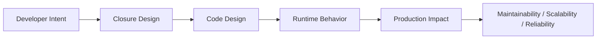
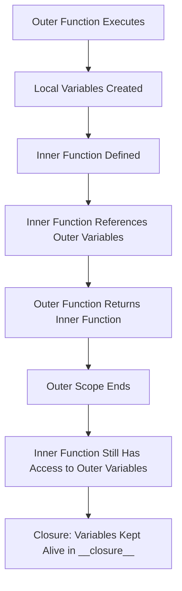

# Closures

## Overview

A **closure** is a function that retains access to variables from its enclosing scope even after that scope has finished executing. In Python, closures are created when a nested (inner) function references variables from its enclosing (outer) function. The inner function "closes over" those variables, keeping them alive.

Closures are a foundational concept in functional programming and are the mechanism behind decorators, factory functions, memoization, and stateful callbacks. In production systems — AI agents, middleware, configuration factories, and plugin systems — closures enable elegant, lightweight stateful behavior without classes.

---

## Why It Matters





---

## Simple Example

```python
# Basic closure: a counter factory

def make_counter(start: int = 0):
    count = start  # Enclosed variable

    def increment(step: int = 1) -> int:
        nonlocal count
        count += step
        return count

    def reset() -> None:
        nonlocal count
        count = start

    def get() -> int:
        return count

    return increment, reset, get

# Create two independent counters
inc_a, reset_a, get_a = make_counter(0)
inc_b, reset_b, get_b = make_counter(100)

print(inc_a())    # 1
print(inc_a())    # 2
print(inc_a(5))   # 7
print(get_a())    # 7

print(inc_b())    # 101
print(inc_b())    # 102

reset_a()
print(get_a())    # 0  (reset to start)
print(get_b())    # 102 (independent)

# Inspect the closure
print(inc_a.__closure__)  # tuple of cell objects
print(inc_a.__code__.co_freevars)  # ('count', 'start')
```

**Explanation:**
- `count` and `start` are enclosed variables — they live in the closure's `__closure__` cells.
- `nonlocal count` allows the inner function to modify the enclosed variable.
- Each call to `make_counter()` creates an independent closure with its own `count`.
- `__closure__` and `__code__.co_freevars` expose the closure internals.

**Expected output:**
```
1
2
7
7
101
102
0
102
```

---

## Intermediate Example

### Closure-Based Middleware Factory

```python
from typing import Callable, Any
import time
import logging

logging.basicConfig(level=logging.INFO)
logger = logging.getLogger(__name__)

# Type alias
Handler = Callable[..., Any]

def with_logging(logger_name: str = "app") -> Callable[[Handler], Handler]:
    """Closure factory: creates a logging middleware for any function."""
    log = logging.getLogger(logger_name)

    def decorator(func: Handler) -> Handler:
        def wrapper(*args, **kwargs):
            log.info("Calling %s with args=%s kwargs=%s", func.__name__, args, kwargs)
            try:
                result = func(*args, **kwargs)
                log.info("%s returned %s", func.__name__, result)
                return result
            except Exception as e:
                log.error("%s raised %s: %s", func.__name__, type(e).__name__, e)
                raise
        wrapper.__name__ = func.__name__
        return wrapper
    return decorator

def with_retry(max_attempts: int = 3, delay: float = 1.0) -> Callable[[Handler], Handler]:
    """Closure factory: creates a retry middleware."""
    def decorator(func: Handler) -> Handler:
        def wrapper(*args, **kwargs):
            last_exc = None
            for attempt in range(1, max_attempts + 1):
                try:
                    return func(*args, **kwargs)
                except Exception as e:
                    last_exc = e
                    if attempt < max_attempts:
                        logger.warning("Attempt %d/%d failed: %s. Retrying...", attempt, max_attempts, e)
                        time.sleep(delay)
            raise last_exc  # type: ignore
        return wrapper
    return decorator

# Apply closures as decorators
@with_logging("api")
@with_retry(max_attempts=3, delay=0.1)
def fetch_data(url: str) -> dict:
    import random
    if random.random() < 0.5:
        raise ConnectionError(f"Failed to connect to {url}")
    return {"url": url, "data": "..."}

# Usage
try:
    result = fetch_data("https://api.example.com/data")
    print(result)
except ConnectionError as e:
    print(f"All retries failed: {e}")
```

**Explanation:**
- `with_logging` and `with_retry` are closure factories — they capture `logger_name`, `max_attempts`, and `delay` in their closures.
- Each decorator returns a new function that closes over the configuration.
- Stacking decorators composes the closures.

---

## Advanced / Architect-Level Example

### Closure-Based Configuration and Dependency Injection for an AI Agent

**Problem context:** An AI agent framework needs configurable tool functions that capture their configuration (API keys, model names, timeouts) at initialization time, without passing configuration through every call. Closures provide a clean, lightweight alternative to classes for this pattern.

```python
from __future__ import annotations
from typing import Callable, Any
import hashlib
import time

# --- Tool Factory using Closures ---
def make_llm_caller(
    model: str,
    api_key: str,
    temperature: float = 0.7,
    max_tokens: int = 512,
) -> Callable[[str], str]:
    """
    Returns a configured LLM caller function.
    The configuration is captured in the closure — not passed on every call.
    """
    call_count = 0  # Mutable state in closure

    def call_llm(prompt: str) -> str:
        nonlocal call_count
        call_count += 1
        # Simulate LLM call
        response = f"[{model}] Response to: {prompt[:50]}... (call #{call_count})"
        return response

    def get_stats() -> dict[str, Any]:
        return {
            "model": model,
            "temperature": temperature,
            "max_tokens": max_tokens,
            "total_calls": call_count,
        }

    # Attach stats as an attribute of the closure function
    call_llm.get_stats = get_stats  # type: ignore[attr-defined]
    return call_llm

def make_vector_retriever(
    collection: str,
    top_k: int = 5,
    score_threshold: float = 0.7,
) -> Callable[[str], list[dict]]:
    """Returns a configured vector retriever function."""
    cache: dict[str, list[dict]] = {}

    def retrieve(query: str) -> list[dict]:
        cache_key = hashlib.md5(query.encode()).hexdigest()
        if cache_key in cache:
            return cache[cache_key]

        # Simulate retrieval
        results = [
            {"doc_id": f"{collection}_{i}", "text": f"Doc {i} for '{query}'", "score": 0.9 - i * 0.05}
            for i in range(top_k)
            if 0.9 - i * 0.05 >= score_threshold
        ]
        cache[cache_key] = results
        return results

    def clear_cache() -> None:
        cache.clear()

    retrieve.clear_cache = clear_cache  # type: ignore[attr-defined]
    return retrieve

# --- Agent using closure-based tools ---
def make_rag_agent(
    llm: Callable[[str], str],
    retriever: Callable[[str], list[dict]],
) -> Callable[[str], str]:
    """Compose an agent from closure-based tools."""
    query_count = 0

    def agent(question: str) -> str:
        nonlocal query_count
        query_count += 1

        docs = retriever(question)
        context = "\n".join(d["text"] for d in docs[:3])
        prompt = f"Context:\n{context}\n\nQuestion: {question}"
        answer = llm(prompt)
        return answer

    def get_stats() -> dict[str, Any]:
        return {
            "query_count": query_count,
            "llm_stats": llm.get_stats(),  # type: ignore[attr-defined]
        }

    agent.get_stats = get_stats  # type: ignore[attr-defined]
    return agent

# --- Wire up ---
llm = make_llm_caller(model="gpt-4o", api_key="sk-...", temperature=0.3)
retriever = make_vector_retriever(collection="docs", top_k=5)
agent = make_rag_agent(llm=llm, retriever=retriever)

# Use the agent
print(agent("What is RAG?"))
print(agent("How do embeddings work?"))
print(agent("What is RAG?"))  # Cached retrieval

print(agent.get_stats())  # type: ignore[attr-defined]
```

**Explanation:**
- Each factory function captures its configuration in a closure — no class needed.
- Mutable state (`call_count`, `cache`) is maintained across calls via `nonlocal` and mutable objects.
- Functions are composed into an agent — the agent itself is a closure.
- Stats and cache management are attached as attributes on the closure functions.

**Design trade-offs:**
| Approach | Pros | Cons |
|---|---|---|
| Closure | Lightweight, no class boilerplate | Harder to inspect/serialize |
| Class | Explicit state, inspectable | More boilerplate |
| `functools.partial` | Simple for fixed args | No mutable state |
| Dataclass + `__call__` | Best of both | More verbose |

---

## Common Mistakes

### 1. The classic loop closure bug
```python
# Bad — all functions capture the same variable 'i'
funcs = [lambda: i for i in range(5)]
print([f() for f in funcs])  # [4, 4, 4, 4, 4] — all see i=4

# Good — capture the value at each iteration
funcs = [lambda i=i: i for i in range(5)]
print([f() for f in funcs])  # [0, 1, 2, 3, 4]
```

### 2. Forgetting `nonlocal` when modifying enclosed variables
```python
# Bad — creates a new local variable instead of modifying the enclosed one
def make_counter():
    count = 0
    def increment():
        count += 1  # UnboundLocalError: count referenced before assignment
        return count
    return increment

# Good
def make_counter():
    count = 0
    def increment():
        nonlocal count
        count += 1
        return count
    return increment
```

### 3. Memory leaks from long-lived closures
- **Problem:** Closures keep their enclosed variables alive. If a closure captures a large object (e.g., a DataFrame), it prevents garbage collection.
- **Better approach:** Capture only what you need. Use `del` to release references when done.

### 4. Overusing closures when a class is clearer
- **Problem:** Complex closures with many enclosed variables and multiple inner functions become hard to read.
- **Better approach:** If a closure has more than 2-3 enclosed variables and 3+ inner functions, consider a class.

### 5. Mutating a list/dict in a closure without `nonlocal`
```python
# This works — mutating a mutable object doesn't require nonlocal
def make_store():
    data = {}
    def set(key, value):
        data[key] = value  # OK — mutating the dict, not rebinding 'data'
    def get(key):
        return data.get(key)
    return set, get
```

---

## Best Practices

- **Use `nonlocal`** when you need to rebind an enclosed variable (not just mutate it).
- **Use default argument capture** (`lambda i=i: i`) to capture loop variables by value.
- **Keep closures small** — if you need many enclosed variables, use a class.
- **Use closures for factory functions** — they are ideal for creating configured, reusable functions.
- **Attach metadata as function attributes** (`func.stats = ...`) for introspection.
- **Use `functools.wraps`** in closure-based decorators to preserve function metadata.
- **Avoid capturing large objects** in long-lived closures — it prevents garbage collection.

---

## Performance Considerations

- Closures have a **small overhead** compared to regular functions — accessing enclosed variables requires an extra indirection through the cell object.
- For hot loops, this overhead is measurable but usually negligible.
- **Mutable state in closures** (via `nonlocal`) is not thread-safe — use `threading.Lock` if shared across threads.
- **Caching in closures** (e.g., a `dict` cache) is effective but not bounded — add a size limit for production use.

---

## Testing Strategy

```python
# tests/test_closures.py
import pytest
from mymodule import make_counter, make_llm_caller, make_vector_retriever

def test_counter_increments():
    inc, reset, get = make_counter(0)
    assert inc() == 1
    assert inc() == 2
    assert inc(5) == 7

def test_counter_reset():
    inc, reset, get = make_counter(10)
    inc()
    inc()
    reset()
    assert get() == 10

def test_counters_are_independent():
    inc_a, _, get_a = make_counter(0)
    inc_b, _, get_b = make_counter(100)
    inc_a()
    inc_a()
    inc_b()
    assert get_a() == 2
    assert get_b() == 101

def test_loop_closure_capture():
    funcs = [lambda i=i: i for i in range(5)]
    assert [f() for f in funcs] == [0, 1, 2, 3, 4]

def test_llm_caller_tracks_calls():
    llm = make_llm_caller("gpt-4o", "key", temperature=0.5)
    llm("prompt 1")
    llm("prompt 2")
    stats = llm.get_stats()
    assert stats["total_calls"] == 2
    assert stats["model"] == "gpt-4o"

def test_retriever_caches_results():
    retriever = make_vector_retriever("docs", top_k=3)
    r1 = retriever("test query")
    r2 = retriever("test query")
    assert r1 is r2  # Same object from cache
```

---

## Debugging Tips

- **`func.__closure__`** — tuple of cell objects containing enclosed variables.
- **`func.__code__.co_freevars`** — names of enclosed variables.
- **`cell.cell_contents`** — access the value inside a cell: `func.__closure__[0].cell_contents`.
- **`nonlocal` errors** — if you see `UnboundLocalError`, you forgot `nonlocal`.
- **Loop closure bugs** — if all lambdas return the same value, you have a late-binding closure. Use default argument capture.
- Use `dis.dis(func)` to inspect the bytecode and see `LOAD_DEREF` instructions (closure variable access).

---

## Interview Questions

### Beginner
1. **What is a closure in Python?**
   *A function that retains access to variables from its enclosing scope after that scope has finished executing.*

2. **What is `nonlocal` used for?**
   *To declare that a variable in an inner function refers to the enclosing scope's variable, allowing it to be modified.*

3. **What is the classic loop closure bug?**
   *All lambdas in a loop capture the same variable `i` by reference, so they all see the final value. Fix: use `lambda i=i: i` to capture by value.*

4. **How do you inspect a closure's enclosed variables?**
   *`func.__closure__` (cell objects) and `func.__code__.co_freevars` (variable names).*

5. **What is the difference between a closure and a regular function?**
   *A closure has a non-empty `__closure__` — it references variables from an enclosing scope. A regular function has `__closure__ = None`.*

### Intermediate
1. **When should you use a closure instead of a class?**
   *Use a closure for simple, lightweight stateful functions with 1-3 enclosed variables. Use a class when you need multiple methods, inheritance, or complex state.*

2. **How do closures enable the decorator pattern?**
   *A decorator is a closure factory — it takes a function, defines a wrapper that closes over the original function, and returns the wrapper.*

3. **What is the difference between `global` and `nonlocal`?**
   *`global` refers to the module-level scope. `nonlocal` refers to the nearest enclosing function scope (not global).*

4. **How do you create a memoization cache using a closure?**
   *Enclose a `dict` in the outer function. The inner function checks the dict before computing, and stores results after computing.*

5. **Can closures cause memory leaks? How?**
   *Yes. If a closure captures a large object (e.g., a DataFrame, a database connection), the object is kept alive as long as the closure exists. Use `del` or weak references to release it.*

### Advanced / Architect-Level
1. **How are closures used in the implementation of decorators in Python?**
   *A decorator is a function that takes a function and returns a closure. The closure captures the original function and any decorator arguments, wrapping the call with additional behavior.*

2. **How do closures compare to objects for encapsulating state?**
   *Closures are lighter (no class overhead) and more functional. Objects are more explicit, inspectable, and support inheritance. For simple state machines and factories, closures are elegant. For complex domain objects, classes are clearer.*

3. **How would you implement a thread-safe counter using a closure?**
   *Enclose a `threading.Lock` alongside the counter variable. Acquire the lock in the increment function before modifying the counter.*

4. **How do closures interact with Python's garbage collector?**
   *Closures keep their enclosed variables alive via cell objects. If a closure is long-lived (e.g., stored in a global registry), it prevents GC of all enclosed objects. Use `weakref` for large objects.*

5. **How are closures used in async Python (asyncio)?**
   *Async closures work the same way — `async def` inner functions can close over variables from enclosing scopes. They are used in async middleware, event handlers, and coroutine factories.*

---

## Key Takeaways

- A closure is a function that **retains access to its enclosing scope's variables**.
- Use **`nonlocal`** to modify (not just read) enclosed variables.
- The **loop closure bug** is a classic pitfall — use default argument capture to fix it.
- Closures are the foundation of **decorators, factory functions, and memoization**.
- Use closures for **lightweight stateful functions**; use classes for complex state.
- **`func.__closure__`** and **`func.__code__.co_freevars`** expose closure internals.
- Closures can cause **memory leaks** if they capture large objects in long-lived functions.

---

## Mini Project Idea

### Project: `closure-toolkit` — Functional Utilities Built on Closures

**Goal:** Build a library of production-quality functional utilities implemented as closures: memoization, retry, rate limiting, circuit breaker, and event emitter.

**Features:**
- `memoize(maxsize=128)` — LRU cache as a closure.
- `retry(max_attempts, delay, backoff)` — retry decorator as a closure.
- `rate_limit(calls_per_second)` — rate limiter as a closure.
- `circuit_breaker(failure_threshold, reset_timeout)` — circuit breaker as a closure.
- `event_emitter()` — pub/sub system as a closure.

**Suggested folder structure:**
```
closure_toolkit/
├── .venv/
├── pyproject.toml
├── src/
│   └── closure_toolkit/
│       ├── __init__.py
│       ├── cache.py         # memoize
│       ├── resilience.py    # retry, circuit_breaker
│       ├── throttle.py      # rate_limit
│       └── events.py        # event_emitter
└── tests/
    ├── test_cache.py
    ├── test_resilience.py
    └── test_events.py
```

**Extension ideas:**
- Add async versions of all utilities.
- Add thread-safe versions using `threading.Lock`.
- Add metrics collection (call count, hit rate, failure rate).
- Publish as a PyPI package.

---

## Final Summary

Closures are one of Python's most elegant and powerful features. They enable lightweight stateful functions, factory patterns, decorators, and functional composition — all without the overhead of classes. Architects who understand closures can design systems that are concise, composable, and expressive. The decorator pattern — which powers Python's entire middleware ecosystem — is built on closures. Mastering closures is mastering the functional heart of Python.
