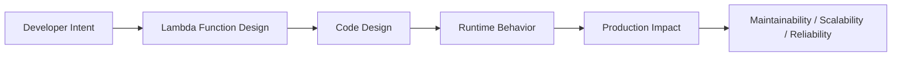
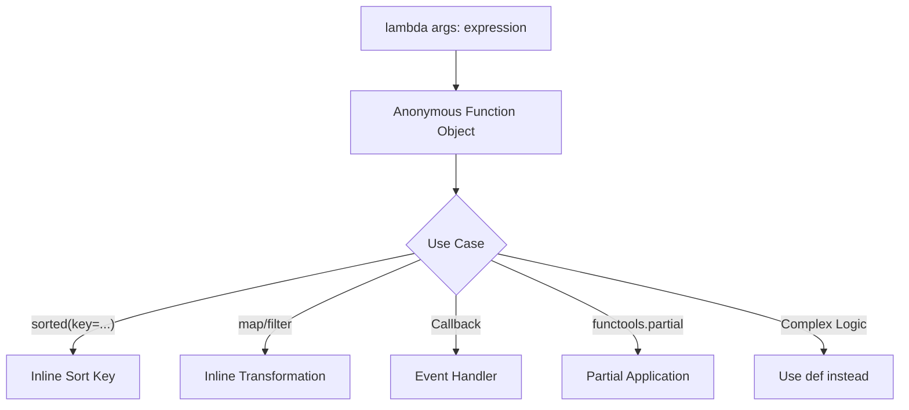

# Lambda Functions

## Overview

A **lambda function** in Python is an anonymous, single-expression function defined with the `lambda` keyword. It is syntactic sugar for a simple function definition and is most useful when a short, throwaway function is needed inline — typically as an argument to higher-order functions like `sorted()`, `map()`, `filter()`, and `reduce()`.

Lambdas are not a replacement for `def` — they are a tool for concise, inline function expressions. Understanding when to use them (and when not to) is a mark of Python maturity.

---

## Why It Matters





---

## Simple Example

```python
# Basic lambda syntax and usage

# Equivalent to: def square(x): return x ** 2
square = lambda x: x ** 2
print(square(5))  # 25

# Multi-argument lambda
add = lambda x, y: x + y
print(add(3, 4))  # 7

# Lambda with default argument
greet = lambda name, greeting="Hello": f"{greeting}, {name}!"
print(greet("Alice"))          # Hello, Alice!
print(greet("Bob", "Hi"))      # Hi, Bob!

# Immediately invoked lambda
result = (lambda x, y: x * y)(6, 7)
print(result)  # 42

# Lambda in sorted()
people = [
    {"name": "Charlie", "age": 30},
    {"name": "Alice", "age": 25},
    {"name": "Bob", "age": 35},
]
sorted_by_age = sorted(people, key=lambda p: p["age"])
print([p["name"] for p in sorted_by_age])  # ['Alice', 'Charlie', 'Bob']

# Lambda in filter()
numbers = [1, 2, 3, 4, 5, 6, 7, 8, 9, 10]
evens = list(filter(lambda n: n % 2 == 0, numbers))
print(evens)  # [2, 4, 6, 8, 10]

# Lambda in map()
doubled = list(map(lambda n: n * 2, numbers))
print(doubled)  # [2, 4, 6, 8, 10, 12, 14, 16, 18, 20]
```

**Explanation:**
- `lambda args: expression` creates an anonymous function.
- Lambdas can only contain a single expression — no statements, no assignments.
- They are most useful as inline arguments to higher-order functions.

**Expected output:**
```
25
7
Hello, Alice!
Hi, Bob!
42
['Alice', 'Charlie', 'Bob']
[2, 4, 6, 8, 10]
[2, 4, 6, 8, 10, 12, 14, 16, 18, 20]
```

---

## Intermediate Example

### Lambdas in Data Processing Pipelines

```python
from functools import reduce
from typing import Callable, TypeVar

T = TypeVar("T")

# Multi-key sorting
employees = [
    {"name": "Alice", "dept": "Engineering", "salary": 95000},
    {"name": "Bob",   "dept": "Marketing",   "salary": 75000},
    {"name": "Carol", "dept": "Engineering", "salary": 105000},
    {"name": "Dave",  "dept": "Marketing",   "salary": 80000},
    {"name": "Eve",   "dept": "Engineering", "salary": 95000},
]

# Sort by department, then by salary descending
sorted_employees = sorted(
    employees,
    key=lambda e: (e["dept"], -e["salary"])
)
for emp in sorted_employees:
    print(f"{emp['dept']:15} {emp['name']:10} ${emp['salary']:,}")

print()

# Chained transformations using lambdas
pipeline: list[Callable[[list], list]] = [
    lambda data: [e for e in data if e["salary"] > 80000],   # filter
    lambda data: sorted(data, key=lambda e: e["salary"], reverse=True),  # sort
    lambda data: [{"name": e["name"], "salary": e["salary"]} for e in data],  # project
]

result = reduce(lambda acc, fn: fn(acc), pipeline, employees)
print(result)

# Lambda as a dispatch table
operations = {
    "add":      lambda x, y: x + y,
    "subtract": lambda x, y: x - y,
    "multiply": lambda x, y: x * y,
    "divide":   lambda x, y: x / y if y != 0 else None,
}

for op, func in operations.items():
    print(f"{op}(10, 3) = {func(10, 3)}")
```

**Explanation:**
- Multi-key sort: `key=lambda e: (e["dept"], -e["salary"])` sorts by dept ascending, salary descending.
- `reduce` applies a pipeline of lambda transformations sequentially.
- A dispatch table maps operation names to lambda functions — a clean alternative to `if/elif` chains.

**Expected output:**
```
Engineering     Carol      $105,000
Engineering     Alice      $95,000
Engineering     Eve        $95,000
Marketing       Dave       $80,000
Marketing       Bob        $75,000

[{'name': 'Carol', 'salary': 105000}, {'name': 'Alice', 'salary': 95000}, {'name': 'Eve', 'salary': 95000}]
add(10, 3) = 13
subtract(10, 3) = 7
multiply(10, 3) = 30
divide(10, 3) = 3.3333333333333335
```

---

## Advanced / Architect-Level Example

### Lambda-Driven Rule Engine for an AI Agent Decision System

**Problem context:** An AI agent needs a configurable rule engine where business rules are defined as lambda expressions, loaded from configuration, and applied to agent state. This enables non-engineers to define rules without modifying code.

```python
from __future__ import annotations
from dataclasses import dataclass, field
from typing import Callable, Any
import operator

# --- Rule Engine ---
@dataclass
class Rule:
    name: str
    condition: Callable[[dict], bool]
    action: Callable[[dict], dict]
    priority: int = 0
    description: str = ""

class RuleEngine:
    def __init__(self):
        self._rules: list[Rule] = []

    def add_rule(self, rule: Rule) -> None:
        self._rules.append(rule)
        self._rules.sort(key=lambda r: -r.priority)  # Higher priority first

    def evaluate(self, state: dict[str, Any]) -> tuple[dict[str, Any], list[str]]:
        """Apply all matching rules to the state. Returns updated state and applied rule names."""
        applied: list[str] = []
        for rule in self._rules:
            if rule.condition(state):
                state = rule.action(state)
                applied.append(rule.name)
        return state, applied

# --- Lambda-Based Rule Definitions ---
engine = RuleEngine()

# Rule 1: Escalate if confidence is low
engine.add_rule(Rule(
    name="low_confidence_escalate",
    condition=lambda s: s.get("confidence", 1.0) < 0.5,
    action=lambda s: {**s, "action": "escalate", "reason": "low confidence"},
    priority=10,
    description="Escalate to human if agent confidence < 50%",
))

# Rule 2: Apply discount for high-value customers
engine.add_rule(Rule(
    name="high_value_discount",
    condition=lambda s: s.get("customer_tier") == "gold" and s.get("order_total", 0) > 1000,
    action=lambda s: {**s, "discount": 0.15, "discount_reason": "gold tier + high value"},
    priority=5,
    description="15% discount for gold customers with orders > $1000",
))

# Rule 3: Flag suspicious activity
engine.add_rule(Rule(
    name="suspicious_activity",
    condition=lambda s: s.get("failed_attempts", 0) >= 3,
    action=lambda s: {**s, "flagged": True, "action": "block"},
    priority=20,
    description="Block after 3 failed attempts",
))

# --- Test Cases ---
test_states = [
    {"user_id": "u1", "confidence": 0.3, "customer_tier": "silver"},
    {"user_id": "u2", "confidence": 0.9, "customer_tier": "gold", "order_total": 1500},
    {"user_id": "u3", "failed_attempts": 5, "confidence": 0.8},
]

for state in test_states:
    result, applied = engine.evaluate(state.copy())
    print(f"User {state['user_id']}: applied={applied}")
    print(f"  Result: {result}")
    print()
```

**Explanation:**
- Rules are defined as lambda pairs: `condition` (predicate) and `action` (state transformer).
- The engine sorts rules by priority and applies all matching ones.
- Lambdas make rules concise and readable — each rule fits on one line.
- The `{**s, "key": value}` pattern creates a new dict (immutable state update).

**Design trade-offs:**
| Approach | Pros | Cons |
|---|---|---|
| Lambda rules | Concise, inline | No multi-statement logic |
| `def` rules | Full Python, debuggable | More verbose |
| DSL (string rules) | Non-engineer friendly | Requires parser, security risk |
| Class-based rules | Testable, extensible | Most verbose |

---

## Common Mistakes

### 1. Assigning lambdas to variables (use `def` instead)
```python
# Bad — PEP 8 violation; loses the name in tracebacks
square = lambda x: x ** 2

# Good — use def for named functions
def square(x: int) -> int:
    return x ** 2
```

### 2. Using lambdas for complex logic
```python
# Bad — unreadable
process = lambda x: x.strip().lower().replace(" ", "_") if isinstance(x, str) else str(x)

# Good — use def
def process(x) -> str:
    if isinstance(x, str):
        return x.strip().lower().replace(" ", "_")
    return str(x)
```

### 3. The loop closure bug with lambdas
```python
# Bad
funcs = [lambda: i for i in range(5)]
print([f() for f in funcs])  # [4, 4, 4, 4, 4]

# Good
funcs = [lambda i=i: i for i in range(5)]
print([f() for f in funcs])  # [0, 1, 2, 3, 4]
```

### 4. Using `lambda` when `operator` module functions are cleaner
```python
from operator import attrgetter, itemgetter

# Bad
sorted(people, key=lambda p: p["age"])

# Good — more readable and faster
sorted(people, key=itemgetter("age"))

# Bad
sorted(objects, key=lambda o: o.name)

# Good
sorted(objects, key=attrgetter("name"))
```

### 5. Trying to use statements in lambdas
```python
# Bad — SyntaxError
f = lambda x: if x > 0: return x else: return -x

# Good — use ternary expression
f = lambda x: x if x > 0 else -x

# Better — use def
def f(x: int) -> int:
    return x if x > 0 else -x
```

---

## Best Practices

- **Use lambdas only for simple, single-expression functions** passed as arguments.
- **Use `def` for named functions** — even short ones. PEP 8 discourages assigning lambdas to variables.
- **Use `operator.itemgetter` / `attrgetter`** instead of lambdas for attribute/key access — they are faster and more readable.
- **Use default argument capture** (`lambda i=i: i`) to avoid loop closure bugs.
- **Prefer list comprehensions** over `map(lambda ...)` — they are more Pythonic and readable.
- **Use lambdas in dispatch tables** — they are clean for mapping keys to simple operations.
- **Never use lambdas for complex logic** — if it needs a comment, use `def`.

---

## Performance Considerations

- Lambdas and `def` functions have **identical performance** — they produce the same bytecode.
- **`operator.itemgetter`** and **`attrgetter`** are implemented in C and are faster than equivalent lambdas for attribute/key access.
- **List comprehensions** are faster than `map(lambda ...)` because they avoid the function call overhead per element.

```python
import timeit

data = list(range(1000))

# map + lambda vs list comprehension
t1 = timeit.timeit(lambda: list(map(lambda x: x * 2, data)), number=10000)
t2 = timeit.timeit(lambda: [x * 2 for x in data], number=10000)
print(f"map+lambda: {t1:.3f}s, comprehension: {t2:.3f}s")
# Comprehension is typically 20-40% faster
```

---

## Testing Strategy

```python
# tests/test_lambdas.py
import pytest
from operator import itemgetter

def test_sort_by_age():
    people = [{"name": "Bob", "age": 30}, {"name": "Alice", "age": 25}]
    result = sorted(people, key=lambda p: p["age"])
    assert result[0]["name"] == "Alice"

def test_filter_evens():
    numbers = list(range(10))
    evens = list(filter(lambda n: n % 2 == 0, numbers))
    assert evens == [0, 2, 4, 6, 8]

def test_map_double():
    numbers = [1, 2, 3]
    doubled = list(map(lambda n: n * 2, numbers))
    assert doubled == [2, 4, 6]

def test_dispatch_table():
    ops = {
        "add": lambda x, y: x + y,
        "mul": lambda x, y: x * y,
    }
    assert ops["add"](3, 4) == 7
    assert ops["mul"](3, 4) == 12

def test_loop_closure_fix():
    funcs = [lambda i=i: i for i in range(5)]
    assert [f() for f in funcs] == [0, 1, 2, 3, 4]

def test_rule_engine():
    from mymodule import engine
    state = {"confidence": 0.3}
    result, applied = engine.evaluate(state)
    assert "low_confidence_escalate" in applied
    assert result["action"] == "escalate"
```

---

## Debugging Tips

- **Lambdas show as `<lambda>` in tracebacks** — use `def` for functions that appear in error messages.
- **`func.__name__`** — lambdas have `__name__ = '<lambda>'`; named functions have their actual name.
- **Loop closure bugs** — if all lambdas return the same value, check for missing default argument capture.
- **`dis.dis(lambda x: x * 2)`** — inspect the bytecode of a lambda.
- If a lambda is too complex to understand at a glance, refactor it to a `def`.

---

## Interview Questions

### Beginner
1. **What is a lambda function?**
   *An anonymous, single-expression function defined with the `lambda` keyword.*

2. **What is the syntax of a lambda function?**
   *`lambda args: expression`*

3. **Can a lambda function contain multiple statements?**
   *No. Lambdas can only contain a single expression.*

4. **When should you use a lambda instead of `def`?**
   *When you need a short, throwaway function as an argument to a higher-order function (e.g., `sorted`, `map`, `filter`).*

5. **What does `sorted(items, key=lambda x: x["age"])` do?**
   *Sorts `items` by the `"age"` key of each element.*

### Intermediate
1. **What is the loop closure bug with lambdas and how do you fix it?**
   *All lambdas in a loop capture the same variable by reference. Fix: use default argument capture: `lambda i=i: i`.*

2. **When should you use `operator.itemgetter` instead of a lambda?**
   *When accessing a dictionary key or object attribute — `itemgetter` is faster (C implementation) and more readable.*

3. **What is a dispatch table and how do lambdas fit in?**
   *A dispatch table maps keys to functions. Lambdas are ideal for simple operations: `{"add": lambda x, y: x + y}`.*

4. **Why does PEP 8 discourage assigning lambdas to variables?**
   *Because `def` is clearer, gives the function a proper name (visible in tracebacks), and is no more verbose for simple functions.*

5. **What is the difference between `map(lambda x: x*2, data)` and `[x*2 for x in data]`?**
   *Both produce the same result. The list comprehension is more Pythonic, more readable, and typically faster.*

### Advanced / Architect-Level
1. **How would you use lambdas to implement a rule engine?**
   *Define rules as `(condition_lambda, action_lambda)` pairs. The engine iterates rules, evaluates conditions, and applies actions. Lambdas keep rules concise and inline.*

2. **What are the limitations of lambdas compared to `def`?**
   *Lambdas: single expression only, no statements, no docstrings, no type annotations (in practice), show as `<lambda>` in tracebacks, cannot use `yield` or `await`.*

3. **How do lambdas interact with `functools.partial`?**
   *`partial` pre-fills arguments of any callable, including lambdas. But for partial application, `partial` with a named function is clearer than a lambda.*

4. **Can lambdas be used in async code?**
   *Regular lambdas cannot be `async`. For async inline functions, you must use `async def`. However, lambdas can return coroutines if they call an async function.*

5. **How would you serialize and deserialize lambda functions?**
   *Lambdas cannot be pickled by default. Use `dill` (extends pickle) or `cloudpickle` for serializing lambdas. Alternatively, represent rules as strings and use `eval()` with a restricted namespace (with security caution).*

---

## Key Takeaways

- Lambdas are **anonymous, single-expression functions** — not a replacement for `def`.
- Use lambdas **inline** as arguments to `sorted`, `map`, `filter`, `reduce`, and callbacks.
- **Never assign lambdas to variables** — use `def` instead (PEP 8).
- Use **`operator.itemgetter` / `attrgetter`** for key/attribute access — faster and cleaner.
- **List comprehensions** are preferred over `map(lambda ...)`.
- The **loop closure bug** is a classic pitfall — use default argument capture.
- Lambdas are ideal for **dispatch tables** and **rule engines**.

---

## Mini Project Idea

### Project: `lambda-rules` — Lambda-Driven Business Rule Engine

**Goal:** Build a configurable business rule engine where rules are defined as lambda pairs (condition, action), with priority ordering, conflict resolution, and JSON-based rule loading.

**Features:**
- `Rule(name, condition, action, priority)` dataclass.
- `RuleEngine.add_rule()`, `evaluate()`, `explain()` methods.
- Load rules from a Python config file (lambda expressions as strings, evaluated safely).
- Rule conflict detection (multiple rules match the same state).
- Audit log: record which rules fired and what state changes occurred.
- CLI for testing rules against sample states.

**Suggested folder structure:**
```
lambda_rules/
├── .venv/
├── pyproject.toml
├── src/
│   └── lambda_rules/
│       ├── __init__.py
│       ├── engine.py        # RuleEngine
│       ├── rule.py          # Rule dataclass
│       ├── loader.py        # Load rules from config
│       └── cli.py           # CLI interface
└── tests/
    ├── test_engine.py
    └── test_loader.py
```

**Extension ideas:**
- Add async rule evaluation.
- Support rule chaining (output of one rule feeds into the next).
- Add a visual rule debugger (show which rules matched and why).
- Integrate with FastAPI for a REST-based rule evaluation endpoint.

---

## Final Summary

Lambda functions are a concise, expressive tool for inline function expressions in Python. Used appropriately — as sort keys, filter predicates, map transformations, and dispatch table entries — they make code more readable and functional. Used inappropriately — for complex logic, named functions, or multi-statement operations — they make code harder to read and debug. Architects who know when to use lambdas and when to reach for `def`, `operator`, or comprehensions write code that is both elegant and maintainable.
