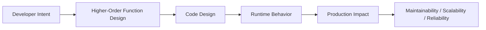
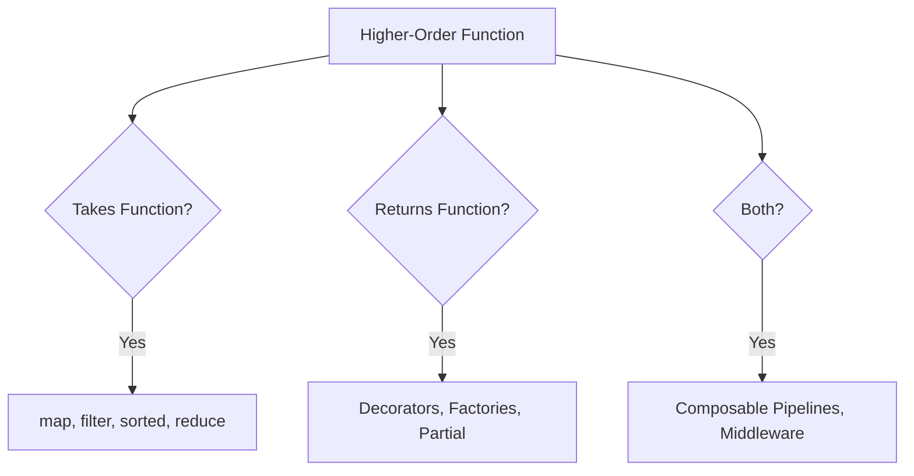

# Higher-Order Functions

## Overview

A **higher-order function** (HOF) is a function that either takes one or more functions as arguments, returns a function as its result, or both. Higher-order functions are a cornerstone of functional programming and are deeply embedded in Python's standard library and ecosystem.

Python's built-in HOFs include `map()`, `filter()`, `sorted()`, `functools.reduce()`, `functools.partial()`, and `functools.wraps()`. Understanding HOFs enables you to write composable, reusable, and expressive code — the foundation of decorators, pipelines, middleware, and functional data processing.

---

## Why It Matters





---

## Simple Example

```python
from functools import reduce
from typing import Callable, TypeVar

T = TypeVar("T")

# map() — apply a function to every element
numbers = [1, 2, 3, 4, 5]
squared = list(map(lambda x: x ** 2, numbers))
print(f"Squared: {squared}")

# filter() — keep elements where function returns True
evens = list(filter(lambda x: x % 2 == 0, numbers))
print(f"Evens: {evens}")

# sorted() with key function
words = ["banana", "apple", "cherry", "date"]
by_length = sorted(words, key=len)
print(f"By length: {by_length}")

# reduce() — fold a sequence into a single value
total = reduce(lambda acc, x: acc + x, numbers, 0)
product = reduce(lambda acc, x: acc * x, numbers, 1)
print(f"Sum: {total}, Product: {product}")

# A function that takes a function as argument
def apply_twice(func: Callable[[T], T], value: T) -> T:
    return func(func(value))

double = lambda x: x * 2
print(apply_twice(double, 3))   # 12

# A function that returns a function
def multiplier(factor: int) -> Callable[[int], int]:
    return lambda x: x * factor

triple = multiplier(3)
print(triple(7))   # 21
```

**Explanation:**
- `map`, `filter`, `sorted`, `reduce` are built-in HOFs that accept functions as arguments.
- `apply_twice` is a custom HOF that takes a function and applies it twice.
- `multiplier` is a HOF that returns a new function (a closure).

**Expected output:**
```
Squared: [1, 4, 9, 16, 25]
Evens: [2, 4]
By length: ['date', 'apple', 'banana', 'cherry']
Sum: 15, Product: 120
12
21
```

---

## Intermediate Example

### Function Composition and Pipeline

```python
from typing import Callable, TypeVar, Any
from functools import reduce

T = TypeVar("T")

def compose(*funcs: Callable) -> Callable:
    """Right-to-left function composition: compose(f, g, h)(x) = f(g(h(x)))"""
    def composed(value: Any) -> Any:
        return reduce(lambda v, f: f(v), reversed(funcs), value)
    return composed

def pipe(*funcs: Callable) -> Callable:
    """Left-to-right function composition: pipe(f, g, h)(x) = h(g(f(x)))"""
    def piped(value: Any) -> Any:
        return reduce(lambda v, f: f(v), funcs, value)
    return piped

# Individual transformations
strip_whitespace = str.strip
to_lowercase = str.lower
replace_spaces = lambda s: s.replace(" ", "_")
add_prefix = lambda s: f"field_{s}"

# Compose into a single transformation
normalize_field_name = pipe(
    strip_whitespace,
    to_lowercase,
    replace_spaces,
    add_prefix,
)

test_inputs = ["  User Name  ", "  Email Address ", "  Phone Number  "]
for name in test_inputs:
    print(f"{name!r:25} → {normalize_field_name(name)!r}")

print()

# HOF: apply a function to each item and collect results
def transform_all(
    items: list[T],
    *transformers: Callable[[T], T],
) -> list[T]:
    pipeline = pipe(*transformers)
    return [pipeline(item) for item in items]

numbers = [1, 2, 3, 4, 5]
result = transform_all(
    numbers,
    lambda x: x * 2,
    lambda x: x + 10,
    lambda x: x ** 2,
)
print(result)
```

**Explanation:**
- `compose` and `pipe` are HOFs that take multiple functions and return a new composed function.
- `pipe` applies functions left-to-right (data flows through the pipeline).
- `compose` applies right-to-left (mathematical convention).
- `transform_all` is a HOF that applies a pipeline to every item in a list.

**Expected output:**
```
'  User Name  '           → 'field_user_name'
'  Email Address '        → 'field_email_address'
'  Phone Number  '        → 'field_phone_number'

[144, 196, 256, 324, 400]
```

---

## Advanced / Architect-Level Example

### HOF-Based Middleware Chain for an AI Agent Framework

**Problem context:** An AI agent framework needs a composable middleware system where each middleware is a HOF that wraps a handler. Middlewares handle logging, authentication, rate limiting, caching, and error handling — all composable without modifying the core handler.

```python
from __future__ import annotations
from typing import Callable, Any, TypeVar
from functools import wraps
import time
import logging
import hashlib
import json

logger = logging.getLogger(__name__)
logging.basicConfig(level=logging.INFO, format="%(levelname)s %(message)s")

# Type alias
Handler = Callable[..., Any]
Middleware = Callable[[Handler], Handler]

# --- Middleware HOFs ---
def logging_middleware(logger_name: str = "agent") -> Middleware:
    log = logging.getLogger(logger_name)
    def middleware(handler: Handler) -> Handler:
        @wraps(handler)
        def wrapper(*args, **kwargs):
            log.info("→ %s called with args=%s kwargs=%s", handler.__name__, args, kwargs)
            start = time.perf_counter()
            result = handler(*args, **kwargs)
            elapsed = time.perf_counter() - start
            log.info("← %s returned in %.3fs: %s", handler.__name__, elapsed, result)
            return result
        return wrapper
    return middleware

def retry_middleware(max_attempts: int = 3, delay: float = 0.1) -> Middleware:
    def middleware(handler: Handler) -> Handler:
        @wraps(handler)
        def wrapper(*args, **kwargs):
            for attempt in range(1, max_attempts + 1):
                try:
                    return handler(*args, **kwargs)
                except Exception as e:
                    if attempt == max_attempts:
                        raise
                    logger.warning("Attempt %d/%d failed: %s", attempt, max_attempts, e)
                    time.sleep(delay)
        return wrapper
    return middleware

def cache_middleware(ttl: float = 60.0) -> Middleware:
    cache: dict[str, tuple[Any, float]] = {}
    def middleware(handler: Handler) -> Handler:
        @wraps(handler)
        def wrapper(*args, **kwargs):
            key = hashlib.md5(json.dumps((args, sorted(kwargs.items())), default=str).encode()).hexdigest()
            if key in cache:
                value, expires_at = cache[key]
                if time.time() < expires_at:
                    logger.info("Cache hit for %s", handler.__name__)
                    return value
            result = handler(*args, **kwargs)
            cache[key] = (result, time.time() + ttl)
            return result
        return wrapper
    return middleware

def error_boundary_middleware(fallback: Any = None) -> Middleware:
    def middleware(handler: Handler) -> Handler:
        @wraps(handler)
        def wrapper(*args, **kwargs):
            try:
                return handler(*args, **kwargs)
            except Exception as e:
                logger.error("Error in %s: %s. Returning fallback.", handler.__name__, e)
                return fallback
        return wrapper
    return middleware

# --- Middleware Composer ---
def apply_middleware(*middlewares: Middleware) -> Callable[[Handler], Handler]:
    """Apply middlewares in order (outermost first)."""
    def decorator(handler: Handler) -> Handler:
        for middleware in reversed(middlewares):
            handler = middleware(handler)
        return handler
    return decorator

# --- Core Handler ---
def fetch_document(doc_id: str) -> dict:
    """Simulate fetching a document from a vector store."""
    if doc_id == "bad":
        raise ValueError(f"Document '{doc_id}' not found")
    return {"doc_id": doc_id, "text": f"Content of document {doc_id}"}

# --- Apply Middleware Stack ---
enhanced_fetch = apply_middleware(
    logging_middleware("rag"),
    retry_middleware(max_attempts=2, delay=0.05),
    cache_middleware(ttl=30.0),
    error_boundary_middleware(fallback={"doc_id": None, "text": ""}),
)(fetch_document)

# Usage
print(enhanced_fetch("doc_001"))
print(enhanced_fetch("doc_001"))  # Cache hit
print(enhanced_fetch("bad"))      # Error → fallback
```

**Explanation:**
- Each middleware is a HOF: it takes a handler and returns a new handler.
- `apply_middleware` composes multiple middlewares into a single decorator.
- The middleware stack is applied in order: logging → retry → cache → error boundary.
- This pattern is used in WSGI/ASGI frameworks (Django, FastAPI, Starlette).

**Design trade-offs:**
| Approach | Pros | Cons |
|---|---|---|
| HOF middleware | Composable, reusable | Order matters |
| Class-based middleware | Stateful, inspectable | More boilerplate |
| Decorator stacking | Familiar Python syntax | Less dynamic |
| Middleware list | Dynamic composition | Less type-safe |

---

## Common Mistakes

### 1. Using `map()` and `filter()` when list comprehensions are clearer
```python
# Less Pythonic
result = list(map(lambda x: x * 2, filter(lambda x: x > 0, numbers)))

# More Pythonic
result = [x * 2 for x in numbers if x > 0]
```

### 2. Forgetting `list()` around `map()` and `filter()`
- **Problem:** `map()` and `filter()` return iterators in Python 3 — not lists.
- **Better approach:** Wrap with `list()` if you need a list, or iterate directly.

### 3. Not using `@wraps` in HOF decorators
```python
# Bad — loses function metadata
def my_decorator(func):
    def wrapper(*args, **kwargs):
        return func(*args, **kwargs)
    return wrapper

# Good
from functools import wraps
def my_decorator(func):
    @wraps(func)
    def wrapper(*args, **kwargs):
        return func(*args, **kwargs)
    return wrapper
```

### 4. Overcomplicating with HOFs when a loop is clearer
- **Problem:** Chaining `map`, `filter`, `reduce` for complex transformations is hard to read.
- **Better approach:** Use list comprehensions or explicit loops for complex logic.

### 5. Not handling the case where `reduce()` receives an empty sequence
```python
from functools import reduce

# Bad — raises TypeError on empty list
total = reduce(lambda acc, x: acc + x, [])

# Good — provide an initial value
total = reduce(lambda acc, x: acc + x, [], 0)
```

---

## Best Practices

- **Prefer list comprehensions** over `map(lambda ...)` and `filter(lambda ...)`.
- **Use `sorted(key=...)` with `operator.itemgetter`** for attribute/key sorting.
- **Always use `@wraps`** in HOF decorators to preserve function metadata.
- **Use `functools.partial`** for partial application instead of lambdas.
- **Design middleware as HOFs** — each middleware wraps a handler and returns a new handler.
- **Use `pipe()` / `compose()`** for readable function composition.
- **Provide an initial value** to `reduce()` to handle empty sequences.

---

## Performance Considerations

- **`map()` and `filter()`** return lazy iterators — they are memory-efficient for large datasets.
- **List comprehensions** are faster than `map(lambda ...)` due to reduced function call overhead.
- **`operator.itemgetter`** is faster than `lambda x: x["key"]` for sorting.
- **Function composition** adds a small overhead per composed function call — negligible for most use cases.
- **HOF middleware chains** add one function call per middleware layer — keep chains short for hot paths.

---

## Testing Strategy

```python
# tests/test_hof.py
import pytest
from mymodule import compose, pipe, apply_middleware, logging_middleware, cache_middleware

def test_pipe_applies_left_to_right():
    pipeline = pipe(lambda x: x + 1, lambda x: x * 2, lambda x: x - 3)
    assert pipeline(5) == (5 + 1) * 2 - 3  # 9

def test_compose_applies_right_to_left():
    composed = compose(lambda x: x - 3, lambda x: x * 2, lambda x: x + 1)
    assert composed(5) == (5 + 1) * 2 - 3  # 9

def test_map_squares():
    result = list(map(lambda x: x ** 2, [1, 2, 3]))
    assert result == [1, 4, 9]

def test_filter_evens():
    result = list(filter(lambda x: x % 2 == 0, range(10)))
    assert result == [0, 2, 4, 6, 8]

def test_middleware_wraps_handler():
    from functools import wraps
    calls = []

    def tracking_middleware(handler):
        @wraps(handler)
        def wrapper(*args, **kwargs):
            calls.append(handler.__name__)
            return handler(*args, **kwargs)
        return wrapper

    @tracking_middleware
    def my_func(x: int) -> int:
        return x * 2

    assert my_func(5) == 10
    assert calls == ["my_func"]
    assert my_func.__name__ == "my_func"

def test_cache_middleware_returns_same_result():
    call_count = [0]

    def handler(x: int) -> int:
        call_count[0] += 1
        return x * 2

    cached = cache_middleware(ttl=60.0)(handler)
    r1 = cached(5)
    r2 = cached(5)
    assert r1 == r2 == 10
    assert call_count[0] == 1  # Only called once
```

---

## Debugging Tips

- **`func.__name__`** — check if `@wraps` was applied (should show original function name).
- **`func.__wrapped__`** — access the original unwrapped function (set by `@wraps`).
- **`inspect.unwrap(func)`** — unwrap all decorator layers to get the original function.
- If a HOF chain produces unexpected results, test each function in isolation.
- Use `print` or `logging` inside each middleware to trace the execution order.
- **`functools.reduce` with empty list** — always provide an initial value to avoid `TypeError`.

---

## Interview Questions

### Beginner
1. **What is a higher-order function?**
   *A function that takes one or more functions as arguments, returns a function, or both.*

2. **Name three built-in Python higher-order functions.**
   *`map()`, `filter()`, `sorted()` (with `key`), `functools.reduce()`.*

3. **What does `map(func, iterable)` do?**
   *Applies `func` to every element of `iterable` and returns an iterator of results.*

4. **What does `filter(func, iterable)` do?**
   *Returns an iterator of elements from `iterable` for which `func` returns `True`.*

5. **What is `functools.reduce()`?**
   *Applies a binary function cumulatively to a sequence, reducing it to a single value.*

### Intermediate
1. **What is function composition and how do you implement it in Python?**
   *Combining functions so the output of one becomes the input of the next. Implement with `reduce`: `compose(f, g)(x) = f(g(x))`.*

2. **What is the difference between `pipe` and `compose`?**
   *`pipe` applies functions left-to-right (data flows forward). `compose` applies right-to-left (mathematical convention).*

3. **Why should you use `@wraps` in HOF decorators?**
   *To preserve the wrapped function's `__name__`, `__doc__`, `__annotations__`, and `__wrapped__` attributes.*

4. **When should you prefer list comprehensions over `map()` and `filter()`?**
   *When the transformation is complex, involves multiple conditions, or when readability is more important than functional style.*

5. **What is the middleware pattern and how does it use HOFs?**
   *Each middleware is a HOF that takes a handler and returns a new handler with additional behavior. Middlewares are composed into a chain.*

### Advanced / Architect-Level
1. **How would you design a composable middleware system for a production API framework?**
   *Define each middleware as a HOF: `Middleware = Callable[[Handler], Handler]`. Compose with `apply_middleware(*middlewares)`. Apply in reverse order so the first middleware is outermost.*

2. **What is the difference between `functools.partial` and a closure for partial application?**
   *`partial` is more explicit, preserves the original function's metadata, and is faster. A closure is more flexible (can capture mutable state). Use `partial` for simple argument pre-filling.*

3. **How do HOFs enable the Open/Closed Principle?**
   *New behavior (logging, caching, retry) can be added by composing new HOFs without modifying the original function. The system is open for extension, closed for modification.*

4. **How would you implement a type-safe HOF pipeline using `TypeVar` and `Generic`?**
   *Use `TypeVar` to parameterize input and output types. Define `Transformer(Protocol[InputT, OutputT])`. Use `Generic[InputT, OutputT]` for the pipeline class. mypy infers the full type chain.*

5. **What are the performance implications of deep HOF chains?**
   *Each HOF layer adds one function call. For 10 middlewares, each request incurs 10 extra calls. This is negligible for I/O-bound operations but measurable for CPU-bound hot loops. Profile before optimizing.*

---

## Key Takeaways

- HOFs take functions as arguments, return functions, or both — they are the foundation of **composable, reusable code**.
- Built-in HOFs: `map`, `filter`, `sorted`, `reduce`, `partial`, `wraps`.
- **Prefer list comprehensions** over `map(lambda ...)` for readability.
- **`@wraps`** is essential in HOF decorators to preserve function metadata.
- **Function composition** (`pipe`, `compose`) enables clean data transformation pipelines.
- **Middleware as HOFs** is the pattern behind WSGI, ASGI, and agent frameworks.
- HOFs enable the **Open/Closed Principle** — add behavior without modifying existing code.

---

## Mini Project Idea

### Project: `funcpipe` — Functional Pipeline Library

**Goal:** Build a production-quality functional pipeline library with composable transformers, middleware support, and type safety.

**Features:**
- `pipe(*funcs)` and `compose(*funcs)` for function composition.
- `Pipeline` class with `.then()`, `.filter()`, `.map()`, `.reduce()` methods.
- Built-in middleware: `logging`, `retry`, `cache`, `timeout`, `error_boundary`.
- `apply_middleware(*middlewares)` composer.
- Full type annotations (mypy strict).
- Async pipeline support.

**Suggested folder structure:**
```
funcpipe/
├── .venv/
├── pyproject.toml
├── src/
│   └── funcpipe/
│       ├── __init__.py
│       ├── composition.py   # pipe, compose
│       ├── pipeline.py      # Pipeline class
│       ├── middleware.py    # Built-in middlewares
│       └── async_pipe.py    # Async pipeline
└── tests/
    ├── test_composition.py
    ├── test_pipeline.py
    └── test_middleware.py
```

**Extension ideas:**
- Add parallel pipeline execution with `concurrent.futures`.
- Add a visual pipeline diagram generator.
- Integrate with pandas for DataFrame pipelines.
- Publish as a PyPI package.

---

## Final Summary

Higher-order functions are the building blocks of composable, reusable, and expressive Python code. They power decorators, middleware, pipelines, and functional data processing. Architects who master HOFs can design systems where behavior is composed from small, testable units — rather than hardcoded into monolithic functions. The middleware pattern, built entirely on HOFs, is the foundation of every major Python web framework. Mastering HOFs is mastering the art of composition.
