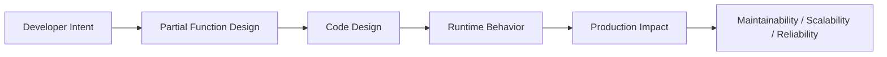
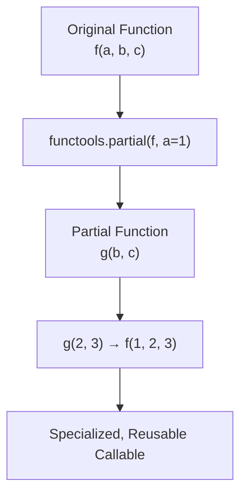

# Partial Functions

## Overview

**Partial functions** in Python are created using `functools.partial()` — a tool that pre-fills one or more arguments of a function, returning a new callable with a reduced signature. This is a form of **partial application**: fixing some arguments of a function to produce a simpler, more specialized version.

Partial functions are a clean alternative to lambdas for argument pre-filling, and they are widely used in configuration, dependency injection, event handling, and functional pipelines. They are more readable, preserve function metadata, and integrate naturally with Python's type system.

---

## Why It Matters





---

## Simple Example

```python
from functools import partial

# Original function
def power(base: int, exponent: int) -> int:
    return base ** exponent

# Create specialized versions
square = partial(power, exponent=2)
cube   = partial(power, exponent=3)

print(square(5))   # 25
print(cube(3))     # 27

# Partial with positional arguments
def greet(greeting: str, name: str) -> str:
    return f"{greeting}, {name}!"

hello = partial(greet, "Hello")
hi    = partial(greet, "Hi")

print(hello("Alice"))   # Hello, Alice!
print(hi("Bob"))        # Hi, Bob!

# Inspect the partial object
print(square.func)      # <function power at 0x...>
print(square.args)      # ()
print(square.keywords)  # {'exponent': 2}

# Partial with multiple pre-filled args
def log_message(level: str, prefix: str, message: str) -> str:
    return f"[{level}] {prefix}: {message}"

error_log = partial(log_message, "ERROR", "APP")
print(error_log("Something went wrong"))
```

**Explanation:**
- `partial(func, *args, **kwargs)` returns a new callable with some arguments pre-filled.
- The partial object stores `.func`, `.args`, and `.keywords` for introspection.
- Partial functions are more readable than equivalent lambdas and preserve the original function's metadata.

**Expected output:**
```
25
27
Hello, Alice!
Hi, Bob!
<function power at 0x...>
()
{'exponent': 2}
[ERROR] APP: Something went wrong
```

---

## Intermediate Example

### Partial Functions in Data Processing and Configuration

```python
from functools import partial
from typing import Callable, Any
import json
import re

# --- Configurable text processors ---
def replace_pattern(pattern: str, replacement: str, text: str) -> str:
    return re.sub(pattern, replacement, text)

def truncate(max_length: int, suffix: str, text: str) -> str:
    if len(text) <= max_length:
        return text
    return text[:max_length - len(suffix)] + suffix

def encode_json(indent: int, sort_keys: bool, data: Any) -> str:
    return json.dumps(data, indent=indent, sort_keys=sort_keys)

# Create specialized processors
remove_html_tags    = partial(replace_pattern, r"<[^>]+>", "")
normalize_whitespace = partial(replace_pattern, r"\s+", " ")
truncate_100        = partial(truncate, 100, "...")
truncate_50         = partial(truncate, 50, "…")
pretty_json         = partial(encode_json, indent=2, sort_keys=True)
compact_json        = partial(encode_json, indent=None, sort_keys=False)

# Apply processors
text = "  <b>Hello</b>   World!   This is a   test.  "
cleaned = normalize_whitespace(remove_html_tags(text)).strip()
print(f"Cleaned: {cleaned!r}")
print(f"Truncated: {truncate_100(cleaned)!r}")

data = {"z": 3, "a": 1, "m": 2}
print(f"Pretty: {pretty_json(data)}")
print(f"Compact: {compact_json(data)}")

# --- Partial in sorted() ---
from operator import itemgetter

employees = [
    {"name": "Alice", "dept": "Eng", "salary": 95000},
    {"name": "Bob",   "dept": "Mkt", "salary": 75000},
    {"name": "Carol", "dept": "Eng", "salary": 105000},
]

sort_by_salary = partial(sorted, key=itemgetter("salary"), reverse=True)
sort_by_name   = partial(sorted, key=itemgetter("name"))

print([e["name"] for e in sort_by_salary(employees)])
print([e["name"] for e in sort_by_name(employees)])
```

**Explanation:**
- Partial functions create a library of specialized text processors from a single generic function.
- `partial(sorted, key=..., reverse=True)` creates reusable sort functions.
- This pattern reduces code duplication and makes intent explicit.

**Expected output:**
```
Cleaned: 'Hello World! This is a test.'
Truncated: 'Hello World! This is a test.'
Pretty: {
  "a": 1,
  "m": 2,
  "z": 3
}
Compact: {"z": 3, "a": 1, "m": 2}
['Carol', 'Alice', 'Bob']
['Alice', 'Bob', 'Carol']
```

---

## Advanced / Architect-Level Example

### Partial Functions in a Dependency Injection and Plugin System

**Problem context:** A RAG pipeline framework needs configurable components (embedders, retrievers, rerankers) that can be swapped via configuration. Partial functions provide a clean way to pre-configure components without classes or lambdas.

```python
from __future__ import annotations
from functools import partial
from typing import Callable, Any
from dataclasses import dataclass, field
import hashlib

# --- Core Functions (generic, configurable) ---
def embed_text(
    model: str,
    dimensions: int,
    normalize: bool,
    text: str,
) -> list[float]:
    """Simulate text embedding."""
    hash_val = int(hashlib.md5(text.encode()).hexdigest(), 16)
    vector = [(hash_val >> i & 0xFF) / 255.0 for i in range(dimensions)]
    if normalize:
        magnitude = sum(v ** 2 for v in vector) ** 0.5
        vector = [v / magnitude for v in vector] if magnitude > 0 else vector
    return vector

def retrieve_documents(
    collection: str,
    top_k: int,
    score_threshold: float,
    query_vector: list[float],
) -> list[dict]:
    """Simulate vector retrieval."""
    return [
        {"doc_id": f"{collection}_{i}", "score": 0.95 - i * 0.05, "text": f"Doc {i}"}
        for i in range(top_k)
        if 0.95 - i * 0.05 >= score_threshold
    ]

def rerank_documents(
    model: str,
    top_n: int,
    query: str,
    documents: list[dict],
) -> list[dict]:
    """Simulate reranking."""
    return sorted(documents, key=lambda d: d["score"], reverse=True)[:top_n]

# --- Component Registry using Partial Functions ---
@dataclass
class RAGComponentRegistry:
    embedder:  Callable[[str], list[float]]
    retriever: Callable[[list[float]], list[dict]]
    reranker:  Callable[[str, list[dict]], list[dict]]

    def run(self, query: str) -> dict:
        vector = self.embedder(query)
        docs   = self.retriever(vector)
        ranked = self.reranker(query, docs)
        return {"query": query, "results": ranked}

# --- Factory: build components from config using partial ---
def build_registry_from_config(config: dict) -> RAGComponentRegistry:
    embedder = partial(
        embed_text,
        model=config["embedder"]["model"],
        dimensions=config["embedder"]["dimensions"],
        normalize=config["embedder"].get("normalize", True),
    )
    retriever = partial(
        retrieve_documents,
        collection=config["retriever"]["collection"],
        top_k=config["retriever"]["top_k"],
        score_threshold=config["retriever"].get("score_threshold", 0.7),
    )
    reranker = partial(
        rerank_documents,
        model=config["reranker"]["model"],
        top_n=config["reranker"]["top_n"],
    )
    return RAGComponentRegistry(
        embedder=embedder,
        retriever=retriever,
        reranker=reranker,
    )

# --- Configuration ---
config = {
    "embedder":  {"model": "text-embedding-3-small", "dimensions": 8, "normalize": True},
    "retriever": {"collection": "knowledge_base", "top_k": 5, "score_threshold": 0.8},
    "reranker":  {"model": "cross-encoder-v1", "top_n": 3},
}

registry = build_registry_from_config(config)
result = registry.run("What is RAG?")
print(f"Query: {result['query']}")
print(f"Results: {[r['doc_id'] for r in result['results']]}")

# Swap components without changing the pipeline
config_v2 = {**config, "retriever": {**config["retriever"], "top_k": 10, "score_threshold": 0.6}}
registry_v2 = build_registry_from_config(config_v2)
result_v2 = registry_v2.run("What is RAG?")
print(f"V2 Results: {[r['doc_id'] for r in result_v2['results']]}")
```

**Explanation:**
- Generic functions (`embed_text`, `retrieve_documents`, `rerank_documents`) accept all configuration as parameters.
- `partial` pre-fills configuration parameters, producing clean single-argument callables.
- The registry holds the configured callables — the pipeline doesn't know about configuration.
- Swapping components is as simple as creating a new partial with different arguments.

**Design trade-offs:**
| Approach | Pros | Cons |
|---|---|---|
| `partial` | Clean, no class needed | Less introspectable than class |
| Lambda | Inline, flexible | No metadata, harder to test |
| Class with `__call__` | Full OOP, inspectable | More boilerplate |
| Closure factory | Stateful | Harder to serialize |

---

## Common Mistakes

### 1. Confusing positional and keyword argument order
```python
from functools import partial

def func(a, b, c):
    return (a, b, c)

# partial fills positional args from the left
p = partial(func, 1, 2)
print(p(3))   # (1, 2, 3) — correct

# But this is confusing:
p2 = partial(func, 1)
print(p2(2, 3))  # (1, 2, 3)
print(p2(b=2, c=3))  # (1, 2, 3)
```

### 2. Using `partial` when a named function is clearer
```python
# Bad — partial with many args is hard to read
process = partial(transform, normalize=True, lowercase=True, strip=True, max_length=100)

# Good — use a named function or class
def process_text(text: str) -> str:
    return transform(text, normalize=True, lowercase=True, strip=True, max_length=100)
```

### 3. Forgetting that `partial` does not copy the function's docstring
```python
from functools import partial, update_wrapper

def add(x: int, y: int) -> int:
    """Add two numbers."""
    return x + y

add_five = partial(add, 5)
print(add_five.__doc__)  # None — partial doesn't copy docstring

# Fix: use update_wrapper
update_wrapper(add_five, add)
print(add_five.__doc__)  # "Add two numbers."
```

### 4. Using `partial` to override keyword arguments that were already set
```python
# partial cannot override already-set keyword arguments
p = partial(func, a=1)
p(a=2)  # TypeError: got multiple values for keyword argument 'a'
```

### 5. Not using `partial` when it would eliminate a lambda
```python
# Bad — lambda just for argument pre-filling
process = lambda text: transform(text, normalize=True)

# Good
process = partial(transform, normalize=True)
```

---

## Best Practices

- **Use `partial` instead of lambdas** for argument pre-filling — it is more readable and preserves metadata.
- **Use `partial` for configuration** — pre-fill configuration parameters to create specialized callables.
- **Use `update_wrapper`** or `functools.wraps` if you need the partial to carry the original function's metadata.
- **Name your partials** descriptively — `square = partial(power, exponent=2)` is self-documenting.
- **Use `partial` in registries and factories** — it cleanly separates configuration from execution.
- **Prefer `partial` over closures** for simple argument pre-filling without mutable state.

---

## Performance Considerations

- `partial` objects are **slightly faster** than equivalent lambdas because they avoid the overhead of creating a new code object.
- `partial` is implemented in C — it is faster than a Python closure for simple argument pre-filling.
- For hot loops, the difference is measurable but usually negligible.

```python
import timeit
from functools import partial

def add(x, y):
    return x + y

add_five_partial = partial(add, 5)
add_five_lambda  = lambda y: add(5, y)

t1 = timeit.timeit(lambda: add_five_partial(3), number=1_000_000)
t2 = timeit.timeit(lambda: add_five_lambda(3), number=1_000_000)
print(f"partial: {t1:.3f}s, lambda: {t2:.3f}s")
# partial is typically 10-20% faster
```

---

## Testing Strategy

```python
# tests/test_partial.py
import pytest
from functools import partial
from mymodule import power, greet, build_registry_from_config

def test_partial_square():
    square = partial(power, exponent=2)
    assert square(5) == 25
    assert square(3) == 9

def test_partial_cube():
    cube = partial(power, exponent=3)
    assert cube(2) == 8

def test_partial_greet():
    hello = partial(greet, "Hello")
    assert hello("Alice") == "Hello, Alice!"
    assert hello("Bob") == "Hello, Bob!"

def test_partial_preserves_func():
    square = partial(power, exponent=2)
    assert square.func is power
    assert square.keywords == {"exponent": 2}

def test_partial_in_registry():
    config = {
        "embedder":  {"model": "test-model", "dimensions": 4, "normalize": False},
        "retriever": {"collection": "test", "top_k": 3, "score_threshold": 0.5},
        "reranker":  {"model": "test-reranker", "top_n": 2},
    }
    registry = build_registry_from_config(config)
    result = registry.run("test query")
    assert "query" in result
    assert "results" in result
    assert len(result["results"]) <= 2

def test_partial_cannot_override_set_kwargs():
    def func(a, b):
        return a + b
    p = partial(func, a=1)
    with pytest.raises(TypeError):
        p(a=2, b=3)
```

---

## Debugging Tips

- **`p.func`** — the original function.
- **`p.args`** — pre-filled positional arguments.
- **`p.keywords`** — pre-filled keyword arguments.
- **`inspect.signature(p)`** — shows the remaining (unfilled) parameters.
- If a partial raises `TypeError: got multiple values for keyword argument`, you are trying to override a pre-filled keyword argument.
- Use `functools.update_wrapper(partial_obj, original_func)` to copy metadata.

---

## Interview Questions

### Beginner
1. **What is `functools.partial()`?**
   *A function that creates a new callable with some arguments of the original function pre-filled.*

2. **What is the difference between `partial(func, 1)` and `lambda x: func(1, x)`?**
   *Both pre-fill the first argument. `partial` is faster, preserves metadata, and is more readable. The lambda creates a new code object.*

3. **How do you inspect a partial object's pre-filled arguments?**
   *`p.func` (original function), `p.args` (positional), `p.keywords` (keyword).*

4. **Can `partial` override keyword arguments that were already set?**
   *No. Attempting to do so raises `TypeError: got multiple values for keyword argument`.*

5. **What is partial application?**
   *Fixing some arguments of a function to produce a new function with a reduced signature.*

### Intermediate
1. **When should you use `partial` instead of a lambda?**
   *When you are pre-filling arguments of an existing function. `partial` is more readable, faster, and preserves the original function's metadata.*

2. **How does `partial` interact with `inspect.signature()`?**
   *`inspect.signature(partial_obj)` shows only the remaining (unfilled) parameters, making the partial's interface clear.*

3. **What is `functools.update_wrapper` and when do you need it?**
   *It copies metadata (`__name__`, `__doc__`, etc.) from the original function to the partial. Use it when the partial needs to appear as the original function.*

4. **How would you use `partial` to create a configurable text processor library?**
   *Define generic functions with all configuration as parameters. Use `partial` to pre-fill configuration, creating named, specialized processors.*

5. **What is the difference between `partial` and `functools.partialmethod`?**
   *`partialmethod` is designed for use in class bodies — it creates a partial method descriptor that works correctly with `self`.*

### Advanced / Architect-Level
1. **How would you use `partial` to implement a plugin/component registry?**
   *Define generic component functions. Use `partial` to pre-fill configuration parameters. Store the configured callables in a registry. The pipeline calls them with only runtime arguments.*

2. **How does `partial` compare to a class with `__call__` for encapsulating configuration?**
   *`partial` is lighter and more functional. A class with `__call__` is more explicit, supports inheritance, and is easier to serialize. For simple configuration, `partial` is preferred; for complex state, use a class.*

3. **How would you serialize and deserialize `partial` objects?**
   *`partial` objects are picklable if the wrapped function is picklable. Use `pickle` or `cloudpickle`. For JSON serialization, store `func.__name__`, `args`, and `keywords` separately and reconstruct on load.*

4. **How does `partial` interact with type checkers (mypy)?**
   *mypy understands `partial` and infers the remaining parameter types. However, complex partial chains may require explicit type annotations. Use `Callable` type hints for partial objects in function signatures.*

5. **How would you use `partial` in an async context?**
   *`partial` works with async functions — `partial(async_func, arg)` returns a partial that, when called, returns a coroutine. Use `asyncio.iscoroutinefunction(p.func)` to check if the wrapped function is async.*

---

## Key Takeaways

- `functools.partial()` pre-fills arguments of a function, returning a new callable.
- **Use `partial` instead of lambdas** for argument pre-filling — it is faster and more readable.
- Partial objects expose `.func`, `.args`, and `.keywords` for introspection.
- **Use `partial` for configuration** — pre-fill config parameters to create specialized callables.
- `partial` is implemented in C — slightly faster than equivalent lambdas.
- **`partialmethod`** is the class-body equivalent of `partial`.
- `partial` objects are **picklable** if the wrapped function is picklable.

---

## Mini Project Idea

### Project: `configurable-processors` — Partial-Function-Based Text Processing Library

**Goal:** Build a library of configurable text processors using `partial` functions, with a pipeline builder and a configuration-driven factory.

**Features:**
- Generic text processing functions: `normalize`, `truncate`, `replace`, `encode`, `decode`.
- `partial`-based specialized processors: `remove_html`, `normalize_whitespace`, `truncate_100`.
- `ProcessorPipeline` class that chains processors.
- Configuration-driven factory: load processor config from YAML/JSON and build a pipeline.
- CLI for applying pipelines to text files.

**Suggested folder structure:**
```
configurable_processors/
├── .venv/
├── pyproject.toml
├── src/
│   └── configurable_processors/
│       ├── __init__.py
│       ├── processors.py    # Generic functions
│       ├── presets.py       # partial-based presets
│       ├── pipeline.py      # ProcessorPipeline
│       └── factory.py       # Config-driven factory
└── tests/
    ├── test_processors.py
    └── test_pipeline.py
```

**Extension ideas:**
- Add async processor support.
- Add a visual pipeline diagram.
- Support loading processors from a plugin directory.
- Add a FastAPI endpoint for text processing.

---

## Final Summary

Partial functions are a clean, Pythonic tool for argument pre-filling and configuration encapsulation. They eliminate boilerplate lambdas, make intent explicit, and integrate naturally with Python's functional ecosystem. Architects who use `partial` for component configuration, plugin registries, and pipeline factories write code that is more readable, testable, and composable. Mastering `functools.partial` is mastering the art of specialization — taking a general function and making it precisely fit a specific context.
