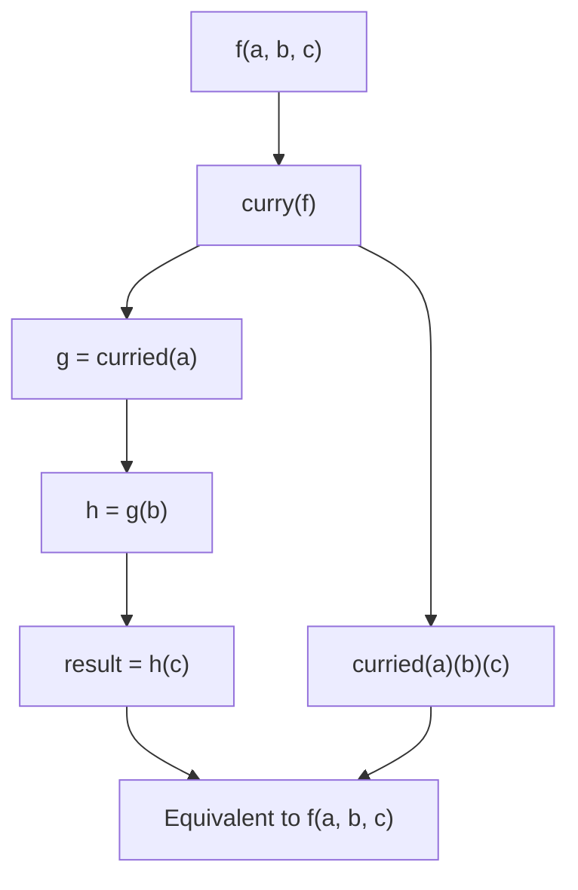

# Currying

## Overview

**Currying** is the technique of transforming a function that takes multiple arguments into a sequence of functions, each taking a single argument. Named after mathematician Haskell Curry, it is a fundamental concept in functional programming. In Python, currying is not built-in (unlike Haskell or Scala), but it can be implemented manually, via closures, or using libraries like `toolz` or `cytoolz`.

Currying is closely related to **partial application** but is distinct: partial application fixes some (not necessarily one) arguments; currying transforms a multi-argument function into a chain of single-argument functions.

---

## Why It Matters




---

## Simple Example

```python
# Manual currying using closures

def add(x: int) -> callable:
    def inner(y: int) -> int:
        return x + y
    return inner

# Curried usage
add_5 = add(5)
print(add_5(3))   # 8
print(add_5(10))  # 15
print(add(2)(3))  # 5 — immediate application

# Three-argument curried function
def multiply(x: int):
    def step2(y: int):
        def step3(z: int) -> int:
            return x * y * z
        return step3
    return step2

print(multiply(2)(3)(4))   # 24
double = multiply(2)
double_triple = double(3)
print(double_triple(5))    # 30

# Using functools.reduce to implement a generic curry
from functools import reduce

def curry(func):
    """Generic curry decorator using inspect."""
    import inspect
    arity = len(inspect.signature(func).parameters)

    def curried(*args):
        if len(args) >= arity:
            return func(*args[:arity])
        return lambda *more: curried(*(args + more))

    return curried

@curry
def volume(length: int, width: int, height: int) -> int:
    return length * width * height

print(volume(2)(3)(4))       # 24
print(volume(2, 3)(4))       # 24 — partial application still works
print(volume(2)(3, 4))       # 24
print(volume(2, 3, 4))       # 24 — full application
```

**Explanation:**
- Manual currying uses nested closures — each function takes one argument and returns the next.
- The generic `curry` decorator uses `inspect` to determine the function's arity and accumulates arguments until all are provided.
- Curried functions support both one-at-a-time and grouped argument application.

**Expected output:**
```
8
15
5
24
30
24
24
24
24
```

---

## Intermediate Example

### Currying for Reusable Data Transformation Pipelines

```python
from functools import reduce
import re

def curry(func):
    import inspect
    arity = len(inspect.signature(func).parameters)
    def curried(*args):
        if len(args) >= arity:
            return func(*args[:arity])
        return lambda *more: curried(*(args + more))
    return curried

# --- Curried utility functions ---
@curry
def filter_by(predicate, items):
    return [item for item in items if predicate(item)]

@curry
def map_with(transform, items):
    return [transform(item) for item in items]

@curry
def sort_by(key_func, items):
    return sorted(items, key=key_func)

@curry
def take(n, items):
    return items[:n]

# --- Compose a pipeline ---
def pipe(*funcs):
    return lambda value: reduce(lambda v, f: f(v), funcs, value)

# Data
employees = [
    {"name": "Alice", "dept": "Eng",  "salary": 95000, "active": True},
    {"name": "Bob",   "dept": "Mkt",  "salary": 75000, "active": False},
    {"name": "Carol", "dept": "Eng",  "salary": 105000, "active": True},
    {"name": "Dave",  "dept": "Eng",  "salary": 85000, "active": True},
    {"name": "Eve",   "dept": "Mkt",  "salary": 90000, "active": True},
]

# Build a reusable pipeline using curried functions
top_active_engineers = pipe(
    filter_by(lambda e: e["active"]),
    filter_by(lambda e: e["dept"] == "Eng"),
    sort_by(lambda e: -e["salary"]),
    take(2),
    map_with(lambda e: e["name"]),
)

print(top_active_engineers(employees))  # ['Carol', 'Alice']

# Reuse curried functions with different arguments
top_marketers = pipe(
    filter_by(lambda e: e["active"]),
    filter_by(lambda e: e["dept"] == "Mkt"),
    sort_by(lambda e: -e["salary"]),
    map_with(lambda e: f"{e['name']}: ${e['salary']:,}"),
)

print(top_marketers(employees))  # ['Eve: $90,000']
```

**Explanation:**
- Curried functions (`filter_by`, `map_with`, `sort_by`, `take`) accept their configuration first, returning a single-argument function ready for pipeline composition.
- `pipe` composes the curried functions into a reusable pipeline.
- The same curried functions are reused with different arguments — no code duplication.

**Expected output:**
```
['Carol', 'Alice']
['Eve: $90,000']
```

---

## Advanced / Architect-Level Example

### Currying for a Type-Safe Query Builder in a RAG System

**Problem context:** A RAG system needs a composable, reusable query builder where filters, projections, and sorting are defined as curried functions. The query builder must be type-safe, composable, and testable.

```python
from __future__ import annotations
from typing import TypeVar, Callable, Any
from dataclasses import dataclass, field
from functools import reduce
import inspect

T = TypeVar("T")

# --- Generic curry ---
def curry(func: Callable) -> Callable:
    arity = len(inspect.signature(func).parameters)
    def curried(*args: Any) -> Any:
        if len(args) >= arity:
            return func(*args[:arity])
        return lambda *more: curried(*(args + more))
    curried.__name__ = func.__name__
    return curried

# --- Curried Query Operations ---
@curry
def where(predicate: Callable[[dict], bool], docs: list[dict]) -> list[dict]:
    return [d for d in docs if predicate(d)]

@curry
def select(fields: list[str], docs: list[dict]) -> list[dict]:
    return [{k: d[k] for k in fields if k in d} for d in docs]

@curry
def order_by(key: str, descending: bool, docs: list[dict]) -> list[dict]:
    return sorted(docs, key=lambda d: d.get(key, 0), reverse=descending)

@curry
def limit(n: int, docs: list[dict]) -> list[dict]:
    return docs[:n]

@curry
def score_above(threshold: float, docs: list[dict]) -> list[dict]:
    return [d for d in docs if d.get("score", 0) >= threshold]

# --- Query Builder ---
@dataclass
class QueryBuilder:
    _steps: list[Callable[[list[dict]], list[dict]]] = field(default_factory=list)

    def filter(self, predicate: Callable[[dict], bool]) -> QueryBuilder:
        return QueryBuilder(self._steps + [where(predicate)])

    def project(self, *fields: str) -> QueryBuilder:
        return QueryBuilder(self._steps + [select(list(fields))])

    def sort(self, key: str, descending: bool = True) -> QueryBuilder:
        return QueryBuilder(self._steps + [order_by(key, descending)])

    def top(self, n: int) -> QueryBuilder:
        return QueryBuilder(self._steps + [limit(n)])

    def min_score(self, threshold: float) -> QueryBuilder:
        return QueryBuilder(self._steps + [score_above(threshold)])

    def execute(self, docs: list[dict]) -> list[dict]:
        return reduce(lambda d, step: step(d), self._steps, docs)

# --- Sample Data ---
documents = [
    {"doc_id": "d1", "text": "Python closures", "score": 0.92, "category": "python"},
    {"doc_id": "d2", "text": "RAG pipelines",   "score": 0.88, "category": "ai"},
    {"doc_id": "d3", "text": "Type hints",       "score": 0.95, "category": "python"},
    {"doc_id": "d4", "text": "Async Python",     "score": 0.75, "category": "python"},
    {"doc_id": "d5", "text": "LangChain agents", "score": 0.91, "category": "ai"},
]

# Build and execute queries
python_docs = (
    QueryBuilder()
    .filter(lambda d: d["category"] == "python")
    .min_score(0.85)
    .sort("score", descending=True)
    .project("doc_id", "text", "score")
    .top(2)
    .execute(documents)
)
print("Top Python docs:", python_docs)

ai_docs = (
    QueryBuilder()
    .filter(lambda d: d["category"] == "ai")
    .sort("score", descending=True)
    .project("doc_id", "text")
    .execute(documents)
)
print("AI docs:", ai_docs)
```

**Explanation:**
- Each query operation is a curried function — it takes its configuration first, then the data.
- `QueryBuilder` accumulates curried steps and executes them as a pipeline.
- The builder is immutable — each method returns a new `QueryBuilder`.
- Currying enables clean, composable query construction without a complex DSL.

**Design trade-offs:**
| Approach | Pros | Cons |
|---|---|---|
| Curried functions | Composable, reusable | Less familiar to OOP developers |
| Method chaining (fluent API) | Readable, familiar | Requires mutable or immutable builder |
| SQL-like DSL | Expressive | Requires parser |
| Direct lambdas | Simple | Not reusable |

---

## Common Mistakes

### 1. Confusing currying with partial application
- **Currying**: `f(a, b, c)` → `f(a)(b)(c)` — one argument at a time.
- **Partial application**: `f(a, b, c)` → `g(c)` where `a` and `b` are fixed.
- They are related but distinct. Python's `functools.partial` does partial application, not currying.

### 2. Not handling variable-argument functions
```python
# curry() based on arity doesn't work with *args
@curry
def variadic(*args):  # arity = 0 — curry doesn't know when to stop
    return sum(args)
```
- **Better approach:** Use explicit arity or a different pattern for variadic functions.

### 3. Overusing currying in Python
- **Problem:** Python is not a purely functional language. Currying adds complexity that is not always justified.
- **Better approach:** Use currying for composable pipelines and functional patterns. Use `partial` for simple argument pre-filling.

### 4. Ignoring performance overhead
- **Problem:** Each curried call creates a new closure. In tight loops, this adds up.
- **Better approach:** Profile before optimizing. For hot paths, use direct function calls.

### 5. Not using `toolz.curry` for production
- **Problem:** A hand-rolled `curry` decorator may have edge cases.
- **Better approach:** Use `toolz.curry` or `cytoolz.curry` — battle-tested, fast, and handles edge cases.

---

## Best Practices

- **Use `toolz.curry`** for production currying — it is well-tested and handles edge cases.
- **Use currying for pipeline composition** — curried functions compose naturally with `pipe`.
- **Use `partial` for simple argument pre-filling** — it is more Pythonic for non-functional code.
- **Keep curried functions pure** — no side effects, no mutable state.
- **Document the arity** of curried functions — it is not always obvious.
- **Use currying sparingly** in Python — it is a powerful tool but can reduce readability for developers unfamiliar with functional programming.

---

## Performance Considerations

- Each curried call creates a new closure — there is overhead per call.
- For tight loops, direct function calls are faster.
- `cytoolz.curry` (Cython implementation) is significantly faster than pure Python currying.
- For data pipelines processing millions of records, consider using `pandas`, `polars`, or `numpy` operations instead of curried Python functions.

---

## Testing Strategy

```python
# tests/test_currying.py
import pytest
from mymodule import curry, add, volume, filter_by, map_with, QueryBuilder

def test_curry_single_arg():
    add_5 = add(5)
    assert add_5(3) == 8
    assert add_5(10) == 15

def test_curry_immediate():
    assert add(2)(3) == 5

def test_curry_three_args():
    assert volume(2)(3)(4) == 24
    assert volume(2, 3)(4) == 24
    assert volume(2, 3, 4) == 24

def test_curried_filter():
    is_even = filter_by(lambda x: x % 2 == 0)
    assert is_even([1, 2, 3, 4, 5]) == [2, 4]

def test_curried_map():
    double = map_with(lambda x: x * 2)
    assert double([1, 2, 3]) == [2, 4, 6]

def test_query_builder():
    docs = [
        {"id": 1, "score": 0.9, "cat": "a"},
        {"id": 2, "score": 0.5, "cat": "b"},
        {"id": 3, "score": 0.8, "cat": "a"},
    ]
    result = (
        QueryBuilder()
        .filter(lambda d: d["cat"] == "a")
        .sort("score", descending=True)
        .top(1)
        .execute(docs)
    )
    assert len(result) == 1
    assert result[0]["id"] == 1

def test_curry_returns_callable_until_saturated():
    @curry
    def add3(a, b, c):
        return a + b + c

    step1 = add3(1)
    assert callable(step1)
    step2 = step1(2)
    assert callable(step2)
    result = step2(3)
    assert result == 6
```

---

## Debugging Tips

- **`func.__name__`** — check if the curried function preserves the original name.
- **`inspect.signature(curried_func)`** — may show `(*args)` for generic curry implementations.
- If a curried function never returns a value (always returns a callable), check the arity — it may be higher than expected.
- Use `toolz.curry` for production — it has better error messages and handles edge cases.
- Test curried functions with all argument combinations: one-at-a-time, grouped, and full application.

---

## Interview Questions

### Beginner
1. **What is currying?**
   *Transforming a function that takes multiple arguments into a sequence of functions, each taking a single argument.*

2. **What is the difference between currying and partial application?**
   *Currying transforms `f(a, b, c)` into `f(a)(b)(c)`. Partial application fixes some arguments: `g = partial(f, a=1)` → `g(b, c)`.*

3. **How do you implement a simple curried function in Python?**
   *Using nested closures: `def add(x): return lambda y: x + y`.*

4. **What is the arity of a function?**
   *The number of arguments it takes.*

5. **Can you use `functools.partial` to achieve currying?**
   *Partially — `partial` fixes arguments but doesn't transform the function into a chain of single-argument functions.*

### Intermediate
1. **How do you implement a generic `curry` decorator?**
   *Use `inspect.signature` to get the arity. Accumulate arguments until the arity is reached, then call the original function.*

2. **What is `toolz.curry` and why use it over a hand-rolled implementation?**
   *`toolz.curry` is a battle-tested, production-quality curry implementation that handles edge cases (default args, `*args`, `**kwargs`). Use it instead of rolling your own.*

3. **How does currying enable function composition?**
   *Curried functions that take one argument at a time compose naturally with `pipe` — each step receives the output of the previous step.*

4. **What is the relationship between currying and closures?**
   *Currying is implemented using closures — each intermediate function closes over the arguments provided so far.*

5. **When should you use currying vs. `functools.partial`?**
   *Use currying for functional pipelines where functions are composed one argument at a time. Use `partial` for simple argument pre-filling in non-functional code.*

### Advanced / Architect-Level
1. **How would you design a type-safe curried pipeline in Python?**
   *Use `TypeVar` and `Generic` to parameterize input/output types. Define curried functions with explicit type signatures. Use `pipe` for composition. mypy can infer types through the chain.*

2. **What are the performance implications of currying in Python?**
   *Each curried call creates a new closure. For tight loops, this adds overhead. Use `cytoolz.curry` (Cython) for performance-critical code. For data pipelines, prefer vectorized operations (pandas, numpy).*

3. **How does currying relate to the concept of "point-free" programming?**
   *Point-free style defines functions without mentioning their arguments. Currying enables this: `process = pipe(filter_by(pred), map_with(transform))` — no explicit data argument.*

4. **How would you implement auto-currying for all functions in a module?**
   *Use a module-level decorator or metaclass that wraps all functions with `curry`. Or use `toolz.curry` as a decorator on each function.*

5. **How does currying interact with Python's type system?**
   *Python's type system has limited support for currying. `TypeVar` and `Callable` can express some curried types, but complex chains require `overload` or `ParamSpec`. Libraries like `returns` provide typed currying.*

---

## Key Takeaways

- Currying transforms `f(a, b, c)` into `f(a)(b)(c)` — a chain of single-argument functions.
- **Currying ≠ partial application** — they are related but distinct.
- Implement currying with **nested closures** or a generic `curry` decorator.
- Use **`toolz.curry`** for production — it is battle-tested and handles edge cases.
- Currying enables **point-free, composable pipelines**.
- Use currying for **functional data processing**; use `partial` for simple argument pre-filling.
- Currying adds **closure overhead** — profile before using in hot loops.

---

## Mini Project Idea

### Project: `curry-pipeline` — Functional Data Pipeline with Curried Operations

**Goal:** Build a functional data processing library using curried operations, composable pipelines, and a fluent query builder.

**Features:**
- Curried operations: `where`, `select`, `order_by`, `limit`, `group_by`, `aggregate`.
- `pipe(*funcs)` and `compose(*funcs)` for function composition.
- `QueryBuilder` with method chaining.
- Type-safe with mypy.
- Async pipeline support.
- Benchmarks comparing curried vs. direct function calls.

**Suggested folder structure:**
```
curry_pipeline/
├── .venv/
├── pyproject.toml
├── src/
│   └── curry_pipeline/
│       ├── __init__.py
│       ├── curry.py         # curry decorator
│       ├── operations.py    # Curried data operations
│       ├── pipeline.py      # pipe, compose
│       └── query.py         # QueryBuilder
└── tests/
    ├── test_curry.py
    ├── test_operations.py
    └── test_query.py
```

**Extension ideas:**
- Add lazy evaluation (generator-based pipeline).
- Add parallel execution with `concurrent.futures`.
- Integrate with pandas for DataFrame operations.
- Add a visual pipeline diagram generator.

---

## Final Summary

Currying is a powerful functional programming technique that transforms multi-argument functions into composable, single-argument chains. In Python, it is most valuable for building functional data pipelines, query builders, and composable middleware. While Python is not a purely functional language, currying — used judiciously — enables elegant, reusable, and expressive code. Architects who understand currying can design systems where data transformations are composed from small, testable units, and where the same operations can be reused across different contexts with different configurations.
