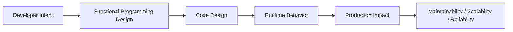
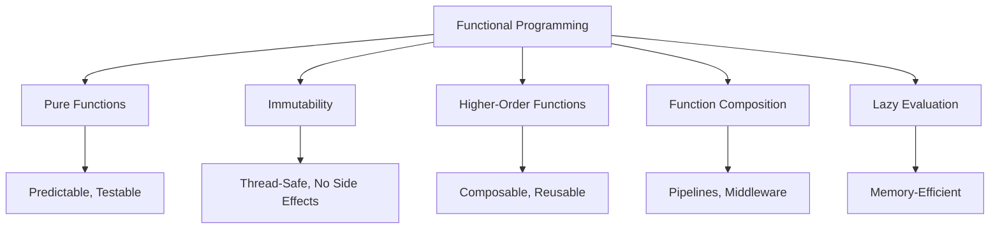

# Functional Programming Paradigm

## Overview

**Functional programming (FP)** is a programming paradigm that treats computation as the evaluation of mathematical functions, emphasizing **immutability**, **pure functions**, **function composition**, and **declarative style**. Python is a multi-paradigm language — it supports FP alongside OOP and procedural programming.

Key FP concepts in Python include: pure functions, immutability, higher-order functions, function composition, `map`/`filter`/`reduce`, closures, partial application, currying, and lazy evaluation. In production systems — data pipelines, AI agents, RAG systems, and backend APIs — FP principles lead to more predictable, testable, and composable code.

---

## Why It Matters





---

## Simple Example

```python
# Pure functions — no side effects, same input always gives same output

def add(x: int, y: int) -> int:
    return x + y  # Pure: no side effects

def square(x: int) -> int:
    return x ** 2  # Pure

# Immutability — prefer creating new values over mutating
original = (1, 2, 3, 4, 5)  # Tuple: immutable
doubled = tuple(x * 2 for x in original)  # New tuple, original unchanged
print(f"Original: {original}")
print(f"Doubled:  {doubled}")

# Higher-order functions
from functools import reduce

numbers = [1, 2, 3, 4, 5, 6, 7, 8, 9, 10]

# map, filter, reduce — functional style
evens   = list(filter(lambda x: x % 2 == 0, numbers))
squared = list(map(lambda x: x ** 2, evens))
total   = reduce(lambda acc, x: acc + x, squared, 0)

print(f"Evens: {evens}")
print(f"Squared evens: {squared}")
print(f"Sum of squared evens: {total}")

# Equivalent with list comprehension (more Pythonic)
total_v2 = sum(x ** 2 for x in numbers if x % 2 == 0)
print(f"Sum (comprehension): {total_v2}")
```

**Explanation:**
- **Pure functions** have no side effects and always return the same output for the same input.
- **Immutability** is achieved by using tuples, frozensets, and creating new values instead of mutating.
- `map`, `filter`, `reduce` are the classic FP trio for data transformation.

**Expected output:**
```
Original: (1, 2, 3, 4, 5)
Doubled:  (2, 4, 6, 8, 10)
Evens: [2, 4, 6, 8, 10]
Squared evens: [4, 16, 36, 64, 100]
Sum of squared evens: 220
Sum (comprehension): 220
```

---

## Intermediate Example

### Functional Data Pipeline with Immutable Records

```python
from __future__ import annotations
from typing import Callable, TypeVar, Any
from functools import reduce
from dataclasses import dataclass, replace

T = TypeVar("T")

# --- Immutable Record ---
@dataclass(frozen=True)
class Employee:
    employee_id: int
    name: str
    department: str
    salary: float
    active: bool = True

    def with_salary(self, new_salary: float) -> Employee:
        return replace(self, salary=new_salary)

    def deactivate(self) -> Employee:
        return replace(self, active=False)

# --- Pure Transformation Functions ---
def give_raise(pct: float) -> Callable[[Employee], Employee]:
    return lambda e: e.with_salary(e.salary * (1 + pct / 100))

def filter_dept(dept: str) -> Callable[[list[Employee]], list[Employee]]:
    return lambda employees: [e for e in employees if e.department == dept]

def sort_by_salary(employees: list[Employee]) -> list[Employee]:
    return sorted(employees, key=lambda e: e.salary, reverse=True)

def top_n(n: int) -> Callable[[list[Employee]], list[Employee]]:
    return lambda employees: employees[:n]

# --- Functional Pipeline ---
def pipe(*funcs: Callable) -> Callable:
    return lambda value: reduce(lambda v, f: f(v), funcs, value)

# --- Data ---
employees = [
    Employee(1, "Alice", "Engineering", 95000),
    Employee(2, "Bob",   "Marketing",   75000),
    Employee(3, "Carol", "Engineering", 105000),
    Employee(4, "Dave",  "Engineering", 85000),
    Employee(5, "Eve",   "Marketing",   90000),
]

# Build a pure, composable pipeline
top_engineers_after_raise = pipe(
    filter_dept("Engineering"),
    lambda emps: [give_raise(10)(e) for e in emps],  # 10% raise
    sort_by_salary,
    top_n(2),
)

result = top_engineers_after_raise(employees)
for emp in result:
    print(f"{emp.name}: ${emp.salary:,.0f}")

# Original data is unchanged (immutability)
print(f"\nOriginal Alice salary: ${employees[0].salary:,}")
```

**Explanation:**
- `@dataclass(frozen=True)` creates immutable records.
- `replace()` creates a new instance with modified fields — the original is unchanged.
- Transformation functions are pure — they take data and return new data.
- The pipeline is composed from pure functions — easy to test and reason about.

**Expected output:**
```
Carol: $115,500
Alice: $104,500

Original Alice salary: $95,000
```

---

## Advanced / Architect-Level Example

### Functional RAG Pipeline with Monadic Error Handling

**Problem context:** A RAG pipeline must process documents through multiple stages (fetch, parse, embed, store). Each stage can fail. Using functional patterns — specifically a `Result` monad — errors are handled without exceptions, making the pipeline composable and testable.

```python
from __future__ import annotations
from typing import TypeVar, Generic, Callable, Any
from dataclasses import dataclass
from functools import reduce

T = TypeVar("T")
E = TypeVar("E")
U = TypeVar("U")

# --- Result Monad ---
@dataclass(frozen=True)
class Ok(Generic[T]):
    value: T

    def map(self, func: Callable[[T], U]) -> Ok[U] | Err:
        try:
            return Ok(func(self.value))
        except Exception as e:
            return Err(str(e))

    def flat_map(self, func: Callable[[T], Ok[U] | Err]) -> Ok[U] | Err:
        try:
            return func(self.value)
        except Exception as e:
            return Err(str(e))

    def is_ok(self) -> bool:
        return True

    def unwrap(self) -> T:
        return self.value

@dataclass(frozen=True)
class Err(Generic[E]):
    error: E

    def map(self, func: Callable) -> Err:
        return self  # Propagate error

    def flat_map(self, func: Callable) -> Err:
        return self  # Propagate error

    def is_ok(self) -> bool:
        return False

    def unwrap(self) -> None:
        raise ValueError(f"Called unwrap on Err: {self.error}")

Result = Ok | Err

# --- Pure Pipeline Stages ---
def fetch_document(url: str) -> Result:
    if not url.startswith("http"):
        return Err(f"Invalid URL: {url}")
    return Ok({"url": url, "raw": f"<html>Content from {url}</html>"})

def parse_html(doc: dict) -> Result:
    raw = doc.get("raw", "")
    if not raw:
        return Err("Empty document")
    text = raw.replace("<html>", "").replace("</html>", "").strip()
    return Ok({**doc, "text": text})

def embed_text(doc: dict) -> Result:
    text = doc.get("text", "")
    if len(text) < 5:
        return Err(f"Text too short to embed: {text!r}")
    vector = [hash(text[i:i+4]) % 100 / 100.0 for i in range(8)]
    return Ok({**doc, "vector": vector})

def store_document(doc: dict) -> Result:
    return Ok({**doc, "stored": True, "doc_id": hash(doc["url"]) % 10000})

# --- Functional Pipeline with Result Monad ---
def pipeline_stage(func: Callable[[dict], Result]) -> Callable[[Result], Result]:
    """Lift a function into the Result monad."""
    def apply(result: Result) -> Result:
        if isinstance(result, Err):
            return result  # Short-circuit on error
        return func(result.value)
    return apply

def run_pipeline(url: str) -> Result:
    stages = [
        pipeline_stage(fetch_document),
        pipeline_stage(parse_html),
        pipeline_stage(embed_text),
        pipeline_stage(store_document),
    ]
    initial: Result = Ok({"url": url})
    # Actually, let's start with fetch
    result = fetch_document(url)
    for stage in stages[1:]:
        result = stage(result)
    return result

# --- Test Cases ---
test_urls = [
    "https://example.com/doc1",
    "ftp://invalid-url.com",
    "https://example.com/empty",
]

for url in test_urls:
    result = run_pipeline(url)
    if result.is_ok():
        doc = result.unwrap()
        print(f"✓ {url}: doc_id={doc.get('doc_id')}, vector_len={len(doc.get('vector', []))}")
    else:
        print(f"✗ {url}: {result.error}")
```

**Explanation:**
- `Ok` and `Err` form a `Result` monad — a functional pattern for error handling without exceptions.
- `map` and `flat_map` allow chaining operations on `Ok` values; errors short-circuit automatically.
- Each pipeline stage is a pure function that returns a `Result`.
- The pipeline is fully composable and testable — no exceptions, no side effects.

**Design trade-offs:**
| Approach | Pros | Cons |
|---|---|---|
| Result monad | Explicit errors, composable | Unfamiliar to OOP developers |
| Exceptions | Familiar, built-in | Breaks functional composition |
| Optional/None | Simple | No error context |
| `returns` library | Full monad support | External dependency |

---

## Common Mistakes

### 1. Writing "functional-looking" code that has side effects
```python
# Bad — looks functional but has side effects
results = []
list(map(lambda x: results.append(x * 2), numbers))  # Side effect in map!

# Good — pure transformation
results = [x * 2 for x in numbers]
```

### 2. Mutating data in "pure" functions
```python
# Bad — mutates the input
def add_field(record: dict, key: str, value) -> dict:
    record[key] = value  # Mutation!
    return record

# Good — return a new dict
def add_field(record: dict, key: str, value) -> dict:
    return {**record, key: value}
```

### 3. Overusing `reduce` for simple operations
```python
# Bad — reduce is overkill for sum
total = reduce(lambda acc, x: acc + x, numbers, 0)

# Good
total = sum(numbers)
```

### 4. Ignoring Python's multi-paradigm nature
- **Problem:** Forcing FP everywhere in Python leads to unreadable code.
- **Better approach:** Use FP where it adds value (data pipelines, transformations, pure logic). Use OOP for domain models and stateful systems.

### 5. Not using `dataclasses(frozen=True)` for immutable records
- **Problem:** Regular dataclasses are mutable — FP requires immutability.
- **Better approach:** Use `@dataclass(frozen=True)` and `replace()` for immutable records.

---

## Best Practices

- **Write pure functions** — no side effects, no global state.
- **Use `@dataclass(frozen=True)`** for immutable data records.
- **Use `replace()`** to create modified copies of frozen dataclasses.
- **Use list comprehensions** over `map(lambda ...)` — more Pythonic.
- **Use `functools.reduce`** only when `sum`, `max`, `min`, or comprehensions don't suffice.
- **Compose functions** with `pipe` / `compose` for readable pipelines.
- **Use generators** for lazy evaluation of large datasets.
- **Avoid shared mutable state** — use function arguments and return values.
- **Use the `returns` library** for production-grade monadic patterns.

---

## Performance Considerations

- **Pure functions** are easier to optimize — they can be memoized, parallelized, and cached.
- **Immutable data** is thread-safe — no locking needed for concurrent access.
- **Generators** are memory-efficient for large datasets — they evaluate lazily.
- **`map` and `filter`** return lazy iterators in Python 3 — wrap with `list()` only when needed.
- **Functional pipelines** add function call overhead — for CPU-bound hot loops, consider vectorized operations (numpy, pandas).

---

## Testing Strategy

```python
# tests/test_functional.py
import pytest
from mymodule import add, square, give_raise, Employee, run_pipeline, Ok, Err

def test_pure_function_deterministic():
    assert add(3, 4) == 7
    assert add(3, 4) == 7  # Same input, same output

def test_immutable_record():
    emp = Employee(1, "Alice", "Eng", 95000)
    raised = give_raise(10)(emp)
    assert raised.salary == 104500
    assert emp.salary == 95000  # Original unchanged

def test_pipeline_success():
    result = run_pipeline("https://example.com/doc")
    assert result.is_ok()
    doc = result.unwrap()
    assert "vector" in doc
    assert doc["stored"] is True

def test_pipeline_error_propagation():
    result = run_pipeline("ftp://invalid")
    assert not result.is_ok()
    assert isinstance(result, Err)

def test_result_map():
    ok = Ok(5)
    doubled = ok.map(lambda x: x * 2)
    assert doubled.unwrap() == 10

def test_result_map_on_err():
    err = Err("failed")
    result = err.map(lambda x: x * 2)
    assert isinstance(result, Err)
    assert result.error == "failed"

def test_functional_pipeline_pure():
    from mymodule import filter_dept, sort_by_salary, top_n, pipe
    employees = [
        Employee(1, "A", "Eng", 100),
        Employee(2, "B", "Mkt", 200),
        Employee(3, "C", "Eng", 150),
    ]
    pipeline = pipe(filter_dept("Eng"), sort_by_salary, top_n(1))
    result = pipeline(employees)
    assert len(result) == 1
    assert result[0].name == "C"
```

---

## Debugging Tips

- **Pure functions are easy to debug** — call them directly with test inputs.
- **Immutable data prevents mutation bugs** — if data is wrong, trace where it was created.
- **`Result` monad** — check `is_ok()` before `unwrap()` to avoid errors.
- **`functools.reduce` with empty list** — always provide an initial value.
- **Generator exhaustion** — generators can only be iterated once. Use `list()` to materialize if needed.
- **Side effects in `map`** — if `map` has side effects, the behavior depends on when the iterator is consumed. Avoid side effects in `map`.

---

## Interview Questions

### Beginner
1. **What is a pure function?**
   *A function with no side effects that always returns the same output for the same input.*

2. **What is immutability in functional programming?**
   *Data that cannot be modified after creation. New values are created instead of mutating existing ones.*

3. **What are the three classic FP functions in Python?**
   *`map()`, `filter()`, `reduce()`.*

4. **What is function composition?**
   *Combining functions so the output of one becomes the input of the next.*

5. **What is a side effect?**
   *Any observable change outside the function's scope: modifying global state, writing to a file, printing, etc.*

### Intermediate
1. **What is the difference between `map` and a list comprehension?**
   *Both transform sequences. `map` returns a lazy iterator; list comprehensions return a list. Comprehensions are more Pythonic and often more readable.*

2. **What is lazy evaluation and how does Python support it?**
   *Lazy evaluation defers computation until the result is needed. Python supports it via generators, `map`, `filter`, and generator expressions.*

3. **What is a monad and how does the `Result` type implement one?**
   *A monad is a design pattern for chaining operations while handling context (errors, optionality). `Result` (Ok/Err) chains operations on Ok values and short-circuits on Err.*

4. **How does `@dataclass(frozen=True)` support functional programming?**
   *It creates immutable instances — attributes cannot be changed after creation. Use `replace()` to create modified copies.*

5. **What is the `toolz` library and how does it support FP in Python?**
   *`toolz` provides functional utilities: `curry`, `compose`, `pipe`, `memoize`, `groupby`, `partition`, etc. It is a production-quality FP toolkit for Python.*

### Advanced / Architect-Level
1. **How would you design a functional data pipeline for a RAG system?**
   *Define pure functions for each stage (fetch, parse, embed, store). Use a `Result` monad for error handling. Compose stages with `pipe`. Use immutable records (`frozen=True`) for documents.*

2. **What are the trade-offs between FP and OOP in Python?**
   *FP: predictable, testable, composable, thread-safe. OOP: familiar, encapsulates state, supports inheritance. Python works best with a hybrid: FP for data transformations, OOP for domain models.*

3. **How does FP improve testability?**
   *Pure functions have no side effects and no external dependencies — they can be tested with just input/output assertions. No mocking required.*

4. **What is referential transparency and why does it matter?**
   *A function is referentially transparent if it can be replaced by its return value without changing program behavior. This enables memoization, parallelization, and equational reasoning.*

5. **How would you implement a functional event sourcing system in Python?**
   *Events are immutable records. State is computed by `reduce`-ing events over an initial state. Each event handler is a pure function: `(state, event) -> new_state`. The event log is the source of truth.*

---

## Key Takeaways

- FP emphasizes **pure functions**, **immutability**, **composition**, and **declarative style**.
- **Pure functions** are predictable, testable, and parallelizable.
- **Immutability** prevents mutation bugs and enables thread safety.
- **`@dataclass(frozen=True)`** + **`replace()`** for immutable records.
- **`map`, `filter`, `reduce`** are the FP trio — prefer comprehensions for readability.
- **Function composition** (`pipe`, `compose`) enables clean data pipelines.
- **Result monad** handles errors functionally — no exceptions in the pipeline.
- Python is multi-paradigm — use FP where it adds value, OOP where it is clearer.

---

## Mini Project Idea

### Project: `fp-pipeline` — Functional Data Processing Framework

**Goal:** Build a production-quality functional data processing framework with immutable records, a `Result` monad, composable pipelines, and lazy evaluation.

**Features:**
- `Result[T, E]` monad with `Ok`, `Err`, `map`, `flat_map`, `recover`.
- `@dataclass(frozen=True)` record types with `replace()` helpers.
- `pipe(*funcs)` and `compose(*funcs)` for function composition.
- Lazy `Stream` class for memory-efficient processing.
- Built-in transformers: `filter_by`, `map_with`, `sort_by`, `group_by`, `aggregate`.
- Full type annotations (mypy strict).

**Suggested folder structure:**
```
fp_pipeline/
├── .venv/
├── pyproject.toml
├── src/
│   └── fp_pipeline/
│       ├── __init__.py
│       ├── result.py        # Result monad
│       ├── stream.py        # Lazy Stream
│       ├── composition.py   # pipe, compose
│       └── transformers.py  # Built-in transformers
└── tests/
    ├── test_result.py
    ├── test_stream.py
    └── test_composition.py
```

**Extension ideas:**
- Add async pipeline support.
- Add parallel execution with `concurrent.futures`.
- Integrate with pandas for DataFrame pipelines.
- Add a visual pipeline diagram generator.

---

## Final Summary

Functional programming is not just a style — it is a discipline that produces more predictable, testable, and composable code. Python's multi-paradigm nature means you can apply FP principles selectively: pure functions for data transformations, immutable records for domain objects, and function composition for pipelines. Architects who master FP in Python build systems where data flows through well-defined, testable transformations — systems that are easier to reason about, parallelize, and maintain. The functional paradigm is the foundation of modern data engineering, AI pipelines, and reactive systems.
