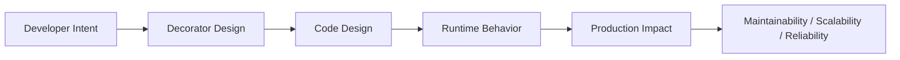
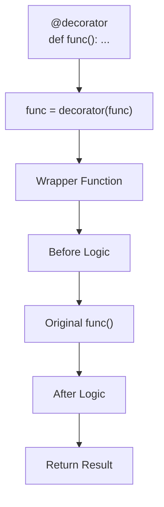

# Decorators

## Overview

A **decorator** in Python is a higher-order function that takes a function (or class) as input, wraps it with additional behavior, and returns the modified version. Decorators are applied using the `@decorator` syntax and are one of Python's most powerful and widely-used metaprogramming features.

Decorators are the foundation of Python's middleware ecosystem: logging, authentication, caching, retry logic, rate limiting, validation, and more are all implemented as decorators. Understanding decorators — from simple wrappers to parameterized, class-based, and stacked decorators — is essential for production Python development.

---

## Why It Matters





---

## Simple Example

```python
from functools import wraps
import time

# Basic decorator
def timer(func):
    @wraps(func)
    def wrapper(*args, **kwargs):
        start = time.perf_counter()
        result = func(*args, **kwargs)
        elapsed = time.perf_counter() - start
        print(f"{func.__name__} took {elapsed:.4f}s")
        return result
    return wrapper

@timer
def slow_function(n: int) -> int:
    total = sum(range(n))
    return total

result = slow_function(1_000_000)
print(f"Result: {result}")

# Verify @wraps preserves metadata
print(f"Function name: {slow_function.__name__}")
print(f"Wrapped: {slow_function.__wrapped__}")
```

**Explanation:**
- `@timer` is equivalent to `slow_function = timer(slow_function)`.
- `@wraps(func)` copies `__name__`, `__doc__`, `__annotations__`, and sets `__wrapped__`.
- `*args, **kwargs` ensures the wrapper accepts any arguments.

**Expected output:**
```
slow_function took 0.0412s
Result: 499999500000
Function name: slow_function
Wrapped: <function slow_function at 0x...>
```

---

## Intermediate Example

### Parameterized Decorators and Stacking

```python
from functools import wraps
import logging
import time
from typing import Callable, TypeVar

F = TypeVar("F", bound=Callable)
logger = logging.getLogger(__name__)
logging.basicConfig(level=logging.INFO)

# --- Parameterized decorator ---
def retry(max_attempts: int = 3, delay: float = 1.0, exceptions: tuple = (Exception,)):
    """Retry decorator with configurable attempts, delay, and exception types."""
    def decorator(func: F) -> F:
        @wraps(func)
        def wrapper(*args, **kwargs):
            last_exc = None
            for attempt in range(1, max_attempts + 1):
                try:
                    return func(*args, **kwargs)
                except exceptions as e:
                    last_exc = e
                    if attempt < max_attempts:
                        logger.warning(
                            "%s: attempt %d/%d failed (%s). Retrying in %.1fs...",
                            func.__name__, attempt, max_attempts, e, delay
                        )
                        time.sleep(delay)
            raise last_exc  # type: ignore
        return wrapper  # type: ignore
    return decorator

def log_calls(level: str = "INFO"):
    """Log function calls with arguments and return values."""
    log_func = getattr(logging, level.lower())
    def decorator(func: F) -> F:
        @wraps(func)
        def wrapper(*args, **kwargs):
            log_func("→ %s(%s, %s)", func.__name__, args, kwargs)
            result = func(*args, **kwargs)
            log_func("← %s returned %s", func.__name__, result)
            return result
        return wrapper  # type: ignore
    return decorator

def validate_positive(*param_names: str):
    """Validate that specified parameters are positive numbers."""
    def decorator(func: F) -> F:
        import inspect
        sig = inspect.signature(func)
        @wraps(func)
        def wrapper(*args, **kwargs):
            bound = sig.bind(*args, **kwargs)
            bound.apply_defaults()
            for name in param_names:
                if name in bound.arguments:
                    val = bound.arguments[name]
                    if not isinstance(val, (int, float)) or val <= 0:
                        raise ValueError(f"Parameter '{name}' must be positive, got {val!r}")
            return func(*args, **kwargs)
        return wrapper  # type: ignore
    return decorator

# --- Stacked decorators (applied bottom-up) ---
@log_calls("INFO")
@retry(max_attempts=3, delay=0.1, exceptions=(ConnectionError,))
@validate_positive("amount")
def process_payment(user_id: str, amount: float) -> dict:
    import random
    if random.random() < 0.3:
        raise ConnectionError("Payment gateway unavailable")
    return {"user_id": user_id, "amount": amount, "status": "success"}

# Valid call
try:
    result = process_payment("u001", 99.99)
    print(result)
except ConnectionError as e:
    print(f"Payment failed: {e}")

# Invalid call
try:
    process_payment("u001", -50.0)
except ValueError as e:
    print(f"Validation error: {e}")
```

**Explanation:**
- Parameterized decorators are factories: `retry(max_attempts=3)` returns a decorator.
- Stacked decorators are applied bottom-up: `validate_positive` runs first, then `retry`, then `log_calls`.
- Each decorator is independent and reusable.

---

## Advanced / Architect-Level Example

### Class-Based Decorators and a Production Decorator Registry

**Problem context:** A production API framework needs a registry of reusable decorators that can be applied to route handlers. Decorators must be composable, configurable, and introspectable. A class-based decorator is used for stateful behavior (rate limiting).

```python
from __future__ import annotations
from functools import wraps
from typing import Callable, Any, TypeVar
from dataclasses import dataclass, field
import time
import threading
import logging

logger = logging.getLogger(__name__)
F = TypeVar("F", bound=Callable)

# --- Class-Based Decorator: Rate Limiter ---
class RateLimiter:
    """Thread-safe rate limiter using token bucket algorithm."""

    def __init__(self, calls_per_second: float):
        self.calls_per_second = calls_per_second
        self.min_interval = 1.0 / calls_per_second
        self._lock = threading.Lock()
        self._last_call: float = 0.0

    def __call__(self, func: F) -> F:
        @wraps(func)
        def wrapper(*args, **kwargs):
            with self._lock:
                now = time.monotonic()
                elapsed = now - self._last_call
                if elapsed < self.min_interval:
                    wait = self.min_interval - elapsed
                    logger.debug("Rate limit: waiting %.3fs before %s", wait, func.__name__)
                    time.sleep(wait)
                self._last_call = time.monotonic()
            return func(*args, **kwargs)
        return wrapper  # type: ignore

# --- Decorator Registry ---
@dataclass
class DecoratorRegistry:
    _registry: dict[str, Callable] = field(default_factory=dict)

    def register(self, name: str):
        def decorator(func: Callable) -> Callable:
            self._registry[name] = func
            return func
        return decorator

    def apply(self, *names: str) -> Callable[[F], F]:
        """Apply registered decorators by name."""
        def decorator(func: F) -> F:
            for name in reversed(names):
                if name not in self._registry:
                    raise KeyError(f"Decorator '{name}' not registered")
                func = self._registry[name](func)  # type: ignore
            return func
        return decorator

    def list_decorators(self) -> list[str]:
        return list(self._registry.keys())

registry = DecoratorRegistry()

# --- Register Decorators ---
@registry.register("log")
def logging_decorator(func: F) -> F:
    @wraps(func)
    def wrapper(*args, **kwargs):
        logger.info("Calling %s", func.__name__)
        result = func(*args, **kwargs)
        logger.info("%s completed", func.__name__)
        return result
    return wrapper  # type: ignore

@registry.register("cache")
def cache_decorator(func: F) -> F:
    _cache: dict[str, Any] = {}
    @wraps(func)
    def wrapper(*args, **kwargs):
        key = str(args) + str(sorted(kwargs.items()))
        if key not in _cache:
            _cache[key] = func(*args, **kwargs)
        return _cache[key]
    return wrapper  # type: ignore

# --- Apply Decorators from Registry ---
@registry.apply("log", "cache")
def fetch_user(user_id: int) -> dict:
    return {"id": user_id, "name": f"User {user_id}"}

# --- Class-Based Rate Limiter ---
rate_limit_10 = RateLimiter(calls_per_second=10)

@rate_limit_10
def call_external_api(endpoint: str) -> dict:
    return {"endpoint": endpoint, "data": "..."}

# Usage
print(fetch_user(1))
print(fetch_user(1))  # Cached
print(fetch_user(2))

print(registry.list_decorators())

# Introspect decorated function
print(f"fetch_user.__name__: {fetch_user.__name__}")
import inspect
print(f"fetch_user.__wrapped__: {inspect.unwrap(fetch_user).__name__}")
```

**Explanation:**
- `RateLimiter` is a class-based decorator — it maintains state (`_last_call`, `_lock`) across calls.
- `DecoratorRegistry` allows decorators to be registered by name and applied dynamically.
- `registry.apply("log", "cache")` composes decorators from the registry.
- `inspect.unwrap()` peels back all decorator layers to the original function.

**Design trade-offs:**
| Approach | Pros | Cons |
|---|---|---|
| Function decorator | Simple, lightweight | No persistent state |
| Class-based decorator | Stateful, inspectable | More boilerplate |
| Parameterized decorator | Configurable | Three levels of nesting |
| Registry | Dynamic, composable | Indirection |

---

## Common Mistakes

### 1. Forgetting `@wraps(func)`
```python
# Bad — loses function metadata
def my_decorator(func):
    def wrapper(*args, **kwargs):
        return func(*args, **kwargs)
    return wrapper

# Good
from functools import wraps
def my_decorator(func):
    @wraps(func)
    def wrapper(*args, **kwargs):
        return func(*args, **kwargs)
    return wrapper
```

### 2. Not passing `*args, **kwargs` to the wrapped function
```python
# Bad — only works for no-argument functions
def my_decorator(func):
    @wraps(func)
    def wrapper():
        return func()
    return wrapper

# Good
def my_decorator(func):
    @wraps(func)
    def wrapper(*args, **kwargs):
        return func(*args, **kwargs)
    return wrapper
```

### 3. Confusing decorator application order
```python
@A
@B
@C
def func(): ...
# Equivalent to: func = A(B(C(func)))
# C is applied first (innermost), A is outermost
```

### 4. Applying decorators to class methods incorrectly
- **Problem:** Decorators that use `inspect.signature` may not handle `self` correctly.
- **Better approach:** Skip `self` in parameter inspection, or use `functools.wraps` which handles methods.

### 5. Creating decorators that break async functions
```python
# Bad — wrapping async function with sync wrapper
def my_decorator(func):
    @wraps(func)
    def wrapper(*args, **kwargs):
        return func(*args, **kwargs)  # Returns coroutine, not awaited!
    return wrapper

# Good — handle both sync and async
import asyncio
def my_decorator(func):
    @wraps(func)
    async def async_wrapper(*args, **kwargs):
        return await func(*args, **kwargs)

    @wraps(func)
    def sync_wrapper(*args, **kwargs):
        return func(*args, **kwargs)

    return async_wrapper if asyncio.iscoroutinefunction(func) else sync_wrapper
```

---

## Best Practices

- **Always use `@wraps(func)`** to preserve function metadata.
- **Always pass `*args, **kwargs`** to the wrapped function.
- **Use parameterized decorators** for configurable behavior.
- **Use class-based decorators** for stateful behavior (rate limiting, circuit breaking).
- **Handle async functions** — check `asyncio.iscoroutinefunction(func)`.
- **Use `inspect.unwrap(func)`** to access the original function.
- **Keep decorators focused** — one concern per decorator.
- **Document decorator behavior** in the docstring.

---

## Performance Considerations

- Each decorator adds one function call per invocation — keep decorator chains short for hot paths.
- `@wraps` has negligible overhead.
- **`functools.lru_cache`** is a highly optimized built-in caching decorator — use it instead of rolling your own.
- **Class-based decorators** with `threading.Lock` add locking overhead — profile in concurrent scenarios.
- **`@functools.cache`** (Python 3.9+) is `lru_cache` with unlimited size.

---

## Testing Strategy

```python
# tests/test_decorators.py
import pytest
import time
from unittest.mock import patch, MagicMock
from mymodule import retry, log_calls, validate_positive, RateLimiter

def test_retry_succeeds_on_first_attempt():
    call_count = [0]
    @retry(max_attempts=3, delay=0)
    def func():
        call_count[0] += 1
        return "ok"
    assert func() == "ok"
    assert call_count[0] == 1

def test_retry_retries_on_failure():
    call_count = [0]
    @retry(max_attempts=3, delay=0, exceptions=(ValueError,))
    def func():
        call_count[0] += 1
        if call_count[0] < 3:
            raise ValueError("fail")
        return "ok"
    assert func() == "ok"
    assert call_count[0] == 3

def test_retry_raises_after_max_attempts():
    @retry(max_attempts=2, delay=0, exceptions=(ValueError,))
    def func():
        raise ValueError("always fails")
    with pytest.raises(ValueError):
        func()

def test_validate_positive_passes():
    @validate_positive("amount")
    def func(amount: float) -> float:
        return amount
    assert func(10.0) == 10.0

def test_validate_positive_raises():
    @validate_positive("amount")
    def func(amount: float) -> float:
        return amount
    with pytest.raises(ValueError, match="must be positive"):
        func(-5.0)

def test_wraps_preserves_name():
    @retry(max_attempts=1, delay=0)
    def my_function():
        return 42
    assert my_function.__name__ == "my_function"

def test_rate_limiter():
    limiter = RateLimiter(calls_per_second=100)
    @limiter
    def fast_func():
        return time.monotonic()
    t1 = fast_func()
    t2 = fast_func()
    assert t2 >= t1  # Second call is after first
```

---

## Debugging Tips

- **`func.__name__`** — should show the original function name (if `@wraps` was used).
- **`func.__wrapped__`** — the function wrapped by the decorator (set by `@wraps`).
- **`inspect.unwrap(func)`** — unwrap all decorator layers.
- **`inspect.getclosurevars(func)`** — inspect closure variables of a decorator.
- If a decorator breaks async functions, check `asyncio.iscoroutinefunction(func)`.
- If stacked decorators produce unexpected results, test each decorator in isolation.
- Use `print` or `logging` inside the wrapper to trace execution order.

---

## Interview Questions

### Beginner
1. **What is a decorator in Python?**
   *A higher-order function that takes a function, wraps it with additional behavior, and returns the modified version.*

2. **What does `@decorator` syntax do?**
   *It is equivalent to `func = decorator(func)` — it applies the decorator to the function.*

3. **Why should you use `@wraps(func)` in a decorator?**
   *To preserve the wrapped function's `__name__`, `__doc__`, `__annotations__`, and `__wrapped__`.*

4. **What is a parameterized decorator?**
   *A decorator factory — a function that takes arguments and returns a decorator.*

5. **In what order are stacked decorators applied?**
   *Bottom-up: `@A @B @C def f()` → `f = A(B(C(f)))`. C is applied first.*

### Intermediate
1. **What is a class-based decorator and when should you use it?**
   *A class that implements `__call__`. Use it when the decorator needs persistent state (e.g., rate limiting, circuit breaking).*

2. **How do you write a decorator that works for both sync and async functions?**
   *Check `asyncio.iscoroutinefunction(func)` and return an `async def` wrapper for async functions.*

3. **What is `inspect.unwrap()` used for?**
   *To peel back all decorator layers and access the original unwrapped function.*

4. **How does `functools.lru_cache` work?**
   *It caches function results keyed by arguments. On repeated calls with the same arguments, it returns the cached result instead of calling the function.*

5. **What is the difference between `@functools.cache` and `@functools.lru_cache`?**
   *`@cache` (Python 3.9+) is `lru_cache(maxsize=None)` — unlimited cache size. `lru_cache` evicts the least recently used entries when `maxsize` is reached.*

### Advanced / Architect-Level
1. **How would you implement a circuit breaker as a class-based decorator?**
   *Track consecutive failures in instance state. After N failures, raise `CircuitOpenError` immediately. After a timeout, allow one probe request. Reset on success.*

2. **How do decorators interact with Python's descriptor protocol?**
   *When a decorator is applied to a method, it wraps the function before it becomes a descriptor. `@staticmethod` and `@classmethod` are descriptors. Decorators must handle `self` correctly.*

3. **How would you design a decorator registry for a plugin system?**
   *Use a dictionary mapping names to decorator factories. Plugins register decorators at import time. The framework applies decorators by name from the registry.*

4. **What are the performance implications of deeply stacked decorators?**
   *Each decorator adds one function call per invocation. For 10 decorators, each call incurs 10 extra calls. Profile hot paths and consider combining decorators.*

5. **How do you test a decorator in isolation?**
   *Apply the decorator to a simple test function. Test that: (1) the original function is called with correct args, (2) the decorator's behavior is applied, (3) `__name__` is preserved, (4) exceptions are handled correctly.*

---

## Key Takeaways

- Decorators are **higher-order functions** that wrap functions with additional behavior.
- **Always use `@wraps(func)`** to preserve function metadata.
- **Always pass `*args, **kwargs`** to the wrapped function.
- **Parameterized decorators** are factories — three levels of nesting.
- **Class-based decorators** are for stateful behavior.
- **Stacked decorators** are applied bottom-up.
- **Handle async functions** — check `asyncio.iscoroutinefunction`.
- Decorators are the foundation of **logging, caching, retry, rate limiting, and authentication** in production Python.

---

## Mini Project Idea

### Project: `decorator-toolkit` — Production-Quality Decorator Library

**Goal:** Build a comprehensive decorator library with logging, retry, caching, rate limiting, circuit breaking, and validation — all production-ready and fully tested.

**Features:**
- `@log_calls(level, include_args, include_result)` — structured logging.
- `@retry(max_attempts, delay, backoff, exceptions)` — exponential backoff retry.
- `@cache(ttl, maxsize)` — TTL-based LRU cache.
- `@rate_limit(calls_per_second)` — token bucket rate limiter.
- `@circuit_breaker(failure_threshold, reset_timeout)` — circuit breaker.
- `@validate(**validators)` — parameter validation.
- All decorators handle sync and async functions.
- Full type annotations (mypy strict).

**Suggested folder structure:**
```
decorator_toolkit/
├── .venv/
├── pyproject.toml
├── src/
│   └── decorator_toolkit/
│       ├── __init__.py
│       ├── logging.py
│       ├── retry.py
│       ├── cache.py
│       ├── rate_limit.py
│       ├── circuit_breaker.py
│       └── validation.py
└── tests/
    ├── test_logging.py
    ├── test_retry.py
    ├── test_cache.py
    └── test_circuit_breaker.py
```

**Extension ideas:**
- Add async versions of all decorators.
- Add metrics collection (call count, error rate, latency).
- Export metrics to Prometheus.
- Add a decorator composition helper.

---

## Final Summary

Decorators are one of Python's most powerful and expressive features. They enable the separation of cross-cutting concerns — logging, caching, retry, authentication — from business logic, keeping code clean and composable. Architects who master decorators can design systems where behavior is layered transparently, without modifying the core logic. The decorator pattern is the foundation of Python's middleware ecosystem, and understanding it deeply — from simple wrappers to class-based, parameterized, and async-aware decorators — is a hallmark of production-grade Python expertise.
