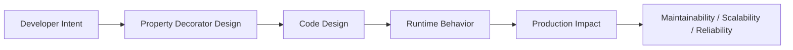
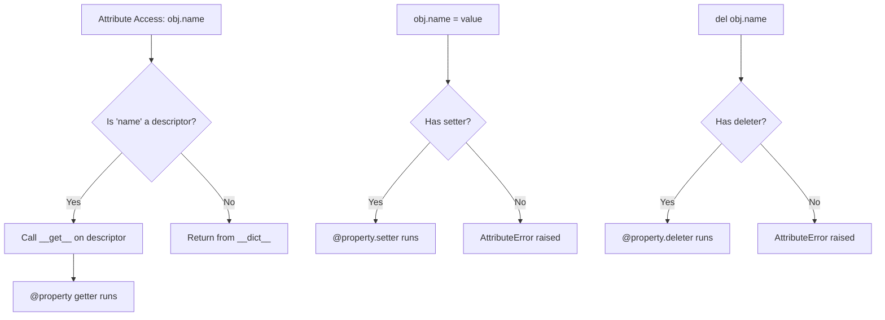

# Property Decorators

## Overview

**Property decorators** in Python — primarily `@property`, `@<name>.setter`, `@<name>.deleter`, and `@<name>.getter` — are the Pythonic mechanism for implementing **managed attributes**: attributes whose access, mutation, and deletion are controlled by methods, while still using clean dot-notation syntax from the caller's perspective.

Under the hood, `@property` is a built-in descriptor that transforms a method into a computed attribute. This allows you to start with a simple public attribute and later add validation, lazy computation, caching, or access control **without changing the public API** — a cornerstone of the Open/Closed Principle.

In production systems, property decorators are used for data validation, lazy loading, computed fields, access control, and clean domain model design.

---

## Why It Matters





---

## Simple Example

```python
class Circle:
    def __init__(self, radius: float):
        self._radius = radius  # Private backing attribute

    @property
    def radius(self) -> float:
        """Get the radius."""
        return self._radius

    @radius.setter
    def radius(self, value: float) -> None:
        """Set the radius with validation."""
        if value < 0:
            raise ValueError(f"Radius must be non-negative, got {value}")
        self._radius = value

    @radius.deleter
    def radius(self) -> None:
        """Delete the radius."""
        print("Deleting radius...")
        del self._radius

    @property
    def area(self) -> float:
        """Computed property — no setter needed."""
        import math
        return math.pi * self._radius ** 2

    @property
    def diameter(self) -> float:
        return self._radius * 2


c = Circle(5.0)
print(c.radius)       # 5.0
print(c.area)         # 78.539...
print(c.diameter)     # 10.0

c.radius = 10.0
print(c.radius)       # 10.0

try:
    c.radius = -3.0
except ValueError as e:
    print(e)          # Radius must be non-negative, got -3.0

del c.radius          # Deleting radius...
```

**Explanation:**
- `_radius` is the private backing store; `radius` is the public managed attribute.
- `@property` defines the getter. `@radius.setter` defines the setter. `@radius.deleter` defines the deleter.
- `area` and `diameter` are **read-only computed properties** — they have no setter.
- Callers use `c.radius = 10.0` (not `c.set_radius(10.0)`), keeping the API clean.

**Expected output:**
```
5.0
78.53981633974483
10.0
10.0
Radius must be non-negative, got -3.0
Deleting radius...
```

---

## Intermediate Example

### Lazy-Loading and Cached Properties in a Domain Model

```python
from __future__ import annotations
from functools import cached_property
from typing import Optional
import time


class Product:
    """Domain model with validated, computed, and lazy-loaded properties."""

    def __init__(self, name: str, price: float, tax_rate: float = 0.1):
        self.name = name          # Will use @property setter
        self.price = price        # Will use @property setter
        self._tax_rate = tax_rate
        self._discount: float = 0.0

    # --- Validated property ---
    @property
    def price(self) -> float:
        return self._price

    @price.setter
    def price(self, value: float) -> None:
        if not isinstance(value, (int, float)):
            raise TypeError(f"Price must be numeric, got {type(value).__name__}")
        if value < 0:
            raise ValueError(f"Price must be non-negative, got {value}")
        self._price = float(value)
        # Invalidate cached property when price changes
        self.__dict__.pop("final_price", None)

    @property
    def name(self) -> str:
        return self._name

    @name.setter
    def name(self, value: str) -> None:
        if not value or not value.strip():
            raise ValueError("Product name cannot be empty")
        self._name = value.strip()

    # --- Computed property ---
    @property
    def tax_amount(self) -> float:
        return round(self._price * self._tax_rate, 2)

    @property
    def discount(self) -> float:
        return self._discount

    @discount.setter
    def discount(self, value: float) -> None:
        if not (0.0 <= value <= 1.0):
            raise ValueError(f"Discount must be between 0 and 1, got {value}")
        self._discount = value
        self.__dict__.pop("final_price", None)  # Invalidate cache

    # --- Cached property (computed once, then cached in __dict__) ---
    @cached_property
    def final_price(self) -> float:
        """Expensive computation cached after first access."""
        print(f"  [Computing final_price for '{self.name}'...]")
        time.sleep(0.01)  # Simulate expensive computation
        return round(self._price * (1 - self._discount) + self.tax_amount, 2)

    def __repr__(self) -> str:
        return f"Product(name={self.name!r}, price={self.price}, discount={self.discount})"


# Usage
p = Product("Widget Pro", 100.0)
print(p)

print(p.final_price)   # Computed
print(p.final_price)   # Cached — no recomputation

p.discount = 0.1       # Invalidates cache
print(p.final_price)   # Recomputed

try:
    p.price = -10
except ValueError as e:
    print(e)

try:
    p.discount = 1.5
except ValueError as e:
    print(e)
```

**Explanation:**
- `@property` with setters enforces validation on every assignment.
- `@cached_property` (Python 3.8+) computes the value once and stores it in `__dict__`, bypassing the descriptor on subsequent accesses.
- Manually removing the key from `__dict__` (`self.__dict__.pop("final_price", None)`) invalidates the cache when dependencies change.
- This pattern is common in domain models, ORM entities, and data transfer objects.

**Expected output:**
```
Product(name='Widget Pro', price=100.0, discount=0.0)
  [Computing final_price for 'Widget Pro'...]
110.0
110.0
  [Computing final_price for 'Widget Pro'...]
99.0
Price must be non-negative, got -10
Discount must be between 0 and 1, got 1.5
```

---

## Advanced / Architect-Level Example

### Configuration Model with Property-Based Validation, Observability, and Change Tracking

**Problem context:** An enterprise AI agent framework needs a `AgentConfig` class where configuration values are validated on assignment, changes are tracked for audit logging, and dependent computed properties are automatically invalidated. This is a common pattern in ERP systems, workflow engines, and AI agent orchestration frameworks.

```python
from __future__ import annotations
from typing import Any, Callable, Optional
from dataclasses import dataclass, field
from datetime import datetime
import logging

logger = logging.getLogger(__name__)
logging.basicConfig(level=logging.INFO, format="%(levelname)s: %(message)s")


# --- Change tracking descriptor factory ---
class TrackedProperty:
    """
    A descriptor that tracks changes to a property and notifies observers.
    Used as a building block for observable domain models.
    """

    def __init__(
        self,
        validator: Optional[Callable[[Any], None]] = None,
        default: Any = None,
    ):
        self.validator = validator
        self.default = default
        self.name: str = ""

    def __set_name__(self, owner: type, name: str) -> None:
        self.name = name
        self.private_name = f"_tracked_{name}"

    def __get__(self, obj: Any, objtype: Any = None) -> Any:
        if obj is None:
            return self
        return getattr(obj, self.private_name, self.default)

    def __set__(self, obj: Any, value: Any) -> None:
        if self.validator:
            self.validator(value)
        old_value = getattr(obj, self.private_name, self.default)
        setattr(obj, self.private_name, value)
        if old_value != value:
            obj._record_change(self.name, old_value, value)


@dataclass
class ChangeRecord:
    field: str
    old_value: Any
    new_value: Any
    timestamp: datetime = field(default_factory=datetime.utcnow)

    def __str__(self) -> str:
        return (
            f"[{self.timestamp.isoformat()}] "
            f"{self.field}: {self.old_value!r} → {self.new_value!r}"
        )


# --- Validators ---
def positive_int(value: Any) -> None:
    if not isinstance(value, int) or value <= 0:
        raise ValueError(f"Expected positive int, got {value!r}")

def non_empty_str(value: Any) -> None:
    if not isinstance(value, str) or not value.strip():
        raise ValueError(f"Expected non-empty string, got {value!r}")

def valid_temperature(value: Any) -> None:
    if not isinstance(value, float) or not (0.0 <= value <= 2.0):
        raise ValueError(f"Temperature must be float in [0.0, 2.0], got {value!r}")


# --- Agent Configuration Model ---
class AgentConfig:
    """
    Production-grade AI agent configuration with:
    - Property-based validation
    - Change tracking and audit log
    - Computed properties with cache invalidation
    - Observer notifications
    """

    model_name: str = TrackedProperty(validator=non_empty_str, default="gpt-4o")
    max_tokens: int = TrackedProperty(validator=positive_int, default=2048)
    temperature: float = TrackedProperty(validator=valid_temperature, default=0.7)

    def __init__(
        self,
        model_name: str = "gpt-4o",
        max_tokens: int = 2048,
        temperature: float = 0.7,
        agent_id: str = "agent-001",
    ):
        self._change_log: list[ChangeRecord] = []
        self._observers: list[Callable[[ChangeRecord], None]] = []
        self._agent_id = agent_id
        # Trigger TrackedProperty setters
        self.model_name = model_name
        self.max_tokens = max_tokens
        self.temperature = temperature
        # Clear init-time changes from log
        self._change_log.clear()

    def _record_change(self, field: str, old_value: Any, new_value: Any) -> None:
        record = ChangeRecord(field=field, old_value=old_value, new_value=new_value)
        self._change_log.append(record)
        logger.info("AgentConfig[%s] changed: %s", self._agent_id, record)
        for observer in self._observers:
            observer(record)

    def add_observer(self, observer: Callable[[ChangeRecord], None]) -> None:
        self._observers.append(observer)

    @property
    def change_log(self) -> list[ChangeRecord]:
        """Read-only access to the change log."""
        return list(self._change_log)

    @property
    def agent_id(self) -> str:
        """Immutable after construction."""
        return self._agent_id

    @property
    def cost_estimate_per_1k_tokens(self) -> float:
        """Computed property: estimated cost based on model."""
        pricing = {
            "gpt-4o": 0.005,
            "gpt-4-turbo": 0.01,
            "gpt-3.5-turbo": 0.0005,
        }
        return pricing.get(self.model_name, 0.002)

    @property
    def estimated_cost(self) -> float:
        """Computed cost for max_tokens."""
        return round(self.cost_estimate_per_1k_tokens * self.max_tokens / 1000, 6)

    def __repr__(self) -> str:
        return (
            f"AgentConfig(agent_id={self._agent_id!r}, "
            f"model={self.model_name!r}, "
            f"max_tokens={self.max_tokens}, "
            f"temperature={self.temperature})"
        )


# --- Usage ---
config = AgentConfig(agent_id="rag-agent-01")
print(config)
print(f"Estimated cost: ${config.estimated_cost}")

# Register an observer
def on_config_change(record: ChangeRecord) -> None:
    print(f"  [OBSERVER] Config changed: {record}")

config.add_observer(on_config_change)

# Mutate config — triggers validation, tracking, and observer
config.model_name = "gpt-4-turbo"
config.max_tokens = 4096
config.temperature = 0.3

print(f"\nUpdated config: {config}")
print(f"Estimated cost: ${config.estimated_cost}")

print("\nChange log:")
for record in config.change_log:
    print(f"  {record}")

# Validation errors
try:
    config.temperature = 3.0
except ValueError as e:
    print(f"\nValidation error: {e}")

try:
    config.max_tokens = -100
except ValueError as e:
    print(f"Validation error: {e}")
```

**Explanation:**
- `TrackedProperty` is a **custom descriptor** that combines validation and change tracking. It uses `__set_name__` to auto-discover its attribute name.
- `AgentConfig` uses `TrackedProperty` class-level descriptors alongside `@property` for computed and read-only attributes.
- The observer pattern allows external systems (audit loggers, dashboards, config sync services) to react to changes.
- `change_log` is a read-only `@property` that returns a copy, preventing external mutation.
- `agent_id` is an immutable `@property` — no setter defined.

**Design trade-offs:**

| Approach | Pros | Cons |
|---|---|---|
| `@property` only | Simple, Pythonic | No reuse across classes |
| Custom descriptor | Reusable, composable | More complex |
| `__setattr__` override | Catches all assignments | Hard to maintain, fragile |
| Pydantic `BaseModel` | Full validation, serialization | External dependency |
| `@dataclass` + `__post_init__` | Clean syntax | Validation only at init |

---

## Common Mistakes

### 1. Using the same name for the property and the backing attribute
```python
# Bad — infinite recursion!
class Foo:
    @property
    def value(self):
        return self.value  # Calls getter again → RecursionError

    @value.setter
    def value(self, v):
        self.value = v  # Calls setter again → RecursionError

# Good — use a private backing attribute
class Foo:
    @property
    def value(self):
        return self._value

    @value.setter
    def value(self, v):
        self._value = v
```

### 2. Defining setter before getter
```python
# Bad — @value.setter requires @property to be defined first
class Foo:
    @value.setter          # NameError: name 'value' is not defined
    def value(self, v):
        self._value = v

    @property
    def value(self):
        return self._value
```
- **Better approach:** Always define `@property` (getter) first, then `@<name>.setter`, then `@<name>.deleter`.

### 3. Forgetting that `@cached_property` is not thread-safe by default
- **Problem:** In multi-threaded code, two threads may both compute the cached value simultaneously.
- **Better approach:** Use `threading.Lock` or Python 3.12's thread-safe `@cached_property`, or use `functools.lru_cache` on a method.

### 4. Trying to use `@cached_property` on a class with `__slots__`
- **Problem:** `@cached_property` stores the result in `__dict__`, which doesn't exist when `__slots__` is defined.
- **Better approach:** Use a regular `@property` with a manual cache dict, or remove `__slots__`.

### 5. Defining a setter but not a getter
```python
# Bad — property with only a setter is write-only and confusing
class Foo:
    @property
    def value(self):
        raise AttributeError("value is write-only")

    @value.setter
    def value(self, v):
        self._value = v
```
- **Better approach:** If you need write-only attributes, use a regular method (`set_value()`). Write-only properties are an anti-pattern.

### 6. Mutating state inside a getter
```python
# Bad — getters should be side-effect free
@property
def items(self):
    self._access_count += 1  # Side effect in getter
    return self._items
```
- **Better approach:** Use a dedicated method for operations with side effects, or use `@cached_property` for lazy initialization.

---

## Best Practices

- **Use `_name` as the backing attribute** for a property named `name` to avoid recursion.
- **Always define getter before setter** — `@property` must exist before `@name.setter`.
- **Keep getters side-effect free** — getters should only read and compute, never mutate.
- **Use `@cached_property`** for expensive computed attributes that don't change after first access.
- **Invalidate `@cached_property` explicitly** by deleting the key from `__dict__` when dependencies change.
- **Use `@property` for computed attributes** instead of storing redundant data.
- **Raise `ValueError` or `TypeError`** in setters for invalid input — not `AssertionError`.
- **Document properties** with docstrings — they appear in `help()` and IDEs.
- **Prefer `@property` over `get_x()/set_x()` methods** for simple attribute access patterns.

---

## Performance Considerations

- `@property` adds a small overhead per access compared to a plain attribute — one descriptor `__get__` call. This is negligible for most use cases.
- `@cached_property` eliminates repeated computation by storing the result in `__dict__`. After the first access, subsequent accesses are as fast as a plain attribute lookup (the descriptor is bypassed because `__dict__` takes priority).
- For **hot paths** (e.g., tight loops accessing a property millions of times), consider caching the value in a local variable:
  ```python
  radius = obj.radius  # One descriptor call
  for _ in range(1_000_000):
      area = math.pi * radius ** 2  # No descriptor overhead
  ```
- Avoid complex logic (I/O, network calls) inside `@property` getters — use explicit methods instead to signal the cost to callers.

---

## Testing Strategy

```python
# tests/test_property_decorators.py
import pytest
from unittest.mock import patch


class Temperature:
    def __init__(self, celsius: float):
        self.celsius = celsius

    @property
    def celsius(self) -> float:
        return self._celsius

    @celsius.setter
    def celsius(self, value: float) -> None:
        if value < -273.15:
            raise ValueError(f"Temperature below absolute zero: {value}")
        self._celsius = float(value)

    @property
    def fahrenheit(self) -> float:
        return self._celsius * 9 / 5 + 32

    @property
    def kelvin(self) -> float:
        return self._celsius + 273.15


def test_getter_returns_value():
    t = Temperature(100.0)
    assert t.celsius == 100.0

def test_setter_validates_below_absolute_zero():
    with pytest.raises(ValueError, match="absolute zero"):
        Temperature(-300.0)

def test_setter_accepts_valid_value():
    t = Temperature(0.0)
    t.celsius = 37.0
    assert t.celsius == 37.0

def test_computed_fahrenheit():
    t = Temperature(0.0)
    assert t.fahrenheit == 32.0

def test_computed_kelvin():
    t = Temperature(0.0)
    assert t.kelvin == pytest.approx(273.15)

def test_fahrenheit_is_read_only():
    t = Temperature(100.0)
    with pytest.raises(AttributeError):
        t.fahrenheit = 212.0  # No setter defined

def test_setter_coerces_to_float():
    t = Temperature(0)
    assert isinstance(t.celsius, float)


# Testing cached_property invalidation
from functools import cached_property

class ExpensiveModel:
    def __init__(self, data: list):
        self._data = data

    @cached_property
    def total(self) -> int:
        return sum(self._data)

    def update(self, data: list) -> None:
        self._data = data
        self.__dict__.pop("total", None)  # Invalidate cache

def test_cached_property_computed_once(mocker):
    model = ExpensiveModel([1, 2, 3])
    assert model.total == 6
    assert model.total == 6  # Cached

def test_cached_property_invalidated_on_update():
    model = ExpensiveModel([1, 2, 3])
    assert model.total == 6
    model.update([10, 20, 30])
    assert model.total == 60
```

---

## Debugging Tips

- **`RecursionError` in a property?** — You're likely using `self.name = value` inside the setter instead of `self._name = value`. The setter calls itself recursively.
- **`AttributeError: can't set attribute`** — You defined a `@property` getter but no `@<name>.setter`. Add a setter or make the attribute truly read-only by design.
- **`@cached_property` not caching?** — Check if the class defines `__slots__`. `cached_property` requires `__dict__`.
- **Stale cached value?** — Ensure you're invalidating the cache (`self.__dict__.pop("attr", None)`) when dependencies change.
- **Inspect the descriptor:** `type(MyClass.__dict__['attr'])` — should show `<property object>` or `<functools.cached_property object>`.
- **Check if setter is defined:** `MyClass.attr.fset is not None` — `None` means read-only.
- Use `vars(obj)` to inspect the instance `__dict__` and see which `@cached_property` values have been computed.

---

## Interview Questions

### Beginner
1. **What does `@property` do in Python?**
   *It transforms a method into a managed attribute, allowing getter/setter/deleter logic while keeping dot-notation access syntax.*

2. **What is the difference between `@property` and a regular attribute?**
   *A regular attribute is stored directly in `__dict__`. A `@property` runs a method on access, enabling validation, computation, and access control.*

3. **How do you define a read-only property?**
   *Define only the `@property` getter without a `@<name>.setter`. Attempting to assign will raise `AttributeError`.*

4. **Why do we use `self._name` as the backing attribute instead of `self.name`?**
   *Using `self.name` inside the setter would call the setter recursively, causing infinite recursion. `self._name` bypasses the descriptor.*

5. **What is `@cached_property`?**
   *A decorator from `functools` that computes a property value once and caches it in the instance's `__dict__`, making subsequent accesses as fast as a plain attribute.*

### Intermediate
1. **How do you invalidate a `@cached_property`?**
   *Delete the key from the instance's `__dict__`: `self.__dict__.pop("attr_name", None)`. The next access will recompute and re-cache.*

2. **What is the difference between `@property` and `@cached_property`?**
   *`@property` runs the getter method on every access. `@cached_property` runs it once and stores the result in `__dict__`, bypassing the descriptor on subsequent accesses.*

3. **Can you use `@cached_property` with `__slots__`?**
   *No. `@cached_property` stores the result in `__dict__`, which doesn't exist when `__slots__` is defined. Use a regular `@property` with manual caching instead.*

4. **How does `@property` relate to Python's descriptor protocol?**
   *`property` is a built-in descriptor class that implements `__get__`, `__set__`, and `__delete__`. When accessed on an instance, Python calls these methods instead of returning the descriptor object itself.*

5. **How would you implement a property that logs every access?**
   *Define a `@property` getter that logs before returning the value, and a setter that logs before assigning.*

### Advanced / Architect-Level
1. **How would you build a reusable validated property descriptor for use across multiple classes?**
   *Implement a custom descriptor class with `__set_name__`, `__get__`, and `__set__`. Accept a validator callable in `__init__`. Use `__set_name__` to auto-discover the attribute name and store the value under a private key.*

2. **What are the trade-offs between `@property`-based validation and Pydantic `BaseModel`?**
   *`@property` is built-in, flexible, and integrates with any class. Pydantic provides full schema validation, serialization, JSON schema generation, and IDE support — better for API models and data contracts. Use `@property` for domain logic; Pydantic for data transfer objects.*

3. **How does `@cached_property` interact with inheritance?**
   *`@cached_property` stores the result in the instance's `__dict__`. Subclasses inherit the descriptor, but each instance has its own cache. Overriding `@cached_property` in a subclass replaces the descriptor entirely.*

4. **How would you implement a thread-safe `@cached_property`?**
   *Use a `threading.Lock` stored on the instance. In the getter, acquire the lock, check if the value is already cached, compute if not, release the lock. Python 3.12 adds a `thread_safe` parameter to `cached_property`.*

5. **How would you design a configuration class where changing one property automatically invalidates related cached properties?**
   *Use a custom descriptor that, on `__set__`, calls a method on the owner instance to invalidate dependent cached properties by removing their keys from `__dict__`. Maintain a dependency graph mapping each property to its dependents.*

---

## Key Takeaways

- `@property` transforms methods into managed attributes, enabling validation, computation, and access control with clean dot-notation syntax.
- **Always use a private backing attribute** (`_name`) to avoid infinite recursion in setters.
- **Define getter before setter** — `@property` must exist before `@name.setter`.
- **`@cached_property`** computes once and caches in `__dict__` — ideal for expensive computed attributes.
- **Invalidate `@cached_property`** by deleting the key from `__dict__` when dependencies change.
- **Read-only properties** are defined with only a getter — no setter.
- `@property` is a built-in **descriptor** — understanding it unlocks the full descriptor protocol.
- Properties are the Pythonic alternative to Java-style `get_x()/set_x()` methods.
- In production, properties enable **non-breaking API evolution**: start with a plain attribute, add a property later without changing callers.

---

## Mini Project Idea

### Project: `smart-config` — Observable Configuration Manager

**Goal:** Build a configuration management library where all config values are validated on assignment, changes are tracked with timestamps, and dependent computed properties are automatically invalidated.

**Features:**
- `ValidatedProperty` descriptor with pluggable validators.
- `ObservableConfig` base class with change tracking and observer registration.
- `@cached_property` for computed fields with automatic invalidation.
- Serialization to/from dict and JSON.
- Full pytest test suite.

**Suggested folder structure:**
```
smart_config/
├── .venv/
├── pyproject.toml
├── src/
│   └── smart_config/
│       ├── __init__.py
│       ├── descriptors.py       # ValidatedProperty, TrackedProperty
│       ├── base.py              # ObservableConfig base class
│       ├── validators.py        # Reusable validator functions
│       └── serialization.py    # to_dict, from_dict, to_json
└── tests/
    ├── test_descriptors.py
    ├── test_observable_config.py
    └── test_serialization.py
```

**Extension ideas:**
- Add environment variable binding (`config.api_key` reads from `os.environ`).
- Add schema export (JSON Schema, OpenAPI).
- Add async observer support.
- Integrate with Pydantic for full validation.

---

## Final Summary

Property decorators are one of Python's most elegant features, enabling the **Uniform Access Principle**: callers always use the same dot-notation syntax regardless of whether an attribute is a plain value, a validated field, or a computed expression. Mastering `@property`, `@cached_property`, and custom descriptors allows architects to design domain models that enforce invariants at the boundary, evolve APIs without breaking callers, and build observable, self-validating configuration systems. In production AI and backend systems, property decorators are the foundation of clean, maintainable, and robust data models.
