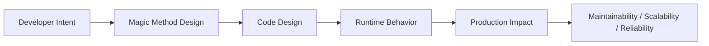
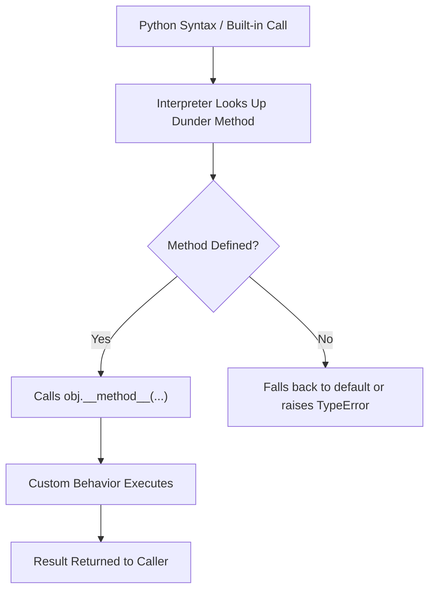

# Magic Methods

## Overview

**Magic methods** (also called **dunder methods** — short for "double underscore") are special methods in Python that begin and end with double underscores, such as `__init__`, `__str__`, `__len__`, `__add__`, and `__enter__`. They are the hooks through which Python's data model is implemented: they define how objects behave with built-in functions, operators, iteration, context managers, attribute access, and more.

Magic methods are not called directly by user code — they are invoked automatically by the Python interpreter in response to specific syntax or built-in function calls. Mastering them allows you to create objects that integrate seamlessly with Python's syntax and standard library, making your APIs feel native and intuitive.

In production systems, magic methods power ORM models, data containers, context managers, custom collections, domain-specific languages (DSLs), and AI agent components.

---

## Why It Matters





---

## Simple Example

```python
class Vector:
    """A 2D vector with full magic method support."""

    def __init__(self, x: float, y: float):
        self.x = x
        self.y = y

    # String representations
    def __repr__(self) -> str:
        return f"Vector({self.x}, {self.y})"

    def __str__(self) -> str:
        return f"({self.x}, {self.y})"

    # Arithmetic
    def __add__(self, other: "Vector") -> "Vector":
        return Vector(self.x + other.x, self.y + other.y)

    def __sub__(self, other: "Vector") -> "Vector":
        return Vector(self.x - other.x, self.y - other.y)

    def __mul__(self, scalar: float) -> "Vector":
        return Vector(self.x * scalar, self.y * scalar)

    def __rmul__(self, scalar: float) -> "Vector":
        return self.__mul__(scalar)

    def __neg__(self) -> "Vector":
        return Vector(-self.x, -self.y)

    # Comparison
    def __eq__(self, other: object) -> bool:
        if not isinstance(other, Vector):
            return NotImplemented
        return self.x == other.x and self.y == other.y

    def __abs__(self) -> float:
        return (self.x ** 2 + self.y ** 2) ** 0.5

    # Container protocol
    def __len__(self) -> int:
        return 2

    def __getitem__(self, index: int) -> float:
        return (self.x, self.y)[index]

    def __iter__(self):
        yield self.x
        yield self.y

    def __bool__(self) -> bool:
        return self.x != 0 or self.y != 0


v1 = Vector(3, 4)
v2 = Vector(1, 2)

print(repr(v1))          # Vector(3, 4)
print(str(v1))           # (3, 4)
print(v1 + v2)           # (4, 6)
print(v1 - v2)           # (2, 2)
print(v1 * 2)            # (6, 8)
print(3 * v1)            # (9, 12)  — uses __rmul__
print(-v1)               # (-3, -4)
print(abs(v1))           # 5.0
print(len(v1))           # 2
print(v1[0], v1[1])      # 3 4
print(list(v1))          # [3, 4]
print(v1 == Vector(3,4)) # True
print(bool(Vector(0,0))) # False
```

**Explanation:**
- `__repr__` is for developers (used in REPL, `repr()`). `__str__` is for end users (`print()`, `str()`).
- `__rmul__` handles `scalar * vector` (reflected operation) when the left operand doesn't know how to multiply.
- Returning `NotImplemented` (not raising) from `__eq__` tells Python to try the reflected operation on the other operand.
- `__iter__` makes the object iterable — enables `list(v)`, `for x in v`, and unpacking.

**Expected output:**
```
Vector(3, 4)
(3, 4)
(4, 6)
(2, 2)
(6, 8)
(9, 12)
(-3, -4)
5.0
2
3 4
[3, 4]
True
False
```

---

## Intermediate Example

### A Custom Mapping (Dict-Like) Class

```python
from __future__ import annotations
from typing import Any, Iterator


class CaseInsensitiveDict:
    """
    A dict-like mapping where string keys are case-insensitive.
    Useful for HTTP headers, config keys, and CLI argument parsing.
    """

    def __init__(self, data: dict[str, Any] | None = None):
        self._store: dict[str, tuple[str, Any]] = {}
        if data:
            for key, value in data.items():
                self[key] = value

    def _normalize(self, key: str) -> str:
        if not isinstance(key, str):
            raise TypeError(f"Keys must be strings, got {type(key).__name__}")
        return key.lower()

    def __setitem__(self, key: str, value: Any) -> None:
        self._store[self._normalize(key)] = (key, value)

    def __getitem__(self, key: str) -> Any:
        try:
            return self._store[self._normalize(key)][1]
        except KeyError:
            raise KeyError(key)

    def __delitem__(self, key: str) -> None:
        try:
            del self._store[self._normalize(key)]
        except KeyError:
            raise KeyError(key)

    def __contains__(self, key: object) -> bool:
        if not isinstance(key, str):
            return False
        return self._normalize(key) in self._store

    def __len__(self) -> int:
        return len(self._store)

    def __iter__(self) -> Iterator[str]:
        return (original_key for original_key, _ in self._store.values())

    def __repr__(self) -> str:
        items = {k: v for k, v in self._store.values()}
        return f"CaseInsensitiveDict({items!r})"

    def get(self, key: str, default: Any = None) -> Any:
        try:
            return self[key]
        except KeyError:
            return default

    def keys(self):
        return list(self)

    def values(self):
        return [v for _, v in self._store.values()]

    def items(self):
        return list(self._store.values())

    def __or__(self, other: "CaseInsensitiveDict") -> "CaseInsensitiveDict":
        """Merge two dicts: self | other (Python 3.9+ dict merge)."""
        result = CaseInsensitiveDict(dict(self.items()))
        for k, v in other.items():
            result[k] = v
        return result


# Usage
headers = CaseInsensitiveDict({
    "Content-Type": "application/json",
    "Authorization": "Bearer token123",
})

print(headers["content-type"])       # application/json
print(headers["AUTHORIZATION"])      # Bearer token123
print("content-type" in headers)     # True
print("CONTENT-TYPE" in headers)     # True
print(len(headers))                  # 2

headers["X-Request-ID"] = "abc-123"
print(list(headers))                 # ['Content-Type', 'Authorization', 'X-Request-ID']

extra = CaseInsensitiveDict({"Accept": "application/json"})
merged = headers | extra
print(len(merged))                   # 4
print(repr(merged))
```

**Explanation:**
- `__setitem__`, `__getitem__`, `__delitem__` implement the mutable mapping protocol.
- `__contains__` powers the `in` operator.
- `__iter__` enables `for key in d`, `list(d)`, and dict unpacking.
- `__or__` implements the `|` merge operator (Python 3.9+).
- This pattern is used in `requests.structures.CaseInsensitiveDict` in the popular `requests` library.

---

## Advanced / Architect-Level Example

### AI Agent Pipeline with Magic Methods for Composability

**Problem context:** An AI agent orchestration framework needs pipeline steps that can be composed with `|` (pipe operator), chained with `>>`, compared by priority, used as context managers for resource management, and introspected with `len()` and `in`. Magic methods make the DSL feel native.

```python
from __future__ import annotations
from typing import Any, Callable, Iterator
from dataclasses import dataclass, field
from contextlib import contextmanager
import logging
import time

logger = logging.getLogger(__name__)
logging.basicConfig(level=logging.INFO, format="%(levelname)s: %(message)s")


@dataclass
class AgentContext:
    """Shared context passed through pipeline steps."""
    data: dict[str, Any] = field(default_factory=dict)
    metadata: dict[str, Any] = field(default_factory=dict)
    errors: list[str] = field(default_factory=list)

    def __contains__(self, key: str) -> bool:
        """Support: 'key' in context"""
        return key in self.data

    def __getitem__(self, key: str) -> Any:
        return self.data[key]

    def __setitem__(self, key: str, value: Any) -> None:
        self.data[key] = value

    def __len__(self) -> int:
        return len(self.data)

    def __repr__(self) -> str:
        return f"AgentContext(keys={list(self.data.keys())}, errors={self.errors})"


class PipelineStep:
    """
    A composable pipeline step for AI agent workflows.

    Supports:
    - step1 | step2       → Sequential pipeline (PipelineStep.__or__)
    - step1 >> step2      → Alias for |
    - len(step)           → Number of sub-steps
    - step in pipeline    → Membership test
    - with step:          → Context manager for resource management
    - repr(step)          → Developer-friendly representation
    - step1 < step2       → Priority comparison
    """

    def __init__(self, name: str, fn: Callable[[AgentContext], AgentContext], priority: int = 0):
        self.name = name
        self.fn = fn
        self.priority = priority
        self._steps: list["PipelineStep"] = [self]

    def __call__(self, context: AgentContext) -> AgentContext:
        """Execute all steps in sequence."""
        for step in self._steps:
            logger.info("Executing step: %s", step.name)
            start = time.perf_counter()
            context = step.fn(context)
            elapsed = time.perf_counter() - start
            context.metadata[f"{step.name}_duration_ms"] = round(elapsed * 1000, 2)
        return context

    def __or__(self, other: "PipelineStep") -> "PipelineStep":
        """Compose pipelines: step1 | step2"""
        combined = PipelineStep(
            name=f"{self.name}|{other.name}",
            fn=lambda ctx: ctx,  # Placeholder — __call__ uses _steps
        )
        combined._steps = self._steps + other._steps
        return combined

    def __rshift__(self, other: "PipelineStep") -> "PipelineStep":
        """Alias for |: step1 >> step2"""
        return self.__or__(other)

    def __len__(self) -> int:
        """Number of steps in the pipeline."""
        return len(self._steps)

    def __contains__(self, item: "PipelineStep | str") -> bool:
        """Check if a step is in the pipeline."""
        if isinstance(item, str):
            return any(s.name == item for s in self._steps)
        return item in self._steps

    def __iter__(self) -> Iterator["PipelineStep"]:
        return iter(self._steps)

    def __repr__(self) -> str:
        names = " → ".join(s.name for s in self._steps)
        return f"Pipeline[{names}]"

    def __str__(self) -> str:
        return self.name

    def __lt__(self, other: "PipelineStep") -> bool:
        return self.priority < other.priority

    def __le__(self, other: "PipelineStep") -> bool:
        return self.priority <= other.priority

    def __eq__(self, other: object) -> bool:
        if not isinstance(other, PipelineStep):
            return NotImplemented
        return self.name == other.name and self.priority == other.priority

    def __hash__(self) -> int:
        return hash((self.name, self.priority))

    def __enter__(self) -> "PipelineStep":
        logger.info("Acquiring resources for pipeline: %s", self.name)
        return self

    def __exit__(self, exc_type, exc_val, exc_tb) -> bool:
        if exc_type:
            logger.error("Pipeline %s failed: %s", self.name, exc_val)
        else:
            logger.info("Pipeline %s completed successfully", self.name)
        return False  # Do not suppress exceptions


# --- Define pipeline steps ---
def retrieve_documents(ctx: AgentContext) -> AgentContext:
    ctx["documents"] = ["doc1: Python basics", "doc2: RAG patterns", "doc3: Agent design"]
    return ctx

def embed_documents(ctx: AgentContext) -> AgentContext:
    ctx["embeddings"] = [hash(doc) for doc in ctx["documents"]]
    return ctx

def rank_documents(ctx: AgentContext) -> AgentContext:
    ctx["ranked"] = sorted(ctx["documents"], key=len)
    return ctx

def generate_response(ctx: AgentContext) -> AgentContext:
    ctx["response"] = f"Based on {len(ctx['ranked'])} documents: [generated answer]"
    return ctx


# --- Build pipeline using magic methods ---
retriever = PipelineStep("retrieve", retrieve_documents, priority=1)
embedder  = PipelineStep("embed",    embed_documents,    priority=2)
ranker    = PipelineStep("rank",     rank_documents,     priority=3)
generator = PipelineStep("generate", generate_response,  priority=4)

# Compose with | operator
rag_pipeline = retriever | embedder | ranker | generator

print(repr(rag_pipeline))          # Pipeline[retrieve → embed → rank → generate]
print(f"Steps: {len(rag_pipeline)}")  # Steps: 4
print("retrieve" in rag_pipeline)  # True
print("unknown"  in rag_pipeline)  # False

# Sort steps by priority
steps = [generator, retriever, ranker, embedder]
print([s.name for s in sorted(steps)])  # ['retrieve', 'embed', 'rank', 'generate']

# Execute with context manager
context = AgentContext()
with rag_pipeline as pipeline:
    result = pipeline(context)

print(result)
print(result["response"])
print(result.metadata)
```

**Explanation:**
- `__or__` and `__rshift__` enable a fluent DSL: `step1 | step2 | step3`.
- `__call__` makes the pipeline itself callable — it's both a builder and an executor.
- `__contains__` and `__iter__` make the pipeline introspectable.
- `__enter__`/`__exit__` enable `with pipeline:` for resource management and error handling.
- `__lt__`, `__le__`, `__eq__`, `__hash__` enable sorting and set membership.

**Design trade-offs:**

| Approach | Pros | Cons |
|---|---|---|
| Magic method DSL | Pythonic, readable, composable | Learning curve for new developers |
| Explicit method calls | Verbose but clear | Less elegant |
| Functional composition | Lightweight | No introspection |
| Framework (Prefect, Airflow) | Full-featured | Heavy dependency |

---

## Common Mistakes

### 1. Returning `None` instead of `NotImplemented` from comparison methods
```python
# Bad — returning None breaks comparisons with other types
def __eq__(self, other):
    if not isinstance(other, MyClass):
        return None  # Wrong!

# Good — return NotImplemented to let Python try the reflected operation
def __eq__(self, other):
    if not isinstance(other, MyClass):
        return NotImplemented
```

### 2. Defining `__eq__` without `__hash__`
```python
# Bad — defining __eq__ implicitly sets __hash__ = None, making objects unhashable
class Point:
    def __eq__(self, other):
        return self.x == other.x and self.y == other.y
    # __hash__ is now None — can't use in sets or as dict keys!

# Good — define __hash__ alongside __eq__
class Point:
    def __eq__(self, other):
        return self.x == other.x and self.y == other.y

    def __hash__(self):
        return hash((self.x, self.y))
```

### 3. Implementing `__str__` but not `__repr__`
- **Problem:** `__repr__` is the fallback for `__str__`. If only `__str__` is defined, `repr(obj)` shows the default `<ClassName object at 0x...>`.
- **Better approach:** Always implement `__repr__`. Implement `__str__` only if you need a different user-facing representation.

### 4. Raising exceptions instead of returning `NotImplemented` in arithmetic methods
```python
# Bad — raises TypeError immediately, preventing Python from trying reflected ops
def __add__(self, other):
    if not isinstance(other, Vector):
        raise TypeError("unsupported type")

# Good — return NotImplemented to allow Python to try other.__radd__(self)
def __add__(self, other):
    if not isinstance(other, Vector):
        return NotImplemented
    return Vector(self.x + other.x, self.y + other.y)
```

### 5. Forgetting `__bool__` and relying on `__len__` for truthiness
- **Problem:** If `__len__` is defined, Python uses it for truthiness (`len == 0` → `False`). This may not be the desired behavior.
- **Better approach:** Define `__bool__` explicitly to control truthiness independently of length.

### 6. Implementing `__getattr__` instead of `__getattribute__`
- **Problem:** `__getattr__` is only called when normal attribute lookup fails. `__getattribute__` is called on every attribute access. Overriding `__getattribute__` without calling `super().__getattribute__()` breaks all attribute access.
- **Better approach:** Use `__getattr__` for fallback behavior. Only override `__getattribute__` when you need to intercept all attribute access.

---

## Best Practices

- **Always implement `__repr__`** — it's the most important dunder for debugging.
- **Return `NotImplemented`** (not raise) from arithmetic and comparison methods when the type is unsupported.
- **Define `__hash__` whenever you define `__eq__`** — or explicitly set `__hash__ = None` for mutable objects.
- **Use `@functools.total_ordering`** to implement all comparison methods from just `__eq__` and one of `__lt__`, `__le__`, `__gt__`, `__ge__`.
- **Keep `__init__` focused** — use `__post_init__` (dataclasses) or factory class methods for complex initialization.
- **Implement the full protocol** — if you implement `__getitem__`, also implement `__len__` and `__iter__` for full sequence/mapping behavior.
- **Use `__slots__`** for memory-efficient classes with fixed attributes.
- **Document magic methods** — their behavior is not always obvious to readers.

---

## Performance Considerations

- Magic methods are looked up on the **type** (class), not the instance — Python caches this lookup, so the overhead is minimal.
- `__slots__` eliminates `__dict__` per instance, reducing memory usage by 40–50% for classes with many instances.
- `__hash__` should be fast and consistent — avoid expensive computations. Cache the hash if the object is immutable.
- `__getattribute__` is called on **every** attribute access — overriding it without care can severely impact performance.
- `__len__` is called by `bool()` if `__bool__` is not defined — ensure it's O(1) if possible.
- For numeric types, implementing `__slots__` and avoiding `__dict__` can make tight loops significantly faster.

---

## Testing Strategy

```python
# tests/test_magic_methods.py
import pytest
from mymodule import Vector, CaseInsensitiveDict


# --- Vector tests ---
def test_repr():
    v = Vector(1, 2)
    assert repr(v) == "Vector(1, 2)"

def test_str():
    v = Vector(1, 2)
    assert str(v) == "(1, 2)"

def test_add():
    assert Vector(1, 2) + Vector(3, 4) == Vector(4, 6)

def test_sub():
    assert Vector(3, 4) - Vector(1, 2) == Vector(2, 2)

def test_mul():
    assert Vector(2, 3) * 2 == Vector(4, 6)

def test_rmul():
    assert 3 * Vector(1, 2) == Vector(3, 6)

def test_neg():
    assert -Vector(1, -2) == Vector(-1, 2)

def test_abs():
    assert abs(Vector(3, 4)) == pytest.approx(5.0)

def test_eq_same():
    assert Vector(1, 2) == Vector(1, 2)

def test_eq_different():
    assert Vector(1, 2) != Vector(3, 4)

def test_eq_different_type():
    assert Vector(1, 2).__eq__("not a vector") == NotImplemented

def test_hash():
    v1, v2 = Vector(1, 2), Vector(1, 2)
    assert hash(v1) == hash(v2)
    assert len({v1, v2}) == 1  # Same hash and equal → same set element

def test_len():
    assert len(Vector(1, 2)) == 2

def test_iter():
    assert list(Vector(3, 4)) == [3, 4]

def test_getitem():
    v = Vector(5, 6)
    assert v[0] == 5
    assert v[1] == 6

def test_bool_nonzero():
    assert bool(Vector(1, 0)) is True

def test_bool_zero():
    assert bool(Vector(0, 0)) is False


# --- CaseInsensitiveDict tests ---
def test_case_insensitive_get():
    d = CaseInsensitiveDict({"Content-Type": "application/json"})
    assert d["content-type"] == "application/json"
    assert d["CONTENT-TYPE"] == "application/json"

def test_contains():
    d = CaseInsensitiveDict({"Key": "value"})
    assert "key" in d
    assert "KEY" in d

def test_len():
    d = CaseInsensitiveDict({"a": 1, "b": 2})
    assert len(d) == 2

def test_del():
    d = CaseInsensitiveDict({"a": 1})
    del d["A"]
    assert "a" not in d

def test_missing_key_raises():
    d = CaseInsensitiveDict()
    with pytest.raises(KeyError):
        _ = d["missing"]
```

---

## Debugging Tips

- **`dir(obj)`** — lists all attributes and methods, including dunder methods.
- **`type(obj).__mro__`** — shows the method resolution order; useful when magic methods are inherited.
- **`obj.__class__.__dict__`** — shows methods defined directly on the class (not inherited).
- **`hasattr(obj, '__add__')`** — check if a magic method is defined before calling.
- If `==` behaves unexpectedly, check `__eq__` and `__hash__` — they must be consistent.
- If an object is not iterable, check that `__iter__` or `__getitem__` is defined.
- If `with obj:` raises `AttributeError`, check that both `__enter__` and `__exit__` are defined.
- Use `python -c "import dis; dis.dis(lambda: a + b)"` to see which dunder methods Python calls for an operation.

---

## Interview Questions

### Beginner
1. **What are magic methods (dunder methods) in Python?**
   *Special methods with double-underscore prefix and suffix (e.g., `__init__`, `__str__`) that Python calls automatically in response to specific syntax or built-in function calls.*

2. **What is the difference between `__str__` and `__repr__`?**
   *`__repr__` is for developers — it should be unambiguous and ideally eval-able. `__str__` is for end users — it should be readable. `__repr__` is the fallback if `__str__` is not defined.*

3. **What does `__init__` do?**
   *It initializes a newly created instance. It is called after `__new__` creates the object.*

4. **How does Python know how to use `+` with custom objects?**
   *Python calls `__add__` on the left operand. If it returns `NotImplemented`, Python calls `__radd__` on the right operand.*

5. **What is `__len__` used for?**
   *It defines the behavior of `len(obj)`. If `__bool__` is not defined, Python also uses `__len__` for truthiness testing.*

### Intermediate
1. **Why should `__eq__` return `NotImplemented` instead of raising `TypeError`?**
   *Returning `NotImplemented` tells Python to try the reflected operation (`other.__eq__(self)`). Raising immediately prevents this fallback.*

2. **What happens to `__hash__` when you define `__eq__`?**
   *Python sets `__hash__ = None`, making the object unhashable. You must explicitly define `__hash__` if you want the object to be usable in sets or as dict keys.*

3. **What is `@functools.total_ordering`?**
   *A class decorator that fills in missing comparison methods. You define `__eq__` and one of `__lt__`, `__le__`, `__gt__`, `__ge__`, and it generates the rest.*

4. **What is the difference between `__getattr__` and `__getattribute__`?**
   *`__getattr__` is called only when normal attribute lookup fails. `__getattribute__` is called on every attribute access. Overriding `__getattribute__` requires calling `super().__getattribute__()` to avoid infinite recursion.*

5. **How do context managers use magic methods?**
   *`__enter__` is called when entering a `with` block and returns the context value. `__exit__` is called when leaving the block, receiving exception info if an exception occurred.*

### Advanced / Architect-Level
1. **How would you implement a lazy proxy object using magic methods?**
   *Override `__getattr__` to forward attribute access to the wrapped object, initializing it on first access. Override `__repr__`, `__str__`, `__call__`, etc. to delegate to the wrapped object.*

2. **How does Python's descriptor protocol relate to magic methods?**
   *Descriptors implement `__get__`, `__set__`, and `__delete__`. When a class attribute is a descriptor, Python calls these methods instead of returning the attribute directly. `@property`, `@classmethod`, and `@staticmethod` are all descriptors.*

3. **How would you implement an immutable value object with correct equality and hashing?**
   *Use `__slots__` for fixed attributes, define `__eq__` based on all fields, define `__hash__` as `hash(tuple(fields))`, and override `__setattr__` to raise `AttributeError` after initialization.*

4. **What are the performance implications of `__slots__`?**
   *`__slots__` eliminates `__dict__` per instance, reducing memory by 40–50% for classes with many instances. Attribute access is slightly faster. Trade-off: no dynamic attributes, no `__weakref__` by default, and inheritance is more complex.*

5. **How would you design a pipeline DSL using magic methods for an AI agent framework?**
   *Implement `__or__` for composition, `__call__` for execution, `__iter__` for introspection, `__len__` for step count, `__contains__` for membership, and `__enter__`/`__exit__` for resource management. This creates a fluent, Pythonic API.*

---

## Key Takeaways

- Magic methods are the hooks through which Python's **data model** is implemented.
- `__repr__` is the most important dunder — always implement it.
- **Return `NotImplemented`** (not raise) from arithmetic/comparison methods for unsupported types.
- **Define `__hash__` whenever you define `__eq__`** — or set `__hash__ = None` for mutable objects.
- `__enter__`/`__exit__` implement the **context manager protocol**.
- `__iter__`/`__next__` implement the **iterator protocol**.
- `__get__`/`__set__`/`__delete__` implement the **descriptor protocol**.
- `__slots__` reduces memory usage for classes with many instances.
- Magic methods enable **DSL design** — making custom objects feel like native Python.
- Understanding magic methods is essential for building **frameworks, ORMs, and domain models**.

---

## Mini Project Idea

### Project: `pymatrix` — A Minimal Matrix Library Using Magic Methods

**Goal:** Build a 2D matrix class that supports arithmetic, comparison, iteration, slicing, and pretty-printing — all via magic methods — without using NumPy.

**Features:**
- `Matrix + Matrix`, `Matrix * scalar`, `Matrix @ Matrix` (matrix multiply via `__matmul__`).
- `Matrix == Matrix` with element-wise comparison.
- `len(matrix)` → number of rows.
- `matrix[i]` → row access, `matrix[i, j]` → element access via `__getitem__`.
- `for row in matrix:` iteration.
- `repr(matrix)` and `str(matrix)` with aligned columns.
- `with Matrix.timer():` context manager for benchmarking operations.

**Suggested folder structure:**
```
pymatrix/
├── .venv/
├── pyproject.toml
├── src/
│   └── pymatrix/
│       ├── __init__.py
│       ├── matrix.py        # Matrix class with all magic methods
│       ├── operations.py    # Higher-level operations (transpose, determinant)
│       └── utils.py         # Formatting helpers
└── tests/
    ├── test_arithmetic.py
    ├── test_comparison.py
    ├── test_iteration.py
    └── test_repr.py
```

**Extension ideas:**
- Add `__array__` for NumPy interoperability.
- Add `__format__` for custom format strings.
- Add `__copy__` and `__deepcopy__` for correct copy behavior.
- Add `__reduce__` for pickle support.

---

## Final Summary

Magic methods are the foundation of Python's expressive power. They allow custom objects to integrate seamlessly with Python's syntax, built-in functions, and standard library — making APIs feel native rather than bolted on. Architects who master magic methods can design domain models, DSLs, and frameworks that are intuitive, composable, and Pythonic. From ORM field descriptors to AI pipeline operators, from context managers to custom collections, magic methods are the mechanism through which Python's "everything is an object" philosophy is realized in production code.
