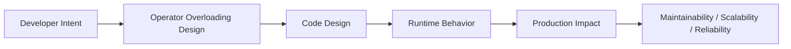
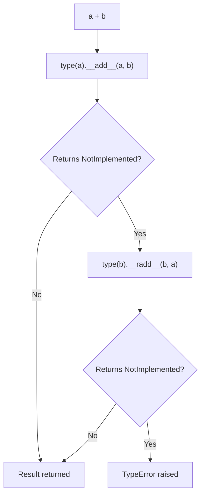

# Operator Overloading

## Overview

**Operator overloading** in Python is the ability to define custom behavior for built-in operators (`+`, `-`, `*`, `/`, `==`, `<`, `|`, `[]`, etc.) on user-defined classes. It is implemented through Python's **magic methods** (dunder methods) — for example, `__add__` for `+`, `__eq__` for `==`, `__getitem__` for `[]`.

Operator overloading is not about changing what operators do for built-in types — it is about extending operators to work meaningfully with your own types. When done well, it makes custom objects feel like first-class Python citizens, enabling expressive, readable code. When done poorly, it creates confusion and bugs.

In production systems, operator overloading is used in numerical libraries (NumPy, PyTorch), ORMs (SQLAlchemy query expressions), data pipeline DSLs, AI agent frameworks, and domain-specific languages.

---

## Why It Matters





---

## Simple Example

```python
from __future__ import annotations
from functools import total_ordering


@total_ordering
class Money:
    """Represents a monetary amount with currency."""

    def __init__(self, amount: float, currency: str = "USD"):
        self.amount = round(float(amount), 2)
        self.currency = currency.upper()

    def _check_currency(self, other: "Money") -> None:
        if self.currency != other.currency:
            raise ValueError(
                f"Cannot operate on different currencies: "
                f"{self.currency} and {other.currency}"
            )

    # Arithmetic operators
    def __add__(self, other: "Money") -> "Money":
        if not isinstance(other, Money):
            return NotImplemented
        self._check_currency(other)
        return Money(self.amount + other.amount, self.currency)

    def __sub__(self, other: "Money") -> "Money":
        if not isinstance(other, Money):
            return NotImplemented
        self._check_currency(other)
        return Money(self.amount - other.amount, self.currency)

    def __mul__(self, factor: float) -> "Money":
        if not isinstance(factor, (int, float)):
            return NotImplemented
        return Money(self.amount * factor, self.currency)

    def __rmul__(self, factor: float) -> "Money":
        return self.__mul__(factor)

    def __truediv__(self, divisor: float) -> "Money":
        if not isinstance(divisor, (int, float)):
            return NotImplemented
        if divisor == 0:
            raise ZeroDivisionError("Cannot divide money by zero")
        return Money(self.amount / divisor, self.currency)

    def __neg__(self) -> "Money":
        return Money(-self.amount, self.currency)

    def __abs__(self) -> "Money":
        return Money(abs(self.amount), self.currency)

    # Comparison operators (total_ordering fills in the rest from __eq__ + __lt__)
    def __eq__(self, other: object) -> bool:
        if not isinstance(other, Money):
            return NotImplemented
        return self.currency == other.currency and self.amount == other.amount

    def __lt__(self, other: "Money") -> bool:
        if not isinstance(other, Money):
            return NotImplemented
        self._check_currency(other)
        return self.amount < other.amount

    def __hash__(self) -> int:
        return hash((self.amount, self.currency))

    # String representations
    def __repr__(self) -> str:
        return f"Money({self.amount!r}, {self.currency!r})"

    def __str__(self) -> str:
        return f"{self.currency} {self.amount:.2f}"

    def __bool__(self) -> bool:
        return self.amount != 0.0


# Usage
price = Money(19.99, "USD")
tax   = Money(1.60,  "USD")
total = price + tax
print(total)                    # USD 21.59
print(total * 2)                # USD 43.18
print(3 * price)                # USD 59.97
print(total / 2)                # USD 10.80
print(-price)                   # USD -19.99
print(abs(-price))              # USD 19.99

# Comparisons (total_ordering provides <=, >, >= for free)
print(price < total)            # True
print(price > tax)              # True
print(price <= Money(19.99))    # True
print(sorted([total, price, tax]))  # [USD 1.60, USD 19.99, USD 21.59]

# Sets and dicts (requires __hash__)
prices = {Money(10.0), Money(20.0), Money(10.0)}
print(len(prices))              # 2

# Currency mismatch
try:
    Money(10, "USD") + Money(10, "EUR")
except ValueError as e:
    print(e)
```

**Explanation:**
- `@total_ordering` generates `__le__`, `__gt__`, `__ge__` from `__eq__` and `__lt__`.
- `__rmul__` handles `3 * price` (reflected operation when `int` doesn't know how to multiply by `Money`).
- Returning `NotImplemented` (not raising) allows Python to try the reflected operation.
- `__hash__` is defined alongside `__eq__` to keep objects usable in sets and dicts.

**Expected output:**
```
USD 21.59
USD 43.18
USD 59.97
USD 10.80
USD -19.99
USD 19.99
True
True
True
[USD 1.60, USD 19.99, USD 21.59]
2
Cannot operate on different currencies: USD and EUR
```

---

## Intermediate Example

### Query Builder with Operator Overloading (SQLAlchemy-style)

```python
from __future__ import annotations
from typing import Any
from dataclasses import dataclass


@dataclass
class Column:
    """Represents a database column that supports operator-based query building."""
    name: str
    table: str = ""

    def __eq__(self, other: Any) -> "Condition":       # type: ignore[override]
        return Condition(self, "=", other)

    def __ne__(self, other: Any) -> "Condition":       # type: ignore[override]
        return Condition(self, "!=", other)

    def __lt__(self, other: Any) -> "Condition":
        return Condition(self, "<", other)

    def __le__(self, other: Any) -> "Condition":
        return Condition(self, "<=", other)

    def __gt__(self, other: Any) -> "Condition":
        return Condition(self, ">", other)

    def __ge__(self, other: Any) -> "Condition":
        return Condition(self, ">=", other)

    def in_(self, values: list) -> "Condition":
        return Condition(self, "IN", values)

    def like(self, pattern: str) -> "Condition":
        return Condition(self, "LIKE", pattern)

    def __repr__(self) -> str:
        return f"{self.table}.{self.name}" if self.table else self.name

    def __hash__(self) -> int:
        return hash((self.name, self.table))


class Condition:
    """Represents a SQL condition that supports AND/OR composition."""

    def __init__(self, left: Any, operator: str, right: Any):
        self.left = left
        self.operator = operator
        self.right = right

    def __and__(self, other: "Condition") -> "Condition":
        return Condition(self, "AND", other)

    def __or__(self, other: "Condition") -> "Condition":
        return Condition(self, "OR", other)

    def __invert__(self) -> "Condition":
        return Condition(self, "NOT", None)

    def to_sql(self) -> str:
        if self.operator == "NOT":
            return f"NOT ({self.left.to_sql()})"
        if self.operator in ("AND", "OR"):
            return f"({self.left.to_sql()} {self.operator} {self.right.to_sql()})"
        if self.operator == "IN":
            values = ", ".join(repr(v) for v in self.right)
            return f"{self.left} {self.operator} ({values})"
        right = repr(self.right) if isinstance(self.right, str) else self.right
        return f"{self.left} {self.operator} {right}"

    def __repr__(self) -> str:
        return f"Condition({self.to_sql()})"


# --- Usage ---
# Define columns
age    = Column("age",    "users")
name   = Column("name",   "users")
status = Column("status", "users")
score  = Column("score",  "users")

# Build conditions using operators
cond1 = age >= 18
cond2 = status == "active"
cond3 = score > 90
cond4 = name.like("%John%")
cond5 = status.in_(["active", "premium"])

# Compose with & and |
query = cond1 & cond2 & (cond3 | cond4)
print(query.to_sql())
# ((users.age >= 18 AND users.status = 'active') AND (users.score > 90 OR users.name LIKE '%John%'))

# NOT operator
not_active = ~cond2
print(not_active.to_sql())
# NOT (users.status = 'active')

# IN operator
print(cond5.to_sql())
# users.status IN ('active', 'premium')

# Complex query
complex_query = (age >= 21) & (status.in_(["active", "premium"])) & ~(score < 50)
print(complex_query.to_sql())
```

**Explanation:**
- `Column.__eq__` returns a `Condition` object instead of a boolean — this is the key trick used by SQLAlchemy, Django ORM, and Pandas.
- `Condition.__and__` (`&`) and `__or__` (`|`) compose conditions into a tree.
- `__invert__` (`~`) implements the NOT operator.
- This pattern enables a type-safe, composable query DSL without string concatenation.

---

## Advanced / Architect-Level Example

### Tensor-Like Class for AI/ML Pipelines with Full Operator Overloading

**Problem context:** An AI framework needs a lightweight `Tensor` class that supports element-wise arithmetic, broadcasting, comparison, and pipeline composition — all via operator overloading. This is the pattern used by NumPy, PyTorch, and TensorFlow.

```python
from __future__ import annotations
from typing import Union, Iterator
import math

Numeric = Union[int, float]


class Tensor:
    """
    A minimal 1D tensor with operator overloading for AI/ML pipelines.
    Demonstrates the full operator overloading surface used by NumPy/PyTorch.
    """

    def __init__(self, data: list[Numeric], name: str = ""):
        self._data = [float(x) for x in data]
        self.name = name

    # --- Unary operators ---
    def __neg__(self) -> "Tensor":
        return Tensor([-x for x in self._data], f"-{self.name}")

    def __abs__(self) -> "Tensor":
        return Tensor([abs(x) for x in self._data], f"|{self.name}|")

    def __pos__(self) -> "Tensor":
        return Tensor(self._data[:], self.name)

    # --- Binary arithmetic operators ---
    def _broadcast(self, other: "Tensor | Numeric") -> list[Numeric]:
        if isinstance(other, (int, float)):
            return [other] * len(self._data)
        if len(other._data) != len(self._data):
            raise ValueError(
                f"Shape mismatch: {len(self._data)} vs {len(other._data)}"
            )
        return other._data

    def __add__(self, other: "Tensor | Numeric") -> "Tensor":
        other_data = self._broadcast(other)
        return Tensor([a + b for a, b in zip(self._data, other_data)])

    def __radd__(self, other: Numeric) -> "Tensor":
        return self.__add__(other)

    def __sub__(self, other: "Tensor | Numeric") -> "Tensor":
        other_data = self._broadcast(other)
        return Tensor([a - b for a, b in zip(self._data, other_data)])

    def __rsub__(self, other: Numeric) -> "Tensor":
        return Tensor([other - a for a in self._data])

    def __mul__(self, other: "Tensor | Numeric") -> "Tensor":
        other_data = self._broadcast(other)
        return Tensor([a * b for a, b in zip(self._data, other_data)])

    def __rmul__(self, other: Numeric) -> "Tensor":
        return self.__mul__(other)

    def __truediv__(self, other: "Tensor | Numeric") -> "Tensor":
        other_data = self._broadcast(other)
        return Tensor([a / b for a, b in zip(self._data, other_data)])

    def __rtruediv__(self, other: Numeric) -> "Tensor":
        return Tensor([other / a for a in self._data])

    def __pow__(self, exp: Numeric) -> "Tensor":
        return Tensor([x ** exp for x in self._data])

    def __matmul__(self, other: "Tensor") -> float:
        """Dot product: tensor @ tensor"""
        if not isinstance(other, Tensor):
            return NotImplemented
        if len(self._data) != len(other._data):
            raise ValueError("Dot product requires equal-length tensors")
        return sum(a * b for a, b in zip(self._data, other._data))

    # --- In-place operators ---
    def __iadd__(self, other: "Tensor | Numeric") -> "Tensor":
        other_data = self._broadcast(other)
        self._data = [a + b for a, b in zip(self._data, other_data)]
        return self

    def __imul__(self, other: "Tensor | Numeric") -> "Tensor":
        other_data = self._broadcast(other)
        self._data = [a * b for a, b in zip(self._data, other_data)]
        return self

    # --- Comparison operators (element-wise, return bool Tensor) ---
    def __eq__(self, other: object) -> "Tensor":          # type: ignore[override]
        if isinstance(other, (int, float)):
            return Tensor([float(x == other) for x in self._data])
        if isinstance(other, Tensor):
            return Tensor([float(a == b) for a, b in zip(self._data, other._data)])
        return NotImplemented  # type: ignore[return-value]

    def __lt__(self, other: "Tensor | Numeric") -> "Tensor":
        other_data = self._broadcast(other)
        return Tensor([float(a < b) for a, b in zip(self._data, other_data)])

    def __gt__(self, other: "Tensor | Numeric") -> "Tensor":
        other_data = self._broadcast(other)
        return Tensor([float(a > b) for a, b in zip(self._data, other_data)])

    # --- Container protocol ---
    def __len__(self) -> int:
        return len(self._data)

    def __getitem__(self, index: int | slice) -> "float | Tensor":
        result = self._data[index]
        if isinstance(result, list):
            return Tensor(result)
        return result

    def __setitem__(self, index: int, value: Numeric) -> None:
        self._data[index] = float(value)

    def __iter__(self) -> Iterator[float]:
        return iter(self._data)

    def __contains__(self, item: Numeric) -> bool:
        return float(item) in self._data

    # --- Bitwise operators for masking ---
    def __and__(self, other: "Tensor") -> "Tensor":
        """Element-wise logical AND (for boolean tensors)."""
        other_data = self._broadcast(other)
        return Tensor([float(bool(a) and bool(b)) for a, b in zip(self._data, other_data)])

    def __or__(self, other: "Tensor") -> "Tensor":
        """Element-wise logical OR (for boolean tensors)."""
        other_data = self._broadcast(other)
        return Tensor([float(bool(a) or bool(b)) for a, b in zip(self._data, other_data)])

    def __invert__(self) -> "Tensor":
        """Element-wise logical NOT (for boolean tensors)."""
        return Tensor([float(not bool(x)) for x in self._data])

    # --- Representations ---
    def __repr__(self) -> str:
        data_str = ", ".join(f"{x:.4f}" for x in self._data)
        name_part = f", name={self.name!r}" if self.name else ""
        return f"Tensor([{data_str}]{name_part})"

    def __str__(self) -> str:
        data_str = ", ".join(f"{x:.2f}" for x in self._data)
        return f"[{data_str}]"

    def __bool__(self) -> bool:
        raise TypeError(
            "Boolean value of a Tensor is ambiguous. "
            "Use .any() or .all() instead."
        )

    def __hash__(self):
        raise TypeError("Tensor objects are not hashable")

    # --- Utility methods ---
    def sum(self) -> float:
        return sum(self._data)

    def mean(self) -> float:
        return sum(self._data) / len(self._data)

    def any(self) -> bool:
        return any(self._data)

    def all(self) -> bool:
        return all(self._data)


# --- Usage ---
a = Tensor([1.0, 2.0, 3.0, 4.0], name="a")
b = Tensor([10.0, 20.0, 30.0, 40.0], name="b")

print(a + b)           # [11.00, 22.00, 33.00, 44.00]
print(a * 2)           # [2.00, 4.00, 6.00, 8.00]
print(2 * a)           # [2.00, 4.00, 6.00, 8.00]
print(b / 10)          # [1.00, 2.00, 3.00, 4.00]
print(a ** 2)          # [1.00, 4.00, 9.00, 16.00]
print(a @ b)           # 300.0 (dot product)
print(-a)              # [-1.00, -2.00, -3.00, -4.00]
print(abs(-a))         # [1.00, 2.00, 3.00, 4.00]

# Comparison (element-wise)
mask = a > 2
print(mask)            # [0.00, 0.00, 1.00, 1.00]
print((mask & (b > 25)).all())  # False

# In-place
a += 10
print(a)               # [11.00, 12.00, 13.00, 14.00]

# Container
print(len(a))          # 4
print(a[0])            # 11.0
print(list(a[:2]))     # [11.0, 12.0]
print(11.0 in a)       # True

# Ambiguous bool raises TypeError (like NumPy/PyTorch)
try:
    if a:
        pass
except TypeError as e:
    print(e)
```

**Explanation:**
- `__matmul__` implements the `@` operator for dot products — the same pattern used by NumPy and PyTorch.
- `__eq__` returns a `Tensor` (element-wise comparison) instead of a `bool` — this is the NumPy/PyTorch pattern.
- `__bool__` raises `TypeError` to prevent accidental use of a tensor in a boolean context — exactly as NumPy does.
- `__iadd__`, `__imul__` implement in-place operations that mutate the tensor.
- `__and__`, `__or__`, `__invert__` implement element-wise logical operations for boolean masking.

**Design trade-offs:**

| Design Decision | Rationale | Trade-off |
|---|---|---|
| `__eq__` returns Tensor | Enables element-wise comparison | Breaks `==` for identity checks |
| `__bool__` raises TypeError | Prevents ambiguous truthiness | Requires explicit `.any()`/`.all()` |
| `__hash__` raises TypeError | Mutable tensors shouldn't be hashable | Can't use in sets/dicts |
| `__matmul__` for dot product | Matches NumPy/PyTorch convention | Non-obvious for newcomers |
| In-place operators | Memory efficiency | Mutability can cause bugs |

---

## Common Mistakes

### 1. Forgetting reflected operators (`__radd__`, `__rmul__`, etc.)
```python
# Bad — 2 * Money(10) raises TypeError
class Money:
    def __mul__(self, factor):
        return Money(self.amount * factor)
    # Missing __rmul__!

# Good
class Money:
    def __mul__(self, factor):
        return Money(self.amount * factor)

    def __rmul__(self, factor):
        return self.__mul__(factor)
```

### 2. Raising `TypeError` instead of returning `NotImplemented`
```python
# Bad — prevents Python from trying the reflected operation
def __add__(self, other):
    if not isinstance(other, Money):
        raise TypeError("unsupported type")  # Wrong!

# Good
def __add__(self, other):
    if not isinstance(other, Money):
        return NotImplemented  # Let Python try other.__radd__(self)
```

### 3. Defining `__eq__` without `__hash__`
```python
# Bad — objects become unhashable (can't use in sets/dicts)
class Point:
    def __eq__(self, other):
        return self.x == other.x

# Good
class Point:
    def __eq__(self, other):
        return self.x == other.x

    def __hash__(self):
        return hash(self.x)
```

### 4. Overloading operators with non-intuitive semantics
```python
# Bad — using + for something unrelated to addition
class Config:
    def __add__(self, other):
        self.send_email(other)  # Confusing! + should not send emails
```
- **Better approach:** Only overload operators when the semantics are natural and obvious to readers.

### 5. Not handling in-place operators correctly
```python
# Bad — __iadd__ that doesn't return self
class Counter:
    def __iadd__(self, n):
        self.count += n
        # Missing: return self!

# Good
class Counter:
    def __iadd__(self, n):
        self.count += n
        return self  # Must return self (or a new object)
```

### 6. Overloading comparison operators inconsistently
- **Problem:** Defining `__eq__` but not `__lt__` means `sorted()` will fail.
- **Better approach:** Use `@functools.total_ordering` to generate all comparison methods from `__eq__` and one ordering method.

---

## Best Practices

- **Return `NotImplemented`** (not raise) when the operand type is unsupported.
- **Always implement `__rmul__`, `__radd__`** etc. for scalar operations.
- **Define `__hash__` alongside `__eq__`** — or set `__hash__ = None` for mutable objects.
- **Use `@functools.total_ordering`** to avoid implementing all six comparison methods manually.
- **Only overload operators with natural semantics** — `+` should mean addition or concatenation, not something unrelated.
- **In-place operators (`__iadd__`, etc.) must return `self`** (or a new object).
- **Document operator behavior** — especially when it deviates from the standard (e.g., element-wise `==`).
- **Be consistent** — if `a + b` works, `b + a` should also work (implement reflected operators).
- **Test edge cases** — mixed types, zero values, empty containers, and type mismatches.

---

## Performance Considerations

- Operator overloading adds one method call per operation — negligible for most use cases.
- For **tight numerical loops**, operator overhead can accumulate. NumPy avoids this by delegating to C extensions.
- **In-place operators** (`+=`, `*=`) can be more efficient than creating new objects — implement them when mutation is acceptable.
- **`@total_ordering`** generates comparison methods at class definition time — no runtime overhead.
- For **high-performance numerical code**, consider using `__slots__` to reduce memory overhead and attribute lookup time.
- Avoid complex logic in frequently-called operators — keep them O(1) or O(n) where n is the data size.

---

## Testing Strategy

```python
# tests/test_operator_overloading.py
import pytest
from mymodule import Money, Tensor


# --- Money tests ---
def test_add():
    assert Money(10) + Money(5) == Money(15)

def test_sub():
    assert Money(10) - Money(3) == Money(7)

def test_mul():
    assert Money(10) * 2 == Money(20)

def test_rmul():
    assert 3 * Money(10) == Money(30)

def test_truediv():
    assert Money(10) / 2 == Money(5)

def test_neg():
    assert -Money(10) == Money(-10)

def test_abs():
    assert abs(Money(-10)) == Money(10)

def test_eq():
    assert Money(10) == Money(10)
    assert Money(10) != Money(20)

def test_lt():
    assert Money(5) < Money(10)

def test_le():
    assert Money(5) <= Money(5)
    assert Money(5) <= Money(10)

def test_gt():
    assert Money(10) > Money(5)

def test_ge():
    assert Money(10) >= Money(10)

def test_sorted():
    amounts = [Money(30), Money(10), Money(20)]
    assert sorted(amounts) == [Money(10), Money(20), Money(30)]

def test_hash_in_set():
    s = {Money(10), Money(20), Money(10)}
    assert len(s) == 2

def test_currency_mismatch():
    with pytest.raises(ValueError, match="currencies"):
        Money(10, "USD") + Money(10, "EUR")

def test_not_implemented_returns_not_implemented():
    result = Money(10).__add__("not money")
    assert result is NotImplemented

def test_zero_division():
    with pytest.raises(ZeroDivisionError):
        Money(10) / 0

def test_bool_nonzero():
    assert bool(Money(10)) is True

def test_bool_zero():
    assert bool(Money(0)) is False


# --- Tensor tests ---
def test_tensor_add():
    a = Tensor([1, 2, 3])
    b = Tensor([4, 5, 6])
    assert list(a + b) == [5.0, 6.0, 7.0]

def test_tensor_scalar_mul():
    a = Tensor([1, 2, 3])
    assert list(a * 2) == [2.0, 4.0, 6.0]

def test_tensor_rmul():
    a = Tensor([1, 2, 3])
    assert list(2 * a) == [2.0, 4.0, 6.0]

def test_tensor_matmul():
    a = Tensor([1, 2, 3])
    b = Tensor([4, 5, 6])
    assert a @ b == pytest.approx(32.0)

def test_tensor_bool_raises():
    a = Tensor([1, 2, 3])
    with pytest.raises(TypeError, match="ambiguous"):
        bool(a)

def test_tensor_shape_mismatch():
    a = Tensor([1, 2])
    b = Tensor([1, 2, 3])
    with pytest.raises(ValueError, match="Shape mismatch"):
        _ = a + b

def test_tensor_inplace_add():
    a = Tensor([1, 2, 3])
    a += 10
    assert list(a) == [11.0, 12.0, 13.0]
```

---

## Debugging Tips

- **`type(obj).__add__`** — check if the operator method is defined on the class.
- **`NotImplemented` vs `None`** — if an operator returns `None` unexpectedly, you may have forgotten `return NotImplemented`.
- **`TypeError: unsupported operand type(s)`** — both `__add__` and `__radd__` returned `NotImplemented` or are not defined.
- **Infinite recursion** — `__add__` calling `__add__` on the same type without a base case.
- **`__eq__` returning a non-bool** (e.g., a Tensor) — `if a == b:` will not work as expected. Document this behavior clearly.
- **`__hash__` inconsistency** — if `a == b` but `hash(a) != hash(b)`, objects will behave incorrectly in sets and dicts.
- Use `python -c "import dis; dis.dis(lambda a, b: a + b)"` to see the bytecode and which dunder methods are invoked.

---

## Interview Questions

### Beginner
1. **What is operator overloading in Python?**
   *Defining custom behavior for built-in operators (`+`, `-`, `==`, etc.) on user-defined classes via magic methods like `__add__`, `__eq__`.*

2. **How do you make a class support the `+` operator?**
   *Define `__add__(self, other)` on the class. For `other + self`, also define `__radd__`.*

3. **What should `__add__` return when it doesn't know how to handle the other operand?**
   *Return `NotImplemented` (not raise `TypeError`). This allows Python to try the reflected operation `other.__radd__(self)`.*

4. **What is `@functools.total_ordering`?**
   *A class decorator that generates all comparison methods (`__le__`, `__gt__`, `__ge__`) from `__eq__` and one of `__lt__`, `__le__`, `__gt__`, `__ge__`.*

5. **What is the difference between `__add__` and `__iadd__`?**
   *`__add__` implements `a + b` (returns a new object). `__iadd__` implements `a += b` (modifies in place and returns `self`).*

### Intermediate
1. **Why must `__iadd__` return `self`?**
   *Python assigns the return value of `__iadd__` back to the variable: `a = a.__iadd__(b)`. If `None` is returned, `a` becomes `None`.*

2. **How does Python resolve `2 * my_object`?**
   *Python first tries `int.__mul__(2, my_object)`, which returns `NotImplemented`. Then it tries `my_object.__rmul__(2)`. If that also returns `NotImplemented`, `TypeError` is raised.*

3. **What happens to `__hash__` when you define `__eq__`?**
   *Python sets `__hash__ = None`, making the object unhashable. You must explicitly define `__hash__` to keep the object usable in sets and dicts.*

4. **How does SQLAlchemy use operator overloading for query building?**
   *Column objects override `__eq__`, `__lt__`, `__gt__`, etc. to return `Condition` objects instead of booleans. `Condition` objects override `__and__` and `__or__` to compose conditions into a tree.*

5. **What is the `__matmul__` operator and when is it used?**
   *`__matmul__` implements the `@` operator (PEP 465). It is used for matrix multiplication in NumPy (`A @ B`) and dot products in PyTorch.*

### Advanced / Architect-Level
1. **How does NumPy handle operator overloading with mixed types (e.g., `ndarray + scalar`)?**
   *NumPy uses `__array_ufunc__` and `__array_priority__` to control how operations are dispatched. When a scalar is added to an array, NumPy broadcasts the scalar to match the array shape.*

2. **How would you design an operator-overloaded DSL for a workflow engine?**
   *Define `Step.__or__` for sequential composition, `Step.__and__` for parallel composition, `Step.__rshift__` for conditional branching, and `Step.__call__` for execution. Use `__repr__` for visualization.*

3. **What are the risks of overloading `__eq__` to return a non-boolean?**
   *`if a == b:` will not work as expected (a Tensor is always truthy). `a in [b, c]` uses `__eq__` and may behave unexpectedly. `dict` and `set` operations break. Must document clearly and override `__bool__` to raise `TypeError`.*

4. **How would you implement a lazy evaluation system using operator overloading?**
   *Override operators to return `Expression` nodes instead of computing immediately. Build an AST. Evaluate the AST only when `.compute()` or `__float__` is called. This is the pattern used by Dask, SymPy, and TensorFlow's graph mode.*

5. **How do you ensure operator overloading is consistent across a class hierarchy?**
   *Define operators on the base class using `NotImplemented` for unsupported types. Use `isinstance` checks. Use `@total_ordering` for comparisons. Test all operator combinations in the test suite, including mixed-type operations.*

---

## Key Takeaways

- Operator overloading is implemented via **magic methods** (`__add__`, `__eq__`, `__lt__`, etc.).
- **Return `NotImplemented`** (not raise) when the operand type is unsupported — enables reflected operations.
- **Implement reflected operators** (`__radd__`, `__rmul__`) for scalar operations.
- **Define `__hash__` alongside `__eq__`** — or set `__hash__ = None` for mutable objects.
- **`@total_ordering`** generates all comparison methods from `__eq__` + one ordering method.
- **In-place operators must return `self`** (or a new object).
- **Only overload with natural semantics** — operators should behave as readers expect.
- Operator overloading powers **NumPy, PyTorch, SQLAlchemy, Pandas, and SymPy**.
- The `@` operator (`__matmul__`) is the standard for matrix multiplication and dot products.
- **Lazy evaluation DSLs** (Dask, SymPy, TF graph mode) are built entirely on operator overloading.

---

## Mini Project Idea

### Project: `expreval` — A Symbolic Expression Evaluator

**Goal:** Build a symbolic math library where expressions are built using Python operators and evaluated lazily — similar to SymPy or TensorFlow's graph mode.

**Features:**
- `Expr` class with `__add__`, `__sub__`, `__mul__`, `__truediv__`, `__pow__`, `__neg__`.
- `Variable` subclass representing symbolic variables.
- `Constant` subclass representing numeric constants.
- `expr.evaluate(x=3, y=4)` to substitute values and compute.
- `repr(expr)` to display the expression as a string (e.g., `"(x + 2) * y"`).
- `expr.simplify()` for basic simplification (e.g., `x + 0 → x`, `x * 1 → x`).

**Suggested folder structure:**
```
expreval/
├── .venv/
├── pyproject.toml
├── src/
│   └── expreval/
│       ├── __init__.py
│       ├── expr.py          # Expr base class with operator overloading
│       ├── nodes.py         # Variable, Constant, BinaryOp, UnaryOp
│       ├── evaluator.py     # evaluate() and simplify()
│       └── renderer.py      # __str__ / __repr__ for expressions
└── tests/
    ├── test_operators.py
    ├── test_evaluate.py
    └── test_simplify.py
```

**Extension ideas:**
- Add `__eq__` for symbolic equality checking.
- Add differentiation (`expr.diff("x")`).
- Add LaTeX rendering (`expr.to_latex()`).
- Add a JIT compiler that generates Python bytecode from the expression tree.

---

## Final Summary

Operator overloading is one of Python's most powerful tools for building expressive, domain-specific APIs. When used with discipline — natural semantics, `NotImplemented` returns, consistent `__hash__`/`__eq__`, and reflected operators — it enables libraries and frameworks that feel like extensions of the language itself. NumPy's array arithmetic, SQLAlchemy's query DSL, PyTorch's tensor operations, and SymPy's symbolic math are all built on operator overloading. Architects who master this feature can design APIs that are both powerful and intuitive, reducing cognitive load and making complex systems accessible to their users.
