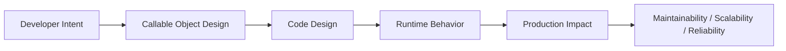
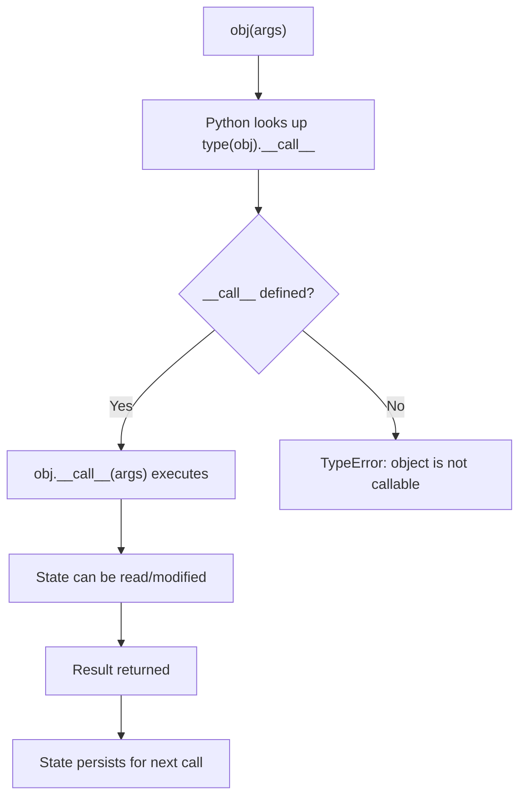

# Callable Objects

## Overview

In Python, a **callable** is any object that can be invoked using the call syntax `obj(args)`. Functions and methods are the most common callables, but Python's data model allows any class to become callable by implementing the `__call__` magic method. An instance of such a class is called a **callable object** (or **functor**).

Callable objects bridge the gap between functions and classes: they carry state (like a class) while being invokable (like a function). This makes them ideal for stateful callbacks, configurable function factories, middleware components, AI agent steps, and anywhere you need a function with persistent context.

You can check if any object is callable using the built-in `callable(obj)` function.

---

## Why It Matters





---

## Simple Example

```python
class Multiplier:
    """A callable object that multiplies its input by a fixed factor."""

    def __init__(self, factor: float):
        self.factor = factor
        self.call_count = 0  # Stateful: tracks how many times it's been called

    def __call__(self, value: float) -> float:
        self.call_count += 1
        return value * self.factor

    def __repr__(self) -> str:
        return f"Multiplier(factor={self.factor}, calls={self.call_count})"


# Create callable objects
double = Multiplier(2)
triple = Multiplier(3)

# Use them like functions
print(double(5))     # 10.0
print(double(10))    # 20.0
print(triple(7))     # 21.0

# State is preserved between calls
print(double.call_count)  # 2
print(triple.call_count)  # 1

# Check callability
print(callable(double))   # True
print(callable(42))       # False
print(callable(print))    # True

# Pass as a callback (just like a function)
numbers = [1, 2, 3, 4, 5]
print(list(map(double, numbers)))  # [2.0, 4.0, 6.0, 8.0, 10.0]

print(repr(double))  # Multiplier(factor=2, calls=7)
```

**Explanation:**
- `__call__` makes instances of `Multiplier` callable — `double(5)` is equivalent to `double.__call__(5)`.
- `call_count` is instance state that persists across calls — something a plain function cannot do without closures or global variables.
- Callable objects can be passed anywhere a function is expected: `map()`, `filter()`, `sorted(key=...)`, callbacks, etc.

**Expected output:**
```
10.0
20.0
21.0
2
1
True
False
True
[2.0, 4.0, 6.0, 8.0, 10.0]
Multiplier(factor=2, calls=7)
```

---

## Intermediate Example

### Configurable Middleware and Pipeline Steps

```python
from __future__ import annotations
from typing import Any, Callable
from functools import wraps
import time
import logging

logger = logging.getLogger(__name__)
logging.basicConfig(level=logging.INFO, format="%(levelname)s: %(message)s")


class RateLimiter:
    """
    A callable rate limiter that enforces a minimum interval between calls.
    Can be used as a decorator or as a standalone callable wrapper.
    """

    def __init__(self, calls_per_second: float):
        self.min_interval = 1.0 / calls_per_second
        self._last_call: float = 0.0
        self._total_calls: int = 0
        self._throttled_calls: int = 0

    def __call__(self, func: Callable) -> Callable:
        """Use as a decorator: @RateLimiter(10)"""
        @wraps(func)
        def wrapper(*args, **kwargs):
            self._enforce_rate()
            return func(*args, **kwargs)
        return wrapper

    def _enforce_rate(self) -> None:
        now = time.monotonic()
        elapsed = now - self._last_call
        if elapsed < self.min_interval:
            wait = self.min_interval - elapsed
            self._throttled_calls += 1
            time.sleep(wait)
        self._last_call = time.monotonic()
        self._total_calls += 1

    @property
    def stats(self) -> dict:
        return {
            "total_calls": self._total_calls,
            "throttled_calls": self._throttled_calls,
        }

    def __repr__(self) -> str:
        return (
            f"RateLimiter(calls_per_second={1/self.min_interval:.1f}, "
            f"total={self._total_calls}, throttled={self._throttled_calls})"
        )


class Validator:
    """
    A callable validator that checks a value against a set of rules.
    Rules are callables that return True/False or raise ValueError.
    """

    def __init__(self, name: str, *rules: Callable[[Any], bool]):
        self.name = name
        self.rules = list(rules)
        self._pass_count = 0
        self._fail_count = 0

    def add_rule(self, rule: Callable[[Any], bool]) -> "Validator":
        """Fluent interface for adding rules."""
        self.rules.append(rule)
        return self

    def __call__(self, value: Any) -> bool:
        """Validate a value against all rules."""
        for rule in self.rules:
            try:
                if not rule(value):
                    self._fail_count += 1
                    logger.warning("Validator '%s' failed for value: %r", self.name, value)
                    return False
            except (ValueError, TypeError) as e:
                self._fail_count += 1
                logger.warning("Validator '%s' raised: %s", self.name, e)
                return False
        self._pass_count += 1
        return True

    @property
    def stats(self) -> dict:
        total = self._pass_count + self._fail_count
        return {
            "pass": self._pass_count,
            "fail": self._fail_count,
            "total": total,
            "pass_rate": self._pass_count / total if total else 0.0,
        }

    def __repr__(self) -> str:
        return f"Validator(name={self.name!r}, rules={len(self.rules)})"


# --- Usage ---
# Validator as a callable
is_valid_age = (
    Validator("age")
    .add_rule(lambda x: isinstance(x, int))
    .add_rule(lambda x: 0 <= x <= 150)
)

print(is_valid_age(25))    # True
print(is_valid_age(-1))    # False
print(is_valid_age(200))   # False
print(is_valid_age("old")) # False
print(is_valid_age.stats)  # {'pass': 1, 'fail': 3, 'total': 4, 'pass_rate': 0.25}

# Filter with callable object
ages = [25, -1, 30, 200, 18, "old", 65]
valid_ages = list(filter(is_valid_age, ages))
print(valid_ages)  # [25, 30, 18, 65]

# RateLimiter as a decorator
limiter = RateLimiter(calls_per_second=100)

@limiter
def fetch_data(endpoint: str) -> dict:
    return {"endpoint": endpoint, "data": "..."}

for i in range(3):
    fetch_data(f"/api/item/{i}")

print(limiter)  # RateLimiter(calls_per_second=100.0, total=3, throttled=...)
```

**Explanation:**
- `RateLimiter.__call__` accepts a function and returns a wrapped function — making it usable as a decorator.
- `Validator.__call__` validates a value — making it usable with `filter()`, `map()`, and any callback API.
- Both objects maintain state (`_total_calls`, `_pass_count`) across invocations.
- The fluent `.add_rule()` interface returns `self`, enabling method chaining.

---

## Advanced / Architect-Level Example

### AI Agent Step Registry with Callable Objects

**Problem context:** An enterprise AI agent framework needs pipeline steps that are callable, configurable, introspectable, composable, and serializable. Each step is a callable object with metadata, retry logic, observability hooks, and a registry for dynamic dispatch. This pattern is used in LangChain, Haystack, and custom RAG pipelines.

```python
from __future__ import annotations
from typing import Any, Callable, Optional
from dataclasses import dataclass, field
from abc import ABC, abstractmethod
import time
import logging
import functools

logger = logging.getLogger(__name__)
logging.basicConfig(level=logging.INFO, format="%(levelname)s: %(message)s")


# --- Base callable step ---
@dataclass
class StepMetrics:
    name: str
    call_count: int = 0
    total_duration_ms: float = 0.0
    error_count: int = 0

    @property
    def avg_duration_ms(self) -> float:
        return self.total_duration_ms / self.call_count if self.call_count else 0.0

    def __repr__(self) -> str:
        return (
            f"StepMetrics(name={self.name!r}, calls={self.call_count}, "
            f"avg_ms={self.avg_duration_ms:.2f}, errors={self.error_count})"
        )


class AgentStep(ABC):
    """
    Abstract base class for all agent pipeline steps.
    Subclasses implement __call__ to define step behavior.
    """

    def __init__(self, name: str, retry: int = 0, timeout_ms: Optional[float] = None):
        self.name = name
        self.retry = retry
        self.timeout_ms = timeout_ms
        self.metrics = StepMetrics(name=name)
        self._hooks: list[Callable] = []

    @abstractmethod
    def __call__(self, context: dict[str, Any]) -> dict[str, Any]:
        """Execute the step. Must be implemented by subclasses."""
        ...

    def _execute_with_observability(
        self, context: dict[str, Any]
    ) -> dict[str, Any]:
        """Wraps __call__ with metrics, retry, and hooks."""
        last_exc: Optional[Exception] = None
        attempts = self.retry + 1

        for attempt in range(1, attempts + 1):
            start = time.perf_counter()
            try:
                result = self(context)
                elapsed_ms = (time.perf_counter() - start) * 1000
                self.metrics.call_count += 1
                self.metrics.total_duration_ms += elapsed_ms
                logger.info(
                    "Step '%s' completed in %.2fms (attempt %d/%d)",
                    self.name, elapsed_ms, attempt, attempts
                )
                for hook in self._hooks:
                    hook(self, context, result)
                return result
            except Exception as e:
                last_exc = e
                self.metrics.error_count += 1
                if attempt < attempts:
                    logger.warning(
                        "Step '%s' failed (attempt %d/%d): %s. Retrying...",
                        self.name, attempt, attempts, e
                    )
                else:
                    logger.error(
                        "Step '%s' failed after %d attempts: %s",
                        self.name, attempts, e
                    )

        raise last_exc  # type: ignore

    def add_hook(self, hook: Callable) -> "AgentStep":
        """Register an observability hook (called after each successful execution)."""
        self._hooks.append(hook)
        return self

    def __repr__(self) -> str:
        return f"{self.__class__.__name__}(name={self.name!r}, retry={self.retry})"


# --- Concrete step implementations ---
class DocumentRetriever(AgentStep):
    """Retrieves documents from a vector store."""

    def __init__(self, name: str, top_k: int = 5, **kwargs):
        super().__init__(name, **kwargs)
        self.top_k = top_k
        self._document_store: list[str] = [
            "Python decorators enable AOP patterns",
            "RAG pipelines combine retrieval and generation",
            "Agent frameworks use callable objects for steps",
            "Magic methods define Python's data model",
            "Property decorators enable managed attributes",
        ]

    def __call__(self, context: dict[str, Any]) -> dict[str, Any]:
        query = context.get("query", "")
        # Simulate retrieval (in production: vector similarity search)
        docs = [d for d in self._document_store if any(
            word.lower() in d.lower()
            for word in query.split()
        )][:self.top_k]
        context["retrieved_docs"] = docs or self._document_store[:self.top_k]
        return context


class ContextBuilder(AgentStep):
    """Builds a prompt context from retrieved documents."""

    def __init__(self, name: str, max_tokens: int = 1000, **kwargs):
        super().__init__(name, **kwargs)
        self.max_tokens = max_tokens

    def __call__(self, context: dict[str, Any]) -> dict[str, Any]:
        docs = context.get("retrieved_docs", [])
        context["prompt_context"] = "\n".join(
            f"[{i+1}] {doc}" for i, doc in enumerate(docs)
        )
        context["token_estimate"] = len(context["prompt_context"].split())
        return context


class ResponseGenerator(AgentStep):
    """Generates a response using the built context."""

    def __init__(self, name: str, model: str = "gpt-4o", **kwargs):
        super().__init__(name, **kwargs)
        self.model = model

    def __call__(self, context: dict[str, Any]) -> dict[str, Any]:
        query = context.get("query", "")
        prompt_context = context.get("prompt_context", "")
        # Simulate LLM call
        context["response"] = (
            f"[{self.model}] Based on the context:\n{prompt_context}\n\n"
            f"Answer to '{query}': This is a generated response."
        )
        return context


# --- Step Registry ---
class StepRegistry:
    """
    Registry for agent steps. Steps are callable objects registered by name.
    Enables dynamic pipeline construction and plugin architectures.
    """

    def __init__(self):
        self._registry: dict[str, AgentStep] = {}

    def register(self, step: AgentStep) -> "StepRegistry":
        self._registry[step.name] = step
        return self

    def get(self, name: str) -> AgentStep:
        if name not in self._registry:
            raise KeyError(f"Step '{name}' not found in registry")
        return self._registry[name]

    def __call__(self, name: str, context: dict[str, Any]) -> dict[str, Any]:
        """Execute a registered step by name."""
        step = self.get(name)
        return step._execute_with_observability(context)

    def __contains__(self, name: str) -> bool:
        return name in self._registry

    def __len__(self) -> int:
        return len(self._registry)

    def __repr__(self) -> str:
        return f"StepRegistry(steps={list(self._registry.keys())})"

    def build_pipeline(self, *step_names: str) -> Callable[[dict], dict]:
        """Build a sequential pipeline from registered step names."""
        steps = [self.get(name) for name in step_names]

        def pipeline(context: dict[str, Any]) -> dict[str, Any]:
            for step in steps:
                context = step._execute_with_observability(context)
            return context

        pipeline.__name__ = " → ".join(step_names)
        return pipeline

    def metrics_report(self) -> dict[str, StepMetrics]:
        return {name: step.metrics for name, step in self._registry.items()}


# --- Build and run the pipeline ---
registry = StepRegistry()

registry.register(DocumentRetriever("retriever", top_k=3, retry=1))
registry.register(ContextBuilder("context_builder", max_tokens=500))
registry.register(ResponseGenerator("generator", model="gpt-4o"))

# Add observability hook
def log_step_output(step: AgentStep, ctx: dict, result: dict) -> None:
    logger.info("  [HOOK] Step '%s' output keys: %s", step.name, list(result.keys()))

for step_name in ["retriever", "context_builder", "generator"]:
    registry.get(step_name).add_hook(log_step_output)

# Build and execute pipeline
rag_pipeline = registry.build_pipeline("retriever", "context_builder", "generator")

context = {"query": "callable objects agent pipeline"}
result = rag_pipeline(context)

print("\n--- Pipeline Result ---")
print(f"Query: {result['query']}")
print(f"Retrieved docs: {len(result['retrieved_docs'])}")
print(f"Token estimate: {result['token_estimate']}")
print(f"Response:\n{result['response']}")

print("\n--- Metrics Report ---")
for name, metrics in registry.metrics_report().items():
    print(f"  {metrics}")

print(f"\nRegistry: {registry}")
print(f"'retriever' in registry: {'retriever' in registry}")
print(f"Steps registered: {len(registry)}")
```

**Explanation:**
- `AgentStep` is an abstract callable base class — subclasses implement `__call__` to define behavior.
- `_execute_with_observability` wraps `__call__` with metrics, retry, and hooks — without modifying the step's core logic.
- `StepRegistry.__call__` makes the registry itself callable — `registry("retriever", context)` dispatches to the named step.
- `build_pipeline` returns a plain callable (function) that chains steps — demonstrating that callable objects and functions are interchangeable.
- This pattern is used in LangChain (`Chain`), Haystack (`Pipeline`), and custom agent frameworks.

**Design trade-offs:**

| Approach | Pros | Cons |
|---|---|---|
| Callable objects | Stateful, introspectable, composable | More boilerplate than functions |
| Plain functions | Simple, lightweight | No state, no introspection |
| Class with `run()` method | Explicit, discoverable | Not interchangeable with functions |
| Closures | Lightweight stateful callables | Hard to inspect, test, and serialize |
| Dataclass + `__call__` | Clean, typed, serializable | Slightly more verbose |

---

## Common Mistakes

### 1. Forgetting that `__call__` must be defined on the class, not the instance
```python
# Bad — assigning a function to an instance attribute does NOT make it callable via ()
class Foo:
    pass

foo = Foo()
foo.__call__ = lambda: "hello"
foo()  # TypeError: 'Foo' object is not callable

# Good — define __call__ on the class
class Foo:
    def __call__(self):
        return "hello"

foo = Foo()
foo()  # "hello"
```

### 2. Mutable default arguments in `__init__` shared across instances
```python
# Bad — all instances share the same list
class Accumulator:
    def __init__(self, history=[]):  # Mutable default!
        self.history = history

    def __call__(self, value):
        self.history.append(value)
        return sum(self.history)

# Good
class Accumulator:
    def __init__(self):
        self.history: list = []

    def __call__(self, value):
        self.history.append(value)
        return sum(self.history)
```

### 3. Not implementing `__repr__` for callable objects
- **Problem:** Callable objects passed as callbacks are hard to debug without a meaningful `__repr__`.
- **Better approach:** Always implement `__repr__` that shows the object's configuration and state.

### 4. Confusing callable objects with class instances that have a `run()` method
- **Problem:** A `run()` method is not interchangeable with functions in `map()`, `filter()`, `sorted(key=...)`, etc.
- **Better approach:** Use `__call__` when the object needs to be used anywhere a function is expected.

### 5. Not handling thread safety for stateful callable objects
```python
# Bad — call_count is not thread-safe
class Counter:
    def __init__(self):
        self.call_count = 0

    def __call__(self, value):
        self.call_count += 1  # Race condition in multi-threaded code!
        return value

# Good
import threading

class Counter:
    def __init__(self):
        self.call_count = 0
        self._lock = threading.Lock()

    def __call__(self, value):
        with self._lock:
            self.call_count += 1
        return value
```

### 6. Using callable objects where a simple closure would suffice
- **Problem:** Callable objects add boilerplate. For simple stateful functions, a closure is often cleaner.
- **Better approach:** Use closures for simple cases; use callable objects when you need introspection, serialization, multiple methods, or inheritance.

---

## Best Practices

- **Implement `__repr__`** — callable objects are often passed as callbacks; make them debuggable.
- **Use `callable(obj)`** to check if an object is callable before invoking it.
- **Use `@dataclass` + `__call__`** for clean, typed, serializable callable objects.
- **Use `functools.wraps`** when a callable object wraps another function (as a decorator).
- **Handle thread safety** with `threading.Lock` for stateful callable objects used in concurrent code.
- **Keep `__call__` focused** — one responsibility per callable object.
- **Use abstract base classes** (`ABC` + `@abstractmethod`) for callable object hierarchies.
- **Prefer callable objects over closures** when you need: multiple methods, introspection, serialization, or inheritance.
- **Document the call signature** — use type hints on `__call__` for IDE support and static analysis.

---

## Performance Considerations

- Calling a callable object (`obj(args)`) is slightly slower than calling a plain function due to the extra attribute lookup for `__call__`. The difference is negligible for most use cases.
- **`__slots__`** can reduce memory overhead for callable objects with many instances (e.g., one per pipeline step).
- For **hot paths** (e.g., a callable called millions of times in a loop), consider caching `obj.__call__` in a local variable:
  ```python
  call = obj.__call__
  for item in large_dataset:
      call(item)  # Avoids repeated attribute lookup
  ```
- **Stateful callable objects** with locks (`threading.Lock`) add synchronization overhead in concurrent code — profile before optimizing.
- `functools.lru_cache` can be applied to `__call__` for memoization:
  ```python
  from functools import lru_cache
  class CachedStep:
      @lru_cache(maxsize=128)
      def __call__(self, key: str) -> str:
          return expensive_computation(key)
  ```
  Note: `lru_cache` requires hashable arguments.

---

## Testing Strategy

```python
# tests/test_callable_objects.py
import pytest
import threading
from mymodule import Multiplier, Validator, RateLimiter


# --- Multiplier tests ---
def test_multiplier_basic():
    double = Multiplier(2)
    assert double(5) == 10.0

def test_multiplier_state():
    double = Multiplier(2)
    double(1)
    double(2)
    double(3)
    assert double.call_count == 3

def test_multiplier_callable():
    double = Multiplier(2)
    assert callable(double)

def test_multiplier_as_map_callback():
    double = Multiplier(2)
    result = list(map(double, [1, 2, 3]))
    assert result == [2.0, 4.0, 6.0]

def test_multiplier_repr():
    double = Multiplier(2)
    double(1)
    assert "Multiplier" in repr(double)
    assert "factor=2" in repr(double)


# --- Validator tests ---
def test_validator_passes():
    v = Validator("positive", lambda x: x > 0)
    assert v(5) is True

def test_validator_fails():
    v = Validator("positive", lambda x: x > 0)
    assert v(-1) is False

def test_validator_multiple_rules():
    v = Validator("age",
        lambda x: isinstance(x, int),
        lambda x: 0 <= x <= 150,
    )
    assert v(25) is True
    assert v(-1) is False
    assert v("old") is False

def test_validator_stats():
    v = Validator("test", lambda x: x > 0)
    v(1)   # pass
    v(-1)  # fail
    v(2)   # pass
    assert v.stats["pass"] == 2
    assert v.stats["fail"] == 1
    assert v.stats["pass_rate"] == pytest.approx(2/3)

def test_validator_as_filter():
    v = Validator("positive", lambda x: x > 0)
    result = list(filter(v, [-1, 0, 1, 2, -3, 4]))
    assert result == [1, 2, 4]

def test_validator_fluent_interface():
    v = (
        Validator("number")
        .add_rule(lambda x: isinstance(x, (int, float)))
        .add_rule(lambda x: x >= 0)
    )
    assert v(10) is True
    assert v(-1) is False


# --- Thread safety test ---
def test_callable_thread_safety():
    import threading

    class ThreadSafeCounter:
        def __init__(self):
            self.count = 0
            self._lock = threading.Lock()

        def __call__(self):
            with self._lock:
                self.count += 1

    counter = ThreadSafeCounter()
    threads = [threading.Thread(target=counter) for _ in range(100)]
    for t in threads:
        t.start()
    for t in threads:
        t.join()

    assert counter.count == 100


# --- callable() built-in tests ---
def test_callable_builtin():
    assert callable(Multiplier(2)) is True
    assert callable(lambda x: x) is True
    assert callable(42) is False
    assert callable("string") is False
    assert callable(print) is True
```

---

## Debugging Tips

- **`callable(obj)`** — quick check if an object is callable before invoking it.
- **`type(obj).__call__`** — inspect the `__call__` method defined on the class.
- **`inspect.signature(obj)`** — get the call signature of a callable object (works on `__call__`).
- **`obj.__call__`** — access the bound method directly; useful for profiling or caching.
- If `obj()` raises `TypeError: object is not callable`, check that `__call__` is defined on the **class**, not the instance.
- If state is not persisting between calls, check that you're using the same instance (not creating a new one each time).
- Use `repr(obj)` to inspect the callable's configuration and state — implement `__repr__` for this purpose.
- For thread-safety issues, add logging inside `__call__` with `threading.current_thread().name` to trace concurrent access.

---

## Interview Questions

### Beginner
1. **What is a callable object in Python?**
   *Any object that can be invoked using `()` syntax. A class becomes callable by implementing `__call__`.*

2. **How do you make a class instance callable?**
   *Define a `__call__` method on the class. Then instances can be called like functions: `obj(args)`.*

3. **How do you check if an object is callable?**
   *Use the built-in `callable(obj)` function. Returns `True` if the object has a `__call__` method.*

4. **What is the advantage of a callable object over a plain function?**
   *Callable objects can maintain state between calls, have multiple methods, support introspection, and can be configured at construction time.*

5. **Can you pass a callable object to `map()` or `filter()`?**
   *Yes. Any callable — function, lambda, or callable object — can be passed to `map()`, `filter()`, `sorted(key=...)`, and any other higher-order function.*

### Intermediate
1. **What is the difference between a callable object and a closure?**
   *Both can maintain state. A closure captures variables from an enclosing scope. A callable object stores state as instance attributes, supports multiple methods, introspection, and inheritance. Use closures for simple cases; callable objects for complex, reusable, or inspectable behavior.*

2. **How can a callable object be used as a decorator?**
   *Implement `__call__` to accept a function and return a wrapped function. The callable object can store configuration (e.g., retry count, rate limit) as instance attributes.*

3. **How does `inspect.signature()` work with callable objects?**
   *`inspect.signature(obj)` inspects `obj.__call__` to determine the call signature. This enables IDE autocompletion and runtime introspection.*

4. **What is `functools.lru_cache` and can it be applied to `__call__`?**
   *`lru_cache` memoizes function results. It can be applied to `__call__`, but requires hashable arguments. Note: `lru_cache` on an instance method shares the cache across all instances unless applied carefully.*

5. **How would you implement a callable object that acts as both a decorator and a direct callable?**
   *In `__call__`, check if the argument is a callable (function). If yes, return a wrapped function (decorator mode). If no, execute the core logic directly (callable mode). This is the pattern used by `pytest.mark.parametrize` and similar APIs.*

### Advanced / Architect-Level
1. **How would you design a callable step registry for an AI agent pipeline?**
   *Define an abstract `AgentStep` base class with `__call__`. Implement concrete steps as subclasses. Register steps in a `StepRegistry` dict. The registry's `__call__` dispatches to the named step. `build_pipeline` chains steps into a single callable.*

2. **How do callable objects relate to the Strategy design pattern?**
   *Callable objects are a Pythonic implementation of the Strategy pattern. Instead of defining a `Strategy` interface with an `execute()` method, Python uses `__call__` — making strategies interchangeable with plain functions.*

3. **How would you serialize and deserialize a callable object?**
   *Use `pickle` for simple cases. For complex objects, implement `__getstate__` and `__setstate__`. For cross-language serialization, store the class name and constructor arguments as JSON, and reconstruct with a factory.*

4. **What are the thread-safety considerations for stateful callable objects?**
   *Shared mutable state (counters, caches, connection pools) must be protected with `threading.Lock` or `threading.RLock`. For read-heavy workloads, use `threading.RLock` for reentrant locking. For async code, use `asyncio.Lock`.*

5. **How does Python's `__call__` protocol interact with `functools.partial`?**
   *`functools.partial` creates a new callable by pre-filling arguments of any callable — including callable objects. `partial(obj, fixed_arg)` returns a `partial` object whose `__call__` invokes `obj.__call__(fixed_arg, *args, **kwargs)`.*

---

## Key Takeaways

- Any class with `__call__` produces **callable objects** — instances that behave like functions.
- **`callable(obj)`** checks if an object is callable at runtime.
- Callable objects carry **state** between invocations — unlike plain functions (without closures).
- They are **interchangeable with functions** in `map()`, `filter()`, `sorted()`, callbacks, and decorators.
- Use callable objects over closures when you need: **multiple methods, introspection, serialization, or inheritance**.
- **`@dataclass` + `__call__`** is a clean, typed pattern for callable objects.
- Callable objects are the Pythonic implementation of the **Strategy** and **Command** design patterns.
- In AI/ML frameworks, callable objects are the building blocks of **pipeline steps, middleware, and agent components**.
- **Thread safety** requires explicit locking for stateful callable objects in concurrent code.
- `__call__` must be defined on the **class**, not the instance.

---

## Mini Project Idea

### Project: `pipeline-kit` — A Callable-Object-Based Data Pipeline Library

**Goal:** Build a lightweight data pipeline library where each step is a callable object with validation, metrics, retry, and composability — suitable for ETL, RAG preprocessing, or AI agent workflows.

**Features:**
- `Step` abstract base class with `__call__`, metrics, retry, and hooks.
- `Pipeline` class that chains steps and is itself callable.
- `StepRegistry` for dynamic step registration and dispatch.
- Built-in steps: `Filter`, `Transform`, `Validator`, `Logger`, `RateLimiter`.
- `Pipeline | Step` composition using `__or__`.
- Full pytest test suite with mocking.

**Suggested folder structure:**
```
pipeline_kit/
├── .venv/
├── pyproject.toml
├── src/
│   └── pipeline_kit/
│       ├── __init__.py
│       ├── base.py          # Step ABC, StepMetrics
│       ├── pipeline.py      # Pipeline class
│       ├── registry.py      # StepRegistry
│       └── steps/
│           ├── __init__.py
│           ├── filter.py
│           ├── transform.py
│           ├── validate.py
│           └── rate_limit.py
└── tests/
    ├── test_step.py
    ├── test_pipeline.py
    └── test_registry.py
```

**Extension ideas:**
- Add async support (`async def __call__`).
- Add parallel step execution (`asyncio.gather`).
- Add step serialization to JSON for pipeline persistence.
- Add a visual pipeline renderer (Mermaid diagram generator).
- Integrate with OpenTelemetry for distributed tracing.

---

## Final Summary

Callable objects are one of Python's most versatile and underutilized features. By implementing `__call__`, any class instance becomes a first-class function — carrying state, supporting introspection, and integrating seamlessly with Python's functional programming tools. In production AI and backend systems, callable objects are the natural building blocks for pipeline steps, middleware, validators, rate limiters, and agent components. Architects who master callable objects can design systems that are simultaneously object-oriented (stateful, composable, introspectable) and functional (interchangeable with functions, usable in `map`/`filter`/`sorted`). This duality is a hallmark of idiomatic, production-grade Python.
