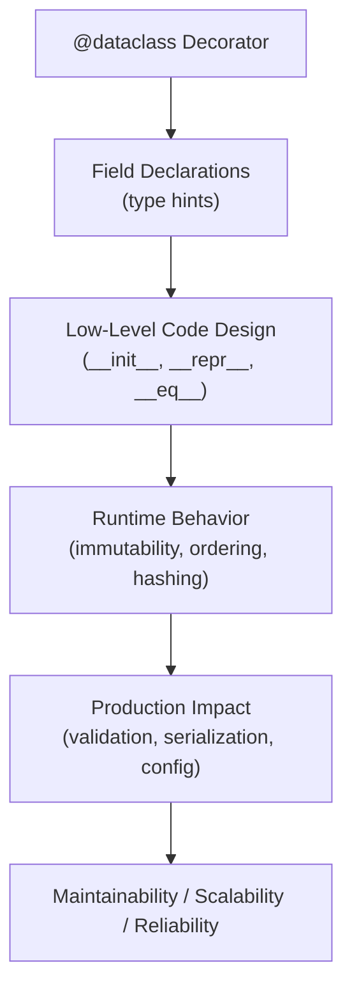
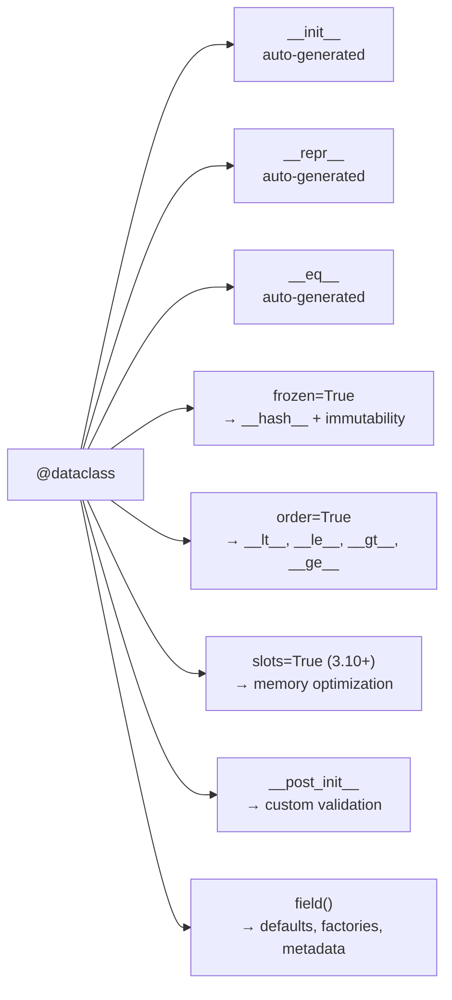

# Data Classes in Python

## Overview

**Data Classes** (introduced in Python 3.7 via [PEP 557](https://peps.python.org/pep-0557/)) are a decorator-based mechanism that auto-generates boilerplate methods — `__init__`, `__repr__`, `__eq__`, and more — for classes whose primary purpose is to hold structured data. They sit at the intersection of simplicity, type safety, and production readiness, making them a cornerstone of modern Python architecture.

> **Core idea:** Stop writing repetitive `__init__` and `__repr__` methods. Declare fields with type hints and let Python do the rest.

---

## Why It Matters

| Without Data Classes | With Data Classes |
|---|---|
| Manual `__init__`, `__repr__`, `__eq__` | Auto-generated from field declarations |
| Error-prone boilerplate | Declarative, readable field definitions |
| No built-in immutability support | `frozen=True` for immutable instances |
| No ordering out of the box | `order=True` for comparison operators |
| No slot optimization | `slots=True` (Python 3.10+) for memory efficiency |

Data classes are used extensively in:
- **FastAPI** request/response models (alongside Pydantic)
- **AI agent state containers**
- **RAG pipeline configuration objects**
- **Domain-driven design value objects**
- **Event-driven architectures** (event payloads)

---

## Concept Map





---

## Simple Example

```python
from dataclasses import dataclass

@dataclass
class Point:
    x: float
    y: float

p1 = Point(1.0, 2.0)
p2 = Point(1.0, 2.0)
p3 = Point(3.0, 4.0)

print(p1)           # Point(x=1.0, y=2.0)
print(p1 == p2)     # True
print(p1 == p3)     # False
```

**Explanation:**
- `@dataclass` generates `__init__(self, x, y)`, `__repr__`, and `__eq__` automatically.
- No manual method writing needed.
- `p1 == p2` compares field values, not object identity.

**Expected Output:**
```
Point(x=1.0, y=2.0)
True
False
```

---

## Intermediate Example

```python
from dataclasses import dataclass, field
from typing import List

@dataclass
class OrderItem:
    product_id: str
    quantity: int
    unit_price: float

    @property
    def total(self) -> float:
        return self.quantity * self.unit_price

@dataclass
class Order:
    order_id: str
    customer: str
    items: List[OrderItem] = field(default_factory=list)
    discount: float = 0.0

    def add_item(self, item: OrderItem) -> None:
        self.items.append(item)

    @property
    def subtotal(self) -> float:
        return sum(i.total for i in self.items)

    @property
    def grand_total(self) -> float:
        return self.subtotal * (1 - self.discount)

# Usage
order = Order(order_id="ORD-001", customer="Alice", discount=0.1)
order.add_item(OrderItem("SKU-A", 2, 49.99))
order.add_item(OrderItem("SKU-B", 1, 19.99))

print(order)
print(f"Grand Total: ${order.grand_total:.2f}")
```

**Explanation:**
- `field(default_factory=list)` avoids the mutable default argument pitfall.
- Properties add computed behavior without polluting `__init__`.
- Data classes compose naturally — `Order` contains `OrderItem` instances.

**Expected Output:**
```
Order(order_id='ORD-001', customer='Alice', items=[OrderItem(product_id='SKU-A', quantity=2, unit_price=49.99), OrderItem(product_id='SKU-B', quantity=1, unit_price=19.99)], discount=0.1)
Grand Total: $107.98
```

---

## Advanced / Architect-Level Example

### Problem Context

In a **RAG (Retrieval-Augmented Generation) pipeline**, you need strongly-typed, validated, and serializable configuration and state objects that flow through multiple pipeline stages: document ingestion, chunking, embedding, retrieval, and generation. Using plain dicts leads to silent key errors and no IDE support. Data classes provide a clean, validated, and serializable contract.

```python
from __future__ import annotations
from dataclasses import dataclass, field, asdict
from typing import List, Optional, Dict, Any
from enum import Enum
import json
import time


class EmbeddingModel(str, Enum):
    ADA_002 = "text-embedding-ada-002"
    SMALL_3 = "text-embedding-3-small"
    LARGE_3 = "text-embedding-3-large"


class RetrievalStrategy(str, Enum):
    COSINE = "cosine"
    MMR = "mmr"
    BM25 = "bm25"


@dataclass(frozen=True)
class ChunkConfig:
    """Immutable chunking configuration — safe to share across threads."""
    chunk_size: int = 512
    chunk_overlap: int = 64
    separator: str = "\n\n"

    def __post_init__(self):
        if self.chunk_overlap >= self.chunk_size:
            raise ValueError("chunk_overlap must be less than chunk_size")


@dataclass(frozen=True)
class EmbeddingConfig:
    model: EmbeddingModel = EmbeddingModel.SMALL_3
    batch_size: int = 100
    dimensions: int = 1536


@dataclass
class RetrievalConfig:
    strategy: RetrievalStrategy = RetrievalStrategy.COSINE
    top_k: int = 5
    score_threshold: float = 0.75
    rerank: bool = False


@dataclass
class PipelineConfig:
    """Top-level RAG pipeline configuration."""
    pipeline_id: str
    chunking: ChunkConfig = field(default_factory=ChunkConfig)
    embedding: EmbeddingConfig = field(default_factory=EmbeddingConfig)
    retrieval: RetrievalConfig = field(default_factory=RetrievalConfig)
    metadata: Dict[str, Any] = field(default_factory=dict)

    def to_json(self) -> str:
        return json.dumps(asdict(self), indent=2, default=str)

    @classmethod
    def from_dict(cls, data: Dict[str, Any]) -> PipelineConfig:
        return cls(
            pipeline_id=data["pipeline_id"],
            chunking=ChunkConfig(**data.get("chunking", {})),
            embedding=EmbeddingConfig(**data.get("embedding", {})),
            retrieval=RetrievalConfig(**data.get("retrieval", {})),
            metadata=data.get("metadata", {}),
        )


@dataclass
class DocumentChunk:
    chunk_id: str
    doc_id: str
    text: str
    embedding: Optional[List[float]] = None
    metadata: Dict[str, Any] = field(default_factory=dict)
    created_at: float = field(default_factory=time.time)

    def has_embedding(self) -> bool:
        return self.embedding is not None


@dataclass
class RetrievalResult:
    chunk: DocumentChunk
    score: float
    rank: int

    def __lt__(self, other: RetrievalResult) -> bool:
        return self.score > other.score  # Higher score = better rank


# --- Usage ---
config = PipelineConfig(
    pipeline_id="rag-v2",
    chunking=ChunkConfig(chunk_size=1024, chunk_overlap=128),
    metadata={"version": "2.0", "owner": "ml-team"},
)

print(config.to_json())

chunk = DocumentChunk(
    chunk_id="c-001",
    doc_id="doc-42",
    text="Python data classes simplify structured data handling.",
    embedding=[0.1, 0.2, 0.3],
)
print(f"Has embedding: {chunk.has_embedding()}")

result = RetrievalResult(chunk=chunk, score=0.92, rank=1)
print(f"Top result score: {result.score}")
```

**Explanation:**
- `frozen=True` on `ChunkConfig` and `EmbeddingConfig` makes them hashable and thread-safe — ideal for shared pipeline configs.
- `__post_init__` validates invariants at construction time, not at runtime deep in the pipeline.
- `asdict()` enables zero-effort JSON serialization for logging, caching, and API responses.
- `from_dict()` provides a clean deserialization path from config files or API payloads.
- `RetrievalResult.__lt__` enables `sorted(results)` to work naturally.

**Design Trade-offs:**

| Approach | Pros | Cons |
|---|---|---|
| `@dataclass` | Lightweight, stdlib, fast | No runtime field validation |
| `pydantic.BaseModel` | Full validation, JSON schema | External dependency, slower |
| `attrs` | More features, slots by default | External dependency |
| Plain `dict` | Flexible | No type safety, no IDE support |

> **Architect's rule:** Use `@dataclass` for internal domain objects and pipeline state. Use Pydantic for API boundaries and external data validation.

---

## Common Mistakes

### 1. Mutable Default Arguments
```python
# ❌ Wrong — shared list across all instances
@dataclass
class Config:
    tags: list = []  # TypeError raised by dataclass, but easy to misunderstand

# ✅ Correct
@dataclass
class Config:
    tags: list = field(default_factory=list)
```
**Why it's a problem:** Python evaluates default values once at class definition time. All instances would share the same list.  
**Better approach:** Always use `field(default_factory=...)` for mutable defaults.

---

### 2. Forgetting `__post_init__` for Validation
```python
# ❌ No validation
@dataclass
class Range:
    start: int
    end: int

# ✅ Validated
@dataclass
class Range:
    start: int
    end: int

    def __post_init__(self):
        if self.start >= self.end:
            raise ValueError(f"start ({self.start}) must be < end ({self.end})")
```
**Why it's a problem:** Invalid objects silently propagate through the system.  
**Better approach:** Use `__post_init__` for invariant enforcement.

---

### 3. Using `frozen=True` with Mutable Fields
```python
# ❌ Frozen but contains mutable list — false sense of immutability
@dataclass(frozen=True)
class Config:
    tags: list = field(default_factory=list)
    # config.tags.append("x") still works!
```
**Why it's a problem:** `frozen=True` only prevents attribute reassignment, not mutation of contained objects.  
**Better approach:** Use `tuple` instead of `list`, or use `__post_init__` to convert to tuple.

---

### 4. Mixing `order=True` and Custom `__eq__`
```python
# ❌ Defining __eq__ disables auto-generated __hash__ and breaks order=True
@dataclass(order=True)
class Item:
    value: int
    def __eq__(self, other): ...  # Breaks ordering contract
```
**Better approach:** Let the data class generate both, or use `eq=False` and implement manually.

---

### 5. Ignoring `field(compare=False)` for Non-Comparable Fields
```python
# ❌ Embedding vectors in __eq__ is expensive and semantically wrong
@dataclass
class Document:
    doc_id: str
    embedding: list  # Compared element-by-element in __eq__!

# ✅ Exclude from comparison
@dataclass
class Document:
    doc_id: str
    embedding: list = field(default=None, compare=False, repr=False)
```

---

## Best Practices

1. **Use `field(default_factory=...)` for all mutable defaults** — lists, dicts, sets.
2. **Use `frozen=True` for configuration and value objects** — makes them hashable and safe as dict keys or set members.
3. **Use `__post_init__` for validation** — keep constructors clean and enforce invariants early.
4. **Use `field(repr=False)` for large or sensitive fields** — embeddings, passwords, binary data.
5. **Use `field(compare=False)` for fields that shouldn't affect equality** — timestamps, metadata, caches.
6. **Use `asdict()` and `astuple()` for serialization** — avoid manual dict conversion.
7. **Use `slots=True` (Python 3.10+) for memory-critical objects** — reduces per-instance memory by ~30%.
8. **Compose data classes** — nest them for complex domain models instead of flat dicts.
9. **Prefer data classes over `namedtuple` for mutable state** — namedtuples are immutable and lack `__post_init__`.
10. **Document field semantics with `field(metadata=...)`** — useful for schema generation and documentation tools.

---

## Performance Considerations

### Memory
- Standard data classes use `__dict__` per instance (same as regular classes).
- `slots=True` (Python 3.10+) eliminates `__dict__`, saving ~50–100 bytes per instance — critical when creating millions of objects (e.g., document chunks in a RAG pipeline).

```python
# Python 3.10+
@dataclass(slots=True)
class EmbeddingVector:
    doc_id: str
    vector: list
```

### Speed
- `__init__` generated by `@dataclass` is slightly slower than a hand-written `__init__` with no validation, but negligible in practice.
- `frozen=True` adds overhead to attribute setting (uses `object.__setattr__`) — avoid in tight loops.
- `asdict()` performs a deep copy — cache the result if called repeatedly.

### Comparison
- `__eq__` compares all fields by default — use `field(compare=False)` to exclude expensive fields like embeddings.

---

## Testing Strategy

```python
# test_data_classes.py
import pytest
from dataclasses import asdict, replace
from your_module import ChunkConfig, Order, OrderItem, PipelineConfig


# --- Basic construction and equality ---
def test_chunk_config_defaults():
    cfg = ChunkConfig()
    assert cfg.chunk_size == 512
    assert cfg.chunk_overlap == 64


def test_chunk_config_validation():
    with pytest.raises(ValueError, match="chunk_overlap must be less than chunk_size"):
        ChunkConfig(chunk_size=100, chunk_overlap=200)


# --- Immutability ---
def test_chunk_config_is_frozen():
    cfg = ChunkConfig()
    with pytest.raises(Exception):  # FrozenInstanceError
        cfg.chunk_size = 1024


# --- replace() for immutable updates ---
def test_replace_creates_new_instance():
    cfg = ChunkConfig(chunk_size=512)
    new_cfg = replace(cfg, chunk_size=1024)
    assert new_cfg.chunk_size == 1024
    assert cfg.chunk_size == 512  # Original unchanged


# --- Serialization ---
def test_pipeline_config_serialization():
    config = PipelineConfig(pipeline_id="test")
    data = asdict(config)
    assert data["pipeline_id"] == "test"
    assert "chunking" in data


# --- Mutable default factory ---
def test_order_items_not_shared():
    o1 = Order(order_id="1", customer="Alice")
    o2 = Order(order_id="2", customer="Bob")
    o1.add_item(OrderItem("SKU-A", 1, 10.0))
    assert len(o2.items) == 0  # Not shared!


# --- Computed properties ---
def test_order_grand_total():
    order = Order(order_id="1", customer="Alice", discount=0.1)
    order.add_item(OrderItem("SKU-A", 2, 50.0))
    assert order.grand_total == pytest.approx(90.0)
```

**Key testing patterns:**
- Test default values explicitly.
- Test `__post_init__` validation with `pytest.raises`.
- Test immutability with `frozen=True`.
- Use `dataclasses.replace()` to test immutable updates.
- Test that `default_factory` fields are not shared between instances.

---

## Debugging Tips

1. **Use `repr` output** — data classes print all fields by default, making `print(obj)` highly informative during debugging.

2. **Use `dataclasses.fields(obj)`** to inspect field metadata at runtime:
   ```python
   from dataclasses import fields
   for f in fields(my_obj):
       print(f.name, f.type, f.default)
   ```

3. **Use `dataclasses.asdict(obj)`** to dump the full nested structure as a dict for logging:
   ```python
   import json, dataclasses
   print(json.dumps(dataclasses.asdict(config), indent=2, default=str))
   ```

4. **`FrozenInstanceError`** — if you see this, you're trying to mutate a `frozen=True` dataclass. Use `dataclasses.replace()` instead.

5. **`TypeError: non-default argument follows default argument`** — fields without defaults must come before fields with defaults. Reorder your fields or use `field(default=...)`.

6. **Inheritance ordering issues** — when subclassing data classes, parent fields with defaults must not precede child fields without defaults. Use `field(default=...)` carefully in inheritance chains.

---

## Interview Questions

### Beginner

**Q1: What does `@dataclass` auto-generate?**  
A: `__init__`, `__repr__`, and `__eq__` by default. Optionally `__hash__`, `__lt__`, `__le__`, `__gt__`, `__ge__` with `order=True`, and immutability with `frozen=True`.

**Q2: Why can't you use a list as a default value directly in a data class field?**  
A: Mutable defaults are shared across instances. Use `field(default_factory=list)` to create a new list per instance.

**Q3: What is `__post_init__` used for?**  
A: Post-construction logic such as validation, derived field computation, or type coercion — runs after `__init__`.

**Q4: What is the difference between `frozen=True` and a regular data class?**  
A: `frozen=True` makes instances immutable (raises `FrozenInstanceError` on attribute assignment) and automatically generates `__hash__`.

**Q5: How do you create a modified copy of a frozen data class?**  
A: Use `dataclasses.replace(obj, field=new_value)` — returns a new instance with specified fields changed.

---

### Intermediate

**Q6: How does `field(compare=False)` affect `__eq__` and `__hash__`?**  
A: Fields with `compare=False` are excluded from equality checks and hash computation, useful for metadata or cache fields.

**Q7: How do data classes handle inheritance?**  
A: Child classes inherit parent fields. The MRO determines field order in `__init__`. Parent fields with defaults cannot precede child fields without defaults — this causes a `TypeError`.

**Q8: What is the difference between `@dataclass` and `collections.namedtuple`?**  
A: Data classes are mutable by default, support methods, `__post_init__`, and inheritance. Namedtuples are always immutable, tuple-based, and lighter but less flexible.

**Q9: How do you serialize a nested data class to JSON?**  
A: Use `dataclasses.asdict()` to convert to a nested dict, then `json.dumps()`. For custom types (enums, datetimes), provide a `default` serializer.

**Q10: What does `slots=True` do in Python 3.10+?**  
A: Generates `__slots__` for the class, eliminating the per-instance `__dict__` and reducing memory usage — important for large-scale object creation.

---

### Advanced / Architect-Level

**Q11: How would you implement a data class that supports both validation and JSON schema generation?**  
A: Use `field(metadata={"description": "...", "min": 0})` to attach schema metadata, then write a `schema_for()` utility that inspects `dataclasses.fields()` and their metadata to produce a JSON Schema dict. Alternatively, migrate to Pydantic for built-in schema generation.

**Q12: When would you choose `@dataclass` over Pydantic's `BaseModel` in a production system?**  
A: Use `@dataclass` for internal domain objects, pipeline state, and value objects where runtime validation overhead is undesirable and data is trusted. Use Pydantic at API boundaries, for external data ingestion, or when JSON schema generation and coercion are needed.

**Q13: How do frozen data classes interact with Python's `functools.lru_cache`?**  
A: `frozen=True` generates `__hash__`, making instances hashable and usable as cache keys in `lru_cache`. This is powerful for memoizing expensive computations keyed on configuration objects.

**Q14: Describe a strategy for versioning data class schemas in an event-driven system.**  
A: Add a `schema_version: str` field with a default. Use `from_dict()` class methods with version-aware deserialization logic. Store `asdict()` snapshots in event logs. Use `dataclasses.replace()` for migrations between versions.

**Q15: How would you implement a plugin system where each plugin declares its configuration as a data class?**  
A: Define a `PluginConfig` base data class. Each plugin subclasses it and adds its fields. A plugin registry maps plugin names to their config classes. At load time, deserialize config dicts using `PluginConfigClass(**config_dict)`, validated by `__post_init__`. This gives type-safe, self-documenting plugin configuration.

---

## Key Takeaways

- `@dataclass` eliminates boilerplate `__init__`, `__repr__`, and `__eq__` while keeping code readable and type-safe.
- Use `field(default_factory=...)` for all mutable defaults — never use bare lists or dicts.
- `frozen=True` creates immutable, hashable value objects — ideal for config, cache keys, and thread-safe state.
- `__post_init__` is the right place for validation and derived field computation.
- `asdict()` / `astuple()` provide zero-effort serialization for logging, caching, and API responses.
- `dataclasses.replace()` enables functional-style immutable updates.
- `slots=True` (Python 3.10+) significantly reduces memory for high-volume object creation.
- Data classes compose naturally — nest them for rich domain models.
- For API boundaries and external data, prefer Pydantic; for internal domain objects, `@dataclass` is often sufficient.
- Understanding data classes deeply signals strong Python architecture skills in interviews and code reviews.

---

## Mini Project Idea

### Goal
Build a **RAG Pipeline Configuration Manager** — a CLI tool that loads, validates, merges, and serializes pipeline configurations using data classes.

### Features
- Define `ChunkConfig`, `EmbeddingConfig`, `RetrievalConfig`, and `PipelineConfig` as data classes.
- Load configs from YAML/JSON files using `from_dict()` class methods.
- Validate configs via `__post_init__` with descriptive error messages.
- Merge configs (base + override) using `dataclasses.replace()`.
- Serialize final config to JSON for pipeline execution.
- CLI interface: `python config_manager.py --base base.yaml --override prod.yaml --output final.json`.

### Suggested Folder Structure
```
rag_config_manager/
├── config/
│   ├── __init__.py
│   ├── models.py          # All data class definitions
│   ├── loader.py          # YAML/JSON loading + from_dict()
│   └── merger.py          # Config merging logic
├── tests/
│   ├── test_models.py
│   ├── test_loader.py
│   └── test_merger.py
├── configs/
│   ├── base.yaml
│   └── prod_override.yaml
├── cli.py                 # CLI entry point
└── README.md
```

### Extension Ideas
- Add JSON Schema generation from field metadata.
- Support environment variable overrides (`os.environ`).
- Add a config diff tool using `asdict()` comparison.
- Integrate with Pydantic for API-facing config endpoints.
- Add config versioning and migration support.

---

## Final Summary

Mastering data classes transforms how you design Python systems. They enforce a **declarative, type-safe approach** to structured data — eliminating entire categories of bugs (mutable defaults, missing `__repr__`, broken `__eq__`) while making code dramatically more readable. For a Python architect, data classes are the foundation of clean domain modeling: they define the **contracts** between pipeline stages, the **shape** of events in event-driven systems, and the **configuration** of extensible frameworks. Understanding when to use `@dataclass` versus Pydantic versus `attrs` — and why — is a hallmark of architectural maturity. Combined with `frozen=True`, `__post_init__` validation, and `asdict()` serialization, data classes give you a lightweight but powerful toolkit for building maintainable, production-grade Python systems.
