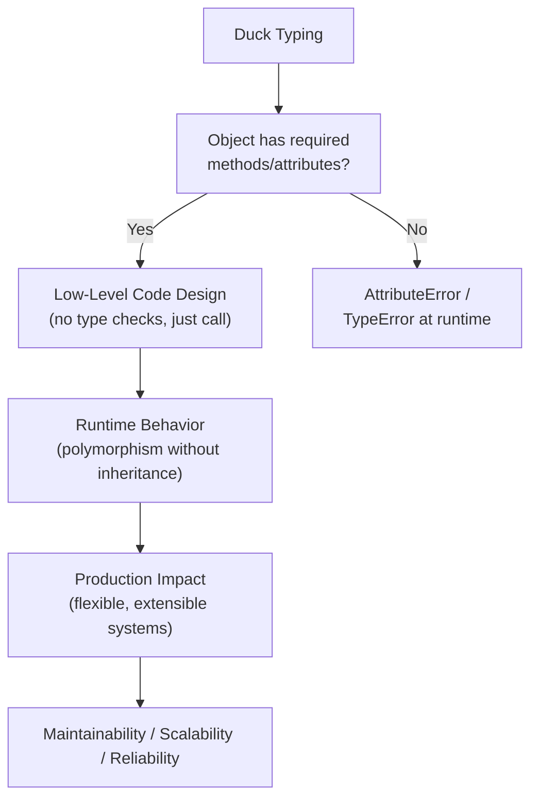
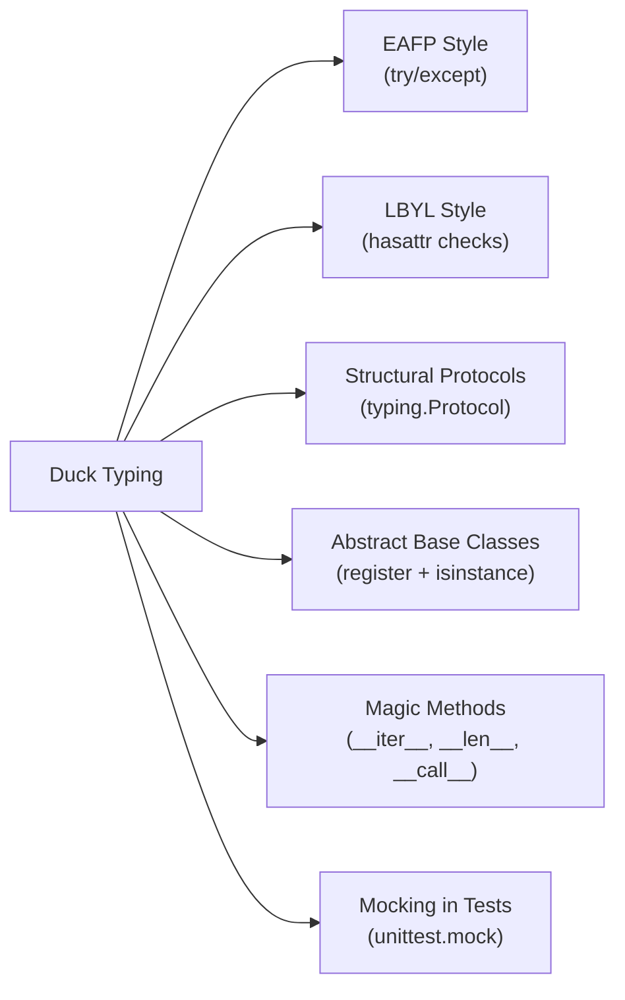

# Duck Typing in Python

## Overview

**Duck Typing** is a programming concept central to Python's design philosophy: *"If it walks like a duck and quacks like a duck, then it must be a duck."* In practice, this means Python determines an object's suitability for an operation based on the **presence of methods and attributes**, not on the object's explicit type or class hierarchy.

> **Core idea:** Python doesn't ask *"what are you?"* — it asks *"can you do what I need?"*

Duck typing is the reason Python code is naturally polymorphic, extensible, and composable without requiring rigid inheritance hierarchies. It underpins protocols, interfaces, and the entire Python data model.

---

## Why It Matters

| Static Typing (Java/C++) | Duck Typing (Python) |
|---|---|
| Type checked at compile time | Type checked at runtime |
| Requires explicit interface/inheritance | Requires only compatible behavior |
| Rigid class hierarchies | Flexible, composable objects |
| `instanceof` checks everywhere | `hasattr` / `try/except` / Protocols |
| Harder to extend third-party code | Easy to extend via monkey patching or wrappers |

Duck typing is foundational to:
- **Python's built-in protocols** (`__iter__`, `__len__`, `__enter__`, `__call__`)
- **Plugin architectures** — any object with the right methods works
- **AI agent tool systems** — tools are duck-typed callables
- **RAG pipelines** — retrievers, embedders, and generators are interchangeable if they share an interface
- **Testing with mocks** — mock objects work because they duck-type the real interface

---

## Concept Map





---

## Simple Example

```python
class Dog:
    def speak(self):
        return "Woof!"

class Cat:
    def speak(self):
        return "Meow!"

class Robot:
    def speak(self):
        return "Beep boop."

def make_it_speak(animal):
    # No type check — just call speak()
    print(animal.speak())

for creature in [Dog(), Cat(), Robot()]:
    make_it_speak(creature)
```

**Explanation:**
- `make_it_speak` doesn't care about the type of `animal`.
- It only requires that the object has a `speak()` method.
- `Robot` is not an animal, but it duck-types the interface perfectly.

**Expected Output:**
```
Woof!
Meow!
Beep boop.
```

---

## Intermediate Example

```python
from typing import Any

class FileWriter:
    def __init__(self, path: str):
        self._path = path

    def write(self, data: str) -> None:
        with open(self._path, "a") as f:
            f.write(data + "\n")

class ConsoleWriter:
    def write(self, data: str) -> None:
        print(f"[CONSOLE] {data}")

class NullWriter:
    """Discards all output — useful for testing."""
    def write(self, data: str) -> None:
        pass

class Logger:
    def __init__(self, writer: Any):
        # Duck-typed: writer just needs a .write(str) method
        self._writer = writer

    def log(self, message: str) -> None:
        self._writer.write(f"LOG: {message}")

    def error(self, message: str) -> None:
        self._writer.write(f"ERROR: {message}")

# Swap writers without changing Logger
console_logger = Logger(ConsoleWriter())
null_logger = Logger(NullWriter())

console_logger.log("Pipeline started")
console_logger.error("Retrieval failed")
null_logger.log("This goes nowhere")
```

**Explanation:**
- `Logger` accepts any object with a `.write(str)` method.
- `FileWriter`, `ConsoleWriter`, and `NullWriter` are completely unrelated classes.
- This pattern is the foundation of Python's `io` module and `logging` handlers.
- `NullWriter` is a classic duck-typed test double.

**Expected Output:**
```
[CONSOLE] LOG: Pipeline started
[CONSOLE] ERROR: Retrieval failed
```

---

## Advanced / Architect-Level Example

### Problem Context

In a **GenAI agent framework**, you need a flexible tool-calling system where tools can be functions, callable objects, LangChain tools, or custom wrappers — all interchangeable as long as they support a common interface. Using duck typing with `typing.Protocol` gives you structural subtyping: compile-time IDE support without runtime inheritance overhead.

```python
from __future__ import annotations
from typing import Protocol, runtime_checkable, Any, Dict, List
import inspect


@runtime_checkable
class AgentTool(Protocol):
    """
    Structural protocol for agent tools.
    Any object with name, description, and __call__ duck-types this interface.
    """
    name: str
    description: str

    def __call__(self, **kwargs: Any) -> str:
        ...


# --- Concrete tool implementations (no shared base class) ---

class WebSearchTool:
    name = "web_search"
    description = "Search the web for current information."

    def __call__(self, query: str, max_results: int = 5) -> str:
        # Simulate web search
        return f"[WebSearch] Results for '{query}' (top {max_results})"


class CalculatorTool:
    name = "calculator"
    description = "Evaluate mathematical expressions."

    def __call__(self, expression: str) -> str:
        try:
            result = eval(expression, {"__builtins__": {}})
            return str(result)
        except Exception as e:
            return f"Error: {e}"


class RAGRetrieverTool:
    name = "rag_retriever"
    description = "Retrieve relevant documents from the knowledge base."

    def __init__(self, index_name: str):
        self._index = index_name

    def __call__(self, query: str, top_k: int = 3) -> str:
        return f"[RAG:{self._index}] Top {top_k} docs for '{query}'"


# --- A plain function wrapped as a tool ---
def _get_weather(location: str) -> str:
    return f"Weather in {location}: Sunny, 22°C"

class FunctionTool:
    """Wraps any callable as an AgentTool."""
    def __init__(self, fn, name: str, description: str):
        self._fn = fn
        self.name = name
        self.description = description

    def __call__(self, **kwargs: Any) -> str:
        return self._fn(**kwargs)


# --- Agent that uses duck-typed tools ---
class Agent:
    def __init__(self, tools: List[Any]):
        self._tools: Dict[str, Any] = {}
        for tool in tools:
            if not isinstance(tool, AgentTool):
                raise TypeError(
                    f"Tool '{tool}' does not implement AgentTool protocol "
                    f"(needs .name, .description, and __call__)"
                )
            self._tools[tool.name] = tool

    def list_tools(self) -> List[str]:
        return [f"{name}: {t.description}" for name, t in self._tools.items()]

    def run(self, tool_name: str, **kwargs: Any) -> str:
        if tool_name not in self._tools:
            return f"Unknown tool: {tool_name}"
        return self._tools[tool_name](**kwargs)


# --- Usage ---
weather_tool = FunctionTool(_get_weather, "weather", "Get current weather.")

agent = Agent(tools=[
    WebSearchTool(),
    CalculatorTool(),
    RAGRetrieverTool("product-docs"),
    weather_tool,
])

print("\n".join(agent.list_tools()))
print()
print(agent.run("web_search", query="Python duck typing", max_results=3))
print(agent.run("calculator", expression="2 ** 10"))
print(agent.run("rag_retriever", query="return policy", top_k=2))
print(agent.run("weather", location="Berlin"))
```

**Explanation:**
- `AgentTool` is a `typing.Protocol` — it defines the structural interface without requiring inheritance.
- `@runtime_checkable` enables `isinstance(tool, AgentTool)` checks at runtime.
- `WebSearchTool`, `CalculatorTool`, `RAGRetrieverTool`, and `FunctionTool` share no base class — they duck-type the protocol.
- The `Agent` validates tools at registration time using `isinstance(..., AgentTool)`.
- New tools can be added from third-party libraries without modifying the framework.

**Design Trade-offs:**

| Approach | Pros | Cons |
|---|---|---|
| Pure duck typing (no check) | Maximum flexibility | Silent failures if interface is wrong |
| `hasattr` checks | Explicit, no imports | Verbose, doesn't check signatures |
| `typing.Protocol` | IDE support, structural typing | Requires Python 3.8+, `@runtime_checkable` for isinstance |
| ABC + `register()` | Explicit registration | More boilerplate, nominal typing |

---

## Common Mistakes

### 1. Catching `AttributeError` Too Broadly
```python
# ❌ Hides real bugs
try:
    result = obj.process()
except AttributeError:
    pass  # Silently swallows missing method errors

# ✅ Check explicitly or let it propagate
if hasattr(obj, "process"):
    result = obj.process()
else:
    raise TypeError(f"Expected object with .process(), got {type(obj)}")
```

---

### 2. Using `type()` Instead of Duck Typing
```python
# ❌ Breaks polymorphism
def save(data):
    if type(data) == list:
        ...
    elif type(data) == dict:
        ...

# ✅ Duck-type the interface
def save(data):
    if hasattr(data, "__iter__"):
        for item in data:
            ...
```

---

### 3. Overusing `isinstance()` Checks
```python
# ❌ Defeats duck typing
def render(widget):
    if isinstance(widget, Button):
        widget.click()
    elif isinstance(widget, TextBox):
        widget.type("hello")

# ✅ Define a common interface
def render(widget):
    widget.interact()  # All widgets implement interact()
```

---

### 4. Not Documenting the Expected Interface
```python
# ❌ Caller has no idea what methods are needed
def process(handler):
    handler.handle(data)

# ✅ Use Protocol or docstring to document the contract
class Handler(Protocol):
    def handle(self, data: dict) -> None: ...

def process(handler: Handler) -> None:
    handler.handle(data)
```

---

### 5. Assuming Duck Typing Means No Type Safety
Duck typing and type hints are **complementary**, not mutually exclusive. Use `typing.Protocol` to get structural type checking with mypy while preserving duck typing's flexibility.

---

## Best Practices

1. **Prefer EAFP (Easier to Ask Forgiveness than Permission)** — use `try/except` over `hasattr` chains for cleaner code.
2. **Use `typing.Protocol` to document duck-typed interfaces** — gives IDE support and mypy checking without inheritance.
3. **Use `@runtime_checkable` sparingly** — only when you need `isinstance()` checks at runtime.
4. **Document expected interfaces in docstrings** — even without Protocol, state what methods/attributes are required.
5. **Avoid `type()` equality checks** — use `isinstance()` or duck typing instead.
6. **Use `hasattr()` for optional capabilities** — check before calling optional methods.
7. **Design for the interface, not the implementation** — write functions that depend on behavior, not class names.
8. **Combine duck typing with ABCs** — use `abc.ABC` for mandatory interface enforcement, duck typing for optional extensions.
9. **Test with mock objects** — duck typing makes `unittest.mock.MagicMock` and `Mock` trivially easy to use.
10. **Validate at system boundaries** — use Protocol isinstance checks at plugin registration or API entry points.

---

## Performance Considerations

Duck typing has **minimal performance overhead** in Python. Attribute lookup (`obj.method`) uses the same `__getattribute__` mechanism regardless of whether you've checked the type. The key considerations are:

- **`hasattr()` calls** add a small overhead — avoid in tight loops; check once and cache.
- **`isinstance(obj, Protocol)`** with `@runtime_checkable` is slower than regular `isinstance` — it checks all protocol members. Use at registration time, not in hot paths.
- **EAFP vs LBYL**: `try/except` has near-zero overhead when no exception is raised (Python's exception handling is optimized for the happy path).
- **No virtual dispatch overhead** — Python's method resolution is the same for duck-typed and explicitly typed objects.

Overall, duck typing does not introduce meaningful performance costs in production Python systems.

---

## Testing Strategy

Duck typing makes testing **easier** because you can substitute any object that implements the required interface:

```python
# test_duck_typing.py
import pytest
from unittest.mock import MagicMock
from your_module import Logger, Agent, AgentTool


# --- Test with a mock writer (duck-typed) ---
def test_logger_uses_writer():
    mock_writer = MagicMock()
    logger = Logger(mock_writer)
    logger.log("test message")
    mock_writer.write.assert_called_once_with("LOG: test message")


# --- Test duck-typed tool protocol ---
def test_agent_accepts_duck_typed_tool():
    class MinimalTool:
        name = "minimal"
        description = "A minimal tool."
        def __call__(self, **kwargs):
            return "done"

    agent = Agent(tools=[MinimalTool()])
    assert agent.run("minimal") == "done"


# --- Test protocol violation is caught ---
def test_agent_rejects_invalid_tool():
    class BadTool:
        pass  # Missing name, description, __call__

    with pytest.raises(TypeError):
        Agent(tools=[BadTool()])


# --- Test EAFP pattern ---
def test_eafp_handles_missing_method():
    class NoProcess:
        pass

    obj = NoProcess()
    try:
        result = obj.process()
    except AttributeError:
        result = "fallback"

    assert result == "fallback"


# --- Test hasattr-based optional capability ---
def test_optional_capability():
    class BasicWriter:
        def write(self, data): pass

    class FlushableWriter:
        def write(self, data): pass
        def flush(self): return "flushed"

    for writer in [BasicWriter(), FlushableWriter()]:
        if hasattr(writer, "flush"):
            assert writer.flush() == "flushed"
```

---

## Debugging Tips

1. **`AttributeError: 'X' object has no attribute 'Y'`** — the object doesn't implement the expected duck-typed interface. Check what methods the caller expects vs. what the object provides.

2. **Use `dir(obj)`** to inspect all available attributes and methods at runtime:
   ```python
   print([m for m in dir(obj) if not m.startswith("_")])
   ```

3. **Use `inspect.getmembers(obj)`** for a detailed view including inherited methods.

4. **Use `typing.get_protocol_members(Protocol)`** (Python 3.12+) or manually inspect Protocol attributes to see what's required.

5. **Enable mypy with `--strict`** — mypy checks Protocol conformance statically, catching duck typing mismatches before runtime.

6. **Add `__repr__` to your objects** — when duck typing fails, a good `__repr__` makes the error message immediately informative.

7. **Log the type at boundaries** — when accepting duck-typed objects, log `type(obj).__name__` at entry points for easier debugging.

---

## Interview Questions

### Beginner

**Q1: What is duck typing?**  
A: Duck typing means Python checks whether an object has the required methods/attributes at runtime, rather than checking its type. If an object "walks like a duck and quacks like a duck," it's treated as a duck.

**Q2: What is the difference between EAFP and LBYL?**  
A: EAFP (Easier to Ask Forgiveness than Permission) uses `try/except` to attempt an operation and handle failure. LBYL (Look Before You Leap) uses `hasattr`/`isinstance` checks before attempting. Python favors EAFP.

**Q3: Why does Python prefer duck typing over strict type checking?**  
A: It enables polymorphism without inheritance, makes code more flexible and composable, and allows third-party objects to work with existing code without modification.

**Q4: What is the difference between `type()` and `isinstance()` in the context of duck typing?**  
A: `type()` checks exact type (breaks polymorphism). `isinstance()` respects inheritance. Neither is ideal for duck typing — prefer checking for the required method/attribute instead.

**Q5: Give an example of duck typing in Python's standard library.**  
A: The `for` loop works with any object that implements `__iter__` — lists, tuples, generators, custom classes. It doesn't check the type, only the protocol.

---

### Intermediate

**Q6: What is `typing.Protocol` and how does it relate to duck typing?**  
A: `Protocol` defines a structural interface — any class that implements the required methods satisfies the protocol without explicit inheritance. It gives duck typing static type-checking support via mypy.

**Q7: What is `@runtime_checkable` and when should you use it?**  
A: It makes a Protocol usable with `isinstance()` at runtime. Use it at system boundaries (plugin registration, API entry points) where you need to validate duck-typed objects. Avoid in hot paths due to performance overhead.

**Q8: How does duck typing enable the mock objects pattern in testing?**  
A: `unittest.mock.MagicMock` implements `__getattr__` to return mock callables for any attribute access. This means it duck-types any interface, making it a universal test double.

**Q9: What is the difference between structural subtyping (duck typing) and nominal subtyping (inheritance)?**  
A: Nominal subtyping requires explicit `class B(A)` declaration. Structural subtyping (duck typing / Protocol) only requires compatible structure — no inheritance needed. Python supports both.

**Q10: How would you enforce a duck-typed interface at class registration time?**  
A: Use `isinstance(obj, MyProtocol)` with `@runtime_checkable`, or check `hasattr` for each required method, raising `TypeError` with a descriptive message if the interface is not satisfied.

---

### Advanced / Architect-Level

**Q11: How does Python's data model use duck typing internally?**  
A: Python's operators, built-ins, and control flow all use magic methods (`__iter__`, `__len__`, `__enter__`, `__add__`, etc.). When you call `len(obj)`, Python calls `obj.__len__()` — it doesn't check the type. This is duck typing at the language level.

**Q12: How would you design a plugin system using duck typing and Protocols?**  
A: Define a `Plugin` Protocol with required methods (`name`, `execute`, `teardown`). At plugin load time, validate with `isinstance(plugin, Plugin)`. Store plugins in a registry dict. This allows third-party plugins to work without inheriting from a base class.

**Q13: What are the trade-offs between duck typing and ABCs in a large codebase?**  
A: Duck typing is more flexible but can lead to silent interface mismatches. ABCs enforce the interface at instantiation time (`TypeError` if abstract methods are missing) and provide `register()` for virtual subclassing. In large teams, ABCs provide clearer contracts; duck typing with Protocols is a good middle ground.

**Q14: How does duck typing interact with Python's `__slots__`?**  
A: `__slots__` restricts attribute creation, which can break duck typing if code tries to add attributes dynamically. When designing duck-typed interfaces, avoid assuming objects support arbitrary attribute assignment unless you've verified they don't use `__slots__`.

**Q15: In a RAG pipeline, how would you use duck typing to make retrievers interchangeable?**  
A: Define a `Retriever` Protocol with `retrieve(query: str, top_k: int) -> List[Document]`. Implement `VectorRetriever`, `BM25Retriever`, `HybridRetriever` independently. The pipeline accepts any `Retriever`-compatible object, enabling A/B testing and hot-swapping of retrieval strategies without changing pipeline code.

---

## Key Takeaways

- Duck typing enables polymorphism without inheritance — objects are judged by behavior, not type.
- Python's entire data model (magic methods, protocols) is built on duck typing.
- EAFP (`try/except`) is the Pythonic style; LBYL (`hasattr`) is acceptable for optional capabilities.
- `typing.Protocol` gives duck typing static type-checking support — use it to document interfaces.
- `@runtime_checkable` enables `isinstance()` checks for Protocols at system boundaries.
- Avoid `type()` equality checks — they break polymorphism and duck typing.
- Duck typing makes testing trivial — any object with the right methods works as a test double.
- Combine duck typing with ABCs for mandatory interface enforcement in large systems.
- Document expected interfaces explicitly — duck typing doesn't mean "anything goes."
- Mastering duck typing is essential for building flexible, extensible Python frameworks and agent systems.

---

## Mini Project Idea

### Goal
Build a **Multi-Backend Data Export System** — a pipeline that exports data to multiple backends (CSV, JSON, database, S3) using duck-typed writers.

### Features
- Define a `DataWriter` Protocol with `write(records: List[dict]) -> None` and `close() -> None`.
- Implement `CSVWriter`, `JSONWriter`, `SQLiteWriter`, and `MockWriter` (for testing).
- Build an `ExportPipeline` that accepts any `DataWriter`-compatible object.
- Add a `CompositeWriter` that fans out to multiple writers simultaneously.
- CLI: `python export.py --format csv --output data.csv`.

### Suggested Folder Structure
```
data_exporter/
├── writers/
│   ├── __init__.py
│   ├── protocol.py        # DataWriter Protocol definition
│   ├── csv_writer.py
│   ├── json_writer.py
│   ├── sqlite_writer.py
│   └── composite_writer.py
├── pipeline/
│   ├── __init__.py
│   └── export_pipeline.py
├── tests/
│   ├── test_writers.py
│   └── test_pipeline.py
├── cli.py
└── README.md
```

### Extension Ideas
- Add an `S3Writer` using `boto3` — it duck-types the same interface.
- Add a `BufferedWriter` wrapper that batches writes.
- Implement a writer discovery system using entry points.
- Add mypy Protocol checking to CI pipeline.

---

## Final Summary

Mastering duck typing is mastering Python's soul. It is the mechanism that makes Python code naturally polymorphic, composable, and extensible — without the rigid class hierarchies of Java or C#. For a Python architect, duck typing is the foundation of every plugin system, every interchangeable pipeline component, and every testable interface. Combined with `typing.Protocol`, it gives you the best of both worlds: the flexibility of structural typing and the safety of static analysis. Understanding duck typing deeply — knowing when to use EAFP vs. LBYL, when to use Protocol vs. ABC, and how Python's data model leverages it — is what separates a Python practitioner from a Python architect.
