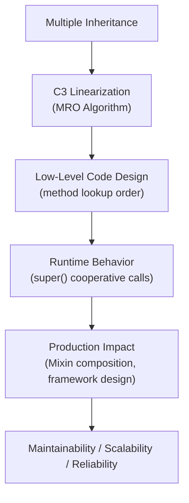
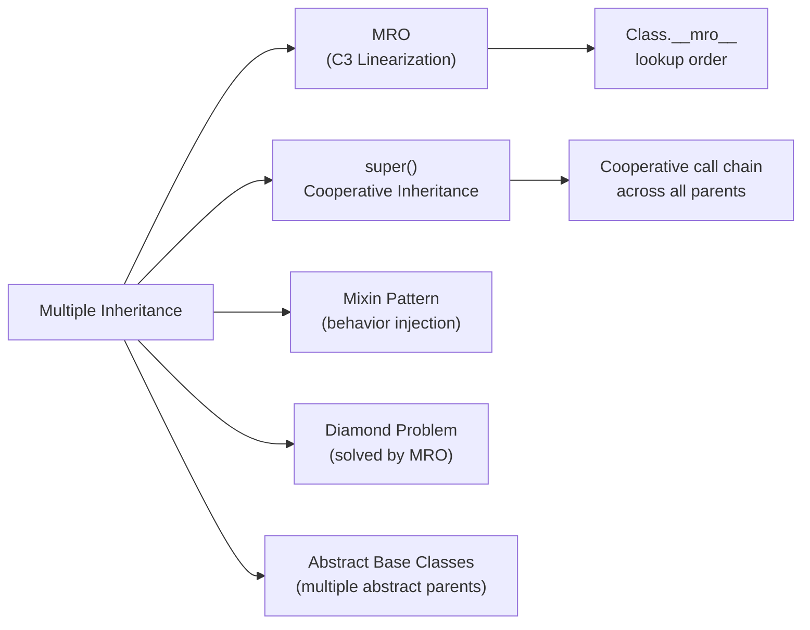

# Multiple Inheritance in Python

## Overview

**Multiple Inheritance** allows a Python class to inherit from more than one parent class simultaneously, combining their attributes and methods. Python resolves method lookup order using the **C3 Linearization algorithm** (also called the **Method Resolution Order — MRO**), which guarantees a consistent, predictable lookup sequence even in complex diamond inheritance hierarchies.

> **Core idea:** A class can inherit behavior from multiple sources. Python's MRO ensures there is always one unambiguous method resolution path.

Multiple inheritance is powerful but requires careful design. It is the foundation of Python's **Mixin pattern**, Django's class-based views, and many framework architectures.

---

## Why It Matters

| Single Inheritance | Multiple Inheritance |
|---|---|
| Simple, linear hierarchy | Combines multiple behaviors |
| Limited code reuse | Maximum code reuse via mixins |
| Easy to reason about | Requires understanding MRO |
| No diamond problem | Diamond problem solved by C3 MRO |

Multiple inheritance is used in:
- **Django** — `View`, `TemplateResponseMixin`, `ContextMixin` compose class-based views
- **Python's `io` module** — `BufferedRWPair` inherits from `BufferedReader` and `BufferedWriter`
- **Mixin patterns** — `LoggingMixin`, `SerializableMixin`, `CacheMixin`
- **AI agent frameworks** — composing agent capabilities (memory, tools, logging)
- **Abstract Base Classes** — `collections.abc` uses multiple inheritance extensively

---

## Concept Map





---

## Simple Example

```python
class Animal:
    def breathe(self):
        return "Breathing air"

class Swimmer:
    def swim(self):
        return "Swimming"

class Flyer:
    def fly(self):
        return "Flying"

class Duck(Animal, Swimmer, Flyer):
    def quack(self):
        return "Quack!"

donald = Duck()
print(donald.breathe())   # From Animal
print(donald.swim())      # From Swimmer
print(donald.fly())       # From Flyer
print(donald.quack())     # Own method

# Inspect MRO
print(Duck.__mro__)
```

**Explanation:**
- `Duck` inherits from `Animal`, `Swimmer`, and `Flyer` simultaneously.
- All parent methods are available on `Duck` instances.
- `Duck.__mro__` shows the method resolution order.

**Expected Output:**
```
Breathing air
Swimming
Flying
Quack!
(<class '__main__.Duck'>, <class '__main__.Animal'>, <class '__main__.Swimmer'>, <class '__main__.Flyer'>, <class 'object'>)
```

---

## Intermediate Example

### The Diamond Problem and `super()`

```python
class Base:
    def greet(self):
        print("Base.greet")

class Left(Base):
    def greet(self):
        print("Left.greet")
        super().greet()

class Right(Base):
    def greet(self):
        print("Right.greet")
        super().greet()

class Child(Left, Right):
    def greet(self):
        print("Child.greet")
        super().greet()

c = Child()
c.greet()
print(Child.__mro__)
```

**Explanation:**
- `Child` inherits from both `Left` and `Right`, which both inherit from `Base` — the classic diamond.
- Without `super()`, `Base.greet` would be called twice.
- With `super()` and C3 MRO, each class in the chain calls the next in MRO order — `Base.greet` is called exactly once.
- MRO: `Child → Left → Right → Base → object`

**Expected Output:**
```
Child.greet
Left.greet
Right.greet
Base.greet
(<class '__main__.Child'>, <class '__main__.Left'>, <class '__main__.Right'>, <class '__main__.Base'>, <class 'object'>)
```

---

## Advanced / Architect-Level Example

### Problem Context

In a **GenAI agent framework**, you need to compose agent capabilities from independent, reusable mixins: logging, retry logic, rate limiting, and tool registration. Each capability is a mixin class. The final agent class combines them via multiple inheritance, and `super()` ensures all mixins participate in the initialization chain cooperatively.

```python
from __future__ import annotations
import time
import logging
from typing import Any, Dict, List, Optional, Callable

logging.basicConfig(level=logging.INFO, format="%(levelname)s | %(name)s | %(message)s")


class LoggingMixin:
    """Adds structured logging to any agent."""
    def __init__(self, *args, **kwargs):
        super().__init__(*args, **kwargs)
        self._logger = logging.getLogger(self.__class__.__name__)

    def log(self, message: str, level: str = "info") -> None:
        getattr(self._logger, level)(message)


class RetryMixin:
    """Adds retry logic with exponential backoff."""
    def __init__(self, *args, max_retries: int = 3, **kwargs):
        super().__init__(*args, **kwargs)
        self._max_retries = max_retries

    def with_retry(self, fn: Callable, *args, **kwargs) -> Any:
        for attempt in range(1, self._max_retries + 1):
            try:
                return fn(*args, **kwargs)
            except Exception as e:
                if attempt == self._max_retries:
                    raise
                wait = 2 ** attempt
                print(f"Retry {attempt}/{self._max_retries} after {wait}s: {e}")
                time.sleep(wait)


class ToolRegistryMixin:
    """Provides a tool registry for agent tool management."""
    def __init__(self, *args, **kwargs):
        super().__init__(*args, **kwargs)
        self._tools: Dict[str, Callable] = {}

    def register_tool(self, name: str, fn: Callable) -> None:
        self._tools[name] = fn

    def run_tool(self, name: str, **kwargs) -> Any:
        if name not in self._tools:
            raise KeyError(f"Tool '{name}' not registered")
        return self._tools[name](**kwargs)

    def list_tools(self) -> List[str]:
        return list(self._tools.keys())


class MemoryMixin:
    """Provides short-term conversation memory."""
    def __init__(self, *args, memory_limit: int = 10, **kwargs):
        super().__init__(*args, **kwargs)
        self._memory: List[Dict[str, str]] = []
        self._memory_limit = memory_limit

    def remember(self, role: str, content: str) -> None:
        self._memory.append({"role": role, "content": content})
        if len(self._memory) > self._memory_limit:
            self._memory.pop(0)

    def get_history(self) -> List[Dict[str, str]]:
        return list(self._memory)


class BaseAgent:
    """Core agent with LLM invocation."""
    def __init__(self, model: str = "gpt-4o", **kwargs):
        super().__init__(**kwargs)
        self.model = model

    def invoke(self, prompt: str) -> str:
        # Simulate LLM call
        return f"[{self.model}] Response to: {prompt[:50]}..."


# --- Composed Agent using Multiple Inheritance ---
class ProductionAgent(LoggingMixin, RetryMixin, ToolRegistryMixin, MemoryMixin, BaseAgent):
    """
    Full-featured agent composed from independent mixins.
    MRO: ProductionAgent → LoggingMixin → RetryMixin → ToolRegistryMixin → MemoryMixin → BaseAgent → object
    """
    def __init__(self, name: str, model: str = "gpt-4o", **kwargs):
        super().__init__(model=model, **kwargs)
        self.name = name

    def chat(self, user_message: str) -> str:
        self.log(f"User: {user_message}")
        self.remember("user", user_message)

        response = self.with_retry(self.invoke, user_message)

        self.remember("assistant", response)
        self.log(f"Assistant: {response}")
        return response


# --- Usage ---
agent = ProductionAgent(name="Aria", model="gpt-4o", max_retries=2, memory_limit=5)

# Register tools
agent.register_tool("search", lambda query: f"Results for '{query}'")
agent.register_tool("calc", lambda expr: str(eval(expr, {"__builtins__": {}})))

print("Tools:", agent.list_tools())
print()

response = agent.chat("What is the capital of France?")
print(f"Response: {response}")
print()

tool_result = agent.run_tool("calc", expr="42 * 7")
print(f"Calculator: {tool_result}")
print()

print("Memory:", agent.get_history())
print("MRO:", [c.__name__ for c in ProductionAgent.__mro__])
```

**Explanation:**
- Each mixin is independent and focused on a single concern (SRP).
- `super().__init__(*args, **kwargs)` in every mixin ensures the full cooperative initialization chain runs.
- `**kwargs` passes unknown arguments up the chain — critical for cooperative multiple inheritance.
- `ProductionAgent` gains all capabilities without any mixin knowing about the others.
- Adding a new capability (e.g., `RateLimitMixin`) requires only adding it to the inheritance list.

**Design Trade-offs:**

| Approach | Pros | Cons |
|---|---|---|
| Multiple inheritance + mixins | Maximum reuse, composable | Complex MRO, `super()` discipline required |
| Composition (has-a) | Explicit, no MRO complexity | More boilerplate, delegation code |
| Single inheritance + interfaces | Simple hierarchy | Limited reuse |
| Dependency injection | Testable, explicit | More setup code |

> **Architect's rule:** Use multiple inheritance for **behavior mixins** (logging, caching, retry). Use composition for **structural dependencies** (database, HTTP client). Never mix the two patterns in the same class.

---

## Common Mistakes

### 1. Not Using `super()` in All Classes
```python
# ❌ Breaks cooperative inheritance — Base.__init__ may never be called
class LoggingMixin:
    def __init__(self):
        self._logger = logging.getLogger(self.__class__.__name__)
        # Missing super().__init__() — breaks the chain!

# ✅ Always call super().__init__()
class LoggingMixin:
    def __init__(self, *args, **kwargs):
        super().__init__(*args, **kwargs)
        self._logger = logging.getLogger(self.__class__.__name__)
```

---

### 2. Not Passing `**kwargs` Up the Chain
```python
# ❌ Swallows unknown kwargs — breaks other mixins
class RetryMixin:
    def __init__(self, max_retries=3):
        super().__init__()  # Drops all other kwargs!

# ✅ Pass **kwargs through
class RetryMixin:
    def __init__(self, *args, max_retries=3, **kwargs):
        super().__init__(*args, **kwargs)
        self._max_retries = max_retries
```

---

### 3. Creating Inconsistent MRO (TypeError)
```python
# ❌ Inconsistent MRO — Python raises TypeError
class A: pass
class B(A): pass
class C(A, B): pass  # TypeError: Cannot create a consistent MRO

# ✅ Correct ordering — more specific classes first
class C(B, A): pass
```

---

### 4. Overriding Methods Without `super()`
```python
# ❌ Breaks the cooperative chain
class AuditMixin:
    def save(self):
        print("Auditing...")
        # Missing super().save() — downstream save() never called!

# ✅ Always call super() in overridden methods
class AuditMixin:
    def save(self):
        print("Auditing...")
        super().save()
```

---

### 5. Deep Diamond Hierarchies
```python
# ❌ Hard to reason about, fragile
class A(B, C, D, E, F): pass  # 6-level diamond

# ✅ Flatten with composition or limit mixin depth to 2-3 levels
```

---

## Best Practices

1. **Always use `super().__init__(*args, **kwargs)`** in every class in the hierarchy — cooperative inheritance requires it.
2. **Always pass `**kwargs` through** — unknown keyword arguments must flow up the chain.
3. **Keep mixins focused** — each mixin should add exactly one capability (SRP).
4. **Name mixins with `Mixin` suffix** — `LoggingMixin`, `CacheMixin` — makes intent clear.
5. **Mixins should not call `__init__` of specific parents** — use `super()` only.
6. **Inspect `__mro__` during development** — `print(MyClass.__mro__)` to verify resolution order.
7. **Use `super()` without arguments** (Python 3) — never use `super(ClassName, self)` unless targeting Python 2.
8. **Prefer composition over deep inheritance** — more than 3-4 levels of inheritance is a design smell.
9. **Document the expected MRO** in class docstrings for complex hierarchies.
10. **Test each mixin independently** before composing — isolate behavior in unit tests.

---

## Performance Considerations

- **MRO computation** happens once at class creation time (not per method call) — negligible overhead.
- **`super()` method calls** add a small overhead compared to direct calls, but this is negligible in practice.
- **Deep MRO chains** (10+ classes) can slow attribute lookup slightly — Python traverses the MRO linearly.
- **`__slots__` and multiple inheritance** are incompatible unless all classes in the hierarchy define `__slots__` — mixing `__slots__` and `__dict__` classes causes `__slots__` to be ignored.
- **Memory**: Each mixin adds its methods to the class's method resolution chain but does not duplicate data — memory overhead is minimal.

Overall, multiple inheritance has no significant performance impact in production Python systems when used correctly.

---

## Testing Strategy

```python
# test_multiple_inheritance.py
import pytest
from your_module import (
    LoggingMixin, RetryMixin, ToolRegistryMixin,
    MemoryMixin, BaseAgent, ProductionAgent
)


# --- Test each mixin independently ---
class MinimalBase:
    def __init__(self, **kwargs):
        super().__init__(**kwargs)

class TestLoggingAgent(LoggingMixin, MinimalBase):
    pass

def test_logging_mixin_initializes():
    agent = TestLoggingAgent()
    assert hasattr(agent, "_logger")


class TestRetryAgent(RetryMixin, MinimalBase):
    pass

def test_retry_mixin_retries_on_failure():
    agent = TestRetryAgent(max_retries=2)
    call_count = 0

    def flaky():
        nonlocal call_count
        call_count += 1
        if call_count < 2:
            raise ValueError("Temporary failure")
        return "success"

    result = agent.with_retry(flaky)
    assert result == "success"
    assert call_count == 2


def test_retry_mixin_raises_after_max_retries():
    agent = TestRetryAgent(max_retries=2)
    with pytest.raises(ValueError):
        agent.with_retry(lambda: (_ for _ in ()).throw(ValueError("always fails")))


# --- Test tool registry ---
class TestToolAgent(ToolRegistryMixin, MinimalBase):
    pass

def test_tool_registry():
    agent = TestToolAgent()
    agent.register_tool("add", lambda a, b: a + b)
    assert agent.run_tool("add", a=2, b=3) == 5
    assert "add" in agent.list_tools()


# --- Test memory mixin ---
class TestMemoryAgent(MemoryMixin, MinimalBase):
    pass

def test_memory_limit():
    agent = TestMemoryAgent(memory_limit=2)
    agent.remember("user", "msg1")
    agent.remember("user", "msg2")
    agent.remember("user", "msg3")
    assert len(agent.get_history()) == 2
    assert agent.get_history()[0]["content"] == "msg2"


# --- Test composed agent MRO ---
def test_production_agent_mro():
    mro_names = [c.__name__ for c in ProductionAgent.__mro__]
    assert mro_names.index("LoggingMixin") < mro_names.index("BaseAgent")
    assert mro_names.index("MemoryMixin") < mro_names.index("BaseAgent")


# --- Test full composition ---
def test_production_agent_chat():
    agent = ProductionAgent(name="Test", model="gpt-4o")
    response = agent.chat("Hello")
    assert "gpt-4o" in response
    assert len(agent.get_history()) == 2  # user + assistant
```

---

## Debugging Tips

1. **Always inspect `__mro__`** when behavior is unexpected:
   ```python
   print([c.__name__ for c in MyClass.__mro__])
   ```

2. **Use `super().__init__` tracing** — add `print(f"{self.__class__.__name__}.__init__ via {type(self).__name__}")` temporarily to trace the init chain.

3. **`TypeError: Cannot create a consistent MRO`** — Python detected an inconsistent linearization. Reorder parent classes so more specific classes come first.

4. **Method not found / wrong method called** — use `MyClass.__mro__` to trace which class's method would be called. The first class in MRO that defines the method wins.

5. **`super()` calling wrong class** — remember `super()` in Python 3 is `super(__class__, self)` — it always refers to the class where the method is defined, not the class of `self`.

6. **`AttributeError` in mixin** — a mixin's `__init__` may not have run if a class in the chain forgot to call `super().__init__()`. Trace the init chain.

7. **Use `inspect.getmro(cls)`** programmatically:
   ```python
   import inspect
   print(inspect.getmro(ProductionAgent))
   ```

---

## Interview Questions

### Beginner

**Q1: What is multiple inheritance in Python?**  
A: A class can inherit from more than one parent class, gaining all their attributes and methods. Python uses C3 linearization to determine method resolution order.

**Q2: What is MRO?**  
A: Method Resolution Order — the order in which Python searches classes for a method or attribute. Computed by the C3 linearization algorithm. Accessible via `ClassName.__mro__`.

**Q3: What is the diamond problem?**  
A: When two parent classes share a common ancestor, creating a diamond shape in the inheritance graph. Python's MRO ensures the common ancestor's method is called exactly once.

**Q4: Why must you use `super()` in multiple inheritance?**  
A: `super()` follows the MRO to call the next class in the chain, enabling cooperative inheritance where all classes in the hierarchy participate in method calls.

**Q5: How do you inspect the MRO of a class?**  
A: `MyClass.__mro__` or `MyClass.mro()` returns the ordered tuple/list of classes in resolution order.

---

### Intermediate

**Q6: What is cooperative multiple inheritance?**  
A: A pattern where every class in the hierarchy calls `super()` in its methods, ensuring all classes participate in the call chain. Requires `*args, **kwargs` to pass unknown arguments up.

**Q7: What happens if you don't pass `**kwargs` in a mixin's `__init__`?**  
A: Unknown keyword arguments are silently dropped, breaking initialization of other classes in the MRO chain — leading to `AttributeError` or missing initialization.

**Q8: What is the difference between a mixin and a regular base class?**  
A: A mixin provides a specific, reusable behavior (logging, caching) without being a standalone class. It's designed to be combined with other classes via multiple inheritance, not instantiated directly.

**Q9: Can you use `__slots__` with multiple inheritance?**  
A: Yes, but all classes in the hierarchy must define `__slots__`. If any class uses `__dict__` (no `__slots__`), the slot optimization is lost for that branch.

**Q10: How does Python's `super()` differ from calling the parent class directly?**  
A: `super()` follows the MRO and calls the next class in the chain — not necessarily the direct parent. Direct parent calls (e.g., `Base.__init__(self)`) bypass MRO and can cause methods to be called multiple times in diamond hierarchies.

---

### Advanced / Architect-Level

**Q11: Explain C3 linearization with an example.**  
A: C3 linearization computes MRO as: `L[C] = C + merge(L[B1], L[B2], ..., [B1, B2, ...])` where merge takes the first element of each list that doesn't appear in the tail of any other list. For `class D(B, C)` where `B(A)` and `C(A)`: `L[D] = D, B, C, A, object`.

**Q12: How would you design a mixin-based permission system for a REST API?**  
A: Define `ReadPermissionMixin`, `WritePermissionMixin`, `AdminPermissionMixin` each with a `check_permission(user, action)` method calling `super().check_permission()`. Compose them: `class AdminView(AdminPermissionMixin, WritePermissionMixin, ReadPermissionMixin, BaseView)`. Each mixin checks its permission and delegates to the next.

**Q13: What are the risks of multiple inheritance in large codebases?**  
A: Fragile base class problem (changes to a base class break subclasses), complex MRO that's hard to reason about, accidental method shadowing, and difficulty in understanding which class provides a given method. Mitigate with focused mixins, `__mro__` documentation, and composition where appropriate.

**Q14: How does Django use multiple inheritance in its class-based views?**  
A: Django's CBVs compose `View` with mixins like `TemplateResponseMixin`, `ContextMixin`, `LoginRequiredMixin`. Each mixin adds one behavior. `super()` chains ensure all mixins participate. This allows `class MyView(LoginRequiredMixin, TemplateView)` to get authentication + template rendering without code duplication.

**Q15: When would you choose composition over multiple inheritance?**  
A: Choose composition when: the relationship is "has-a" not "is-a"; the component has its own lifecycle; you need to swap implementations at runtime; the component is a heavy dependency (database, HTTP client). Use multiple inheritance for lightweight, stateless behavior mixins (logging, serialization, validation).

---

## Key Takeaways

- Multiple inheritance allows a class to combine behaviors from multiple parents — Python's MRO ensures consistent resolution.
- C3 linearization guarantees a single, predictable method resolution order — inspect it with `__mro__`.
- `super()` enables cooperative inheritance — every class in the chain participates in method calls.
- Always use `super().__init__(*args, **kwargs)` in every class — never break the cooperative chain.
- Mixins are the primary use case for multiple inheritance — focused, reusable, single-responsibility behavior units.
- The diamond problem is solved by MRO — `Base.__init__` is called exactly once.
- `**kwargs` must flow through the entire chain — unknown arguments must not be swallowed.
- Prefer composition for structural dependencies; use multiple inheritance for behavioral mixins.
- Deep inheritance hierarchies (5+ levels) are a design smell — flatten with composition.
- Mastering multiple inheritance and MRO is essential for understanding Django, Python's `io` module, and building composable frameworks.

---

## Mini Project Idea

### Goal
Build a **Composable HTTP Client Framework** using multiple inheritance and mixins.

### Features
- `BaseHTTPClient` — core `get()`, `post()`, `put()`, `delete()` methods.
- `RetryMixin` — automatic retry with exponential backoff.
- `LoggingMixin` — logs all requests and responses.
- `CacheMixin` — caches GET responses with TTL.
- `AuthMixin` — injects Authorization headers.
- `RateLimitMixin` — enforces requests-per-second limits.
- Compose: `class ProductionClient(AuthMixin, RetryMixin, LoggingMixin, CacheMixin, RateLimitMixin, BaseHTTPClient)`.

### Suggested Folder Structure
```
http_client/
├── mixins/
│   ├── __init__.py
│   ├── retry.py
│   ├── logging.py
│   ├── cache.py
│   ├── auth.py
│   └── rate_limit.py
├── client/
│   ├── __init__.py
│   ├── base.py
│   └── production.py
├── tests/
│   ├── test_mixins.py
│   └── test_client.py
└── README.md
```

### Extension Ideas
- Add `CircuitBreakerMixin` for fault tolerance.
- Add `MetricsMixin` for Prometheus metrics.
- Support async with `AsyncBaseHTTPClient` and async mixins.
- Add MRO visualization tool using `graphviz`.

---

## Final Summary

Mastering multiple inheritance and Python's MRO is a hallmark of Python architectural expertise. It unlocks the **mixin pattern** — the most powerful code reuse mechanism in Python — enabling you to compose complex, production-grade classes from focused, independently testable building blocks. Understanding C3 linearization, cooperative `super()` calls, and the `**kwargs` forwarding contract separates developers who use multiple inheritance from architects who design with it. Frameworks like Django, Python's standard library, and modern AI agent systems all rely on these patterns. A Python architect who deeply understands multiple inheritance can build systems that are simultaneously flexible, extensible, and maintainable.
