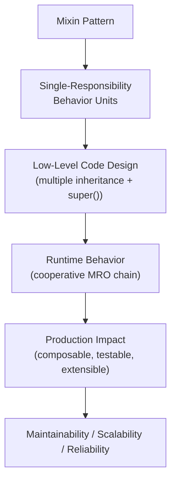
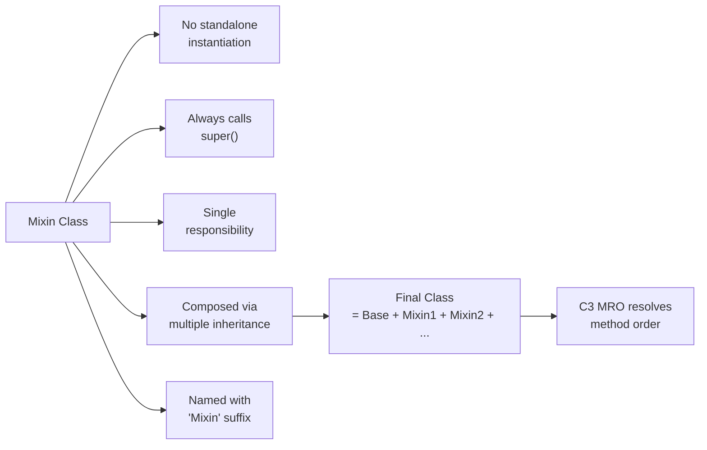

# Mixins in Python

## Overview

**Mixins** are a design pattern in Python that uses multiple inheritance to inject reusable, focused behaviors into classes without creating deep inheritance hierarchies. A mixin is a class that provides a specific capability — logging, serialization, caching, validation — and is designed to be combined with other classes, not instantiated on its own.

> **Core idea:** Compose complex classes from small, single-responsibility behavior units. Each mixin does one thing well.

Mixins are the primary practical application of Python's multiple inheritance. They are used extensively in Django, Flask, Python's standard library, and modern AI/ML frameworks.

---

## Why It Matters

| Deep Inheritance | Mixin Composition |
|---|---|
| Monolithic base classes | Focused, single-responsibility units |
| Hard to reuse across hierarchies | Freely composable across any class |
| Changes ripple through hierarchy | Isolated, independent behavior |
| Difficult to test in isolation | Each mixin testable independently |
| Fragile base class problem | Loose coupling between behaviors |

Mixins are used in:
- **Django** — `LoginRequiredMixin`, `PermissionRequiredMixin`, `TemplateResponseMixin`
- **Python `io` module** — `RawIOBase`, `BufferedIOBase` composed via mixins
- **REST frameworks** — `CreateModelMixin`, `ListModelMixin` in DRF
- **AI agent systems** — composing memory, tools, logging, retry into agents
- **Serialization** — `JSONSerializableMixin`, `YAMLSerializableMixin`

---

## Concept Map





---

## Simple Example

```python
class JSONSerializableMixin:
    """Adds JSON serialization to any class with a __dict__."""
    import json

    def to_json(self) -> str:
        import json
        return json.dumps(self.__dict__, indent=2, default=str)

    @classmethod
    def from_json(cls, json_str: str):
        import json
        data = json.loads(json_str)
        obj = cls.__new__(cls)
        obj.__dict__.update(data)
        return obj


class TimestampMixin:
    """Adds created_at and updated_at timestamps."""
    from datetime import datetime

    def __init__(self, *args, **kwargs):
        super().__init__(*args, **kwargs)
        from datetime import datetime
        self.created_at = datetime.utcnow().isoformat()
        self.updated_at = self.created_at

    def touch(self):
        from datetime import datetime
        self.updated_at = datetime.utcnow().isoformat()


class User(TimestampMixin, JSONSerializableMixin):
    def __init__(self, name: str, email: str):
        super().__init__()
        self.name = name
        self.email = email


user = User("Alice", "alice@example.com")
print(user.to_json())
user.touch()
print(f"Updated at: {user.updated_at}")
```

**Explanation:**
- `JSONSerializableMixin` adds serialization without knowing anything about `User`.
- `TimestampMixin` adds timestamp tracking without knowing about `User` or JSON.
- `User` gains both capabilities by listing them in its inheritance.
- `super().__init__()` in `TimestampMixin` ensures the cooperative chain works.

**Expected Output:**
```json
{
  "name": "Alice",
  "email": "alice@example.com",
  "created_at": "2024-01-15T10:30:00.000000",
  "updated_at": "2024-01-15T10:30:00.000000"
}
Updated at: 2024-01-15T10:30:01.123456
```

---

## Intermediate Example

```python
import logging
import functools
import time
from typing import Any, Callable

logging.basicConfig(level=logging.INFO, format="%(levelname)s | %(name)s | %(message)s")


class LoggingMixin:
    """Structured logging for any class."""
    def __init__(self, *args, **kwargs):
        super().__init__(*args, **kwargs)
        self._logger = logging.getLogger(
            f"{self.__class__.__module__}.{self.__class__.__name__}"
        )

    def log_info(self, msg: str) -> None:
        self._logger.info(msg)

    def log_error(self, msg: str) -> None:
        self._logger.error(msg)

    def log_debug(self, msg: str) -> None:
        self._logger.debug(msg)


class ValidationMixin:
    """Field validation for data classes."""
    _validators: dict = {}

    def validate(self) -> list[str]:
        errors = []
        for field, validator in self.__class__._validators.items():
            value = getattr(self, field, None)
            if not validator(value):
                errors.append(f"Validation failed for field '{field}': got {value!r}")
        return errors

    def is_valid(self) -> bool:
        return len(self.validate()) == 0


class CacheMixin:
    """Simple in-memory result caching."""
    def __init__(self, *args, **kwargs):
        super().__init__(*args, **kwargs)
        self._cache: dict = {}

    def cache_get(self, key: str) -> Any:
        return self._cache.get(key)

    def cache_set(self, key: str, value: Any, ttl: int = 300) -> None:
        self._cache[key] = {"value": value, "expires": time.time() + ttl}

    def cache_fetch(self, key: str, fn: Callable, **kwargs) -> Any:
        entry = self._cache.get(key)
        if entry and time.time() < entry["expires"]:
            return entry["value"]
        result = fn(**kwargs)
        self.cache_set(key, result)
        return result


class ProductRepository(LoggingMixin, CacheMixin):
    """Repository with logging and caching."""
    def __init__(self, db_url: str):
        super().__init__()
        self._db_url = db_url

    def get_product(self, product_id: str) -> dict:
        cache_key = f"product:{product_id}"
        return self.cache_fetch(
            cache_key,
            self._fetch_from_db,
            product_id=product_id
        )

    def _fetch_from_db(self, product_id: str) -> dict:
        self.log_info(f"DB query for product {product_id}")
        # Simulate DB call
        return {"id": product_id, "name": f"Product {product_id}", "price": 29.99}


repo = ProductRepository("postgresql://localhost/products")
p1 = repo.get_product("SKU-001")
p2 = repo.get_product("SKU-001")  # From cache
print(p1)
print(f"Cache hit: {p1 == p2}")
```

**Explanation:**
- `ProductRepository` gains logging and caching by listing the mixins.
- The DB is only queried once — the second call hits the cache.
- Each mixin is independently testable and reusable across any repository class.

**Expected Output:**
```
INFO | __main__.ProductRepository | DB query for product SKU-001
{'id': 'SKU-001', 'name': 'Product SKU-001', 'price': 29.99}
Cache hit: True
```

---

## Advanced / Architect-Level Example

### Problem Context

In an **enterprise ERP system**, you need to compose domain entities (Order, Invoice, Product) with cross-cutting concerns: audit logging, soft deletion, optimistic locking, and event publishing. Each concern is a mixin. The final entity classes are clean, focused, and production-ready.

```python
from __future__ import annotations
import uuid
import time
from typing import Any, Dict, List, Optional, Callable
from dataclasses import dataclass, field
from datetime import datetime


# --- Event Bus (simplified) ---
_event_handlers: Dict[str, List[Callable]] = {}

def subscribe(event_type: str, handler: Callable) -> None:
    _event_handlers.setdefault(event_type, []).append(handler)

def publish(event_type: str, payload: dict) -> None:
    for handler in _event_handlers.get(event_type, []):
        handler(payload)


# --- Mixins ---

class AuditMixin:
    """Tracks creation and modification metadata."""
    def __init__(self, *args, created_by: str = "system", **kwargs):
        super().__init__(*args, **kwargs)
        self.created_by: str = created_by
        self.created_at: str = datetime.utcnow().isoformat()
        self.updated_by: Optional[str] = None
        self.updated_at: Optional[str] = None

    def mark_updated(self, by: str = "system") -> None:
        self.updated_by = by
        self.updated_at = datetime.utcnow().isoformat()


class SoftDeleteMixin:
    """Adds soft deletion — records are never physically deleted."""
    def __init__(self, *args, **kwargs):
        super().__init__(*args, **kwargs)
        self.is_deleted: bool = False
        self.deleted_at: Optional[str] = None
        self.deleted_by: Optional[str] = None

    def soft_delete(self, by: str = "system") -> None:
        self.is_deleted = True
        self.deleted_at = datetime.utcnow().isoformat()
        self.deleted_by = by

    def restore(self) -> None:
        self.is_deleted = False
        self.deleted_at = None
        self.deleted_by = None


class OptimisticLockMixin:
    """Prevents concurrent update conflicts using version numbers."""
    def __init__(self, *args, **kwargs):
        super().__init__(*args, **kwargs)
        self._version: int = 1

    @property
    def version(self) -> int:
        return self._version

    def increment_version(self) -> None:
        self._version += 1

    def check_version(self, expected: int) -> None:
        if self._version != expected:
            raise ValueError(
                f"Optimistic lock conflict: expected version {expected}, "
                f"got {self._version}"
            )


class EventPublishingMixin:
    """Publishes domain events on state changes."""
    def __init__(self, *args, **kwargs):
        super().__init__(*args, **kwargs)
        self._pending_events: List[dict] = []

    def add_event(self, event_type: str, payload: dict) -> None:
        self._pending_events.append({
            "event_id": str(uuid.uuid4()),
            "event_type": event_type,
            "timestamp": datetime.utcnow().isoformat(),
            "payload": payload,
        })

    def publish_events(self) -> None:
        for event in self._pending_events:
            publish(event["event_type"], event)
        self._pending_events.clear()


# --- Base Entity ---
class BaseEntity:
    def __init__(self, entity_id: Optional[str] = None, **kwargs):
        super().__init__(**kwargs)
        self.id: str = entity_id or str(uuid.uuid4())

    def to_dict(self) -> dict:
        return {k: v for k, v in self.__dict__.items() if not k.startswith("_")}


# --- Composed Domain Entity ---
class Order(
    AuditMixin,
    SoftDeleteMixin,
    OptimisticLockMixin,
    EventPublishingMixin,
    BaseEntity
):
    """
    Production-grade Order entity with full cross-cutting concerns.
    MRO: Order → AuditMixin → SoftDeleteMixin → OptimisticLockMixin
         → EventPublishingMixin → BaseEntity → object
    """
    def __init__(
        self,
        customer_id: str,
        total: float,
        created_by: str = "system",
        **kwargs
    ):
        super().__init__(created_by=created_by, **kwargs)
        self.customer_id = customer_id
        self.total = total
        self.status = "pending"
        self.add_event("order.created", {"order_id": self.id, "customer": customer_id})

    def confirm(self, by: str = "system") -> None:
        self.check_version(self._version)
        self.status = "confirmed"
        self.mark_updated(by)
        self.increment_version()
        self.add_event("order.confirmed", {"order_id": self.id})

    def cancel(self, by: str = "system") -> None:
        self.soft_delete(by)
        self.add_event("order.cancelled", {"order_id": self.id, "by": by})


# --- Usage ---
# Subscribe to events
subscribe("order.created", lambda e: print(f"EVENT: {e['event_type']} → {e['payload']}"))
subscribe("order.confirmed", lambda e: print(f"EVENT: {e['event_type']} → {e['payload']}"))
subscribe("order.cancelled", lambda e: print(f"EVENT: {e['event_type']} → {e['payload']}"))

order = Order(customer_id="CUST-001", total=299.99, created_by="api-gateway")
order.publish_events()

order.confirm(by="warehouse-service")
order.publish_events()

print(f"\nOrder state: {order.to_dict()}")
print(f"Version: {order.version}")
print(f"MRO: {[c.__name__ for c in Order.__mro__]}")
```

**Explanation:**
- Each mixin handles exactly one cross-cutting concern (SRP).
- `super().__init__(*args, **kwargs)` ensures all mixins initialize cooperatively.
- `Order` is clean — it only contains business logic, not infrastructure concerns.
- Adding a new concern (e.g., `EncryptionMixin`) requires only adding it to the inheritance list.
- Domain events are published after state changes, enabling event-driven architecture.

**Design Trade-offs:**

| Approach | Pros | Cons |
|---|---|---|
| Mixin composition | Reusable, testable, composable | MRO complexity, `super()` discipline |
| Decorator pattern | No inheritance needed | Harder to access `self` state |
| Aspect-oriented (e.g., wrapt) | Non-invasive | External dependency, complex |
| Composition (has-a) | Explicit, no MRO | More delegation boilerplate |

---

## Common Mistakes

### 1. Instantiating Mixins Directly
```python
# ❌ Mixins are not standalone classes
mixin = LoggingMixin()  # May work but is semantically wrong

# ✅ Mixins are only used via composition
class MyService(LoggingMixin, BaseService): ...
```

---

### 2. Forgetting `super().__init__()` in Mixins
```python
# ❌ Breaks the cooperative chain
class CacheMixin:
    def __init__(self):
        self._cache = {}
        # Missing super().__init__() — other mixins won't initialize!

# ✅ Always call super().__init__(*args, **kwargs)
class CacheMixin:
    def __init__(self, *args, **kwargs):
        super().__init__(*args, **kwargs)
        self._cache = {}
```

---

### 3. Mixins with State That Conflicts
```python
# ❌ Both mixins define self._logger — one overwrites the other
class LoggingMixin:
    def __init__(self, *args, **kwargs):
        super().__init__(*args, **kwargs)
        self._logger = logging.getLogger("logging")

class AuditMixin:
    def __init__(self, *args, **kwargs):
        super().__init__(*args, **kwargs)
        self._logger = logging.getLogger("audit")  # Overwrites!

# ✅ Use unique attribute names or check before setting
class AuditMixin:
    def __init__(self, *args, **kwargs):
        super().__init__(*args, **kwargs)
        self._audit_logger = logging.getLogger("audit")
```

---

### 4. Mixin Depending on Specific Base Class
```python
# ❌ Mixin assumes it's mixed with UserBase — breaks reusability
class AdminMixin:
    def promote(self):
        self.role = "admin"  # Assumes self.role exists in UserBase

# ✅ Document the interface requirement or use hasattr
class AdminMixin:
    def promote(self):
        if not hasattr(self, "role"):
            raise AttributeError("AdminMixin requires a 'role' attribute")
        self.role = "admin"
```

---

### 5. Not Naming Mixins with `Mixin` Suffix
```python
# ❌ Unclear intent
class Loggable: ...
class Cacheable: ...

# ✅ Clear naming convention
class LoggingMixin: ...
class CacheMixin: ...
```

---

## Best Practices

1. **Name mixins with `Mixin` suffix** — `LoggingMixin`, `SerializableMixin` — signals intent clearly.
2. **Always call `super().__init__(*args, **kwargs)`** — never break the cooperative chain.
3. **Keep mixins stateless or use unique attribute names** — avoid attribute name collisions.
4. **One mixin, one responsibility** — if a mixin does two things, split it.
5. **Document required interface** — if a mixin assumes `self.id` exists, document it in the docstring.
6. **Test each mixin independently** — compose with a minimal `BaseClass` in tests.
7. **List mixins before the base class** in inheritance: `class MyClass(MixinA, MixinB, Base)`.
8. **Avoid deep mixin chains** — more than 4-5 mixins in one class is a design smell.
9. **Use `typing.Protocol` to define the interface a mixin expects** from the host class.
10. **Prefer mixins over monkey patching** — mixins are explicit, traceable, and testable.

---

## Performance Considerations

- **MRO computation** is done once at class creation — no runtime overhead per method call.
- **`super()` calls** add a tiny overhead (MRO traversal) but are negligible in practice.
- **Attribute name collisions** between mixins can cause subtle bugs — not a performance issue but a correctness one.
- **Many mixins** (10+) can slow attribute lookup slightly due to longer MRO chains — keep mixin count reasonable.
- **`__slots__` with mixins** requires all classes in the hierarchy to define `__slots__` — otherwise the optimization is lost.
- **Memory**: Each mixin adds methods to the class namespace but no per-instance data unless `__init__` sets attributes.

Overall, mixins have negligible performance impact. The design benefits far outweigh any micro-overhead.

---

## Testing Strategy

```python
# test_mixins.py
import pytest
import json
from datetime import datetime
from your_module import (
    LoggingMixin, CacheMixin, AuditMixin,
    SoftDeleteMixin, OptimisticLockMixin, Order
)


# --- Minimal base for isolated mixin testing ---
class MinimalBase:
    def __init__(self, **kwargs):
        super().__init__(**kwargs)


# --- Test LoggingMixin ---
class LoggableService(LoggingMixin, MinimalBase):
    pass

def test_logging_mixin_creates_logger():
    svc = LoggableService()
    assert hasattr(svc, "_logger")
    assert svc._logger.name == "test_mixins.LoggableService"


# --- Test CacheMixin ---
class CachedService(CacheMixin, MinimalBase):
    pass

def test_cache_mixin_stores_and_retrieves():
    svc = CachedService()
    svc.cache_set("key1", "value1", ttl=60)
    assert svc.cache_get("key1")["value"] == "value1"

def test_cache_mixin_fetch_calls_fn_once():
    svc = CachedService()
    call_count = 0

    def expensive():
        nonlocal call_count
        call_count += 1
        return "result"

    r1 = svc.cache_fetch("k", expensive)
    r2 = svc.cache_fetch("k", expensive)
    assert r1 == r2 == "result"
    assert call_count == 1


# --- Test AuditMixin ---
class AuditedEntity(AuditMixin, MinimalBase):
    pass

def test_audit_mixin_sets_created_at():
    entity = AuditedEntity(created_by="test-user")
    assert entity.created_by == "test-user"
    assert entity.created_at is not None
    assert entity.updated_at is None

def test_audit_mixin_mark_updated():
    entity = AuditedEntity()
    entity.mark_updated(by="admin")
    assert entity.updated_by == "admin"
    assert entity.updated_at is not None


# --- Test SoftDeleteMixin ---
class SoftDeletableEntity(SoftDeleteMixin, MinimalBase):
    pass

def test_soft_delete():
    entity = SoftDeletableEntity()
    assert not entity.is_deleted
    entity.soft_delete(by="admin")
    assert entity.is_deleted
    assert entity.deleted_by == "admin"

def test_soft_delete_restore():
    entity = SoftDeletableEntity()
    entity.soft_delete()
    entity.restore()
    assert not entity.is_deleted
    assert entity.deleted_at is None


# --- Test OptimisticLockMixin ---
class VersionedEntity(OptimisticLockMixin, MinimalBase):
    pass

def test_optimistic_lock_version_check():
    entity = VersionedEntity()
    entity.check_version(1)  # OK
    entity.increment_version()
    with pytest.raises(ValueError, match="Optimistic lock conflict"):
        entity.check_version(1)  # Stale version


# --- Test composed Order ---
def test_order_composition():
    order = Order(customer_id="C-001", total=100.0)
    assert order.status == "pending"
    assert not order.is_deleted
    assert order.version == 1
    assert len(order._pending_events) == 1

def test_order_confirm_increments_version():
    order = Order(customer_id="C-001", total=100.0)
    order.confirm()
    assert order.version == 2
    assert order.status == "confirmed"
```

---

## Debugging Tips

1. **Inspect MRO** to understand method resolution:
   ```python
   print([c.__name__ for c in MyClass.__mro__])
   ```

2. **Trace `__init__` chain** by temporarily adding prints:
   ```python
   class DebugMixin:
       def __init__(self, *args, **kwargs):
           print(f"DebugMixin.__init__ called on {type(self).__name__}")
           super().__init__(*args, **kwargs)
   ```

3. **`AttributeError` in mixin** — a mixin's `__init__` didn't run. Check that every class in the chain calls `super().__init__()`.

4. **Attribute collision** — if a mixin's attribute is being overwritten, add `print(self.__dict__)` after each `__init__` to trace which mixin sets what.

5. **`TypeError: __init__() got unexpected keyword argument`** — a class in the chain is not passing `**kwargs` to `super().__init__()`. Find the class that swallows kwargs.

6. **Use `vars(obj)`** to inspect all instance attributes and identify which mixin set them.

7. **`inspect.getmro(cls)`** programmatically returns the MRO for logging or assertions.

---

## Interview Questions

### Beginner

**Q1: What is a mixin in Python?**  
A: A mixin is a class that provides a specific, reusable behavior (logging, caching, serialization) designed to be combined with other classes via multiple inheritance. It is not meant to be instantiated directly.

**Q2: Why do mixins need to call `super().__init__()`?**  
A: To participate in Python's cooperative multiple inheritance chain. Without it, other mixins and the base class may not be initialized.

**Q3: What naming convention is used for mixins?**  
A: The `Mixin` suffix — e.g., `LoggingMixin`, `SerializableMixin` — to clearly signal that the class is a mixin, not a standalone class.

**Q4: What is the difference between a mixin and a regular base class?**  
A: A mixin provides a single, focused behavior and is not meant to be instantiated alone. A base class defines the core identity and structure of a class hierarchy.

**Q5: Can a mixin have its own `__init__`?**  
A: Yes, but it must call `super().__init__(*args, **kwargs)` to maintain the cooperative initialization chain.

---

### Intermediate

**Q6: How do you avoid attribute name collisions between mixins?**  
A: Use unique, descriptive attribute names (e.g., `_audit_logger` instead of `_logger`). Document required attributes in the mixin's docstring. Use `hasattr` checks before setting.

**Q7: How does the order of mixins in the class definition affect behavior?**  
A: The order determines the MRO. Mixins listed first have higher priority in method resolution. `class A(Mixin1, Mixin2, Base)` means `Mixin1` methods are checked before `Mixin2`.

**Q8: How would you test a mixin in isolation?**  
A: Create a minimal base class (`class MinimalBase: def __init__(self, **kwargs): super().__init__(**kwargs)`) and compose it with the mixin: `class TestClass(MyMixin, MinimalBase): pass`. Test `TestClass` instances.

**Q9: What is the difference between a mixin and a decorator?**  
A: A mixin adds behavior via inheritance (class-level, affects all instances). A decorator wraps a function or class (instance-level or class-level). Mixins have access to `self` and can add state; decorators are more suitable for wrapping behavior without modifying the class structure.

**Q10: How do Django's class-based views use mixins?**  
A: Django CBVs compose `View` with mixins like `LoginRequiredMixin`, `PermissionRequiredMixin`, `TemplateResponseMixin`. Each mixin adds one behavior. `super()` chains ensure all mixins participate in request handling.

---

### Advanced / Architect-Level

**Q11: How would you design a mixin that requires the host class to implement a specific interface?**  
A: Use `typing.Protocol` to define the required interface. In the mixin's methods, access the required attributes/methods. Document the requirement in the docstring. Optionally, add a `__init_subclass__` check to validate the interface at class creation time.

**Q12: How do mixins interact with `__slots__`?**  
A: For `__slots__` to work correctly with mixins, every class in the MRO must define `__slots__`. If any class uses `__dict__` (no `__slots__`), the slot optimization is lost. This makes `__slots__` + mixins complex — prefer `@dataclass(slots=True)` for slot-based data classes.

**Q13: What is the "fragile base class" problem and how do mixins mitigate it?**  
A: The fragile base class problem occurs when changes to a base class break subclasses. Mixins mitigate it by keeping behaviors isolated — a change to `LoggingMixin` only affects classes that use it, not the entire hierarchy.

**Q14: How would you implement a plugin system where plugins are mixins?**  
A: Define a `PluginMixin` base with a `plugin_name` class attribute and `activate()` method. Each plugin subclasses `PluginMixin`. A `PluginRegistry` discovers all `PluginMixin` subclasses using `__subclasses__()`. The host class dynamically composes itself with selected plugins using `type()`.

**Q15: When would you choose composition (has-a) over mixins (is-a) for cross-cutting concerns?**  
A: Choose composition when: the concern has its own lifecycle (database connection, HTTP client); you need to swap implementations at runtime; the concern is heavyweight; you want to avoid MRO complexity. Use mixins for lightweight, stateless behaviors (logging, serialization, validation) that are always active.

---

## Key Takeaways

- Mixins inject focused, reusable behaviors into classes via multiple inheritance.
- Always call `super().__init__(*args, **kwargs)` — cooperative inheritance requires it.
- Name mixins with the `Mixin` suffix for clarity.
- Keep each mixin focused on a single responsibility.
- Test mixins independently using a minimal base class.
- Avoid attribute name collisions — use unique, descriptive names.
- List mixins before the base class in the inheritance declaration.
- Mixins are the foundation of Django's CBVs, DRF's model mixins, and many Python frameworks.
- Combine mixins with `typing.Protocol` to document required interfaces.
- Prefer mixins for lightweight behaviors; use composition for heavyweight dependencies.

---

## Mini Project Idea

### Goal
Build a **Composable Repository Framework** — a data access layer where repositories are composed from mixins for caching, logging, soft deletion, and audit trails.

### Features
- `BaseRepository` — core CRUD operations (in-memory dict for simplicity).
- `LoggingMixin` — logs all operations with timestamps.
- `CacheMixin` — caches read results with TTL.
- `SoftDeleteMixin` — marks records as deleted instead of removing them.
- `AuditMixin` — tracks created_by, updated_by, timestamps.
- `EventPublishingMixin` — publishes domain events on mutations.
- Compose: `class ProductRepository(LoggingMixin, CacheMixin, SoftDeleteMixin, AuditMixin, BaseRepository)`.

### Suggested Folder Structure
```
repository_framework/
├── mixins/
│   ├── __init__.py
│   ├── logging.py
│   ├── cache.py
│   ├── soft_delete.py
│   ├── audit.py
│   └── events.py
├── repositories/
│   ├── __init__.py
│   ├── base.py
│   ├── product.py
│   └── order.py
├── tests/
│   ├── test_mixins.py
│   └── test_repositories.py
└── README.md
```

### Extension Ideas
- Add `PaginationMixin` for paginated list queries.
- Add `SearchMixin` for full-text search.
- Support async with `AsyncBaseRepository` and async mixins.
- Add a mixin composition validator using `__init_subclass__`.

---

## Final Summary

Mastering mixins is mastering Python's most powerful code reuse pattern. Mixins enable you to build complex, production-grade classes from small, independently testable, single-responsibility units — without the fragility of deep inheritance hierarchies. For a Python architect, mixins are the tool of choice for cross-cutting concerns: logging, caching, validation, serialization, audit trails, and event publishing. Understanding how to design mixins that cooperate via `super()`, avoid attribute collisions, and document their interface requirements is what separates a Python developer from a Python architect. Every major Python framework — Django, DRF, SQLAlchemy — uses mixins extensively. Mastering them gives you the vocabulary and tools to build frameworks, not just use them.
