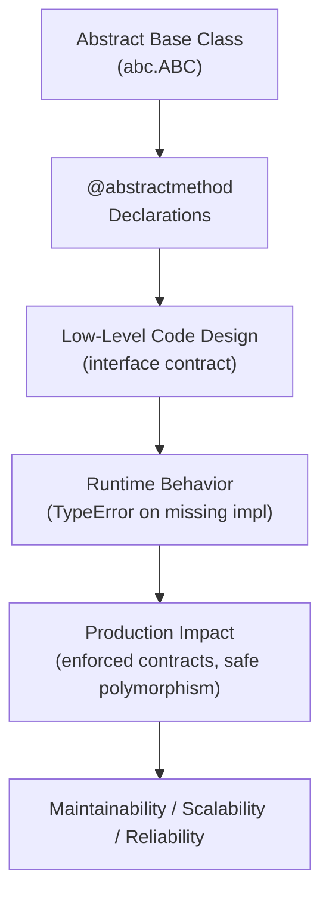
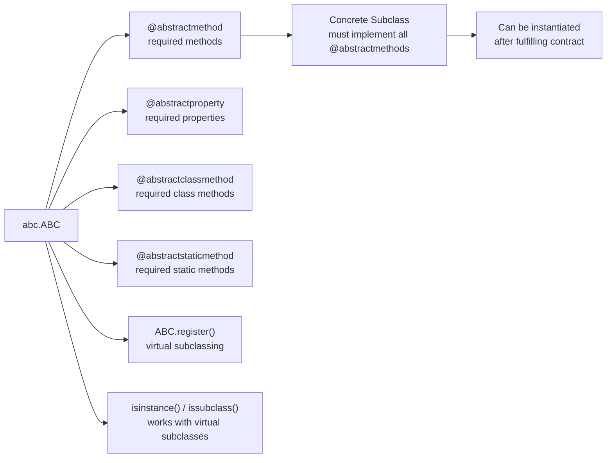

# Abstract Base Classes (ABCs) in Python

## Overview

**Abstract Base Classes (ABCs)** provide a mechanism to define formal interfaces in Python — classes that declare methods that *must* be implemented by any concrete subclass. Introduced via the `abc` module, ABCs enforce contracts at class instantiation time, raising `TypeError` if required methods are missing.

> **Core idea:** Define the *what* (interface contract) separately from the *how* (implementation). ABCs guarantee that all subclasses fulfill the contract before they can be instantiated.

ABCs bridge the gap between Python's flexible duck typing and the need for explicit, enforceable interfaces in large, production-grade systems.

---

## Why It Matters

| Duck Typing | ABCs |
|---|---|
| Interface checked at call time | Interface checked at instantiation time |
| Silent failures if method missing | `TypeError` immediately on instantiation |
| No formal contract | Explicit, documented contract |
| Flexible, no inheritance needed | Requires explicit subclassing or `register()` |
| Best for small, flexible systems | Best for large, team-based systems |

ABCs are used in:
- **Python's `collections.abc`** — `Iterable`, `Mapping`, `Sequence`, `Callable`
- **Python's `io` module** — `IOBase`, `RawIOBase`, `BufferedIOBase`
- **Django** — `BaseCommand`, `BaseBackend`
- **AI agent frameworks** — defining retriever, embedder, generator interfaces
- **Plugin systems** — enforcing plugin contracts
- **Data validation frameworks** — defining validator interfaces

---

## Concept Map





---

## Simple Example

```python
from abc import ABC, abstractmethod

class Shape(ABC):
    @abstractmethod
    def area(self) -> float:
        """Return the area of the shape."""
        ...

    @abstractmethod
    def perimeter(self) -> float:
        """Return the perimeter of the shape."""
        ...

    def describe(self) -> str:
        return f"{self.__class__.__name__}: area={self.area():.2f}, perimeter={self.perimeter():.2f}"


class Circle(Shape):
    def __init__(self, radius: float):
        self.radius = radius

    def area(self) -> float:
        import math
        return math.pi * self.radius ** 2

    def perimeter(self) -> float:
        import math
        return 2 * math.pi * self.radius


class Rectangle(Shape):
    def __init__(self, width: float, height: float):
        self.width = width
        self.height = height

    def area(self) -> float:
        return self.width * self.height

    def perimeter(self) -> float:
        return 2 * (self.width + self.height)


# Cannot instantiate abstract class
try:
    s = Shape()
except TypeError as e:
    print(f"Error: {e}")

# Concrete subclasses work fine
for shape in [Circle(5), Rectangle(4, 6)]:
    print(shape.describe())
```

**Explanation:**
- `Shape` declares `area()` and `perimeter()` as abstract — any subclass must implement them.
- Attempting to instantiate `Shape` directly raises `TypeError`.
- `Circle` and `Rectangle` implement both methods and can be instantiated.
- `describe()` is a concrete method on the ABC — shared by all subclasses.

**Expected Output:**
```
Error: Can't instantiate abstract class Shape with abstract methods area, perimeter
Circle: area=78.54, perimeter=31.42
Rectangle: area=24.00, perimeter=20.00
```

---

## Intermediate Example

```python
from abc import ABC, abstractmethod
from typing import List, Optional, Dict, Any


class DataStore(ABC):
    """Abstract interface for all data storage backends."""

    @abstractmethod
    def connect(self) -> None:
        """Establish connection to the data store."""
        ...

    @abstractmethod
    def disconnect(self) -> None:
        """Close connection to the data store."""
        ...

    @abstractmethod
    def get(self, key: str) -> Optional[Any]:
        """Retrieve a value by key."""
        ...

    @abstractmethod
    def set(self, key: str, value: Any, ttl: Optional[int] = None) -> None:
        """Store a value with optional TTL in seconds."""
        ...

    @abstractmethod
    def delete(self, key: str) -> bool:
        """Delete a key. Returns True if deleted, False if not found."""
        ...

    @abstractmethod
    def exists(self, key: str) -> bool:
        """Check if a key exists."""
        ...

    # Concrete method — shared by all implementations
    def get_or_default(self, key: str, default: Any = None) -> Any:
        return self.get(key) if self.exists(key) else default


class InMemoryStore(DataStore):
    """In-memory implementation — for testing and development."""

    def __init__(self):
        self._store: Dict[str, Any] = {}
        self._connected = False

    def connect(self) -> None:
        self._connected = True
        print("InMemoryStore: connected")

    def disconnect(self) -> None:
        self._connected = False
        print("InMemoryStore: disconnected")

    def get(self, key: str) -> Optional[Any]:
        return self._store.get(key)

    def set(self, key: str, value: Any, ttl: Optional[int] = None) -> None:
        self._store[key] = value  # TTL ignored in this simple impl

    def delete(self, key: str) -> bool:
        if key in self._store:
            del self._store[key]
            return True
        return False

    def exists(self, key: str) -> bool:
        return key in self._store


# Usage — works with any DataStore implementation
def cache_user(store: DataStore, user_id: str, user_data: dict) -> None:
    store.set(f"user:{user_id}", user_data, ttl=3600)
    print(f"Cached user {user_id}: {store.get(f'user:{user_id}')}")

store = InMemoryStore()
store.connect()
cache_user(store, "U-001", {"name": "Alice", "role": "admin"})
print(store.get_or_default("user:U-999", {"name": "Guest"}))
store.disconnect()
```

**Explanation:**
- `DataStore` defines the complete interface for any storage backend.
- `InMemoryStore` implements all abstract methods — can be instantiated.
- `cache_user` accepts any `DataStore` — Redis, DynamoDB, SQLite implementations are drop-in replacements.
- `get_or_default` is a concrete method on the ABC — shared by all implementations.

**Expected Output:**
```
InMemoryStore: connected
Cached user U-001: {'name': 'Alice', 'role': 'admin'}
{'name': 'Guest'}
InMemoryStore: disconnected
```

---

## Advanced / Architect-Level Example

### Problem Context

In a **RAG pipeline**, you need formal, enforceable interfaces for each pipeline component: document loaders, text splitters, embedding models, vector stores, and generators. Using ABCs ensures every component fulfills its contract, enables safe polymorphism, and makes the pipeline testable with mock implementations.

```python
from __future__ import annotations
from abc import ABC, abstractmethod
from typing import List, Optional, Iterator, Dict, Any
from dataclasses import dataclass, field
import time


@dataclass
class Document:
    doc_id: str
    content: str
    metadata: Dict[str, Any] = field(default_factory=dict)


@dataclass
class Chunk:
    chunk_id: str
    doc_id: str
    text: str
    embedding: Optional[List[float]] = None


@dataclass
class RetrievalResult:
    chunk: Chunk
    score: float


# --- Abstract Pipeline Components ---

class DocumentLoader(ABC):
    """Loads documents from a source."""

    @abstractmethod
    def load(self) -> Iterator[Document]:
        """Yield documents from the source."""
        ...

    @abstractmethod
    def source_name(self) -> str:
        """Return a human-readable source identifier."""
        ...


class TextSplitter(ABC):
    """Splits documents into chunks."""

    @abstractmethod
    def split(self, document: Document) -> List[Chunk]:
        """Split a document into chunks."""
        ...


class EmbeddingModel(ABC):
    """Generates vector embeddings for text."""

    @abstractmethod
    def embed(self, texts: List[str]) -> List[List[float]]:
        """Return embeddings for a list of texts."""
        ...

    @abstractmethod
    def dimensions(self) -> int:
        """Return the embedding vector dimensions."""
        ...


class VectorStore(ABC):
    """Stores and retrieves document embeddings."""

    @abstractmethod
    def upsert(self, chunks: List[Chunk]) -> None:
        """Insert or update chunks with their embeddings."""
        ...

    @abstractmethod
    def search(self, query_embedding: List[float], top_k: int = 5) -> List[RetrievalResult]:
        """Return top-k most similar chunks."""
        ...

    @abstractmethod
    def count(self) -> int:
        """Return total number of stored chunks."""
        ...


class Generator(ABC):
    """Generates answers from context and query."""

    @abstractmethod
    def generate(self, query: str, context: List[Chunk]) -> str:
        """Generate an answer given query and retrieved context."""
        ...


# --- Concrete Implementations (for testing/demo) ---

class FileDocumentLoader(DocumentLoader):
    def __init__(self, file_paths: List[str]):
        self._paths = file_paths

    def load(self) -> Iterator[Document]:
        for i, path in enumerate(self._paths):
            yield Document(doc_id=f"doc-{i}", content=f"Content of {path}", metadata={"path": path})

    def source_name(self) -> str:
        return f"FileLoader({len(self._paths)} files)"


class SentenceSplitter(TextSplitter):
    def __init__(self, max_chars: int = 200):
        self._max_chars = max_chars

    def split(self, document: Document) -> List[Chunk]:
        sentences = document.content.split(". ")
        return [
            Chunk(chunk_id=f"{document.doc_id}-{i}", doc_id=document.doc_id, text=s)
            for i, s in enumerate(sentences)
        ]


class MockEmbeddingModel(EmbeddingModel):
    """Deterministic mock for testing."""
    def embed(self, texts: List[str]) -> List[List[float]]:
        return [[float(hash(t) % 100) / 100.0] * self.dimensions() for t in texts]

    def dimensions(self) -> int:
        return 4


class InMemoryVectorStore(VectorStore):
    def __init__(self):
        self._chunks: List[Chunk] = []

    def upsert(self, chunks: List[Chunk]) -> None:
        self._chunks.extend(chunks)

    def search(self, query_embedding: List[float], top_k: int = 5) -> List[RetrievalResult]:
        # Simplified: return first top_k chunks with mock scores
        return [
            RetrievalResult(chunk=c, score=0.9 - i * 0.1)
            for i, c in enumerate(self._chunks[:top_k])
        ]

    def count(self) -> int:
        return len(self._chunks)


class MockGenerator(Generator):
    def generate(self, query: str, context: List[Chunk]) -> str:
        ctx_text = " | ".join(c.text[:50] for c in context)
        return f"[MockLLM] Answer to '{query}' based on: {ctx_text}"


# --- RAG Pipeline ---

class RAGPipeline:
    """
    Orchestrates the RAG pipeline using abstract component interfaces.
    Any concrete implementation of each ABC can be plugged in.
    """
    def __init__(
        self,
        loader: DocumentLoader,
        splitter: TextSplitter,
        embedder: EmbeddingModel,
        store: VectorStore,
        generator: Generator,
    ):
        self._loader = loader
        self._splitter = splitter
        self._embedder = embedder
        self._store = store
        self._generator = generator

    def ingest(self) -> int:
        total = 0
        for doc in self._loader.load():
            chunks = self._splitter.split(doc)
            texts = [c.text for c in chunks]
            embeddings = self._embedder.embed(texts)
            for chunk, emb in zip(chunks, embeddings):
                chunk.embedding = emb
            self._store.upsert(chunks)
            total += len(chunks)
        return total

    def query(self, question: str) -> str:
        query_emb = self._embedder.embed([question])[0]
        results = self._store.search(query_emb, top_k=3)
        context = [r.chunk for r in results]
        return self._generator.generate(question, context)


# --- Usage ---
pipeline = RAGPipeline(
    loader=FileDocumentLoader(["doc1.txt", "doc2.txt"]),
    splitter=SentenceSplitter(),
    embedder=MockEmbeddingModel(),
    store=InMemoryVectorStore(),
    generator=MockGenerator(),
)

ingested = pipeline.ingest()
print(f"Ingested {ingested} chunks into {pipeline._store.count()} stored")

answer = pipeline.query("What is RAG?")
print(f"Answer: {answer}")

# Verify ABC enforcement
try:
    class BrokenLoader(DocumentLoader):
        pass  # Missing load() and source_name()
    loader = BrokenLoader()
except TypeError as e:
    print(f"\nABC enforcement: {e}")
```

**Explanation:**
- Each pipeline stage has a formal ABC contract — `DocumentLoader`, `TextSplitter`, `EmbeddingModel`, `VectorStore`, `Generator`.
- `RAGPipeline` depends only on the ABCs — any concrete implementation is a drop-in replacement.
- Swapping `MockEmbeddingModel` for `OpenAIEmbeddingModel` requires zero changes to the pipeline.
- `BrokenLoader` demonstrates ABC enforcement — `TypeError` at instantiation, not at call time.

**Design Trade-offs:**

| Approach | Pros | Cons |
|---|---|---|
| ABCs | Enforced contracts, clear interfaces | Requires inheritance, more boilerplate |
| `typing.Protocol` | No inheritance, structural typing | No enforcement at instantiation |
| Duck typing only | Maximum flexibility | Silent failures, no documentation |
| Pydantic models | Validation + schema | Not for behavior interfaces |

> **Architect's rule:** Use ABCs for **behavioral interfaces** in plugin systems and pipelines. Use Protocols for **structural typing** in type hints. Use both together for maximum safety.

---

## Common Mistakes

### 1. Forgetting to Implement All Abstract Methods
```python
# ❌ Missing perimeter() — TypeError at instantiation
class Triangle(Shape):
    def area(self):
        return 0.5 * self.base * self.height
    # perimeter() not implemented!

t = Triangle()  # TypeError!

# ✅ Implement all abstract methods
class Triangle(Shape):
    def area(self): ...
    def perimeter(self): ...
```

---

### 2. Instantiating the ABC Directly
```python
# ❌ ABCs are not meant to be instantiated
store = DataStore()  # TypeError

# ✅ Instantiate concrete subclasses
store = InMemoryStore()
```

---

### 3. Using `@abstractmethod` Without `ABC` Base
```python
# ❌ @abstractmethod has no effect without ABC
class MyInterface:
    @abstractmethod
    def process(self): ...

obj = MyInterface()  # No error! abstractmethod is ignored

# ✅ Inherit from ABC
class MyInterface(ABC):
    @abstractmethod
    def process(self): ...
```

---

### 4. Overusing ABCs for Simple Interfaces
```python
# ❌ Overkill for a simple two-method interface in a small module
class Printable(ABC):
    @abstractmethod
    def to_string(self): ...

# ✅ Use typing.Protocol for lightweight structural interfaces
class Printable(Protocol):
    def to_string(self) -> str: ...
```

---

### 5. Not Providing Docstrings on Abstract Methods
```python
# ❌ No documentation — implementors don't know what's expected
@abstractmethod
def process(self, data): ...

# ✅ Document the contract
@abstractmethod
def process(self, data: dict) -> dict:
    """
    Process the input data and return the result.
    Must be idempotent. Raises ValueError on invalid input.
    """
    ...
```

---

## Best Practices

1. **Inherit from `ABC`** (not just use `ABCMeta`) — cleaner syntax: `class MyABC(ABC)`.
2. **Document every abstract method** — the docstring is the contract specification.
3. **Keep ABCs focused** — one ABC per interface, not one ABC for everything.
4. **Provide concrete utility methods** on ABCs — shared logic that all implementations benefit from.
5. **Use `@property` with `@abstractmethod`** for required properties: `@property @abstractmethod def name(self) -> str: ...`
6. **Use `ABC.register()`** for virtual subclassing of third-party classes that can't inherit from your ABC.
7. **Combine ABCs with type hints** — `def process(store: DataStore)` documents the expected interface.
8. **Test ABCs with multiple implementations** — ensures the interface is truly implementation-agnostic.
9. **Use `__abstractmethods__`** to inspect which methods are still abstract: `print(MyClass.__abstractmethods__)`.
10. **Prefer ABCs over duck typing** in large, team-based codebases where interface enforcement matters.

---

## Performance Considerations

- **ABC instantiation check** happens once at `__init__` time — negligible overhead.
- **`isinstance(obj, MyABC)`** is O(1) for direct subclasses, slightly slower for virtual subclasses (uses `__subclasshook__`).
- **`@abstractmethod` has no runtime overhead** after the class is created — it's purely a metaclass mechanism.
- **`ABCMeta`** adds a small overhead to class creation (not instance creation) — irrelevant in practice.
- **Virtual subclassing** (`ABC.register()`) adds a small overhead to `isinstance` checks — use sparingly in hot paths.

Overall, ABCs have negligible performance impact. The design and safety benefits far outweigh any micro-overhead.

---

## Testing Strategy

```python
# test_abcs.py
import pytest
from abc import ABC, abstractmethod
from your_module import (
    DataStore, InMemoryStore, DocumentLoader,
    FileDocumentLoader, RAGPipeline, MockEmbeddingModel,
    InMemoryVectorStore, MockGenerator, SentenceSplitter
)


# --- Test ABC enforcement ---
def test_cannot_instantiate_abstract_class():
    with pytest.raises(TypeError):
        DataStore()


def test_incomplete_subclass_raises_type_error():
    class IncompleteStore(DataStore):
        def connect(self): pass
        def disconnect(self): pass
        # Missing get, set, delete, exists

    with pytest.raises(TypeError):
        IncompleteStore()


# --- Test concrete implementation ---
def test_in_memory_store_connect():
    store = InMemoryStore()
    store.connect()
    assert store._connected


def test_in_memory_store_set_get():
    store = InMemoryStore()
    store.connect()
    store.set("key1", "value1")
    assert store.get("key1") == "value1"


def test_in_memory_store_delete():
    store = InMemoryStore()
    store.connect()
    store.set("key1", "value1")
    assert store.delete("key1") is True
    assert store.delete("key1") is False  # Already deleted


def test_in_memory_store_get_or_default():
    store = InMemoryStore()
    store.connect()
    assert store.get_or_default("missing", "default") == "default"


# --- Test isinstance with ABC ---
def test_isinstance_with_abc():
    store = InMemoryStore()
    assert isinstance(store, DataStore)
    assert isinstance(store, InMemoryStore)


# --- Test virtual subclassing ---
def test_virtual_subclass_registration():
    class ThirdPartyStore:
        def connect(self): pass
        def disconnect(self): pass
        def get(self, key): pass
        def set(self, key, value, ttl=None): pass
        def delete(self, key): pass
        def exists(self, key): pass

    DataStore.register(ThirdPartyStore)
    assert issubclass(ThirdPartyStore, DataStore)
    assert isinstance(ThirdPartyStore(), DataStore)


# --- Test RAG pipeline with ABC components ---
def test_rag_pipeline_ingest_and_query():
    from your_module import FileDocumentLoader, SentenceSplitter

    pipeline = RAGPipeline(
        loader=FileDocumentLoader(["test.txt"]),
        splitter=SentenceSplitter(),
        embedder=MockEmbeddingModel(),
        store=InMemoryVectorStore(),
        generator=MockGenerator(),
    )
    count = pipeline.ingest()
    assert count > 0

    answer = pipeline.query("test question")
    assert "MockLLM" in answer


# --- Test abstract property ---
def test_abstract_property():
    class HasName(ABC):
        @property
        @abstractmethod
        def name(self) -> str: ...

    class Named(HasName):
        @property
        def name(self) -> str:
            return "Alice"

    with pytest.raises(TypeError):
        HasName()

    n = Named()
    assert n.name == "Alice"
```

---

## Debugging Tips

1. **`TypeError: Can't instantiate abstract class X with abstract methods a, b`** — the class hasn't implemented all abstract methods. Check `X.__abstractmethods__` to see which ones are missing:
   ```python
   print(MyClass.__abstractmethods__)
   ```

2. **`@abstractmethod` not enforced** — you forgot to inherit from `ABC`. Check the class definition.

3. **Abstract method accidentally overridden with wrong signature** — use mypy or type checkers to catch signature mismatches.

4. **`isinstance(obj, MyABC)` returns `False` for a registered class** — check that `MyABC.register(ThirdPartyClass)` was called before the `isinstance` check.

5. **`__subclasshook__` not working** — if you've defined `__subclasshook__` on your ABC, ensure it returns `True`, `False`, or `NotImplemented` correctly. `NotImplemented` falls back to normal subclass checking.

6. **Abstract property not enforced** — ensure you use `@property` and `@abstractmethod` together (order matters: `@property` first, then `@abstractmethod` in Python 3.3+, or use `@abstractproperty` in older code).

---

## Interview Questions

### Beginner

**Q1: What is an Abstract Base Class?**  
A: A class that defines abstract methods — methods that must be implemented by any concrete subclass. Attempting to instantiate a class with unimplemented abstract methods raises `TypeError`.

**Q2: How do you create an ABC in Python?**  
A: Inherit from `abc.ABC` and decorate methods with `@abstractmethod`:
```python
from abc import ABC, abstractmethod
class MyABC(ABC):
    @abstractmethod
    def process(self): ...
```

**Q3: What happens if you try to instantiate an ABC directly?**  
A: Python raises `TypeError: Can't instantiate abstract class X with abstract methods a, b`.

**Q4: Can an ABC have concrete (non-abstract) methods?**  
A: Yes. ABCs can have both abstract methods (must be overridden) and concrete methods (shared by all subclasses). This is a key advantage over pure interfaces.

**Q5: What is `ABC.register()` used for?**  
A: It registers a class as a virtual subclass of the ABC without requiring inheritance. `isinstance(obj, MyABC)` returns `True` for registered classes.

---

### Intermediate

**Q6: What is the difference between `ABC` and `ABCMeta`?**  
A: `ABC` is a convenience class that uses `ABCMeta` as its metaclass. `class MyABC(ABC)` is equivalent to `class MyABC(metaclass=ABCMeta)`. Use `ABC` for simplicity.

**Q7: How do you define an abstract property?**  
A: Use `@property` and `@abstractmethod` together:
```python
@property
@abstractmethod
def name(self) -> str: ...
```

**Q8: What is `__subclasshook__` and when would you use it?**  
A: A class method on an ABC that customizes `isinstance`/`issubclass` behavior. Return `True` if the class satisfies the interface structurally (duck typing), `False` to reject, or `NotImplemented` to fall back to normal checking. Used in `collections.abc` to make built-in types satisfy interfaces.

**Q9: How does `collections.abc.Iterable` use ABCs?**  
A: `Iterable` defines `__iter__` as abstract. Its `__subclasshook__` returns `True` for any class that defines `__iter__`, making `isinstance([], Iterable)` return `True` even though `list` doesn't explicitly inherit from `Iterable`.

**Q10: Can you have multiple levels of abstract classes?**  
A: Yes. An abstract class can inherit from another abstract class and add more abstract methods. Concrete subclasses must implement all abstract methods from the entire hierarchy.

---

### Advanced / Architect-Level

**Q11: How would you design a plugin system using ABCs?**  
A: Define a `Plugin` ABC with abstract methods `name`, `execute`, and `teardown`. Use `ABC.__subclasses__()` or entry points to discover plugins. Validate with `isinstance(plugin_instance, Plugin)`. This ensures all plugins fulfill the contract before registration.

**Q12: What is the difference between ABCs and `typing.Protocol` for interface definition?**  
A: ABCs use nominal subtyping (explicit inheritance or `register()`), enforce contracts at instantiation, and support concrete methods. Protocols use structural subtyping (duck typing), are checked by mypy statically, and don't enforce at runtime unless `@runtime_checkable`. Use ABCs for mandatory enforcement; Protocols for flexible structural typing.

**Q13: How would you use ABCs to implement the Strategy pattern in a production system?**  
A: Define a `SortStrategy` ABC with `sort(data: list) -> list`. Implement `QuickSortStrategy`, `MergeSortStrategy`, `TimSortStrategy`. A `DataProcessor` accepts any `SortStrategy` instance. Swap strategies at runtime without changing `DataProcessor`. ABCs ensure all strategies implement `sort()`.

**Q14: How do ABCs interact with `dataclasses`?**  
A: You can combine `@dataclass` with `ABC`. Abstract dataclass fields can be defined using `@abstractmethod` properties. Concrete subclasses use `@dataclass` to generate `__init__` for their fields. This pattern is useful for typed, validated domain entities with enforced interfaces.

**Q15: How would you use `__subclasshook__` to make your ABC compatible with third-party classes?**  
A: Override `__subclasshook__` to check for required methods using `hasattr`. This makes `isinstance(third_party_obj, MyABC)` return `True` if the object has the required methods, without requiring the third-party class to inherit from your ABC. This bridges ABCs and duck typing.

---

## Key Takeaways

- ABCs define formal, enforceable interface contracts — `TypeError` at instantiation if not fulfilled.
- Inherit from `abc.ABC` and use `@abstractmethod` to declare required methods.
- ABCs can have concrete methods — shared logic for all implementations.
- `ABC.register()` enables virtual subclassing — third-party classes can satisfy the interface without inheritance.
- `__subclasshook__` bridges ABCs and duck typing — structural compatibility without inheritance.
- Use ABCs for behavioral interfaces in plugin systems, pipelines, and large codebases.
- Use `typing.Protocol` for lightweight structural typing in type hints.
- `collections.abc` provides ready-made ABCs for Python's core protocols (`Iterable`, `Mapping`, `Sequence`).
- ABCs make systems testable — swap real implementations with mock implementations freely.
- Mastering ABCs is essential for designing extensible, maintainable Python frameworks and AI pipelines.

---

## Mini Project Idea

### Goal
Build a **Multi-Backend Notification System** — a framework where notification channels (email, SMS, Slack, webhook) are interchangeable implementations of a `NotificationChannel` ABC.

### Features
- `NotificationChannel` ABC with `send(recipient, subject, body)`, `validate_config()`, `channel_name` property.
- `EmailChannel`, `SMSChannel`, `SlackChannel`, `WebhookChannel` concrete implementations.
- `NotificationService` that accepts any `NotificationChannel` and dispatches notifications.
- `CompositeChannel` that fans out to multiple channels.
- CLI: `python notify.py --channel email --recipient alice@example.com --message "Hello"`.

### Suggested Folder Structure
```
notification_system/
├── channels/
│   ├── __init__.py
│   ├── base.py            # NotificationChannel ABC
│   ├── email_channel.py
│   ├── sms_channel.py
│   ├── slack_channel.py
│   └── composite.py
├── service/
│   ├── __init__.py
│   └── notification_service.py
├── tests/
│   ├── test_channels.py
│   └── test_service.py
├── cli.py
└── README.md
```

### Extension Ideas
- Add `@abstractmethod validate_config()` to enforce configuration validation.
- Add a channel registry using `ABC.__subclasses__()` for auto-discovery.
- Add retry logic as a mixin on top of the ABC.
- Generate channel documentation from ABC docstrings automatically.

---

## Final Summary

Mastering Abstract Base Classes is mastering Python's formal interface system. ABCs give you the power to define contracts that are enforced at instantiation time — catching interface violations early, before they cause silent failures deep in production systems. For a Python architect, ABCs are the foundation of extensible plugin systems, interchangeable pipeline components, and testable domain interfaces. Understanding when to use ABCs versus Protocols versus duck typing — and how to combine them — is a hallmark of architectural maturity. Every major Python framework uses ABCs: Django's backends, Python's `io` module, `collections.abc`. Mastering them gives you the vocabulary and tools to design systems that are simultaneously flexible, safe, and maintainable at scale.
