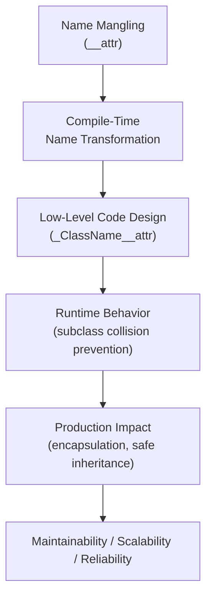
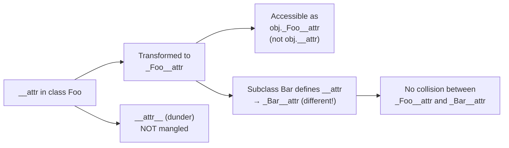

# Name Mangling in Python

## Overview

**Name Mangling** is Python's mechanism for providing a form of **private attribute protection** in classes. When an attribute name starts with two leading underscores (`__name`) and has at most one trailing underscore, Python automatically transforms it to `_ClassName__name` at compile time. This prevents accidental access and overriding in subclasses.

> **Core idea:** Name mangling is not true privacy — it's a name transformation that prevents accidental attribute collisions in inheritance hierarchies. It is a tool for **encapsulation**, not security.

---

## Why It Matters

| Convention | Syntax | Meaning |
|---|---|---|
| Public | `name` | Accessible everywhere |
| Protected (convention) | `_name` | Internal use, accessible but "don't touch" |
| Name-mangled (private) | `__name` | Transformed to `_ClassName__name` |
| Dunder (special) | `__name__` | Python magic methods — NOT mangled |

Name mangling is important for:
- **Preventing accidental attribute override in subclasses** — the primary use case
- **Encapsulating internal implementation details** in framework base classes
- **Avoiding name collisions** in mixin-heavy architectures
- **Signaling strong internal-only intent** to other developers

---

## Concept Map





---

## Simple Example

```python
class BankAccount:
    def __init__(self, owner: str, balance: float):
        self.owner = owner          # Public
        self._account_type = "savings"  # Protected (convention)
        self.__balance = balance    # Name-mangled → _BankAccount__balance

    def deposit(self, amount: float) -> None:
        if amount <= 0:
            raise ValueError("Deposit amount must be positive")
        self.__balance += amount

    def withdraw(self, amount: float) -> None:
        if amount > self.__balance:
            raise ValueError("Insufficient funds")
        self.__balance -= amount

    def get_balance(self) -> float:
        return self.__balance

    def __repr__(self) -> str:
        return f"BankAccount(owner={self.owner!r}, balance={self.__balance:.2f})"


account = BankAccount("Alice", 1000.0)
account.deposit(500.0)
print(account.get_balance())   # 1500.0
print(account)                 # BankAccount(owner='Alice', balance=1500.00)

# Direct access via mangled name (possible but discouraged)
print(account._BankAccount__balance)  # 1500.0

# Direct __balance access fails
try:
    print(account.__balance)
except AttributeError as e:
    print(f"AttributeError: {e}")

# Inspect all attributes
print([a for a in dir(account) if "balance" in a.lower()])
```

**Explanation:**
- `__balance` is transformed to `_BankAccount__balance` at compile time.
- `account.__balance` raises `AttributeError` — the mangled name is not `__balance`.
- `account._BankAccount__balance` works — name mangling is not true privacy.
- `dir(account)` reveals the mangled name.

**Expected Output:**
```
1500.0
BankAccount(owner='Alice', balance=1500.00)
1500.0
AttributeError: 'BankAccount' object has no attribute '__balance'
['_BankAccount__balance']
```

---

## Intermediate Example

### The Real Purpose: Preventing Subclass Collisions

```python
class Base:
    def __init__(self):
        self.__value = "base_value"  # → _Base__value

    def get_value(self) -> str:
        return self.__value  # Accesses _Base__value

    def process(self) -> str:
        return f"Base processing: {self.__value}"


class Child(Base):
    def __init__(self):
        super().__init__()
        self.__value = "child_value"  # → _Child__value (DIFFERENT attribute!)

    def get_child_value(self) -> str:
        return self.__value  # Accesses _Child__value

    def process(self) -> str:
        return f"Child processing: {self.__value}"  # Uses _Child__value


obj = Child()
print(obj.get_value())        # "base_value" — Base's __value unchanged
print(obj.get_child_value())  # "child_value" — Child's __value
print(obj.process())          # "Child processing: child_value"

# Both attributes coexist independently
print(obj._Base__value)   # "base_value"
print(obj._Child__value)  # "child_value"
```

**Explanation:**
- `Base.__value` and `Child.__value` are **different attributes** — `_Base__value` and `_Child__value`.
- `Base.get_value()` always accesses `_Base__value`, regardless of subclass overrides.
- This is the **primary purpose** of name mangling: protecting base class internals from accidental override.
- Without name mangling (using `_value`), `Child.__init__` would overwrite `Base`'s `_value`.

**Expected Output:**
```
base_value
child_value
Child processing: child_value
_Base__value = base_value
_Child__value = child_value
```

---

## Advanced / Architect-Level Example

### Problem Context

In a **framework base class** for an AI agent system, you need to protect internal state (token budget, session ID, internal callbacks) from accidental override by user-defined subclasses. Name mangling ensures framework internals remain intact even when users subclass and add their own attributes.

```python
from __future__ import annotations
import uuid
import time
from typing import Any, Callable, Dict, List, Optional


class AgentFramework:
    """
    Framework base class for AI agents.
    Uses name mangling to protect internal state from subclass interference.
    """

    # Class-level registry — not mangled (class attribute, not instance)
    _registry: Dict[str, "AgentFramework"] = {}

    def __init__(self, model: str = "gpt-4o", token_budget: int = 4096):
        # Framework internals — name-mangled to prevent subclass collision
        self.__session_id = str(uuid.uuid4())
        self.__token_budget = token_budget
        self.__tokens_used = 0
        self.__created_at = time.time()
        self.__hooks: Dict[str, List[Callable]] = {
            "before_invoke": [],
            "after_invoke": [],
            "on_error": [],
        }

        # Public/protected attributes — subclasses may extend
        self.model = model
        self._conversation_history: List[Dict[str, str]] = []

        # Register this agent
        AgentFramework._registry[self.__session_id] = self

    # --- Framework-controlled properties ---

    @property
    def session_id(self) -> str:
        """Read-only session ID — cannot be overridden."""
        return self.__session_id

    @property
    def tokens_remaining(self) -> int:
        return self.__token_budget - self.__tokens_used

    @property
    def uptime(self) -> float:
        return time.time() - self.__created_at

    # --- Hook system (framework-internal) ---

    def _register_hook(self, event: str, fn: Callable) -> None:
        """Register a lifecycle hook. Protected — subclasses may call."""
        if event not in self.__hooks:
            raise ValueError(f"Unknown event: {event}")
        self.__hooks[event].append(fn)

    def __fire_hooks(self, event: str, **kwargs) -> None:
        """Fire hooks for an event. Private — framework use only."""
        for hook in self.__hooks.get(event, []):
            hook(**kwargs)

    # --- Core invocation (framework-controlled) ---

    def _consume_tokens(self, count: int) -> None:
        """Track token usage. Protected — subclasses may call."""
        if self.__tokens_used + count > self.__token_budget:
            raise RuntimeError(
                f"Token budget exceeded: {self.__tokens_used + count} > {self.__token_budget}"
            )
        self.__tokens_used += count

    def invoke(self, prompt: str) -> str:
        """Framework-controlled invocation with hooks and token tracking."""
        self.__fire_hooks("before_invoke", prompt=prompt)
        try:
            # Simulate token consumption
            estimated_tokens = len(prompt.split()) * 2
            self._consume_tokens(estimated_tokens)

            result = self._do_invoke(prompt)

            self.__fire_hooks("after_invoke", prompt=prompt, result=result)
            return result
        except Exception as e:
            self.__fire_hooks("on_error", error=e)
            raise

    def _do_invoke(self, prompt: str) -> str:
        """Override this in subclasses — not the full invoke()."""
        return f"[{self.model}] {prompt}"

    def get_stats(self) -> dict:
        return {
            "session_id": self.__session_id,
            "model": self.model,
            "tokens_used": self.__tokens_used,
            "tokens_remaining": self.tokens_remaining,
            "uptime_seconds": round(self.uptime, 2),
        }


# --- User-defined subclass ---
class CustomerSupportAgent(AgentFramework):
    """
    User subclass. Tries to define __session_id and __hooks —
    but name mangling keeps them separate from the framework's internals.
    """

    def __init__(self, department: str, **kwargs):
        super().__init__(**kwargs)
        self.department = department

        # These are _CustomerSupportAgent__session_id and __hooks
        # They do NOT interfere with AgentFramework's internals
        self.__session_id = "user-defined-session"  # _CustomerSupportAgent__session_id
        self.__hooks = {}  # _CustomerSupportAgent__hooks

        # Register a lifecycle hook via the framework's protected method
        self._register_hook("before_invoke", self._log_request)

    def _log_request(self, prompt: str) -> None:
        print(f"[{self.department}] Incoming: {prompt[:50]}")

    def _do_invoke(self, prompt: str) -> str:
        return f"[Support:{self.department}] Handling: {prompt}"


# --- Usage ---
agent = CustomerSupportAgent(department="Billing", model="gpt-4o", token_budget=1000)

print(f"Framework session_id: {agent.session_id}")  # Framework's __session_id
print(f"User __session_id: {agent._CustomerSupportAgent__session_id}")  # User's

response = agent.invoke("I need help with my invoice")
print(f"Response: {response}")
print(f"Stats: {agent.get_stats()}")

# Verify name mangling kept them separate
print(f"\nMangled names in agent.__dict__:")
for k in agent.__dict__:
    if "session" in k or "hook" in k:
        print(f"  {k}")
```

**Explanation:**
- `AgentFramework.__session_id` → `_AgentFramework__session_id` — framework's internal session.
- `CustomerSupportAgent.__session_id` → `_CustomerSupportAgent__session_id` — user's attribute.
- They coexist without collision — the framework's `session_id` property always returns the correct value.
- `__fire_hooks` is name-mangled — subclasses cannot accidentally override the hook firing mechanism.
- This pattern is used in Django's `Model`, SQLAlchemy's `Base`, and other framework base classes.

**Design Trade-offs:**

| Approach | Pros | Cons |
|---|---|---|
| Name mangling (`__attr`) | Prevents subclass collision | Verbose mangled names, not truly private |
| Single underscore (`_attr`) | Convention-based, readable | No collision protection |
| Properties with no setter | Enforces read-only access | More boilerplate |
| `__slots__` | Prevents arbitrary attribute addition | Inflexible, complex with inheritance |

---

## Common Mistakes

### 1. Thinking Name Mangling Provides True Privacy
```python
# ❌ Misconception: __balance is truly private
account = BankAccount("Alice", 1000)
# This still works:
print(account._BankAccount__balance)  # 1000.0

# ✅ Name mangling is collision prevention, not security
# For true privacy, use closures or descriptors
```

---

### 2. Using `__name__` (Dunder) Expecting Mangling
```python
# ❌ Dunder names are NOT mangled
class Foo:
    def __init__(self):
        self.__value__ = 42  # NOT mangled — stays as __value__

foo = Foo()
print(foo.__value__)  # Works! No mangling for dunder names
```

---

### 3. Accessing Mangled Names from Outside the Class
```python
# ❌ Brittle — depends on internal implementation
print(account._BankAccount__balance)

# ✅ Use the public interface
print(account.get_balance())
```

---

### 4. Overusing Name Mangling
```python
# ❌ Mangling everything — makes code hard to read and test
class Config:
    def __init__(self):
        self.__host = "localhost"
        self.__port = 5432
        self.__db = "mydb"
        self.__user = "admin"
        self.__password = "secret"

# ✅ Use single underscore for most internal attributes
class Config:
    def __init__(self):
        self._host = "localhost"
        self._port = 5432
        self.__password = "secret"  # Only mangle truly sensitive/collision-prone attrs
```

---

### 5. Forgetting Mangling in `__init_subclass__` or Metaclasses
```python
# ❌ Name mangling doesn't apply in string-based attribute access
class Meta(type):
    def __new__(mcs, name, bases, namespace):
        # "__value" here is a string — NOT mangled
        if "__value" in namespace:
            print("Found __value")  # Won't trigger for mangled names
```

---

## Best Practices

1. **Use `__attr` only when you need collision protection** — not for general "private" attributes.
2. **Use `_attr` (single underscore) for most internal attributes** — it's the Pythonic convention for "internal use."
3. **Never use `__attr__` (dunder) for your own attributes** — reserved for Python's magic methods.
4. **Document why you're using name mangling** — it's not obvious to all developers.
5. **Use properties to control access** — combine with name mangling for read-only or validated attributes.
6. **Don't access mangled names from outside the class** — use the public interface.
7. **Use name mangling in framework base classes** — protect internal state from subclass interference.
8. **Be aware of mangling in `__init_subclass__`, metaclasses, and `getattr`** — string-based access bypasses mangling.
9. **Test subclass behavior** — verify that subclass attributes don't accidentally override base class internals.
10. **Prefer composition over deep inheritance** when name collision is a concern — reduces the need for mangling.

---

## Performance Considerations

Name mangling has **zero runtime performance impact**. The name transformation happens at **compile time** (when the class body is parsed), not at runtime. Attribute access via the mangled name (`_ClassName__attr`) is identical in speed to any other attribute access.

The only consideration is:
- **Slightly longer attribute names** — `_ClassName__attr` vs `_attr` — negligible memory difference.
- **`dir()` output** — mangled names appear in `dir()`, which can be slightly confusing during debugging.

---

## Testing Strategy

```python
# test_name_mangling.py
import pytest
from your_module import BankAccount, AgentFramework, CustomerSupportAgent


# --- Test that mangled attribute is inaccessible via __name ---
def test_mangled_attribute_not_directly_accessible():
    account = BankAccount("Alice", 1000.0)
    with pytest.raises(AttributeError):
        _ = account.__balance


# --- Test that mangled attribute is accessible via mangled name ---
def test_mangled_attribute_accessible_via_mangled_name():
    account = BankAccount("Alice", 1000.0)
    assert account._BankAccount__balance == 1000.0


# --- Test that subclass does not override base class mangled attr ---
def test_subclass_does_not_override_base_mangled_attr():
    agent = CustomerSupportAgent(department="Billing")
    # Framework's session_id is intact
    framework_session = agent._AgentFramework__session_id
    user_session = agent._CustomerSupportAgent__session_id
    assert framework_session != user_session
    assert agent.session_id == framework_session


# --- Test public interface works correctly ---
def test_bank_account_deposit_withdraw():
    account = BankAccount("Bob", 500.0)
    account.deposit(200.0)
    assert account.get_balance() == 700.0
    account.withdraw(100.0)
    assert account.get_balance() == 600.0


# --- Test validation via mangled attribute ---
def test_bank_account_insufficient_funds():
    account = BankAccount("Carol", 100.0)
    with pytest.raises(ValueError, match="Insufficient funds"):
        account.withdraw(200.0)


# --- Test framework hooks are protected ---
def test_framework_hooks_not_overridden_by_subclass():
    agent = CustomerSupportAgent(department="Tech")
    # Framework's __hooks are intact
    framework_hooks = agent._AgentFramework__hooks
    assert "before_invoke" in framework_hooks
    assert len(framework_hooks["before_invoke"]) == 1  # Our registered hook


# --- Test token budget enforcement ---
def test_token_budget_enforcement():
    agent = AgentFramework(token_budget=10)
    with pytest.raises(RuntimeError, match="Token budget exceeded"):
        agent.invoke("This is a very long prompt that will exceed the token budget easily")
```

---

## Debugging Tips

1. **`AttributeError: 'X' object has no attribute '__attr'`** — you're trying to access a mangled attribute from outside the class. Use `obj._ClassName__attr` or the public interface.

2. **Use `dir(obj)` or `vars(obj)`** to see all attributes including mangled ones:
   ```python
   print([a for a in dir(obj) if "attr" in a])
   # Shows: ['_ClassName__attr']
   ```

3. **Use `obj.__dict__`** to see all instance attributes with their mangled names:
   ```python
   print(obj.__dict__)
   # {'_ClassName__attr': value, ...}
   ```

4. **Unexpected attribute not found in subclass** — check if the base class uses name mangling. The attribute may be `_BaseClass__attr`, not `__attr`.

5. **`getattr(obj, '__attr')`** does NOT apply mangling — it looks for the literal string `__attr`. Use `getattr(obj, '_ClassName__attr')` for mangled access.

6. **Metaclass or `__init_subclass__` not seeing mangled names** — string-based attribute access in metaclasses bypasses mangling. Use `_ClassName__attr` explicitly.

---

## Interview Questions

### Beginner

**Q1: What is name mangling in Python?**  
A: Name mangling transforms attributes starting with `__` (two underscores) to `_ClassName__attr` at compile time. It prevents accidental access and subclass attribute collisions.

**Q2: What is the difference between `_attr`, `__attr`, and `__attr__`?**  
A: `_attr` is a convention for "internal use." `__attr` is name-mangled to `_ClassName__attr`. `__attr__` (dunder) is a Python magic method — NOT mangled.

**Q3: Is name mangling true privacy in Python?**  
A: No. The mangled name `_ClassName__attr` is still accessible from outside the class. Name mangling is collision prevention, not security.

**Q4: How do you access a name-mangled attribute from outside the class?**  
A: Use the mangled name: `obj._ClassName__attr`. This is possible but discouraged — use the public interface instead.

**Q5: What does `dir(obj)` show for name-mangled attributes?**  
A: It shows the mangled name `_ClassName__attr`, not `__attr`.

---

### Intermediate

**Q6: What is the primary purpose of name mangling?**  
A: To prevent accidental attribute collision in inheritance hierarchies. When a base class uses `__attr`, subclasses that define their own `__attr` get a different mangled name, so they don't interfere with the base class's attribute.

**Q7: Does name mangling apply to class attributes?**  
A: Yes. `__class_attr` in a class body is mangled to `_ClassName__class_attr`. This applies to both instance and class attributes.

**Q8: Does name mangling apply inside methods?**  
A: Yes. Any `__attr` reference inside a class body (including methods) is mangled to `_ClassName__attr` at compile time.

**Q9: Does `getattr(obj, '__attr')` apply name mangling?**  
A: No. `getattr` uses the literal string — it does not apply mangling. You must use `getattr(obj, '_ClassName__attr')` to access a mangled attribute dynamically.

**Q10: When would you use name mangling in a production codebase?**  
A: In framework base classes where you need to protect internal state from subclass interference. For example, a base `Model` class protecting its internal `__session` or `__registry` from being accidentally overridden by user subclasses.

---

### Advanced / Architect-Level

**Q11: How does name mangling interact with `__slots__`?**  
A: `__slots__` with mangled names work correctly — `__slots__ = ['__value']` creates a slot named `_ClassName__value`. Subclasses must define their own `__slots__` to avoid `__dict__` fallback.

**Q12: How does name mangling affect metaclasses and `__init_subclass__`?**  
A: Name mangling applies to the class body at compile time. In metaclasses, the `namespace` dict passed to `__new__` already contains mangled names. String-based access (`namespace['__attr']`) won't find mangled names — use `namespace['_ClassName__attr']`.

**Q13: How would you use name mangling to protect a plugin framework's internal state?**  
A: Define a `PluginBase` with `__registry`, `__hooks`, and `__config` as name-mangled attributes. User plugins subclass `PluginBase` and can define their own `__registry` etc. without interfering with the framework's internals. The framework always accesses `_PluginBase__registry`.

**Q14: What is the difference between name mangling and using `@property` with no setter for encapsulation?**  
A: Name mangling prevents attribute name collision in subclasses. `@property` with no setter prevents external mutation (raises `AttributeError` on assignment). They serve different purposes and are often combined: `__attr` for collision prevention + `@property` for controlled read-only access.

**Q15: How does Python's `pickle` module handle name-mangled attributes?**  
A: `pickle` serializes `__dict__`, which contains mangled names (`_ClassName__attr`). When unpickling, the mangled names are restored correctly. However, if the class name changes between pickling and unpickling, the mangled names won't match — a subtle versioning issue to be aware of.

---

## Key Takeaways

- Name mangling transforms `__attr` to `_ClassName__attr` at compile time — not at runtime.
- Its primary purpose is **preventing subclass attribute collisions**, not true privacy.
- `__attr__` (dunder names) are NOT mangled — they are Python's magic method convention.
- Mangled attributes are still accessible via `obj._ClassName__attr` — Python has no true private attributes.
- Use `_attr` (single underscore) for most internal attributes; use `__attr` only when collision protection is needed.
- Name mangling is most valuable in **framework base classes** that must protect internal state from subclass interference.
- `getattr(obj, '__attr')` does NOT apply mangling — use the mangled name explicitly.
- `dir(obj)` and `obj.__dict__` reveal mangled names for debugging.
- Combine name mangling with `@property` for controlled, read-only access to protected state.
- Understanding name mangling is essential for reading and writing framework-level Python code.

---

## Mini Project Idea

### Goal
Build a **Secure Configuration Manager** — a framework base class that uses name mangling to protect sensitive configuration (API keys, database credentials) from accidental exposure or override in subclasses.

### Features
- `BaseConfig` with name-mangled `__api_key`, `__db_password`, `__secret_token`.
- Public properties for read-only access with masking: `api_key` returns `"sk-****"`.
- `validate()` abstract method for subclass-specific validation.
- `AppConfig(BaseConfig)` subclass that adds its own `__api_key` without interfering.
- CLI tool to load config from environment variables and display masked values.

### Suggested Folder Structure
```
config_manager/
├── config/
│   ├── __init__.py
│   ├── base_config.py      # BaseConfig with name mangling
│   ├── app_config.py       # AppConfig subclass
│   └── validators.py
├── tests/
│   ├── test_base_config.py
│   └── test_app_config.py
├── cli.py
└── README.md
```

### Extension Ideas
- Add `__audit_log` to track all config access attempts.
- Add encryption for sensitive fields using `cryptography` library.
- Add a `ConfigRegistry` that uses `__subclasses__()` for auto-discovery.
- Add `__slots__` to prevent arbitrary attribute addition.

---

## Final Summary

Mastering name mangling gives you a precise understanding of Python's encapsulation model — and its intentional limitations. Python's philosophy is "we're all consenting adults here": name mangling provides collision protection and signals strong internal intent, but not true privacy. For a Python architect, knowing when and why to use `__attr` versus `_attr` versus `@property` is a mark of design maturity. Name mangling is most valuable in framework base classes where you need to guarantee that internal state survives subclassing — a pattern used throughout Django, SQLAlchemy, and Python's standard library. Understanding it deeply means you can read, extend, and design framework-level code with confidence.
