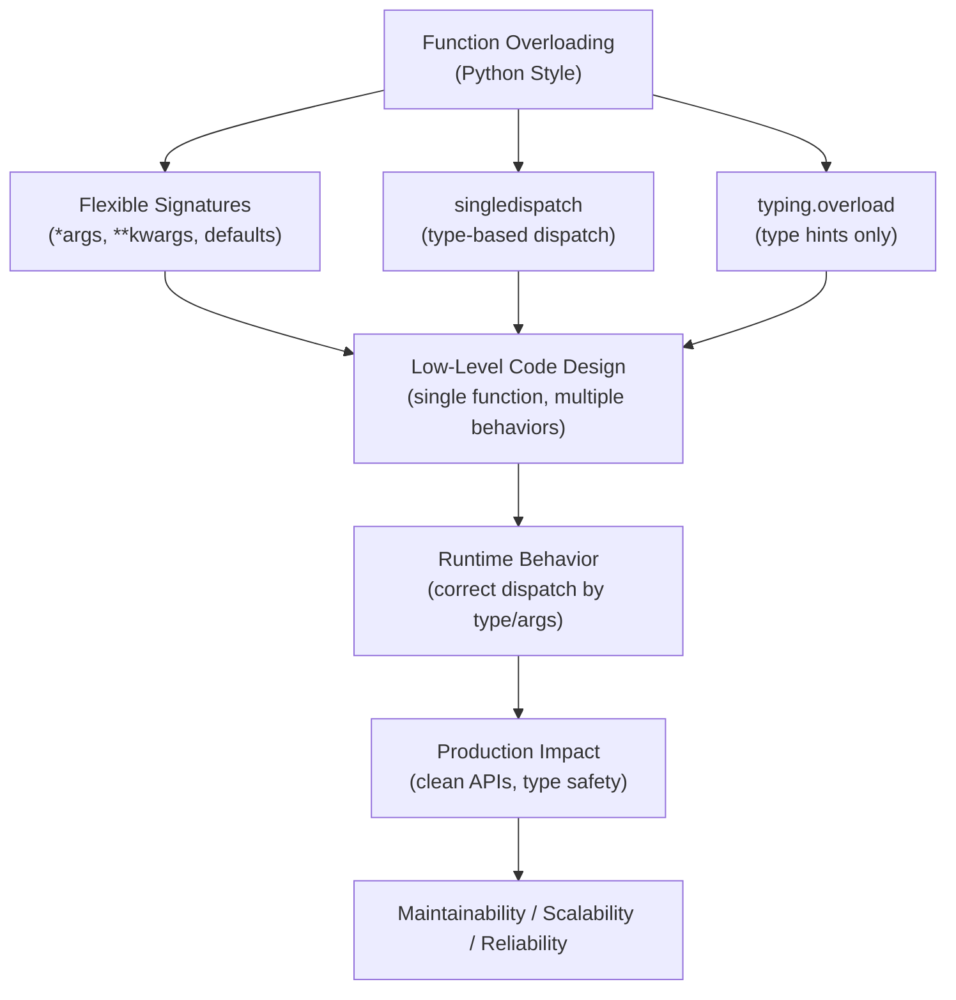
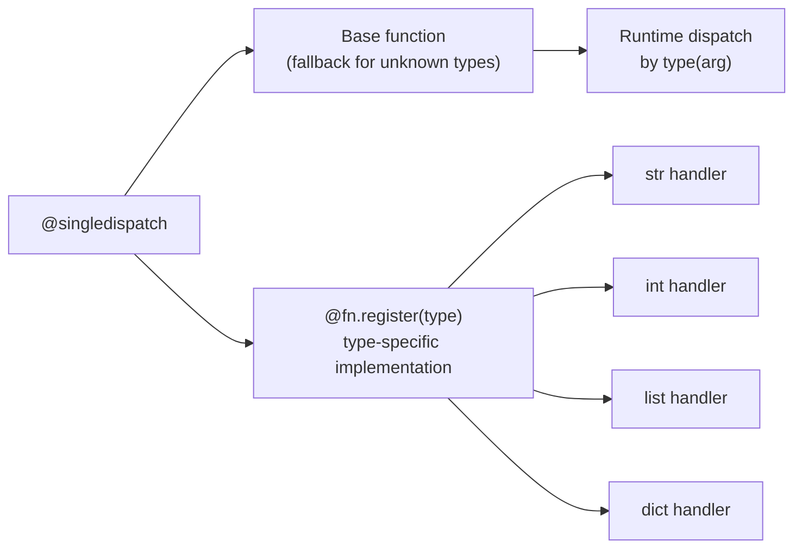

# Function Overloading in Python

## Overview

**Function Overloading** — defining multiple functions with the same name but different parameter types or counts — does not exist natively in Python the way it does in Java or C++. Python's dynamic typing means the last definition of a function with a given name simply replaces all previous ones.

However, Python provides several powerful mechanisms to achieve **overloading-like behavior**:
1. **Default arguments and `*args`/`**kwargs`** — handle multiple call signatures in one function
2. **`functools.singledispatch`** — dispatch based on the type of the first argument
3. **`typing.overload`** — type-hint multiple signatures for static analysis (no runtime dispatch)
4. **`multipledispatch` library** — full multiple dispatch on all argument types

> **Core idea:** Python achieves overloading through dispatch mechanisms and flexible signatures, not through multiple function definitions.

---

## Why It Matters

| Java/C++ Overloading | Python Equivalent |
|---|---|
| Multiple definitions, same name | Single function with flexible signature |
| Compile-time dispatch by type | Runtime dispatch via `singledispatch` |
| Type-safe, explicit | Dynamic, flexible |
| No `*args`/`**kwargs` | `*args`/`**kwargs` handle variable signatures |
| `@Override` annotation | `@singledispatch` + `@fn.register` |

Function overloading patterns are used in:
- **Data processing pipelines** — handling different input types (str, Path, bytes, dict)
- **AI agent tool systems** — tools that accept different input formats
- **Serialization frameworks** — encoding different types differently
- **Domain-driven design** — factory methods that accept different input types
- **API handlers** — processing different request payload formats

---

## Concept Map





---

## Simple Example

### Approach 1: Default Arguments and `*args`

```python
def greet(name: str, greeting: str = "Hello", times: int = 1) -> str:
    return f"{greeting}, {name}! " * times

print(greet("Alice"))                        # Hello, Alice!
print(greet("Bob", "Hi"))                    # Hi, Bob!
print(greet("Carol", "Hey", 3))              # Hey, Carol! Hey, Carol! Hey, Carol!
```

### Approach 2: `functools.singledispatch`

```python
from functools import singledispatch

@singledispatch
def process(data):
    raise TypeError(f"Unsupported type: {type(data)}")

@process.register(str)
def _(data: str) -> str:
    return f"String: {data.upper()}"

@process.register(int)
def _(data: int) -> str:
    return f"Integer: {data * 2}"

@process.register(list)
def _(data: list) -> str:
    return f"List with {len(data)} items: {data}"

@process.register(dict)
def _(data: dict) -> str:
    return f"Dict with keys: {list(data.keys())}"

print(process("hello"))          # String: HELLO
print(process(42))               # Integer: 84
print(process([1, 2, 3]))        # List with 3 items: [1, 2, 3]
print(process({"a": 1}))         # Dict with keys: ['a']
```

**Explanation:**
- `@singledispatch` registers the base function as the fallback.
- `@process.register(type)` registers type-specific implementations.
- Python dispatches to the correct implementation based on `type(data)` at runtime.

**Expected Output:**
```
String: HELLO
Integer: 84
List with 3 items: [1, 2, 3]
Dict with keys: ['a']
```

---

## Intermediate Example

### `typing.overload` for Type-Safe APIs

```python
from typing import overload, Union, List
from pathlib import Path

@overload
def load_data(source: str) -> dict: ...
@overload
def load_data(source: Path) -> dict: ...
@overload
def load_data(source: bytes) -> dict: ...
@overload
def load_data(source: dict) -> dict: ...

def load_data(source: Union[str, Path, bytes, dict]) -> dict:
    """
    Load data from multiple source types.
    - str: treat as JSON string
    - Path: read file and parse JSON
    - bytes: decode and parse JSON
    - dict: return as-is (already loaded)
    """
    import json

    if isinstance(source, dict):
        return source
    elif isinstance(source, Path):
        return json.loads(source.read_text())
    elif isinstance(source, bytes):
        return json.loads(source.decode("utf-8"))
    elif isinstance(source, str):
        return json.loads(source)
    else:
        raise TypeError(f"Unsupported source type: {type(source)}")


# Usage
import json
data_str = '{"name": "Alice", "age": 30}'
data_bytes = data_str.encode()
data_dict = {"name": "Alice", "age": 30}

print(load_data(data_str))    # From JSON string
print(load_data(data_bytes))  # From bytes
print(load_data(data_dict))   # From dict (passthrough)
```

**Explanation:**
- `@overload` decorators define type signatures for static analysis tools (mypy, Pylance).
- The actual implementation handles all types in a single function body.
- IDEs show the correct overloaded signatures in autocomplete.
- `@overload` has **no runtime effect** — it's purely for type checkers.

**Expected Output:**
```
{'name': 'Alice', 'age': 30}
{'name': 'Alice', 'age': 30}
{'name': 'Alice', 'age': 30}
```

---

## Advanced / Architect-Level Example

### Problem Context

In a **data ingestion pipeline** for a RAG system, documents arrive in multiple formats: raw strings, file paths, URLs, pre-parsed dicts, and `Document` objects. Using `singledispatch` with a class-based dispatcher provides clean, extensible, type-safe ingestion without a massive `if/elif` chain.

```python
from __future__ import annotations
from functools import singledispatch
from pathlib import Path
from typing import List, Dict, Any, Union
from dataclasses import dataclass, field
import json
import re


@dataclass
class Document:
    doc_id: str
    content: str
    source: str
    metadata: Dict[str, Any] = field(default_factory=dict)


# --- singledispatch-based document loader ---

@singledispatch
def load_document(source) -> List[Document]:
    """
    Fallback: raise for unsupported types.
    Extend by registering new types without modifying this function.
    """
    raise TypeError(
        f"Cannot load document from {type(source).__name__}. "
        f"Supported: str, Path, dict, list, Document"
    )


@load_document.register(Document)
def _(source: Document) -> List[Document]:
    """Already a Document — return as-is."""
    return [source]


@load_document.register(dict)
def _(source: dict) -> List[Document]:
    """Load from a dict with 'content' and optional 'metadata'."""
    return [Document(
        doc_id=source.get("id", f"dict-{id(source)}"),
        content=source["content"],
        source="dict",
        metadata=source.get("metadata", {}),
    )]


@load_document.register(str)
def _(source: str) -> List[Document]:
    """
    Load from a string:
    - If it looks like a URL, fetch it (simulated)
    - If it looks like a file path, read it
    - Otherwise, treat as raw content
    """
    if re.match(r"https?://", source):
        # Simulate URL fetch
        content = f"[Fetched from {source}] Sample content."
        return [Document(doc_id=f"url-{hash(source)}", content=content, source=source)]
    elif Path(source).exists():
        return load_document(Path(source))
    else:
        # Raw string content
        return [Document(doc_id=f"str-{hash(source)}", content=source, source="inline")]


@load_document.register(Path)
def _(source: Path) -> List[Document]:
    """Load from a file path — supports .txt and .json."""
    if not source.exists():
        raise FileNotFoundError(f"File not found: {source}")

    if source.suffix == ".json":
        data = json.loads(source.read_text())
        if isinstance(data, list):
            return [d for item in data for d in load_document(item)]
        return load_document(data)
    else:
        content = source.read_text()
        return [Document(doc_id=source.stem, content=content, source=str(source))]


@load_document.register(list)
def _(source: list) -> List[Document]:
    """Load from a list of any supported source types."""
    docs = []
    for item in source:
        docs.extend(load_document(item))
    return docs


# --- Pipeline that uses the dispatcher ---

class IngestionPipeline:
    def __init__(self):
        self._documents: List[Document] = []

    def ingest(self, source: Any) -> int:
        """Ingest from any supported source type."""
        docs = load_document(source)
        self._documents.extend(docs)
        return len(docs)

    def total_documents(self) -> int:
        return len(self._documents)

    def summary(self) -> List[str]:
        return [f"{d.doc_id}: {d.content[:50]}..." for d in self._documents]


# --- Extending the dispatcher (plugin-style) ---
# Third-party code can register new types without modifying load_document

class PDFDocument:
    def __init__(self, path: str, pages: List[str]):
        self.path = path
        self.pages = pages

@load_document.register(PDFDocument)
def _(source: PDFDocument) -> List[Document]:
    return [
        Document(doc_id=f"{Path(source.path).stem}-p{i}", content=page, source=source.path)
        for i, page in enumerate(source.pages)
    ]


# --- Usage ---
pipeline = IngestionPipeline()

# Ingest from different source types
pipeline.ingest("This is raw text content about Python.")
pipeline.ingest({"id": "doc-1", "content": "Dict-based document content."})
pipeline.ingest(Document("doc-2", "Pre-built document.", "manual"))
pipeline.ingest([
    "First item in list",
    {"id": "list-item-2", "content": "Second item"},
])
pipeline.ingest(PDFDocument("report.pdf", ["Page 1 content", "Page 2 content"]))

print(f"Total documents: {pipeline.total_documents()}")
for summary in pipeline.summary():
    print(f"  {summary}")

# Verify dispatch
print(f"\nRegistered types: {list(load_document.registry.keys())}")
```

**Explanation:**
- `singledispatch` provides clean, extensible type-based dispatch without `if/elif` chains.
- New source types (e.g., `PDFDocument`) can be registered externally — open/closed principle.
- `IngestionPipeline.ingest()` accepts any type — the dispatcher handles routing.
- The `list` handler recursively dispatches each item — composable and elegant.

**Design Trade-offs:**

| Approach | Pros | Cons |
|---|---|---|
| `if/elif isinstance` | Simple, explicit | Not extensible, grows with types |
| `singledispatch` | Extensible, clean, open/closed | Only dispatches on first arg type |
| `typing.overload` | IDE/mypy support | No runtime dispatch |
| `multipledispatch` | Multi-arg dispatch | External dependency |
| Method overloading via `__init_subclass__` | Framework-level | Complex |

---

## Common Mistakes

### 1. Expecting `typing.overload` to Dispatch at Runtime
```python
# ❌ @overload has NO runtime effect
@overload
def process(x: int) -> int: ...
@overload
def process(x: str) -> str: ...

def process(x):
    return x  # This is the only runtime implementation

# ✅ @overload is for type checkers only — implement all logic in the final def
```

---

### 2. Registering Subclasses Before Base Classes in `singledispatch`
```python
# ❌ bool is a subclass of int — register bool AFTER int
@process.register(int)
def _(x): return f"int: {x}"

# bool dispatches to int handler (correct MRO behavior)
# ✅ Register bool explicitly if you need different behavior
@process.register(bool)
def _(x): return f"bool: {x}"
```

---

### 3. Using `singledispatch` for Multi-Argument Dispatch
```python
# ❌ singledispatch only dispatches on the FIRST argument
@singledispatch
def add(a, b):
    ...

# ✅ Use multipledispatch library or manual isinstance checks for multi-arg dispatch
```

---

### 4. Redefining the Same Function Name (Python's "Last Wins")
```python
# ❌ This is NOT overloading — second definition replaces the first
def process(x: int): return x * 2
def process(x: str): return x.upper()  # Replaces the int version!

process(42)  # TypeError or wrong behavior
```

---

### 5. Not Providing a Fallback in `singledispatch`
```python
# ❌ No fallback — unknown types cause AttributeError or silent wrong behavior
@singledispatch
def process(data):
    pass  # Silent no-op for unknown types

# ✅ Raise a descriptive error for unsupported types
@singledispatch
def process(data):
    raise TypeError(f"Unsupported type: {type(data).__name__}")
```

---

## Best Practices

1. **Use `singledispatch` for type-based dispatch** — cleaner than `if/elif isinstance` chains.
2. **Always provide a fallback** in `singledispatch` that raises `TypeError` with a helpful message.
3. **Use `typing.overload` for IDE/mypy support** — document multiple call signatures without runtime overhead.
4. **Register subclasses explicitly** in `singledispatch` — Python uses MRO for dispatch, but explicit is better.
5. **Use default arguments and `*args`/`**kwargs`** for simple multi-signature functions.
6. **Keep dispatch functions focused** — each registered handler should do one thing.
7. **Use `singledispatch` for extensible plugin systems** — third-party code can register new types.
8. **Combine `typing.overload` with `singledispatch`** for both runtime dispatch and type safety.
9. **Document supported types** in the base function's docstring.
10. **Test each registered handler independently** — don't rely on integration tests alone.

---

## Performance Considerations

- **`singledispatch` dispatch** uses a cache after the first call for each type — O(1) after warm-up.
- **`isinstance` chains** are O(n) where n is the number of type checks — `singledispatch` is faster for many types.
- **`typing.overload`** has zero runtime overhead — it's erased at runtime.
- **`multipledispatch`** (external library) is slower than `singledispatch` due to multi-argument type resolution.
- **Default arguments** have negligible overhead — evaluated once at function definition.
- **`*args`/`**kwargs`** add a small overhead for tuple/dict creation — negligible in practice.

For high-frequency dispatch (millions of calls), `singledispatch` with a warm cache is efficient. For cold-start performance, pre-warm the cache by calling each type once at startup.

---

## Testing Strategy

```python
# test_function_overloading.py
import pytest
from functools import singledispatch
from pathlib import Path
from your_module import load_document, process, Document, PDFDocument


# --- Test singledispatch ---
def test_process_string():
    assert process("hello") == "String: HELLO"

def test_process_int():
    assert process(42) == "Integer: 84"

def test_process_list():
    assert "3 items" in process([1, 2, 3])

def test_process_unsupported_type():
    with pytest.raises(TypeError, match="Unsupported type"):
        process(3.14)


# --- Test load_document dispatch ---
def test_load_from_string():
    docs = load_document("Raw content here")
    assert len(docs) == 1
    assert docs[0].content == "Raw content here"

def test_load_from_dict():
    docs = load_document({"id": "d1", "content": "Dict content"})
    assert docs[0].doc_id == "d1"

def test_load_from_document():
    doc = Document("d1", "Content", "test")
    docs = load_document(doc)
    assert docs[0] is doc

def test_load_from_list():
    sources = ["text1", {"id": "d2", "content": "text2"}]
    docs = load_document(sources)
    assert len(docs) == 2

def test_load_from_pdf():
    pdf = PDFDocument("report.pdf", ["Page 1", "Page 2"])
    docs = load_document(pdf)
    assert len(docs) == 2
    assert "p0" in docs[0].doc_id

def test_load_unsupported_type():
    with pytest.raises(TypeError):
        load_document(42)


# --- Test typing.overload (runtime behavior) ---
def test_load_data_from_str():
    from your_module import load_data
    result = load_data('{"key": "value"}')
    assert result == {"key": "value"}

def test_load_data_from_bytes():
    from your_module import load_data
    result = load_data(b'{"key": "value"}')
    assert result == {"key": "value"}

def test_load_data_from_dict():
    from your_module import load_data
    data = {"key": "value"}
    assert load_data(data) is data


# --- Test extensibility ---
def test_register_new_type():
    @singledispatch
    def my_fn(x):
        raise TypeError(f"Unsupported: {type(x)}")

    @my_fn.register(float)
    def _(x):
        return f"float: {x}"

    assert my_fn(3.14) == "float: 3.14"
    with pytest.raises(TypeError):
        my_fn("string")
```

---

## Debugging Tips

1. **Check registered types** with `fn.registry`:
   ```python
   print(list(load_document.registry.keys()))
   # [<class 'object'>, <class 'str'>, <class 'dict'>, ...]
   ```

2. **Check which implementation will be called** with `fn.dispatch(type)`:
   ```python
   print(load_document.dispatch(str))  # Shows the str handler
   print(load_document.dispatch(bool)) # Shows int handler (bool is subclass of int)
   ```

3. **`singledispatch` not dispatching correctly** — check if the type is a subclass of a registered type. Use `fn.dispatch(type)` to verify.

4. **`typing.overload` not showing in IDE** — ensure the `@overload` decorators come before the actual implementation and that the implementation has no `@overload` decorator.

5. **`TypeError: Unsupported type`** from `singledispatch` — the type is not registered. Check `fn.registry` and register the missing type.

6. **`bool` dispatching to `int` handler** — `bool` is a subclass of `int`. Register `bool` explicitly if you need different behavior.

---

## Interview Questions

### Beginner

**Q1: Does Python support function overloading natively?**  
A: No. Python's dynamic typing means the last definition of a function replaces all previous ones. Overloading-like behavior is achieved via default arguments, `*args`/`**kwargs`, `singledispatch`, or `typing.overload`.

**Q2: What is `functools.singledispatch`?**  
A: A decorator that enables type-based dispatch — different implementations are called based on the type of the first argument. Register implementations with `@fn.register(type)`.

**Q3: What is `typing.overload` used for?**  
A: It provides multiple type signatures for a function for static analysis tools (mypy, Pylance). It has no runtime effect — the actual implementation is the last (non-decorated) function definition.

**Q4: How do default arguments simulate overloading?**  
A: By making parameters optional, a single function can be called with different numbers of arguments, simulating multiple signatures.

**Q5: What happens if you define two functions with the same name in Python?**  
A: The second definition replaces the first. There is no overloading — only the last definition exists.

---

### Intermediate

**Q6: How does `singledispatch` handle subclasses?**  
A: It uses the MRO to find the most specific registered type. If `bool` is not registered but `int` is, `bool` values dispatch to the `int` handler (since `bool` is a subclass of `int`).

**Q7: How do you check which implementation `singledispatch` will use for a given type?**  
A: Use `fn.dispatch(type)` — it returns the registered implementation for that type.

**Q8: What is the difference between `singledispatch` and `singledispatchmethod`?**  
A: `singledispatch` works on module-level functions. `singledispatchmethod` (Python 3.8+) works on class methods, dispatching on the type of the first non-`self` argument.

**Q9: How do you register multiple types for the same `singledispatch` handler?**  
A: Stack multiple `@fn.register` decorators:
```python
@process.register(list)
@process.register(tuple)
def _(data):
    return f"Sequence: {len(data)} items"
```

**Q10: How does `typing.overload` interact with mypy?**  
A: mypy uses `@overload` signatures to type-check call sites. If you call `load_data(42)` and `int` is not in any `@overload` signature, mypy reports an error. The actual implementation's type hints are ignored by mypy for call-site checking.

---

### Advanced / Architect-Level

**Q11: How would you implement a multi-argument dispatch system in Python?**  
A: Use the `multipledispatch` library for full multi-argument dispatch. Alternatively, use `singledispatch` on the first argument and `isinstance` checks inside the handler for additional arguments. For a custom solution, build a dispatch table keyed on `(type(a), type(b))` tuples.

**Q12: How would you use `singledispatch` to build an extensible serialization framework?**  
A: Define `@singledispatch def serialize(obj)` with a fallback. Register handlers for `str`, `int`, `float`, `list`, `dict`, `datetime`, `Decimal`, etc. Third-party code registers their own types. The framework serializes any object without modification.

**Q13: How does `singledispatch` interact with ABCs and virtual subclasses?**  
A: `singledispatch` respects `isinstance` semantics, including virtual subclasses registered with `ABC.register()`. If `MyClass` is registered as a virtual subclass of `Sequence`, `singledispatch` will dispatch `MyClass` instances to the `Sequence` handler.

**Q14: What are the performance implications of `singledispatch` in a high-throughput pipeline?**  
A: `singledispatch` uses an LRU cache for dispatch resolution — O(1) after the first call for each type. For millions of calls per second, the cache hit rate is near 100% for a fixed set of types. Pre-warm the cache at startup by calling each type once. For extreme performance, consider a manual dispatch dict.

**Q15: How would you combine `typing.overload` and `singledispatch` for a production API?**  
A: Use `@overload` to declare all supported signatures for IDE/mypy support. Use `@singledispatch` for runtime dispatch. The `@overload` decorators document the API; `@singledispatch` implements it. This gives both static type safety and runtime extensibility.

---

## Key Takeaways

- Python does not support native function overloading — the last definition wins.
- `functools.singledispatch` provides type-based runtime dispatch on the first argument.
- `typing.overload` provides multiple type signatures for static analysis — no runtime effect.
- Default arguments and `*args`/`**kwargs` handle variable-signature functions.
- `singledispatch` is extensible — third-party code can register new types without modifying the base function.
- `singledispatch` uses MRO for subclass dispatch — register subclasses explicitly for custom behavior.
- `singledispatchmethod` (Python 3.8+) enables dispatch on class methods.
- Combine `@overload` + `singledispatch` for both type safety and runtime extensibility.
- `singledispatch` is O(1) after cache warm-up — suitable for high-throughput pipelines.
- Mastering Python's overloading patterns is essential for building clean, extensible, type-safe APIs.

---

## Mini Project Idea

### Goal
Build a **Universal Data Serializer** — a `singledispatch`-based serialization framework that converts any Python object to JSON-compatible format.

### Features
- `@singledispatch serialize(obj)` with handlers for: `str`, `int`, `float`, `bool`, `list`, `dict`, `tuple`, `set`, `datetime`, `Decimal`, `Path`, `Enum`, `dataclass`.
- `@overload` type hints for IDE support.
- Plugin registration: third-party code registers custom types.
- `deserialize(data, target_type)` for round-trip support.
- CLI: `python serialize.py --input data.py --output data.json`.

### Suggested Folder Structure
```
universal_serializer/
├── serializer/
│   ├── __init__.py
│   ├── core.py            # @singledispatch serialize()
│   ├── handlers.py        # Type-specific handlers
│   └── plugins.py         # Plugin registration API
├── tests/
│   ├── test_core.py
│   ├── test_handlers.py
│   └── test_plugins.py
├── cli.py
└── README.md
```

### Extension Ideas
- Add `@singledispatch deserialize()` for type-safe deserialization.
- Add YAML and MessagePack output formats.
- Add a schema generator using `typing.overload` signatures.
- Benchmark against `json.dumps` and `pickle`.

---

## Final Summary

Mastering Python's function overloading patterns — `singledispatch`, `typing.overload`, and flexible signatures — is mastering Python's approach to polymorphic APIs. Unlike Java's compile-time overloading, Python's approach is dynamic, extensible, and composable. For a Python architect, `singledispatch` is the tool of choice for building open/closed, extensible dispatch systems — serializers, document loaders, event handlers, and plugin frameworks. Understanding when to use `singledispatch` versus `isinstance` chains versus `typing.overload` — and how to combine them — is a hallmark of production-grade Python design. These patterns appear throughout Python's standard library, major frameworks, and modern AI/ML pipelines.
