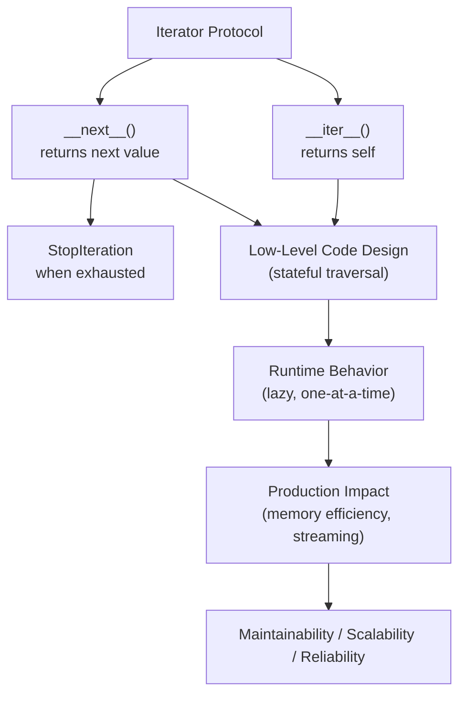
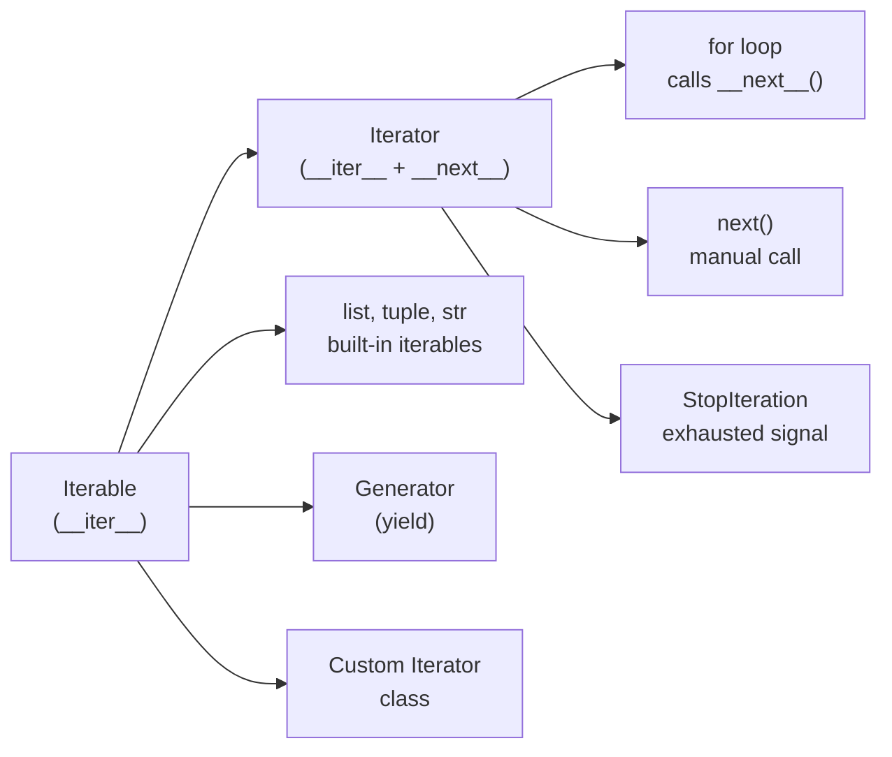

# Iterators in Python

## Overview

**Iterators** are objects that implement Python's **iterator protocol**: the `__iter__()` and `__next__()` methods. They represent a stream of data that can be consumed one element at a time, enabling lazy evaluation, memory efficiency, and composable data pipelines.

> **Core idea:** An iterator is an object that knows how to produce the next value on demand. It maintains state between calls and raises `StopIteration` when exhausted.

Iterators are the foundation of Python's `for` loop, comprehensions, `map()`, `filter()`, `zip()`, and the entire `itertools` module.

---

## Why It Matters

| Eager Evaluation (lists) | Lazy Evaluation (iterators) |
|---|---|
| All data in memory at once | One element at a time |
| O(n) memory | O(1) memory |
| Fast random access | Sequential access only |
| Reusable | Single-pass (exhausted after use) |
| `[x for x in data]` | `(x for x in data)` |

Iterators are used in:
- **Python's `for` loop** — works with any iterable/iterator
- **File I/O** — `open()` returns a line iterator
- **Database cursors** — lazy row-by-row fetching
- **RAG pipelines** — streaming document chunks
- **AI data loaders** — batch-by-batch training data
- **Network streams** — chunked HTTP responses
- **`itertools`** — infinite sequences, combinatorics

---

## Concept Map





---

## Simple Example

```python
# Understanding the iterator protocol manually

numbers = [10, 20, 30]

# Get an iterator from the list
it = iter(numbers)  # Calls numbers.__iter__()

print(next(it))  # 10 — calls it.__next__()
print(next(it))  # 20
print(next(it))  # 30

try:
    print(next(it))  # Raises StopIteration
except StopIteration:
    print("Iterator exhausted")

# The for loop does this automatically
for n in [10, 20, 30]:
    print(n)
# Equivalent to:
# it = iter([10, 20, 30])
# while True:
#     try:
#         n = next(it)
#         print(n)
#     except StopIteration:
#         break
```

**Explanation:**
- `iter(obj)` calls `obj.__iter__()` and returns an iterator.
- `next(it)` calls `it.__next__()` and returns the next value.
- `StopIteration` signals the end of the sequence.
- The `for` loop is syntactic sugar for this exact pattern.

**Expected Output:**
```
10
20
30
Iterator exhausted
10
20
30
```

---

## Intermediate Example

```python
from typing import Iterator, List
import time

class RangeIterator:
    """A custom range iterator — demonstrates the iterator protocol."""

    def __init__(self, start: int, stop: int, step: int = 1):
        if step == 0:
            raise ValueError("step cannot be zero")
        self._current = start
        self._stop = stop
        self._step = step

    def __iter__(self) -> "RangeIterator":
        return self  # Iterator returns itself

    def __next__(self) -> int:
        if (self._step > 0 and self._current >= self._stop) or \
           (self._step < 0 and self._current <= self._stop):
            raise StopIteration
        value = self._current
        self._current += self._step
        return value

    def __repr__(self) -> str:
        return f"RangeIterator({self._current}, {self._stop}, {self._step})"


# Usage
r = RangeIterator(0, 10, 2)
print(list(r))          # [0, 2, 4, 6, 8]

# Countdown
for n in RangeIterator(10, 0, -2):
    print(n, end=" ")   # 10 8 6 4 2
print()

# Works with all iterator consumers
r2 = RangeIterator(1, 6)
print(sum(r2))          # 15
print(list(map(lambda x: x**2, RangeIterator(1, 5))))  # [1, 4, 9, 16]

# Iterators are single-pass
r3 = RangeIterator(1, 4)
print(list(r3))  # [1, 2, 3]
print(list(r3))  # [] — exhausted!
```

**Explanation:**
- `__iter__` returns `self` — an iterator is its own iterator.
- `__next__` maintains state (`_current`) and raises `StopIteration` when done.
- Works with `list()`, `sum()`, `map()`, `for` — any iterator consumer.
- Single-pass: once exhausted, it stays exhausted.

**Expected Output:**
```
[0, 2, 4, 6, 8]
10 8 6 4 2
15
[1, 4, 9, 16]
[1, 2, 3]
[]
```

---

## Advanced / Architect-Level Example

### Problem Context

In a **RAG document ingestion pipeline**, documents arrive from multiple sources (files, databases, APIs). Processing them all in memory is infeasible for large corpora. An iterator-based pipeline processes documents lazily — one at a time — enabling streaming ingestion with constant memory usage regardless of corpus size.

```python
from __future__ import annotations
import time
from typing import Iterator, List, Optional, Dict, Any
from dataclasses import dataclass, field
from pathlib import Path


@dataclass
class Document:
    doc_id: str
    content: str
    source: str
    metadata: Dict[str, Any] = field(default_factory=dict)


@dataclass
class Chunk:
    chunk_id: str
    doc_id: str
    text: str
    metadata: Dict[str, Any] = field(default_factory=dict)


# --- Iterator-based pipeline stages ---

class DocumentIterator:
    """
    Lazily yields documents from a list of sources.
    Memory: O(1) — only one document in memory at a time.
    """
    def __init__(self, sources: List[str]):
        self._sources = sources
        self._index = 0

    def __iter__(self) -> "DocumentIterator":
        return self

    def __next__(self) -> Document:
        if self._index >= len(self._sources):
            raise StopIteration
        source = self._sources[self._index]
        self._index += 1
        # Simulate loading document from source
        return Document(
            doc_id=f"doc-{self._index:04d}",
            content=f"Content of {source}. " * 10,
            source=source,
        )

    def __len__(self) -> int:
        return len(self._sources)


class ChunkingIterator:
    """
    Wraps a document iterator and lazily yields chunks.
    Transforms: Iterator[Document] → Iterator[Chunk]
    """
    def __init__(self, doc_iter: Iterator[Document], chunk_size: int = 100):
        self._doc_iter = doc_iter
        self._chunk_size = chunk_size
        self._current_chunks: List[Chunk] = []
        self._chunk_index = 0
        self._total_chunks = 0

    def __iter__(self) -> "ChunkingIterator":
        return self

    def __next__(self) -> Chunk:
        # If we have buffered chunks, return the next one
        while self._chunk_index >= len(self._current_chunks):
            # Need more chunks — get next document
            doc = next(self._doc_iter)  # Raises StopIteration when docs exhausted
            self._current_chunks = self._split_document(doc)
            self._chunk_index = 0

        chunk = self._current_chunks[self._chunk_index]
        self._chunk_index += 1
        self._total_chunks += 1
        return chunk

    def _split_document(self, doc: Document) -> List[Chunk]:
        words = doc.content.split()
        chunks = []
        for i in range(0, len(words), self._chunk_size):
            text = " ".join(words[i:i + self._chunk_size])
            chunks.append(Chunk(
                chunk_id=f"{doc.doc_id}-c{i // self._chunk_size:03d}",
                doc_id=doc.doc_id,
                text=text,
                metadata={"source": doc.source},
            ))
        return chunks


class BatchingIterator:
    """
    Wraps any iterator and yields batches of items.
    Transforms: Iterator[T] → Iterator[List[T]]
    """
    def __init__(self, source_iter: Iterator, batch_size: int = 32):
        self._iter = source_iter
        self._batch_size = batch_size

    def __iter__(self) -> "BatchingIterator":
        return self

    def __next__(self) -> List:
        batch = []
        try:
            for _ in range(self._batch_size):
                batch.append(next(self._iter))
        except StopIteration:
            if not batch:
                raise
        return batch


class ProgressIterator:
    """
    Wraps any iterator and reports progress.
    Transparent wrapper — passes through all items unchanged.
    """
    def __init__(self, source_iter: Iterator, total: Optional[int] = None, name: str = ""):
        self._iter = source_iter
        self._total = total
        self._name = name
        self._count = 0
        self._start = time.time()

    def __iter__(self) -> "ProgressIterator":
        return self

    def __next__(self):
        item = next(self._iter)  # Propagates StopIteration
        self._count += 1
        if self._count % 10 == 0:
            elapsed = time.time() - self._start
            rate = self._count / elapsed if elapsed > 0 else 0
            total_str = f"/{self._total}" if self._total else ""
            print(f"[{self._name}] {self._count}{total_str} items @ {rate:.1f}/s")
        return item


# --- Pipeline composition ---

class IngestionPipeline:
    """
    Composes iterator stages into a streaming ingestion pipeline.
    Memory usage: O(batch_size) regardless of corpus size.
    """
    def __init__(self, sources: List[str], chunk_size: int = 50, batch_size: int = 4):
        self._sources = sources
        self._chunk_size = chunk_size
        self._batch_size = batch_size

    def run(self) -> Dict[str, int]:
        # Build the iterator pipeline
        doc_iter = DocumentIterator(self._sources)
        chunk_iter = ChunkingIterator(doc_iter, self._chunk_size)
        batch_iter = BatchingIterator(chunk_iter, self._batch_size)
        progress_iter = ProgressIterator(batch_iter, name="Ingestion")

        total_batches = 0
        total_chunks = 0

        for batch in progress_iter:
            # Process batch (simulate embedding + indexing)
            total_chunks += len(batch)
            total_batches += 1
            # In production: embed batch, upsert to vector store

        return {"batches": total_batches, "chunks": total_chunks}


# --- Usage ---
sources = [f"document_{i}.txt" for i in range(5)]
pipeline = IngestionPipeline(sources, chunk_size=20, batch_size=3)
stats = pipeline.run()
print(f"\nIngestion complete: {stats}")
```

**Explanation:**
- Each pipeline stage is an iterator that wraps the previous one — composable and lazy.
- `DocumentIterator` → `ChunkingIterator` → `BatchingIterator` → `ProgressIterator` — a streaming pipeline.
- Memory usage is O(batch_size) regardless of corpus size — critical for large document collections.
- `ProgressIterator` is a transparent wrapper — it doesn't change the data, only reports progress.
- `StopIteration` propagates naturally through the chain — no special handling needed.

**Design Trade-offs:**

| Approach | Pros | Cons |
|---|---|---|
| Iterator classes | Full control, stateful, composable | More boilerplate than generators |
| Generators (`yield`) | Concise, automatic state management | Less explicit state |
| `itertools` | Highly optimized, composable | Limited to built-in operations |
| Eager lists | Simple, random access | O(n) memory |

---

## Common Mistakes

### 1. Confusing Iterables and Iterators
```python
# ❌ Lists are iterables, not iterators
my_list = [1, 2, 3]
next(my_list)  # TypeError: 'list' object is not an iterator

# ✅ Get an iterator from an iterable
it = iter(my_list)
next(it)  # 1
```

---

### 2. Forgetting That Iterators Are Single-Pass
```python
# ❌ Trying to reuse an exhausted iterator
it = iter([1, 2, 3])
list(it)  # [1, 2, 3]
list(it)  # [] — exhausted!

# ✅ Create a new iterator or use an iterable
data = [1, 2, 3]
list(data)  # [1, 2, 3]
list(data)  # [1, 2, 3] — iterable creates a new iterator each time
```

---

### 3. Not Returning `self` from `__iter__`
```python
# ❌ __iter__ must return self for iterators
class MyIter:
    def __iter__(self):
        return iter([1, 2, 3])  # Wrong — creates a new iterator each time!

    def __next__(self):
        ...

# ✅ Return self
class MyIter:
    def __iter__(self):
        return self  # Iterator is its own iterator
```

---

### 4. Swallowing `StopIteration` in `__next__`
```python
# ❌ Catching StopIteration inside __next__ breaks the protocol
def __next__(self):
    try:
        return self._data[self._index]
    except IndexError:
        return None  # Should raise StopIteration!

# ✅ Raise StopIteration
def __next__(self):
    if self._index >= len(self._data):
        raise StopIteration
    value = self._data[self._index]
    self._index += 1
    return value
```

---

### 5. Modifying the Underlying Collection During Iteration
```python
# ❌ Modifying a list while iterating causes skipped elements
data = [1, 2, 3, 4, 5]
for item in data:
    if item % 2 == 0:
        data.remove(item)  # Skips elements!

# ✅ Iterate over a copy or use a comprehension
data = [x for x in data if x % 2 != 0]
```

---

## Best Practices

1. **Return `self` from `__iter__`** — iterators are their own iterators.
2. **Raise `StopIteration` from `__next__`** — never return a sentinel value.
3. **Keep iterators single-pass** — if you need multiple passes, use an iterable (implement `__iter__` to return a new iterator each time).
4. **Use generators for simple iterators** — `yield` is more concise than `__iter__`/`__next__`.
5. **Compose iterators** — wrap one iterator with another for pipeline stages.
6. **Use `itertools`** for common patterns: `chain`, `islice`, `takewhile`, `dropwhile`, `batched` (3.12+).
7. **Document memory behavior** — note whether your iterator is O(1) or O(n) memory.
8. **Handle `StopIteration` propagation** — in wrapper iterators, let `StopIteration` from the inner iterator propagate naturally.
9. **Use `__length_hint__`** for iterators with known approximate lengths — enables progress bars.
10. **Test exhaustion behavior** — always test what happens after the iterator is exhausted.

---

## Performance Considerations

- **Memory**: Iterators use O(1) memory — only the current element and state are in memory. Lists use O(n).
- **Speed**: Iterating over a list is slightly faster than a custom iterator due to C-level optimization. For large datasets, the memory savings outweigh the speed difference.
- **`itertools`**: Implemented in C — significantly faster than equivalent Python iterators.
- **Generator expressions** `(x for x in data)` are slightly faster than equivalent iterator classes due to less overhead.
- **`next()` with default**: `next(it, default)` avoids `try/except` overhead for optional iteration.
- **Chained iterators**: Each `next()` call traverses the chain — for deep chains (10+ levels), consider flattening.

---

## Testing Strategy

```python
# test_iterators.py
import pytest
from your_module import RangeIterator, DocumentIterator, ChunkingIterator, BatchingIterator


# --- Test basic iterator protocol ---
def test_range_iterator_basic():
    r = RangeIterator(0, 5)
    assert list(r) == [0, 1, 2, 3, 4]


def test_range_iterator_step():
    r = RangeIterator(0, 10, 2)
    assert list(r) == [0, 2, 4, 6, 8]


def test_range_iterator_countdown():
    r = RangeIterator(5, 0, -1)
    assert list(r) == [5, 4, 3, 2, 1]


def test_range_iterator_exhaustion():
    r = RangeIterator(0, 3)
    list(r)  # Exhaust
    assert list(r) == []  # Empty after exhaustion


def test_range_iterator_stop_iteration():
    r = RangeIterator(0, 1)
    next(r)  # 0
    with pytest.raises(StopIteration):
        next(r)


def test_range_iterator_is_own_iterator():
    r = RangeIterator(0, 3)
    assert iter(r) is r


def test_range_iterator_zero_step_raises():
    with pytest.raises(ValueError):
        RangeIterator(0, 10, 0)


# --- Test document iterator ---
def test_document_iterator_yields_all():
    sources = ["a.txt", "b.txt", "c.txt"]
    docs = list(DocumentIterator(sources))
    assert len(docs) == 3
    assert docs[0].source == "a.txt"


def test_document_iterator_single_pass():
    it = DocumentIterator(["a.txt"])
    list(it)
    assert list(it) == []


# --- Test chunking iterator ---
def test_chunking_iterator_produces_chunks():
    doc_iter = DocumentIterator(["doc1.txt"])
    chunk_iter = ChunkingIterator(doc_iter, chunk_size=5)
    chunks = list(chunk_iter)
    assert len(chunks) > 0
    assert all(hasattr(c, "text") for c in chunks)


# --- Test batching iterator ---
def test_batching_iterator_batch_size():
    data = iter(range(10))
    batches = list(BatchingIterator(data, batch_size=3))
    assert batches[0] == [0, 1, 2]
    assert batches[1] == [3, 4, 5]
    assert batches[-1] == [9]  # Partial last batch


def test_batching_iterator_empty():
    batches = list(BatchingIterator(iter([]), batch_size=3))
    assert batches == []


# --- Test with itertools ---
def test_iterator_with_itertools():
    import itertools
    r = RangeIterator(0, 100)
    first_five = list(itertools.islice(r, 5))
    assert first_five == [0, 1, 2, 3, 4]
```

---

## Debugging Tips

1. **`TypeError: 'X' object is not an iterator`** — you're calling `next()` on an iterable, not an iterator. Call `iter(obj)` first.

2. **`TypeError: 'X' object is not iterable`** — the object doesn't implement `__iter__`. Check if it's a custom class missing `__iter__`.

3. **Iterator returns empty on second pass** — iterators are single-pass. If you need multiple passes, use an iterable (a class where `__iter__` returns a new iterator each time).

4. **Unexpected `StopIteration` inside a generator** — in Python 3.7+, `StopIteration` raised inside a generator is converted to `RuntimeError`. Use `return` instead of `raise StopIteration` in generators.

5. **Use `list(it)` to materialize** an iterator for debugging — see all remaining values at once.

6. **Check iterator state** by inspecting instance variables: `print(it.__dict__)`.

7. **`itertools.islice(it, n)`** — peek at the first n items without exhausting the iterator (but it does consume them).

---

## Interview Questions

### Beginner

**Q1: What is the difference between an iterable and an iterator?**  
A: An iterable implements `__iter__()` and returns an iterator. An iterator implements both `__iter__()` (returns `self`) and `__next__()` (returns the next value or raises `StopIteration`).

**Q2: What does `iter()` do?**  
A: Calls `obj.__iter__()` and returns an iterator. For sequences, it creates a new iterator each time.

**Q3: What does `next()` do?**  
A: Calls `it.__next__()` and returns the next value. Raises `StopIteration` when the iterator is exhausted. Accepts an optional default: `next(it, default)`.

**Q4: Why do iterators return `self` from `__iter__`?**  
A: So that iterators can be used directly in `for` loops and other iterator consumers. An iterator is its own iterator.

**Q5: What is `StopIteration`?**  
A: An exception that signals the end of an iterator. The `for` loop catches it automatically to stop iteration.

---

### Intermediate

**Q6: What is the difference between an iterator and a generator?**  
A: A generator is a special iterator created with `yield`. It automatically implements `__iter__` and `__next__`, and manages state via the call stack. Custom iterators use explicit `__iter__`/`__next__` methods.

**Q7: How does the `for` loop work internally?**  
A: It calls `iter(obj)` to get an iterator, then repeatedly calls `next(it)` until `StopIteration` is raised.

**Q8: Can you iterate over an iterator multiple times?**  
A: No. Iterators are single-pass. Once exhausted, they stay exhausted. To iterate multiple times, use an iterable (where `__iter__` returns a new iterator each time).

**Q9: What is `itertools.chain` and how does it use iterators?**  
A: `itertools.chain(*iterables)` creates an iterator that yields from each iterable in sequence. It's lazy — it doesn't load all iterables into memory.

**Q10: How do you create an infinite iterator?**  
A: Implement `__next__` without a termination condition, or use `itertools.count()`, `itertools.cycle()`, or `itertools.repeat()`.

---

### Advanced / Architect-Level

**Q11: How would you implement a lazy, memory-efficient document processing pipeline using iterators?**  
A: Chain iterator stages: `DocumentIterator` → `ChunkingIterator` → `BatchingIterator` → `EmbeddingIterator`. Each stage wraps the previous one. Memory usage is O(batch_size) regardless of corpus size. `StopIteration` propagates naturally through the chain.

**Q12: What is `__length_hint__` and when should you implement it?**  
A: `__length_hint__` returns an estimated length for iterators that don't have an exact length. Used by `list()` and other consumers to pre-allocate memory. Implement it when you have a reasonable estimate — it's an optimization hint, not a guarantee.

**Q13: How does Python 3.7+ handle `StopIteration` inside generators differently from earlier versions?**  
A: In Python 3.7+, `StopIteration` raised inside a generator body is converted to `RuntimeError` (PEP 479). This prevents accidental iterator exhaustion from propagating as a normal `StopIteration`. Use `return` to stop a generator, not `raise StopIteration`.

**Q14: How would you implement a thread-safe iterator for a concurrent pipeline?**  
A: Use a `threading.Lock` in `__next__` to protect the state update. Alternatively, use a `queue.Queue` as the backing store — `Queue.get()` is thread-safe. For async pipelines, use `async for` with `__aiter__` and `__anext__`.

**Q15: How do iterators interact with Python's `pickle` module?**  
A: Most custom iterators can be pickled if their state (`__dict__`) is picklable. Generators cannot be pickled. For distributed pipelines, prefer iterator classes over generators for serializable state.

---

## Key Takeaways

- Iterators implement `__iter__()` (returns `self`) and `__next__()` (returns next value or raises `StopIteration`).
- Iterables implement `__iter__()` and return a new iterator each time — they can be iterated multiple times.
- Iterators are single-pass — once exhausted, they stay exhausted.
- The `for` loop is syntactic sugar for `iter()` + `next()` + `StopIteration` handling.
- Iterators enable lazy evaluation — O(1) memory regardless of data size.
- Compose iterators for streaming pipelines — each stage wraps the previous one.
- `itertools` provides highly optimized, composable iterator utilities.
- Generators are the concise alternative to iterator classes — use `yield` for simple cases.
- `StopIteration` propagates naturally through iterator chains — no special handling needed.
- Mastering iterators is essential for building memory-efficient, streaming data pipelines in Python.

---

## Mini Project Idea

### Goal
Build a **Streaming Log Analyzer** — an iterator-based pipeline that processes large log files lazily, filtering, transforming, and aggregating log entries without loading the entire file into memory.

### Features
- `LogLineIterator` — reads log file line by line (lazy).
- `FilterIterator` — filters lines by log level, date range, or regex.
- `ParseIterator` — parses raw log lines into structured `LogEntry` objects.
- `BatchIterator` — groups entries into batches for bulk processing.
- `AggregatorIterator` — computes rolling statistics (error rate, request count).
- CLI: `python analyze.py --file app.log --level ERROR --since 2024-01-01`.

### Suggested Folder Structure
```
log_analyzer/
├── iterators/
│   ├── __init__.py
│   ├── log_line.py
│   ├── filter.py
│   ├── parse.py
│   ├── batch.py
│   └── aggregator.py
├── models/
│   └── log_entry.py
├── pipeline/
│   └── analyzer.py
├── tests/
│   ├── test_iterators.py
│   └── test_pipeline.py
├── cli.py
└── README.md
```

### Extension Ideas
- Add `TailIterator` that follows a live log file (like `tail -f`).
- Add async support with `__aiter__`/`__anext__` for async log sources.
- Add `SamplingIterator` that randomly samples entries.
- Benchmark memory usage vs. loading the full file.

---

## Final Summary

Mastering iterators is mastering Python's lazy evaluation model. Iterators are the foundation of Python's `for` loop, comprehensions, `map()`, `filter()`, `zip()`, and the entire `itertools` ecosystem. For a Python architect, iterators are the tool of choice for building memory-efficient, streaming data pipelines — from log analyzers to RAG document ingestion to ML data loaders. Understanding the iterator protocol deeply — the difference between iterables and iterators, single-pass semantics, `StopIteration` propagation, and iterator composition — is what enables you to build systems that scale to arbitrarily large datasets with constant memory usage. This is a fundamental skill for any production Python architect.
