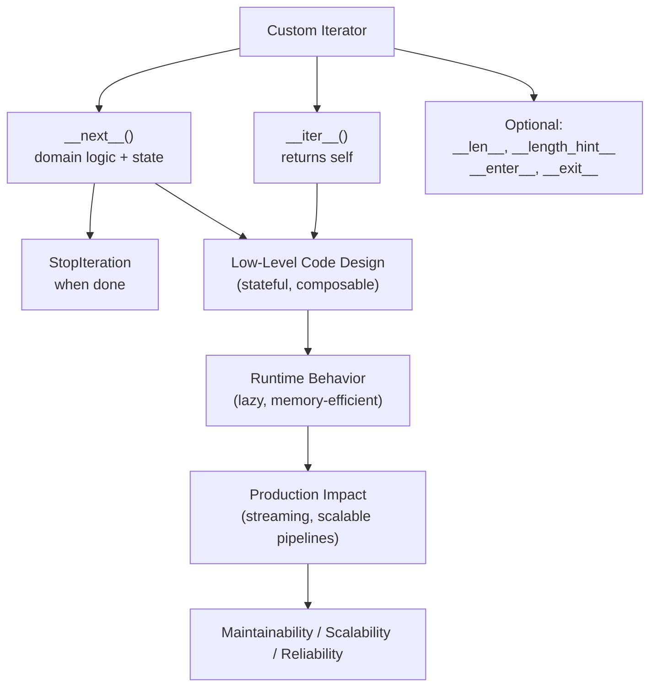
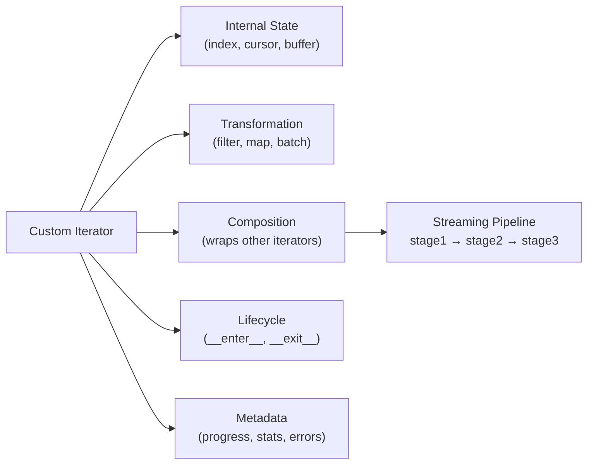

# Custom Iterators in Python

## Overview

**Custom Iterators** are user-defined classes that implement Python's iterator protocol (`__iter__` and `__next__`) to provide specialized, stateful, lazy traversal over any data source — files, databases, APIs, graphs, trees, or computed sequences. They go beyond built-in iterators by encoding domain-specific traversal logic, transformation, filtering, and composition.

> **Core idea:** When Python's built-in iterators and generators aren't expressive enough for your domain, custom iterator classes give you full control over traversal state, behavior, and lifecycle.

Custom iterators are the foundation of production-grade streaming pipelines, lazy data loaders, and composable processing chains.

---

## Why It Matters

| Built-in Iterators | Custom Iterators |
|---|---|
| Fixed traversal logic | Domain-specific traversal |
| No custom state | Rich stateful behavior |
| No lifecycle hooks | `__enter__`/`__exit__` support |
| No metadata | Progress tracking, statistics |
| Not serializable | Can implement `__getstate__` |

Custom iterators are used in:
- **ML data loaders** — `DataLoader` in PyTorch uses custom iterators
- **Database cursors** — lazy row-by-row fetching with connection management
- **Tree/graph traversal** — BFS, DFS, topological sort
- **Streaming APIs** — paginated API responses as a flat iterator
- **RAG pipelines** — document chunk iterators with metadata
- **File processing** — multi-file iterators with encoding handling

---

## Concept Map





---

## Simple Example

```python
class FibonacciIterator:
    """Yields Fibonacci numbers up to a maximum value."""

    def __init__(self, max_value: int):
        self._max = max_value
        self._a = 0
        self._b = 1

    def __iter__(self) -> "FibonacciIterator":
        return self

    def __next__(self) -> int:
        if self._a > self._max:
            raise StopIteration
        value = self._a
        self._a, self._b = self._b, self._a + self._b
        return value

    def __repr__(self) -> str:
        return f"FibonacciIterator(max={self._max}, current={self._a})"


# Usage
fib = FibonacciIterator(100)
print(list(fib))  # [0, 1, 1, 2, 3, 5, 8, 13, 21, 34, 55, 89]

# Works with all iterator consumers
fib2 = FibonacciIterator(50)
print(sum(fib2))  # 88

# Works with zip
fib3 = FibonacciIterator(20)
for i, f in enumerate(fib3):
    print(f"F({i}) = {f}")
```

**Explanation:**
- `__iter__` returns `self` — the iterator is its own iterator.
- `__next__` maintains state (`_a`, `_b`) and computes the next Fibonacci number.
- `StopIteration` is raised when `_a` exceeds `max_value`.
- Works with `list()`, `sum()`, `zip()`, `for` — any iterator consumer.

**Expected Output:**
```
[0, 1, 1, 2, 3, 5, 8, 13, 21, 34, 55, 89]
88
F(0) = 0
F(1) = 1
...
```

---

## Intermediate Example

```python
from typing import Iterator, List, Optional, Callable, TypeVar, Generic
from pathlib import Path
import csv

T = TypeVar("T")


class CSVIterator:
    """
    Lazily reads a CSV file row by row.
    Supports filtering, transformation, and progress tracking.
    """

    def __init__(
        self,
        filepath: str,
        delimiter: str = ",",
        skip_header: bool = True,
        filter_fn: Optional[Callable[[dict], bool]] = None,
        transform_fn: Optional[Callable[[dict], dict]] = None,
    ):
        self._filepath = Path(filepath)
        self._delimiter = delimiter
        self._skip_header = skip_header
        self._filter_fn = filter_fn
        self._transform_fn = transform_fn
        self._file = None
        self._reader = None
        self._row_count = 0
        self._yielded_count = 0

    def __iter__(self) -> "CSVIterator":
        self._file = open(self._filepath, newline="", encoding="utf-8")
        self._reader = csv.DictReader(self._file, delimiter=self._delimiter)
        return self

    def __next__(self) -> dict:
        while True:
            try:
                row = next(self._reader)
                self._row_count += 1
            except StopIteration:
                self._file.close()
                raise

            # Apply filter
            if self._filter_fn and not self._filter_fn(row):
                continue

            # Apply transformation
            if self._transform_fn:
                row = self._transform_fn(row)

            self._yielded_count += 1
            return row

    def __del__(self):
        if self._file and not self._file.closed:
            self._file.close()

    @property
    def stats(self) -> dict:
        return {
            "rows_read": self._row_count,
            "rows_yielded": self._yielded_count,
            "filter_rate": (
                1 - self._yielded_count / self._row_count
                if self._row_count > 0 else 0
            ),
        }


class TransformIterator(Generic[T]):
    """
    Wraps any iterator and applies a transformation function.
    Generic: works with any element type.
    """

    def __init__(self, source: Iterator[T], transform: Callable[[T], T]):
        self._source = source
        self._transform = transform

    def __iter__(self) -> "TransformIterator":
        return self

    def __next__(self) -> T:
        item = next(self._source)  # Propagates StopIteration
        return self._transform(item)


class TakeIterator(Generic[T]):
    """Yields at most n items from the source iterator."""

    def __init__(self, source: Iterator[T], n: int):
        self._source = source
        self._n = n
        self._count = 0

    def __iter__(self) -> "TakeIterator":
        return self

    def __next__(self) -> T:
        if self._count >= self._n:
            raise StopIteration
        item = next(self._source)
        self._count += 1
        return item


# --- Demo with synthetic data ---
import io
import csv as csv_module

# Create synthetic CSV data
csv_data = """name,age,department,salary
Alice,30,Engineering,95000
Bob,25,Marketing,65000
Carol,35,Engineering,110000
Dave,28,HR,55000
Eve,32,Engineering,98000
"""

# Write to a temp file for demo
import tempfile, os
with tempfile.NamedTemporaryFile(mode="w", suffix=".csv", delete=False, newline="") as f:
    f.write(csv_data)
    tmp_path = f.name

# Use the custom iterator
it = CSVIterator(
    tmp_path,
    filter_fn=lambda row: row["department"] == "Engineering",
    transform_fn=lambda row: {**row, "salary": int(row["salary"])},
)

engineers = list(it)
print(f"Engineers: {engineers}")
print(f"Stats: {it.stats}")

# Compose with TakeIterator
it2 = CSVIterator(tmp_path)
first_two = list(TakeIterator(it2, 2))
print(f"First two rows: {first_two}")

os.unlink(tmp_path)
```

**Explanation:**
- `CSVIterator` opens the file lazily in `__iter__` — not in `__init__`.
- Filter and transform are applied per-row — no intermediate list.
- `stats` property provides runtime metrics.
- `TransformIterator` and `TakeIterator` are composable wrappers.
- `StopIteration` from `next(self._reader)` propagates naturally.

---

## Advanced / Architect-Level Example

### Problem Context

In a **production RAG ingestion system**, documents arrive from multiple heterogeneous sources (S3, databases, APIs). A custom iterator hierarchy provides a unified, lazy, resumable, and observable streaming interface — with progress tracking, error handling, and checkpoint support.

```python
from __future__ import annotations
import time
import uuid
from abc import ABC, abstractmethod
from typing import Iterator, List, Optional, Dict, Any, Callable
from dataclasses import dataclass, field
from enum import Enum


class IteratorState(Enum):
    READY = "ready"
    RUNNING = "running"
    PAUSED = "paused"
    EXHAUSTED = "exhausted"
    ERROR = "error"


@dataclass
class IteratorCheckpoint:
    """Serializable state for resumable iterators."""
    iterator_id: str
    position: int
    metadata: Dict[str, Any] = field(default_factory=dict)
    timestamp: float = field(default_factory=time.time)


@dataclass
class Document:
    doc_id: str
    content: str
    source: str
    metadata: Dict[str, Any] = field(default_factory=dict)


class ObservableIterator(ABC):
    """
    Abstract base for observable, resumable custom iterators.
    Provides lifecycle hooks, progress tracking, and checkpoint support.
    """

    def __init__(self, iterator_id: Optional[str] = None):
        self._id = iterator_id or str(uuid.uuid4())[:8]
        self._state = IteratorState.READY
        self._position = 0
        self._errors: List[Exception] = []
        self._hooks: Dict[str, List[Callable]] = {
            "on_item": [],
            "on_error": [],
            "on_complete": [],
        }

    @abstractmethod
    def _fetch_next(self) -> Any:
        """Fetch the next item. Raise StopIteration when done."""
        ...

    def __iter__(self) -> "ObservableIterator":
        self._state = IteratorState.RUNNING
        return self

    def __next__(self) -> Any:
        try:
            item = self._fetch_next()
            self._position += 1
            self._fire("on_item", item=item, position=self._position)
            return item
        except StopIteration:
            self._state = IteratorState.EXHAUSTED
            self._fire("on_complete", total=self._position)
            raise
        except Exception as e:
            self._errors.append(e)
            self._state = IteratorState.ERROR
            self._fire("on_error", error=e, position=self._position)
            raise

    def on(self, event: str, handler: Callable) -> "ObservableIterator":
        """Register a lifecycle hook. Returns self for chaining."""
        self._hooks[event].append(handler)
        return self

    def _fire(self, event: str, **kwargs) -> None:
        for handler in self._hooks.get(event, []):
            try:
                handler(**kwargs)
            except Exception:
                pass  # Don't let hook errors break iteration

    def checkpoint(self) -> IteratorCheckpoint:
        return IteratorCheckpoint(
            iterator_id=self._id,
            position=self._position,
            metadata={"state": self._state.value},
        )

    @property
    def progress(self) -> dict:
        return {
            "id": self._id,
            "state": self._state.value,
            "position": self._position,
            "errors": len(self._errors),
        }


class S3DocumentIterator(ObservableIterator):
    """
    Lazily fetches documents from S3 (simulated).
    Supports pagination and resumption from checkpoint.
    """

    def __init__(
        self,
        bucket: str,
        prefix: str,
        page_size: int = 10,
        start_position: int = 0,
    ):
        super().__init__(iterator_id=f"s3-{bucket}-{prefix}")
        self._bucket = bucket
        self._prefix = prefix
        self._page_size = page_size
        self._position = start_position
        self._buffer: List[Document] = []
        self._buffer_index = 0
        self._total_available = 50  # Simulated total

    def _fetch_next(self) -> Document:
        # Refill buffer if empty
        if self._buffer_index >= len(self._buffer):
            if self._position >= self._total_available:
                raise StopIteration
            self._buffer = self._fetch_page(self._position)
            self._buffer_index = 0

        if not self._buffer:
            raise StopIteration

        doc = self._buffer[self._buffer_index]
        self._buffer_index += 1
        return doc

    def _fetch_page(self, offset: int) -> List[Document]:
        """Simulate S3 paginated fetch."""
        end = min(offset + self._page_size, self._total_available)
        return [
            Document(
                doc_id=f"{self._bucket}/{self._prefix}/doc-{i:04d}",
                content=f"Document {i} content from S3.",
                source=f"s3://{self._bucket}/{self._prefix}",
                metadata={"index": i},
            )
            for i in range(offset, end)
        ]


class FilteringIterator(ObservableIterator):
    """Wraps any ObservableIterator and filters items."""

    def __init__(
        self,
        source: Iterator,
        predicate: Callable[[Any], bool],
        iterator_id: Optional[str] = None,
    ):
        super().__init__(iterator_id=iterator_id or f"filter-{id(source)}")
        self._source = source
        self._predicate = predicate
        self._filtered_count = 0

    def _fetch_next(self) -> Any:
        while True:
            item = next(self._source)  # Propagates StopIteration
            if self._predicate(item):
                return item
            self._filtered_count += 1

    @property
    def progress(self) -> dict:
        return {**super().progress, "filtered": self._filtered_count}


class BatchingIterator(ObservableIterator):
    """Wraps any iterator and yields batches."""

    def __init__(self, source: Iterator, batch_size: int = 32):
        super().__init__(iterator_id=f"batch-{id(source)}")
        self._source = source
        self._batch_size = batch_size

    def _fetch_next(self) -> List:
        batch = []
        try:
            for _ in range(self._batch_size):
                batch.append(next(self._source))
        except StopIteration:
            if not batch:
                raise
        return batch


# --- Pipeline composition ---

def build_ingestion_pipeline(
    bucket: str,
    prefix: str,
    min_content_length: int = 10,
    batch_size: int = 5,
) -> BatchingIterator:
    """Build a composable, observable ingestion pipeline."""

    source = S3DocumentIterator(bucket, prefix, page_size=10)
    filtered = FilteringIterator(
        source,
        predicate=lambda doc: len(doc.content) >= min_content_length,
    )
    batched = BatchingIterator(filtered, batch_size=batch_size)

    # Register lifecycle hooks
    source.on("on_item", lambda item, position: None)  # Could log to metrics
    batched.on("on_complete", lambda total: print(f"Pipeline complete: {total} batches"))

    return batched


# --- Usage ---
pipeline = build_ingestion_pipeline("my-bucket", "docs/", batch_size=5)

total_docs = 0
for batch in pipeline:
    total_docs += len(batch)
    # In production: embed batch, upsert to vector store
    print(f"Batch of {len(batch)}: {[d.doc_id for d in batch[:2]]}...")

print(f"\nTotal documents processed: {total_docs}")
print(f"Pipeline progress: {pipeline.progress}")
print(f"Checkpoint: {pipeline.checkpoint()}")
```

**Explanation:**
- `ObservableIterator` is an abstract base with lifecycle hooks, progress tracking, and checkpoint support.
- `S3DocumentIterator` implements paginated, lazy fetching — only one page in memory at a time.
- `FilteringIterator` and `BatchingIterator` are composable wrappers.
- Lifecycle hooks enable observability without modifying iterator logic.
- Checkpoints enable resumption after failure — critical for long-running ingestion jobs.

**Design Trade-offs:**

| Approach | Pros | Cons |
|---|---|---|
| Custom iterator classes | Full control, stateful, resumable | More boilerplate than generators |
| Generators | Concise, automatic state | No lifecycle hooks, not resumable |
| `itertools` | Optimized, composable | Limited to built-in operations |
| Async iterators | Non-blocking I/O | More complex, requires async context |

---

## Common Mistakes

### 1. Opening Resources in `__init__` Instead of `__iter__`
```python
# ❌ File opened at construction — may not be used
class FileIterator:
    def __init__(self, path):
        self._file = open(path)  # Opened immediately!

# ✅ Open in __iter__ — lazy resource acquisition
class FileIterator:
    def __init__(self, path):
        self._path = path
        self._file = None

    def __iter__(self):
        self._file = open(self._path)
        return self
```

---

### 2. Not Closing Resources on Exhaustion
```python
# ❌ File never closed if StopIteration is raised
def __next__(self):
    line = self._file.readline()
    if not line:
        raise StopIteration  # File not closed!

# ✅ Close on exhaustion
def __next__(self):
    line = self._file.readline()
    if not line:
        self._file.close()
        raise StopIteration
```

---

### 3. Swallowing `StopIteration` in Wrapper Iterators
```python
# ❌ Catches StopIteration and returns None — breaks the protocol
def __next__(self):
    try:
        return next(self._source)
    except StopIteration:
        return None  # Wrong! Should re-raise

# ✅ Let StopIteration propagate
def __next__(self):
    return next(self._source)  # StopIteration propagates naturally
```

---

### 4. Making `__iter__` Reset State (Confusing Iterable/Iterator)
```python
# ❌ __iter__ resets state — iterator becomes reusable but confusing
class MyIter:
    def __iter__(self):
        self._index = 0  # Resets on each for loop!
        return self

# ✅ If you want reusability, make it an iterable that returns a new iterator
class MyIterable:
    def __iter__(self):
        return MyIterator(self._data)  # New iterator each time
```

---

### 5. Not Implementing `__length_hint__` for Known-Size Iterators
```python
# ❌ Missing length hint — progress bars and pre-allocation can't work
class PagedIterator:
    def __init__(self, total: int, page_size: int):
        self._total = total
        ...

# ✅ Implement __length_hint__ for optimization hints
    def __length_hint__(self) -> int:
        return max(0, self._total - self._position)
```

---

## Best Practices

1. **Open resources in `__iter__`, not `__init__`** — lazy resource acquisition.
2. **Close resources on `StopIteration`** — prevent resource leaks.
3. **Implement `__enter__`/`__exit__`** for iterators that hold resources — use as context managers.
4. **Let `StopIteration` propagate** in wrapper iterators — don't catch and swallow it.
5. **Return `self` from `__iter__`** — iterators are their own iterators.
6. **Implement `__length_hint__`** for iterators with known approximate sizes.
7. **Add progress tracking** as a property — `position`, `total`, `elapsed`.
8. **Support checkpointing** for long-running iterators — enable resumption after failure.
9. **Use `__repr__`** to show current state — invaluable for debugging.
10. **Test exhaustion, partial iteration, and error cases** — not just the happy path.

---

## Performance Considerations

- **Memory**: Custom iterators use O(1) memory for the current item + state. Buffer-based iterators use O(buffer_size).
- **Speed**: Custom iterator classes have slightly more overhead than generators due to method dispatch. For tight loops, consider generators.
- **Resource management**: Opening/closing files per iteration is expensive. Use buffered reads (page_size > 1).
- **`__length_hint__`**: Implementing this allows `list()` and other consumers to pre-allocate memory — significant speedup for large iterators.
- **Composition depth**: Each wrapper adds one `next()` call overhead. For 5+ levels of wrapping, consider flattening the pipeline.
- **Caching**: If the same iterator is consumed multiple times, cache results with `itertools.tee()` or materialize to a list.

---

## Testing Strategy

```python
# test_custom_iterators.py
import pytest
from your_module import (
    FibonacciIterator, CSVIterator, FilteringIterator,
    BatchingIterator, S3DocumentIterator
)


# --- Test FibonacciIterator ---
def test_fibonacci_basic():
    assert list(FibonacciIterator(10)) == [0, 1, 1, 2, 3, 5, 8]

def test_fibonacci_zero():
    assert list(FibonacciIterator(0)) == [0]

def test_fibonacci_is_own_iterator():
    fib = FibonacciIterator(10)
    assert iter(fib) is fib

def test_fibonacci_exhaustion():
    fib = FibonacciIterator(5)
    list(fib)
    with pytest.raises(StopIteration):
        next(fib)


# --- Test FilteringIterator ---
def test_filtering_iterator_filters():
    source = iter([1, 2, 3, 4, 5, 6])
    evens = FilteringIterator(source, lambda x: x % 2 == 0)
    assert list(evens) == [2, 4, 6]

def test_filtering_iterator_empty_source():
    source = iter([])
    filtered = FilteringIterator(source, lambda x: True)
    assert list(filtered) == []

def test_filtering_iterator_all_filtered():
    source = iter([1, 3, 5])
    filtered = FilteringIterator(source, lambda x: x % 2 == 0)
    assert list(filtered) == []


# --- Test BatchingIterator ---
def test_batching_iterator_full_batches():
    source = iter(range(6))
    batches = list(BatchingIterator(source, batch_size=2))
    assert batches == [[0, 1], [2, 3], [4, 5]]

def test_batching_iterator_partial_last_batch():
    source = iter(range(5))
    batches = list(BatchingIterator(source, batch_size=2))
    assert batches[-1] == [4]

def test_batching_iterator_empty():
    batches = list(BatchingIterator(iter([]), batch_size=3))
    assert batches == []


# --- Test S3DocumentIterator ---
def test_s3_iterator_yields_documents():
    it = S3DocumentIterator("bucket", "prefix/", page_size=5)
    docs = list(it)
    assert len(docs) == 50  # Simulated total

def test_s3_iterator_progress():
    it = S3DocumentIterator("bucket", "prefix/", page_size=5)
    for _ in it:
        pass
    assert it.progress["state"] == "exhausted"
    assert it.progress["position"] == 50


# --- Test pipeline composition ---
def test_pipeline_composition():
    source = iter(range(20))
    filtered = FilteringIterator(source, lambda x: x % 2 == 0)
    batched = BatchingIterator(filtered, batch_size=3)
    batches = list(batched)
    # Even numbers: 0,2,4,6,8,10,12,14,16,18 → 10 items → 4 batches (3,3,3,1)
    assert len(batches) == 4
    assert batches[0] == [0, 2, 4]
    assert batches[-1] == [18]


# --- Test lifecycle hooks ---
def test_lifecycle_hooks():
    items_seen = []
    source = S3DocumentIterator("b", "p/", page_size=10)
    source.on("on_item", lambda item, position: items_seen.append(position))

    docs = list(source)
    assert len(items_seen) == len(docs)
    assert items_seen == list(range(1, len(docs) + 1))
```

---

## Debugging Tips

1. **Add `__repr__`** to show current state:
   ```python
   def __repr__(self):
       return f"MyIterator(position={self._position}, state={self._state})"
   ```

2. **Use `itertools.islice(it, n)`** to peek at the first n items without exhausting the iterator.

3. **Materialize with `list(it)`** during debugging to see all remaining items at once.

4. **Check `it.progress`** or `it.__dict__`** to inspect internal state.

5. **`StopIteration` raised unexpectedly** — check if a wrapper iterator is catching and swallowing `StopIteration` from the inner iterator.

6. **Resource leak** — if files/connections aren't closed, add `__del__` as a safety net and implement `__enter__`/`__exit__` for proper context manager support.

7. **`RuntimeError: generator raised StopIteration`** — in Python 3.7+, `StopIteration` inside a generator is converted to `RuntimeError`. Use `return` instead of `raise StopIteration` in generators.

8. **Infinite loop in `FilteringIterator`** — if the predicate never matches, the iterator loops forever. Add a max-skip limit or check for empty source.

---

## Interview Questions

### Beginner

**Q1: What is a custom iterator?**  
A: A class that implements `__iter__()` (returns `self`) and `__next__()` (returns the next value or raises `StopIteration`), providing domain-specific traversal logic.

**Q2: Why would you use a custom iterator instead of a generator?**  
A: When you need explicit state management, lifecycle hooks, progress tracking, checkpointing, resource management, or when the iterator needs to be serializable/resumable.

**Q3: What is the difference between an iterable and an iterator?**  
A: An iterable implements `__iter__()` and returns a new iterator each time. An iterator implements both `__iter__()` (returns `self`) and `__next__()`.

**Q4: How do you make a custom iterator work as a context manager?**  
A: Implement `__enter__` (returns `self`) and `__exit__` (closes resources). Then use `with MyIterator() as it: for item in it: ...`.

**Q5: What happens if `__next__` doesn't raise `StopIteration`?**  
A: The `for` loop runs forever — an infinite iterator. This is valid for infinite sequences (like `itertools.count()`), but unintentional for finite ones.

---

### Intermediate

**Q6: How do you implement a resumable iterator?**  
A: Store the current position as state. Implement a `checkpoint()` method that serializes the position. Implement `from_checkpoint(cp)` that restores the position and resumes from there.

**Q7: How do you compose multiple custom iterators into a pipeline?**  
A: Each iterator wraps the previous one: `BatchingIterator(FilteringIterator(SourceIterator()))`. `StopIteration` propagates naturally through the chain.

**Q8: What is `__length_hint__` and why is it useful?**  
A: An optional method that returns an estimated length. Used by `list()` and other consumers to pre-allocate memory. Implementing it can significantly speed up materialization of large iterators.

**Q9: How do you handle errors in a custom iterator without breaking the pipeline?**  
A: Catch exceptions in `__next__`, log them, and either skip the item (continue to next) or re-raise. Use lifecycle hooks (`on_error`) to notify observers without breaking the iteration.

**Q10: How do you make a custom iterator thread-safe?**  
A: Use `threading.Lock` in `__next__` to protect state updates. Alternatively, use a `queue.Queue` as the backing store — `Queue.get()` is thread-safe.

---

### Advanced / Architect-Level

**Q11: How would you implement a distributed, resumable iterator for a large-scale document ingestion system?**  
A: Use a checkpoint store (Redis, DynamoDB) to persist `IteratorCheckpoint` objects. On failure, restore from the last checkpoint. Use a work queue (SQS, Kafka) as the backing store — each `__next__` call dequeues one item. Implement `__enter__`/`__exit__` for connection management.

**Q12: How do async iterators (`__aiter__`, `__anext__`) differ from sync iterators?**  
A: Async iterators use `async def __anext__` and are consumed with `async for`. They enable non-blocking I/O — each `__anext__` call can `await` a coroutine. Use for async database queries, HTTP requests, and message queues.

**Q13: How would you implement a memory-bounded iterator that limits total memory usage?**  
A: Track the size of each item (e.g., `sys.getsizeof(item)`). Maintain a running total. When the total exceeds the limit, pause and wait for consumers to process items (using a `threading.Semaphore` or `asyncio.Semaphore`).

**Q14: How does PyTorch's `DataLoader` use custom iterators?**  
A: `DataLoader` creates a `_SingleProcessDataLoaderIter` or `_MultiProcessingDataLoaderIter` — custom iterators that implement `__next__` to fetch batches from a `Dataset`, apply transforms, and optionally shuffle. The iterator manages worker processes and shared memory.

**Q15: How would you implement a custom iterator that supports both `for` loops and `with` statements?**  
A: Implement all four methods: `__iter__`, `__next__`, `__enter__`, `__exit__`. `__enter__` opens resources and returns `self`. `__exit__` closes resources. `__iter__` returns `self`. `__next__` fetches items. Usage: `with MyIterator(source) as it: for item in it: ...`.

---

## Key Takeaways

- Custom iterators implement `__iter__()` (returns `self`) and `__next__()` (returns next item or raises `StopIteration`).
- Open resources in `__iter__`, not `__init__` — lazy resource acquisition.
- Close resources on `StopIteration` — prevent leaks.
- Let `StopIteration` propagate in wrapper iterators — don't swallow it.
- Compose iterators for streaming pipelines — each stage wraps the previous one.
- Add lifecycle hooks, progress tracking, and checkpointing for production-grade iterators.
- Implement `__length_hint__` for known-size iterators — enables memory pre-allocation.
- Implement `__enter__`/`__exit__` for resource-holding iterators.
- Use generators for simple cases; custom iterator classes for complex, stateful, resumable traversal.
- Mastering custom iterators is essential for building memory-efficient, streaming, production-grade data pipelines.

---

## Mini Project Idea

### Goal
Build a **Resumable Multi-Source Document Iterator** — a production-grade iterator that lazily fetches documents from multiple sources (files, S3, database), supports checkpointing, and provides real-time progress metrics.

### Features
- `MultiSourceIterator` — chains multiple source iterators.
- `CheckpointableIterator` — saves/restores position to/from a JSON file.
- `RateLimitedIterator` — limits items per second (for API rate limits).
- `RetryIterator` — retries failed `__next__` calls with backoff.
- `MetricsIterator` — tracks throughput, error rate, and latency.
- CLI: `python ingest.py --sources s3://bucket/docs/ --checkpoint checkpoint.json`.

### Suggested Folder Structure
```
resumable_iterator/
├── iterators/
│   ├── __init__.py
│   ├── base.py              # ObservableIterator ABC
│   ├── multi_source.py
│   ├── checkpointable.py
│   ├── rate_limited.py
│   ├── retry.py
│   └── metrics.py
├── sources/
│   ├── file_source.py
│   ├── s3_source.py
│   └── db_source.py
├── tests/
│   ├── test_iterators.py
│   └── test_pipeline.py
├── cli.py
└── README.md
```

### Extension Ideas
- Add async support with `__aiter__`/`__anext__`.
- Add distributed checkpointing with Redis.
- Add a visual progress bar using `tqdm`.
- Benchmark memory usage vs. eager loading.

---

## Final Summary

Mastering custom iterators is mastering Python's streaming data model. Custom iterators give you full control over traversal logic, resource lifecycle, progress tracking, and pipeline composition — capabilities that generators alone cannot provide. For a Python architect, custom iterators are the foundation of production-grade data pipelines: ML data loaders, document ingestion systems, database cursors, and streaming API clients. Understanding when to use a custom iterator class versus a generator, how to compose iterators into pipelines, and how to add observability and resumability — these are the skills that distinguish a Python architect from a Python developer. Every major data framework — PyTorch, SQLAlchemy, Pandas — uses custom iterators at its core.
