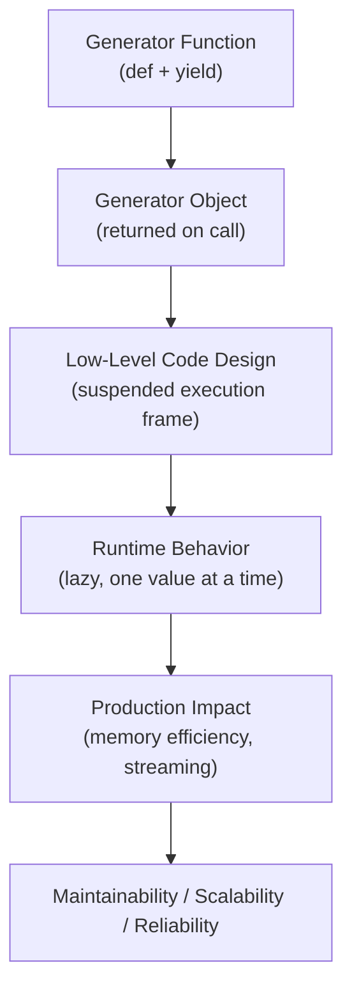
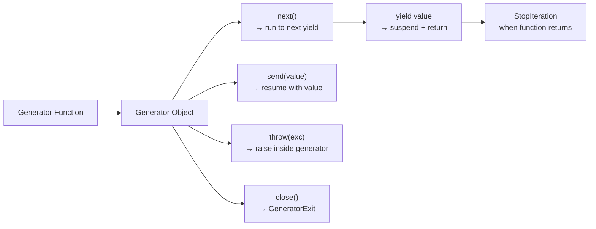

# Generators in Python

## Overview

**Generators** are a special type of iterator created using functions with the `yield` keyword (or generator expressions). They produce values lazily — one at a time — suspending execution between yields and resuming exactly where they left off. Generators are Python's most concise and powerful tool for lazy evaluation, streaming data, and memory-efficient pipelines.

> **Core idea:** A generator function returns a generator object. Each call to `next()` runs the function until the next `yield`, suspends, and returns the yielded value. State is preserved automatically between calls.

---

## Why It Matters

| Regular Functions | Generators |
|---|---|
| Compute all results, return once | Yield one result at a time |
| O(n) memory for n results | O(1) memory |
| Blocking — runs to completion | Suspendable — pauses at `yield` |
| No state between calls | State preserved between yields |
| `return value` | `yield value` |

Generators are used in:
- **Streaming data pipelines** — process large datasets without loading into memory
- **Infinite sequences** — `itertools.count()`, Fibonacci, prime numbers
- **Coroutines** — `yield` can receive values via `send()`
- **RAG pipelines** — lazy document chunking and embedding
- **AI streaming responses** — token-by-token LLM output
- **File processing** — line-by-line reading of large files

---

## Concept Map





---

## Simple Example

```python
def countdown(n: int):
    """A simple countdown generator."""
    print(f"Starting countdown from {n}")
    while n > 0:
        yield n
        n -= 1
    print("Liftoff!")

# Create generator object (function body NOT executed yet)
gen = countdown(5)
print(type(gen))  # <class 'generator'>

# Consume manually
print(next(gen))  # Starting countdown from 5 → 5
print(next(gen))  # 4
print(next(gen))  # 3

# Consume with for loop
for n in countdown(3):
    print(n)
# Starting countdown from 3 → 3 → 2 → 1 → Liftoff!

# Generator expression (like list comprehension but lazy)
squares = (x**2 for x in range(10))
print(list(squares))  # [0, 1, 4, 9, 16, 25, 36, 49, 64, 81]
print(list(squares))  # [] — exhausted!
```

**Explanation:**
- Calling `countdown(5)` returns a generator object — the function body doesn't run yet.
- Each `next()` call runs until the next `yield`, suspends, and returns the yielded value.
- `print("Starting countdown...")` runs on the first `next()` call.
- `print("Liftoff!")` runs after the last `yield`, before `StopIteration`.

**Expected Output:**
```
<class 'generator'>
Starting countdown from 5
5
4
3
Starting countdown from 3
3
2
1
Liftoff!
[0, 1, 4, 9, 16, 25, 36, 49, 64, 81]
[]
```

---

## Intermediate Example

```python
from typing import Generator, Iterator, List
from pathlib import Path
import json

def read_jsonl(filepath: str) -> Generator[dict, None, None]:
    """
    Lazily reads a JSONL (JSON Lines) file.
    Memory: O(1) — only one line in memory at a time.
    """
    with open(filepath, "r", encoding="utf-8") as f:
        for line_num, line in enumerate(f, 1):
            line = line.strip()
            if not line:
                continue
            try:
                yield json.loads(line)
            except json.JSONDecodeError as e:
                print(f"Skipping invalid JSON at line {line_num}: {e}")


def filter_records(
    records: Iterator[dict],
    **criteria
) -> Generator[dict, None, None]:
    """Filter records by field values."""
    for record in records:
        if all(record.get(k) == v for k, v in criteria.items()):
            yield record


def transform_records(
    records: Iterator[dict],
    transform_fn
) -> Generator[dict, None, None]:
    """Apply a transformation to each record."""
    for record in records:
        yield transform_fn(record)


def batch_records(
    records: Iterator[dict],
    batch_size: int = 32
) -> Generator[List[dict], None, None]:
    """Group records into batches."""
    batch = []
    for record in records:
        batch.append(record)
        if len(batch) >= batch_size:
            yield batch
            batch = []
    if batch:
        yield batch  # Yield remaining partial batch


# --- Pipeline composition ---
import tempfile, os

# Create synthetic JSONL data
jsonl_data = "\n".join([
    json.dumps({"id": i, "category": "A" if i % 2 == 0 else "B", "value": i * 10})
    for i in range(20)
])

with tempfile.NamedTemporaryFile(mode="w", suffix=".jsonl", delete=False) as f:
    f.write(jsonl_data)
    tmp_path = f.name

# Build a lazy pipeline
records = read_jsonl(tmp_path)
category_a = filter_records(records, category="A")
scaled = transform_records(category_a, lambda r: {**r, "value": r["value"] * 2})
batches = batch_records(scaled, batch_size=3)

for i, batch in enumerate(batches):
    print(f"Batch {i+1}: {[r['id'] for r in batch]}")

os.unlink(tmp_path)
```

**Explanation:**
- Each pipeline stage is a generator function — lazy, composable, memory-efficient.
- `read_jsonl` → `filter_records` → `transform_records` → `batch_records` — a streaming pipeline.
- Memory usage is O(batch_size) regardless of file size.
- `yield from` can be used to delegate to sub-generators.

**Expected Output:**
```
Batch 1: [0, 2, 4]
Batch 2: [6, 8, 10]
Batch 3: [12, 14, 16]
Batch 4: [18]
```

---

## Advanced / Architect-Level Example

### Problem Context

In a **GenAI streaming response system**, an LLM generates tokens one at a time. A generator-based pipeline streams tokens through transformation stages (filtering, formatting, buffering) and delivers them to multiple consumers (WebSocket, SSE, logging) — all lazily and without buffering the full response.

```python
from __future__ import annotations
import time
import random
from typing import Generator, Iterator, List, Optional, Callable
from dataclasses import dataclass


@dataclass
class Token:
    text: str
    token_id: int
    finish_reason: Optional[str] = None

    @property
    def is_final(self) -> bool:
        return self.finish_reason is not None


# --- Generator-based LLM streaming ---

def simulate_llm_stream(
    prompt: str,
    model: str = "gpt-4o",
    max_tokens: int = 50,
) -> Generator[Token, None, None]:
    """
    Simulates a streaming LLM response.
    In production: wraps OpenAI/Anthropic streaming API.
    """
    words = f"This is a simulated response to: {prompt}".split()
    for i, word in enumerate(words[:max_tokens]):
        time.sleep(0.01)  # Simulate network latency
        is_last = i == len(words) - 1 or i == max_tokens - 1
        yield Token(
            text=word + (" " if not is_last else ""),
            token_id=i,
            finish_reason="stop" if is_last else None,
        )


def filter_tokens(
    tokens: Iterator[Token],
    blocked_words: List[str] = None,
) -> Generator[Token, None, None]:
    """Filter out blocked words from the token stream."""
    blocked = set(blocked_words or [])
    for token in tokens:
        if token.text.strip().lower() not in blocked:
            yield token


def add_metadata(
    tokens: Iterator[Token],
    stream_id: str,
) -> Generator[dict, None, None]:
    """Transform tokens into SSE-compatible event dicts."""
    for token in tokens:
        yield {
            "stream_id": stream_id,
            "text": token.text,
            "token_id": token.token_id,
            "done": token.is_final,
        }


def buffer_tokens(
    tokens: Iterator[Token],
    buffer_size: int = 5,
) -> Generator[str, None, None]:
    """Buffer tokens and yield complete sentences or buffer-sized chunks."""
    buffer = []
    for token in tokens:
        buffer.append(token.text)
        if len(buffer) >= buffer_size or token.is_final:
            yield "".join(buffer)
            buffer = []
    if buffer:
        yield "".join(buffer)


def tee_generator(
    source: Iterator,
    consumers: List[Callable],
) -> Generator:
    """
    Fan-out: send each item to multiple consumers.
    Note: This materializes each item — use carefully for large streams.
    """
    for item in source:
        for consumer in consumers:
            consumer(item)
        yield item


# --- Streaming pipeline ---

class StreamingResponsePipeline:
    """
    Orchestrates a streaming LLM response through a generator pipeline.
    Each stage is a generator — lazy, composable, memory-efficient.
    """

    def __init__(self, stream_id: str, blocked_words: List[str] = None):
        self._stream_id = stream_id
        self._blocked_words = blocked_words or []
        self._tokens_generated = 0
        self._tokens_filtered = 0

    def stream(self, prompt: str) -> Generator[dict, None, None]:
        """Build and run the streaming pipeline."""
        # Stage 1: LLM token stream
        raw_tokens = simulate_llm_stream(prompt)

        # Stage 2: Content filtering
        filtered_tokens = filter_tokens(raw_tokens, self._blocked_words)

        # Stage 3: Add metadata for SSE
        events = add_metadata(filtered_tokens, self._stream_id)

        # Stage 4: Yield events (could add more stages here)
        for event in events:
            self._tokens_generated += 1
            yield event

    def stream_buffered(self, prompt: str, buffer_size: int = 5) -> Generator[str, None, None]:
        """Stream buffered text chunks instead of individual tokens."""
        raw_tokens = simulate_llm_stream(prompt)
        filtered = filter_tokens(raw_tokens, self._blocked_words)
        yield from buffer_tokens(filtered, buffer_size)


# --- Usage ---
pipeline = StreamingResponsePipeline(
    stream_id="sess-001",
    blocked_words=["simulated"],
)

print("=== Token-by-token streaming ===")
full_response = ""
for event in pipeline.stream("What is RAG?"):
    full_response += event["text"]
    if event["done"]:
        print(f"\nFinal response: {full_response.strip()}")
        print(f"Total tokens: {pipeline._tokens_generated}")
        break
    print(event["text"], end="", flush=True)

print("\n\n=== Buffered streaming ===")
for chunk in pipeline.stream_buffered("Explain generators", buffer_size=4):
    print(f"[CHUNK] {chunk!r}")
```

**Explanation:**
- Each pipeline stage is a generator function — lazy, composable, zero-copy.
- `yield from` delegates to sub-generators cleanly.
- The pipeline processes one token at a time — O(1) memory regardless of response length.
- Adding a new stage (e.g., `translate_tokens`) requires only inserting one line.
- In production, `simulate_llm_stream` is replaced by `openai.chat.completions.create(stream=True)`.

**Design Trade-offs:**

| Approach | Pros | Cons |
|---|---|---|
| Generator pipeline | Lazy, composable, O(1) memory | Single-pass, not resumable |
| Async generators | Non-blocking I/O | Requires async context |
| Queue-based pipeline | Thread-safe, buffered | More complex, higher latency |
| Eager list pipeline | Simple, random access | O(n) memory |

---

## Common Mistakes

### 1. Calling the Generator Function Without Consuming It
```python
# ❌ Nothing happens — generator object created but not consumed
def my_gen():
    print("Running")
    yield 1

my_gen()  # No output! Returns generator object, doesn't run.

# ✅ Consume the generator
list(my_gen())  # Running → [1]
next(my_gen())  # Running → 1
```

---

### 2. Using `return value` Instead of `yield value`
```python
# ❌ return exits the generator — value goes to StopIteration, not the consumer
def gen():
    return 42  # StopIteration(42) — not yielded!

# ✅ Use yield to produce values
def gen():
    yield 42
```

---

### 3. Reusing an Exhausted Generator
```python
# ❌ Generator is single-pass
gen = (x**2 for x in range(5))
print(list(gen))  # [0, 1, 4, 9, 16]
print(list(gen))  # [] — exhausted!

# ✅ Create a new generator or use a function
def squares(n):
    return (x**2 for x in range(n))

print(list(squares(5)))  # [0, 1, 4, 9, 16]
print(list(squares(5)))  # [0, 1, 4, 9, 16] — new generator each time
```

---

### 4. Raising `StopIteration` Inside a Generator (Python 3.7+)
```python
# ❌ StopIteration inside a generator → RuntimeError (PEP 479)
def gen():
    raise StopIteration  # RuntimeError in Python 3.7+!

# ✅ Use return to stop a generator
def gen():
    return  # Cleanly stops the generator
```

---

### 5. Forgetting `yield from` for Sub-Generator Delegation
```python
# ❌ Manually iterating a sub-generator
def outer():
    for item in inner():
        yield item

# ✅ Use yield from — cleaner and handles send()/throw() correctly
def outer():
    yield from inner()
```

---

## Best Practices

1. **Use generators for lazy, memory-efficient sequences** — prefer over lists for large data.
2. **Use `yield from`** to delegate to sub-generators — cleaner and handles `send()`/`throw()`.
3. **Use `return` to stop a generator** — never `raise StopIteration` (Python 3.7+).
4. **Document generator return type** with `Generator[YieldType, SendType, ReturnType]`.
5. **Use generator expressions** `(x for x in data)` for simple transformations.
6. **Compose generators** for pipeline stages — each stage wraps the previous one.
7. **Use `itertools`** for common generator patterns: `chain`, `islice`, `takewhile`, `groupby`.
8. **Test generators with `list(gen())`** to materialize all values for assertion.
9. **Use `next(gen, default)`** to safely get the next value without `try/except`.
10. **Prefer generators over custom iterator classes** for simple, stateless traversal.

---

## Performance Considerations

- **Memory**: Generators use O(1) memory — only the current frame is in memory. Lists use O(n).
- **Speed**: Generator functions have slightly more overhead than list comprehensions for small datasets. For large datasets, the memory savings dominate.
- **Generator expressions** are slightly faster than equivalent generator functions due to less overhead.
- **`yield from`** is faster than manual `for item in sub: yield item` — it's implemented in C.
- **`itertools`** generators are implemented in C — significantly faster than equivalent Python generators.
- **Chained generators**: Each `next()` call traverses the chain. For 10+ levels, consider flattening.
- **`list(gen())`** materializes the generator — use only when you need random access or multiple passes.

---

## Testing Strategy

```python
# test_generators.py
import pytest
from your_module import (
    countdown, read_jsonl, filter_records,
    batch_records, simulate_llm_stream, buffer_tokens
)
import json, tempfile, os


# --- Test basic generator ---
def test_countdown_yields_correct_values():
    assert list(countdown(5)) == [5, 4, 3, 2, 1]

def test_countdown_zero():
    assert list(countdown(0)) == []

def test_countdown_is_generator():
    import types
    assert isinstance(countdown(3), types.GeneratorType)


# --- Test generator exhaustion ---
def test_generator_is_single_pass():
    gen = countdown(3)
    list(gen)
    assert list(gen) == []


# --- Test filter generator ---
def test_filter_records():
    records = iter([
        {"cat": "A", "val": 1},
        {"cat": "B", "val": 2},
        {"cat": "A", "val": 3},
    ])
    result = list(filter_records(records, cat="A"))
    assert len(result) == 2
    assert all(r["cat"] == "A" for r in result)


# --- Test batch generator ---
def test_batch_records_full_batches():
    records = iter([{"id": i} for i in range(6)])
    batches = list(batch_records(records, batch_size=2))
    assert len(batches) == 3
    assert batches[0] == [{"id": 0}, {"id": 1}]

def test_batch_records_partial_last():
    records = iter([{"id": i} for i in range(5)])
    batches = list(batch_records(records, batch_size=2))
    assert batches[-1] == [{"id": 4}]

def test_batch_records_empty():
    assert list(batch_records(iter([]), batch_size=3)) == []


# --- Test JSONL reader ---
def test_read_jsonl():
    data = [{"id": 1}, {"id": 2}, {"id": 3}]
    with tempfile.NamedTemporaryFile(mode="w", suffix=".jsonl", delete=False) as f:
        for d in data:
            f.write(json.dumps(d) + "\n")
        path = f.name

    result = list(read_jsonl(path))
    os.unlink(path)
    assert result == data


# --- Test buffer_tokens ---
def test_buffer_tokens():
    from your_module import Token
    tokens = iter([
        Token("Hello ", 0),
        Token("world ", 1),
        Token("from ", 2),
        Token("Python.", 3, finish_reason="stop"),
    ])
    chunks = list(buffer_tokens(tokens, buffer_size=2))
    assert "".join(chunks) == "Hello world from Python."


# --- Test generator pipeline composition ---
def test_pipeline_composition():
    def source():
        yield from range(10)

    def double(it):
        for x in it:
            yield x * 2

    def take(it, n):
        for i, x in enumerate(it):
            if i >= n:
                break
            yield x

    result = list(take(double(source()), 5))
    assert result == [0, 2, 4, 6, 8]


# --- Test send() ---
def test_generator_send():
    def accumulator():
        total = 0
        while True:
            value = yield total
            if value is None:
                break
            total += value

    gen = accumulator()
    next(gen)  # Prime the generator
    assert gen.send(10) == 10
    assert gen.send(20) == 30
    assert gen.send(5) == 35
```

---

## Debugging Tips

1. **Generator not producing output** — you created the generator object but didn't consume it. Call `list(gen())` or use a `for` loop.

2. **`RuntimeError: generator raised StopIteration`** — you used `raise StopIteration` inside a generator (Python 3.7+). Use `return` instead.

3. **Generator exhausted unexpectedly** — generators are single-pass. Check if the generator was consumed elsewhere before your code.

4. **`TypeError: 'generator' object is not subscriptable`** — generators don't support indexing. Use `list(gen)[i]` or `next(itertools.islice(gen, i, None))`.

5. **`send()` raises `TypeError: can't send non-None value to a just-started generator`** — you must call `next(gen)` (or `gen.send(None)`) to prime the generator before sending values.

6. **Use `list(gen)` to materialize** during debugging — see all remaining values at once.

7. **Add `print` statements inside the generator** — they execute when the generator runs, helping trace execution flow.

---

## Interview Questions

### Beginner

**Q1: What is a generator in Python?**  
A: A function that uses `yield` to produce values lazily. Calling a generator function returns a generator object. Each `next()` call runs the function until the next `yield`, suspends, and returns the yielded value.

**Q2: What is the difference between `return` and `yield` in a function?**  
A: `return` exits the function and returns a value once. `yield` suspends the function, returns a value, and resumes from the same point on the next `next()` call.

**Q3: What is a generator expression?**  
A: A lazy version of a list comprehension: `(x**2 for x in range(10))`. It creates a generator object instead of a list — O(1) memory.

**Q4: Are generators single-pass?**  
A: Yes. Once exhausted, a generator stays exhausted. Create a new generator object to iterate again.

**Q5: What is `yield from` used for?**  
A: To delegate to a sub-generator. `yield from sub_gen()` is equivalent to `for item in sub_gen(): yield item`, but also handles `send()` and `throw()` correctly.

---

### Intermediate

**Q6: How do you send values into a generator?**  
A: Use `gen.send(value)`. The generator must be primed first with `next(gen)` or `gen.send(None)`. The sent value becomes the result of the `yield` expression inside the generator.

**Q7: What is the difference between a generator and a custom iterator class?**  
A: Generators are more concise — Python manages state automatically via the call stack. Custom iterators give more control: lifecycle hooks, progress tracking, checkpointing, and serialization.

**Q8: How does `yield from` handle `send()` and `throw()`?**  
A: `yield from` transparently forwards `send()` values and `throw()` exceptions to the sub-generator, and propagates the sub-generator's return value as the result of the `yield from` expression.

**Q9: What is the return value of a generator function?**  
A: The value passed to `return` in the generator becomes the `value` attribute of the `StopIteration` exception. It can be captured with `yield from` or by catching `StopIteration`.

**Q10: How do you implement an infinite generator?**  
A: Use a `while True` loop with `yield`:
```python
def counter(start=0):
    n = start
    while True:
        yield n
        n += 1
```

---

### Advanced / Architect-Level

**Q11: How would you implement a streaming LLM response pipeline using generators?**  
A: Chain generator functions: `llm_stream()` → `filter_tokens()` → `add_metadata()` → `buffer_tokens()`. Each stage is a generator that wraps the previous one. The pipeline processes one token at a time — O(1) memory. In production, `llm_stream()` wraps the OpenAI streaming API.

**Q12: What is the difference between a generator and an async generator?**  
A: An async generator uses `async def` + `yield` and is consumed with `async for`. It can `await` coroutines inside, enabling non-blocking I/O. Regular generators are synchronous.

**Q13: How does Python's `yield from` enable coroutine chaining?**  
A: `yield from` delegates to a sub-generator and transparently forwards `send()` and `throw()`. This enables coroutine chaining — a coroutine can delegate to another coroutine and the caller communicates directly with the innermost coroutine. This was the foundation of Python's async/await before `asyncio`.

**Q14: How would you implement a generator-based event sourcing system?**  
A: Define an `event_stream()` generator that yields events from a persistent store. Use `filter_events()`, `transform_events()`, and `aggregate_events()` generator stages. The pipeline replays events lazily — O(1) memory regardless of event log size.

**Q15: What are the performance implications of deeply chained generators?**  
A: Each `next()` call traverses the entire chain — O(depth) overhead per item. For 10+ levels, consider flattening the pipeline or using `itertools.chain`. For CPU-bound pipelines, consider materializing intermediate results. For I/O-bound pipelines, async generators are more efficient.

---

## Key Takeaways

- Generators use `yield` to produce values lazily — O(1) memory regardless of sequence size.
- Calling a generator function returns a generator object — the body doesn't run until `next()`.
- Generators are single-pass — once exhausted, they stay exhausted.
- `yield from` delegates to sub-generators and handles `send()`/`throw()` transparently.
- Use `return` to stop a generator — never `raise StopIteration` (Python 3.7+).
- Generator expressions `(x for x in data)` are lazy list comprehensions.
- Compose generators for streaming pipelines — each stage wraps the previous one.
- `send(value)` enables two-way communication — the generator receives the sent value.
- `itertools` provides highly optimized generator utilities.
- Mastering generators is essential for building memory-efficient, streaming data pipelines in Python.

---

## Mini Project Idea

### Goal
Build a **Streaming Data Processing Framework** — a generator-based pipeline that processes large datasets (CSV, JSONL, database) through configurable transformation stages.

### Features
- `source_generator(path)` — lazily reads CSV/JSONL files.
- `filter_stage(predicate)` — filters records.
- `transform_stage(fn)` — transforms records.
- `batch_stage(size)` — groups into batches.
- `sink_stage(fn)` — writes to output (file, database, API).
- `pipeline_builder` — fluent API: `Pipeline().source(path).filter(fn).batch(32).sink(db)`.
- Progress reporting with `tqdm`.

### Suggested Folder Structure
```
streaming_pipeline/
├── stages/
│   ├── __init__.py
│   ├── source.py
│   ├── filter.py
│   ├── transform.py
│   ├── batch.py
│   └── sink.py
├── pipeline/
│   ├── __init__.py
│   └── builder.py
├── tests/
│   ├── test_stages.py
│   └── test_pipeline.py
├── cli.py
└── README.md
```

### Extension Ideas
- Add async generator support for async I/O sources.
- Add `tee_stage` for fan-out to multiple sinks.
- Add `window_stage` for sliding window aggregations.
- Benchmark memory usage vs. pandas for large files.

---

## Final Summary

Mastering generators is mastering Python's lazy evaluation model. Generators are the most concise and powerful tool for building memory-efficient, streaming data pipelines — from file readers to LLM token streams to RAG document processors. For a Python architect, generators are the default choice for any sequence that doesn't need to be fully materialized: they reduce memory usage from O(n) to O(1), enable composable pipeline stages, and integrate seamlessly with Python's iterator protocol. Understanding `yield`, `yield from`, `send()`, and generator composition — and knowing when to use generators versus custom iterators versus async generators — is a hallmark of production-grade Python expertise.
