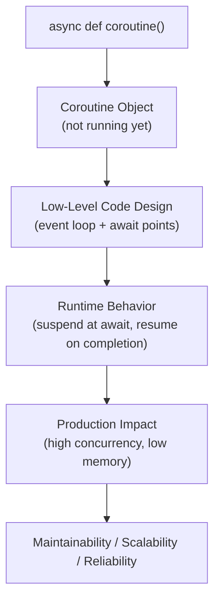
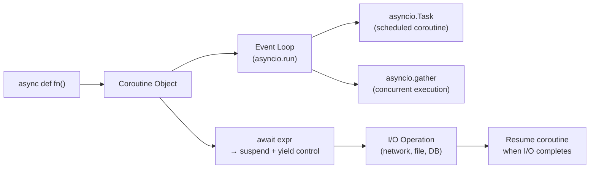

# Coroutines in Python

## Overview

**Coroutines** are functions that can suspend and resume their execution, enabling cooperative multitasking. In Python, coroutines evolved from generator-based coroutines (`yield`/`send`) to native coroutines (`async def`/`await`), which are the foundation of Python's `asyncio` framework and modern asynchronous programming.

> **Core idea:** A coroutine is a function that can pause at an `await` point, yield control to the event loop, and resume when the awaited operation completes — enabling thousands of concurrent I/O operations without threads.

---

## Why It Matters

| Threads | Coroutines (asyncio) |
|---|---|
| OS-managed, preemptive | Python-managed, cooperative |
| High memory (~1MB/thread) | Low memory (~few KB/coroutine) |
| Race conditions, locks needed | Single-threaded, no race conditions |
| Good for CPU-bound work | Ideal for I/O-bound work |
| Limited scalability (~1000s) | High scalability (~100,000s) |

Coroutines are used in:
- **FastAPI** — async request handlers
- **AI agent frameworks** — concurrent tool calls, parallel LLM requests
- **RAG pipelines** — concurrent document fetching and embedding
- **WebSocket servers** — thousands of concurrent connections
- **Database clients** — `asyncpg`, `motor`, `aiosqlite`
- **HTTP clients** — `aiohttp`, `httpx` async mode

---

## Concept Map





---

## Simple Example

```python
import asyncio

async def greet(name: str, delay: float) -> str:
    """A simple coroutine that simulates async work."""
    print(f"Starting greeting for {name}")
    await asyncio.sleep(delay)  # Suspend — yield control to event loop
    message = f"Hello, {name}!"
    print(f"Finished greeting for {name}")
    return message

async def main():
    # Sequential execution
    print("=== Sequential ===")
    r1 = await greet("Alice", 0.1)
    r2 = await greet("Bob", 0.1)
    print(f"{r1}, {r2}")

    # Concurrent execution
    print("\n=== Concurrent ===")
    results = await asyncio.gather(
        greet("Alice", 0.1),
        greet("Bob", 0.1),
        greet("Carol", 0.1),
    )
    print(results)

asyncio.run(main())
```

**Explanation:**
- `async def` defines a coroutine function. Calling it returns a coroutine object — it doesn't run yet.
- `await asyncio.sleep(delay)` suspends the coroutine and yields control to the event loop.
- `asyncio.gather()` runs multiple coroutines concurrently — all three greetings run in parallel.
- Sequential: ~0.2s total. Concurrent: ~0.1s total.

**Expected Output:**
```
=== Sequential ===
Starting greeting for Alice
Finished greeting for Alice
Starting greeting for Bob
Finished greeting for Bob
Hello, Alice!, Hello, Bob!

=== Concurrent ===
Starting greeting for Alice
Starting greeting for Bob
Starting greeting for Carol
Finished greeting for Alice
Finished greeting for Bob
Finished greeting for Carol
['Hello, Alice!', 'Hello, Bob!', 'Hello, Carol!']
```

---

## Intermediate Example

```python
import asyncio
import aiohttp  # pip install aiohttp
from typing import List, Dict, Any, Optional
import time

# Simulated async HTTP client (no real network needed)
class MockAsyncHTTPClient:
    async def get(self, url: str) -> dict:
        await asyncio.sleep(0.05)  # Simulate network latency
        return {"url": url, "status": 200, "data": f"Content from {url}"}

    async def post(self, url: str, json: dict) -> dict:
        await asyncio.sleep(0.1)
        return {"url": url, "status": 201, "data": json}


async def fetch_document(client: MockAsyncHTTPClient, url: str) -> Optional[dict]:
    """Fetch a single document with error handling."""
    try:
        response = await client.get(url)
        return response["data"] if response["status"] == 200 else None
    except Exception as e:
        print(f"Error fetching {url}: {e}")
        return None


async def fetch_all_documents(
    urls: List[str],
    concurrency: int = 10,
) -> List[Optional[dict]]:
    """
    Fetch multiple documents concurrently with a semaphore to limit concurrency.
    """
    client = MockAsyncHTTPClient()
    semaphore = asyncio.Semaphore(concurrency)

    async def fetch_with_limit(url: str) -> Optional[dict]:
        async with semaphore:
            return await fetch_document(client, url)

    tasks = [fetch_with_limit(url) for url in urls]
    return await asyncio.gather(*tasks, return_exceptions=False)


async def embed_batch(texts: List[str]) -> List[List[float]]:
    """Simulate async embedding API call."""
    await asyncio.sleep(0.1)  # Simulate API latency
    return [[float(hash(t) % 100) / 100.0] * 4 for t in texts]


async def process_documents(urls: List[str]) -> Dict[str, Any]:
    """Full async pipeline: fetch → embed → store."""
    start = time.time()

    # Step 1: Fetch all documents concurrently
    print(f"Fetching {len(urls)} documents...")
    documents = await fetch_all_documents(urls, concurrency=5)
    documents = [d for d in documents if d is not None]
    print(f"Fetched {len(documents)} documents in {time.time()-start:.2f}s")

    # Step 2: Embed in batches concurrently
    batch_size = 3
    batches = [documents[i:i+batch_size] for i in range(0, len(documents), batch_size)]
    print(f"Embedding {len(batches)} batches...")

    embedding_tasks = [embed_batch(batch) for batch in batches]
    all_embeddings = await asyncio.gather(*embedding_tasks)

    total_embeddings = sum(len(e) for e in all_embeddings)
    print(f"Embedded {total_embeddings} documents in {time.time()-start:.2f}s")

    return {
        "documents": len(documents),
        "embeddings": total_embeddings,
        "elapsed": round(time.time() - start, 3),
    }


# Run
urls = [f"https://example.com/doc/{i}" for i in range(15)]
result = asyncio.run(process_documents(urls))
print(f"\nResult: {result}")
```

**Explanation:**
- `asyncio.Semaphore` limits concurrent requests — prevents overwhelming the server.
- `asyncio.gather()` runs all fetch tasks concurrently — 15 requests in ~0.05s instead of ~0.75s.
- Embedding batches run concurrently — further parallelism.
- Error handling with `return_exceptions=False` — failed tasks raise exceptions.

---

## Advanced / Architect-Level Example

### Problem Context

In a **production AI agent system**, an agent needs to execute multiple tool calls concurrently, stream results back to the client, handle timeouts, and retry failed operations — all without blocking. A coroutine-based agent framework handles this elegantly.

```python
from __future__ import annotations
import asyncio
import time
import uuid
from typing import Any, Callable, Dict, List, Optional, AsyncGenerator
from dataclasses import dataclass, field
from enum import Enum


class ToolStatus(Enum):
    PENDING = "pending"
    RUNNING = "running"
    SUCCESS = "success"
    FAILED = "failed"
    TIMEOUT = "timeout"


@dataclass
class ToolCall:
    tool_name: str
    kwargs: Dict[str, Any]
    call_id: str = field(default_factory=lambda: str(uuid.uuid4())[:8])
    status: ToolStatus = ToolStatus.PENDING
    result: Optional[Any] = None
    error: Optional[str] = None
    duration: float = 0.0


@dataclass
class AgentMessage:
    role: str  # "user", "assistant", "tool"
    content: str
    tool_calls: List[ToolCall] = field(default_factory=list)


# --- Async tool registry ---

class AsyncToolRegistry:
    def __init__(self):
        self._tools: Dict[str, Callable] = {}
        self._timeouts: Dict[str, float] = {}

    def register(self, name: str, fn: Callable, timeout: float = 10.0) -> None:
        self._tools[name] = fn
        self._timeouts[name] = timeout

    async def execute(self, call: ToolCall) -> ToolCall:
        """Execute a tool call with timeout and error handling."""
        if call.tool_name not in self._tools:
            call.status = ToolStatus.FAILED
            call.error = f"Unknown tool: {call.tool_name}"
            return call

        call.status = ToolStatus.RUNNING
        start = time.time()

        try:
            timeout = self._timeouts[call.tool_name]
            fn = self._tools[call.tool_name]

            # Support both sync and async tools
            if asyncio.iscoroutinefunction(fn):
                result = await asyncio.wait_for(fn(**call.kwargs), timeout=timeout)
            else:
                result = await asyncio.wait_for(
                    asyncio.get_event_loop().run_in_executor(None, lambda: fn(**call.kwargs)),
                    timeout=timeout,
                )

            call.result = result
            call.status = ToolStatus.SUCCESS
        except asyncio.TimeoutError:
            call.status = ToolStatus.TIMEOUT
            call.error = f"Tool '{call.tool_name}' timed out after {timeout}s"
        except Exception as e:
            call.status = ToolStatus.FAILED
            call.error = str(e)
        finally:
            call.duration = round(time.time() - start, 3)

        return call

    async def execute_parallel(self, calls: List[ToolCall]) -> List[ToolCall]:
        """Execute multiple tool calls concurrently."""
        tasks = [self.execute(call) for call in calls]
        return await asyncio.gather(*tasks)


# --- Async streaming agent ---

class AsyncStreamingAgent:
    """
    Production-grade async agent with:
    - Concurrent tool execution
    - Streaming token output
    - Retry logic
    - Conversation history
    """

    def __init__(self, model: str = "gpt-4o"):
        self.model = model
        self._registry = AsyncToolRegistry()
        self._history: List[AgentMessage] = []
        self._session_id = str(uuid.uuid4())[:8]

    def register_tool(self, name: str, fn: Callable, timeout: float = 10.0) -> None:
        self._registry.register(name, fn, timeout)

    async def _stream_llm(self, prompt: str) -> AsyncGenerator[str, None]:
        """Simulate streaming LLM response."""
        words = f"Processing your request: {prompt}. I will use available tools.".split()
        for word in words:
            await asyncio.sleep(0.02)
            yield word + " "

    async def stream_response(self, user_message: str) -> AsyncGenerator[str, None]:
        """
        Full agent turn: stream response + execute tools concurrently.
        Yields tokens as they arrive.
        """
        self._history.append(AgentMessage(role="user", content=user_message))

        # Stream LLM response
        response_text = ""
        async for token in self._stream_llm(user_message):
            response_text += token
            yield token

        # Simulate tool calls decided by LLM
        tool_calls = [
            ToolCall("web_search", {"query": user_message}),
            ToolCall("calculator", {"expression": "42 * 7"}),
        ]

        yield "\n\n[Executing tools...]\n"

        # Execute all tool calls concurrently
        completed_calls = await self._registry.execute_parallel(tool_calls)

        for call in completed_calls:
            status_icon = "✓" if call.status == ToolStatus.SUCCESS else "✗"
            yield f"{status_icon} {call.tool_name}: {call.result or call.error} ({call.duration}s)\n"

        self._history.append(AgentMessage(
            role="assistant",
            content=response_text,
            tool_calls=completed_calls,
        ))

    async def run(self, user_message: str) -> str:
        """Non-streaming version — collects full response."""
        full_response = ""
        async for token in self.stream_response(user_message):
            full_response += token
        return full_response


# --- Async tools ---

async def web_search(query: str) -> str:
    await asyncio.sleep(0.1)  # Simulate API call
    return f"Top results for '{query}': [result1, result2, result3]"

def calculator(expression: str) -> str:
    result = eval(expression, {"__builtins__": {}})
    return str(result)


# --- Usage ---

async def main():
    agent = AsyncStreamingAgent(model="gpt-4o")
    agent.register_tool("web_search", web_search, timeout=5.0)
    agent.register_tool("calculator", calculator, timeout=2.0)

    print("=== Streaming Agent Response ===")
    async for token in agent.stream_response("What is 42 * 7 and search for Python coroutines?"):
        print(token, end="", flush=True)

    print("\n\n=== Concurrent Tool Execution Demo ===")
    start = time.time()
    calls = [
        ToolCall("web_search", {"query": f"topic {i}"})
        for i in range(5)
    ]
    results = await agent._registry.execute_parallel(calls)
    elapsed = time.time() - start
    print(f"5 concurrent tool calls completed in {elapsed:.2f}s (vs ~0.5s sequential)")
    for r in results:
        print(f"  {r.tool_name}[{r.call_id}]: {r.status.value} in {r.duration}s")


asyncio.run(main())
```

**Explanation:**
- `AsyncToolRegistry.execute_parallel()` runs all tool calls concurrently — 5 calls in ~0.1s instead of ~0.5s.
- `asyncio.wait_for()` enforces per-tool timeouts — prevents hung tools from blocking the agent.
- `AsyncGenerator` enables streaming token output — clients receive tokens as they arrive.
- Both sync and async tools are supported — `run_in_executor` wraps sync tools.
- Conversation history is maintained across turns.

**Design Trade-offs:**

| Approach | Pros | Cons |
|---|---|---|
| `asyncio` coroutines | High concurrency, low memory | Single-threaded, CPU-bound work blocks |
| `threading` | True parallelism for I/O | Race conditions, higher memory |
| `multiprocessing` | True CPU parallelism | High overhead, no shared memory |
| `concurrent.futures` | Simple API | Less control than asyncio |

---

## Common Mistakes

### 1. Calling a Coroutine Without `await`
```python
# ❌ Returns coroutine object, doesn't execute
async def fetch():
    return "data"

result = fetch()  # <coroutine object fetch at 0x...>
# RuntimeWarning: coroutine 'fetch' was never awaited

# ✅ Always await coroutines
result = await fetch()
```

---

### 2. Using Blocking I/O in Coroutines
```python
# ❌ Blocks the entire event loop
async def bad_fetch(url):
    import requests
    return requests.get(url).text  # Blocking!

# ✅ Use async I/O libraries
async def good_fetch(url):
    async with aiohttp.ClientSession() as session:
        async with session.get(url) as response:
            return await response.text()
```

---

### 3. Not Using `asyncio.gather` for Concurrent Execution
```python
# ❌ Sequential — no concurrency benefit
async def sequential():
    r1 = await fetch("url1")  # Waits for url1
    r2 = await fetch("url2")  # Then waits for url2

# ✅ Concurrent
async def concurrent():
    r1, r2 = await asyncio.gather(fetch("url1"), fetch("url2"))
```

---

### 4. Mixing Sync and Async Code Incorrectly
```python
# ❌ Can't call async function from sync context directly
def sync_function():
    result = await my_coroutine()  # SyntaxError!

# ✅ Use asyncio.run() from sync context
def sync_function():
    result = asyncio.run(my_coroutine())
```

---

### 5. Not Handling `asyncio.CancelledError`
```python
# ❌ Swallows cancellation — task can't be cancelled
async def worker():
    try:
        await long_operation()
    except Exception:
        pass  # Catches CancelledError too!

# ✅ Re-raise CancelledError
async def worker():
    try:
        await long_operation()
    except asyncio.CancelledError:
        # Cleanup
        raise  # Must re-raise!
    except Exception as e:
        handle_error(e)
```

---

## Best Practices

1. **Use `async def` + `await`** for all I/O-bound operations.
2. **Use `asyncio.gather()`** for concurrent execution — not sequential `await`.
3. **Use `asyncio.Semaphore`** to limit concurrency — prevent overwhelming external services.
4. **Use `asyncio.wait_for()`** for timeouts — prevent hung coroutines.
5. **Never use blocking I/O** in coroutines — use async libraries (`aiohttp`, `asyncpg`, `aiofiles`).
6. **Use `asyncio.run()`** as the entry point — not `loop.run_until_complete()`.
7. **Re-raise `asyncio.CancelledError`** — never swallow it.
8. **Use `asyncio.create_task()`** for fire-and-forget background tasks.
9. **Use `async with`** for async context managers (database connections, HTTP sessions).
10. **Use `async for`** for async iterators (streaming responses, database cursors).

---

## Performance Considerations

- **Concurrency**: Coroutines enable thousands of concurrent I/O operations on a single thread — far more than threads (limited by OS).
- **Memory**: Each coroutine uses ~few KB vs ~1MB per thread — 100x more memory-efficient.
- **CPU-bound work**: Coroutines don't help with CPU-bound work — use `multiprocessing` or `concurrent.futures.ProcessPoolExecutor`.
- **Event loop overhead**: Each `await` point has a small overhead (~microseconds). For tight loops with many awaits, consider batching.
- **`asyncio.gather` vs `asyncio.wait`**: `gather` is simpler and faster for fixed sets of tasks. `wait` is more flexible for dynamic task sets.
- **`run_in_executor`**: Wraps sync code in a thread pool — adds thread overhead but prevents blocking the event loop.

---

## Testing Strategy

```python
# test_coroutines.py
import pytest
import asyncio
from your_module import (
    greet, fetch_document, fetch_all_documents,
    AsyncToolRegistry, ToolCall, ToolStatus, web_search, calculator
)


# --- Test basic coroutine ---
@pytest.mark.asyncio
async def test_greet_returns_message():
    result = await greet("Alice", 0)
    assert result == "Hello, Alice!"


# --- Test concurrent execution is faster ---
@pytest.mark.asyncio
async def test_gather_is_concurrent():
    import time
    start = time.time()
    await asyncio.gather(
        asyncio.sleep(0.1),
        asyncio.sleep(0.1),
        asyncio.sleep(0.1),
    )
    elapsed = time.time() - start
    assert elapsed < 0.2  # Should be ~0.1s, not 0.3s


# --- Test tool registry ---
@pytest.mark.asyncio
async def test_tool_registry_success():
    registry = AsyncToolRegistry()
    registry.register("add", lambda a, b: a + b)

    call = ToolCall("add", {"a": 2, "b": 3})
    result = await registry.execute(call)
    assert result.status == ToolStatus.SUCCESS
    assert result.result == 5


@pytest.mark.asyncio
async def test_tool_registry_unknown_tool():
    registry = AsyncToolRegistry()
    call = ToolCall("unknown", {})
    result = await registry.execute(call)
    assert result.status == ToolStatus.FAILED
    assert "Unknown tool" in result.error


@pytest.mark.asyncio
async def test_tool_registry_timeout():
    registry = AsyncToolRegistry()

    async def slow_tool():
        await asyncio.sleep(10)
        return "done"

    registry.register("slow", slow_tool, timeout=0.05)
    call = ToolCall("slow", {})
    result = await registry.execute(call)
    assert result.status == ToolStatus.TIMEOUT


@pytest.mark.asyncio
async def test_tool_registry_parallel_execution():
    import time
    registry = AsyncToolRegistry()

    async def delayed_tool(delay: float):
        await asyncio.sleep(delay)
        return f"done after {delay}s"

    registry.register("delayed", delayed_tool, timeout=5.0)

    calls = [ToolCall("delayed", {"delay": 0.1}) for _ in range(5)]
    start = time.time()
    results = await registry.execute_parallel(calls)
    elapsed = time.time() - start

    assert all(r.status == ToolStatus.SUCCESS for r in results)
    assert elapsed < 0.3  # 5 concurrent calls, each 0.1s → ~0.1s total


# --- Test semaphore-limited concurrency ---
@pytest.mark.asyncio
async def test_fetch_all_with_semaphore():
    urls = [f"https://example.com/{i}" for i in range(10)]
    results = await fetch_all_documents(urls, concurrency=3)
    assert len(results) == 10
    assert all(r is not None for r in results)


# --- Test async generator ---
@pytest.mark.asyncio
async def test_async_generator():
    from your_module import AsyncStreamingAgent
    agent = AsyncStreamingAgent()
    agent.register_tool("calculator", calculator)

    tokens = []
    async for token in agent.stream_response("test"):
        tokens.append(token)

    assert len(tokens) > 0
    full_text = "".join(tokens)
    assert len(full_text) > 0
```

> **Note:** Install `pytest-asyncio` and configure `asyncio_mode = "auto"` in `pytest.ini`.

---

## Debugging Tips

1. **`RuntimeWarning: coroutine 'X' was never awaited`** — you called a coroutine function without `await`. Add `await` or use `asyncio.run()`.

2. **Event loop is blocked** — a blocking call (requests, time.sleep, file I/O) is running inside a coroutine. Replace with async equivalents (`aiohttp`, `asyncio.sleep`, `aiofiles`).

3. **`RuntimeError: This event loop is already running`** — you're calling `asyncio.run()` inside an already-running event loop (e.g., Jupyter). Use `await` directly or `asyncio.get_event_loop().run_until_complete()`.

4. **Tasks not running concurrently** — you're using sequential `await` instead of `asyncio.gather()`. Check your code for sequential awaits that should be concurrent.

5. **`asyncio.CancelledError` propagating unexpectedly** — a task was cancelled. Check for `asyncio.wait_for()` timeouts or explicit `task.cancel()` calls.

6. **Use `asyncio.get_event_loop().set_debug(True)`** for detailed asyncio debugging — logs slow callbacks, unawaited coroutines, and more.

7. **Use `asyncio.current_task()`** to identify which task is running in a coroutine.

---

## Interview Questions

### Beginner

**Q1: What is a coroutine in Python?**  
A: A function defined with `async def` that can suspend execution at `await` points, yielding control to the event loop until the awaited operation completes.

**Q2: What is the difference between `async def` and a regular function?**  
A: `async def` defines a coroutine function. Calling it returns a coroutine object — it doesn't execute until awaited. Regular functions execute immediately when called.

**Q3: What does `await` do?**  
A: Suspends the current coroutine, yields control to the event loop, and resumes when the awaited coroutine/future completes. Can only be used inside `async def` functions.

**Q4: What is `asyncio.run()`?**  
A: Creates a new event loop, runs the given coroutine until completion, and closes the loop. The standard entry point for async programs.

**Q5: What is `asyncio.gather()`?**  
A: Runs multiple coroutines concurrently and returns their results as a list. All coroutines start immediately and run until completion.

---

### Intermediate

**Q6: What is the difference between `asyncio.gather()` and `asyncio.wait()`?**  
A: `gather()` runs all coroutines concurrently and returns results in order. `wait()` is more flexible — it accepts a set of tasks and returns when specified conditions are met (ALL_COMPLETED, FIRST_COMPLETED, FIRST_EXCEPTION).

**Q7: How do you limit concurrency in asyncio?**  
A: Use `asyncio.Semaphore(n)` — acquire it before each operation and release after. This limits the number of concurrent operations to `n`.

**Q8: What is `asyncio.create_task()` and when would you use it?**  
A: Creates a `Task` that schedules a coroutine to run concurrently. Use it for fire-and-forget background tasks or when you want to start a coroutine without immediately awaiting it.

**Q9: How do you handle timeouts in asyncio?**  
A: Use `asyncio.wait_for(coroutine, timeout=seconds)` — raises `asyncio.TimeoutError` if the coroutine doesn't complete within the timeout.

**Q10: What is an async context manager?**  
A: A class implementing `__aenter__` and `__aexit__` (both `async def`). Used with `async with` — enables async setup and teardown (e.g., database connections, HTTP sessions).

---

### Advanced / Architect-Level

**Q11: How would you design a concurrent AI agent tool execution system?**  
A: Use `asyncio.gather()` to execute all tool calls concurrently. Wrap each tool with `asyncio.wait_for()` for timeouts. Use `asyncio.Semaphore` to limit concurrent external API calls. Support both sync and async tools via `run_in_executor`. Track tool call status with a `ToolCall` dataclass.

**Q12: What is the difference between coroutines and threads for I/O-bound work?**  
A: Coroutines are more memory-efficient (~KB vs ~MB per unit), have no race conditions (single-threaded), and scale to 100,000s of concurrent operations. Threads are better for blocking I/O that can't be made async. For CPU-bound work, use `multiprocessing`.

**Q13: How does `asyncio` handle the GIL?**  
A: `asyncio` is single-threaded — it runs on one thread and is not affected by the GIL. The GIL is only relevant for multi-threaded code. For CPU-bound work, use `ProcessPoolExecutor` with `run_in_executor`.

**Q14: How would you implement a rate-limited async HTTP client?**  
A: Use `asyncio.Semaphore` for concurrency limiting. Add a token bucket or leaky bucket algorithm using `asyncio.sleep` for rate limiting. Wrap with retry logic using exponential backoff.

**Q15: How do async generators differ from regular generators?**  
A: Async generators use `async def` + `yield` and are consumed with `async for`. They can `await` inside the body, enabling non-blocking I/O between yields. Used for streaming API responses, async database cursors, and real-time data feeds.

---

## Key Takeaways

- Coroutines (`async def`) enable cooperative multitasking — suspend at `await`, resume on completion.
- `asyncio.gather()` runs coroutines concurrently — the key to async performance.
- Never use blocking I/O inside coroutines — use async libraries.
- `asyncio.Semaphore` limits concurrency — prevents overwhelming external services.
- `asyncio.wait_for()` enforces timeouts — prevents hung coroutines.
- Re-raise `asyncio.CancelledError` — never swallow it.
- Coroutines are ideal for I/O-bound work; use `multiprocessing` for CPU-bound work.
- Async generators (`async def` + `yield`) enable streaming with non-blocking I/O.
- `async with` and `async for` are the async equivalents of `with` and `for`.
- Mastering coroutines is essential for building high-performance, scalable Python backends and AI agent systems.

---

## Mini Project Idea

### Goal
Build an **Async AI Agent Orchestrator** — a coroutine-based system that runs multiple AI agents concurrently, each executing tool calls in parallel, with streaming output and rate limiting.

### Features
- `AsyncAgent` — coroutine-based agent with tool registry.
- `AgentOrchestrator` — runs multiple agents concurrently with `asyncio.gather()`.
- `RateLimiter` — token bucket rate limiter using `asyncio.sleep`.
- `StreamingOutput` — async generator for token-by-token output.
- `ToolRegistry` — supports both sync and async tools.
- CLI: `python orchestrator.py --agents 5 --tools search,calc,weather`.

### Suggested Folder Structure
```
async_agent_orchestrator/
├── agents/
│   ├── __init__.py
│   ├── base_agent.py
│   └── streaming_agent.py
├── tools/
│   ├── __init__.py
│   ├── registry.py
│   ├── web_search.py
│   └── calculator.py
├── orchestrator/
│   ├── __init__.py
│   ├── orchestrator.py
│   └── rate_limiter.py
├── tests/
│   ├── test_agents.py
│   └── test_orchestrator.py
├── cli.py
└── README.md
```

### Extension Ideas
- Add WebSocket streaming with `websockets` library.
- Add distributed agent execution with `asyncio` + Redis pub/sub.
- Add circuit breaker pattern for tool failures.
- Benchmark coroutines vs. threads for 1000 concurrent tool calls.

---

## Final Summary

Mastering coroutines is mastering Python's concurrency model for I/O-bound systems. Coroutines enable thousands of concurrent operations on a single thread — with lower memory, no race conditions, and higher scalability than threads. For a Python architect, coroutines are the foundation of modern backend systems: FastAPI request handlers, async database clients, AI agent tool execution, and streaming LLM responses. Understanding `async def`, `await`, `asyncio.gather()`, `Semaphore`, `wait_for()`, and async generators — and knowing when to use coroutines versus threads versus processes — is what separates a Python developer from a Python architect who can design systems that scale to millions of concurrent users.
