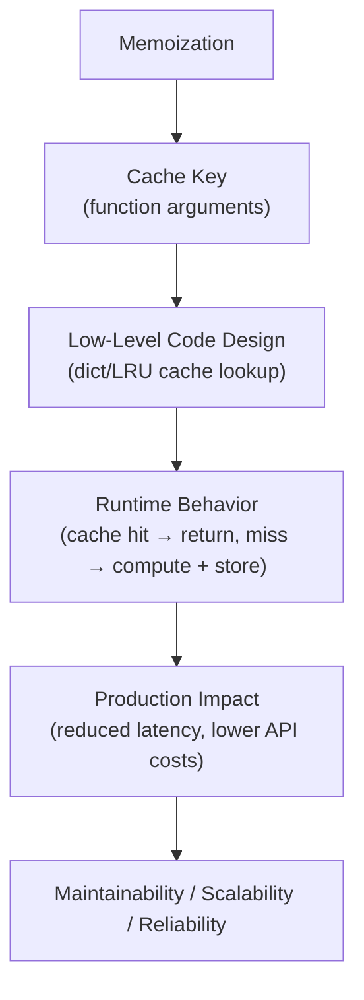
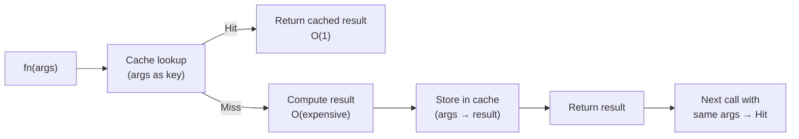

# Memoization in Python

## Overview

**Memoization** is an optimization technique that caches the results of expensive function calls and returns the cached result when the same inputs occur again. It is a specific form of caching applied at the function level — trading memory for speed.

> **Core idea:** If a function is called with the same arguments multiple times, compute the result once and cache it. Subsequent calls with the same arguments return the cached result instantly.

Memoization is most effective for **pure functions** (same input always produces same output) with **expensive computations** or **repeated calls with the same arguments**.

---

## Why It Matters

| Without Memoization | With Memoization |
|---|---|
| Recomputes on every call | Returns cached result instantly |
| O(n) or O(2^n) time | O(1) for cached calls |
| No memory overhead | Memory used for cache |
| Stateless | Stateful (cache) |
| Simple | Requires cache management |

Memoization is used in:
- **Recursive algorithms** — Fibonacci, dynamic programming
- **LLM API calls** — cache responses for identical prompts
- **Database queries** — cache frequent read results
- **Embedding generation** — cache embeddings for repeated texts
- **Configuration loading** — cache parsed config files
- **Expensive computations** — ML model inference, cryptographic operations

---

## Concept Map





---

## Simple Example

```python
from functools import lru_cache
import time

# Without memoization
def fib_slow(n: int) -> int:
    if n <= 1:
        return n
    return fib_slow(n - 1) + fib_slow(n - 2)

# With memoization using lru_cache
@lru_cache(maxsize=None)
def fib_fast(n: int) -> int:
    if n <= 1:
        return n
    return fib_fast(n - 1) + fib_fast(n - 2)

# Compare performance
start = time.time()
print(fib_slow(35))
print(f"Without memoization: {time.time() - start:.3f}s")

start = time.time()
print(fib_fast(35))
print(f"With memoization: {time.time() - start:.6f}s")

# Cache info
print(fib_fast.cache_info())

# Manual memoization with a dict
def memoize(fn):
    cache = {}
    def wrapper(*args):
        if args not in cache:
            cache[args] = fn(*args)
        return cache[args]
    return wrapper

@memoize
def fib_manual(n: int) -> int:
    if n <= 1:
        return n
    return fib_manual(n - 1) + fib_manual(n - 2)

print(fib_manual(40))
```

**Explanation:**
- `fib_slow(35)` makes ~29 million recursive calls — exponential time.
- `@lru_cache` caches results — each `fib_fast(n)` is computed exactly once.
- `cache_info()` shows hits, misses, maxsize, and current size.
- Manual `memoize` decorator shows the underlying mechanism.

**Expected Output:**
```
9227465
Without memoization: 2.341s
9227465
With memoization: 0.000023s
CacheInfo(hits=33, misses=36, maxsize=None, currsize=36)
102334155
```

---

## Intermediate Example

```python
from functools import lru_cache, cached_property
from typing import Optional, Dict, Any
import hashlib
import json
import time

# --- LRU Cache with bounded size ---
@lru_cache(maxsize=128)
def fetch_user_profile(user_id: str) -> dict:
    """Simulate expensive DB lookup."""
    time.sleep(0.1)  # Simulate DB latency
    return {"id": user_id, "name": f"User {user_id}", "role": "member"}

# --- cached_property for class attributes ---
class DocumentProcessor:
    def __init__(self, text: str):
        self._text = text

    @cached_property
    def word_count(self) -> int:
        """Computed once, cached forever on the instance."""
        print("Computing word count...")
        return len(self._text.split())

    @cached_property
    def vocabulary(self) -> set:
        """Computed once, cached forever."""
        print("Computing vocabulary...")
        return set(self._text.lower().split())

    @cached_property
    def fingerprint(self) -> str:
        """SHA256 hash of the text — expensive, computed once."""
        return hashlib.sha256(self._text.encode()).hexdigest()


# --- Custom TTL memoization ---
class TTLCache:
    """Memoization cache with time-to-live expiration."""

    def __init__(self, ttl: float = 60.0, maxsize: int = 256):
        self._cache: Dict[str, Dict[str, Any]] = {}
        self._ttl = ttl
        self._maxsize = maxsize

    def __call__(self, fn):
        def wrapper(*args, **kwargs):
            key = self._make_key(args, kwargs)
            now = time.time()

            if key in self._cache:
                entry = self._cache[key]
                if now - entry["timestamp"] < self._ttl:
                    return entry["value"]

            result = fn(*args, **kwargs)
            self._evict_if_needed()
            self._cache[key] = {"value": result, "timestamp": now}
            return result

        wrapper.cache_clear = lambda: self._cache.clear()
        wrapper.cache_info = lambda: {
            "size": len(self._cache),
            "maxsize": self._maxsize,
            "ttl": self._ttl,
        }
        return wrapper

    def _make_key(self, args, kwargs) -> str:
        return hashlib.md5(
            json.dumps((args, sorted(kwargs.items())), default=str).encode()
        ).hexdigest()

    def _evict_if_needed(self):
        if len(self._cache) >= self._maxsize:
            # Evict oldest entry
            oldest = min(self._cache, key=lambda k: self._cache[k]["timestamp"])
            del self._cache[oldest]


@TTLCache(ttl=5.0, maxsize=100)
def get_exchange_rate(from_currency: str, to_currency: str) -> float:
    """Simulate expensive API call for exchange rate."""
    print(f"Fetching rate {from_currency}/{to_currency}...")
    time.sleep(0.1)
    return 1.08 if from_currency == "USD" and to_currency == "EUR" else 1.0


# --- Usage ---
# LRU cache
start = time.time()
for uid in ["U1", "U2", "U1", "U3", "U1"]:
    fetch_user_profile(uid)
print(f"5 calls (3 unique): {time.time()-start:.3f}s")
print(f"Cache info: {fetch_user_profile.cache_info()}")

# cached_property
doc = DocumentProcessor("The quick brown fox jumps over the lazy dog")
print(doc.word_count)   # Computed
print(doc.word_count)   # Cached — no "Computing..." printed
print(doc.vocabulary)   # Computed
print(doc.fingerprint)  # Computed

# TTL cache
rate1 = get_exchange_rate("USD", "EUR")  # Fetches
rate2 = get_exchange_rate("USD", "EUR")  # Cached
print(f"Rate: {rate1}, cached: {rate1 == rate2}")
```

**Explanation:**
- `@lru_cache(maxsize=128)` caches up to 128 results, evicting least-recently-used entries.
- `@cached_property` caches the result on the instance — computed once per instance.
- `TTLCache` adds time-based expiration — critical for data that changes over time.

---

## Advanced / Architect-Level Example

### Problem Context

In a **RAG pipeline**, embedding generation is the most expensive operation — each API call costs money and takes ~100ms. Memoizing embeddings for repeated texts (queries, common phrases) dramatically reduces cost and latency. A production-grade memoization layer supports TTL, distributed caching (Redis), and cache warming.

```python
from __future__ import annotations
import asyncio
import hashlib
import json
import time
from typing import List, Optional, Dict, Any, Callable
from dataclasses import dataclass, field
from functools import wraps


@dataclass
class CacheStats:
    hits: int = 0
    misses: int = 0
    evictions: int = 0
    total_saved_ms: float = 0.0

    @property
    def hit_rate(self) -> float:
        total = self.hits + self.misses
        return self.hits / total if total > 0 else 0.0


class EmbeddingCache:
    """
    Production-grade memoization cache for LLM embeddings.
    Features: TTL, LRU eviction, stats, async support, cache warming.
    """

    def __init__(self, ttl: float = 3600.0, maxsize: int = 10_000):
        self._cache: Dict[str, Dict[str, Any]] = {}
        self._access_order: List[str] = []  # LRU tracking
        self._ttl = ttl
        self._maxsize = maxsize
        self._stats = CacheStats()

    def _make_key(self, text: str, model: str) -> str:
        """Deterministic cache key from text + model."""
        content = f"{model}:{text}"
        return hashlib.sha256(content.encode()).hexdigest()

    def get(self, text: str, model: str) -> Optional[List[float]]:
        key = self._make_key(text, model)
        entry = self._cache.get(key)

        if entry is None:
            self._stats.misses += 1
            return None

        if time.time() - entry["timestamp"] > self._ttl:
            del self._cache[key]
            self._stats.misses += 1
            return None

        # Update LRU order
        if key in self._access_order:
            self._access_order.remove(key)
        self._access_order.append(key)

        self._stats.hits += 1
        self._stats.total_saved_ms += entry.get("compute_ms", 0)
        return entry["embedding"]

    def set(self, text: str, model: str, embedding: List[float], compute_ms: float = 0) -> None:
        key = self._make_key(text, model)

        # LRU eviction
        while len(self._cache) >= self._maxsize:
            oldest_key = self._access_order.pop(0)
            self._cache.pop(oldest_key, None)
            self._stats.evictions += 1

        self._cache[key] = {
            "embedding": embedding,
            "timestamp": time.time(),
            "compute_ms": compute_ms,
            "text_preview": text[:50],
        }
        self._access_order.append(key)

    def warm(self, texts: List[str], model: str, embeddings: List[List[float]]) -> None:
        """Pre-populate cache with known embeddings."""
        for text, embedding in zip(texts, embeddings):
            self.set(text, model, embedding)

    @property
    def stats(self) -> dict:
        return {
            "hits": self._stats.hits,
            "misses": self._stats.misses,
            "hit_rate": f"{self._stats.hit_rate:.1%}",
            "evictions": self._stats.evictions,
            "size": len(self._cache),
            "maxsize": self._maxsize,
            "saved_ms": round(self._stats.total_saved_ms, 1),
        }


# --- Memoized embedding service ---

class EmbeddingService:
    """
    Embedding service with transparent memoization.
    Cache-aside pattern: check cache → miss → compute → store.
    """

    def __init__(self, model: str = "text-embedding-3-small", cache: Optional[EmbeddingCache] = None):
        self._model = model
        self._cache = cache or EmbeddingCache(ttl=3600, maxsize=10_000)
        self._api_calls = 0

    async def embed(self, text: str) -> List[float]:
        """Embed a single text with caching."""
        cached = self._cache.get(text, self._model)
        if cached is not None:
            return cached

        start = time.time()
        embedding = await self._call_api([text])
        compute_ms = (time.time() - start) * 1000

        self._cache.set(text, self._model, embedding[0], compute_ms)
        return embedding[0]

    async def embed_batch(self, texts: List[str]) -> List[List[float]]:
        """
        Embed a batch of texts.
        Only calls the API for texts not in cache.
        """
        results: Dict[int, List[float]] = {}
        uncached_indices: List[int] = []
        uncached_texts: List[str] = []

        # Check cache for each text
        for i, text in enumerate(texts):
            cached = self._cache.get(text, self._model)
            if cached is not None:
                results[i] = cached
            else:
                uncached_indices.append(i)
                uncached_texts.append(text)

        # Batch API call for uncached texts only
        if uncached_texts:
            start = time.time()
            new_embeddings = await self._call_api(uncached_texts)
            compute_ms = (time.time() - start) * 1000 / len(uncached_texts)

            for idx, text, embedding in zip(uncached_indices, uncached_texts, new_embeddings):
                self._cache.set(text, self._model, embedding, compute_ms)
                results[idx] = embedding

        return [results[i] for i in range(len(texts))]

    async def _call_api(self, texts: List[str]) -> List[List[float]]:
        """Simulate embedding API call."""
        self._api_calls += 1
        await asyncio.sleep(0.1)  # Simulate API latency
        return [[float(hash(t) % 100) / 100.0] * 4 for t in texts]

    @property
    def stats(self) -> dict:
        return {
            "api_calls": self._api_calls,
            "cache": self._cache.stats,
        }


# --- Memoization decorator for arbitrary async functions ---

def async_memoize(ttl: float = 300.0, maxsize: int = 1000):
    """Decorator for async function memoization with TTL."""
    def decorator(fn: Callable) -> Callable:
        cache: Dict[str, Any] = {}
        access_order: List[str] = []

        @wraps(fn)
        async def wrapper(*args, **kwargs):
            key = hashlib.md5(
                json.dumps((args, sorted(kwargs.items())), default=str).encode()
            ).hexdigest()

            now = time.time()
            if key in cache and now - cache[key]["ts"] < ttl:
                return cache[key]["value"]

            result = await fn(*args, **kwargs)

            # LRU eviction
            while len(cache) >= maxsize:
                oldest = access_order.pop(0)
                cache.pop(oldest, None)

            cache[key] = {"value": result, "ts": now}
            access_order.append(key)
            return result

        wrapper.cache_clear = lambda: (cache.clear(), access_order.clear())
        return wrapper
    return decorator


@async_memoize(ttl=60.0, maxsize=500)
async def get_document_summary(doc_id: str) -> str:
    """Expensive LLM summarization — memoized."""
    await asyncio.sleep(0.2)  # Simulate LLM call
    return f"Summary of document {doc_id}"


# --- Usage ---
async def main():
    service = EmbeddingService()

    # Warm cache with common queries
    common_queries = ["What is RAG?", "How does Python work?", "Explain embeddings"]
    common_embeddings = [[0.1, 0.2, 0.3, 0.4]] * 3
    service._cache.warm(common_queries, service._model, common_embeddings)

    # First batch — some cached, some not
    texts = ["What is RAG?", "New document 1", "New document 2", "How does Python work?"]
    embeddings = await service.embed_batch(texts)
    print(f"Batch 1: {len(embeddings)} embeddings, {service._api_calls} API calls")

    # Second batch — all cached
    embeddings2 = await service.embed_batch(texts)
    print(f"Batch 2: {len(embeddings2)} embeddings, {service._api_calls} API calls (no new calls)")

    print(f"\nStats: {service.stats}")

    # Test async_memoize decorator
    s1 = await get_document_summary("doc-001")
    s2 = await get_document_summary("doc-001")  # Cached
    print(f"\nSummary (same): {s1 == s2}")


asyncio.run(main())
```

**Explanation:**
- `EmbeddingCache` implements LRU eviction + TTL — production-grade cache management.
- `embed_batch()` only calls the API for uncached texts — minimizes API costs.
- Cache warming pre-populates common queries — zero latency for known inputs.
- `async_memoize` is a reusable decorator for any async function.
- `stats` provides observability — hit rate, API calls saved, memory usage.

**Design Trade-offs:**

| Approach | Pros | Cons |
|---|---|---|
| `@lru_cache` | Built-in, fast, simple | No TTL, no async, no distributed |
| `@cached_property` | Per-instance, lazy | No TTL, not thread-safe |
| Custom TTL cache | TTL support, configurable | More code |
| Redis cache | Distributed, persistent | External dependency |
| `cachetools` library | Rich features, thread-safe | External dependency |

---

## Common Mistakes

### 1. Memoizing Functions with Mutable Arguments
```python
# ❌ Lists are not hashable — TypeError
@lru_cache
def process(data: list) -> int:
    return sum(data)

process([1, 2, 3])  # TypeError: unhashable type: 'list'

# ✅ Convert to tuple or use a hashable type
@lru_cache
def process(data: tuple) -> int:
    return sum(data)

process(tuple([1, 2, 3]))  # Works
```

---

### 2. Memoizing Impure Functions
```python
# ❌ Function depends on external state — cache returns stale results
@lru_cache
def get_current_time() -> str:
    return datetime.now().isoformat()  # Always different!

# ✅ Only memoize pure functions
@lru_cache
def compute_hash(text: str) -> str:
    return hashlib.sha256(text.encode()).hexdigest()
```

---

### 3. Unbounded Cache Growth
```python
# ❌ maxsize=None — cache grows forever, potential memory leak
@lru_cache(maxsize=None)
def process(large_input: str) -> str:
    ...

# ✅ Set a reasonable maxsize
@lru_cache(maxsize=1024)
def process(large_input: str) -> str:
    ...
```

---

### 4. Not Clearing Cache When Underlying Data Changes
```python
# ❌ Cache returns stale data after DB update
@lru_cache(maxsize=256)
def get_user(user_id: str) -> dict:
    return db.query(user_id)

# After updating user in DB, cache still returns old data!

# ✅ Clear cache on data change
def update_user(user_id: str, data: dict):
    db.update(user_id, data)
    get_user.cache_clear()  # Or invalidate specific key
```

---

### 5. Using `lru_cache` on Instance Methods
```python
# ❌ lru_cache on instance methods caches self — prevents garbage collection
class MyClass:
    @lru_cache(maxsize=128)
    def compute(self, x: int) -> int:
        return x * 2

# ✅ Use cached_property for instance-level caching
# Or use methodtools.lru_cache for per-instance caching
class MyClass:
    @cached_property
    def expensive_value(self) -> int:
        return compute_expensive()
```

---

## Best Practices

1. **Only memoize pure functions** — same input must always produce same output.
2. **Set `maxsize`** — never use `maxsize=None` in production without memory monitoring.
3. **Use TTL for time-sensitive data** — exchange rates, API responses, user sessions.
4. **Clear cache on data mutations** — `fn.cache_clear()` or invalidate specific keys.
5. **Use `cached_property`** for expensive instance attributes computed once.
6. **Monitor cache hit rate** — below 50% suggests memoization isn't helping.
7. **Use `cache_info()`** to inspect `lru_cache` performance: hits, misses, size.
8. **For distributed systems**, use Redis or Memcached — in-process caches don't share across instances.
9. **Hash complex arguments** — use `hashlib` to create stable keys for complex inputs.
10. **Document cache behavior** — note TTL, maxsize, and invalidation strategy in docstrings.

---

## Performance Considerations

- **`@lru_cache`**: O(1) lookup using a dict. Overhead is ~microseconds per call — negligible for expensive functions.
- **Memory**: Each cached result uses memory. For large results (embeddings, documents), set `maxsize` carefully.
- **Thread safety**: `@lru_cache` is thread-safe in CPython (GIL protects dict operations). Custom caches need explicit locking.
- **`cached_property`**: Stores result in instance `__dict__` — O(1) lookup, no overhead after first computation.
- **Cache warming**: Pre-populating cache at startup eliminates cold-start latency.
- **Serialization overhead**: For Redis-based caches, serialization (pickle/JSON) adds overhead — profile before using.
- **LRU eviction**: `lru_cache` uses an ordered dict — O(1) eviction. Custom LRU implementations may be O(n).

---

## Testing Strategy

```python
# test_memoization.py
import pytest
import time
from functools import lru_cache
from unittest.mock import patch, MagicMock
from your_module import EmbeddingCache, EmbeddingService, TTLCache, fib_fast


# --- Test lru_cache ---
def test_fib_fast_correctness():
    assert fib_fast(0) == 0
    assert fib_fast(1) == 1
    assert fib_fast(10) == 55
    assert fib_fast(20) == 6765

def test_fib_fast_cache_hits():
    fib_fast.cache_clear()
    fib_fast(10)
    info = fib_fast.cache_info()
    assert info.misses == 11  # fib(0) through fib(10)
    fib_fast(10)
    info = fib_fast.cache_info()
    assert info.hits >= 1


# --- Test EmbeddingCache ---
def test_embedding_cache_miss_then_hit():
    cache = EmbeddingCache(ttl=60, maxsize=100)
    assert cache.get("hello", "model-1") is None  # Miss

    cache.set("hello", "model-1", [0.1, 0.2])
    result = cache.get("hello", "model-1")
    assert result == [0.1, 0.2]  # Hit


def test_embedding_cache_ttl_expiry():
    cache = EmbeddingCache(ttl=0.1, maxsize=100)
    cache.set("hello", "model-1", [0.1, 0.2])
    time.sleep(0.2)
    assert cache.get("hello", "model-1") is None  # Expired


def test_embedding_cache_lru_eviction():
    cache = EmbeddingCache(ttl=60, maxsize=3)
    cache.set("a", "m", [1.0])
    cache.set("b", "m", [2.0])
    cache.set("c", "m", [3.0])
    cache.set("d", "m", [4.0])  # Evicts "a" (LRU)
    assert cache.get("a", "m") is None
    assert cache.get("d", "m") == [4.0]
    assert cache.stats["evictions"] == 1


def test_embedding_cache_warm():
    cache = EmbeddingCache()
    cache.warm(["q1", "q2"], "model", [[0.1], [0.2]])
    assert cache.get("q1", "model") == [0.1]
    assert cache.get("q2", "model") == [0.2]


# --- Test EmbeddingService ---
@pytest.mark.asyncio
async def test_embedding_service_caches_results():
    service = EmbeddingService()
    e1 = await service.embed("hello world")
    e2 = await service.embed("hello world")
    assert e1 == e2
    assert service._api_calls == 1  # Only one API call


@pytest.mark.asyncio
async def test_embedding_service_batch_partial_cache():
    service = EmbeddingService()
    await service.embed("cached text")  # Pre-cache

    texts = ["cached text", "new text 1", "new text 2"]
    embeddings = await service.embed_batch(texts)
    assert len(embeddings) == 3
    assert service._api_calls == 2  # 1 for pre-cache + 1 for batch of 2


# --- Test TTLCache ---
def test_ttl_cache_expires():
    @TTLCache(ttl=0.1)
    def fn(x):
        return x * 2

    assert fn(5) == 10
    time.sleep(0.2)
    # After TTL, should recompute (same result but cache miss)
    assert fn(5) == 10


# --- Test cache invalidation ---
def test_cache_clear():
    call_count = 0

    @lru_cache(maxsize=10)
    def counted_fn(x):
        nonlocal call_count
        call_count += 1
        return x

    counted_fn(1)
    counted_fn(1)
    assert call_count == 1

    counted_fn.cache_clear()
    counted_fn(1)
    assert call_count == 2  # Recomputed after clear
```

---

## Debugging Tips

1. **Check cache hit rate** with `fn.cache_info()`:
   ```python
   print(my_fn.cache_info())
   # CacheInfo(hits=100, misses=5, maxsize=128, currsize=5)
   ```

2. **Cache not working** — check if arguments are hashable. `lru_cache` requires all arguments to be hashable. Lists, dicts, and sets are not hashable.

3. **Stale cache results** — the function is impure (depends on external state). Add TTL or call `fn.cache_clear()` when the underlying data changes.

4. **Memory growing unboundedly** — `maxsize=None` with many unique inputs. Set a reasonable `maxsize`.

5. **`lru_cache` on instance methods** — `self` is included in the cache key, preventing garbage collection of instances. Use `cached_property` or `methodtools.lru_cache` instead.

6. **Cache not shared across processes** — in-process caches (dict, `lru_cache`) are not shared. Use Redis for distributed caching.

7. **Debugging cache keys** — add logging to your cache key generation to verify keys are correct.

---

## Interview Questions

### Beginner

**Q1: What is memoization?**  
A: Caching the results of function calls keyed by their arguments. When the same arguments are passed again, the cached result is returned instead of recomputing.

**Q2: What is `functools.lru_cache`?**  
A: A decorator that memoizes function results using a Least Recently Used (LRU) cache. `maxsize` limits the cache size — when full, the least recently used entry is evicted.

**Q3: What is `cached_property`?**  
A: A descriptor that computes a property value once and caches it on the instance. Subsequent accesses return the cached value without recomputation.

**Q4: Why must arguments to `lru_cache` be hashable?**  
A: `lru_cache` uses arguments as dict keys. Dict keys must be hashable. Lists, dicts, and sets are not hashable — use tuples instead.

**Q5: What does `fn.cache_clear()` do?**  
A: Clears all cached results for the function. Use when the underlying data changes and cached results are stale.

---

### Intermediate

**Q6: What is the difference between `lru_cache(maxsize=None)` and `lru_cache(maxsize=128)`?**  
A: `maxsize=None` creates an unbounded cache — all results are cached forever. `maxsize=128` limits the cache to 128 entries, evicting the least recently used when full. Use `maxsize=None` only for functions with a small, bounded input space.

**Q7: How do you implement TTL (time-to-live) memoization?**  
A: Store the result along with a timestamp. On cache lookup, check if `time.time() - timestamp < ttl`. If expired, recompute and update the cache.

**Q8: How do you memoize a function with unhashable arguments?**  
A: Convert unhashable arguments to hashable equivalents: `list → tuple`, `dict → frozenset(items())`. Or use a custom cache key function that hashes the arguments with `hashlib`.

**Q9: What is the difference between memoization and caching?**  
A: Memoization is function-level caching — results are keyed by function arguments. Caching is a broader concept — any storage of computed results for reuse. Memoization is a specific pattern of caching.

**Q10: How does `lru_cache` handle thread safety?**  
A: In CPython, `lru_cache` is thread-safe due to the GIL protecting dict operations. In other Python implementations (PyPy, Jython), explicit locking may be needed.

---

### Advanced / Architect-Level

**Q11: How would you implement distributed memoization for a multi-instance API?**  
A: Use Redis as the cache backend. Serialize results with `pickle` or `json`. Use `hashlib` for cache keys. Implement TTL with Redis `SETEX`. Add a local in-process L1 cache (LRU) in front of Redis for hot keys.

**Q12: How would you memoize LLM API calls in a RAG pipeline?**  
A: Hash the prompt + model + parameters as the cache key. Store embeddings/responses in Redis with TTL. Implement a two-level cache: in-process LRU for hot queries, Redis for persistence. Track hit rate and cost savings in metrics.

**Q13: What are the risks of memoization in a production system?**  
A: Stale data (impure functions), unbounded memory growth (no maxsize), cache poisoning (incorrect results cached), thundering herd (many misses simultaneously), and incorrect cache key generation (collisions).

**Q14: How would you implement cache warming for a production embedding service?**  
A: At startup, load the most frequent queries from logs, compute their embeddings, and pre-populate the cache. Use a background task to refresh expiring entries before they expire (cache refresh-ahead pattern).

**Q15: How does memoization interact with Python's garbage collector?**  
A: `lru_cache` holds strong references to cached arguments and results — they won't be garbage collected while in the cache. For large objects, this can cause memory pressure. Use `weakref` for caching objects that should be garbage-collected when no longer referenced elsewhere.

---

## Key Takeaways

- Memoization caches function results keyed by arguments — trades memory for speed.
- `@lru_cache` is Python's built-in memoization — use it for pure functions with hashable arguments.
- `@cached_property` caches instance attribute values — computed once per instance.
- Always set `maxsize` — unbounded caches can cause memory leaks.
- Only memoize pure functions — impure functions produce stale cached results.
- Add TTL for time-sensitive data — exchange rates, API responses, user sessions.
- Clear cache on data mutations — `fn.cache_clear()` or key-specific invalidation.
- For distributed systems, use Redis — in-process caches don't share across instances.
- Monitor hit rate — below 50% suggests memoization isn't helping.
- Mastering memoization is essential for building cost-efficient, low-latency AI and data systems.

---

## Mini Project Idea

### Goal
Build a **Smart Embedding Cache** — a production-grade memoization layer for LLM embedding APIs with multi-level caching, TTL, statistics, and Redis backend support.

### Features
- L1 cache: in-process LRU (fast, small).
- L2 cache: Redis (persistent, shared across instances).
- TTL support with configurable expiry per model.
- Cache warming from a CSV of common queries.
- Statistics dashboard: hit rate, API calls saved, cost savings.
- CLI: `python cache_manager.py --warm queries.csv --stats`.

### Suggested Folder Structure
```
embedding_cache/
├── cache/
│   ├── __init__.py
│   ├── l1_cache.py        # In-process LRU
│   ├── l2_cache.py        # Redis backend
│   └── multi_level.py     # L1 + L2 combined
├── service/
│   ├── __init__.py
│   └── embedding_service.py
├── tests/
│   ├── test_l1_cache.py
│   ├── test_l2_cache.py
│   └── test_service.py
├── cli.py
└── README.md
```

### Extension Ideas
- Add cache invalidation by tag (invalidate all embeddings for a model).
- Add async Redis support with `aioredis`.
- Add Prometheus metrics for cache hit rate and latency.
- Implement cache stampede prevention with distributed locks.

---

## Final Summary

Mastering memoization is mastering one of the most impactful performance optimizations in Python. For a Python architect, memoization is not just about `@lru_cache` — it's about understanding when to cache, what to cache, how to invalidate, and how to scale caching across distributed systems. In AI and RAG systems, memoizing embeddings and LLM responses can reduce API costs by 80%+ and cut latency from hundreds of milliseconds to microseconds. Understanding the trade-offs between in-process caches, distributed caches, TTL strategies, and cache invalidation patterns is what separates a Python developer from a Python architect who designs systems that are both fast and cost-efficient at scale.
