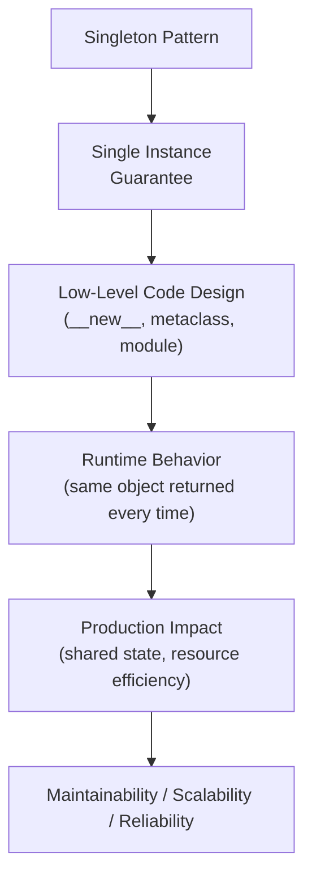
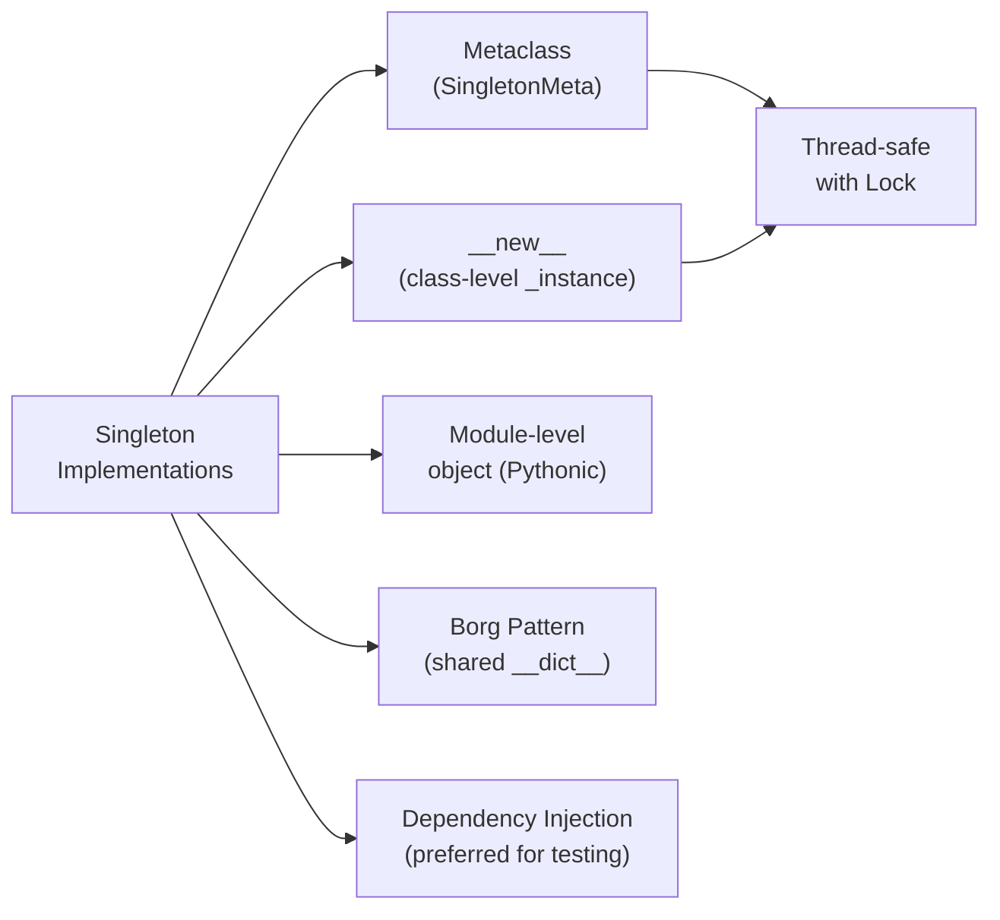

# Singleton Pattern in Python

## Overview

The **Singleton Pattern** is a creational design pattern that ensures a class has **only one instance** throughout the application's lifetime and provides a global access point to that instance. It is one of the most recognized — and most debated — design patterns in software engineering.

> **Core idea:** Guarantee that a class is instantiated exactly once, and provide a single, shared access point to that instance.

In Python, singletons can be implemented via metaclasses, `__new__`, module-level objects, `@classmethod` factories, or the `borg` pattern. Each approach has different trade-offs.

---

## Why It Matters

| Without Singleton | With Singleton |
|---|---|
| Multiple instances of shared resources | One shared instance |
| Inconsistent state across instances | Consistent, shared state |
| Multiple DB connections, loggers, configs | Single connection pool, logger, config |
| No global access point | Controlled global access |

Singletons are used for:
- **Configuration managers** — one config object for the entire app
- **Database connection pools** — one pool shared across all requests
- **Logging** — Python's `logging` module uses a singleton registry
- **Plugin registries** — one registry for all plugins
- **AI model instances** — one loaded model shared across requests
- **Event buses** — one event dispatcher for the application

---

## Concept Map





---

## Simple Example

```python
class Singleton:
    """Basic singleton using __new__."""
    _instance = None

    def __new__(cls, *args, **kwargs):
        if cls._instance is None:
            cls._instance = super().__new__(cls)
        return cls._instance

    def __init__(self, value: str = "default"):
        # __init__ is called every time — guard against re-initialization
        if not hasattr(self, "_initialized"):
            self.value = value
            self._initialized = True


# Test
s1 = Singleton("first")
s2 = Singleton("second")

print(s1 is s2)        # True — same object
print(id(s1) == id(s2))  # True
print(s1.value)        # "first" — not overwritten by second call
print(s2.value)        # "first" — same instance
```

**Explanation:**
- `__new__` controls object creation — returns the existing instance if one exists.
- `_initialized` guard prevents `__init__` from re-initializing the instance on subsequent calls.
- `s1 is s2` is `True` — they are the same object in memory.

**Expected Output:**
```
True
True
first
first
```

---

## Intermediate Example

### Thread-Safe Singleton with Metaclass

```python
import threading
from typing import Any, Dict, Optional

class SingletonMeta(type):
    """
    Thread-safe singleton metaclass.
    All classes using this metaclass will be singletons.
    """
    _instances: Dict[type, Any] = {}
    _lock: threading.Lock = threading.Lock()

    def __call__(cls, *args, **kwargs):
        with cls._lock:
            if cls not in cls._instances:
                instance = super().__call__(*args, **kwargs)
                cls._instances[cls] = instance
        return cls._instances[cls]


class DatabaseConnectionPool(metaclass=SingletonMeta):
    """Singleton database connection pool."""

    def __init__(self, host: str = "localhost", port: int = 5432, pool_size: int = 10):
        self.host = host
        self.port = port
        self.pool_size = pool_size
        self._connections = []
        self._initialized = True
        print(f"Pool created: {host}:{port} (size={pool_size})")

    def get_connection(self) -> str:
        return f"Connection to {self.host}:{self.port}"

    def __repr__(self) -> str:
        return f"DBPool({self.host}:{self.port}, size={self.pool_size})"


class AppLogger(metaclass=SingletonMeta):
    """Singleton application logger."""

    def __init__(self, name: str = "app", level: str = "INFO"):
        import logging
        self._logger = logging.getLogger(name)
        self._logger.setLevel(level)
        print(f"Logger created: {name} ({level})")

    def info(self, msg: str) -> None:
        print(f"[INFO] {msg}")

    def error(self, msg: str) -> None:
        print(f"[ERROR] {msg}")


# Usage
pool1 = DatabaseConnectionPool("db.prod.com", 5432, 20)
pool2 = DatabaseConnectionPool("db.other.com", 5433, 5)  # Ignored — returns pool1

print(pool1 is pool2)   # True
print(pool1)            # DBPool(db.prod.com:5432, size=20)
print(pool2)            # Same — DBPool(db.prod.com:5432, size=20)

logger1 = AppLogger("myapp")
logger2 = AppLogger("other")  # Ignored — returns logger1
print(logger1 is logger2)  # True

# Thread safety test
results = []
def create_pool():
    p = DatabaseConnectionPool()
    results.append(id(p))

threads = [threading.Thread(target=create_pool) for _ in range(10)]
for t in threads: t.start()
for t in threads: t.join()
print(f"All same instance: {len(set(results)) == 1}")  # True
```

**Explanation:**
- `SingletonMeta` uses a class-level `_lock` to prevent race conditions in multi-threaded environments.
- The lock is acquired only during instance creation — subsequent calls return the cached instance without locking.
- Multiple classes can use `SingletonMeta` — each gets its own singleton instance.

---

## Advanced / Architect-Level Example

### Problem Context

In a **production AI inference service**, you need a singleton model registry that loads ML models once (expensive operation) and serves them to all request handlers. The registry must be thread-safe, support lazy loading, and be testable (replaceable in tests).

```python
from __future__ import annotations
import threading
import time
from typing import Any, Dict, Optional, Callable, Type
from dataclasses import dataclass, field
from enum import Enum


class ModelStatus(Enum):
    NOT_LOADED = "not_loaded"
    LOADING = "loading"
    READY = "ready"
    ERROR = "error"


@dataclass
class ModelInfo:
    name: str
    version: str
    status: ModelStatus = ModelStatus.NOT_LOADED
    instance: Optional[Any] = None
    load_time_ms: float = 0.0
    error: Optional[str] = None


class ModelRegistryMeta(type):
    """Thread-safe singleton metaclass for the model registry."""
    _instance: Optional["ModelRegistry"] = None
    _lock: threading.Lock = threading.Lock()

    def __call__(cls, *args, **kwargs):
        with cls._lock:
            if cls._instance is None:
                cls._instance = super().__call__(*args, **kwargs)
        return cls._instance

    @classmethod
    def reset(mcs) -> None:
        """Reset singleton — for testing only."""
        with mcs._lock:
            mcs._instance = None


class ModelRegistry(metaclass=ModelRegistryMeta):
    """
    Singleton model registry for AI inference service.
    - Lazy loading: models loaded on first request
    - Thread-safe: concurrent requests handled safely
    - Observable: load times and status tracked
    - Testable: reset() for test isolation
    """

    def __init__(self):
        self._models: Dict[str, ModelInfo] = {}
        self._loaders: Dict[str, Callable] = {}
        self._model_locks: Dict[str, threading.Lock] = {}
        self._global_lock = threading.Lock()
        print("ModelRegistry initialized")

    def register(self, name: str, version: str, loader: Callable) -> None:
        """Register a model loader (doesn't load yet — lazy)."""
        with self._global_lock:
            self._models[name] = ModelInfo(name=name, version=version)
            self._loaders[name] = loader
            self._model_locks[name] = threading.Lock()
        print(f"Registered model: {name} v{version}")

    def get(self, name: str) -> Any:
        """
        Get a model instance — loads on first access (lazy).
        Thread-safe: uses double-checked locking.
        """
        if name not in self._models:
            raise KeyError(f"Model '{name}' not registered")

        model_info = self._models[name]

        # Fast path: already loaded
        if model_info.status == ModelStatus.READY:
            return model_info.instance

        # Slow path: load with per-model lock (double-checked locking)
        with self._model_locks[name]:
            if model_info.status == ModelStatus.READY:
                return model_info.instance

            if model_info.status == ModelStatus.ERROR:
                raise RuntimeError(f"Model '{name}' failed to load: {model_info.error}")

            model_info.status = ModelStatus.LOADING
            start = time.time()
            try:
                model_info.instance = self._loaders[name]()
                model_info.load_time_ms = (time.time() - start) * 1000
                model_info.status = ModelStatus.READY
                print(f"Loaded {name} in {model_info.load_time_ms:.1f}ms")
            except Exception as e:
                model_info.status = ModelStatus.ERROR
                model_info.error = str(e)
                raise

        return model_info.instance

    def preload(self, *names: str) -> None:
        """Eagerly load specified models."""
        threads = [
            threading.Thread(target=self.get, args=(name,))
            for name in names
        ]
        for t in threads: t.start()
        for t in threads: t.join()

    def status(self) -> Dict[str, dict]:
        return {
            name: {
                "version": info.version,
                "status": info.status.value,
                "load_time_ms": info.load_time_ms,
            }
            for name, info in self._models.items()
        }

    def unload(self, name: str) -> None:
        """Unload a model to free memory."""
        with self._model_locks.get(name, threading.Lock()):
            if name in self._models:
                self._models[name].instance = None
                self._models[name].status = ModelStatus.NOT_LOADED


# --- Simulated model loaders ---
def load_embedding_model():
    time.sleep(0.1)  # Simulate loading
    return {"type": "embedding", "dims": 1536, "model": "text-embedding-3-small"}

def load_llm_model():
    time.sleep(0.2)  # Simulate loading
    return {"type": "llm", "context_window": 128000, "model": "gpt-4o"}

def load_reranker_model():
    time.sleep(0.05)
    return {"type": "reranker", "model": "cross-encoder/ms-marco-MiniLM-L-6-v2"}


# --- Usage ---
registry = ModelRegistry()
registry.register("embedder", "3-small", load_embedding_model)
registry.register("llm", "gpt-4o", load_llm_model)
registry.register("reranker", "v1", load_reranker_model)

# Verify singleton
r2 = ModelRegistry()
print(f"Same instance: {registry is r2}")  # True

# Lazy loading — models loaded on first access
embedder = registry.get("embedder")
print(f"Embedder: {embedder}")

# Concurrent access — safe
results = []
def get_llm():
    model = registry.get("llm")
    results.append(id(model))

threads = [threading.Thread(target=get_llm) for _ in range(5)]
for t in threads: t.start()
for t in threads: t.join()
print(f"All same LLM instance: {len(set(results)) == 1}")  # True

print(f"\nRegistry status: {registry.status()}")

# Reset for testing
ModelRegistryMeta.reset()
new_registry = ModelRegistry()
print(f"After reset, new instance: {registry is not new_registry}")  # True
```

**Explanation:**
- `ModelRegistryMeta` is a thread-safe singleton metaclass with a `reset()` method for test isolation.
- Double-checked locking: fast path (no lock) for already-loaded models, slow path (with lock) for loading.
- Per-model locks prevent concurrent loading of the same model while allowing different models to load in parallel.
- `reset()` enables test isolation — each test gets a fresh registry.

**Design Trade-offs:**

| Approach | Pros | Cons |
|---|---|---|
| Singleton | Simple global access, resource sharing | Hard to test, global state, not thread-safe by default |
| Dependency Injection | Testable, explicit, no global state | More setup code |
| Module-level object | Pythonic, simple | No lazy init, no reset |
| Borg pattern | Shared state, multiple instances | Confusing semantics |

> **Architect's rule:** Prefer **dependency injection** over singletons in production systems. Use singletons only for truly global resources (logging, config) and always provide a `reset()` for testing.

---

## Common Mistakes

### 1. Not Thread-Safe Singleton
```python
# ❌ Race condition — two threads may create two instances
class Singleton:
    _instance = None
    def __new__(cls):
        if cls._instance is None:
            cls._instance = super().__new__(cls)  # Race condition here!
        return cls._instance

# ✅ Use a lock
import threading
class Singleton:
    _instance = None
    _lock = threading.Lock()
    def __new__(cls):
        with cls._lock:
            if cls._instance is None:
                cls._instance = super().__new__(cls)
        return cls._instance
```

---

### 2. Re-initializing on Every `__init__` Call
```python
# ❌ __init__ runs every time — overwrites state
class Singleton:
    _instance = None
    def __new__(cls):
        if cls._instance is None:
            cls._instance = super().__new__(cls)
        return cls._instance
    def __init__(self, value):
        self.value = value  # Overwrites on every call!

s1 = Singleton("first")
s2 = Singleton("second")
print(s1.value)  # "second" — overwritten!

# ✅ Guard __init__
def __init__(self, value):
    if not hasattr(self, "_initialized"):
        self.value = value
        self._initialized = True
```

---

### 3. Singleton Makes Testing Difficult
```python
# ❌ Tests share state — order-dependent, flaky
def test_config():
    config = AppConfig()
    config.debug = True
    assert config.debug  # Passes

def test_other():
    config = AppConfig()
    assert not config.debug  # Fails if test_config ran first!

# ✅ Provide reset() and use dependency injection
def test_config():
    AppConfigMeta.reset()
    config = AppConfig()
    config.debug = True
    assert config.debug
```

---

### 4. Using Singleton for Everything
```python
# ❌ Overusing singleton — makes code rigid and untestable
class UserService(metaclass=SingletonMeta): ...
class OrderService(metaclass=SingletonMeta): ...
class ProductService(metaclass=SingletonMeta): ...

# ✅ Use DI container or factory functions
def get_user_service(db: Database) -> UserService:
    return UserService(db)
```

---

### 5. Singleton in Multiprocessing
```python
# ❌ Singleton is per-process — not shared across processes
import multiprocessing
# Each process gets its own singleton instance!

# ✅ Use shared memory, Redis, or a manager process for cross-process state
```

---

## Best Practices

1. **Use thread-safe implementation** — always use a lock for multi-threaded applications.
2. **Provide `reset()` for testing** — test isolation requires the ability to reset the singleton.
3. **Prefer module-level objects** for simple singletons — Python modules are singletons by nature.
4. **Use dependency injection** instead of singletons where possible — more testable and flexible.
5. **Guard `__init__`** with `_initialized` flag — prevent re-initialization on subsequent calls.
6. **Document singleton behavior** — make it clear that the class is a singleton.
7. **Use lazy initialization** for expensive resources — don't load until first use.
8. **Avoid singletons for mutable shared state** — leads to hidden coupling and race conditions.
9. **Use per-model locks** for fine-grained concurrency — don't block all models for one.
10. **Consider the Borg pattern** when you want shared state but multiple instances.

---

## Performance Considerations

- **Instance creation**: After the first creation, `__new__` returns the cached instance — O(1) with no allocation.
- **Thread-safe locking**: The lock is only acquired during instance creation. After that, the fast path (no lock) is used. Overhead is negligible.
- **Double-checked locking**: Check without lock first, then with lock — minimizes lock contention in high-concurrency scenarios.
- **Module-level singletons**: Python's import system caches modules — module-level objects are effectively singletons with zero overhead.
- **Memory**: One instance shared across all users — significant memory savings for large objects (ML models, connection pools).

---

## Testing Strategy

```python
# test_singleton.py
import pytest
import threading
from your_module import (
    Singleton, DatabaseConnectionPool, ModelRegistry,
    ModelRegistryMeta, SingletonMeta
)


# --- Test basic singleton ---
def test_singleton_same_instance():
    s1 = Singleton("first")
    s2 = Singleton("second")
    assert s1 is s2

def test_singleton_no_reinit():
    s1 = Singleton("first")
    s2 = Singleton("second")
    assert s1.value == "first"  # Not overwritten


# --- Test thread safety ---
def test_singleton_thread_safe():
    instances = []
    def create():
        instances.append(id(DatabaseConnectionPool()))

    threads = [threading.Thread(target=create) for _ in range(50)]
    for t in threads: t.start()
    for t in threads: t.join()

    assert len(set(instances)) == 1  # All same instance


# --- Test reset for test isolation ---
def test_model_registry_reset():
    r1 = ModelRegistry()
    ModelRegistryMeta.reset()
    r2 = ModelRegistry()
    assert r1 is not r2  # Different instances after reset


# --- Test lazy loading ---
def test_model_registry_lazy_load():
    ModelRegistryMeta.reset()
    registry = ModelRegistry()
    loaded = []
    registry.register("test_model", "v1", lambda: loaded.append(1) or {"model": "test"})

    assert len(loaded) == 0  # Not loaded yet
    registry.get("test_model")
    assert len(loaded) == 1  # Loaded on first access
    registry.get("test_model")
    assert len(loaded) == 1  # Not loaded again


# --- Test concurrent model loading ---
def test_model_loaded_once_concurrently():
    ModelRegistryMeta.reset()
    registry = ModelRegistry()
    load_count = 0

    def loader():
        nonlocal load_count
        load_count += 1
        return {"model": "test"}

    registry.register("concurrent_model", "v1", loader)

    threads = [threading.Thread(target=registry.get, args=("concurrent_model",)) for _ in range(10)]
    for t in threads: t.start()
    for t in threads: t.join()

    assert load_count == 1  # Loaded exactly once


# --- Test unknown model raises ---
def test_model_registry_unknown_model():
    ModelRegistryMeta.reset()
    registry = ModelRegistry()
    with pytest.raises(KeyError):
        registry.get("nonexistent")
```

---

## Debugging Tips

1. **Multiple instances created** — check if the singleton is thread-safe. Add a lock around instance creation.

2. **State not persisting** — `__init__` is re-running and overwriting state. Add the `_initialized` guard.

3. **Tests interfering with each other** — singleton state leaks between tests. Add `reset()` and call it in `setUp`/`teardown`.

4. **Singleton not working across modules** — ensure you're importing the same class, not re-defining it. Python's import system caches modules, so the same class object is used everywhere.

5. **Singleton in multiprocessing** — each process has its own memory space. Singletons are not shared across processes. Use Redis or a manager process.

6. **`id(s1) == id(s2)` but `s1 is not s2`** — impossible in CPython (same id = same object). If you see this, you have a bug in your singleton implementation.

---

## Interview Questions

### Beginner

**Q1: What is the Singleton pattern?**  
A: A creational pattern that ensures a class has only one instance and provides a global access point to it.

**Q2: How do you implement a singleton in Python using `__new__`?**  
A: Store the instance in a class variable `_instance`. In `__new__`, return the existing instance if it exists, otherwise create a new one.

**Q3: Why is the Singleton pattern controversial?**  
A: It introduces global state, makes testing difficult (shared state between tests), creates hidden coupling, and violates the Single Responsibility Principle.

**Q4: What is the simplest way to create a singleton in Python?**  
A: Use a module-level object. Python's import system caches modules — a module-level object is effectively a singleton.

**Q5: What is the `_initialized` guard in a singleton?**  
A: A flag that prevents `__init__` from re-initializing the instance on subsequent calls. Without it, `__init__` runs every time the class is called, overwriting state.

---

### Intermediate

**Q6: How do you make a singleton thread-safe?**  
A: Use a `threading.Lock` around instance creation. Use double-checked locking for performance: check without lock first, then with lock.

**Q7: What is the Borg pattern and how does it differ from Singleton?**  
A: The Borg pattern shares `__dict__` across all instances — all instances have the same state but are different objects. Singleton returns the same object. Borg is useful when you want shared state but don't need identity equality.

**Q8: How do you test code that uses a singleton?**  
A: Provide a `reset()` class method that clears the singleton instance. Call it in test setup/teardown. Alternatively, use dependency injection to avoid singletons in testable code.

**Q9: What is a metaclass-based singleton?**  
A: A metaclass that overrides `__call__` to return the cached instance. All classes using this metaclass become singletons. More reusable than per-class `__new__` implementations.

**Q10: How does Python's module system act as a singleton?**  
A: Python caches imported modules in `sys.modules`. The first import executes the module; subsequent imports return the cached module object. Module-level objects are effectively singletons.

---

### Advanced / Architect-Level

**Q11: When would you choose dependency injection over a singleton?**  
A: Always prefer DI for testable, maintainable code. Use singletons only for truly global resources (logging, config) where DI would be overly verbose. DI makes dependencies explicit, enables mocking, and avoids global state.

**Q12: How would you implement a singleton model registry for a production AI inference service?**  
A: Use a thread-safe metaclass singleton with per-model locks for fine-grained concurrency. Implement lazy loading, double-checked locking, and a `reset()` method for testing. Track model status and load times for observability.

**Q13: How does the Singleton pattern interact with multiprocessing?**  
A: Singletons are per-process — each process has its own instance. For shared state across processes, use Redis, a manager process (`multiprocessing.Manager`), or shared memory.

**Q14: What are the alternatives to Singleton for managing shared resources?**  
A: Dependency injection containers (e.g., `dependency-injector`), service locators, factory functions, module-level objects, and context variables (`contextvars`).

**Q15: How would you implement a distributed singleton across multiple API instances?**  
A: Use Redis with a distributed lock (Redlock algorithm) for initialization. Store the singleton state in Redis. Each API instance checks Redis before creating a local instance. Use Redis pub/sub to synchronize state changes.

---

## Key Takeaways

- Singleton ensures one instance per class — use for shared resources (config, DB pool, model registry).
- Always implement thread-safe singletons with a `threading.Lock`.
- Guard `__init__` with `_initialized` to prevent re-initialization.
- Provide `reset()` for test isolation — singletons without reset make tests flaky.
- Module-level objects are the simplest Pythonic singleton — use them for simple cases.
- Prefer dependency injection over singletons for testable, maintainable code.
- Singletons are per-process — not shared across multiprocessing workers.
- Double-checked locking minimizes lock contention in high-concurrency scenarios.
- The Borg pattern shares state without identity — useful for configuration objects.
- Mastering the Singleton pattern — and knowing when NOT to use it — is a mark of architectural maturity.

---

## Mini Project Idea

### Goal
Build a **Production Configuration Manager** — a thread-safe singleton that loads, validates, and provides application configuration from environment variables, YAML files, and defaults.

### Features
- `ConfigManager` singleton with `SingletonMeta`.
- Loads from: environment variables → YAML file → defaults (priority order).
- Validates config with `__post_init__` data class validation.
- `reset()` for test isolation.
- `reload()` for hot config reloading.
- Thread-safe read/write with `threading.RLock`.
- CLI: `python config_manager.py --validate --show`.

### Suggested Folder Structure
```
config_manager/
├── config/
│   ├── __init__.py
│   ├── manager.py         # ConfigManager singleton
│   ├── schema.py          # Config dataclass with validation
│   └── loaders.py         # env, yaml, defaults loaders
├── tests/
│   ├── test_manager.py
│   └── test_loaders.py
├── config.yaml
├── cli.py
└── README.md
```

### Extension Ideas
- Add distributed config sync with Redis pub/sub.
- Add config change notifications via callbacks.
- Add config versioning and rollback.
- Add Prometheus metrics for config access patterns.

---

## Final Summary

Mastering the Singleton pattern — and its trade-offs — is a hallmark of Python architectural maturity. Singletons solve a real problem: ensuring shared resources (model registries, connection pools, configuration) are instantiated exactly once. But they introduce global state, hidden coupling, and testing challenges. A Python architect knows when to use a singleton (truly global resources), when to use a module-level object (simple cases), and when to use dependency injection (testable, maintainable systems). Understanding thread safety, double-checked locking, test isolation via `reset()`, and the alternatives to singletons gives you the vocabulary to make informed architectural decisions in production Python systems.
