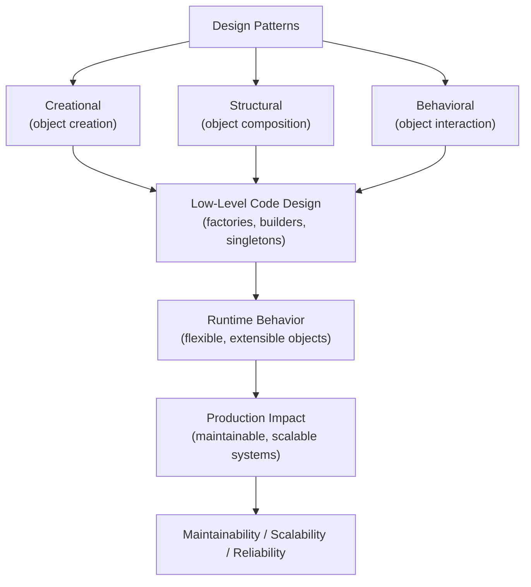
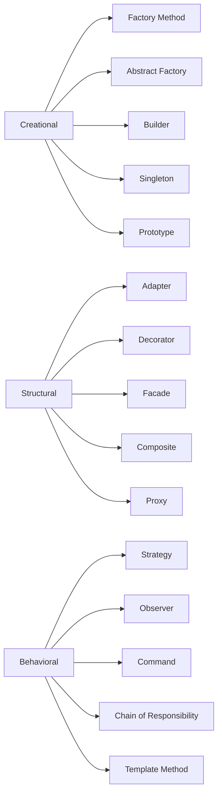

# Design Patterns in Python

## Overview

**Design Patterns** are reusable solutions to commonly occurring problems in software design. Formalized by the "Gang of Four" (GoF) in 1994, they are organized into three categories: **Creational** (object creation), **Structural** (object composition), and **Behavioral** (object interaction). Python's dynamic nature, first-class functions, and duck typing enable elegant, concise implementations of these patterns — often simpler than their Java/C++ equivalents.

> **Core idea:** Design patterns are a shared vocabulary for software architects. They encode proven solutions to recurring design problems, enabling teams to communicate complex designs concisely.

---

## Why It Matters

| Without Patterns | With Patterns |
|---|---|
| Ad-hoc solutions | Proven, named solutions |
| Hard to communicate design | Shared vocabulary |
| Reinventing the wheel | Reusing battle-tested approaches |
| Tightly coupled code | Loosely coupled, extensible code |
| Hard to extend | Open/closed principle |

Design patterns are used in:
- **Django** — MTV (Model-Template-View) is MVC; `QuerySet` is Builder; middleware is Chain of Responsibility
- **SQLAlchemy** — Unit of Work, Identity Map, Repository
- **FastAPI** — Dependency Injection, Decorator
- **AI agent frameworks** — Strategy (tool selection), Observer (event hooks), Chain of Responsibility (middleware)
- **RAG pipelines** — Pipeline/Chain, Strategy (retrieval), Factory (component creation)

---

## Concept Map





---

## Simple Example

### Strategy Pattern

```python
from abc import ABC, abstractmethod
from typing import List

class SortStrategy(ABC):
    @abstractmethod
    def sort(self, data: List[int]) -> List[int]: ...

class BubbleSort(SortStrategy):
    def sort(self, data: List[int]) -> List[int]:
        d = data[:]
        for i in range(len(d)):
            for j in range(len(d) - i - 1):
                if d[j] > d[j+1]:
                    d[j], d[j+1] = d[j+1], d[j]
        return d

class QuickSort(SortStrategy):
    def sort(self, data: List[int]) -> List[int]:
        if len(data) <= 1:
            return data
        pivot = data[len(data) // 2]
        left = [x for x in data if x < pivot]
        mid = [x for x in data if x == pivot]
        right = [x for x in data if x > pivot]
        return self.sort(left) + mid + self.sort(right)

class Sorter:
    def __init__(self, strategy: SortStrategy):
        self._strategy = strategy

    def set_strategy(self, strategy: SortStrategy) -> None:
        self._strategy = strategy

    def sort(self, data: List[int]) -> List[int]:
        return self._strategy.sort(data)

data = [5, 2, 8, 1, 9, 3]
sorter = Sorter(BubbleSort())
print(sorter.sort(data))  # [1, 2, 3, 5, 8, 9]

sorter.set_strategy(QuickSort())
print(sorter.sort(data))  # [1, 2, 3, 5, 8, 9]
```

**Explanation:**
- `SortStrategy` defines the interface. `BubbleSort` and `QuickSort` are concrete strategies.
- `Sorter` uses the strategy — the algorithm can be swapped at runtime.
- This is the foundation of Python's `key=` parameter in `sorted()`.

---

## Intermediate Example

### Observer + Factory + Builder

```python
from __future__ import annotations
from abc import ABC, abstractmethod
from typing import List, Dict, Any, Callable, Optional
from dataclasses import dataclass, field


# --- Observer Pattern ---

class EventBus:
    """Simple event bus — Observer pattern."""
    _handlers: Dict[str, List[Callable]] = {}

    @classmethod
    def subscribe(cls, event: str, handler: Callable) -> None:
        cls._handlers.setdefault(event, []).append(handler)

    @classmethod
    def publish(cls, event: str, **data) -> None:
        for handler in cls._handlers.get(event, []):
            handler(**data)


# --- Factory Method Pattern ---

class Notification(ABC):
    @abstractmethod
    def send(self, recipient: str, message: str) -> str: ...

class EmailNotification(Notification):
    def send(self, recipient: str, message: str) -> str:
        return f"[EMAIL → {recipient}]: {message}"

class SMSNotification(Notification):
    def send(self, recipient: str, message: str) -> str:
        return f"[SMS → {recipient}]: {message}"

class SlackNotification(Notification):
    def send(self, recipient: str, message: str) -> str:
        return f"[SLACK → {recipient}]: {message}"

class NotificationFactory:
    """Factory Method — creates notifications by type."""
    _registry: Dict[str, type] = {
        "email": EmailNotification,
        "sms": SMSNotification,
        "slack": SlackNotification,
    }

    @classmethod
    def create(cls, channel: str) -> Notification:
        if channel not in cls._registry:
            raise ValueError(f"Unknown channel: {channel}")
        return cls._registry[channel]()

    @classmethod
    def register(cls, channel: str, notification_class: type) -> None:
        cls._registry[channel] = notification_class


# --- Builder Pattern ---

@dataclass
class QueryConfig:
    table: str
    conditions: List[str] = field(default_factory=list)
    order_by: Optional[str] = None
    limit: Optional[int] = None
    offset: int = 0
    select_fields: List[str] = field(default_factory=lambda: ["*"])

class QueryBuilder:
    """Builder pattern for SQL queries."""

    def __init__(self, table: str):
        self._config = QueryConfig(table=table)

    def select(self, *fields: str) -> "QueryBuilder":
        self._config.select_fields = list(fields)
        return self

    def where(self, condition: str) -> "QueryBuilder":
        self._config.conditions.append(condition)
        return self

    def order_by(self, field: str) -> "QueryBuilder":
        self._config.order_by = field
        return self

    def limit(self, n: int) -> "QueryBuilder":
        self._config.limit = n
        return self

    def offset(self, n: int) -> "QueryBuilder":
        self._config.offset = n
        return self

    def build(self) -> str:
        fields = ", ".join(self._config.select_fields)
        query = f"SELECT {fields} FROM {self._config.table}"
        if self._config.conditions:
            query += " WHERE " + " AND ".join(self._config.conditions)
        if self._config.order_by:
            query += f" ORDER BY {self._config.order_by}"
        if self._config.limit:
            query += f" LIMIT {self._config.limit}"
        if self._config.offset:
            query += f" OFFSET {self._config.offset}"
        return query


# --- Usage ---

# Observer
EventBus.subscribe("order.created", lambda order_id, **kw: print(f"Order created: {order_id}"))
EventBus.subscribe("order.created", lambda order_id, **kw: print(f"Sending confirmation for {order_id}"))
EventBus.publish("order.created", order_id="ORD-001", customer="Alice")

# Factory
for channel in ["email", "sms", "slack"]:
    notif = NotificationFactory.create(channel)
    print(notif.send("alice@example.com", "Your order is ready"))

# Builder
query = (
    QueryBuilder("orders")
    .select("id", "customer", "total")
    .where("status = 'confirmed'")
    .where("total > 100")
    .order_by("created_at DESC")
    .limit(20)
    .offset(40)
    .build()
)
print(query)
```

**Expected Output:**
```
Order created: ORD-001
Sending confirmation for ORD-001
[EMAIL → alice@example.com]: Your order is ready
[SMS → alice@example.com]: Your order is ready
[SLACK → alice@example.com]: Your order is ready
SELECT id, customer, total FROM orders WHERE status = 'confirmed' AND total > 100 ORDER BY created_at DESC LIMIT 20 OFFSET 40
```

---

## Advanced / Architect-Level Example

### Problem Context

In a **production RAG pipeline**, multiple design patterns work together: **Chain of Responsibility** for middleware processing, **Strategy** for retrieval algorithms, **Decorator** for observability, and **Command** for pipeline step execution with undo/retry support.

```python
from __future__ import annotations
import time
import uuid
from abc import ABC, abstractmethod
from typing import Any, Dict, List, Optional, Callable
from dataclasses import dataclass, field
from functools import wraps


@dataclass
class PipelineContext:
    """Shared context flowing through the pipeline."""
    query: str
    pipeline_id: str = field(default_factory=lambda: str(uuid.uuid4())[:8])
    documents: List[str] = field(default_factory=list)
    embeddings: List[List[float]] = field(default_factory=list)
    results: List[Dict] = field(default_factory=list)
    metadata: Dict[str, Any] = field(default_factory=dict)
    errors: List[str] = field(default_factory=list)


# --- Chain of Responsibility Pattern ---

class PipelineHandler(ABC):
    """Abstract handler in the chain."""

    def __init__(self):
        self._next: Optional[PipelineHandler] = None

    def set_next(self, handler: "PipelineHandler") -> "PipelineHandler":
        self._next = handler
        return handler

    @abstractmethod
    def handle(self, context: PipelineContext) -> PipelineContext:
        ...

    def _pass_to_next(self, context: PipelineContext) -> PipelineContext:
        if self._next:
            return self._next.handle(context)
        return context


class ValidationHandler(PipelineHandler):
    def handle(self, context: PipelineContext) -> PipelineContext:
        if not context.query.strip():
            context.errors.append("Empty query")
            return context
        if len(context.query) > 1000:
            context.errors.append("Query too long")
            return context
        return self._pass_to_next(context)


class RetrievalHandler(PipelineHandler):
    def __init__(self, strategy: "RetrievalStrategy"):
        super().__init__()
        self._strategy = strategy

    def handle(self, context: PipelineContext) -> PipelineContext:
        context.results = self._strategy.retrieve(context.query)
        return self._pass_to_next(context)


class GenerationHandler(PipelineHandler):
    def handle(self, context: PipelineContext) -> PipelineContext:
        context_text = "\n".join(r.get("text", "") for r in context.results[:3])
        context.metadata["answer"] = f"[LLM] Answer to '{context.query}' using: {context_text[:100]}"
        return self._pass_to_next(context)


# --- Strategy Pattern for Retrieval ---

class RetrievalStrategy(ABC):
    @abstractmethod
    def retrieve(self, query: str) -> List[Dict]: ...

class VectorRetrievalStrategy(RetrievalStrategy):
    def retrieve(self, query: str) -> List[Dict]:
        return [{"text": f"Vector result for '{query}'", "score": 0.95}]

class BM25RetrievalStrategy(RetrievalStrategy):
    def retrieve(self, query: str) -> List[Dict]:
        return [{"text": f"BM25 result for '{query}'", "score": 0.88}]

class HybridRetrievalStrategy(RetrievalStrategy):
    def __init__(self, vector: RetrievalStrategy, bm25: RetrievalStrategy, alpha: float = 0.7):
        self._vector = vector
        self._bm25 = bm25
        self._alpha = alpha

    def retrieve(self, query: str) -> List[Dict]:
        v_results = self._vector.retrieve(query)
        b_results = self._bm25.retrieve(query)
        # Merge and re-rank
        all_results = v_results + b_results
        return sorted(all_results, key=lambda r: r["score"], reverse=True)


# --- Decorator Pattern for Observability ---

def timed(fn: Callable) -> Callable:
    """Decorator: adds timing to any pipeline handler method."""
    @wraps(fn)
    def wrapper(self, context: PipelineContext) -> PipelineContext:
        start = time.time()
        result = fn(self, context)
        elapsed = (time.time() - start) * 1000
        context.metadata[f"{self.__class__.__name__}_ms"] = round(elapsed, 2)
        return result
    return wrapper


class ObservableHandler(PipelineHandler):
    """Decorator pattern: wraps any handler with timing and logging."""

    def __init__(self, handler: PipelineHandler, name: str = ""):
        super().__init__()
        self._handler = handler
        self._name = name or handler.__class__.__name__

    def handle(self, context: PipelineContext) -> PipelineContext:
        start = time.time()
        print(f"[{self._name}] Starting...")
        result = self._handler.handle(context)
        elapsed = (time.time() - start) * 1000
        print(f"[{self._name}] Done in {elapsed:.1f}ms")
        return result

    def set_next(self, handler: PipelineHandler) -> PipelineHandler:
        self._handler.set_next(handler)
        return handler


# --- Command Pattern for Pipeline Steps ---

class PipelineCommand(ABC):
    @abstractmethod
    def execute(self, context: PipelineContext) -> PipelineContext: ...

    @abstractmethod
    def undo(self, context: PipelineContext) -> PipelineContext: ...


class RetrievalCommand(PipelineCommand):
    def __init__(self, strategy: RetrievalStrategy):
        self._strategy = strategy
        self._previous_results: List[Dict] = []

    def execute(self, context: PipelineContext) -> PipelineContext:
        self._previous_results = context.results[:]
        context.results = self._strategy.retrieve(context.query)
        return context

    def undo(self, context: PipelineContext) -> PipelineContext:
        context.results = self._previous_results
        return context


# --- Pipeline Assembly ---

def build_rag_pipeline(strategy: RetrievalStrategy) -> PipelineHandler:
    """Factory function that assembles the pipeline."""
    validation = ValidationHandler()
    retrieval = RetrievalHandler(strategy)
    generation = GenerationHandler()

    # Chain: validation → retrieval → generation
    validation.set_next(retrieval).set_next(generation)

    # Wrap with observability
    return ObservableHandler(validation, "RAGPipeline")


# --- Usage ---
strategy = HybridRetrievalStrategy(
    VectorRetrievalStrategy(),
    BM25RetrievalStrategy(),
    alpha=0.7,
)

pipeline = build_rag_pipeline(strategy)

context = PipelineContext(query="What is retrieval-augmented generation?")
result = pipeline.handle(context)

print(f"\nAnswer: {result.metadata.get('answer')}")
print(f"Results: {len(result.results)} documents")
print(f"Errors: {result.errors}")

# Swap strategy at runtime (Strategy pattern)
pipeline2 = build_rag_pipeline(VectorRetrievalStrategy())
context2 = PipelineContext(query="Explain embeddings")
result2 = pipeline2.handle(context2)
print(f"\nVector-only answer: {result2.metadata.get('answer')}")
```

**Explanation:**
- **Chain of Responsibility**: `ValidationHandler → RetrievalHandler → GenerationHandler` — each handler processes and passes to the next.
- **Strategy**: `HybridRetrievalStrategy` composes `VectorRetrievalStrategy` and `BM25RetrievalStrategy` — swappable at runtime.
- **Decorator**: `ObservableHandler` wraps any handler with timing and logging — non-invasive observability.
- **Factory**: `build_rag_pipeline()` assembles the pipeline — clients don't know the internal structure.

**Design Trade-offs:**

| Pattern | Pros | Cons |
|---|---|---|
| Chain of Responsibility | Flexible, extensible | Hard to debug long chains |
| Strategy | Swappable algorithms | More classes |
| Decorator | Non-invasive, composable | Deep nesting can be confusing |
| Observer | Loose coupling | Hard to trace event flows |

---

## Common Mistakes

### 1. Overusing Patterns
```python
# ❌ Using Factory for a simple object creation
class UserFactory:
    def create(self, name: str) -> User:
        return User(name)  # Just use User(name) directly!

# ✅ Use patterns only when they solve a real problem
user = User("Alice")
```

---

### 2. Confusing Decorator Pattern with Python's `@decorator`
```python
# Python's @decorator is a function wrapper — not the GoF Decorator pattern
# GoF Decorator: wraps an object to add behavior
# Python @decorator: wraps a function to add behavior
# They are related but not identical
```

---

### 3. Singleton Overuse
```python
# ❌ Making everything a singleton
class UserService(metaclass=SingletonMeta): ...
class OrderService(metaclass=SingletonMeta): ...

# ✅ Use DI instead
def get_user_service(db: Database) -> UserService:
    return UserService(db)
```

---

### 4. Not Using Python's Built-in Patterns
```python
# ❌ Implementing Observer from scratch when Python has better tools
# ✅ Use functools.singledispatch for Strategy
# ✅ Use contextlib for Template Method
# ✅ Use __call__ for Command
# ✅ Use generators for Iterator
```

---

### 5. Ignoring Pythonic Alternatives
```python
# ❌ Java-style Abstract Factory with many classes
# ✅ Python: use dict of callables as a factory registry
factory = {
    "email": EmailNotification,
    "sms": SMSNotification,
}
notif = factory[channel]()
```

---

## Best Practices

1. **Use patterns to solve problems, not to show off** — apply only when they add clarity.
2. **Prefer Pythonic implementations** — use dicts, functions, and decorators over heavy class hierarchies.
3. **Name classes after patterns** — `UserFactory`, `SortStrategy`, `LoggingDecorator` — communicates intent.
4. **Combine patterns** — real systems use multiple patterns together (Strategy + Factory + Observer).
5. **Use ABCs for pattern interfaces** — enforces contracts on concrete implementations.
6. **Use `functools.singledispatch` for Strategy** — cleaner than class hierarchies for type-based dispatch.
7. **Use `contextlib` for Template Method** — `contextmanager` is a Pythonic template method.
8. **Use `dataclasses` for Value Objects** — immutable, comparable, serializable.
9. **Document pattern usage** — note which pattern is used and why in class/module docstrings.
10. **Test patterns in isolation** — test each concrete strategy/handler/command independently.

---

## Performance Considerations

Design patterns themselves have minimal performance overhead. The key considerations are:

- **Strategy**: Method dispatch overhead is negligible. For hot paths, consider inlining the strategy.
- **Observer**: Event dispatch adds overhead proportional to the number of subscribers. For high-frequency events, use batching.
- **Decorator**: Each decorator layer adds one function call. For 10+ layers, consider flattening.
- **Chain of Responsibility**: Each handler adds one method call. For long chains, profile and optimize hot handlers.
- **Factory**: Object creation overhead is the same as direct instantiation. The factory itself adds negligible overhead.
- **Builder**: Fluent API adds method call overhead — negligible for object construction.

---

## Testing Strategy

```python
# test_design_patterns.py
import pytest
from your_module import (
    BubbleSort, QuickSort, Sorter,
    NotificationFactory, EmailNotification,
    QueryBuilder, EventBus,
    ValidationHandler, RetrievalHandler, GenerationHandler,
    VectorRetrievalStrategy, PipelineContext
)


# --- Strategy Pattern ---
def test_bubble_sort():
    assert BubbleSort().sort([3, 1, 2]) == [1, 2, 3]

def test_quick_sort():
    assert QuickSort().sort([3, 1, 2]) == [1, 2, 3]

def test_sorter_strategy_swap():
    sorter = Sorter(BubbleSort())
    assert sorter.sort([3, 1, 2]) == [1, 2, 3]
    sorter.set_strategy(QuickSort())
    assert sorter.sort([3, 1, 2]) == [1, 2, 3]


# --- Factory Pattern ---
def test_notification_factory_creates_correct_type():
    notif = NotificationFactory.create("email")
    assert isinstance(notif, EmailNotification)

def test_notification_factory_unknown_channel():
    with pytest.raises(ValueError):
        NotificationFactory.create("fax")

def test_notification_factory_register_new():
    class WebhookNotification:
        def send(self, r, m): return f"[WEBHOOK] {m}"

    NotificationFactory.register("webhook", WebhookNotification)
    notif = NotificationFactory.create("webhook")
    assert "WEBHOOK" in notif.send("url", "test")


# --- Builder Pattern ---
def test_query_builder_basic():
    q = QueryBuilder("users").build()
    assert q == "SELECT * FROM users"

def test_query_builder_full():
    q = (QueryBuilder("orders")
         .select("id", "total")
         .where("status = 'active'")
         .order_by("created_at")
         .limit(10)
         .build())
    assert "SELECT id, total" in q
    assert "WHERE status = 'active'" in q
    assert "ORDER BY created_at" in q
    assert "LIMIT 10" in q


# --- Observer Pattern ---
def test_event_bus_publishes_to_subscribers():
    received = []
    EventBus.subscribe("test.event", lambda msg, **kw: received.append(msg))
    EventBus.publish("test.event", msg="hello")
    assert "hello" in received


# --- Chain of Responsibility ---
def test_validation_handler_rejects_empty_query():
    handler = ValidationHandler()
    ctx = PipelineContext(query="")
    result = handler.handle(ctx)
    assert "Empty query" in result.errors

def test_pipeline_chain():
    validation = ValidationHandler()
    retrieval = RetrievalHandler(VectorRetrievalStrategy())
    generation = GenerationHandler()
    validation.set_next(retrieval).set_next(generation)

    ctx = PipelineContext(query="test query")
    result = validation.handle(ctx)
    assert len(result.results) > 0
    assert "answer" in result.metadata
```

---

## Debugging Tips

1. **Chain of Responsibility not reaching a handler** — check that `set_next()` is called correctly and that each handler calls `_pass_to_next()`.

2. **Strategy not being called** — verify the strategy is injected correctly and the method name matches the interface.

3. **Observer not firing** — check that `subscribe()` was called before `publish()`. Check event name spelling.

4. **Factory creating wrong type** — check the registry dict. Use `print(factory._registry)` to inspect.

5. **Builder producing wrong query** — add `print(self._config)` after each builder method to trace state.

6. **Decorator not wrapping correctly** — use `functools.wraps` to preserve the original function's metadata.

---

## Interview Questions

### Beginner

**Q1: What are the three categories of GoF design patterns?**  
A: Creational (object creation), Structural (object composition), Behavioral (object interaction).

**Q2: What is the Strategy pattern?**  
A: Defines a family of algorithms, encapsulates each one, and makes them interchangeable. The algorithm can be selected at runtime.

**Q3: What is the Observer pattern?**  
A: Defines a one-to-many dependency — when one object changes state, all dependents are notified automatically. Used for event systems.

**Q4: What is the Factory Method pattern?**  
A: Defines an interface for creating objects but lets subclasses decide which class to instantiate. Decouples object creation from usage.

**Q5: What is the Decorator pattern?**  
A: Attaches additional responsibilities to an object dynamically. Provides a flexible alternative to subclassing for extending functionality.

---

### Intermediate

**Q6: How does Python's `@decorator` syntax relate to the GoF Decorator pattern?**  
A: Python's `@decorator` is a function wrapper — it wraps a function to add behavior. The GoF Decorator wraps an object to add behavior. They share the same concept (wrapping) but operate at different levels (function vs. object).

**Q7: How would you implement the Observer pattern in Python?**  
A: Use a dict of event names to lists of callbacks. `subscribe(event, fn)` adds to the list. `publish(event, **data)` calls all registered callbacks. Python's `signal` library and `asyncio` events are built on this pattern.

**Q8: What is the difference between Factory Method and Abstract Factory?**  
A: Factory Method creates one product via a method. Abstract Factory creates families of related products via an interface. Abstract Factory is used when you need to create multiple related objects that must work together.

**Q9: How does the Builder pattern differ from a constructor with many parameters?**  
A: Builder uses a fluent API to construct complex objects step by step. It's more readable than constructors with many parameters, supports optional steps, and can validate the final object before building.

**Q10: What is the Chain of Responsibility pattern?**  
A: Passes a request along a chain of handlers. Each handler decides to process the request or pass it to the next handler. Used for middleware, validation pipelines, and event processing.

---

### Advanced / Architect-Level

**Q11: How would you use design patterns to build a RAG pipeline?**  
A: Chain of Responsibility for pipeline stages (validation → retrieval → generation). Strategy for retrieval algorithms (vector, BM25, hybrid). Factory for component creation. Decorator for observability. Observer for pipeline events. Command for step execution with retry/undo.

**Q12: How does Django use design patterns?**  
A: MTV is MVC. `QuerySet` is Builder + Iterator. Middleware is Chain of Responsibility. Signals are Observer. `ModelForm` is Template Method. `Manager` is Repository. `settings` is Singleton (module-level).

**Q13: What is the difference between Decorator and Proxy patterns?**  
A: Decorator adds behavior to an object. Proxy controls access to an object (lazy loading, access control, caching). Both wrap an object, but their intent differs: Decorator enhances, Proxy controls.

**Q14: How would you implement a plugin system using the Factory and Strategy patterns?**  
A: Define a `Plugin` ABC (Strategy interface). Use a `PluginFactory` with a registry dict. Plugins register themselves via `PluginFactory.register(name, PluginClass)`. The system creates plugins by name: `PluginFactory.create("my_plugin")`. New plugins are added without modifying the factory.

**Q15: When would you use the Command pattern in a production system?**  
A: When you need undo/redo, queuing, logging, or retry of operations. Examples: database migrations (execute/rollback), workflow steps (execute/compensate), API request queuing, and audit logging.

---

## Key Takeaways

- Design patterns are a shared vocabulary for software architects — learn the names and intents.
- Python's dynamic nature enables simpler, more Pythonic pattern implementations than Java/C++.
- The three categories: Creational (how objects are created), Structural (how objects are composed), Behavioral (how objects interact).
- Strategy, Observer, Factory, Builder, and Chain of Responsibility are the most commonly used in Python systems.
- Combine patterns — real systems use multiple patterns together.
- Use ABCs to define pattern interfaces — enforces contracts.
- Prefer Pythonic alternatives: dicts for registries, functions for strategies, decorators for wrappers.
- Don't overuse patterns — apply only when they solve a real problem.
- Document pattern usage in code — it communicates design intent.
- Mastering design patterns is mastering the vocabulary of software architecture.

---

## Mini Project Idea

### Goal
Build a **Pluggable Data Processing Framework** — a pipeline that uses multiple design patterns to process data from various sources through configurable transformation stages.

### Features
- **Factory**: `ProcessorFactory` creates processors by name.
- **Strategy**: `FilterStrategy`, `TransformStrategy`, `AggregateStrategy` — swappable algorithms.
- **Chain of Responsibility**: `ValidationStage → FilterStage → TransformStage → OutputStage`.
- **Observer**: `PipelineEventBus` — notifies on stage completion, errors.
- **Builder**: `PipelineBuilder` — fluent API for pipeline construction.
- **Command**: `PipelineCommand` — execute/undo for each stage.

### Suggested Folder Structure
```
data_pipeline/
├── patterns/
│   ├── factory.py
│   ├── strategy.py
│   ├── chain.py
│   ├── observer.py
│   ├── builder.py
│   └── command.py
├── stages/
│   ├── validation.py
│   ├── filter.py
│   ├── transform.py
│   └── output.py
├── tests/
│   ├── test_patterns.py
│   └── test_pipeline.py
├── cli.py
└── README.md
```

### Extension Ideas
- Add async support with async handlers.
- Add a visual pipeline diagram generator.
- Add plugin discovery via entry points.
- Benchmark different strategy implementations.

---

## Final Summary

Mastering design patterns is mastering the language of software architecture. Patterns give you a vocabulary to communicate complex designs concisely, a toolkit of proven solutions to recurring problems, and a framework for thinking about extensibility, maintainability, and scalability. For a Python architect, the key is knowing which patterns to apply, how to implement them Pythonically (using dicts, functions, decorators, and ABCs rather than heavy class hierarchies), and how to combine them in real systems. Every major Python framework — Django, SQLAlchemy, FastAPI — is built on design patterns. Understanding them deeply means you can read, extend, and design frameworks, not just use them.
