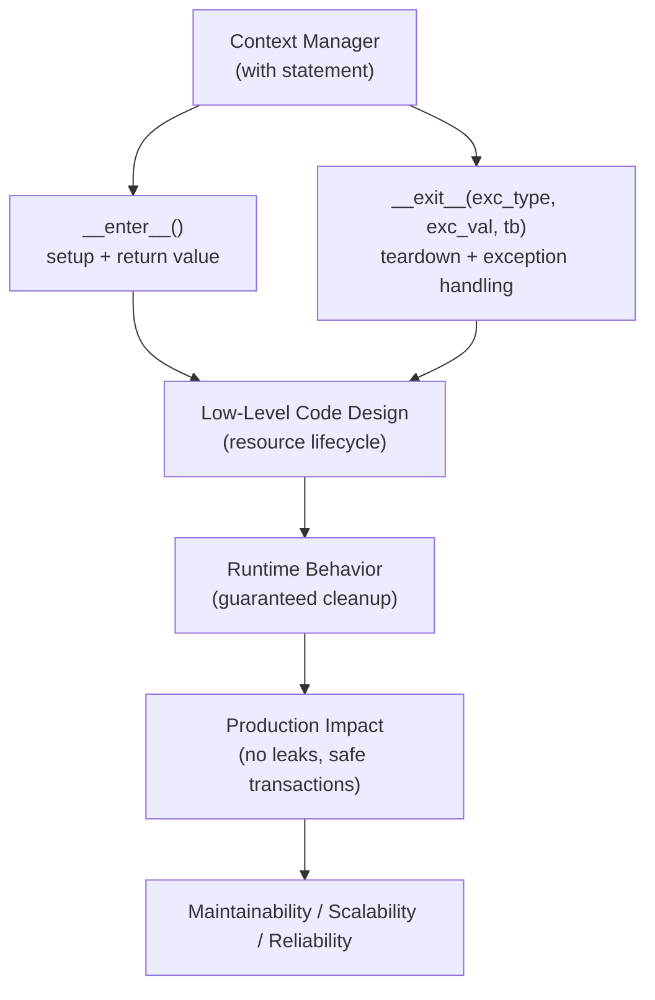
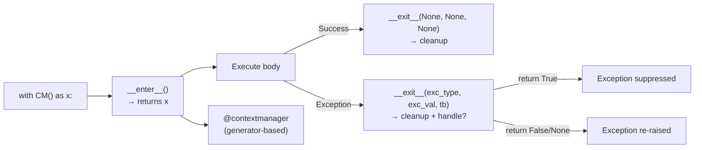

# Context Managers in Python

## Overview

**Context Managers** are objects that define a runtime context for a block of code using the `with` statement. They guarantee that setup and teardown operations are executed correctly — even if exceptions occur — making them Python's primary mechanism for **resource management**, **transaction control**, and **scoped behavior**.

> **Core idea:** A context manager ensures that resources are acquired before a block of code runs and released after it completes — regardless of whether the block succeeds or raises an exception.

---

## Why It Matters

| Without Context Managers | With Context Managers |
|---|---|
| Manual `try/finally` everywhere | Clean `with` statement |
| Resource leaks on exceptions | Guaranteed cleanup |
| Verbose, error-prone | Concise, readable |
| No scoped behavior | Scoped setup/teardown |

Context managers are used for:
- **File I/O** — `open()` returns a context manager
- **Database transactions** — `with db.transaction():`
- **Network connections** — `with aiohttp.ClientSession():`
- **Locks** — `with threading.Lock():`
- **Temporary state** — `with patch()` in tests
- **Timing/profiling** — `with Timer():`
- **AI pipeline stages** — `with pipeline.stage("embedding"):`

---

## Concept Map





---

## Simple Example

```python
# --- Class-based context manager ---
class Timer:
    """Measures execution time of a code block."""
    import time

    def __enter__(self):
        import time
        self._start = time.time()
        return self  # Value bound to 'as' variable

    def __exit__(self, exc_type, exc_val, exc_tb):
        import time
        self.elapsed = time.time() - self._start
        print(f"Elapsed: {self.elapsed:.4f}s")
        return False  # Don't suppress exceptions

# Usage
with Timer() as t:
    total = sum(range(1_000_000))

print(f"Sum: {total}, Time: {t.elapsed:.4f}s")

# --- Generator-based context manager ---
from contextlib import contextmanager

@contextmanager
def managed_resource(name: str):
    print(f"Acquiring {name}")
    try:
        yield name.upper()  # Value bound to 'as' variable
    finally:
        print(f"Releasing {name}")

with managed_resource("database") as resource:
    print(f"Using {resource}")
    # Even if an exception occurs here, "Releasing database" is printed
```

**Explanation:**
- `__enter__` runs before the `with` block — returns the value bound to `as`.
- `__exit__` runs after the block — always, even on exception.
- `@contextmanager` uses a generator: code before `yield` is `__enter__`, code after is `__exit__`.
- `return False` in `__exit__` means exceptions are not suppressed.

**Expected Output:**
```
Elapsed: 0.0234s
Sum: 499999500000, Time: 0.0234s
Acquiring database
Using DATABASE
Releasing database
```

---

## Intermediate Example

```python
from contextlib import contextmanager, suppress, ExitStack
from typing import Optional, Any
import threading
import time


# --- Database transaction context manager ---
class DatabaseTransaction:
    """Simulates a database transaction with commit/rollback."""

    def __init__(self, db_name: str):
        self._db = db_name
        self._operations = []
        self._committed = False

    def __enter__(self) -> "DatabaseTransaction":
        print(f"[{self._db}] BEGIN TRANSACTION")
        return self

    def __exit__(self, exc_type, exc_val, exc_tb) -> bool:
        if exc_type is None:
            self._commit()
        else:
            self._rollback()
            print(f"[{self._db}] Exception: {exc_val}")
        return False  # Don't suppress exceptions

    def execute(self, sql: str) -> None:
        self._operations.append(sql)
        print(f"[{self._db}] EXECUTE: {sql}")

    def _commit(self) -> None:
        self._committed = True
        print(f"[{self._db}] COMMIT ({len(self._operations)} operations)")

    def _rollback(self) -> None:
        self._operations.clear()
        print(f"[{self._db}] ROLLBACK")


# --- Reentrant lock context manager ---
class RateLimiter:
    """Context manager that enforces rate limiting."""

    def __init__(self, max_calls: int, period: float):
        self._max_calls = max_calls
        self._period = period
        self._calls = []
        self._lock = threading.Lock()

    def __enter__(self) -> "RateLimiter":
        with self._lock:
            now = time.time()
            self._calls = [t for t in self._calls if now - t < self._period]
            if len(self._calls) >= self._max_calls:
                wait = self._period - (now - self._calls[0])
                print(f"Rate limit: waiting {wait:.2f}s")
                time.sleep(wait)
            self._calls.append(time.time())
        return self

    def __exit__(self, *args) -> bool:
        return False


# --- contextmanager with exception handling ---
@contextmanager
def suppress_and_log(exception_type: type, logger=None):
    """Suppress specific exceptions and log them."""
    try:
        yield
    except exception_type as e:
        msg = f"Suppressed {exception_type.__name__}: {e}"
        if logger:
            logger(msg)
        else:
            print(msg)


# --- ExitStack for dynamic context managers ---
def process_files(file_paths: list) -> None:
    """Open multiple files dynamically using ExitStack."""
    with ExitStack() as stack:
        files = [stack.enter_context(open(p)) for p in file_paths]
        for f in files:
            print(f"Processing: {f.name}")
        # All files closed automatically when ExitStack exits


# --- Usage ---

# Transaction — success
with DatabaseTransaction("orders_db") as tx:
    tx.execute("INSERT INTO orders VALUES (1, 'Alice', 100)")
    tx.execute("UPDATE inventory SET qty = qty - 1 WHERE id = 1")

print()

# Transaction — failure (rollback)
try:
    with DatabaseTransaction("orders_db") as tx:
        tx.execute("INSERT INTO orders VALUES (2, 'Bob', 200)")
        raise ValueError("Payment failed!")
except ValueError:
    pass

print()

# Suppress specific exceptions
with suppress_and_log(FileNotFoundError):
    open("nonexistent.txt")

# contextlib.suppress (built-in)
with suppress(ZeroDivisionError):
    result = 1 / 0
    print("Never reached")
print("Continued after suppressed exception")
```

**Expected Output:**
```
[orders_db] BEGIN TRANSACTION
[orders_db] EXECUTE: INSERT INTO orders VALUES (1, 'Alice', 100)
[orders_db] EXECUTE: UPDATE inventory SET qty = qty - 1 WHERE id = 1
[orders_db] COMMIT (2 operations)

[orders_db] BEGIN TRANSACTION
[orders_db] EXECUTE: INSERT INTO orders VALUES (2, 'Bob', 200)
[orders_db] ROLLBACK
[orders_db] Exception: Payment failed!

Suppressed FileNotFoundError: [Errno 2] No such file or directory: 'nonexistent.txt'
Continued after suppressed exception
```

---

## Advanced / Architect-Level Example

### Problem Context

In a **production AI pipeline observability system**, you need context managers that: track pipeline stage execution time, manage distributed tracing spans, handle database transactions with automatic rollback, and provide scoped configuration overrides — all composable and reusable.

```python
from __future__ import annotations
import time
import uuid
import threading
from contextlib import contextmanager, ExitStack
from typing import Any, Dict, List, Optional, Callable
from dataclasses import dataclass, field
from enum import Enum


class SpanStatus(Enum):
    RUNNING = "running"
    SUCCESS = "success"
    ERROR = "error"


@dataclass
class Span:
    """Distributed tracing span."""
    name: str
    span_id: str = field(default_factory=lambda: str(uuid.uuid4())[:8])
    parent_id: Optional[str] = None
    start_time: float = field(default_factory=time.time)
    end_time: Optional[float] = None
    status: SpanStatus = SpanStatus.RUNNING
    attributes: Dict[str, Any] = field(default_factory=dict)
    error: Optional[str] = None

    @property
    def duration_ms(self) -> float:
        if self.end_time:
            return (self.end_time - self.start_time) * 1000
        return (time.time() - self.start_time) * 1000


class Tracer:
    """Simple distributed tracer — singleton."""
    _instance: Optional["Tracer"] = None
    _lock = threading.Lock()

    def __new__(cls):
        with cls._lock:
            if cls._instance is None:
                cls._instance = super().__new__(cls)
                cls._instance._spans: List[Span] = []
                cls._instance._active_span: Optional[Span] = None
        return cls._instance

    @contextmanager
    def span(self, name: str, **attributes):
        """Context manager for creating a tracing span."""
        parent_id = self._active_span.span_id if self._active_span else None
        s = Span(name=name, parent_id=parent_id, attributes=attributes)
        previous_span = self._active_span
        self._active_span = s
        self._spans.append(s)

        try:
            yield s
            s.status = SpanStatus.SUCCESS
        except Exception as e:
            s.status = SpanStatus.ERROR
            s.error = str(e)
            raise
        finally:
            s.end_time = time.time()
            self._active_span = previous_span

    def get_trace(self) -> List[dict]:
        return [
            {
                "name": s.name,
                "span_id": s.span_id,
                "parent_id": s.parent_id,
                "duration_ms": round(s.duration_ms, 2),
                "status": s.status.value,
                "attributes": s.attributes,
                "error": s.error,
            }
            for s in self._spans
        ]


# --- Scoped configuration override ---
_config_stack: List[Dict[str, Any]] = [{}]
_config_lock = threading.Lock()

@contextmanager
def config_override(**overrides):
    """
    Temporarily override configuration values.
    Thread-safe using threading.local for per-thread stacks.
    """
    with _config_lock:
        current = _config_stack[-1].copy()
        current.update(overrides)
        _config_stack.append(current)
    try:
        yield current
    finally:
        with _config_lock:
            _config_stack.pop()

def get_config(key: str, default: Any = None) -> Any:
    with _config_lock:
        return _config_stack[-1].get(key, default)


# --- Pipeline stage context manager ---
class PipelineStage:
    """
    Context manager for pipeline stage execution.
    Provides: timing, tracing, error handling, and metrics.
    """

    def __init__(
        self,
        name: str,
        tracer: Tracer,
        on_success: Optional[Callable] = None,
        on_error: Optional[Callable] = None,
    ):
        self._name = name
        self._tracer = tracer
        self._on_success = on_success
        self._on_error = on_error
        self._span: Optional[Span] = None
        self._span_ctx = None

    def __enter__(self) -> "PipelineStage":
        self._span_ctx = self._tracer.span(self._name)
        self._span = self._span_ctx.__enter__()
        print(f"[{self._name}] Starting (span={self._span.span_id})")
        return self

    def __exit__(self, exc_type, exc_val, exc_tb) -> bool:
        self._span_ctx.__exit__(exc_type, exc_val, exc_tb)

        if exc_type is None:
            print(f"[{self._name}] ✓ Done in {self._span.duration_ms:.1f}ms")
            if self._on_success:
                self._on_success(self._span)
        else:
            print(f"[{self._name}] ✗ Failed: {exc_val} ({self._span.duration_ms:.1f}ms)")
            if self._on_error:
                self._on_error(self._span, exc_val)

        return False  # Don't suppress exceptions

    def set_attribute(self, key: str, value: Any) -> None:
        if self._span:
            self._span.attributes[key] = value


# --- Composable pipeline using ExitStack ---
class RAGPipeline:
    """
    RAG pipeline with composable context managers.
    Each stage is a context manager — guaranteed cleanup.
    """

    def __init__(self, tracer: Tracer):
        self._tracer = tracer
        self._metrics: Dict[str, float] = {}

    def run(self, query: str) -> Dict[str, Any]:
        with ExitStack() as stack:
            # Enter all stages
            retrieval = stack.enter_context(
                PipelineStage("retrieval", self._tracer,
                              on_success=lambda s: self._metrics.update({"retrieval_ms": s.duration_ms}))
            )
            embedding = stack.enter_context(
                PipelineStage("embedding", self._tracer,
                              on_success=lambda s: self._metrics.update({"embedding_ms": s.duration_ms}))
            )
            generation = stack.enter_context(
                PipelineStage("generation", self._tracer,
                              on_success=lambda s: self._metrics.update({"generation_ms": s.duration_ms}))
            )

            # Execute pipeline
            with config_override(model="gpt-4o", temperature=0.7) as cfg:
                retrieval.set_attribute("query", query)
                time.sleep(0.05)  # Simulate retrieval

                embedding.set_attribute("model", cfg["model"])
                time.sleep(0.03)  # Simulate embedding

                generation.set_attribute("model", cfg["model"])
                time.sleep(0.1)   # Simulate generation

                return {
                    "answer": f"[{cfg['model']}] Answer to: {query}",
                    "metrics": self._metrics,
                }


# --- Usage ---
tracer = Tracer()
pipeline = RAGPipeline(tracer)

result = pipeline.run("What is retrieval-augmented generation?")
print(f"\nAnswer: {result['answer']}")
print(f"Metrics: {result['metrics']}")

print(f"\nTrace ({len(tracer.get_trace())} spans):")
for span in tracer.get_trace():
    indent = "  " if span["parent_id"] else ""
    print(f"{indent}[{span['status']}] {span['name']}: {span['duration_ms']}ms")

# Config override
print(f"\nDefault model: {get_config('model', 'none')}")
with config_override(model="claude-3-5-sonnet"):
    print(f"Overridden model: {get_config('model')}")
print(f"Restored model: {get_config('model', 'none')}")
```

**Explanation:**
- `Tracer.span()` is a `@contextmanager` — creates a span, sets it as active, and closes it on exit.
- `PipelineStage` is a class-based context manager — wraps a span with pipeline-specific behavior.
- `ExitStack` composes multiple context managers — all stages are entered and exited correctly.
- `config_override` provides scoped configuration — changes are reverted on exit.
- All cleanup is guaranteed — even if a stage raises an exception.

**Design Trade-offs:**

| Approach | Pros | Cons |
|---|---|---|
| Class-based CM | Full control, reusable | More boilerplate |
| `@contextmanager` | Concise, readable | Less control over exception handling |
| `ExitStack` | Dynamic composition | More complex |
| `try/finally` | Explicit | Verbose, error-prone |

---

## Common Mistakes

### 1. Not Returning `False` from `__exit__` (Accidentally Suppressing Exceptions)
```python
# ❌ Accidentally suppresses all exceptions
def __exit__(self, exc_type, exc_val, exc_tb):
    self.cleanup()
    # Missing return — Python treats None as False... but be explicit!

# ✅ Be explicit
def __exit__(self, exc_type, exc_val, exc_tb):
    self.cleanup()
    return False  # Don't suppress exceptions

# To suppress: return True
def __exit__(self, exc_type, exc_val, exc_tb):
    if exc_type is ValueError:
        return True  # Suppress only ValueError
    return False
```

---

### 2. Forgetting `try/finally` in `@contextmanager`
```python
# ❌ Cleanup not guaranteed if exception occurs
@contextmanager
def bad_cm():
    resource = acquire()
    yield resource
    release(resource)  # Not called if exception in body!

# ✅ Always use try/finally
@contextmanager
def good_cm():
    resource = acquire()
    try:
        yield resource
    finally:
        release(resource)  # Always called
```

---

### 3. Using Context Manager Without `with`
```python
# ❌ __enter__ and __exit__ not called
cm = open("file.txt")
data = cm.read()
# File never closed!

# ✅ Always use with
with open("file.txt") as f:
    data = f.read()
```

---

### 4. Raising Exceptions in `__exit__`
```python
# ❌ Exception in __exit__ replaces the original exception
def __exit__(self, exc_type, exc_val, exc_tb):
    self.cleanup()  # If this raises, original exception is lost!

# ✅ Wrap cleanup in try/except
def __exit__(self, exc_type, exc_val, exc_tb):
    try:
        self.cleanup()
    except Exception as e:
        print(f"Cleanup error: {e}")  # Log but don't raise
    return False
```

---

### 5. Not Using `ExitStack` for Dynamic Context Managers
```python
# ❌ Nested with statements — hard to manage dynamically
with cm1() as a:
    with cm2() as b:
        with cm3() as c:
            ...

# ✅ Use ExitStack for dynamic composition
with ExitStack() as stack:
    managers = [stack.enter_context(cm()) for cm in [cm1, cm2, cm3]]
```

---

## Best Practices

1. **Always use `try/finally` in `@contextmanager`** — guarantees cleanup.
2. **Return `False` from `__exit__` explicitly** — don't accidentally suppress exceptions.
3. **Use `contextlib.suppress()`** for intentional exception suppression — more readable than `try/except: pass`.
4. **Use `ExitStack`** for dynamic or variable numbers of context managers.
5. **Use `contextlib.contextmanager`** for simple context managers — less boilerplate than classes.
6. **Use class-based context managers** when you need state, reuse, or complex exception handling.
7. **Use `async with`** for async context managers — `__aenter__`/`__aexit__`.
8. **Document what the context manager acquires and releases** in the docstring.
9. **Test both success and exception paths** — verify cleanup happens in both cases.
10. **Use `contextlib.nullcontext()`** as a no-op context manager for optional context management.

---

## Performance Considerations

Context managers have **minimal performance overhead**:
- `__enter__` and `__exit__` are regular method calls — negligible overhead.
- `@contextmanager` uses a generator — slightly more overhead than class-based, but negligible.
- `ExitStack` adds overhead proportional to the number of context managers — negligible for <100 managers.
- `with` statement compiles to `SETUP_WITH`/`WITH_CLEANUP` bytecode — optimized by CPython.

The main performance consideration is the **cost of the operations inside** `__enter__` and `__exit__` (e.g., acquiring a lock, opening a connection) — not the context manager mechanism itself.

---

## Testing Strategy

```python
# test_context_managers.py
import pytest
from contextlib import contextmanager
from your_module import (
    Timer, DatabaseTransaction, PipelineStage,
    config_override, get_config, Tracer, suppress_and_log
)


# --- Test Timer ---
def test_timer_measures_elapsed():
    with Timer() as t:
        import time
        time.sleep(0.05)
    assert t.elapsed >= 0.05
    assert t.elapsed < 0.2


# --- Test DatabaseTransaction ---
def test_transaction_commits_on_success():
    with DatabaseTransaction("test_db") as tx:
        tx.execute("INSERT INTO test VALUES (1)")
    assert tx._committed is True

def test_transaction_rollbacks_on_exception():
    try:
        with DatabaseTransaction("test_db") as tx:
            tx.execute("INSERT INTO test VALUES (1)")
            raise ValueError("Simulated error")
    except ValueError:
        pass
    assert tx._committed is False
    assert len(tx._operations) == 0

def test_transaction_does_not_suppress_exception():
    with pytest.raises(ValueError):
        with DatabaseTransaction("test_db") as tx:
            raise ValueError("Should propagate")


# --- Test config_override ---
def test_config_override_sets_value():
    with config_override(debug=True) as cfg:
        assert cfg["debug"] is True
        assert get_config("debug") is True

def test_config_override_restores_after_exit():
    with config_override(debug=True):
        pass
    assert get_config("debug") is None

def test_config_override_nested():
    with config_override(model="gpt-4o"):
        assert get_config("model") == "gpt-4o"
        with config_override(model="claude"):
            assert get_config("model") == "claude"
        assert get_config("model") == "gpt-4o"


# --- Test suppress_and_log ---
def test_suppress_and_log_suppresses():
    logs = []
    with suppress_and_log(ValueError, logger=logs.append):
        raise ValueError("test error")
    assert any("ValueError" in log for log in logs)

def test_suppress_and_log_does_not_suppress_other():
    with pytest.raises(TypeError):
        with suppress_and_log(ValueError):
            raise TypeError("not suppressed")


# --- Test @contextmanager with exception ---
def test_contextmanager_cleanup_on_exception():
    cleaned_up = []

    @contextmanager
    def cm():
        try:
            yield
        finally:
            cleaned_up.append(True)

    try:
        with cm():
            raise RuntimeError("test")
    except RuntimeError:
        pass

    assert cleaned_up == [True]


# --- Test ExitStack ---
def test_exit_stack_closes_all():
    closed = []

    @contextmanager
    def tracked_cm(name):
        try:
            yield name
        finally:
            closed.append(name)

    from contextlib import ExitStack
    with ExitStack() as stack:
        for name in ["a", "b", "c"]:
            stack.enter_context(tracked_cm(name))

    assert set(closed) == {"a", "b", "c"}
```

---

## Debugging Tips

1. **Resource not released** — you're not using `with`. Always use `with` for context managers.

2. **Exception suppressed unexpectedly** — `__exit__` is returning `True`. Check your `__exit__` return value.

3. **Cleanup not running on exception** — `@contextmanager` is missing `try/finally`. Add it.

4. **`AttributeError` on `as` variable** — `__enter__` returned `None` instead of `self` or the resource. Check your `__enter__` return value.

5. **`ExitStack` not cleaning up** — ensure you're using `with ExitStack() as stack:` and calling `stack.enter_context()`.

6. **`__exit__` called with `(None, None, None)`** — no exception occurred. This is the success path.

7. **`__exit__` called with exception info** — `exc_type`, `exc_val`, `exc_tb` are set. Return `True` to suppress, `False` to re-raise.

---

## Interview Questions

### Beginner

**Q1: What is a context manager?**  
A: An object that defines setup (`__enter__`) and teardown (`__exit__`) operations for a `with` block. Guarantees cleanup even if an exception occurs.

**Q2: What does `__enter__` return?**  
A: The value bound to the `as` variable in the `with` statement. Often `self`, but can be any object (e.g., a file handle, connection, or resource).

**Q3: What are the parameters of `__exit__`?**  
A: `exc_type`, `exc_val`, `exc_tb` — the exception type, value, and traceback. All `None` if no exception occurred.

**Q4: How do you suppress an exception in `__exit__`?**  
A: Return `True` from `__exit__`. Return `False` (or `None`) to re-raise the exception.

**Q5: What is `@contextmanager`?**  
A: A decorator from `contextlib` that turns a generator function into a context manager. Code before `yield` is `__enter__`; code after (in `finally`) is `__exit__`.

---

### Intermediate

**Q6: What is `contextlib.ExitStack` and when would you use it?**  
A: A context manager that manages a dynamic stack of context managers. Use it when you need to enter a variable number of context managers or compose them dynamically.

**Q7: What is `contextlib.suppress()`?**  
A: A context manager that suppresses specified exceptions. Equivalent to `try: ... except ExceptionType: pass` but more readable.

**Q8: How do you create an async context manager?**  
A: Implement `__aenter__` and `__aexit__` (both `async def`), or use `@asynccontextmanager` from `contextlib`. Used with `async with`.

**Q9: What is `contextlib.nullcontext()`?**  
A: A no-op context manager that does nothing. Useful as a placeholder when a context manager is optional.

**Q10: How does `with open("file") as f:` work?**  
A: `open()` returns a file object that implements `__enter__` (returns `self`) and `__exit__` (calls `self.close()`). The `with` statement calls these automatically.

---

### Advanced / Architect-Level

**Q11: How would you implement a distributed transaction context manager?**  
A: `__enter__` begins the transaction and acquires a distributed lock (Redis Redlock). `__exit__` commits on success or rolls back on exception. Release the lock in `finally`. Use `ExitStack` to compose multiple resource context managers.

**Q12: How do context managers interact with `asyncio`?**  
A: Async context managers use `__aenter__`/`__aexit__` and are used with `async with`. They can `await` inside, enabling non-blocking setup/teardown (e.g., async database connections, HTTP sessions).

**Q13: How would you implement a scoped configuration override for a multi-threaded application?**  
A: Use `threading.local()` for per-thread configuration stacks. `__enter__` pushes overrides onto the thread-local stack. `__exit__` pops them. `get_config()` reads from the top of the thread-local stack.

**Q14: How does `contextlib.contextmanager` handle exceptions?**  
A: If an exception occurs in the `with` body, it's thrown into the generator at the `yield` point. If the generator handles it (catches and doesn't re-raise), the exception is suppressed. If the generator re-raises or doesn't catch it, the exception propagates.

**Q15: How would you use context managers for pipeline stage observability in a production AI system?**  
A: Each pipeline stage is a context manager that creates a tracing span, records timing, and handles errors. `ExitStack` composes all stages. On success, spans are exported to a tracing backend (Jaeger, Datadog). On failure, the span is marked as error and the exception propagates.

---

## Key Takeaways

- Context managers guarantee setup and teardown — even on exceptions.
- `__enter__` returns the resource; `__exit__` handles cleanup and exception decisions.
- Return `True` from `__exit__` to suppress exceptions; `False` to re-raise.
- `@contextmanager` is the concise way to create context managers — use `try/finally`.
- `ExitStack` composes dynamic numbers of context managers.
- `contextlib.suppress()` is the Pythonic way to intentionally suppress exceptions.
- `async with` uses `__aenter__`/`__aexit__` for async context managers.
- Context managers are the foundation of Python's resource management — files, locks, transactions, connections.
- Test both success and exception paths — verify cleanup happens in both cases.
- Mastering context managers is essential for writing safe, leak-free, production-grade Python code.

---

## Mini Project Idea

### Goal
Build a **Pipeline Observability Framework** — a context manager-based system that tracks execution time, distributed traces, and resource usage for each stage of a data processing pipeline.

### Features
- `TimedStage` — context manager that measures and logs stage duration.
- `TracedStage` — context manager that creates distributed tracing spans.
- `TransactionStage` — context manager with commit/rollback for database operations.
- `ConfigScope` — scoped configuration override per pipeline run.
- `PipelineRunner` — uses `ExitStack` to compose all stage context managers.
- Export traces to JSON for visualization.

### Suggested Folder Structure
```
pipeline_observability/
├── context_managers/
│   ├── __init__.py
│   ├── timed.py
│   ├── traced.py
│   ├── transaction.py
│   └── config_scope.py
├── pipeline/
│   ├── __init__.py
│   └── runner.py
├── tests/
│   ├── test_context_managers.py
│   └── test_pipeline.py
├── cli.py
└── README.md
```

### Extension Ideas
- Add async context managers for async pipeline stages.
- Export traces to OpenTelemetry format.
- Add a `RetryStage` context manager with exponential backoff.
- Add a `MemoryStage` context manager that tracks memory usage.

---

## Final Summary

Mastering context managers is mastering Python's resource lifecycle model. Context managers are the Pythonic way to guarantee that resources are acquired and released correctly — files, database connections, locks, network sessions, and pipeline stages. For a Python architect, context managers are not just about `with open()` — they are a powerful abstraction for scoped behavior, transaction management, distributed tracing, and composable pipeline stages. Understanding `__enter__`/`__exit__`, `@contextmanager`, `ExitStack`, and async context managers — and knowing how to compose them for complex production systems — is what separates a Python developer from a Python architect who writes safe, leak-free, observable code at scale.
