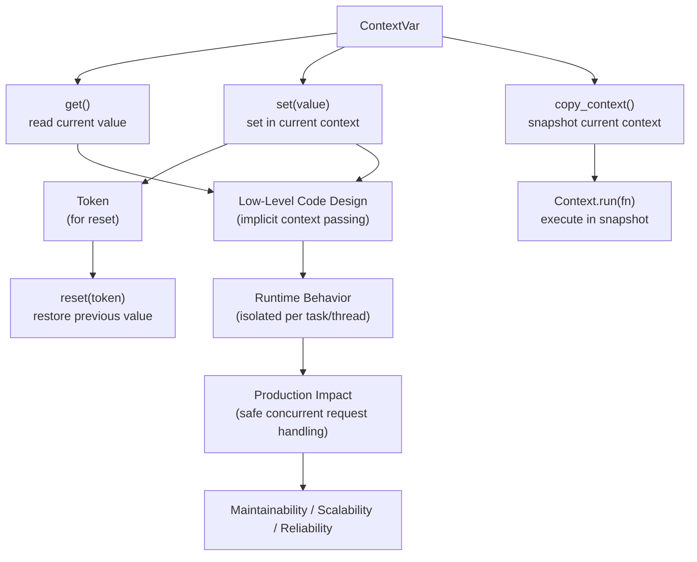
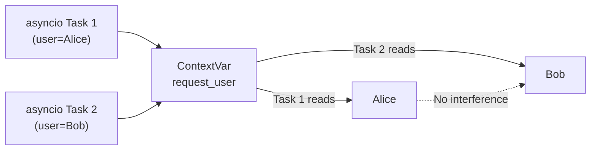

# Context Variables in Python

## Overview

**Context Variables** (`contextvars.ContextVar`) provide a mechanism for storing and accessing values that are **local to a specific execution context** — such as an `asyncio` task, a thread, or a coroutine chain. They are the modern, async-safe replacement for `threading.local()` and are essential for passing request-scoped data (user identity, trace IDs, configuration) through async call stacks without explicit parameter passing.

> **Core idea:** A `ContextVar` holds a different value for each concurrent execution context (task, thread, coroutine). Changes in one context don't affect others — even when running concurrently.

---

## Why It Matters

| `threading.local()` | `ContextVar` |
|---|---|
| Thread-local only | Thread-local AND task-local |
| Not async-safe | Fully async-safe |
| No snapshot/restore | `copy_context()` for snapshots |
| No default values | Supports defaults and tokens |
| Python 2 era | Python 3.7+ |

Context variables are used in:
- **Request-scoped data** — user ID, tenant ID, request ID in FastAPI/Django
- **Distributed tracing** — trace ID, span ID propagation
- **Database transactions** — current transaction per async task
- **Logging** — request context in log records
- **AI agent sessions** — session ID, conversation history per agent task
- **Multi-tenant systems** — tenant context isolation

---

## Concept Map





---

## Simple Example

```python
from contextvars import ContextVar, copy_context

# Define a context variable with a default
request_id: ContextVar[str] = ContextVar("request_id", default="no-request")
user_id: ContextVar[str] = ContextVar("user_id", default="anonymous")

# Set and get
token = request_id.set("req-001")
print(request_id.get())  # "req-001"

# Reset to previous value using token
request_id.reset(token)
print(request_id.get())  # "no-request" (default)

# Context isolation
import asyncio

async def handle_request(req_id: str, uid: str):
    request_id.set(req_id)
    user_id.set(uid)
    await asyncio.sleep(0.01)  # Simulate async work
    print(f"Task {req_id}: user={user_id.get()}, req={request_id.get()}")

async def main():
    # Run concurrently — each task has its own context
    await asyncio.gather(
        handle_request("req-001", "Alice"),
        handle_request("req-002", "Bob"),
        handle_request("req-003", "Carol"),
    )

asyncio.run(main())
```

**Explanation:**
- `ContextVar.set()` returns a `Token` — use it to reset to the previous value.
- Each `asyncio` task gets its own copy of the context — changes in one task don't affect others.
- `request_id.get()` returns the value set in the current task's context.

**Expected Output:**
```
Task req-001: user=Alice, req=req-001
Task req-002: user=Bob, req=req-002
Task req-003: user=Carol, req=req-003
```

---

## Intermediate Example

```python
from contextvars import ContextVar
from typing import Optional, Dict, Any
import asyncio
import uuid
import logging

# --- Request context variables ---
request_id_var: ContextVar[str] = ContextVar("request_id", default="")
user_id_var: ContextVar[str] = ContextVar("user_id", default="anonymous")
tenant_id_var: ContextVar[str] = ContextVar("tenant_id", default="default")
trace_id_var: ContextVar[str] = ContextVar("trace_id", default="")


class RequestContext:
    """Helper class for managing request context variables."""

    @staticmethod
    def set(request_id: str, user_id: str, tenant_id: str) -> Dict[str, Any]:
        """Set all context variables for a request. Returns tokens for reset."""
        return {
            "request_id": request_id_var.set(request_id),
            "user_id": user_id_var.set(user_id),
            "tenant_id": tenant_id_var.set(tenant_id),
            "trace_id": trace_id_var.set(str(uuid.uuid4())[:8]),
        }

    @staticmethod
    def reset(tokens: Dict[str, Any]) -> None:
        """Reset all context variables using tokens."""
        request_id_var.reset(tokens["request_id"])
        user_id_var.reset(tokens["user_id"])
        tenant_id_var.reset(tokens["tenant_id"])
        trace_id_var.reset(tokens["trace_id"])

    @staticmethod
    def get() -> Dict[str, str]:
        return {
            "request_id": request_id_var.get(),
            "user_id": user_id_var.get(),
            "tenant_id": tenant_id_var.get(),
            "trace_id": trace_id_var.get(),
        }


# --- Context-aware logging ---
class ContextualLogger:
    """Logger that automatically includes context variables in every log record."""

    def __init__(self, name: str):
        self._logger = logging.getLogger(name)

    def _log(self, level: str, msg: str, **kwargs) -> None:
        ctx = RequestContext.get()
        extra = {k: v for k, v in ctx.items() if v}
        full_msg = f"[{extra.get('trace_id', '?')}] [{extra.get('user_id', '?')}] {msg}"
        getattr(self._logger, level)(full_msg)

    def info(self, msg: str) -> None: self._log("info", msg)
    def error(self, msg: str) -> None: self._log("error", msg)
    def debug(self, msg: str) -> None: self._log("debug", msg)


logger = ContextualLogger("app")
logging.basicConfig(level=logging.INFO, format="%(levelname)s | %(message)s")


# --- Async middleware pattern ---
async def request_middleware(request_id: str, user_id: str, tenant_id: str, handler):
    """Sets request context before calling the handler."""
    tokens = RequestContext.set(request_id, user_id, tenant_id)
    try:
        return await handler()
    finally:
        RequestContext.reset(tokens)


async def process_order(order_id: str) -> dict:
    """Business logic — reads context without explicit parameters."""
    ctx = RequestContext.get()
    logger.info(f"Processing order {order_id}")
    await asyncio.sleep(0.05)
    return {
        "order_id": order_id,
        "processed_by": ctx["user_id"],
        "tenant": ctx["tenant_id"],
        "trace": ctx["trace_id"],
    }


async def handle_order_request(request_id: str, user_id: str, tenant_id: str, order_id: str):
    async def handler():
        return await process_order(order_id)

    return await request_middleware(request_id, user_id, tenant_id, handler)


# --- Concurrent requests ---
async def main():
    requests = [
        ("req-001", "alice", "tenant-A", "ORD-001"),
        ("req-002", "bob", "tenant-B", "ORD-002"),
        ("req-003", "carol", "tenant-A", "ORD-003"),
    ]

    results = await asyncio.gather(*[
        handle_order_request(*r) for r in requests
    ])

    for result in results:
        print(result)

asyncio.run(main())
```

**Explanation:**
- `RequestContext.set()` sets all context variables and returns tokens for cleanup.
- `request_middleware` sets context before the handler and resets it after — even on exception.
- `process_order` reads context without explicit parameters — clean, implicit context passing.
- Concurrent requests don't interfere — each task has its own context copy.

---

## Advanced / Architect-Level Example

### Problem Context

In a **multi-tenant AI agent platform**, each request carries tenant ID, user ID, session ID, and trace context. These must be available throughout the entire async call stack — from HTTP handler to LLM API call — without threading through every function parameter. Context variables provide this transparently.

```python
from __future__ import annotations
import asyncio
import uuid
import time
from contextvars import ContextVar, copy_context, Context
from typing import Optional, Dict, Any, Callable, List
from dataclasses import dataclass, field
from functools import wraps


# --- Platform context variables ---
tenant_id_var: ContextVar[str] = ContextVar("tenant_id", default="")
user_id_var: ContextVar[str] = ContextVar("user_id", default="")
session_id_var: ContextVar[str] = ContextVar("session_id", default="")
trace_id_var: ContextVar[str] = ContextVar("trace_id", default="")
model_override_var: ContextVar[Optional[str]] = ContextVar("model_override", default=None)


@dataclass
class AgentContext:
    """Immutable snapshot of the current agent context."""
    tenant_id: str
    user_id: str
    session_id: str
    trace_id: str
    model_override: Optional[str] = None
    created_at: float = field(default_factory=time.time)

    @classmethod
    def current(cls) -> "AgentContext":
        return cls(
            tenant_id=tenant_id_var.get(),
            user_id=user_id_var.get(),
            session_id=session_id_var.get(),
            trace_id=trace_id_var.get(),
            model_override=model_override_var.get(),
        )

    def to_dict(self) -> Dict[str, Any]:
        return {
            "tenant_id": self.tenant_id,
            "user_id": self.user_id,
            "session_id": self.session_id,
            "trace_id": self.trace_id,
            "model_override": self.model_override,
        }


# --- Context manager for scoped context ---
class AgentContextScope:
    """
    Context manager that sets agent context variables for a scope.
    Automatically resets on exit — even on exception.
    """

    def __init__(
        self,
        tenant_id: str,
        user_id: str,
        session_id: Optional[str] = None,
        model_override: Optional[str] = None,
    ):
        self._tenant_id = tenant_id
        self._user_id = user_id
        self._session_id = session_id or str(uuid.uuid4())[:8]
        self._model_override = model_override
        self._tokens: Dict[str, Any] = {}

    def __enter__(self) -> "AgentContextScope":
        self._tokens = {
            "tenant_id": tenant_id_var.set(self._tenant_id),
            "user_id": user_id_var.set(self._user_id),
            "session_id": session_id_var.set(self._session_id),
            "trace_id": trace_id_var.set(str(uuid.uuid4())[:8]),
        }
        if self._model_override:
            self._tokens["model_override"] = model_override_var.set(self._model_override)
        return self

    def __exit__(self, *args) -> bool:
        for var_name, token in self._tokens.items():
            {
                "tenant_id": tenant_id_var,
                "user_id": user_id_var,
                "session_id": session_id_var,
                "trace_id": trace_id_var,
                "model_override": model_override_var,
            }[var_name].reset(token)
        return False

    async def __aenter__(self) -> "AgentContextScope":
        return self.__enter__()

    async def __aexit__(self, *args) -> bool:
        return self.__exit__(*args)


# --- Context-aware decorator ---
def with_context(fn: Callable) -> Callable:
    """Decorator that logs context for every function call."""
    @wraps(fn)
    async def wrapper(*args, **kwargs):
        ctx = AgentContext.current()
        print(f"[{ctx.trace_id}] {fn.__name__} | tenant={ctx.tenant_id} user={ctx.user_id}")
        return await fn(*args, **kwargs)
    return wrapper


# --- Agent services that use context implicitly ---

@with_context
async def retrieve_documents(query: str) -> List[str]:
    ctx = AgentContext.current()
    await asyncio.sleep(0.05)
    return [f"[{ctx.tenant_id}] Doc for '{query}'"]


@with_context
async def generate_response(query: str, docs: List[str]) -> str:
    ctx = AgentContext.current()
    model = ctx.model_override or "gpt-4o"
    await asyncio.sleep(0.1)
    return f"[{model}] Response for {ctx.user_id}: {query}"


@with_context
async def log_interaction(query: str, response: str) -> None:
    ctx = AgentContext.current()
    print(f"[AUDIT] tenant={ctx.tenant_id} session={ctx.session_id} query={query[:30]}")


# --- Agent that uses context variables ---
class ContextAwareAgent:
    async def run(self, query: str) -> str:
        docs = await retrieve_documents(query)
        response = await generate_response(query, docs)
        await log_interaction(query, response)
        return response


# --- Multi-tenant request handler ---
async def handle_request(tenant: str, user: str, query: str, model: Optional[str] = None):
    async with AgentContextScope(tenant, user, model_override=model):
        agent = ContextAwareAgent()
        return await agent.run(query)


# --- Concurrent multi-tenant requests ---
async def main():
    requests = [
        ("tenant-A", "alice", "What is RAG?", None),
        ("tenant-B", "bob", "Explain embeddings", "claude-3-5-sonnet"),
        ("tenant-A", "carol", "How does Python work?", None),
    ]

    results = await asyncio.gather(*[
        handle_request(*r) for r in requests
    ])

    print("\n=== Results ===")
    for r in results:
        print(r)

    # Verify context is clean after all requests
    print(f"\nContext after all requests: {AgentContext.current().to_dict()}")


asyncio.run(main())
```

**Explanation:**
- `AgentContextScope` is an async context manager — sets all context variables and resets them on exit.
- `retrieve_documents`, `generate_response`, `log_interaction` read context implicitly — no parameter threading.
- `@with_context` decorator logs context for every function call — non-invasive observability.
- Concurrent requests don't interfere — each `asyncio.gather` task has its own context copy.
- After all requests, context variables are back to their defaults.

**Design Trade-offs:**

| Approach | Pros | Cons |
|---|---|---|
| `ContextVar` | Async-safe, no param threading | Implicit — harder to trace |
| Explicit parameters | Explicit, traceable | Verbose, parameter explosion |
| `threading.local()` | Simple for threads | Not async-safe |
| Global variables | Simple | Not thread/task-safe |

---

## Common Mistakes

### 1. Using `threading.local()` in Async Code
```python
# ❌ threading.local() is NOT async-safe
import threading
_local = threading.local()

async def handler():
    _local.user_id = "Alice"  # Shared across all tasks in the same thread!

# ✅ Use ContextVar
user_id_var: ContextVar[str] = ContextVar("user_id")

async def handler():
    user_id_var.set("Alice")  # Isolated per task
```

---

### 2. Not Resetting Context Variables
```python
# ❌ Context variable not reset — leaks into subsequent code
async def handler():
    user_id_var.set("Alice")
    await process()
    # user_id_var still set to "Alice" after handler!

# ✅ Use token to reset
async def handler():
    token = user_id_var.set("Alice")
    try:
        await process()
    finally:
        user_id_var.reset(token)
```

---

### 3. Expecting Context to Propagate to New Threads
```python
# ❌ New threads don't inherit context automatically
import threading
user_id_var.set("Alice")

def worker():
    print(user_id_var.get())  # "" — not inherited!

t = threading.Thread(target=worker)
t.start()

# ✅ Use copy_context() to propagate
ctx = copy_context()
t = threading.Thread(target=ctx.run, args=(worker,))
t.start()
```

---

### 4. Using ContextVar for Mutable Objects Without Care
```python
# ❌ Mutable default — all contexts share the same list!
items_var: ContextVar[list] = ContextVar("items", default=[])

# ✅ Use None as default and create per-context
items_var: ContextVar[Optional[list]] = ContextVar("items", default=None)

def get_items() -> list:
    items = items_var.get()
    if items is None:
        items = []
        items_var.set(items)
    return items
```

---

### 5. Not Using `copy_context()` for Background Tasks
```python
# ❌ Background task doesn't inherit current context
async def handler():
    user_id_var.set("Alice")
    asyncio.create_task(background_task())  # No context!

# ✅ asyncio.create_task() automatically copies context in Python 3.7+
# But for threading, use copy_context() explicitly
```

---

## Best Practices

1. **Use `ContextVar` instead of `threading.local()`** for async code.
2. **Always reset using tokens** — use `try/finally` or a context manager.
3. **Use `copy_context()`** when spawning threads that need the current context.
4. **Use `None` as default for mutable objects** — avoid shared mutable defaults.
5. **Create a `RequestContext` helper class** to manage multiple context variables together.
6. **Use async context managers** (`async with`) for scoped context in async code.
7. **Document context variable semantics** — what it holds, who sets it, who reads it.
8. **Use `@with_context` decorators** for non-invasive context logging.
9. **Test context isolation** — verify that concurrent tasks don't interfere.
10. **Note:** `asyncio.create_task()` automatically copies the current context in Python 3.7+.

---

## Performance Considerations

- **`ContextVar.get()`**: O(1) — implemented as a dict lookup in the current context.
- **`ContextVar.set()`**: O(1) — creates a new entry in the current context's dict.
- **`copy_context()`**: O(n) where n is the number of context variables — creates a shallow copy.
- **Memory**: Each task/thread has its own context dict — memory proportional to the number of context variables × concurrent tasks.
- **`asyncio.create_task()`**: Automatically copies the current context — O(n) overhead per task creation.
- For high-frequency task creation (millions/second), minimize the number of context variables to reduce copy overhead.

---

## Testing Strategy

```python
# test_context_variables.py
import pytest
import asyncio
from contextvars import ContextVar, copy_context
from your_module import (
    request_id_var, user_id_var, tenant_id_var,
    RequestContext, AgentContextScope, AgentContext
)


# --- Test basic get/set/reset ---
def test_context_var_default():
    var: ContextVar[str] = ContextVar("test_var", default="default")
    assert var.get() == "default"

def test_context_var_set_get():
    var: ContextVar[str] = ContextVar("test_var2")
    token = var.set("value")
    assert var.get() == "value"
    var.reset(token)
    with pytest.raises(LookupError):
        var.get()  # No default, was reset

def test_context_var_reset():
    var: ContextVar[str] = ContextVar("test_var3", default="default")
    token = var.set("new_value")
    assert var.get() == "new_value"
    var.reset(token)
    assert var.get() == "default"


# --- Test async isolation ---
@pytest.mark.asyncio
async def test_async_context_isolation():
    results = {}

    async def task(name: str, value: str):
        user_id_var.set(value)
        await asyncio.sleep(0.01)
        results[name] = user_id_var.get()

    await asyncio.gather(
        task("task1", "Alice"),
        task("task2", "Bob"),
        task("task3", "Carol"),
    )

    assert results["task1"] == "Alice"
    assert results["task2"] == "Bob"
    assert results["task3"] == "Carol"


# --- Test RequestContext ---
@pytest.mark.asyncio
async def test_request_context_set_reset():
    tokens = RequestContext.set("req-001", "alice", "tenant-A")
    assert request_id_var.get() == "req-001"
    assert user_id_var.get() == "alice"
    RequestContext.reset(tokens)
    assert request_id_var.get() == ""


# --- Test AgentContextScope ---
@pytest.mark.asyncio
async def test_agent_context_scope():
    async with AgentContextScope("tenant-A", "alice"):
        ctx = AgentContext.current()
        assert ctx.tenant_id == "tenant-A"
        assert ctx.user_id == "alice"

    # After scope, context is reset
    ctx_after = AgentContext.current()
    assert ctx_after.tenant_id == ""
    assert ctx_after.user_id == ""


@pytest.mark.asyncio
async def test_agent_context_scope_on_exception():
    try:
        async with AgentContextScope("tenant-A", "alice"):
            raise ValueError("test error")
    except ValueError:
        pass

    # Context should be reset even after exception
    assert tenant_id_var.get() == ""


# --- Test copy_context for threads ---
def test_copy_context_for_threads():
    import threading
    user_id_var.set("Alice")
    ctx = copy_context()
    results = []

    def worker():
        results.append(user_id_var.get())

    t = threading.Thread(target=ctx.run, args=(worker,))
    t.start()
    t.join()

    assert results == ["Alice"]
```

---

## Debugging Tips

1. **Context variable returns default unexpectedly** — the variable was never set in the current context. Check that `set()` was called before `get()`.

2. **Context not isolated between async tasks** — you're using `threading.local()` instead of `ContextVar`. Replace with `ContextVar`.

3. **Context not propagated to new thread** — threads don't inherit context automatically. Use `copy_context()` and `ctx.run(fn)`.

4. **Context leaking between requests** — `set()` was called without a corresponding `reset()`. Use `try/finally` or a context manager.

5. **`LookupError` on `get()`** — no default was set and the variable was never set in this context. Add a `default` parameter or call `set()` first.

6. **Inspect current context** with `copy_context()`:
   ```python
   ctx = copy_context()
   print(dict(ctx))  # Shows all ContextVar → value mappings
   ```

---

## Interview Questions

### Beginner

**Q1: What is a `ContextVar`?**  
A: A variable that holds a different value for each execution context (asyncio task, thread). Changes in one context don't affect others.

**Q2: What is the difference between `ContextVar` and a global variable?**  
A: A global variable is shared across all contexts. A `ContextVar` is isolated per context — each task/thread has its own value.

**Q3: What does `ContextVar.set()` return?**  
A: A `Token` object that can be used to reset the variable to its previous value with `var.reset(token)`.

**Q4: Why is `threading.local()` not suitable for async code?**  
A: `threading.local()` is per-thread. Multiple `asyncio` tasks run on the same thread — they would share the same `threading.local()` value. `ContextVar` is per-task.

**Q5: Does `asyncio.create_task()` inherit the current context?**  
A: Yes. In Python 3.7+, `asyncio.create_task()` automatically copies the current context for the new task.

---

### Intermediate

**Q6: How do you propagate context to a new thread?**  
A: Use `copy_context()` to snapshot the current context, then run the thread function with `ctx.run(fn)`.

**Q7: What is `copy_context()` used for?**  
A: Creates a shallow copy of the current context. Used to propagate context to threads, subprocesses, or background tasks that don't automatically inherit context.

**Q8: How do you implement a request-scoped context in FastAPI?**  
A: Use middleware to set `ContextVar` values at the start of each request and reset them at the end. Use `try/finally` or a context manager to guarantee cleanup.

**Q9: What happens if you set a `ContextVar` inside a `copy_context().run()` call?**  
A: The change is isolated to the copied context — it doesn't affect the original context.

**Q10: How do context variables interact with `asyncio.gather()`?**  
A: Each task created by `gather()` gets its own copy of the context at creation time. Changes in one task don't affect others.

---

### Advanced / Architect-Level

**Q11: How would you implement multi-tenant context isolation in a production async API?**  
A: Use `ContextVar` for `tenant_id`, `user_id`, `trace_id`. Set them in middleware at request start. Use a context manager to guarantee reset. All downstream services read context implicitly — no parameter threading.

**Q12: How do context variables interact with `concurrent.futures.ThreadPoolExecutor`?**  
A: `ThreadPoolExecutor` doesn't automatically copy context. Use `copy_context().run(fn)` to propagate context to thread pool workers.

**Q13: How would you implement distributed trace propagation using context variables?**  
A: Set `trace_id_var` and `span_id_var` at request entry. Propagate to outgoing HTTP requests via headers. On incoming requests, extract trace headers and set context variables. All log records and spans automatically include the trace context.

**Q14: What are the memory implications of context variables in a high-concurrency system?**  
A: Each task has its own context dict. With 10,000 concurrent tasks and 10 context variables, memory overhead is ~10,000 × 10 × (key + value size). For small values (strings, ints), this is negligible. For large objects, use references (IDs) rather than storing objects directly.

**Q15: How do context variables interact with Python's `pickle` module?**  
A: `ContextVar` objects themselves are not picklable. Their values (if picklable) can be extracted with `copy_context()` and serialized separately. For distributed systems, serialize context as a dict and restore it in the receiving process.

---

## Key Takeaways

- `ContextVar` provides per-task/per-thread isolated values — the async-safe replacement for `threading.local()`.
- `set()` returns a `Token` — use it with `reset()` to restore the previous value.
- `asyncio.create_task()` automatically copies the current context — tasks are isolated by default.
- Use `copy_context()` to propagate context to threads — they don't inherit automatically.
- Always reset context variables — use `try/finally` or a context manager.
- Use `None` as default for mutable objects — avoid shared mutable defaults.
- Context variables enable implicit context passing — no parameter threading through every function.
- Essential for multi-tenant systems, distributed tracing, and request-scoped data in async APIs.
- Test context isolation — verify concurrent tasks don't interfere.
- Mastering context variables is essential for building safe, scalable, multi-tenant async Python systems.

---

## Mini Project Idea

### Goal
Build a **Multi-Tenant Request Context System** — a production-grade context variable framework for a FastAPI-style async API with tenant isolation, distributed tracing, and context-aware logging.

### Features
- `ContextVar` for: `tenant_id`, `user_id`, `session_id`, `trace_id`, `request_id`.
- `RequestContextMiddleware` — sets context at request start, resets at end.
- `ContextualLogger` — automatically includes context in every log record.
- `TraceContext` — propagates trace IDs to outgoing HTTP requests.
- `copy_context()` support for thread pool workers.
- CLI: `python demo.py --concurrent 100 --tenants 5`.

### Suggested Folder Structure
```
request_context/
├── context/
│   ├── __init__.py
│   ├── variables.py       # ContextVar definitions
│   ├── scope.py           # AgentContextScope context manager
│   └── helpers.py         # RequestContext helper class
├── middleware/
│   ├── __init__.py
│   └── request_context.py
├── logging/
│   └── contextual_logger.py
├── tests/
│   ├── test_context.py
│   └── test_isolation.py
├── demo.py
└── README.md
```

### Extension Ideas
- Integrate with OpenTelemetry for distributed tracing.
- Add context propagation via HTTP headers (W3C Trace Context).
- Add context serialization for message queue consumers.
- Benchmark context overhead vs. explicit parameter passing.

---

## Final Summary

Mastering context variables is mastering Python's model for safe, concurrent, implicit context passing. In modern async Python systems — FastAPI APIs, AI agent platforms, multi-tenant SaaS — context variables are the foundation for passing request-scoped data (user identity, tenant ID, trace context) through the entire async call stack without polluting every function signature. Understanding `ContextVar`, `copy_context()`, token-based reset, and async context managers — and knowing how they differ from `threading.local()` and global variables — is essential for building safe, scalable, multi-tenant Python systems. This is a hallmark of production-grade async Python architecture.
