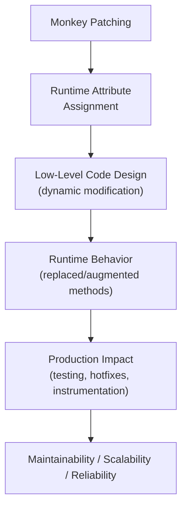
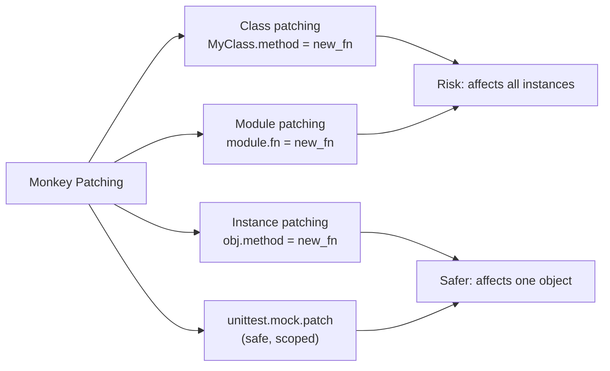

# Monkey Patching in Python

## Overview

**Monkey Patching** is the practice of dynamically modifying or extending a class, module, or object at runtime — replacing or adding attributes, methods, or behaviors without modifying the original source code. Python's dynamic nature makes this straightforward, but it comes with significant risks.

> **Core idea:** Replace or augment existing code at runtime by directly assigning to attributes of classes, modules, or instances. Powerful for testing and quick fixes; dangerous in production if misused.

---

## Why It Matters

| Static Code | Monkey Patching |
|---|---|
| Fixed at definition time | Modified at runtime |
| Predictable behavior | Potentially surprising behavior |
| Easy to trace | Hard to trace |
| Safe | Risky if overused |

Monkey patching is used for:
- **Testing** — replacing real implementations with mocks (`unittest.mock.patch`)
- **Hotfixes** — fixing third-party library bugs without forking
- **Instrumentation** — adding logging/tracing to existing code
- **Compatibility shims** — adding missing methods to older library versions
- **Plugin systems** — extending framework classes at runtime

---

## Concept Map





---

## Simple Example

```python
# --- Basic monkey patching ---
class Dog:
    def speak(self) -> str:
        return "Woof!"

def new_speak(self) -> str:
    return "Meow! (I'm a confused dog)"

# Patch the class method
Dog.speak = new_speak

dog = Dog()
print(dog.speak())  # "Meow! (I'm a confused dog)"

# --- Module-level patching ---
import math

original_sqrt = math.sqrt

def patched_sqrt(x):
    print(f"sqrt({x}) called")
    return original_sqrt(x)

math.sqrt = patched_sqrt
print(math.sqrt(16))  # sqrt(16) called → 4.0

# Restore
math.sqrt = original_sqrt

# --- Instance-level patching ---
import types

class Calculator:
    def add(self, a, b):
        return a + b

calc = Calculator()

def verbose_add(self, a, b):
    result = a + b
    print(f"{a} + {b} = {result}")
    return result

# Patch only this instance
calc.add = types.MethodType(verbose_add, calc)
print(calc.add(3, 4))  # 3 + 4 = 7

# Other instances unaffected
calc2 = Calculator()
print(calc2.add(3, 4))  # 7 (no print)
```

**Explanation:**
- Class patching affects all instances — past and future.
- Module patching replaces the function in the module's namespace.
- Instance patching (with `types.MethodType`) affects only one object.
- Always save the original before patching — enables restoration.

**Expected Output:**
```
Meow! (I'm a confused dog)
sqrt(16) called
4.0
3 + 4 = 7
7
```

---

## Intermediate Example

```python
from unittest.mock import patch, MagicMock
import time
from typing import Callable, Any

# --- Safe monkey patching with unittest.mock.patch ---
class ExternalAPIClient:
    def fetch_data(self, endpoint: str) -> dict:
        # Real implementation would make HTTP request
        import requests
        return requests.get(f"https://api.example.com/{endpoint}").json()

    def post_data(self, endpoint: str, data: dict) -> dict:
        import requests
        return requests.post(f"https://api.example.com/{endpoint}", json=data).json()


class DataService:
    def __init__(self, client: ExternalAPIClient):
        self._client = client

    def get_user(self, user_id: str) -> dict:
        return self._client.fetch_data(f"users/{user_id}")

    def create_order(self, user_id: str, items: list) -> dict:
        return self._client.post_data("orders", {"user_id": user_id, "items": items})


# --- Instrumentation via monkey patching ---
def add_timing(cls, method_name: str) -> None:
    """Add timing instrumentation to a class method."""
    original = getattr(cls, method_name)

    def timed_method(self, *args, **kwargs):
        start = time.time()
        result = original(self, *args, **kwargs)
        elapsed = (time.time() - start) * 1000
        print(f"[TIMING] {cls.__name__}.{method_name}: {elapsed:.2f}ms")
        return result

    setattr(cls, method_name, timed_method)


# Apply instrumentation
add_timing(DataService, "get_user")
add_timing(DataService, "create_order")


# --- Safe patching in tests ---
def test_data_service_get_user():
    """Test using mock.patch — safe, scoped, auto-restored."""
    client = ExternalAPIClient()
    service = DataService(client)

    with patch.object(client, "fetch_data", return_value={"id": "U1", "name": "Alice"}):
        user = service.get_user("U1")
        assert user["name"] == "Alice"
    # fetch_data is restored after the with block


# --- Hotfix pattern ---
def apply_hotfix(module, function_name: str, fix: Callable) -> Callable:
    """Apply a hotfix to a module function, preserving the original."""
    original = getattr(module, function_name)
    setattr(module, function_name, fix)
    return original  # Return original for restoration


# Simulate a buggy third-party function
import json as json_module

def buggy_loads(s, **kwargs):
    # Simulate a bug: doesn't handle empty strings
    if not s:
        raise ValueError("Empty string")
    return json_module._original_loads(s, **kwargs)

# Apply hotfix
json_module._original_loads = json_module.loads

def fixed_loads(s, **kwargs):
    if not s:
        return {}
    return json_module._original_loads(s, **kwargs)

original_loads = apply_hotfix(json_module, "loads", fixed_loads)
print(json_module.loads(""))  # {} instead of ValueError
print(json_module.loads('{"key": "value"}'))  # {"key": "value"}

# Restore
json_module.loads = original_loads
```

**Explanation:**
- `add_timing` instruments class methods non-invasively — no source code changes.
- `patch.object` is the safe way to monkey patch in tests — auto-restored after the `with` block.
- The hotfix pattern saves the original and applies a fix — can be reverted.

---

## Advanced / Architect-Level Example

### Problem Context

In a **production observability system**, you need to instrument third-party library calls (database queries, HTTP requests, LLM API calls) with tracing and metrics — without modifying the library source code. A systematic monkey patching framework applies instrumentation at startup.

```python
from __future__ import annotations
import time
import functools
from typing import Any, Callable, Dict, List, Optional, Type
from dataclasses import dataclass, field


@dataclass
class InstrumentationRecord:
    module: str
    class_name: str
    method_name: str
    duration_ms: float
    success: bool
    error: Optional[str] = None


class InstrumentationRegistry:
    """Registry of all applied instrumentations — for tracking and rollback."""
    _patches: List[Dict[str, Any]] = []
    _records: List[InstrumentationRecord] = []

    @classmethod
    def record(cls, record: InstrumentationRecord) -> None:
        cls._records.append(record)

    @classmethod
    def get_stats(cls) -> Dict[str, Any]:
        if not cls._records:
            return {}
        by_method = {}
        for r in cls._records:
            key = f"{r.class_name}.{r.method_name}"
            if key not in by_method:
                by_method[key] = {"calls": 0, "total_ms": 0, "errors": 0}
            by_method[key]["calls"] += 1
            by_method[key]["total_ms"] += r.duration_ms
            if not r.success:
                by_method[key]["errors"] += 1
        return {
            k: {
                "calls": v["calls"],
                "avg_ms": round(v["total_ms"] / v["calls"], 2),
                "errors": v["errors"],
            }
            for k, v in by_method.items()
        }


def instrument_method(
    cls: Type,
    method_name: str,
    module_name: str = "",
    record_args: bool = False,
) -> None:
    """
    Instrument a class method with timing, error tracking, and observability.
    Idempotent — won't double-instrument.
    """
    original = getattr(cls, method_name, None)
    if original is None or getattr(original, "_instrumented", False):
        return

    @functools.wraps(original)
    def instrumented(self, *args, **kwargs):
        start = time.time()
        success = True
        error = None
        try:
            result = original(self, *args, **kwargs)
            return result
        except Exception as e:
            success = False
            error = str(e)
            raise
        finally:
            duration_ms = (time.time() - start) * 1000
            InstrumentationRegistry.record(InstrumentationRecord(
                module=module_name or cls.__module__,
                class_name=cls.__name__,
                method_name=method_name,
                duration_ms=round(duration_ms, 2),
                success=success,
                error=error,
            ))

    instrumented._instrumented = True
    instrumented._original = original
    setattr(cls, method_name, instrumented)

    InstrumentationRegistry._patches.append({
        "cls": cls,
        "method_name": method_name,
        "original": original,
    })


def rollback_all_patches() -> None:
    """Restore all patched methods to their originals."""
    for patch in InstrumentationRegistry._patches:
        setattr(patch["cls"], patch["method_name"], patch["original"])
    InstrumentationRegistry._patches.clear()


# --- Simulated third-party classes ---
class DatabaseClient:
    def query(self, sql: str) -> list:
        time.sleep(0.02)
        return [{"id": 1, "name": "Alice"}]

    def execute(self, sql: str) -> int:
        time.sleep(0.01)
        return 1


class HTTPClient:
    def get(self, url: str) -> dict:
        time.sleep(0.05)
        return {"status": 200, "data": "response"}

    def post(self, url: str, data: dict) -> dict:
        time.sleep(0.08)
        return {"status": 201, "id": "new-resource"}


class LLMClient:
    def complete(self, prompt: str) -> str:
        time.sleep(0.1)
        return f"Response to: {prompt[:30]}"

    def embed(self, text: str) -> list:
        time.sleep(0.03)
        return [0.1, 0.2, 0.3, 0.4]


# --- Apply instrumentation at startup ---
def setup_instrumentation() -> None:
    """Apply instrumentation to all third-party clients."""
    for cls, methods in [
        (DatabaseClient, ["query", "execute"]),
        (HTTPClient, ["get", "post"]),
        (LLMClient, ["complete", "embed"]),
    ]:
        for method in methods:
            instrument_method(cls, method, module_name="third_party")
    print("Instrumentation applied to 3 clients, 6 methods")


# --- Usage ---
setup_instrumentation()

db = DatabaseClient()
http = HTTPClient()
llm = LLMClient()

# All calls are now instrumented
db.query("SELECT * FROM users")
db.execute("UPDATE users SET active = 1")
http.get("https://api.example.com/data")
llm.complete("What is RAG?")
llm.embed("Hello world")

print("\n=== Instrumentation Stats ===")
for method, stats in InstrumentationRegistry.get_stats().items():
    print(f"  {method}: {stats['calls']} calls, avg {stats['avg_ms']}ms, {stats['errors']} errors")

# Rollback all patches
rollback_all_patches()
print("\nAll patches rolled back")

# Verify rollback
db2 = DatabaseClient()
db2.query("SELECT 1")  # No instrumentation
print(f"Patches remaining: {len(InstrumentationRegistry._patches)}")
```

**Explanation:**
- `instrument_method` wraps any class method with timing and error tracking — idempotent.
- `InstrumentationRegistry` tracks all patches for rollback and statistics.
- `rollback_all_patches()` restores all original methods — clean teardown.
- Applied at startup — all subsequent calls are automatically instrumented.
- This pattern is used by APM tools (Datadog, New Relic) to instrument Python applications.

**Design Trade-offs:**

| Approach | Pros | Cons |
|---|---|---|
| Monkey patching | Non-invasive, no source changes | Hard to trace, fragile |
| Decorator pattern | Explicit, traceable | Requires source modification |
| Proxy pattern | Clean, testable | More boilerplate |
| AOP (wrapt library) | Robust, handles edge cases | External dependency |

---

## Common Mistakes

### 1. Not Saving the Original
```python
# ❌ Original lost — can't restore
import os
os.path.exists = lambda p: True  # Can't undo!

# ✅ Save original first
original_exists = os.path.exists
os.path.exists = lambda p: True
# Later:
os.path.exists = original_exists
```

---

### 2. Patching in Production Without Rollback
```python
# ❌ Permanent patch in production — affects all code
SomeLibrary.method = my_fix  # No way to undo

# ✅ Use unittest.mock.patch for scoped patching
with patch.object(SomeLibrary, "method", my_fix):
    ...  # Restored after block
```

---

### 3. Double-Patching
```python
# ❌ Patching twice — wraps the wrapper
instrument_method(MyClass, "process")
instrument_method(MyClass, "process")  # Now double-wrapped!

# ✅ Check for existing patch
if not getattr(MyClass.process, "_instrumented", False):
    instrument_method(MyClass, "process")
```

---

### 4. Patching Instance Methods Without `types.MethodType`
```python
# ❌ Function not bound to instance — self not passed
obj.method = lambda: "patched"  # Missing self!

# ✅ Use types.MethodType for instance methods
import types
obj.method = types.MethodType(lambda self: "patched", obj)
```

---

### 5. Monkey Patching in Shared Test Fixtures
```python
# ❌ Patch leaks between tests
def test_one():
    SomeClass.method = mock_method  # Leaks to test_two!

# ✅ Use mock.patch as context manager or decorator
@patch.object(SomeClass, "method", mock_method)
def test_one():
    ...  # Restored after test
```

---

## Best Practices

1. **Always save the original** before patching — enables restoration.
2. **Use `unittest.mock.patch`** for test patching — scoped, auto-restored.
3. **Check for existing patches** — prevent double-patching.
4. **Use `functools.wraps`** when wrapping methods — preserves metadata.
5. **Mark patched methods** with `_instrumented = True` — enables idempotency checks.
6. **Implement rollback** — `rollback_all_patches()` for clean teardown.
7. **Document all patches** — note what was patched, why, and where.
8. **Prefer decorators over monkey patching** when you control the source.
9. **Use `wrapt` library** for robust method wrapping — handles edge cases.
10. **Avoid monkey patching in production** unless absolutely necessary — prefer proper abstractions.

---

## Performance Considerations

- **Monkey patching itself** has negligible overhead — it's just attribute assignment.
- **Instrumented methods** add one function call overhead per invocation — negligible for I/O-bound operations.
- **`functools.wraps`** adds no runtime overhead — it's metadata only.
- **`unittest.mock.patch`** has setup/teardown overhead — negligible for tests.
- **Double-patching** can cause significant overhead — always check for existing patches.

---

## Testing Strategy

```python
# test_monkey_patching.py
import pytest
from unittest.mock import patch, MagicMock, call
from your_module import (
    DataService, ExternalAPIClient, add_timing,
    instrument_method, rollback_all_patches,
    InstrumentationRegistry, DatabaseClient
)


# --- Test mock.patch ---
def test_patch_object_replaces_method():
    client = ExternalAPIClient()
    service = DataService(client)

    with patch.object(client, "fetch_data", return_value={"id": "U1", "name": "Alice"}):
        user = service.get_user("U1")
        assert user["name"] == "Alice"


def test_patch_restores_after_context():
    client = ExternalAPIClient()
    original = client.fetch_data

    with patch.object(client, "fetch_data", return_value={}):
        assert client.fetch_data != original

    assert client.fetch_data == original


# --- Test instrumentation ---
def test_instrument_method_records_calls():
    InstrumentationRegistry._records.clear()
    InstrumentationRegistry._patches.clear()

    class TestClass:
        def process(self, x):
            return x * 2

    instrument_method(TestClass, "process")
    obj = TestClass()
    result = obj.process(5)

    assert result == 10
    assert len(InstrumentationRegistry._records) == 1
    assert InstrumentationRegistry._records[0].method_name == "process"
    assert InstrumentationRegistry._records[0].success is True


def test_instrument_method_idempotent():
    class TestClass:
        def process(self, x): return x

    instrument_method(TestClass, "process")
    instrument_method(TestClass, "process")  # Second call — should not double-wrap

    obj = TestClass()
    InstrumentationRegistry._records.clear()
    obj.process(1)
    assert len(InstrumentationRegistry._records) == 1  # Only one record


def test_rollback_restores_original():
    class TestClass:
        def process(self, x): return x * 2

    original = TestClass.process
    instrument_method(TestClass, "process")
    assert TestClass.process != original

    rollback_all_patches()
    assert TestClass.process == original


# --- Test error recording ---
def test_instrument_records_errors():
    InstrumentationRegistry._records.clear()
    InstrumentationRegistry._patches.clear()

    class TestClass:
        def process(self):
            raise ValueError("test error")

    instrument_method(TestClass, "process")
    obj = TestClass()

    with pytest.raises(ValueError):
        obj.process()

    assert InstrumentationRegistry._records[0].success is False
    assert "test error" in InstrumentationRegistry._records[0].error
```

---

## Debugging Tips

1. **Unexpected behavior after patching** — check if the original was saved and restored. Use `print(SomeClass.method)` to inspect the current method.

2. **Double-patching** — add `_instrumented` flag and check before patching. Use `print(getattr(method, "_instrumented", False))`.

3. **Patch not taking effect** — you may be patching the wrong reference. If code imports `from module import fn`, patch `module.fn` in the importing module, not the original.

4. **`patch.object` not restoring** — ensure you're using it as a context manager or decorator, not calling it directly.

5. **Instance method not working after patch** — use `types.MethodType` to bind the function to the instance.

6. **Test isolation issues** — patches leaking between tests. Use `@patch` decorator or `with patch()` context manager — never patch in module scope without cleanup.

---

## Interview Questions

### Beginner

**Q1: What is monkey patching?**  
A: Dynamically modifying or replacing attributes, methods, or functions of a class, module, or object at runtime — without modifying the original source code.

**Q2: What is the most common use of monkey patching in Python?**  
A: Testing — replacing real implementations with mocks using `unittest.mock.patch`.

**Q3: How do you safely monkey patch in tests?**  
A: Use `unittest.mock.patch` as a context manager or decorator — it automatically restores the original after the test.

**Q4: What is the risk of monkey patching a class method?**  
A: It affects all instances of the class — past and future. Changes are global and can cause unexpected behavior in unrelated code.

**Q5: How do you patch only a single instance?**  
A: Use `types.MethodType` to bind a new function to the instance: `obj.method = types.MethodType(new_fn, obj)`.

---

### Intermediate

**Q6: What is the difference between patching a class and patching an instance?**  
A: Class patching affects all instances. Instance patching (via `types.MethodType` or direct attribute assignment) affects only that one object.

**Q7: How do you patch the correct reference when using `from module import fn`?**  
A: Patch the name in the importing module, not the original. If `my_module.py` does `from os.path import exists`, patch `my_module.exists`, not `os.path.exists`.

**Q8: What is `functools.wraps` and why use it when monkey patching?**  
A: `@functools.wraps(original)` copies the original function's metadata (`__name__`, `__doc__`, etc.) to the wrapper. Without it, the patched method loses its identity — breaking introspection and debugging.

**Q9: How do you make a monkey patch idempotent?**  
A: Add a marker attribute (`_instrumented = True`) to the patched method. Check for it before patching.

**Q10: What is the `wrapt` library and when would you use it?**  
A: `wrapt` provides robust function/method wrapping that handles edge cases (descriptors, class methods, static methods) that `functools.wraps` doesn't. Use it for production-grade instrumentation.

---

### Advanced / Architect-Level

**Q11: How would you implement a production APM instrumentation system using monkey patching?**  
A: At startup, instrument all third-party client methods (DB, HTTP, LLM) with timing and error tracking. Use `functools.wraps` and `_instrumented` flags for idempotency. Implement `rollback_all_patches()` for clean shutdown. Export metrics to Prometheus/Datadog.

**Q12: How does `unittest.mock.patch` work internally?**  
A: It saves the original attribute, replaces it with a `MagicMock` (or specified replacement), and restores the original in `__exit__`. It uses `getattr`/`setattr` on the target object.

**Q13: What are the risks of monkey patching in a production system?**  
A: Unexpected behavior in unrelated code, hard-to-debug issues (patched code looks different from source), version conflicts (patch breaks on library update), and test pollution (patches leaking between tests).

**Q14: How would you use monkey patching to add distributed tracing to a third-party HTTP client?**  
A: Wrap the `get`/`post` methods to inject trace headers from `ContextVar` into outgoing requests and record spans. Use `functools.wraps` and `_instrumented` flags. Apply at startup via `setup_instrumentation()`.

**Q15: What is the difference between monkey patching and the Decorator pattern?**  
A: Monkey patching modifies existing code at runtime — non-invasive but fragile. The Decorator pattern wraps objects at design time — explicit, traceable, and testable. Prefer decorators when you control the source; use monkey patching for third-party code.

---

## Key Takeaways

- Monkey patching dynamically replaces or extends code at runtime — without modifying source.
- Always save the original before patching — enables restoration.
- Use `unittest.mock.patch` for test patching — scoped, auto-restored, safe.
- Class patching affects all instances; instance patching affects only one object.
- Use `functools.wraps` when wrapping methods — preserves metadata.
- Mark patched methods with `_instrumented` — prevents double-patching.
- Implement `rollback_all_patches()` for clean teardown.
- Patch the correct reference — `from module import fn` requires patching the importing module.
- Prefer decorators and proper abstractions over monkey patching in production.
- Mastering monkey patching is essential for testing, instrumentation, and working with third-party libraries.

---

## Mini Project Idea

### Goal
Build a **Zero-Code Instrumentation Framework** — a monkey patching system that automatically instruments any Python class with timing, error tracking, and distributed tracing at startup.

### Features
- `instrument_class(cls, methods)` — instruments specified methods.
- `instrument_module(module)` — instruments all public methods in a module.
- `InstrumentationRegistry` — tracks all patches, records, and stats.
- `rollback_all()` — restores all originals.
- `stats_report()` — generates a performance report.
- CLI: `python instrument.py --module myapp.clients --report`.

### Suggested Folder Structure
```
instrumentation/
├── core/
│   ├── __init__.py
│   ├── patcher.py         # instrument_method, instrument_class
│   ├── registry.py        # InstrumentationRegistry
│   └── rollback.py        # rollback_all_patches
├── reporters/
│   ├── console.py
│   └── prometheus.py
├── tests/
│   ├── test_patcher.py
│   └── test_registry.py
├── cli.py
└── README.md
```

### Extension Ideas
- Add async method instrumentation.
- Export metrics to Prometheus with `prometheus_client`.
- Add distributed trace context injection.
- Integrate with OpenTelemetry.

---

## Final Summary

Mastering monkey patching is mastering Python's dynamic runtime model. While monkey patching should be used sparingly in production, it is an essential tool for testing (via `unittest.mock.patch`), instrumentation (APM tools), and working with third-party libraries that can't be modified. For a Python architect, understanding when monkey patching is appropriate — and when to prefer decorators, proxies, or proper abstractions — is a mark of design maturity. The key skills are: saving originals, using `functools.wraps`, implementing idempotency checks, and providing rollback mechanisms. These patterns appear in every major Python testing and observability framework.
