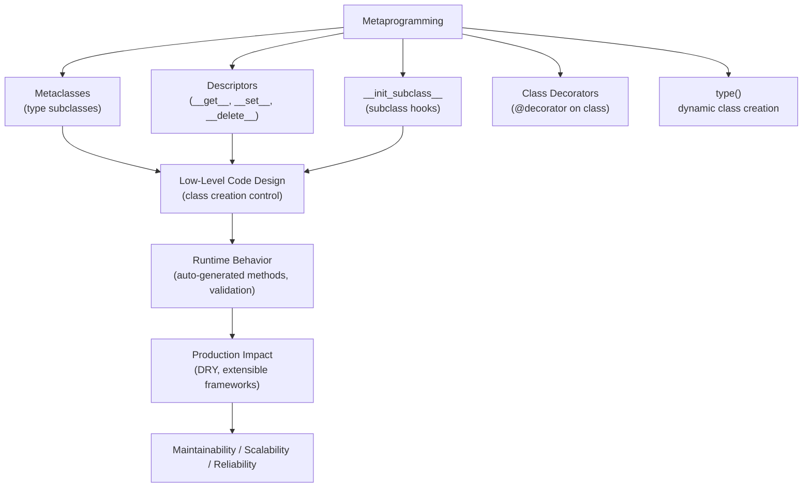
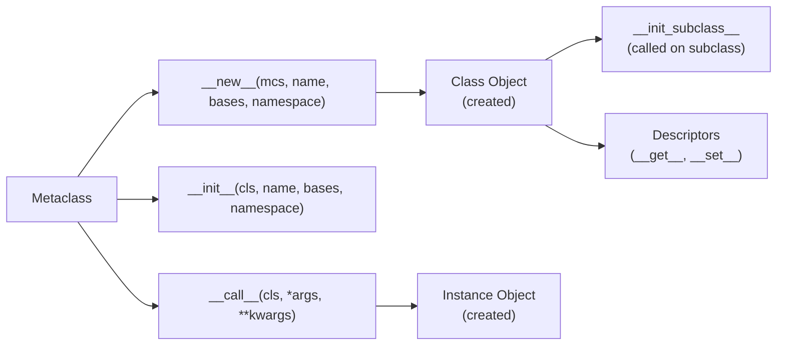

# Metaprogramming in Python

## Overview

**Metaprogramming** is the practice of writing code that generates, modifies, or introspects other code at runtime. In Python, metaprogramming encompasses metaclasses, descriptors, `__init_subclass__`, class decorators, `type()`, `getattr`/`setattr`, and the entire `inspect` module. It is the foundation of Python's most powerful frameworks — Django's ORM, SQLAlchemy, Pydantic, and dataclasses.

> **Core idea:** Code that writes or modifies code. Metaprogramming lets you define behavior at the class or metaclass level that applies automatically to all instances or subclasses — without repetition.

---

## Why It Matters

| Regular Programming | Metaprogramming |
|---|---|
| Write behavior for each class | Write behavior that applies to all classes |
| Explicit, verbose | Concise, DRY |
| Static class definitions | Dynamic class creation and modification |
| Manual boilerplate | Automatic boilerplate generation |

Metaprogramming is used in:
- **Django ORM** — `Model` metaclass generates SQL from class attributes
- **Pydantic** — metaclass validates fields and generates `__init__`
- **SQLAlchemy** — `DeclarativeMeta` maps classes to database tables
- **dataclasses** — `@dataclass` generates `__init__`, `__repr__`, `__eq__`
- **pytest** — collects test classes and functions via metaclass inspection
- **AI agent frameworks** — auto-registering tools, validators, and handlers

---

## Concept Map





---

## Simple Example

```python
# --- type() for dynamic class creation ---
# type(name, bases, dict) creates a new class
Dog = type("Dog", (object,), {
    "species": "Canis lupus familiaris",
    "speak": lambda self: "Woof!",
    "__repr__": lambda self: f"Dog(name={self.name!r})",
})

dog = Dog()
dog.name = "Rex"
print(dog.speak())   # Woof!
print(repr(dog))     # Dog(name='Rex')
print(Dog.species)   # Canis lupus familiaris

# --- __init_subclass__ for subclass hooks ---
class PluginBase:
    _registry: dict = {}

    def __init_subclass__(cls, plugin_name: str = "", **kwargs):
        super().__init_subclass__(**kwargs)
        if plugin_name:
            PluginBase._registry[plugin_name] = cls
            print(f"Registered plugin: {plugin_name} → {cls.__name__}")

class EmailPlugin(PluginBase, plugin_name="email"):
    def send(self, msg): return f"[EMAIL] {msg}"

class SMSPlugin(PluginBase, plugin_name="sms"):
    def send(self, msg): return f"[SMS] {msg}"

print(PluginBase._registry)
plugin = PluginBase._registry["email"]()
print(plugin.send("Hello!"))
```

**Explanation:**
- `type()` creates classes dynamically — the same mechanism Python uses for all class definitions.
- `__init_subclass__` is called automatically when a subclass is defined — enables auto-registration.
- `plugin_name` is passed as a keyword argument to the class definition.

**Expected Output:**
```
Woof!
Dog(name='Rex')
Canis lupus familiaris
Registered plugin: email → EmailPlugin
Registered plugin: sms → SMSPlugin
{'email': <class 'EmailPlugin'>, 'sms': <class 'SMSPlugin'>}
[EMAIL] Hello!
```

---

## Intermediate Example

```python
from typing import Any, Dict, Type, get_type_hints
import inspect

# --- Descriptor for validated attributes ---
class TypedField:
    """Descriptor that enforces type validation on attribute assignment."""

    def __init__(self, expected_type: type, default: Any = None):
        self._type = expected_type
        self._default = default
        self._name: str = ""

    def __set_name__(self, owner: type, name: str) -> None:
        """Called when the descriptor is assigned to a class attribute."""
        self._name = name

    def __get__(self, obj: Any, objtype: type = None) -> Any:
        if obj is None:
            return self  # Class-level access returns descriptor
        return obj.__dict__.get(self._name, self._default)

    def __set__(self, obj: Any, value: Any) -> None:
        if not isinstance(value, self._type):
            raise TypeError(
                f"{self._name}: expected {self._type.__name__}, got {type(value).__name__}"
            )
        obj.__dict__[self._name] = value

    def __delete__(self, obj: Any) -> None:
        obj.__dict__.pop(self._name, None)


# --- Metaclass for auto-validation ---
class ValidatedMeta(type):
    """Metaclass that automatically adds TypedField descriptors from type hints."""

    def __new__(mcs, name: str, bases: tuple, namespace: dict):
        cls = super().__new__(mcs, name, bases, namespace)

        # Add TypedField descriptors for annotated attributes with defaults
        for attr_name, attr_type in namespace.get("__annotations__", {}).items():
            if attr_name.startswith("_"):
                continue
            default = namespace.get(attr_name)
            if not isinstance(default, TypedField):
                setattr(cls, attr_name, TypedField(attr_type, default))

        return cls


class ValidatedModel(metaclass=ValidatedMeta):
    """Base class for validated models."""

    def __init__(self, **kwargs):
        for key, value in kwargs.items():
            setattr(self, key, value)

    def __repr__(self) -> str:
        fields = {k: v for k, v in self.__dict__.items() if not k.startswith("_")}
        return f"{self.__class__.__name__}({fields})"


class User(ValidatedModel):
    name: str = ""
    age: int = 0
    email: str = ""
    active: bool = True


# Usage
user = User(name="Alice", age=30, email="alice@example.com")
print(user)  # User({'name': 'Alice', 'age': 30, 'email': 'alice@example.com', 'active': True})

# Type validation
try:
    user.age = "thirty"  # TypeError!
except TypeError as e:
    print(f"TypeError: {e}")

# Descriptor introspection
print(type(User.__dict__["name"]))  # <class 'TypedField'>
```

**Explanation:**
- `TypedField` is a descriptor — `__get__`, `__set__`, `__delete__` control attribute access.
- `__set_name__` is called when the descriptor is assigned to a class — receives the attribute name.
- `ValidatedMeta` automatically wraps annotated attributes with `TypedField` descriptors.
- This is the foundation of how Pydantic and Django's ORM work.

---

## Advanced / Architect-Level Example

### Problem Context

In a **production AI agent framework**, you need to auto-register tools, validate their signatures, generate documentation, and enforce contracts — all without requiring developers to write boilerplate. A metaclass-based framework handles this automatically.

```python
from __future__ import annotations
import inspect
import functools
from typing import Any, Callable, Dict, List, Optional, Type, get_type_hints
from dataclasses import dataclass, field


@dataclass
class ToolSchema:
    """Auto-generated schema for an agent tool."""
    name: str
    description: str
    parameters: Dict[str, Dict[str, Any]]
    return_type: str
    is_async: bool = False


class ToolRegistry:
    """Global registry of all registered agent tools."""
    _tools: Dict[str, Callable] = {}
    _schemas: Dict[str, ToolSchema] = {}

    @classmethod
    def register(cls, name: str, fn: Callable, schema: ToolSchema) -> None:
        cls._tools[name] = fn
        cls._schemas[name] = schema

    @classmethod
    def get(cls, name: str) -> Optional[Callable]:
        return cls._tools.get(name)

    @classmethod
    def list_tools(cls) -> List[ToolSchema]:
        return list(cls._schemas.values())


def _build_schema(name: str, fn: Callable) -> ToolSchema:
    """Build a ToolSchema from a function's signature and docstring."""
    sig = inspect.signature(fn)
    hints = get_type_hints(fn)
    params = {}

    for param_name, param in sig.parameters.items():
        if param_name == "self":
            continue
        param_type = hints.get(param_name, Any)
        params[param_name] = {
            "type": getattr(param_type, "__name__", str(param_type)),
            "required": param.default is inspect.Parameter.empty,
            "default": None if param.default is inspect.Parameter.empty else param.default,
        }

    return ToolSchema(
        name=name,
        description=inspect.getdoc(fn) or "",
        parameters=params,
        return_type=getattr(hints.get("return", Any), "__name__", "Any"),
        is_async=inspect.iscoroutinefunction(fn),
    )


# --- Metaclass for auto-registering tools ---
class AgentToolMeta(type):
    """
    Metaclass that:
    1. Auto-registers all public methods as agent tools
    2. Validates method signatures
    3. Generates tool schemas
    4. Adds input validation wrappers
    """

    def __new__(mcs, name: str, bases: tuple, namespace: dict):
        cls = super().__new__(mcs, name, bases, namespace)

        # Skip the base class itself
        if name == "AgentToolBase":
            return cls

        # Auto-register all public methods
        for attr_name, attr_value in namespace.items():
            if attr_name.startswith("_"):
                continue
            if not callable(attr_value):
                continue

            tool_name = f"{name.lower()}.{attr_name}"
            schema = _build_schema(tool_name, attr_value)

            # Wrap with validation
            original = attr_value

            @functools.wraps(original)
            def validated_tool(self, *args, _original=original, _schema=schema, **kwargs):
                # Validate required parameters
                sig = inspect.signature(_original)
                bound = sig.bind(self, *args, **kwargs)
                bound.apply_defaults()
                return _original(self, *args, **kwargs)

            setattr(cls, attr_name, validated_tool)
            ToolRegistry.register(tool_name, validated_tool, schema)

        return cls


class AgentToolBase(metaclass=AgentToolMeta):
    """Base class for all agent tool collections."""
    pass


# --- Tool implementations ---
class WebTools(AgentToolBase):
    def search(self, query: str, max_results: int = 5) -> List[str]:
        """Search the web for information.

        Args:
            query: The search query
            max_results: Maximum number of results to return
        """
        return [f"Result {i} for '{query}'" for i in range(max_results)]

    def fetch_url(self, url: str) -> str:
        """Fetch the content of a URL."""
        return f"Content of {url}"


class MathTools(AgentToolBase):
    def calculate(self, expression: str) -> float:
        """Evaluate a mathematical expression safely."""
        allowed = set("0123456789+-*/()., ")
        if not all(c in allowed for c in expression):
            raise ValueError(f"Invalid expression: {expression}")
        return eval(expression)

    def statistics(self, numbers: List[float]) -> Dict[str, float]:
        """Compute basic statistics for a list of numbers."""
        import statistics
        return {
            "mean": statistics.mean(numbers),
            "median": statistics.median(numbers),
            "stdev": statistics.stdev(numbers) if len(numbers) > 1 else 0.0,
        }


class DatabaseTools(AgentToolBase):
    def query(self, sql: str, limit: int = 100) -> List[Dict]:
        """Execute a read-only SQL query."""
        return [{"id": i, "result": f"Row {i}"} for i in range(min(limit, 3))]


# --- Agent that uses the registry ---
class Agent:
    def __init__(self):
        self._tool_instances: Dict[str, Any] = {
            "webtools": WebTools(),
            "mathtools": MathTools(),
            "databasetools": DatabaseTools(),
        }

    def execute_tool(self, tool_name: str, **kwargs) -> Any:
        """Execute a registered tool by name."""
        tool_fn = ToolRegistry.get(tool_name)
        if not tool_fn:
            raise ValueError(f"Unknown tool: {tool_name}")

        # Find the instance
        class_name = tool_name.split(".")[0]
        instance = self._tool_instances.get(class_name)
        if not instance:
            raise ValueError(f"No instance for {class_name}")

        return tool_fn(instance, **kwargs)

    def list_tools(self) -> None:
        for schema in ToolRegistry.list_tools():
            print(f"  {schema.name}: {schema.description[:50]}")
            for param, info in schema.parameters.items():
                req = "required" if info["required"] else f"default={info['default']}"
                print(f"    - {param} ({info['type']}, {req})")


# --- Usage ---
agent = Agent()

print("=== Registered Tools ===")
agent.list_tools()

print("\n=== Tool Execution ===")
results = agent.execute_tool("webtools.search", query="Python metaclasses", max_results=3)
print(f"Search: {results}")

calc = agent.execute_tool("mathtools.calculate", expression="2 ** 10 + 42")
print(f"Calculate: {calc}")

rows = agent.execute_tool("databasetools.query", sql="SELECT * FROM users", limit=2)
print(f"Query: {rows}")

print(f"\nTotal registered tools: {len(ToolRegistry.list_tools())}")
```

**Explanation:**
- `AgentToolMeta` automatically registers all public methods as tools — no manual registration.
- `_build_schema` generates `ToolSchema` from function signatures and docstrings — auto-documentation.
- `validated_tool` wraps each method with input validation — enforced contracts.
- Adding a new tool class (e.g., `FileTools`) automatically registers all its methods.
- This pattern is used in LangChain, AutoGen, and other AI agent frameworks.

**Design Trade-offs:**

| Approach | Pros | Cons |
|---|---|---|
| Metaclass | Automatic, DRY, framework-level | Complex, hard to debug |
| `__init_subclass__` | Simpler than metaclass | Less control |
| Class decorator | Explicit, readable | Must be applied manually |
| Manual registration | Simple, explicit | Verbose, error-prone |

---

## Common Mistakes

### 1. Metaclass Conflicts
```python
# ❌ Two metaclasses — Python can't resolve
class MyMeta(type): ...
class ABCMeta(ABCMeta): ...

class MyClass(ABC, metaclass=MyMeta):  # TypeError: metaclass conflict!
    ...

# ✅ Create a combined metaclass
class CombinedMeta(ABCMeta, MyMeta): ...
class MyClass(ABC, metaclass=CombinedMeta): ...
```

---

### 2. Modifying `namespace` After `super().__new__`
```python
# ❌ Modifying namespace after class creation has no effect
class MyMeta(type):
    def __new__(mcs, name, bases, namespace):
        cls = super().__new__(mcs, name, bases, namespace)
        namespace["new_attr"] = 42  # Too late! Class already created
        return cls

# ✅ Modify namespace BEFORE calling super().__new__
class MyMeta(type):
    def __new__(mcs, name, bases, namespace):
        namespace["new_attr"] = 42  # Before class creation
        return super().__new__(mcs, name, bases, namespace)
```

---

### 3. Forgetting `__set_name__` in Descriptors
```python
# ❌ Descriptor doesn't know its attribute name
class MyDescriptor:
    def __get__(self, obj, objtype=None):
        return obj.__dict__.get("???")  # Unknown name!

# ✅ Use __set_name__
class MyDescriptor:
    def __set_name__(self, owner, name):
        self._name = name

    def __get__(self, obj, objtype=None):
        return obj.__dict__.get(self._name)
```

---

### 4. Infinite Recursion in `__getattr__`
```python
# ❌ __getattr__ calls itself
class MyClass:
    def __getattr__(self, name):
        return self.data[name]  # self.data triggers __getattr__ again!

# ✅ Use __getattribute__ carefully or access __dict__ directly
class MyClass:
    def __getattr__(self, name):
        data = object.__getattribute__(self, "data")
        return data[name]
```

---

### 5. Using Metaclasses When `__init_subclass__` Suffices
```python
# ❌ Overkill — metaclass for simple subclass registration
class PluginMeta(type):
    def __new__(mcs, name, bases, namespace):
        cls = super().__new__(mcs, name, bases, namespace)
        if bases:
            registry[name] = cls
        return cls

# ✅ Use __init_subclass__ — simpler and more Pythonic
class PluginBase:
    def __init_subclass__(cls, **kwargs):
        super().__init_subclass__(**kwargs)
        registry[cls.__name__] = cls
```

---

## Best Practices

1. **Prefer `__init_subclass__` over metaclasses** for simple subclass hooks — simpler and more Pythonic.
2. **Use metaclasses for framework-level behavior** — ORM field mapping, validation, auto-registration.
3. **Modify `namespace` before `super().__new__`** — after is too late.
4. **Use `__set_name__`** in descriptors — called automatically when assigned to a class.
5. **Resolve metaclass conflicts** with a combined metaclass.
6. **Use `type.__prepare__`** to return a custom namespace dict (e.g., `OrderedDict` for ordered attributes).
7. **Document metaclass behavior** — it's non-obvious and must be explained.
8. **Test metaclass behavior** with multiple subclasses — verify auto-registration, validation, etc.
9. **Use `inspect` module** for introspection — `inspect.signature`, `inspect.getmembers`, `get_type_hints`.
10. **Avoid metaclasses in application code** — they belong in frameworks and libraries.

---

## Performance Considerations

- **Metaclass `__new__`**: Called once per class definition — negligible overhead.
- **Descriptors**: `__get__`/`__set__` are called on every attribute access — keep them fast.
- **`__getattr__`**: Called only when normal attribute lookup fails — O(1) for existing attributes.
- **`__getattribute__`**: Called on every attribute access — avoid heavy logic here.
- **`type()` dynamic class creation**: O(1) — same as regular class definition.
- **`inspect.signature()`**: Relatively expensive — cache results if called frequently.
- **`get_type_hints()`**: Evaluates string annotations — can be slow for complex types. Cache results.

---

## Testing Strategy

```python
# test_metaprogramming.py
import pytest
from your_module import (
    TypedField, ValidatedModel, User,
    PluginBase, AgentToolMeta, AgentToolBase,
    WebTools, MathTools, ToolRegistry
)


# --- Test TypedField descriptor ---
def test_typed_field_accepts_correct_type():
    user = User(name="Alice", age=30)
    assert user.name == "Alice"
    assert user.age == 30

def test_typed_field_rejects_wrong_type():
    user = User()
    with pytest.raises(TypeError, match="age"):
        user.age = "thirty"

def test_typed_field_default():
    user = User()
    assert user.active is True  # Default value

def test_typed_field_set_name():
    assert User.__dict__["name"]._name == "name"
    assert User.__dict__["age"]._name == "age"


# --- Test __init_subclass__ ---
def test_plugin_auto_registration():
    class TestPlugin(PluginBase, plugin_name="test_plugin"):
        pass

    assert "test_plugin" in PluginBase._registry
    assert PluginBase._registry["test_plugin"] is TestPlugin


# --- Test metaclass auto-registration ---
def test_tool_auto_registration():
    ToolRegistry._tools.clear()
    ToolRegistry._schemas.clear()

    class TestTools(AgentToolBase):
        def greet(self, name: str) -> str:
            """Greet someone."""
            return f"Hello, {name}!"

    assert "testtools.greet" in ToolRegistry._tools
    schema = ToolRegistry._schemas["testtools.greet"]
    assert schema.description == "Greet someone."
    assert "name" in schema.parameters


# --- Test tool execution ---
def test_tool_execution():
    tools = WebTools()
    results = tools.search("Python", max_results=2)
    assert len(results) == 2

def test_math_tool_calculation():
    tools = MathTools()
    result = tools.calculate("2 + 2 * 3")
    assert result == 8.0

def test_math_tool_invalid_expression():
    tools = MathTools()
    with pytest.raises(ValueError):
        tools.calculate("import os")


# --- Test dynamic class creation ---
def test_type_dynamic_class():
    MyClass = type("MyClass", (object,), {"value": 42, "get_value": lambda self: self.value})
    obj = MyClass()
    assert obj.get_value() == 42
    assert obj.value == 42


# --- Test descriptor __set_name__ ---
def test_descriptor_set_name():
    class MyModel(ValidatedModel):
        score: float = 0.0

    assert MyModel.__dict__["score"]._name == "score"
    m = MyModel(score=9.5)
    assert m.score == 9.5
```

---

## Debugging Tips

1. **`TypeError: metaclass conflict`** — two metaclasses in the MRO. Create a combined metaclass that inherits from both.

2. **Metaclass `__new__` not called** — check that the class inherits from the correct base or uses `metaclass=` correctly.

3. **Descriptor `__get__` returning wrong value** — check `__set_name__` was called. Print `self._name` to verify.

4. **`__init_subclass__` not called** — ensure the base class calls `super().__init_subclass__(**kwargs)`.

5. **Infinite recursion in `__getattr__`** — use `object.__getattribute__(self, name)` to bypass `__getattr__` for internal access.

6. **`inspect.signature()` fails** — the function may be a built-in or C extension. Use `try/except ValueError`.

7. **`get_type_hints()` raises `NameError`** — forward references in annotations. Pass `localns` and `globalns` to `get_type_hints()`.

---

## Interview Questions

### Beginner

**Q1: What is metaprogramming?**  
A: Writing code that generates, modifies, or introspects other code at runtime. In Python: metaclasses, descriptors, `__init_subclass__`, `type()`, and `inspect`.

**Q2: What is a metaclass?**  
A: A class whose instances are classes. `type` is the default metaclass. Custom metaclasses control class creation by overriding `__new__` and `__init__`.

**Q3: What is `__init_subclass__`?**  
A: A class method called automatically when a subclass is defined. Used for auto-registration, validation, and subclass hooks — simpler than metaclasses for most use cases.

**Q4: What is a descriptor?**  
A: An object that defines `__get__`, `__set__`, and/or `__delete__` methods. Controls attribute access on a class. Used by `property`, `classmethod`, `staticmethod`, and ORM fields.

**Q5: What does `type()` do with three arguments?**  
A: Creates a new class: `type(name, bases, dict)`. Equivalent to a `class` statement.

---

### Intermediate

**Q6: What is `__set_name__` and when is it called?**  
A: Called when a descriptor is assigned to a class attribute. Receives the owner class and attribute name. Used to give the descriptor knowledge of its own name.

**Q7: What is the difference between `__getattr__` and `__getattribute__`?**  
A: `__getattr__` is called only when normal attribute lookup fails. `__getattribute__` is called on every attribute access. Override `__getattr__` for missing attributes; use `__getattribute__` carefully to avoid infinite recursion.

**Q8: How do you resolve a metaclass conflict?**  
A: Create a combined metaclass that inherits from all conflicting metaclasses: `class CombinedMeta(MetaA, MetaB): pass`.

**Q9: What is `type.__prepare__`?**  
A: A classmethod called before `__new__` to create the namespace dict for the class body. Override to return a custom dict (e.g., `OrderedDict` for ordered attributes).

**Q10: How does Django's ORM use metaclasses?**  
A: `ModelBase` metaclass processes class attributes (field definitions), generates SQL schema, adds `objects` manager, and registers the model. All `Model` subclasses automatically get these behaviors.

---

### Advanced / Architect-Level

**Q11: How would you implement an auto-registering tool framework for an AI agent using metaclasses?**  
A: Define `AgentToolMeta` that inspects all public methods in `__new__`, builds schemas from signatures and docstrings, wraps methods with validation, and registers them in a global `ToolRegistry`. All `AgentToolBase` subclasses automatically register their tools.

**Q12: How does Pydantic use metaclasses and descriptors?**  
A: Pydantic's `ModelMetaclass` processes field annotations, creates `FieldInfo` descriptors, generates `__init__` with validation, and builds JSON schema. Descriptors enforce type validation on every assignment.

**Q13: What is the difference between a data descriptor and a non-data descriptor?**  
A: A data descriptor defines both `__get__` and `__set__` (or `__delete__`). A non-data descriptor defines only `__get__`. Data descriptors take priority over instance `__dict__`; non-data descriptors don't.

**Q14: How would you implement a lazy-loading descriptor for expensive computed attributes?**  
A: Define a descriptor with `__get__` that checks `obj.__dict__` for a cached value. If not found, compute it, store in `obj.__dict__`, and return. On next access, `obj.__dict__` takes priority (non-data descriptor) — the descriptor's `__get__` is not called again.

**Q15: How does `@dataclass` use metaprogramming?**  
A: `@dataclass` is a class decorator that inspects `__annotations__`, generates `__init__`, `__repr__`, `__eq__`, and optionally `__hash__`, `__lt__`, etc. It uses `exec()` to generate the methods dynamically and adds them to the class.

---

## Key Takeaways

- Metaprogramming writes code that generates or modifies code — the foundation of Python frameworks.
- `type(name, bases, dict)` creates classes dynamically — the same mechanism as `class` statements.
- Metaclasses control class creation — override `__new__` to modify the class before it's created.
- `__init_subclass__` is simpler than metaclasses for subclass hooks — prefer it when possible.
- Descriptors (`__get__`, `__set__`, `__delete__`) control attribute access — the foundation of ORM fields and `property`.
- `__set_name__` gives descriptors knowledge of their attribute name — called automatically.
- Resolve metaclass conflicts with a combined metaclass.
- Use `inspect` and `get_type_hints` for introspection — build schemas from signatures.
- Metaclasses belong in frameworks, not application code.
- Mastering metaprogramming is mastering Python's most powerful abstraction mechanism — the foundation of Django, SQLAlchemy, Pydantic, and modern AI frameworks.

---

## Mini Project Idea

### Goal
Build a **Mini ORM Framework** — a metaclass-based object-relational mapper that maps Python classes to database tables, auto-generates SQL, and validates field types.

### Features
- `Field` descriptor with type validation and `__set_name__`.
- `ModelMeta` metaclass that generates `CREATE TABLE` SQL from class attributes.
- `Model` base class with `save()`, `find()`, `delete()` methods.
- `IntField`, `StringField`, `FloatField`, `BoolField` typed field classes.
- `ForeignKey` descriptor for relationships.
- CLI: `python orm.py --migrate --model User`.

### Suggested Folder Structure
```
mini_orm/
├── fields/
│   ├── __init__.py
│   ├── base.py            # Field descriptor
│   └── typed.py           # IntField, StringField, etc.
├── model/
│   ├── __init__.py
│   ├── meta.py            # ModelMeta metaclass
│   └── base.py            # Model base class
├── db/
│   └── sqlite_backend.py
├── tests/
│   ├── test_fields.py
│   └── test_model.py
├── cli.py
└── README.md
```

### Extension Ideas
- Add `@validates` decorator for custom field validators.
- Add `ManyToMany` relationship descriptor.
- Add migration generation (diff between model and DB schema).
- Add async query support with `aiosqlite`.

---

## Final Summary

Mastering metaprogramming is mastering Python's deepest abstraction layer. Metaclasses, descriptors, `__init_subclass__`, and `type()` are the tools that power Python's most influential frameworks — Django's ORM, SQLAlchemy, Pydantic, and dataclasses. For a Python architect, metaprogramming is the difference between writing application code and writing framework code. Understanding how to use metaclasses to auto-register tools, descriptors to enforce validation, and `__init_subclass__` for subclass hooks — and knowing when each is appropriate — is what enables you to build extensible, DRY, production-grade Python frameworks that other developers can build on top of.
