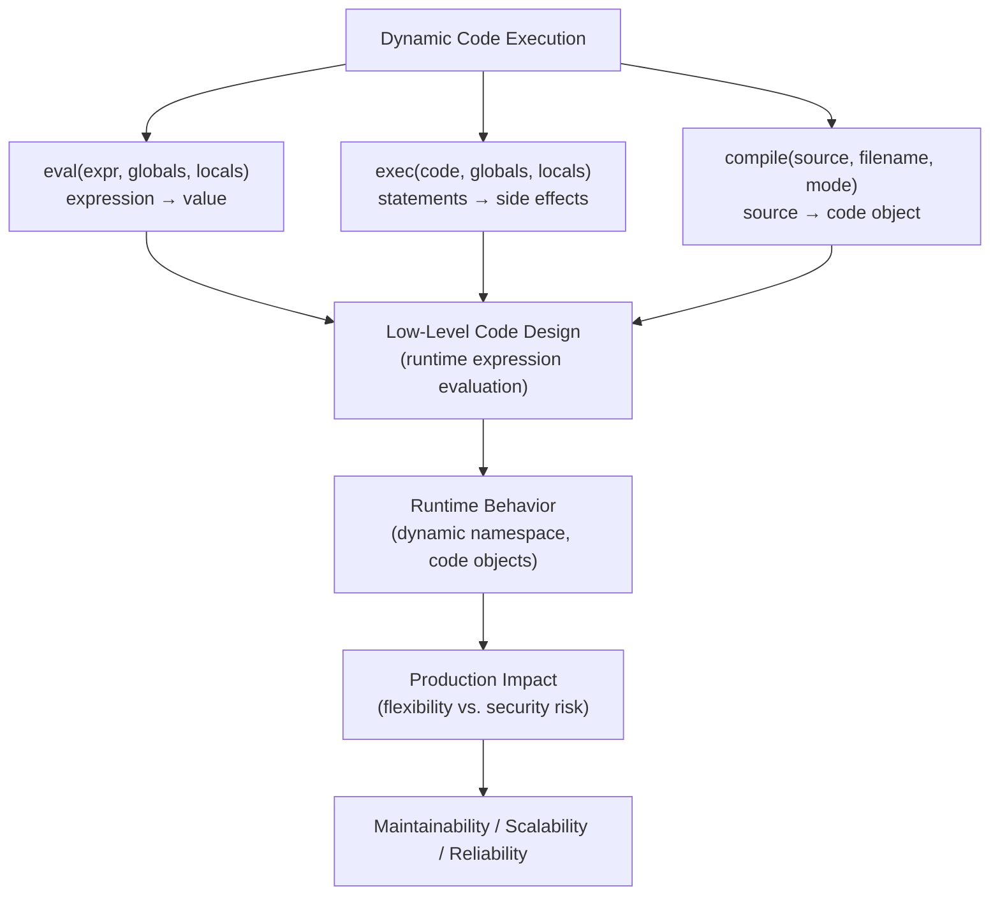
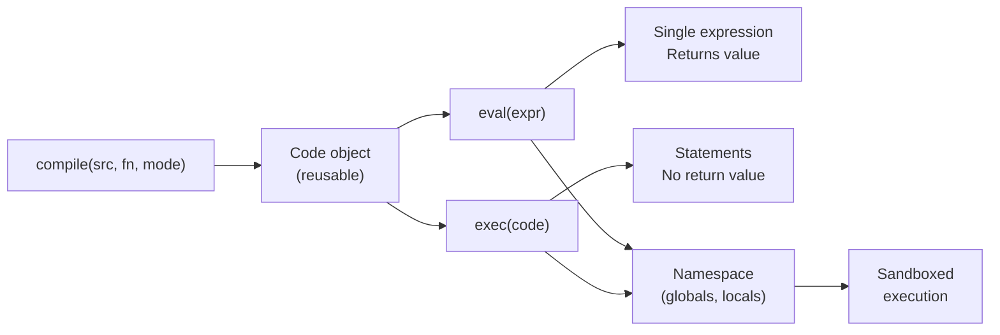

# Dynamic Code Execution (eval, exec) in Python

## Overview

**Dynamic Code Execution** refers to Python's ability to evaluate and execute code represented as strings or code objects at runtime using `eval()`, `exec()`, and `compile()`. These built-ins enable powerful metaprogramming capabilities — from expression evaluation to dynamic class generation — but come with significant security and maintainability risks.

> **Core idea:** `eval()` evaluates a single expression and returns its value. `exec()` executes arbitrary statements with no return value. Both operate in a specified namespace, enabling controlled execution environments.

---

## Why It Matters

| Static Code | Dynamic Code Execution |
|---|---|
| Fixed at write time | Generated at runtime |
| Predictable | Flexible but risky |
| Safe | Security risk if input is untrusted |
| Fast (compiled) | Slower (compiled at runtime) |

Dynamic code execution is used in:
- **Template engines** — Jinja2, Django templates
- **REPL environments** — IPython, Jupyter
- **Configuration DSLs** — rule engines, formula evaluators
- **Code generation** — `dataclasses`, `namedtuple`, `attrs`
- **Sandboxed execution** — restricted Python environments
- **Mathematical expression evaluators** — spreadsheet formulas

---

## Concept Map





---

## Simple Example

```python
# --- eval() ---
# Evaluate a single expression
result = eval("2 + 2 * 3")
print(result)  # 8

# With custom namespace
namespace = {"x": 10, "y": 5}
result = eval("x ** 2 + y", namespace)
print(result)  # 105

# eval() returns the value
expr = "len([1, 2, 3]) * 2"
print(eval(expr))  # 6

# --- exec() ---
# Execute statements
code = """
def greet(name):
    return f"Hello, {name}!"

result = greet("Alice")
"""
namespace = {}
exec(code, namespace)
print(namespace["result"])   # Hello, Alice!
print(namespace["greet"]("Bob"))  # Hello, Bob!

# --- compile() for reusable code objects ---
source = "x * 2 + y"
code_obj = compile(source, "<string>", "eval")

for x, y in [(1, 2), (3, 4), (5, 6)]:
    print(eval(code_obj, {"x": x, "y": y}))  # 4, 10, 16
```

**Explanation:**
- `eval()` evaluates a single expression — returns the result.
- `exec()` executes statements — modifies the namespace, returns `None`.
- `compile()` pre-compiles source to a code object — reuse for performance.
- Custom namespaces control what names are available during execution.

**Expected Output:**
```
8
105
6
Hello, Alice!
Hello, Bob!
4
10
16
```

---

## Intermediate Example

```python
from typing import Any, Dict, Optional
import ast
import operator

# --- Safe expression evaluator using AST ---
class SafeExpressionEvaluator:
    """
    Evaluates mathematical and logical expressions safely.
    Uses AST to prevent code injection — only allows safe operations.
    """

    SAFE_OPERATORS = {
        ast.Add: operator.add,
        ast.Sub: operator.sub,
        ast.Mult: operator.mul,
        ast.Div: operator.truediv,
        ast.FloorDiv: operator.floordiv,
        ast.Mod: operator.mod,
        ast.Pow: operator.pow,
        ast.USub: operator.neg,
        ast.UAdd: operator.pos,
        ast.Eq: operator.eq,
        ast.NotEq: operator.ne,
        ast.Lt: operator.lt,
        ast.LtE: operator.le,
        ast.Gt: operator.gt,
        ast.GtE: operator.ge,
        ast.And: lambda a, b: a and b,
        ast.Or: lambda a, b: a or b,
        ast.Not: operator.not_,
    }

    SAFE_FUNCTIONS = {
        "abs": abs,
        "round": round,
        "min": min,
        "max": max,
        "sum": sum,
        "len": len,
        "int": int,
        "float": float,
        "str": str,
        "bool": bool,
    }

    def evaluate(self, expression: str, variables: Dict[str, Any] = None) -> Any:
        """Safely evaluate an expression with optional variables."""
        try:
            tree = ast.parse(expression, mode="eval")
            return self._eval_node(tree.body, variables or {})
        except (ValueError, TypeError, ZeroDivisionError) as e:
            raise ValueError(f"Evaluation error: {e}") from e
        except Exception as e:
            raise ValueError(f"Invalid expression: {e}") from e

    def _eval_node(self, node: ast.AST, variables: Dict[str, Any]) -> Any:
        if isinstance(node, ast.Constant):
            return node.value
        elif isinstance(node, ast.Name):
            if node.id in variables:
                return variables[node.id]
            if node.id in self.SAFE_FUNCTIONS:
                return self.SAFE_FUNCTIONS[node.id]
            raise ValueError(f"Unknown variable: {node.id}")
        elif isinstance(node, ast.BinOp):
            op = self.SAFE_OPERATORS.get(type(node.op))
            if not op:
                raise ValueError(f"Unsupported operator: {type(node.op).__name__}")
            return op(self._eval_node(node.left, variables), self._eval_node(node.right, variables))
        elif isinstance(node, ast.UnaryOp):
            op = self.SAFE_OPERATORS.get(type(node.op))
            if not op:
                raise ValueError(f"Unsupported operator: {type(node.op).__name__}")
            return op(self._eval_node(node.operand, variables))
        elif isinstance(node, ast.Compare):
            left = self._eval_node(node.left, variables)
            for op_node, comparator in zip(node.ops, node.comparators):
                op = self.SAFE_OPERATORS.get(type(op_node))
                if not op:
                    raise ValueError(f"Unsupported comparison: {type(op_node).__name__}")
                right = self._eval_node(comparator, variables)
                if not op(left, right):
                    return False
                left = right
            return True
        elif isinstance(node, ast.Call):
            func = self._eval_node(node.func, variables)
            args = [self._eval_node(a, variables) for a in node.args]
            return func(*args)
        elif isinstance(node, ast.List):
            return [self._eval_node(e, variables) for e in node.elts]
        else:
            raise ValueError(f"Unsupported node type: {type(node).__name__}")


# --- Dynamic class generation ---
def create_model_class(name: str, fields: Dict[str, type]) -> type:
    """Dynamically create a model class with typed fields."""
    init_params = ", ".join(f"{k}: {v.__name__}" for k, v in fields.items())
    init_body = "\n    ".join(f"self.{k} = {k}" for k in fields)
    repr_fields = ", ".join(f"{k}={{self.{k}!r}}" for k in fields)

    code = f"""
class {name}:
    def __init__(self, {init_params}):
        {init_body}

    def __repr__(self):
        return f"{name}({repr_fields})"

    def to_dict(self):
        return {{{", ".join(f'"{k}": self.{k}' for k in fields)}}}
"""
    namespace = {}
    exec(code, namespace)
    return namespace[name]


# --- Usage ---
evaluator = SafeExpressionEvaluator()

# Safe expressions
print(evaluator.evaluate("2 ** 10 + 42"))  # 1066
print(evaluator.evaluate("x * y + z", {"x": 3, "y": 4, "z": 5}))  # 17
print(evaluator.evaluate("max(a, b, c)", {"a": 1, "b": 5, "c": 3}))  # 5
print(evaluator.evaluate("x > 10 and y < 20", {"x": 15, "y": 10}))  # True

# Blocked: code injection
try:
    evaluator.evaluate("__import__('os').system('ls')")
except ValueError as e:
    print(f"Blocked: {e}")

# Dynamic class creation
Order = create_model_class("Order", {"order_id": str, "customer": str, "total": float})
order = Order("ORD-001", "Alice", 99.99)
print(order)
print(order.to_dict())
```

**Explanation:**
- `SafeExpressionEvaluator` uses AST parsing — only allows whitelisted operations.
- `__import__` and other dangerous calls are blocked — safe for user input.
- `create_model_class` uses `exec()` to generate classes dynamically — used by `dataclasses` internally.

---

## Advanced / Architect-Level Example

### Problem Context

In a **business rules engine** for an ERP system, business analysts define pricing rules, discount conditions, and validation logic as text expressions. A safe, auditable dynamic execution engine evaluates these rules at runtime without code deployment.

```python
from __future__ import annotations
import ast
import hashlib
import time
from typing import Any, Dict, List, Optional, Callable
from dataclasses import dataclass, field
from functools import lru_cache


@dataclass
class Rule:
    rule_id: str
    name: str
    expression: str
    description: str = ""
    created_by: str = ""
    version: int = 1
    enabled: bool = True


@dataclass
class RuleResult:
    rule_id: str
    rule_name: str
    result: Any
    success: bool
    error: Optional[str] = None
    duration_ms: float = 0.0


class RulesEngine:
    """
    Production-grade business rules engine using safe AST evaluation.
    Features: rule registry, caching, audit logging, sandboxed execution.
    """

    SAFE_BUILTINS = {
        "abs": abs, "round": round, "min": min, "max": max,
        "sum": sum, "len": len, "int": int, "float": float,
        "str": str, "bool": bool, "list": list, "dict": dict,
        "sorted": sorted, "reversed": reversed,
        "any": any, "all": all, "zip": zip, "enumerate": enumerate,
        "True": True, "False": False, "None": None,
    }

    def __init__(self):
        self._rules: Dict[str, Rule] = {}
        self._compiled_cache: Dict[str, Any] = {}
        self._audit_log: List[Dict] = []

    def register_rule(self, rule: Rule) -> None:
        """Register a business rule."""
        # Validate expression before registering
        try:
            ast.parse(rule.expression, mode="eval")
        except SyntaxError as e:
            raise ValueError(f"Invalid rule expression: {e}")
        self._rules[rule.rule_id] = rule
        self._compiled_cache.pop(rule.rule_id, None)  # Invalidate cache

    def _get_compiled(self, rule: Rule):
        """Get or compile a rule's code object."""
        cache_key = hashlib.md5(rule.expression.encode()).hexdigest()
        if cache_key not in self._compiled_cache:
            self._compiled_cache[cache_key] = compile(
                rule.expression, f"<rule:{rule.rule_id}>", "eval"
            )
        return self._compiled_cache[cache_key]

    def evaluate(self, rule_id: str, context: Dict[str, Any]) -> RuleResult:
        """Evaluate a single rule in the given context."""
        rule = self._rules.get(rule_id)
        if not rule:
            return RuleResult(rule_id, "unknown", None, False, f"Rule not found: {rule_id}")

        if not rule.enabled:
            return RuleResult(rule_id, rule.name, None, False, "Rule disabled")

        start = time.time()
        try:
            code_obj = self._get_compiled(rule)
            # Sandboxed namespace: only safe builtins + context
            safe_globals = {"__builtins__": self.SAFE_BUILTINS}
            result = eval(code_obj, safe_globals, context)
            duration_ms = (time.time() - start) * 1000

            self._audit_log.append({
                "rule_id": rule_id,
                "context_keys": list(context.keys()),
                "result": result,
                "success": True,
                "timestamp": time.time(),
            })

            return RuleResult(rule_id, rule.name, result, True, duration_ms=round(duration_ms, 3))

        except Exception as e:
            duration_ms = (time.time() - start) * 1000
            return RuleResult(rule_id, rule.name, None, False, str(e), round(duration_ms, 3))

    def evaluate_all(self, context: Dict[str, Any]) -> List[RuleResult]:
        """Evaluate all enabled rules."""
        return [self.evaluate(rule_id, context) for rule_id in self._rules]

    def evaluate_chain(self, rule_ids: List[str], context: Dict[str, Any]) -> Dict[str, Any]:
        """
        Evaluate rules in sequence — each rule's result is added to context.
        Enables rule chaining: later rules can use earlier results.
        """
        result_context = context.copy()
        for rule_id in rule_ids:
            result = self.evaluate(rule_id, result_context)
            if result.success:
                result_context[f"rule_{rule_id}"] = result.result
        return result_context


# --- Business rules ---
engine = RulesEngine()

# Pricing rules
engine.register_rule(Rule(
    rule_id="base_price",
    name="Base Price Calculation",
    expression="quantity * unit_price",
    description="Calculate base price from quantity and unit price",
))

engine.register_rule(Rule(
    rule_id="volume_discount",
    name="Volume Discount",
    expression="0.10 if quantity >= 100 else (0.05 if quantity >= 50 else 0.0)",
    description="10% discount for 100+ units, 5% for 50+ units",
))

engine.register_rule(Rule(
    rule_id="final_price",
    name="Final Price",
    expression="rule_base_price * (1 - rule_volume_discount)",
    description="Apply discount to base price",
))

engine.register_rule(Rule(
    rule_id="is_eligible_for_credit",
    name="Credit Eligibility",
    expression="customer_score >= 700 and annual_revenue >= 100000",
    description="Customer must have score >= 700 and revenue >= 100k",
))

# --- Evaluate rules ---
order_context = {
    "quantity": 75,
    "unit_price": 25.0,
    "customer_score": 750,
    "annual_revenue": 150000,
}

# Chain pricing rules
result_context = engine.evaluate_chain(
    ["base_price", "volume_discount", "final_price"],
    order_context,
)
print(f"Base price: ${result_context['rule_base_price']:.2f}")
print(f"Discount: {result_context['rule_volume_discount']:.0%}")
print(f"Final price: ${result_context['rule_final_price']:.2f}")

# Evaluate eligibility
credit_result = engine.evaluate("is_eligible_for_credit", order_context)
print(f"Credit eligible: {credit_result.result}")

# Security: blocked expressions
engine.register_rule(Rule(
    rule_id="safe_test",
    name="Safe Test",
    expression="quantity * 2",
))

# Attempt injection — blocked by sandboxed namespace
malicious_context = {"quantity": 10, "__import__": __import__}
result = engine.evaluate("safe_test", malicious_context)
print(f"Safe result: {result.result}")  # 20 — __import__ not accessible

print(f"\nAudit log entries: {len(engine._audit_log)}")
```

**Explanation:**
- `compile()` pre-compiles rule expressions — reused across evaluations.
- Sandboxed namespace: `{"__builtins__": SAFE_BUILTINS}` — only whitelisted functions available.
- Rule chaining: each rule's result is added to context for subsequent rules.
- Audit logging: every evaluation is recorded for compliance.
- `__import__` in context is ignored — sandboxed `__builtins__` takes precedence.

**Design Trade-offs:**

| Approach | Pros | Cons |
|---|---|---|
| `eval()` with sandbox | Flexible, fast | Security risk if sandbox is incomplete |
| AST-based evaluator | Fully safe, no injection | More complex, limited operations |
| Compiled DSL | Safe, fast, rich syntax | High implementation cost |
| Stored procedures | Database-native | Not Python, limited flexibility |

---

## Common Mistakes

### 1. Using `eval()` on Untrusted Input
```python
# ❌ CRITICAL SECURITY RISK
user_input = "__import__('os').system('rm -rf /')"
eval(user_input)  # Executes arbitrary code!

# ✅ Use AST-based evaluator or restrict namespace
safe_globals = {"__builtins__": {}}
eval(user_input, safe_globals)  # NameError: __import__ not defined
```

---

### 2. Not Restricting `__builtins__`
```python
# ❌ Default builtins include __import__, open, exec, etc.
eval("__import__('os').getcwd()")  # Works!

# ✅ Restrict builtins
eval("__import__('os').getcwd()", {"__builtins__": {}})  # NameError
```

---

### 3. Using `exec()` When `eval()` Suffices
```python
# ❌ exec() for a simple expression
exec("result = 2 + 2", ns := {})
print(ns["result"])

# ✅ eval() for expressions
result = eval("2 + 2")
```

---

### 4. Not Caching Compiled Code Objects
```python
# ❌ Recompiling on every call — slow
for i in range(10000):
    eval("x * 2 + y", {"x": i, "y": 1})

# ✅ Compile once, eval many times
code = compile("x * 2 + y", "<string>", "eval")
for i in range(10000):
    eval(code, {"x": i, "y": 1})
```

---

### 5. Assuming Sandboxed `eval()` is Completely Safe
```python
# ❌ Even with restricted builtins, some attacks are possible
# via object introspection
safe_globals = {"__builtins__": {}}
# Advanced attacks using __class__.__mro__ etc. may still work
# ✅ Use a proper sandboxing library (RestrictedPython) for untrusted code
```

---

## Best Practices

1. **Never `eval()` untrusted input** — always restrict `__builtins__`.
2. **Use AST-based evaluators** for user-defined expressions — safer than `eval()`.
3. **Compile once, eval many times** — use `compile()` for repeated expressions.
4. **Restrict the namespace** — only expose what's needed.
5. **Use `RestrictedPython`** for truly untrusted code — more robust sandboxing.
6. **Audit all dynamic executions** — log what was executed, by whom, and when.
7. **Validate expressions before storing** — `ast.parse()` to check syntax.
8. **Prefer static alternatives** — `operator` module, `functools`, lambdas.
9. **Use `exec()` for code generation** — `dataclasses`, `namedtuple` use it internally.
10. **Document all uses of `eval`/`exec`** — they are red flags in code review.

---

## Performance Considerations

- **`eval()` without `compile()`**: Compiles the string on every call — O(n) where n is expression length.
- **`compile()` + `eval()`**: Compile once, eval in O(1) — significant speedup for repeated expressions.
- **`exec()` for class generation**: Used by `dataclasses` — fast because it's done once at class definition.
- **AST parsing**: `ast.parse()` is slower than `eval()` but safer — use for validation, not hot paths.
- **Namespace lookup**: `eval()` with a custom namespace is slightly slower than direct Python execution — negligible for most use cases.

---

## Testing Strategy

```python
# test_dynamic_execution.py
import pytest
from your_module import SafeExpressionEvaluator, RulesEngine, Rule, create_model_class


# --- Test SafeExpressionEvaluator ---
def test_eval_basic_arithmetic():
    ev = SafeExpressionEvaluator()
    assert ev.evaluate("2 + 2 * 3") == 8

def test_eval_with_variables():
    ev = SafeExpressionEvaluator()
    assert ev.evaluate("x * y", {"x": 3, "y": 4}) == 12

def test_eval_safe_functions():
    ev = SafeExpressionEvaluator()
    assert ev.evaluate("max(a, b)", {"a": 5, "b": 3}) == 5

def test_eval_blocks_import():
    ev = SafeExpressionEvaluator()
    with pytest.raises(ValueError):
        ev.evaluate("__import__('os')")

def test_eval_blocks_unknown_names():
    ev = SafeExpressionEvaluator()
    with pytest.raises(ValueError, match="Unknown variable"):
        ev.evaluate("unknown_var")


# --- Test RulesEngine ---
def test_rules_engine_evaluate():
    engine = RulesEngine()
    engine.register_rule(Rule("r1", "Double", "x * 2"))
    result = engine.evaluate("r1", {"x": 5})
    assert result.success is True
    assert result.result == 10

def test_rules_engine_unknown_rule():
    engine = RulesEngine()
    result = engine.evaluate("nonexistent", {})
    assert result.success is False

def test_rules_engine_invalid_expression():
    engine = RulesEngine()
    with pytest.raises(ValueError):
        engine.register_rule(Rule("r1", "Bad", "x +++"))

def test_rules_engine_chain():
    engine = RulesEngine()
    engine.register_rule(Rule("base", "Base", "qty * price"))
    engine.register_rule(Rule("final", "Final", "rule_base * 0.9"))
    ctx = engine.evaluate_chain(["base", "final"], {"qty": 10, "price": 5.0})
    assert ctx["rule_base"] == 50.0
    assert abs(ctx["rule_final"] - 45.0) < 0.001

def test_rules_engine_sandbox():
    engine = RulesEngine()
    engine.register_rule(Rule("safe", "Safe", "x + 1"))
    # __import__ in context should not be accessible
    result = engine.evaluate("safe", {"x": 5, "__import__": __import__})
    assert result.result == 6  # Works normally, __import__ not used


# --- Test dynamic class creation ---
def test_create_model_class():
    Order = create_model_class("Order", {"order_id": str, "total": float})
    order = Order("ORD-001", 99.99)
    assert order.order_id == "ORD-001"
    assert order.total == 99.99
    assert "ORD-001" in repr(order)

def test_create_model_class_to_dict():
    Item = create_model_class("Item", {"name": str, "qty": int})
    item = Item("Widget", 5)
    assert item.to_dict() == {"name": "Widget", "qty": 5}


# --- Test compile() caching ---
def test_compile_reuse():
    import time
    code = compile("x ** 2 + y", "<test>", "eval")
    results = [eval(code, {"x": i, "y": 1}) for i in range(100)]
    assert results[0] == 1
    assert results[9] == 82  # 9**2 + 1
```

---

## Debugging Tips

1. **`NameError` in `eval()`** — the variable is not in the namespace. Check `globals` and `locals` passed to `eval()`.

2. **`SyntaxError` in `eval()`** — the expression has a syntax error. Use `ast.parse(expr, mode="eval")` to validate before evaluating.

3. **`eval()` returns `None`** — you're using `eval()` on a statement (e.g., `x = 1`). Use `exec()` for statements.

4. **Security concern** — use `ast.parse()` to inspect the AST before evaluating. Check for `ast.Call` nodes with dangerous function names.

5. **Performance issue** — you're compiling the same expression repeatedly. Use `compile()` and cache the code object.

6. **`exec()` result not accessible** — pass a namespace dict and read from it after `exec()`.

7. **`__builtins__` restriction not working** — some Python versions pass `__builtins__` as a module, not a dict. Use `{"__builtins__": {}}` explicitly.

---

## Interview Questions

### Beginner

**Q1: What is the difference between `eval()` and `exec()`?**  
A: `eval()` evaluates a single expression and returns its value. `exec()` executes arbitrary statements (including multiple lines) and returns `None`.

**Q2: What is `compile()` used for?**  
A: Pre-compiles source code to a code object. The code object can be passed to `eval()` or `exec()` for repeated execution without recompilation.

**Q3: Why is `eval()` on untrusted input dangerous?**  
A: It executes arbitrary Python code — including `__import__('os').system('rm -rf /')`. Always restrict `__builtins__` and validate input.

**Q4: How do you restrict what names are available in `eval()`?**  
A: Pass custom `globals` and `locals` dicts. Set `{"__builtins__": {}}` to remove all built-in functions.

**Q5: What is the `mode` parameter in `compile()`?**  
A: `"eval"` for single expressions, `"exec"` for statements, `"single"` for interactive single statements.

---

### Intermediate

**Q6: How do you safely evaluate user-defined mathematical expressions?**  
A: Use `ast.parse()` to parse the expression, then walk the AST and only allow whitelisted node types (numbers, arithmetic operators, safe functions). Reject any `ast.Call` to non-whitelisted functions.

**Q7: How does `dataclasses` use `exec()` internally?**  
A: `@dataclass` generates `__init__`, `__repr__`, `__eq__` as strings, then calls `exec()` to create the functions and adds them to the class. This is faster than using `type()` with lambdas.

**Q8: What is `RestrictedPython` and when would you use it?**  
A: A library that provides a restricted Python execution environment — prevents access to dangerous operations. Use for executing truly untrusted user code (e.g., user-defined scripts in a SaaS platform).

**Q9: How do you pass variables to `exec()` and read results?**  
A: Pass a namespace dict as the second argument. After `exec()`, read results from the dict:
```python
ns = {}
exec("result = 2 + 2", ns)
print(ns["result"])  # 4
```

**Q10: What is the performance difference between `eval(string)` and `eval(compile(string))`?**  
A: `eval(string)` compiles on every call. `eval(compile(string))` reuses the compiled code object — significantly faster for repeated evaluations of the same expression.

---

### Advanced / Architect-Level

**Q11: How would you implement a safe business rules engine using `eval()`?**  
A: Use `compile()` to pre-compile rules. Restrict `__builtins__` to a whitelist. Validate expressions with `ast.parse()` before storing. Audit all evaluations. Use `lru_cache` for compiled code objects. Implement rule chaining by adding results to context.

**Q12: How does Python's `namedtuple` use `exec()` internally?**  
A: `namedtuple` generates a class definition as a string (with `__init__`, `__repr__`, `_asdict`, etc.) and executes it with `exec()`. The resulting class is returned. This approach generates optimized, readable code.

**Q13: What are the security risks of `eval()` even with restricted `__builtins__`?**  
A: Advanced attacks using object introspection: `().__class__.__bases__[0].__subclasses__()` can access all Python classes. Use `RestrictedPython` or a proper sandbox for truly untrusted code.

**Q14: How would you implement a formula evaluator for a spreadsheet application?**  
A: Parse formulas with `ast.parse()`. Walk the AST, allowing only arithmetic, comparison, and whitelisted functions (SUM, AVERAGE, IF). Resolve cell references from a context dict. Cache compiled formulas. Handle circular references with a dependency graph.

**Q15: How does `exec()` interact with closures and local variables?**  
A: `exec()` with a custom namespace doesn't create closures — it operates in the provided dict. Variables defined in `exec()` are in the namespace dict, not in the enclosing scope. To access enclosing scope variables, pass them in the namespace dict.

---

## Key Takeaways

- `eval()` evaluates expressions; `exec()` executes statements; `compile()` pre-compiles for reuse.
- Never `eval()` untrusted input — always restrict `__builtins__`.
- Use `compile()` for repeated evaluations — significant performance improvement.
- Use AST-based evaluators for safe user-defined expressions.
- `exec()` is used internally by `dataclasses`, `namedtuple`, and other code generators.
- Sandboxed `eval()` with `{"__builtins__": {}}` blocks most attacks — but not all.
- Use `RestrictedPython` for truly untrusted code execution.
- Audit all dynamic executions — log what was executed, by whom, and when.
- Prefer static alternatives (lambdas, `operator` module) when possible.
- Mastering dynamic code execution is essential for building rule engines, template systems, and code generation frameworks.

---

## Mini Project Idea

### Goal
Build a **Business Rules Engine** — a safe, auditable dynamic expression evaluator for pricing, discount, and eligibility rules in an ERP system.

### Features
- `Rule` dataclass with expression, description, version, and enabled flag.
- `RulesEngine` with `register_rule()`, `evaluate()`, `evaluate_chain()`.
- AST-based safety validation before rule registration.
- `compile()` caching for performance.
- Sandboxed `eval()` with whitelisted builtins.
- Audit log for all evaluations.
- CLI: `python rules_engine.py --rule "qty * price" --context '{"qty": 10, "price": 5}'`.

### Suggested Folder Structure
```
rules_engine/
├── engine/
│   ├── __init__.py
│   ├── rule.py            # Rule dataclass
│   ├── engine.py          # RulesEngine
│   ├── validator.py       # AST-based expression validator
│   └── sandbox.py         # Safe builtins whitelist
├── tests/
│   ├── test_engine.py
│   └── test_security.py
├── cli.py
└── README.md
```

### Extension Ideas
- Add rule versioning and rollback.
- Add rule dependency graph for chaining.
- Add Prometheus metrics for rule evaluation latency.
- Add a web UI for rule management.

---

## Final Summary

Mastering dynamic code execution is mastering Python's most powerful — and most dangerous — capability. `eval()`, `exec()`, and `compile()` enable runtime code generation, business rules engines, template systems, and framework internals. For a Python architect, the key skills are: knowing when to use dynamic execution (rule engines, code generation) versus static alternatives (lambdas, decorators), how to sandbox `eval()` safely, how to use `compile()` for performance, and how to audit dynamic executions for compliance. These patterns appear in Django's ORM, Python's `dataclasses`, and every major rule engine. Understanding them deeply — including their security implications — is essential for building safe, flexible, production-grade Python systems.
