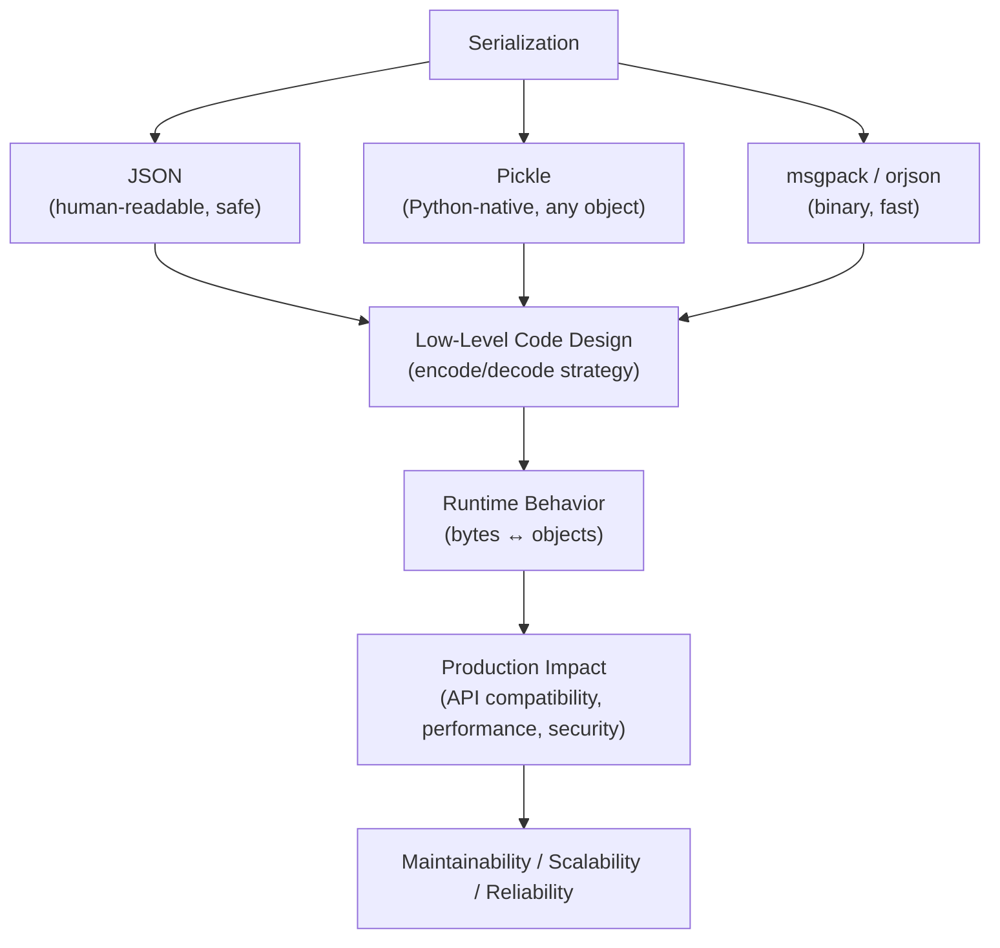
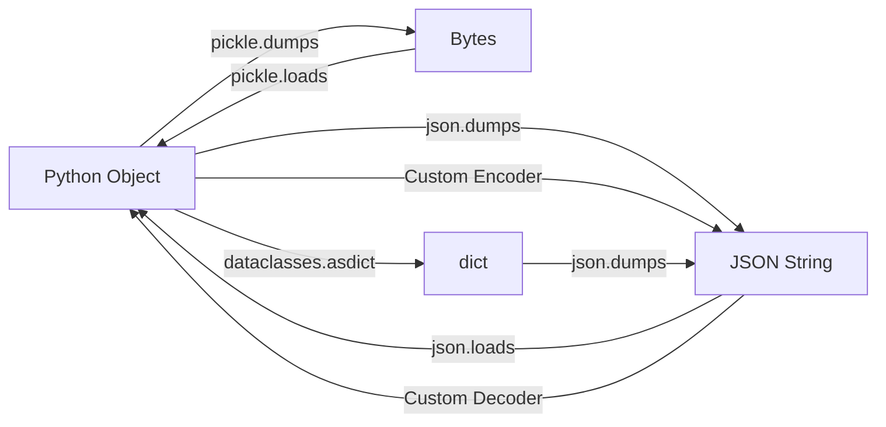

# Serialization (Pickling, JSON) in Python

## Overview

**Serialization** is the process of converting Python objects into a format that can be stored, transmitted, or reconstructed later. Python provides multiple serialization mechanisms: **JSON** (human-readable, language-agnostic), **pickle** (Python-native, supports any object), **msgpack** (binary, fast), and others. Choosing the right serialization format is a critical architectural decision.

> **Core idea:** Serialization converts objects to bytes/strings for storage or transmission. Deserialization reconstructs objects from those bytes/strings. The choice of format determines compatibility, security, performance, and human-readability.

---

## Why It Matters

| JSON | Pickle |
|---|---|
| Human-readable | Binary |
| Language-agnostic | Python-only |
| Limited types (str, int, float, list, dict, bool, None) | Any Python object |
| Safe for untrusted data | NEVER deserialize untrusted pickle |
| Slower for complex objects | Faster for Python objects |
| No functions/classes | Functions, classes, lambdas |

Serialization is used in:
- **REST APIs** — JSON request/response bodies
- **Message queues** — Kafka, RabbitMQ message payloads
- **Caching** — Redis, Memcached stored values
- **ML model persistence** — saving/loading models
- **RAG pipelines** — serializing embeddings, documents
- **Distributed systems** — inter-service communication

---

## Concept Map





---

## Simple Example

```python
import json
import pickle
from datetime import datetime

# --- JSON serialization ---
data = {
    "name": "Alice",
    "age": 30,
    "scores": [95, 87, 92],
    "active": True,
    "address": None,
}

# Serialize to JSON string
json_str = json.dumps(data, indent=2)
print(json_str)

# Deserialize from JSON string
restored = json.loads(json_str)
print(restored["name"])  # Alice

# JSON to/from file
with open("data.json", "w") as f:
    json.dump(data, f, indent=2)

with open("data.json") as f:
    loaded = json.load(f)

# --- Pickle serialization ---
class Point:
    def __init__(self, x, y):
        self.x = x
        self.y = y
    def __repr__(self):
        return f"Point({self.x}, {self.y})"

p = Point(3, 4)

# Serialize to bytes
pickled = pickle.dumps(p)
print(f"Pickled size: {len(pickled)} bytes")

# Deserialize from bytes
restored_p = pickle.loads(pickled)
print(restored_p)  # Point(3, 4)

# Pickle to/from file
with open("point.pkl", "wb") as f:
    pickle.dump(p, f)

with open("point.pkl", "rb") as f:
    loaded_p = pickle.load(f)
print(loaded_p)  # Point(3, 4)

import os
os.unlink("data.json")
os.unlink("point.pkl")
```

**Explanation:**
- `json.dumps()` → string; `json.loads()` → object.
- `json.dump()` → file; `json.load()` → from file.
- `pickle.dumps()` → bytes; `pickle.loads()` → object.
- Pickle preserves the full Python object — including custom classes.

**Expected Output:**
```json
{
  "name": "Alice",
  "age": 30,
  "scores": [95, 87, 92],
  "active": true,
  "address": null
}
```
```
Alice
Pickled size: 64 bytes
Point(3, 4)
Point(3, 4)
```

---

## Intermediate Example

```python
import json
from datetime import datetime, date
from decimal import Decimal
from pathlib import Path
from typing import Any
from dataclasses import dataclass, field, asdict
from enum import Enum


class OrderStatus(Enum):
    PENDING = "pending"
    CONFIRMED = "confirmed"
    SHIPPED = "shipped"


@dataclass
class Address:
    street: str
    city: str
    country: str


@dataclass
class Order:
    order_id: str
    customer: str
    status: OrderStatus
    total: Decimal
    created_at: datetime
    address: Address
    items: list = field(default_factory=list)


# --- Custom JSON encoder ---
class ProductionJSONEncoder(json.JSONEncoder):
    """Handles types not natively supported by JSON."""

    def default(self, obj: Any) -> Any:
        if isinstance(obj, datetime):
            return {"__type__": "datetime", "value": obj.isoformat()}
        if isinstance(obj, date):
            return {"__type__": "date", "value": obj.isoformat()}
        if isinstance(obj, Decimal):
            return {"__type__": "decimal", "value": str(obj)}
        if isinstance(obj, Enum):
            return {"__type__": "enum", "class": obj.__class__.__name__, "value": obj.value}
        if isinstance(obj, Path):
            return {"__type__": "path", "value": str(obj)}
        return super().default(obj)


# --- Custom JSON decoder ---
def production_json_decoder(obj: dict) -> Any:
    """Reconstruct typed objects from JSON."""
    if "__type__" not in obj:
        return obj
    type_name = obj["__type__"]
    if type_name == "datetime":
        return datetime.fromisoformat(obj["value"])
    if type_name == "date":
        return date.fromisoformat(obj["value"])
    if type_name == "decimal":
        return Decimal(obj["value"])
    if type_name == "enum":
        # Note: requires enum class to be in scope
        enum_classes = {"OrderStatus": OrderStatus}
        cls = enum_classes.get(obj["class"])
        return cls(obj["value"]) if cls else obj
    if type_name == "path":
        return Path(obj["value"])
    return obj


# --- Dataclass serialization ---
def serialize_order(order: Order) -> str:
    """Serialize an Order to JSON."""
    d = asdict(order)
    # asdict converts nested dataclasses to dicts but not Enum/Decimal/datetime
    # Use custom encoder for those
    return json.dumps(d, cls=ProductionJSONEncoder, indent=2)


# --- Usage ---
order = Order(
    order_id="ORD-001",
    customer="Alice",
    status=OrderStatus.CONFIRMED,
    total=Decimal("99.99"),
    created_at=datetime(2024, 1, 15, 10, 30),
    address=Address("123 Main St", "Springfield", "US"),
    items=[{"sku": "WIDGET-1", "qty": 2}],
)

json_str = serialize_order(order)
print(json_str)

# Deserialize
data = json.loads(json_str, object_hook=production_json_decoder)
print(f"Total: {data['total']} (type: {type(data['total']).__name__})")
print(f"Created: {data['created_at']} (type: {type(data['created_at']).__name__})")
print(f"Status: {data['status']} (type: {type(data['status']).__name__})")
```

**Explanation:**
- `ProductionJSONEncoder` handles `datetime`, `Decimal`, `Enum`, `Path` — types not natively JSON-serializable.
- `production_json_decoder` reconstructs typed objects from the `__type__` marker.
- `dataclasses.asdict()` converts nested dataclasses to dicts — then the custom encoder handles remaining types.

---

## Advanced / Architect-Level Example

### Problem Context

In a **production RAG pipeline**, documents, embeddings, and agent states must be serialized for caching (Redis), message queues (Kafka), and checkpointing. A unified serialization framework handles multiple formats with versioning, compression, and schema validation.

```python
from __future__ import annotations
import json
import pickle
import gzip
import hashlib
import time
from abc import ABC, abstractmethod
from typing import Any, Dict, Optional, Type, TypeVar
from dataclasses import dataclass, field, asdict
from enum import Enum

T = TypeVar("T")


class SerializationFormat(Enum):
    JSON = "json"
    PICKLE = "pickle"
    JSON_GZIP = "json_gzip"


@dataclass
class SerializedPayload:
    """Envelope for serialized data with metadata."""
    format: str
    version: int
    checksum: str
    data: bytes
    created_at: float = field(default_factory=time.time)
    schema_version: str = "1.0"

    def to_bytes(self) -> bytes:
        """Serialize the envelope itself to bytes."""
        envelope = {
            "format": self.format,
            "version": self.version,
            "checksum": self.checksum,
            "data": self.data.hex(),
            "created_at": self.created_at,
            "schema_version": self.schema_version,
        }
        return json.dumps(envelope).encode()

    @classmethod
    def from_bytes(cls, raw: bytes) -> "SerializedPayload":
        envelope = json.loads(raw)
        return cls(
            format=envelope["format"],
            version=envelope["version"],
            checksum=envelope["checksum"],
            data=bytes.fromhex(envelope["data"]),
            created_at=envelope["created_at"],
            schema_version=envelope["schema_version"],
        )


class Serializer(ABC):
    """Abstract serializer interface."""

    @abstractmethod
    def serialize(self, obj: Any) -> bytes: ...

    @abstractmethod
    def deserialize(self, data: bytes, target_type: Optional[Type] = None) -> Any: ...

    @property
    @abstractmethod
    def format_name(self) -> str: ...


class JSONSerializer(Serializer):
    """JSON serializer with custom type support."""

    def __init__(self, encoder_cls=None, decoder_hook=None):
        self._encoder_cls = encoder_cls
        self._decoder_hook = decoder_hook

    @property
    def format_name(self) -> str:
        return "json"

    def serialize(self, obj: Any) -> bytes:
        if hasattr(obj, "__dataclass_fields__"):
            obj = asdict(obj)
        return json.dumps(obj, cls=self._encoder_cls, default=self._default).encode()

    def deserialize(self, data: bytes, target_type: Optional[Type] = None) -> Any:
        obj = json.loads(data, object_hook=self._decoder_hook)
        if target_type and hasattr(target_type, "__dataclass_fields__"):
            return target_type(**obj)
        return obj

    def _default(self, obj: Any) -> Any:
        if isinstance(obj, Enum):
            return obj.value
        if hasattr(obj, "isoformat"):
            return obj.isoformat()
        raise TypeError(f"Not serializable: {type(obj)}")


class PickleSerializer(Serializer):
    """Pickle serializer — Python-only, supports any object."""

    @property
    def format_name(self) -> str:
        return "pickle"

    def serialize(self, obj: Any) -> bytes:
        return pickle.dumps(obj, protocol=pickle.HIGHEST_PROTOCOL)

    def deserialize(self, data: bytes, target_type: Optional[Type] = None) -> Any:
        return pickle.loads(data)


class GzipJSONSerializer(JSONSerializer):
    """Gzip-compressed JSON — for large payloads."""

    @property
    def format_name(self) -> str:
        return "json_gzip"

    def serialize(self, obj: Any) -> bytes:
        return gzip.compress(super().serialize(obj))

    def deserialize(self, data: bytes, target_type: Optional[Type] = None) -> Any:
        return super().deserialize(gzip.decompress(data), target_type)


class SerializationFramework:
    """
    Unified serialization framework with:
    - Multiple format support
    - Versioning
    - Checksum validation
    - Compression
    """

    def __init__(self):
        self._serializers: Dict[str, Serializer] = {
            "json": JSONSerializer(),
            "pickle": PickleSerializer(),
            "json_gzip": GzipJSONSerializer(),
        }
        self._version = 1

    def serialize(
        self,
        obj: Any,
        format: SerializationFormat = SerializationFormat.JSON,
    ) -> SerializedPayload:
        serializer = self._serializers[format.value]
        data = serializer.serialize(obj)
        checksum = hashlib.sha256(data).hexdigest()[:16]
        return SerializedPayload(
            format=format.value,
            version=self._version,
            checksum=checksum,
            data=data,
        )

    def deserialize(
        self,
        payload: SerializedPayload,
        target_type: Optional[Type] = None,
    ) -> Any:
        # Verify checksum
        actual_checksum = hashlib.sha256(payload.data).hexdigest()[:16]
        if actual_checksum != payload.checksum:
            raise ValueError(f"Checksum mismatch: data may be corrupted")

        serializer = self._serializers.get(payload.format)
        if not serializer:
            raise ValueError(f"Unknown format: {payload.format}")

        return serializer.deserialize(payload.data, target_type)


# --- Usage ---
@dataclass
class Document:
    doc_id: str
    content: str
    embedding: list
    metadata: dict = field(default_factory=dict)


framework = SerializationFramework()

doc = Document(
    doc_id="doc-001",
    content="Python serialization is powerful.",
    embedding=[0.1, 0.2, 0.3, 0.4],
    metadata={"source": "web", "language": "en"},
)

# JSON serialization
payload_json = framework.serialize(doc, SerializationFormat.JSON)
print(f"JSON size: {len(payload_json.data)} bytes, checksum: {payload_json.checksum}")

# Gzip JSON for large embeddings
payload_gz = framework.serialize(doc, SerializationFormat.JSON_GZIP)
print(f"Gzip JSON size: {len(payload_gz.data)} bytes")

# Pickle for complex objects
payload_pkl = framework.serialize(doc, SerializationFormat.PICKLE)
print(f"Pickle size: {len(payload_pkl.data)} bytes")

# Deserialize
restored = framework.deserialize(payload_json, Document)
print(f"Restored: {restored.doc_id}, content: {restored.content[:30]}")

# Envelope round-trip
envelope_bytes = payload_json.to_bytes()
restored_payload = SerializedPayload.from_bytes(envelope_bytes)
restored2 = framework.deserialize(restored_payload, Document)
print(f"Envelope round-trip: {restored2.doc_id}")

# Checksum validation
import copy
corrupted = copy.copy(payload_json)
corrupted.data = b"corrupted data"
try:
    framework.deserialize(corrupted)
except ValueError as e:
    print(f"Corruption detected: {e}")
```

**Explanation:**
- `SerializationFramework` supports multiple formats — JSON, Pickle, Gzip JSON.
- `SerializedPayload` is an envelope with checksum, version, and format metadata.
- Checksum validation detects data corruption.
- `GzipJSONSerializer` compresses large payloads — critical for embeddings.
- The framework is extensible — add new serializers by registering them.

**Design Trade-offs:**

| Format | Pros | Cons |
|---|---|---|
| JSON | Human-readable, language-agnostic, safe | Limited types, verbose |
| Pickle | Any Python object, fast | Python-only, security risk |
| msgpack | Binary, fast, compact | Less readable, external dep |
| Gzip JSON | Compressed, safe | Slower (compression overhead) |
| Protobuf | Schema-enforced, fast, cross-language | Complex setup |

---

## Common Mistakes

### 1. Deserializing Untrusted Pickle Data
```python
# ❌ CRITICAL SECURITY RISK — pickle can execute arbitrary code
data = receive_from_network()
obj = pickle.loads(data)  # Arbitrary code execution!

# ✅ Never unpickle untrusted data — use JSON or signed pickle
import hmac, hashlib
def safe_loads(data: bytes, secret: bytes) -> Any:
    payload, sig = data[:-32], data[-32:]
    expected = hmac.new(secret, payload, hashlib.sha256).digest()
    if not hmac.compare_digest(sig, expected):
        raise ValueError("Invalid signature")
    return pickle.loads(payload)
```

---

### 2. Not Handling Non-JSON-Serializable Types
```python
# ❌ TypeError for datetime, Decimal, Enum
json.dumps({"date": datetime.now()})  # TypeError!

# ✅ Use custom encoder
json.dumps({"date": datetime.now()}, default=str)
# Or use a custom JSONEncoder
```

---

### 3. Using `json.loads` Without Error Handling
```python
# ❌ Crashes on invalid JSON
data = json.loads(user_input)

# ✅ Handle JSONDecodeError
try:
    data = json.loads(user_input)
except json.JSONDecodeError as e:
    print(f"Invalid JSON: {e}")
    data = {}
```

---

### 4. Storing Sensitive Data in Pickle Files
```python
# ❌ Pickle files contain raw Python objects — no encryption
pickle.dump({"password": "secret"}, open("data.pkl", "wb"))

# ✅ Encrypt sensitive data before serializing
import cryptography  # Use Fernet for symmetric encryption
```

---

### 5. Not Versioning Serialized Data
```python
# ❌ Schema changes break deserialization
# Old: {"name": "Alice"}
# New: {"first_name": "Alice", "last_name": "Smith"}
# Old pickled data fails to deserialize with new class!

# ✅ Add version field and migration logic
{"version": 2, "first_name": "Alice", "last_name": "Smith"}
```

---

## Best Practices

1. **Use JSON for APIs and inter-service communication** — language-agnostic, human-readable.
2. **Never deserialize untrusted pickle data** — use JSON or signed/encrypted pickle.
3. **Add version fields** to serialized data — enables schema migration.
4. **Add checksums** for data integrity validation.
5. **Use `orjson` or `ujson`** for high-performance JSON — 5-10x faster than stdlib.
6. **Use `dataclasses.asdict()`** for dataclass serialization — clean, no boilerplate.
7. **Handle `JSONDecodeError`** — always validate input.
8. **Use Gzip compression** for large payloads (embeddings, documents).
9. **Use `pickle.HIGHEST_PROTOCOL`** for best performance and compatibility.
10. **Test round-trips** — serialize then deserialize and verify equality.

---

## Performance Considerations

- **`json.dumps`**: ~1-5 MB/s for complex objects. `orjson` is 5-10x faster.
- **`pickle.dumps`**: Faster than JSON for complex Python objects. `pickle.HIGHEST_PROTOCOL` is fastest.
- **Gzip compression**: Reduces size by 60-80% for text/JSON. Adds ~10-50ms overhead.
- **`msgpack`**: 2-3x faster than JSON, 30-50% smaller. Good for high-throughput systems.
- **`dataclasses.asdict()`**: O(n) where n is the number of fields — negligible.
- **`orjson`**: Handles `datetime`, `numpy` arrays natively — no custom encoder needed.
- For embeddings (float arrays), use `numpy.save()` or `msgpack` — much faster than JSON.

---

## Testing Strategy

```python
# test_serialization.py
import pytest
import json
import pickle
from decimal import Decimal
from datetime import datetime
from your_module import (
    ProductionJSONEncoder, production_json_decoder,
    SerializationFramework, SerializationFormat,
    Document, SerializedPayload, Order, OrderStatus, Address
)


# --- Test JSON encoder/decoder ---
def test_json_encoder_datetime():
    data = {"ts": datetime(2024, 1, 15, 10, 30)}
    encoded = json.dumps(data, cls=ProductionJSONEncoder)
    decoded = json.loads(encoded, object_hook=production_json_decoder)
    assert decoded["ts"] == datetime(2024, 1, 15, 10, 30)

def test_json_encoder_decimal():
    data = {"price": Decimal("99.99")}
    encoded = json.dumps(data, cls=ProductionJSONEncoder)
    decoded = json.loads(encoded, object_hook=production_json_decoder)
    assert decoded["price"] == Decimal("99.99")

def test_json_encoder_enum():
    data = {"status": OrderStatus.CONFIRMED}
    encoded = json.dumps(data, cls=ProductionJSONEncoder)
    decoded = json.loads(encoded, object_hook=production_json_decoder)
    assert decoded["status"] == OrderStatus.CONFIRMED


# --- Test SerializationFramework ---
def test_json_round_trip():
    framework = SerializationFramework()
    doc = Document("d1", "Hello", [0.1, 0.2])
    payload = framework.serialize(doc, SerializationFormat.JSON)
    restored = framework.deserialize(payload, Document)
    assert restored.doc_id == "d1"
    assert restored.content == "Hello"

def test_pickle_round_trip():
    framework = SerializationFramework()
    doc = Document("d1", "Hello", [0.1, 0.2])
    payload = framework.serialize(doc, SerializationFormat.PICKLE)
    restored = framework.deserialize(payload)
    assert restored.doc_id == "d1"

def test_gzip_json_round_trip():
    framework = SerializationFramework()
    doc = Document("d1", "Hello", list(range(1000)))
    payload_json = framework.serialize(doc, SerializationFormat.JSON)
    payload_gz = framework.serialize(doc, SerializationFormat.JSON_GZIP)
    assert len(payload_gz.data) < len(payload_json.data)
    restored = framework.deserialize(payload_gz, Document)
    assert restored.doc_id == "d1"

def test_checksum_validation():
    framework = SerializationFramework()
    doc = Document("d1", "Hello", [])
    payload = framework.serialize(doc, SerializationFormat.JSON)
    import copy
    corrupted = copy.copy(payload)
    corrupted.data = b"corrupted"
    with pytest.raises(ValueError, match="Checksum"):
        framework.deserialize(corrupted)

def test_envelope_round_trip():
    framework = SerializationFramework()
    doc = Document("d1", "Hello", [0.1])
    payload = framework.serialize(doc, SerializationFormat.JSON)
    envelope_bytes = payload.to_bytes()
    restored_payload = SerializedPayload.from_bytes(envelope_bytes)
    restored = framework.deserialize(restored_payload, Document)
    assert restored.doc_id == "d1"


# --- Test pickle security ---
def test_pickle_round_trip_custom_class():
    class MyObj:
        def __init__(self, x): self.x = x
    obj = MyObj(42)
    data = pickle.dumps(obj)
    restored = pickle.loads(data)
    assert restored.x == 42
```

---

## Debugging Tips

1. **`TypeError: Object of type X is not JSON serializable`** — add a custom encoder or use `default=str` for quick debugging.

2. **`JSONDecodeError`** — the input is not valid JSON. Use `json.loads(data)` in a `try/except` and print the raw data.

3. **Pickle `AttributeError` on deserialization** — the class definition has changed since pickling. Add `__getstate__`/`__setstate__` for migration.

4. **Pickle `ModuleNotFoundError`** — the class was moved or renamed. Use `copyreg` to register a compatibility alias.

5. **Gzip decompression error** — data is not gzip-compressed. Check the format field in the envelope.

6. **Checksum mismatch** — data was corrupted in transit or storage. Log the raw bytes for inspection.

7. **`json.dumps` produces `null` for Enum** — Enum values are not JSON-serializable by default. Use `value` attribute or a custom encoder.

---

## Interview Questions

### Beginner

**Q1: What is the difference between `json.dumps` and `json.dump`?**  
A: `json.dumps` serializes to a string. `json.dump` serializes to a file object.

**Q2: What types does JSON natively support?**  
A: `str`, `int`, `float`, `bool`, `None`, `list`, `dict`. Everything else requires a custom encoder.

**Q3: Why is pickle dangerous for untrusted data?**  
A: Pickle can execute arbitrary Python code during deserialization — a malicious pickle payload can run any code on the deserializing machine.

**Q4: What is `pickle.HIGHEST_PROTOCOL`?**  
A: The most efficient pickle protocol available in the current Python version. Use it for best performance and smallest output.

**Q5: How do you serialize a `datetime` object to JSON?**  
A: Use `default=str` for quick serialization, or a custom `JSONEncoder` that calls `obj.isoformat()`.

---

### Intermediate

**Q6: How do you implement a custom JSON encoder?**  
A: Subclass `json.JSONEncoder` and override `default(self, obj)`. Return a JSON-serializable representation for custom types; call `super().default(obj)` for unknown types.

**Q7: What is `object_hook` in `json.loads`?**  
A: A callable called for every JSON object (dict). Used to reconstruct custom types from JSON dicts. Return the reconstructed object or the dict unchanged.

**Q8: How do you serialize a dataclass to JSON?**  
A: Use `dataclasses.asdict()` to convert to a dict, then `json.dumps()`. For nested types (Enum, datetime), use a custom encoder.

**Q9: What is the difference between `pickle` and `shelve`?**  
A: `pickle` serializes to bytes. `shelve` is a persistent dict-like object backed by a file — it uses pickle internally for values.

**Q10: How do you add versioning to serialized data?**  
A: Include a `version` field in the serialized dict. On deserialization, check the version and apply migration logic for older versions.

---

### Advanced / Architect-Level

**Q11: How would you design a serialization framework for a production RAG pipeline?**  
A: Support multiple formats (JSON, Pickle, Gzip JSON). Add envelope with version, checksum, and format. Use `orjson` for performance. Add compression for large embeddings. Implement schema versioning and migration. Sign pickle payloads for security.

**Q12: How do you handle pickle compatibility across Python versions?**  
A: Use `pickle.HIGHEST_PROTOCOL` for writing. For reading, use `encoding="latin1"` for Python 2 pickles. Add `__reduce__` or `__getstate__`/`__setstate__` for custom migration logic.

**Q13: What is `orjson` and when would you use it?**  
A: A fast JSON library (5-10x faster than stdlib) that natively handles `datetime`, `numpy` arrays, `UUID`, and `dataclasses`. Use for high-throughput APIs and data pipelines.

**Q14: How would you implement secure pickle serialization for a distributed system?**  
A: Sign pickle payloads with HMAC-SHA256 using a shared secret. Verify the signature before deserializing. Use a key rotation mechanism. Consider using JSON or msgpack instead of pickle for cross-service communication.

**Q15: How does Python's `__reduce__` method affect pickling?**  
A: `__reduce__` returns a tuple `(callable, args)` that pickle uses to reconstruct the object. Override it to control how the object is pickled — useful for objects with non-picklable attributes (file handles, sockets).

---

## Key Takeaways

- JSON is human-readable, language-agnostic, and safe — use for APIs and inter-service communication.
- Pickle supports any Python object but is Python-only and dangerous for untrusted data.
- Never deserialize untrusted pickle data — use JSON or signed/encrypted pickle.
- Use custom `JSONEncoder` and `object_hook` for non-standard types.
- Add version fields and checksums to serialized data — enables migration and integrity validation.
- Use `orjson` for high-performance JSON serialization.
- Use Gzip compression for large payloads (embeddings, documents).
- Use `dataclasses.asdict()` for clean dataclass serialization.
- Test round-trips — serialize then deserialize and verify equality.
- Mastering serialization is essential for building APIs, caching systems, message queues, and distributed AI pipelines.

---

## Mini Project Idea

### Goal
Build a **Universal Serialization Framework** — a production-grade serialization library that supports JSON, Pickle, and msgpack with versioning, compression, checksums, and schema migration.

### Features
- `Serializer` ABC with `serialize()` and `deserialize()`.
- `JSONSerializer`, `PickleSerializer`, `MsgpackSerializer`, `GzipJSONSerializer`.
- `SerializedPayload` envelope with version, checksum, format, and schema version.
- Schema migration: `migrate(payload, target_version)`.
- `SerializationRegistry` for format selection by type.
- CLI: `python serialize.py --input data.py --format json_gzip --output data.bin`.

### Suggested Folder Structure
```
serialization_framework/
├── serializers/
│   ├── __init__.py
│   ├── base.py
│   ├── json_serializer.py
│   ├── pickle_serializer.py
│   └── gzip_json.py
├── envelope/
│   ├── __init__.py
│   └── payload.py
├── migration/
│   └── migrator.py
├── tests/
│   ├── test_serializers.py
│   └── test_migration.py
├── cli.py
└── README.md
```

### Extension Ideas
- Add Protobuf support for cross-language serialization.
- Add Redis-backed caching with automatic serialization.
- Add schema validation with Pydantic.
- Benchmark all formats for throughput and size.

---

## Final Summary

Mastering serialization is mastering Python's data persistence and communication model. JSON and pickle are the two most important serialization mechanisms — JSON for safe, language-agnostic communication; pickle for Python-native object persistence. For a Python architect, the key decisions are: choosing the right format for each use case, implementing custom encoders for non-standard types, adding versioning and checksums for production reliability, and understanding the security implications of pickle. These skills are essential for building APIs, caching systems, message queues, ML model persistence, and distributed RAG pipelines that are safe, fast, and maintainable.
