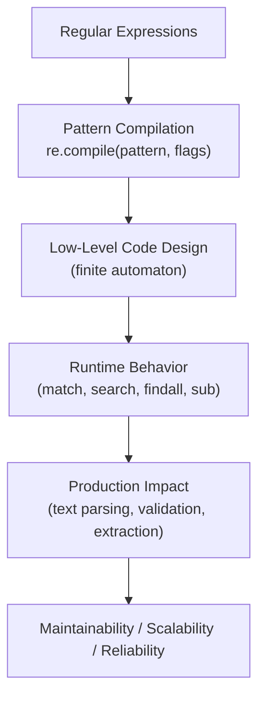
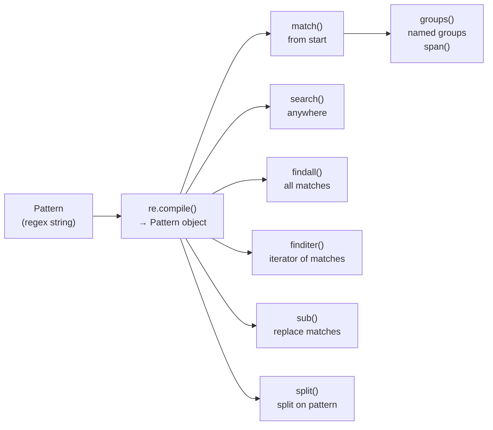

# Regular Expressions in Python

## Overview

**Regular Expressions** (regex) are a powerful pattern-matching language for searching, extracting, and transforming text. Python's `re` module provides full regex support, while the third-party `regex` library adds Unicode and advanced features. Regex is essential for parsing logs, validating input, extracting structured data from unstructured text, and processing LLM outputs.

> **Core idea:** A regular expression is a pattern that describes a set of strings. Python's `re` module compiles patterns to finite automata and matches them against text — enabling complex text operations in a single, concise expression.

---

## Why It Matters

| String Methods | Regular Expressions |
|---|---|
| Simple, readable | Powerful, concise |
| Fixed patterns only | Flexible patterns |
| No capture groups | Named capture groups |
| No alternation | Alternation (`a|b`) |
| No quantifiers | Quantifiers (`*`, `+`, `?`, `{n,m}`) |

Regular expressions are used in:
- **Log parsing** — extract timestamps, levels, messages
- **Input validation** — email, phone, URL, IP address
- **LLM output parsing** — extract structured data from model responses
- **Data cleaning** — normalize text, remove noise
- **URL routing** — Django, Flask URL patterns
- **Code analysis** — find patterns in source code

---

## Concept Map





---

## Simple Example

```python
import re

text = "Contact us at support@example.com or sales@company.org"

# --- Basic matching ---
# re.search() — find first match anywhere in string
match = re.search(r"\w+@\w+\.\w+", text)
if match:
    print(f"Found: {match.group()}")  # support@example.com
    print(f"Span: {match.span()}")    # (14, 34)

# re.findall() — find all matches
emails = re.findall(r"\w+@\w+\.\w+", text)
print(f"All emails: {emails}")  # ['support@example.com', 'sales@company.org']

# re.sub() — replace matches
masked = re.sub(r"\w+@\w+\.\w+", "[REDACTED]", text)
print(masked)  # Contact us at [REDACTED] or [REDACTED]

# --- Capture groups ---
log_line = "2024-01-15 10:30:45 ERROR Database connection failed"
pattern = r"(\d{4}-\d{2}-\d{2}) (\d{2}:\d{2}:\d{2}) (\w+) (.+)"
match = re.match(pattern, log_line)
if match:
    date, time, level, message = match.groups()
    print(f"Date: {date}, Level: {level}, Message: {message}")

# --- Named groups ---
pattern = r"(?P<date>\d{4}-\d{2}-\d{2}) (?P<time>\d{2}:\d{2}:\d{2}) (?P<level>\w+) (?P<message>.+)"
match = re.match(pattern, log_line)
if match:
    print(match.groupdict())

# --- Compiled pattern (reuse for performance) ---
email_pattern = re.compile(r"[a-zA-Z0-9._%+-]+@[a-zA-Z0-9.-]+\.[a-zA-Z]{2,}")
print(email_pattern.findall(text))
```

**Explanation:**
- `re.search()` finds the first match anywhere in the string.
- `re.findall()` returns all non-overlapping matches as a list.
- `re.sub()` replaces all matches with a replacement string.
- Capture groups `()` extract parts of the match.
- Named groups `(?P<name>...)` make groups accessible by name.
- `re.compile()` pre-compiles the pattern — reuse for performance.

**Expected Output:**
```
Found: support@example.com
Span: (14, 34)
All emails: ['support@example.com', 'sales@company.org']
Contact us at [REDACTED] or [REDACTED]
Date: 2024-01-15, Level: ERROR, Message: Database connection failed
{'date': '2024-01-15', 'time': '10:30:45', 'level': 'ERROR', 'message': 'Database connection failed'}
['support@example.com', 'sales@company.org']
```

---

## Intermediate Example

```python
import re
from typing import List, Dict, Optional, Iterator
from dataclasses import dataclass


@dataclass
class LogEntry:
    timestamp: str
    level: str
    service: str
    message: str
    trace_id: Optional[str] = None
    duration_ms: Optional[float] = None


class LogParser:
    """
    Production log parser using compiled regex patterns.
    Handles multiple log formats with named groups.
    """

    # Compiled patterns for performance
    LOG_PATTERN = re.compile(
        r"(?P<timestamp>\d{4}-\d{2}-\d{2}T\d{2}:\d{2}:\d{2}(?:\.\d+)?Z?)"
        r"\s+(?P<level>DEBUG|INFO|WARNING|ERROR|CRITICAL)"
        r"\s+\[(?P<service>[^\]]+)\]"
        r"(?:\s+trace_id=(?P<trace_id>[a-f0-9-]+))?"
        r"(?:\s+duration=(?P<duration>\d+(?:\.\d+)?)ms)?"
        r"\s+(?P<message>.+)"
    )

    IP_PATTERN = re.compile(
        r"\b(?:(?:25[0-5]|2[0-4][0-9]|[01]?[0-9][0-9]?)\.){3}"
        r"(?:25[0-5]|2[0-4][0-9]|[01]?[0-9][0-9]?)\b"
    )

    URL_PATTERN = re.compile(
        r"https?://(?:[-\w.]|(?:%[\da-fA-F]{2}))+"
        r"(?:/[-\w%@!$&'()*+,;=:/?#.~]*)*"
    )

    SENSITIVE_PATTERN = re.compile(
        r"(?:password|token|secret|key|api_key)\s*[=:]\s*\S+",
        re.IGNORECASE,
    )

    def parse_line(self, line: str) -> Optional[LogEntry]:
        """Parse a single log line into a LogEntry."""
        match = self.LOG_PATTERN.match(line.strip())
        if not match:
            return None

        groups = match.groupdict()
        return LogEntry(
            timestamp=groups["timestamp"],
            level=groups["level"],
            service=groups["service"],
            message=groups["message"],
            trace_id=groups.get("trace_id"),
            duration_ms=float(groups["duration"]) if groups.get("duration") else None,
        )

    def parse_file(self, lines: List[str]) -> Iterator[LogEntry]:
        """Parse multiple log lines, yielding valid entries."""
        for line in lines:
            entry = self.parse_line(line)
            if entry:
                yield entry

    def extract_ips(self, text: str) -> List[str]:
        return self.IP_PATTERN.findall(text)

    def extract_urls(self, text: str) -> List[str]:
        return self.URL_PATTERN.findall(text)

    def redact_sensitive(self, text: str) -> str:
        """Redact sensitive values from log lines."""
        return self.SENSITIVE_PATTERN.sub(
            lambda m: m.group().split("=")[0] + "=[REDACTED]"
            if "=" in m.group()
            else m.group().split(":")[0] + ":[REDACTED]",
            text,
        )

    def filter_by_level(self, entries: Iterator[LogEntry], level: str) -> List[LogEntry]:
        return [e for e in entries if e.level == level]


# --- Usage ---
parser = LogParser()

log_lines = [
    "2024-01-15T10:30:45.123Z INFO [api-gateway] trace_id=abc123 duration=45.2ms Request received",
    "2024-01-15T10:30:45.456Z ERROR [database] Connection timeout after 5000ms",
    "2024-01-15T10:30:46.000Z WARNING [auth-service] trace_id=def456 Token expiring soon",
    "Invalid log line — should be skipped",
    "2024-01-15T10:30:47.000Z DEBUG [cache] Cache miss for key user:123",
]

entries = list(parser.parse_file(log_lines))
print(f"Parsed {len(entries)} entries (skipped 1 invalid)")

for entry in entries:
    print(f"[{entry.level}] {entry.service}: {entry.message[:50]}")

# Extract IPs from text
text = "Requests from 192.168.1.1 and 10.0.0.1 were blocked"
print(f"IPs: {parser.extract_ips(text)}")

# Redact sensitive data
sensitive = "User login with password=secret123 and api_key=abc-def-ghi"
print(f"Redacted: {parser.redact_sensitive(sensitive)}")
```

**Explanation:**
- Compiled patterns are reused — significant performance improvement for repeated parsing.
- Named groups make the code self-documenting.
- `(?:...)` non-capturing groups for grouping without capturing.
- `(?P<name>...)?` optional named groups.
- `re.IGNORECASE` flag for case-insensitive matching.

---

## Advanced / Architect-Level Example

### Problem Context

In a **production LLM output parser**, model responses contain structured data embedded in natural language — JSON blocks, code snippets, citations, and tool calls. A regex-based extraction framework parses these reliably.

```python
from __future__ import annotations
import re
import json
from typing import Any, Dict, List, Optional, Tuple
from dataclasses import dataclass, field


@dataclass
class ExtractedBlock:
    block_type: str
    content: str
    language: Optional[str] = None
    metadata: Dict[str, Any] = field(default_factory=dict)


class LLMOutputParser:
    """
    Production parser for LLM-generated text.
    Extracts: JSON blocks, code blocks, citations, tool calls, structured data.
    """

    # Code blocks: ```language\ncode\n```
    CODE_BLOCK = re.compile(
        r"```(?P<language>\w+)?\n(?P<code>.*?)```",
        re.DOTALL,
    )

    # Inline JSON: {...} or [...]
    JSON_BLOCK = re.compile(
        r"(?P<json>\{[^{}]*(?:\{[^{}]*\}[^{}]*)*\}|\[[^\[\]]*(?:\[[^\[\]]*\][^\[\]]*)*\])",
        re.DOTALL,
    )

    # Citations: [1], [2], [Author, 2024]
    CITATION = re.compile(r"\[(?P<ref>\d+|[A-Z][a-z]+(?:\s+et\s+al\.)?(?:,\s*\d{4})?)\]")

    # Tool calls: <tool_call>{"name": "...", "args": {...}}</tool_call>
    TOOL_CALL = re.compile(
        r"<tool_call>\s*(?P<payload>\{.*?\})\s*</tool_call>",
        re.DOTALL,
    )

    # Key-value pairs: Key: Value or **Key**: Value
    KEY_VALUE = re.compile(
        r"(?:\*\*)?(?P<key>[A-Z][a-zA-Z\s]+?)(?:\*\*)?\s*:\s*(?P<value>[^\n]+)",
    )

    # URLs
    URL = re.compile(
        r"https?://(?:[-\w.]|(?:%[\da-fA-F]{2}))+(?:/[-\w%@!$&'()*+,;=:/?#.~]*)*"
    )

    # Markdown headers
    HEADER = re.compile(r"^(?P<level>#{1,6})\s+(?P<title>.+)$", re.MULTILINE)

    def extract_code_blocks(self, text: str) -> List[ExtractedBlock]:
        """Extract all code blocks from LLM output."""
        blocks = []
        for match in self.CODE_BLOCK.finditer(text):
            blocks.append(ExtractedBlock(
                block_type="code",
                content=match.group("code").strip(),
                language=match.group("language"),
            ))
        return blocks

    def extract_json_blocks(self, text: str) -> List[Dict]:
        """Extract and parse all JSON objects/arrays from text."""
        results = []
        for match in self.JSON_BLOCK.finditer(text):
            try:
                parsed = json.loads(match.group("json"))
                results.append(parsed)
            except json.JSONDecodeError:
                pass  # Skip malformed JSON
        return results

    def extract_tool_calls(self, text: str) -> List[Dict]:
        """Extract tool calls from agent responses."""
        calls = []
        for match in self.TOOL_CALL.finditer(text):
            try:
                payload = json.loads(match.group("payload"))
                calls.append(payload)
            except json.JSONDecodeError:
                pass
        return calls

    def extract_citations(self, text: str) -> List[str]:
        """Extract all citation references."""
        return [m.group("ref") for m in self.CITATION.finditer(text)]

    def extract_key_values(self, text: str) -> Dict[str, str]:
        """Extract key-value pairs from structured text."""
        return {
            m.group("key").strip(): m.group("value").strip()
            for m in self.KEY_VALUE.finditer(text)
        }

    def extract_structure(self, text: str) -> Dict[str, Any]:
        """Full structural extraction from LLM output."""
        return {
            "code_blocks": self.extract_code_blocks(text),
            "json_blocks": self.extract_json_blocks(text),
            "tool_calls": self.extract_tool_calls(text),
            "citations": self.extract_citations(text),
            "key_values": self.extract_key_values(text),
            "urls": self.URL.findall(text),
            "headers": [
                {"level": len(m.group("level")), "title": m.group("title")}
                for m in self.HEADER.finditer(text)
            ],
        }

    def clean_for_display(self, text: str) -> str:
        """Remove code blocks and tool calls for clean display."""
        text = self.CODE_BLOCK.sub("[code block]", text)
        text = self.TOOL_CALL.sub("[tool call]", text)
        text = re.sub(r"\n{3,}", "\n\n", text)  # Collapse multiple blank lines
        return text.strip()


# --- Usage ---
parser = LLMOutputParser()

llm_response = """
# Analysis Results

Based on my research [1][2], here is the solution:

**Status**: Completed
**Confidence**: High
**Model**: GPT-4o

The implementation uses the following approach:

```python
def fibonacci(n: int) -> int:
    if n <= 1:
        return n
    return fibonacci(n-1) + fibonacci(n-2)
```

The configuration is:
```json
{"model": "gpt-4o", "temperature": 0.7, "max_tokens": 1000}
```

<tool_call>{"name": "web_search", "args": {"query": "Python fibonacci"}}</tool_call>

For more details, see https://docs.python.org/3/

References:
[1] Smith et al., 2024
[2] Jones, 2023
"""

structure = parser.extract_structure(llm_response)

print(f"Code blocks: {len(structure['code_blocks'])}")
for block in structure['code_blocks']:
    print(f"  [{block.language}]: {block.content[:40]}...")

print(f"\nJSON blocks: {structure['json_blocks']}")
print(f"Tool calls: {structure['tool_calls']}")
print(f"Citations: {structure['citations']}")
print(f"Key-values: {structure['key_values']}")
print(f"URLs: {structure['urls']}")
print(f"Headers: {structure['headers']}")

print(f"\nCleaned:\n{parser.clean_for_display(llm_response)[:200]}")
```

**Explanation:**
- `re.DOTALL` makes `.` match newlines — essential for multi-line code blocks.
- `re.MULTILINE` makes `^` and `$` match line boundaries — for header extraction.
- Non-greedy `.*?` prevents over-matching in nested structures.
- Compiled patterns are class-level — shared across all instances.
- `finditer()` returns an iterator — memory-efficient for large texts.

**Design Trade-offs:**

| Approach | Pros | Cons |
|---|---|---|
| Regex | Fast, concise, no dependencies | Hard to read, fragile for complex structures |
| Parser (pyparsing) | Readable, robust | Slower, more code |
| LLM-based extraction | Flexible, handles edge cases | Expensive, non-deterministic |
| JSON schema validation | Strict, reliable | Requires well-formed JSON |

---

## Common Mistakes

### 1. Not Compiling Patterns Used in Loops
```python
# ❌ Recompiles on every iteration — slow
for line in lines:
    match = re.search(r"\d+", line)

# ✅ Compile once
pattern = re.compile(r"\d+")
for line in lines:
    match = pattern.search(line)
```

---

### 2. Using `re.match` When `re.search` Is Needed
```python
# ❌ re.match only matches at the START of the string
re.match(r"\d+", "abc 123")  # None — no match at start

# ✅ re.search matches anywhere
re.search(r"\d+", "abc 123")  # Match: '123'
```

---

### 3. Catastrophic Backtracking
```python
# ❌ Exponential backtracking on long strings
re.match(r"(a+)+b", "a" * 30 + "c")  # Hangs!

# ✅ Use atomic groups or possessive quantifiers (regex library)
# Or rewrite to avoid nested quantifiers
re.match(r"a+b", "a" * 30 + "c")  # Fast
```

---

### 4. Not Using Raw Strings
```python
# ❌ Backslash confusion
re.search("\d+", text)   # \d is not a valid escape — works by accident
re.search("\n+", text)   # \n is a newline — probably intended

# ✅ Always use raw strings for regex
re.search(r"\d+", text)  # Explicit: \d is regex digit
re.search(r"\n+", text)  # Explicit: \n is newline
```

---

### 5. Greedy vs. Non-Greedy Matching
```python
# ❌ Greedy — matches too much
re.search(r"<.*>", "<b>bold</b>").group()  # '<b>bold</b>'

# ✅ Non-greedy — matches as little as possible
re.search(r"<.*?>", "<b>bold</b>").group()  # '<b>'
```

---

## Best Practices

1. **Always use raw strings** `r"..."` for regex patterns.
2. **Compile patterns** used in loops or called frequently.
3. **Use named groups** `(?P<name>...)` for readability.
4. **Use non-greedy quantifiers** `*?`, `+?` for HTML/XML parsing.
5. **Use `re.VERBOSE`** for complex patterns — add whitespace and comments.
6. **Test with `re.fullmatch`** for complete string validation.
7. **Use `re.IGNORECASE`** for case-insensitive matching.
8. **Avoid catastrophic backtracking** — don't nest quantifiers.
9. **Use `re.finditer()`** instead of `re.findall()` for large texts — memory-efficient.
10. **Document complex patterns** — add comments explaining each part.

---

## Performance Considerations

- **Compiled patterns**: `re.compile()` is ~10x faster for repeated use — always compile in loops.
- **`re.findall` vs `re.finditer`**: `findall` returns a list (O(n) memory); `finditer` returns an iterator (O(1) memory). Use `finditer` for large texts.
- **Catastrophic backtracking**: Nested quantifiers like `(a+)+` can cause exponential time. Test with long inputs.
- **`re.DOTALL`**: Slightly slower than without — only use when needed.
- **`re.fullmatch`**: Faster than `re.match(r"pattern$", ...)` — use for validation.
- **`regex` library**: Supports atomic groups and possessive quantifiers — prevents catastrophic backtracking.
- For very high-throughput text processing, consider `re2` (Google's regex engine) via `google-re2` — linear time guarantee.

---

## Testing Strategy

```python
# test_regex.py
import re
import pytest
from your_module import LogParser, LLMOutputParser, LogEntry


# --- Test LogParser ---
def test_parse_valid_log_line():
    parser = LogParser()
    line = "2024-01-15T10:30:45.123Z INFO [api-gateway] trace_id=abc123 duration=45.2ms Request received"
    entry = parser.parse_line(line)
    assert entry is not None
    assert entry.level == "INFO"
    assert entry.service == "api-gateway"
    assert entry.trace_id == "abc123"
    assert entry.duration_ms == 45.2

def test_parse_invalid_log_line():
    parser = LogParser()
    assert parser.parse_line("not a log line") is None

def test_extract_ips():
    parser = LogParser()
    text = "Requests from 192.168.1.1 and 10.0.0.1"
    ips = parser.extract_ips(text)
    assert "192.168.1.1" in ips
    assert "10.0.0.1" in ips

def test_redact_sensitive():
    parser = LogParser()
    text = "Login with password=secret123"
    redacted = parser.redact_sensitive(text)
    assert "secret123" not in redacted
    assert "[REDACTED]" in redacted


# --- Test LLMOutputParser ---
def test_extract_code_blocks():
    parser = LLMOutputParser()
    text = "Here is code:\n```python\nprint('hello')\n```"
    blocks = parser.extract_code_blocks(text)
    assert len(blocks) == 1
    assert blocks[0].language == "python"
    assert "print" in blocks[0].content

def test_extract_json_blocks():
    parser = LLMOutputParser()
    text = 'Config: {"key": "value", "num": 42}'
    blocks = parser.extract_json_blocks(text)
    assert len(blocks) == 1
    assert blocks[0]["key"] == "value"

def test_extract_citations():
    parser = LLMOutputParser()
    text = "According to [1] and [Smith, 2024], the result is..."
    citations = parser.extract_citations(text)
    assert "1" in citations
    assert "Smith, 2024" in citations

def test_extract_tool_calls():
    parser = LLMOutputParser()
    text = '<tool_call>{"name": "search", "args": {"q": "test"}}</tool_call>'
    calls = parser.extract_tool_calls(text)
    assert len(calls) == 1
    assert calls[0]["name"] == "search"


# --- Test regex patterns directly ---
@pytest.mark.parametrize("email,valid", [
    ("user@example.com", True),
    ("user.name+tag@domain.co.uk", True),
    ("invalid-email", False),
    ("@domain.com", False),
    ("user@", False),
])
def test_email_validation(email, valid):
    pattern = re.compile(r"^[a-zA-Z0-9._%+-]+@[a-zA-Z0-9.-]+\.[a-zA-Z]{2,}$")
    assert bool(pattern.fullmatch(email)) == valid


@pytest.mark.parametrize("ip,valid", [
    ("192.168.1.1", True),
    ("255.255.255.255", True),
    ("256.0.0.1", False),
    ("192.168.1", False),
])
def test_ip_validation(ip, valid):
    pattern = re.compile(
        r"^(?:(?:25[0-5]|2[0-4][0-9]|[01]?[0-9][0-9]?)\.){3}"
        r"(?:25[0-5]|2[0-4][0-9]|[01]?[0-9][0-9]?)$"
    )
    assert bool(pattern.fullmatch(ip)) == valid
```

---

## Debugging Tips

1. **Use `re.DEBUG` flag** to see the compiled pattern structure:
   ```python
   re.compile(r"\d+", re.DEBUG)
   ```

2. **Use regex101.com** — interactive regex tester with explanation and match highlighting.

3. **`re.match` returns `None`** — check if you need `re.search` (matches anywhere) vs `re.match` (matches at start).

4. **Pattern matches too much** — use non-greedy `*?` or `+?` instead of `*` or `+`.

5. **Pattern hangs** — catastrophic backtracking. Simplify nested quantifiers or use the `regex` library with atomic groups.

6. **`re.DOTALL` not set** — `.` doesn't match newlines by default. Add `re.DOTALL` for multi-line content.

7. **Named group not found** — use `match.groupdict()` to see all named groups and their values.

8. **`re.sub` with backreferences** — use `\1` or `\g<name>` in the replacement string:
   ```python
   re.sub(r"(\w+)@(\w+)", r"\2@\1", "user@domain")  # "domain@user"
   ```

---

## Interview Questions

### Beginner

**Q1: What is the difference between `re.match` and `re.search`?**  
A: `re.match` only matches at the beginning of the string. `re.search` scans the entire string for a match.

**Q2: What is a capture group in regex?**  
A: Parentheses `()` create a capture group — the matched text is accessible via `match.group(n)` or `match.groups()`.

**Q3: What is the difference between `*` and `+` quantifiers?**  
A: `*` matches zero or more occurrences. `+` matches one or more occurrences.

**Q4: Why should you use raw strings for regex patterns?**  
A: Raw strings `r"..."` prevent Python from interpreting backslashes — `\d` stays as `\d` (regex digit) instead of being interpreted as an escape sequence.

**Q5: What does `re.findall` return?**  
A: A list of all non-overlapping matches. If the pattern has groups, returns a list of tuples of groups.

---

### Intermediate

**Q6: What is a non-capturing group?**  
A: `(?:...)` groups without capturing — useful for grouping without adding to `match.groups()`.

**Q7: What is the difference between greedy and non-greedy quantifiers?**  
A: Greedy (`*`, `+`) match as much as possible. Non-greedy (`*?`, `+?`) match as little as possible. Use non-greedy for HTML/XML parsing.

**Q8: What is `re.VERBOSE` used for?**  
A: Allows whitespace and comments in patterns for readability:
```python
pattern = re.compile(r"""
    (\d{4})  # year
    -(\d{2}) # month
    -(\d{2}) # day
""", re.VERBOSE)
```

**Q9: What is a lookahead and lookbehind?**  
A: `(?=...)` positive lookahead — matches if followed by pattern. `(?<=...)` positive lookbehind — matches if preceded by pattern. They don't consume characters.

**Q10: How do you match a literal dot in regex?**  
A: Escape it: `\.`. Without escaping, `.` matches any character except newline.

---

### Advanced / Architect-Level

**Q11: How would you implement a production LLM output parser using regex?**  
A: Compile patterns for code blocks, JSON blocks, tool calls, citations, and key-value pairs. Use named groups for readability. Use `re.DOTALL` for multi-line blocks. Use `finditer()` for memory efficiency. Handle malformed JSON with `try/except`.

**Q12: What is catastrophic backtracking and how do you prevent it?**  
A: Exponential time complexity caused by nested quantifiers like `(a+)+`. Prevent by: avoiding nested quantifiers, using atomic groups (via `regex` library), or using `re2` for linear-time guarantees.

**Q13: How would you use regex for log parsing in a high-throughput system?**  
A: Compile patterns once at startup. Use `finditer()` for memory efficiency. Use named groups for self-documenting code. Consider `re2` for linear-time guarantees. For very high throughput, use `hyperscan` (Intel's regex engine).

**Q14: How do you handle Unicode in Python regex?**  
A: Python 3 regex handles Unicode by default. Use `re.UNICODE` flag (default). Use `\w` for Unicode word characters. Use the `regex` library for full Unicode property support (`\p{L}` for letters).

**Q15: What is the difference between `re.fullmatch` and `re.match(r"pattern$")`?**  
A: `re.fullmatch` requires the entire string to match. `re.match(r"pattern$")` matches from the start and requires `$` at the end — but `$` matches before a trailing newline. `re.fullmatch` is more reliable for validation.

---

## Key Takeaways

- Always use raw strings `r"..."` for regex patterns.
- Compile patterns with `re.compile()` for repeated use — significant performance improvement.
- `re.match` matches at start; `re.search` matches anywhere; `re.fullmatch` matches entire string.
- Named groups `(?P<name>...)` make patterns self-documenting.
- Non-greedy quantifiers `*?`, `+?` prevent over-matching.
- `re.DOTALL` makes `.` match newlines — essential for multi-line patterns.
- `re.finditer()` is memory-efficient for large texts.
- Avoid nested quantifiers — catastrophic backtracking risk.
- Use `re.VERBOSE` for complex patterns — add whitespace and comments.
- Mastering regex is essential for log parsing, input validation, LLM output parsing, and data extraction.

---

## Mini Project Idea

### Goal
Build a **LLM Output Extraction Framework** — a regex-based parser that extracts structured data from LLM responses: code blocks, JSON, tool calls, citations, and key-value pairs.

### Features
- `CodeBlockExtractor` — extracts code blocks with language detection.
- `JSONExtractor` — extracts and validates JSON objects/arrays.
- `ToolCallExtractor` — extracts agent tool calls.
- `CitationExtractor` — extracts academic and numeric citations.
- `StructuredDataExtractor` — extracts key-value pairs.
- `OutputCleaner` — removes extracted blocks for clean display.
- CLI: `python extract.py --input response.txt --format json`.

### Suggested Folder Structure
```
llm_parser/
├── extractors/
│   ├── __init__.py
│   ├── code_blocks.py
│   ├── json_blocks.py
│   ├── tool_calls.py
│   ├── citations.py
│   └── key_values.py
├── parser/
│   ├── __init__.py
│   └── llm_output_parser.py
├── tests/
│   ├── test_extractors.py
│   └── test_parser.py
├── cli.py
└── README.md
```

### Extension Ideas
- Add support for Markdown tables.
- Add support for LaTeX math expressions.
- Add confidence scoring for extracted data.
- Benchmark regex vs. LLM-based extraction.

---

## Final Summary

Mastering regular expressions is mastering Python's most powerful text processing tool. Regex is essential for log parsing, input validation, LLM output extraction, and data cleaning — tasks that appear in every production Python system. For a Python architect, the key skills are: compiling patterns for performance, using named groups for readability, avoiding catastrophic backtracking, and knowing when regex is the right tool versus a proper parser. In AI systems, regex is the first line of defense for extracting structured data from LLM outputs — fast, deterministic, and zero-cost. Understanding regex deeply — including lookaheads, non-greedy matching, and Unicode support — is a hallmark of production-grade Python expertise.
