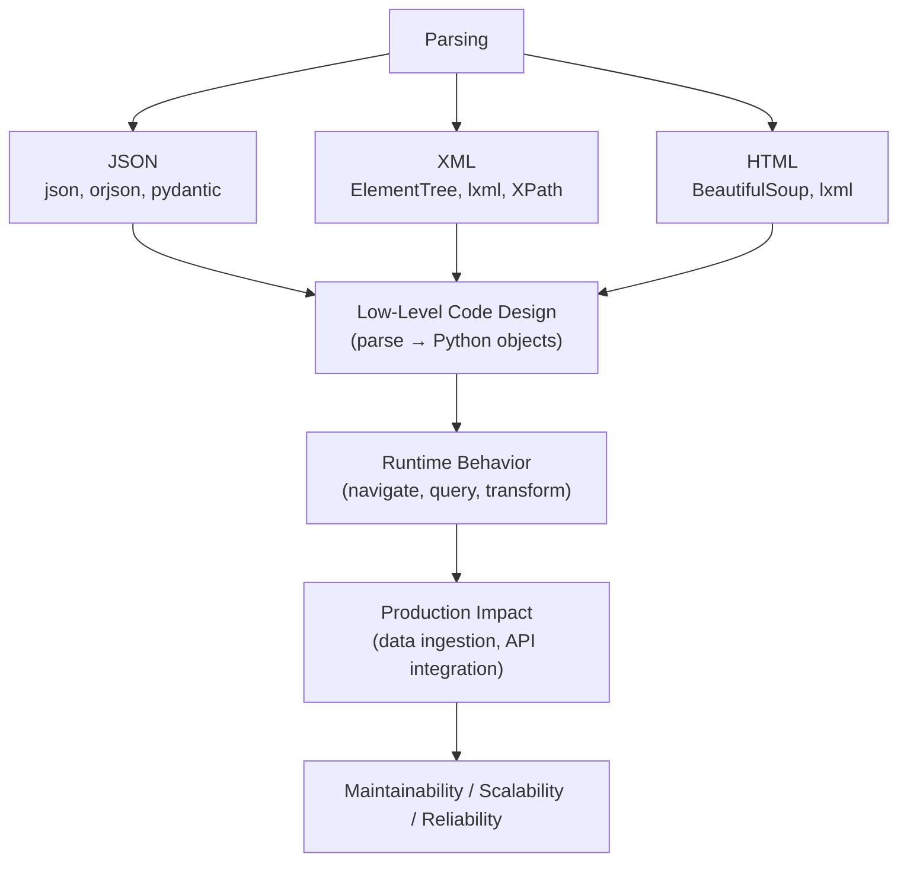
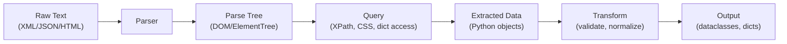

# Parsing (XML, JSON, HTML) in Python

## Overview

**Parsing** is the process of analyzing structured text (XML, JSON, HTML) and converting it into Python data structures that can be queried, transformed, and processed. Python provides built-in parsers for JSON and XML, and the third-party `BeautifulSoup` and `lxml` libraries for HTML/XML. Parsing is fundamental to data ingestion, web scraping, API integration, and document processing in AI pipelines.

> **Core idea:** Parsing transforms raw text in a structured format (XML, JSON, HTML) into Python objects (dicts, lists, trees) that can be navigated, queried, and transformed programmatically.

---

## Why It Matters

| Format | Use Case | Python Library |
|---|---|---|
| JSON | REST APIs, config files, data exchange | `json`, `orjson`, `pydantic` |
| XML | Enterprise systems, SOAP, RSS, SVG | `xml.etree.ElementTree`, `lxml` |
| HTML | Web scraping, document processing | `BeautifulSoup`, `lxml`, `html.parser` |

Parsing is used in:
- **REST API clients** — parse JSON responses
- **Web scraping** — extract data from HTML pages
- **Enterprise integration** — parse XML from ERP/SAP systems
- **RAG pipelines** — parse HTML/PDF documents for ingestion
- **Configuration** — parse YAML/TOML/XML config files
- **AI agent tools** — parse web search results, API responses

---

## Concept Map





---

## Simple Example

```python
import json
import xml.etree.ElementTree as ET
from html.parser import HTMLParser

# --- JSON parsing ---
json_str = '{"name": "Alice", "age": 30, "scores": [95, 87, 92]}'
data = json.loads(json_str)
print(data["name"])    # Alice
print(data["scores"])  # [95, 87, 92]

# Nested JSON
api_response = """
{
    "status": "success",
    "data": {
        "users": [
            {"id": 1, "name": "Alice", "role": "admin"},
            {"id": 2, "name": "Bob", "role": "user"}
        ]
    }
}
"""
parsed = json.loads(api_response)
users = parsed["data"]["users"]
admins = [u for u in users if u["role"] == "admin"]
print(f"Admins: {[u['name'] for u in admins]}")  # ['Alice']

# --- XML parsing ---
xml_str = """<?xml version="1.0"?>
<catalog>
    <book id="bk001">
        <title>Python Architecture</title>
        <author>Alice Smith</author>
        <price>49.99</price>
    </book>
    <book id="bk002">
        <title>Design Patterns</title>
        <author>Bob Jones</author>
        <price>39.99</price>
    </book>
</catalog>
"""

root = ET.fromstring(xml_str)
for book in root.findall("book"):
    title = book.find("title").text
    price = float(book.find("price").text)
    book_id = book.get("id")
    print(f"{book_id}: {title} — ${price}")

# XPath-style queries
expensive = root.findall(".//book[price]")
print(f"Books with price: {len(expensive)}")
```

**Explanation:**
- `json.loads()` parses a JSON string to Python dicts/lists.
- `ET.fromstring()` parses XML to an `Element` tree.
- `findall()` finds all matching elements; `find()` finds the first.
- `element.get("attr")` reads XML attributes; `element.text` reads text content.

**Expected Output:**
```
Alice
[95, 87, 92]
Admins: ['Alice']
bk001: Python Architecture — $49.99
bk002: Design Patterns — $39.99
Books with price: 2
```

---

## Intermediate Example

```python
import json
import xml.etree.ElementTree as ET
from typing import List, Dict, Any, Optional
from dataclasses import dataclass
import re

# --- Robust JSON parser with schema validation ---
@dataclass
class Product:
    product_id: str
    name: str
    price: float
    category: str
    in_stock: bool
    tags: List[str]

def parse_product(data: dict) -> Optional[Product]:
    """Parse and validate a product dict."""
    try:
        return Product(
            product_id=str(data["id"]),
            name=str(data["name"]),
            price=float(data["price"]),
            category=str(data.get("category", "uncategorized")),
            in_stock=bool(data.get("in_stock", True)),
            tags=list(data.get("tags", [])),
        )
    except (KeyError, ValueError, TypeError) as e:
        print(f"Parse error: {e} — data: {data}")
        return None

def parse_products_json(json_str: str) -> List[Product]:
    """Parse a JSON array of products."""
    try:
        data = json.loads(json_str)
        products = data if isinstance(data, list) else data.get("products", [])
        return [p for item in products if (p := parse_product(item)) is not None]
    except json.JSONDecodeError as e:
        print(f"Invalid JSON: {e}")
        return []


# --- XML parser with namespace handling ---
class XMLCatalogParser:
    """Parses product catalog XML with namespace support."""

    NAMESPACES = {
        "cat": "http://example.com/catalog",
        "prod": "http://example.com/product",
    }

    def parse(self, xml_str: str) -> List[Dict[str, Any]]:
        root = ET.fromstring(xml_str)
        products = []

        for item in root.iter("item"):
            product = {
                "id": item.get("id", ""),
                "name": self._get_text(item, "name"),
                "price": self._get_float(item, "price"),
                "description": self._get_text(item, "description"),
                "attributes": self._parse_attributes(item),
            }
            products.append(product)

        return products

    def _get_text(self, element: ET.Element, tag: str, default: str = "") -> str:
        child = element.find(tag)
        return child.text.strip() if child is not None and child.text else default

    def _get_float(self, element: ET.Element, tag: str, default: float = 0.0) -> float:
        text = self._get_text(element, tag)
        try:
            return float(re.sub(r"[^\d.]", "", text))
        except ValueError:
            return default

    def _parse_attributes(self, element: ET.Element) -> Dict[str, str]:
        attrs_elem = element.find("attributes")
        if attrs_elem is None:
            return {}
        return {
            attr.get("name", ""): attr.text or ""
            for attr in attrs_elem.findall("attr")
        }

    def to_json(self, products: List[Dict]) -> str:
        return json.dumps(products, indent=2)


# --- HTML parser (stdlib) ---
class SimpleHTMLTableParser(HTMLParser):
    """Extracts data from HTML tables."""

    def __init__(self):
        super().__init__()
        self._in_table = False
        self._in_row = False
        self._in_cell = False
        self._current_row = []
        self._current_cell = ""
        self.rows: List[List[str]] = []

    def handle_starttag(self, tag, attrs):
        if tag == "table": self._in_table = True
        elif tag == "tr" and self._in_table:
            self._in_row = True
            self._current_row = []
        elif tag in ("td", "th") and self._in_row:
            self._in_cell = True
            self._current_cell = ""

    def handle_endtag(self, tag):
        if tag == "table": self._in_table = False
        elif tag == "tr" and self._in_row:
            self.rows.append(self._current_row)
            self._in_row = False
        elif tag in ("td", "th") and self._in_cell:
            self._current_row.append(self._current_cell.strip())
            self._in_cell = False

    def handle_data(self, data):
        if self._in_cell:
            self._current_cell += data


# --- Usage ---
products_json = """
[
    {"id": "P001", "name": "Widget", "price": 9.99, "category": "tools", "tags": ["sale", "new"]},
    {"id": "P002", "name": "Gadget", "price": 24.99, "in_stock": false},
    {"id": "P003", "name": "Doohickey", "price": "invalid"}
]
"""
products = parse_products_json(products_json)
print(f"Parsed {len(products)} products")
for p in products:
    print(f"  {p.product_id}: {p.name} — ${p.price}")

# HTML table parsing
html = """
<table>
    <tr><th>Name</th><th>Score</th></tr>
    <tr><td>Alice</td><td>95</td></tr>
    <tr><td>Bob</td><td>87</td></tr>
</table>
"""
parser = SimpleHTMLTableParser()
parser.feed(html)
headers, *rows = parser.rows
print(f"\nTable headers: {headers}")
for row in rows:
    print(f"  {dict(zip(headers, row))}")
```

**Explanation:**
- `parse_product` validates and converts dict to dataclass — handles missing/invalid fields.
- `XMLCatalogParser` uses helper methods for safe text/float extraction.
- `SimpleHTMLTableParser` extends `HTMLParser` — event-driven parsing.

---

## Advanced / Architect-Level Example

### Problem Context

In a **production RAG document ingestion pipeline**, documents arrive in multiple formats (HTML web pages, XML feeds, JSON APIs). A unified parsing framework extracts clean text, metadata, and structured data for embedding and indexing.

```python
from __future__ import annotations
import json
import re
import xml.etree.ElementTree as ET
from abc import ABC, abstractmethod
from typing import Any, Dict, List, Optional, Tuple
from dataclasses import dataclass, field
from html.parser import HTMLParser


@dataclass
class ParsedDocument:
    """Unified document representation after parsing."""
    doc_id: str
    title: str
    content: str
    metadata: Dict[str, Any] = field(default_factory=dict)
    sections: List[Dict[str, str]] = field(default_factory=list)
    links: List[str] = field(default_factory=list)
    source_format: str = ""

    @property
    def word_count(self) -> int:
        return len(self.content.split())

    @property
    def char_count(self) -> int:
        return len(self.content)


class DocumentParser(ABC):
    """Abstract parser interface."""

    @abstractmethod
    def can_parse(self, content: str, mime_type: str = "") -> bool: ...

    @abstractmethod
    def parse(self, content: str, doc_id: str = "") -> ParsedDocument: ...


class JSONDocumentParser(DocumentParser):
    """Parses JSON documents — API responses, structured data."""

    def can_parse(self, content: str, mime_type: str = "") -> bool:
        return mime_type == "application/json" or content.strip().startswith(("{", "["))

    def parse(self, content: str, doc_id: str = "") -> ParsedDocument:
        data = json.loads(content)

        # Extract text content from common JSON structures
        title = (
            data.get("title") or data.get("name") or
            data.get("headline") or doc_id
        )
        body = (
            data.get("content") or data.get("body") or
            data.get("text") or data.get("description") or
            json.dumps(data, indent=2)
        )

        return ParsedDocument(
            doc_id=doc_id,
            title=str(title),
            content=str(body),
            metadata={k: v for k, v in data.items() if isinstance(v, (str, int, float, bool))},
            source_format="json",
        )


class XMLDocumentParser(DocumentParser):
    """Parses XML documents — RSS feeds, SOAP responses, data exports."""

    def can_parse(self, content: str, mime_type: str = "") -> bool:
        return (
            mime_type in ("application/xml", "text/xml") or
            content.strip().startswith("<?xml") or
            content.strip().startswith("<")
        )

    def parse(self, content: str, doc_id: str = "") -> ParsedDocument:
        root = ET.fromstring(content)
        title = self._find_text(root, ["title", "name", "headline"]) or doc_id
        body_parts = []
        sections = []

        for elem in root.iter():
            if elem.tag in ("title", "name", "id"):
                continue
            if elem.text and elem.text.strip():
                text = elem.text.strip()
                body_parts.append(text)
                if elem.tag in ("section", "chapter", "article", "item"):
                    sections.append({"tag": elem.tag, "text": text[:200]})

        return ParsedDocument(
            doc_id=doc_id,
            title=title,
            content="\n".join(body_parts),
            metadata={"root_tag": root.tag, "num_elements": len(list(root.iter()))},
            sections=sections,
            source_format="xml",
        )

    def _find_text(self, root: ET.Element, tags: List[str]) -> str:
        for tag in tags:
            elem = root.find(f".//{tag}")
            if elem is not None and elem.text:
                return elem.text.strip()
        return ""


class HTMLDocumentParser(DocumentParser, HTMLParser):
    """Parses HTML documents — web pages, email bodies."""

    SKIP_TAGS = {"script", "style", "nav", "footer", "header", "aside"}
    BLOCK_TAGS = {"p", "h1", "h2", "h3", "h4", "h5", "h6", "li", "div", "article", "section"}

    def can_parse(self, content: str, mime_type: str = "") -> bool:
        return (
            mime_type in ("text/html", "application/xhtml+xml") or
            bool(re.search(r"<html|<!DOCTYPE", content, re.IGNORECASE))
        )

    def parse(self, content: str, doc_id: str = "") -> ParsedDocument:
        self._reset_state()
        self.feed(content)
        return ParsedDocument(
            doc_id=doc_id,
            title=self._title,
            content=self._clean_text(),
            metadata={"meta": self._meta},
            sections=self._sections,
            links=self._links,
            source_format="html",
        )

    def _reset_state(self):
        HTMLParser.__init__(self)
        self._title = ""
        self._in_title = False
        self._skip_depth = 0
        self._current_tag = ""
        self._text_parts: List[str] = []
        self._sections: List[Dict] = []
        self._links: List[str] = []
        self._meta: Dict[str, str] = {}

    def handle_starttag(self, tag, attrs):
        attrs_dict = dict(attrs)
        if tag in self.SKIP_TAGS:
            self._skip_depth += 1
        elif tag == "title":
            self._in_title = True
        elif tag == "a" and "href" in attrs_dict:
            href = attrs_dict["href"]
            if href.startswith("http"):
                self._links.append(href)
        elif tag == "meta":
            name = attrs_dict.get("name", attrs_dict.get("property", ""))
            content = attrs_dict.get("content", "")
            if name and content:
                self._meta[name] = content
        self._current_tag = tag

    def handle_endtag(self, tag):
        if tag in self.SKIP_TAGS and self._skip_depth > 0:
            self._skip_depth -= 1
        elif tag == "title":
            self._in_title = False
        if tag in self.BLOCK_TAGS:
            self._text_parts.append("\n")

    def handle_data(self, data):
        if self._skip_depth > 0:
            return
        text = data.strip()
        if not text:
            return
        if self._in_title:
            self._title += text
        elif self._current_tag in ("h1", "h2", "h3"):
            self._sections.append({"level": self._current_tag, "title": text})
            self._text_parts.append(f"\n## {text}\n")
        else:
            self._text_parts.append(text + " ")

    def _clean_text(self) -> str:
        text = "".join(self._text_parts)
        text = re.sub(r"\n{3,}", "\n\n", text)
        return text.strip()


class UniversalDocumentParser:
    """
    Unified parser that auto-detects format and delegates to the right parser.
    """

    def __init__(self):
        self._parsers: List[DocumentParser] = [
            JSONDocumentParser(),
            XMLDocumentParser(),
            HTMLDocumentParser(),
        ]

    def parse(self, content: str, doc_id: str = "", mime_type: str = "") -> ParsedDocument:
        for parser in self._parsers:
            if parser.can_parse(content, mime_type):
                try:
                    return parser.parse(content, doc_id)
                except Exception as e:
                    print(f"Parser {parser.__class__.__name__} failed: {e}")
                    continue
        # Fallback: treat as plain text
        return ParsedDocument(doc_id=doc_id, title=doc_id, content=content, source_format="text")


# --- Usage ---
parser = UniversalDocumentParser()

# JSON document
json_doc = '{"title": "Python Parsing", "content": "Parsing is fundamental to data processing.", "author": "Alice"}'
doc = parser.parse(json_doc, "doc-001")
print(f"JSON: {doc.title} ({doc.word_count} words)")

# XML document
xml_doc = """<?xml version="1.0"?>
<article>
    <title>XML Parsing in Python</title>
    <section>ElementTree is Python's built-in XML parser.</section>
    <section>lxml provides XPath support.</section>
</article>"""
doc = parser.parse(xml_doc, "doc-002")
print(f"XML: {doc.title} ({doc.word_count} words)")

# HTML document
html_doc = """<!DOCTYPE html>
<html>
<head><title>HTML Parsing</title><meta name="author" content="Bob"></head>
<body>
<h1>Introduction</h1>
<p>BeautifulSoup makes HTML parsing easy.</p>
<h2>Installation</h2>
<p>pip install beautifulsoup4</p>
<a href="https://docs.python.org">Python Docs</a>
</body>
</html>"""
doc = parser.parse(html_doc, "doc-003")
print(f"HTML: {doc.title} ({doc.word_count} words), {len(doc.links)} links")
print(f"Sections: {[s['title'] for s in doc.sections]}")
```

**Explanation:**
- `UniversalDocumentParser` auto-detects format and delegates to the right parser.
- Each parser implements `can_parse()` and `parse()` — Strategy pattern.
- `HTMLDocumentParser` extends `HTMLParser` — event-driven, memory-efficient.
- `ParsedDocument` is a unified output format — downstream code doesn't care about the source format.

**Design Trade-offs:**

| Library | Pros | Cons |
|---|---|---|
| `xml.etree.ElementTree` | Built-in, fast | No XPath 2.0, no CSS selectors |
| `lxml` | XPath, fast, robust | External dependency |
| `BeautifulSoup` | Easy HTML, CSS selectors | Slower than lxml |
| `html.parser` | Built-in, no deps | Limited features |
| `json` | Built-in, fast | No schema validation |
| `pydantic` | Schema validation, type coercion | External dependency |

---

## Common Mistakes

### 1. Not Handling Malformed XML/HTML
```python
# ❌ Crashes on malformed XML
ET.fromstring("<unclosed>")  # ParseError!

# ✅ Use try/except
try:
    root = ET.fromstring(xml_str)
except ET.ParseError as e:
    print(f"XML parse error: {e}")
    root = None
```

---

### 2. Ignoring XML Namespaces
```python
# ❌ findall("title") fails with namespaced XML
# <ns:title xmlns:ns="http://example.com">...</ns:title>
root.findall("title")  # Returns []!

# ✅ Include namespace in query
root.findall("{http://example.com}title")
# Or use namespace dict
root.findall("ns:title", {"ns": "http://example.com"})
```

---

### 3. Using `json.loads` Without Error Handling
```python
# ❌ Crashes on invalid JSON
data = json.loads(api_response)

# ✅ Handle JSONDecodeError
try:
    data = json.loads(api_response)
except json.JSONDecodeError as e:
    print(f"Invalid JSON: {e}")
    data = {}
```

---

### 4. Parsing HTML with Regex
```python
# ❌ Regex for HTML is fragile and wrong
title = re.search(r"<title>(.*?)</title>", html).group(1)

# ✅ Use a proper HTML parser
from html.parser import HTMLParser
# Or: from bs4 import BeautifulSoup
```

---

### 5. Loading Entire Large Files into Memory
```python
# ❌ Loads entire XML file into memory
tree = ET.parse("large_file.xml")

# ✅ Use iterparse for large files
for event, elem in ET.iterparse("large_file.xml", events=("end",)):
    if elem.tag == "record":
        process(elem)
        elem.clear()  # Free memory
```

---

## Best Practices

1. **Use `ET.iterparse()`** for large XML files — streaming, O(1) memory.
2. **Handle namespaces explicitly** in XML — use namespace dicts.
3. **Always handle parse errors** — `json.JSONDecodeError`, `ET.ParseError`.
4. **Use `lxml`** for XPath queries and large XML — faster than stdlib.
5. **Use `BeautifulSoup`** for HTML — more robust than `html.parser`.
6. **Validate JSON with Pydantic** — type-safe, auto-validated.
7. **Use `orjson`** for high-performance JSON parsing.
8. **Don't parse HTML with regex** — use a proper parser.
9. **Cache parsed results** — parsing is expensive; cache for repeated access.
10. **Test with malformed input** — parsers must handle real-world dirty data.

---

## Performance Considerations

- **`json.loads`**: ~100-500 MB/s. `orjson` is 5-10x faster.
- **`ET.fromstring`**: ~50-200 MB/s. `lxml` is 2-5x faster.
- **`ET.iterparse`**: O(1) memory for large files — essential for GB-scale XML.
- **`BeautifulSoup`**: Slower than `lxml` — use `lxml` as the parser backend: `BeautifulSoup(html, "lxml")`.
- **`html.parser`**: Pure Python — slower than `lxml` but no dependencies.
- **Compiled regex in parsers**: Pre-compile patterns used in parsing loops.

---

## Testing Strategy

```python
# test_parsing.py
import pytest
import json
import xml.etree.ElementTree as ET
from your_module import (
    parse_products_json, XMLCatalogParser, SimpleHTMLTableParser,
    UniversalDocumentParser, JSONDocumentParser, XMLDocumentParser, HTMLDocumentParser
)


# --- Test JSON parsing ---
def test_parse_products_valid():
    data = '[{"id": "P1", "name": "Widget", "price": 9.99}]'
    products = parse_products_json(data)
    assert len(products) == 1
    assert products[0].name == "Widget"

def test_parse_products_invalid_price():
    data = '[{"id": "P1", "name": "Widget", "price": "invalid"}]'
    products = parse_products_json(data)
    assert len(products) == 0  # Invalid price — skipped

def test_parse_products_invalid_json():
    products = parse_products_json("not json")
    assert products == []


# --- Test XML parsing ---
def test_xml_parser_extracts_items():
    xml = """<catalog>
        <item id="1"><name>Widget</name><price>9.99</price></item>
        <item id="2"><name>Gadget</name><price>24.99</price></item>
    </catalog>"""
    parser = XMLCatalogParser()
    products = parser.parse(xml)
    assert len(products) == 2
    assert products[0]["name"] == "Widget"
    assert products[0]["price"] == 9.99

def test_xml_parser_malformed():
    with pytest.raises(ET.ParseError):
        XMLCatalogParser().parse("<unclosed>")


# --- Test HTML parsing ---
def test_html_table_parser():
    html = "<table><tr><th>Name</th><th>Age</th></tr><tr><td>Alice</td><td>30</td></tr></table>"
    parser = SimpleHTMLTableParser()
    parser.feed(html)
    assert parser.rows[0] == ["Name", "Age"]
    assert parser.rows[1] == ["Alice", "30"]


# --- Test UniversalDocumentParser ---
def test_universal_parser_json():
    parser = UniversalDocumentParser()
    doc = parser.parse('{"title": "Test", "content": "Hello world"}', "d1")
    assert doc.source_format == "json"
    assert doc.title == "Test"

def test_universal_parser_xml():
    parser = UniversalDocumentParser()
    doc = parser.parse("<?xml version='1.0'?><doc><title>Test</title><body>Hello</body></doc>", "d2")
    assert doc.source_format == "xml"

def test_universal_parser_html():
    parser = UniversalDocumentParser()
    doc = parser.parse("<!DOCTYPE html><html><head><title>Test</title></head><body><p>Hello</p></body></html>", "d3")
    assert doc.source_format == "html"
    assert doc.title == "Test"
    assert "Hello" in doc.content

def test_universal_parser_fallback():
    parser = UniversalDocumentParser()
    doc = parser.parse("plain text content", "d4")
    assert doc.source_format == "text"
    assert doc.content == "plain text content"
```

---

## Debugging Tips

1. **`ET.ParseError`** — malformed XML. Check for unclosed tags, invalid characters, or encoding issues. Use `ET.fromstring(xml.encode("utf-8"))` for encoding issues.

2. **`findall()` returns empty list** — check for XML namespaces. Use `{namespace}tag` syntax or a namespace dict.

3. **`json.JSONDecodeError`** — invalid JSON. Print the raw string and check for trailing commas, single quotes, or unescaped characters.

4. **HTML parser missing content** — JavaScript-rendered content is not in the HTML source. Use `selenium` or `playwright` for dynamic pages.

5. **`ET.iterparse` memory not freed** — call `elem.clear()` after processing each element.

6. **BeautifulSoup returns `None`** — the element doesn't exist. Use `find()` with a default: `soup.find("title") or soup.new_tag("title")`.

---

## Interview Questions

### Beginner

**Q1: What is the difference between `json.loads` and `json.load`?**  
A: `json.loads` parses a string. `json.load` reads from a file object.

**Q2: How do you parse XML in Python without external libraries?**  
A: Use `xml.etree.ElementTree`: `ET.fromstring(xml_str)` for strings, `ET.parse(filepath)` for files.

**Q3: Why shouldn't you parse HTML with regex?**  
A: HTML is not a regular language — it has nested, optional, and malformed structures that regex can't handle reliably. Use a proper HTML parser.

**Q4: What is `ET.iterparse` used for?**  
A: Streaming XML parsing — processes large XML files without loading the entire document into memory.

**Q5: What is `object_hook` in `json.loads`?**  
A: A callable applied to every JSON object (dict). Used to reconstruct custom Python types from JSON.

---

### Intermediate

**Q6: How do you handle XML namespaces in ElementTree?**  
A: Include the namespace URI in the tag: `root.findall("{http://example.com}title")`. Or use a namespace dict: `root.findall("ns:title", {"ns": "http://example.com"})`.

**Q7: What is the difference between `BeautifulSoup` and `html.parser`?**  
A: `html.parser` is Python's built-in event-driven parser — fast but limited. `BeautifulSoup` is a higher-level library that builds a parse tree and supports CSS selectors, `find()`, `find_all()`, and more. Use `lxml` as BeautifulSoup's backend for best performance.

**Q8: How do you extract all links from an HTML page?**  
A: With `html.parser`: override `handle_starttag` and collect `href` from `<a>` tags. With BeautifulSoup: `[a["href"] for a in soup.find_all("a", href=True)]`.

**Q9: How do you validate JSON against a schema?**  
A: Use `jsonschema` library: `jsonschema.validate(data, schema)`. Or use Pydantic: define a model class and parse with `MyModel(**data)`.

**Q10: What is XPath and how do you use it in Python?**  
A: XPath is a query language for XML. ElementTree supports a subset: `root.findall(".//book/title")`. For full XPath, use `lxml`: `root.xpath("//book/title/text()")`.

---

### Advanced / Architect-Level

**Q11: How would you design a universal document parser for a RAG pipeline?**  
A: Use the Strategy pattern — each format has a parser implementing `can_parse()` and `parse()`. Auto-detect format from MIME type or content. Output a unified `ParsedDocument` dataclass. Handle errors gracefully with fallback to plain text.

**Q12: How do you parse large XML files efficiently?**  
A: Use `ET.iterparse()` with `events=("end",)`. Process each element and call `elem.clear()` to free memory. For very large files, use `lxml.etree.iterparse()` — faster and more memory-efficient.

**Q13: How would you implement a streaming JSON parser for large API responses?**  
A: Use `ijson` library for streaming JSON parsing. Process objects as they arrive without loading the entire response. Useful for paginated API responses with thousands of records.

**Q14: How do you handle encoding issues in XML/HTML parsing?**  
A: Detect encoding from the XML declaration or HTTP headers. Use `chardet` for auto-detection. Pass `encoding` to `ET.parse()` or `BeautifulSoup(html, "lxml", from_encoding="utf-8")`.

**Q15: How would you implement a fault-tolerant parser for real-world dirty data?**  
A: Wrap each parse step in `try/except`. Use `lxml`'s `recover=True` for malformed HTML/XML. Implement fallback parsers. Log parse errors with the raw content for debugging. Return partial results rather than failing completely.

---

## Key Takeaways

- `json.loads`/`json.load` for JSON; `ET.fromstring`/`ET.parse` for XML; `HTMLParser`/`BeautifulSoup` for HTML.
- Always handle parse errors — `JSONDecodeError`, `ET.ParseError`.
- Use `ET.iterparse()` for large XML files — O(1) memory.
- Handle XML namespaces explicitly — `{namespace}tag` syntax.
- Don't parse HTML with regex — use a proper parser.
- Use `lxml` for XPath and high-performance XML/HTML parsing.
- Use `BeautifulSoup` with `lxml` backend for easy HTML parsing.
- Use `orjson` or `pydantic` for high-performance/validated JSON.
- Test with malformed input — real-world data is always dirty.
- Mastering parsing is essential for data ingestion, API integration, web scraping, and RAG document processing.

---

## Mini Project Idea

### Goal
Build a **Universal Document Ingestion Parser** — a production-grade parser that handles JSON, XML, and HTML documents, extracts clean text and metadata, and outputs unified `ParsedDocument` objects for a RAG pipeline.

### Features
- `JSONDocumentParser`, `XMLDocumentParser`, `HTMLDocumentParser`.
- `UniversalDocumentParser` with auto-detection.
- `ParsedDocument` with title, content, sections, links, metadata.
- Streaming XML support with `ET.iterparse`.
- Error handling and fallback to plain text.
- CLI: `python parse.py --input doc.html --format html --output doc.json`.

### Suggested Folder Structure
```
document_parser/
├── parsers/
│   ├── __init__.py
│   ├── base.py
│   ├── json_parser.py
│   ├── xml_parser.py
│   └── html_parser.py
├── models/
│   └── document.py
├── universal/
│   └── parser.py
├── tests/
│   ├── test_parsers.py
│   └── fixtures/
├── cli.py
└── README.md
```

### Extension Ideas
- Add PDF parsing with `pdfplumber` or `pypdf`.
- Add Markdown parsing with `mistune`.
- Add YAML/TOML parsing for config files.
- Add streaming support for large documents.

---

## Final Summary

Mastering parsing is mastering Python's data ingestion capabilities. JSON, XML, and HTML are the three most common data formats in production systems — REST APIs, enterprise integrations, and web content. For a Python architect, the key skills are: choosing the right parser for each format, handling malformed input gracefully, processing large files efficiently with streaming parsers, and designing unified output formats for downstream processing. In RAG pipelines and AI systems, parsing is the first step in the data ingestion chain — the quality of parsing directly determines the quality of the knowledge base. Understanding the trade-offs between built-in parsers and third-party libraries, and knowing when to use streaming vs. in-memory parsing, is essential for building scalable, production-grade data pipelines.
