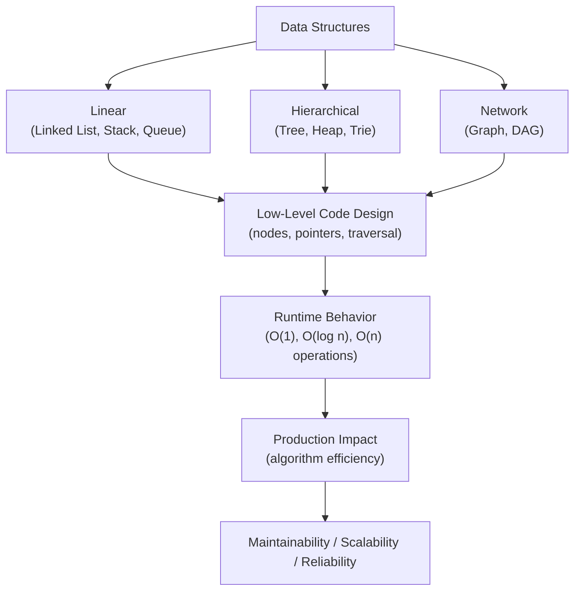
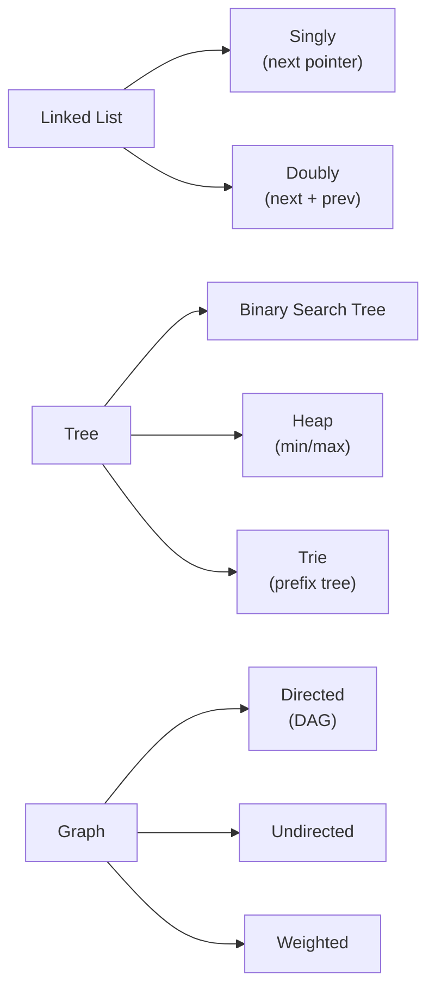

# Data Structures (Linked Lists, Trees, Graphs) in Python

## Overview

**Data Structures** are organized ways of storing and accessing data that enable efficient algorithms. While Python's built-in `list`, `dict`, `set`, and `deque` cover most use cases, understanding and implementing **linked lists**, **trees**, and **graphs** is essential for algorithm design, system architecture, and technical interviews. These structures underpin databases, file systems, AI knowledge graphs, and network routing.

> **Core idea:** The right data structure determines algorithm efficiency. A linked list enables O(1) insertion; a balanced BST enables O(log n) search; a graph enables modeling relationships. Choosing the right structure is an architectural decision.

---

## Why It Matters

| Structure | Key Operations | Use Cases |
|---|---|---|
| Linked List | O(1) insert/delete at head | LRU cache, undo history |
| Binary Search Tree | O(log n) search/insert | Sorted data, range queries |
| Heap | O(log n) insert, O(1) min/max | Priority queues, scheduling |
| Graph | O(V+E) traversal | Knowledge graphs, routing, dependencies |
| Trie | O(k) search (k=key length) | Autocomplete, prefix search |

Data structures are used in:
- **LRU Cache** — doubly linked list + hash map
- **AI knowledge graphs** — graph traversal for reasoning
- **RAG pipelines** — document hierarchies as trees
- **Task schedulers** — priority queues (heaps)
- **Autocomplete** — tries for prefix search
- **Dependency resolution** — topological sort on DAGs

---

## Concept Map





---

## Simple Example

```python
from __future__ import annotations
from typing import Optional, Any

# --- Singly Linked List ---
class ListNode:
    def __init__(self, val: Any, next: Optional["ListNode"] = None):
        self.val = val
        self.next = next

class LinkedList:
    def __init__(self):
        self.head: Optional[ListNode] = None
        self._size = 0

    def prepend(self, val: Any) -> None:
        """O(1) insert at head."""
        self.head = ListNode(val, self.head)
        self._size += 1

    def append(self, val: Any) -> None:
        """O(n) insert at tail."""
        node = ListNode(val)
        if not self.head:
            self.head = node
        else:
            curr = self.head
            while curr.next:
                curr = curr.next
            curr.next = node
        self._size += 1

    def delete(self, val: Any) -> bool:
        """O(n) delete by value."""
        if not self.head:
            return False
        if self.head.val == val:
            self.head = self.head.next
            self._size -= 1
            return True
        curr = self.head
        while curr.next:
            if curr.next.val == val:
                curr.next = curr.next.next
                self._size -= 1
                return True
            curr = curr.next
        return False

    def to_list(self) -> list:
        result, curr = [], self.head
        while curr:
            result.append(curr.val)
            curr = curr.next
        return result

    def __len__(self) -> int:
        return self._size

    def __repr__(self) -> str:
        return " → ".join(str(v) for v in self.to_list())


# --- Binary Search Tree ---
class BSTNode:
    def __init__(self, val: int):
        self.val = val
        self.left: Optional["BSTNode"] = None
        self.right: Optional["BSTNode"] = None

class BST:
    def __init__(self):
        self.root: Optional[BSTNode] = None

    def insert(self, val: int) -> None:
        self.root = self._insert(self.root, val)

    def _insert(self, node: Optional[BSTNode], val: int) -> BSTNode:
        if not node:
            return BSTNode(val)
        if val < node.val:
            node.left = self._insert(node.left, val)
        elif val > node.val:
            node.right = self._insert(node.right, val)
        return node

    def search(self, val: int) -> bool:
        node = self.root
        while node:
            if val == node.val: return True
            node = node.left if val < node.val else node.right
        return False

    def inorder(self) -> list:
        result = []
        def traverse(node):
            if node:
                traverse(node.left)
                result.append(node.val)
                traverse(node.right)
        traverse(self.root)
        return result


# --- Usage ---
ll = LinkedList()
for v in [3, 1, 4, 1, 5, 9]:
    ll.append(v)
print(f"List: {ll}")  # 3 → 1 → 4 → 1 → 5 → 9
ll.delete(1)
print(f"After delete(1): {ll}")  # 3 → 4 → 1 → 5 → 9

bst = BST()
for v in [5, 3, 7, 1, 4, 6, 8]:
    bst.insert(v)
print(f"BST inorder: {bst.inorder()}")  # [1, 3, 4, 5, 6, 7, 8]
print(f"Search 4: {bst.search(4)}")  # True
print(f"Search 9: {bst.search(9)}")  # False
```

**Expected Output:**
```
List: 3 → 1 → 4 → 1 → 5 → 9
After delete(1): 3 → 4 → 1 → 5 → 9
BST inorder: [1, 3, 4, 5, 6, 7, 8]
Search 4: True
Search 9: False
```

---

## Intermediate Example

```python
from __future__ import annotations
import heapq
from typing import Dict, List, Optional, Set, Tuple, Any
from collections import defaultdict, deque


# --- LRU Cache (Doubly Linked List + Hash Map) ---
class DLLNode:
    def __init__(self, key: Any = None, val: Any = None):
        self.key = key
        self.val = val
        self.prev: Optional["DLLNode"] = None
        self.next: Optional["DLLNode"] = None

class LRUCache:
    """O(1) get and put using doubly linked list + hash map."""

    def __init__(self, capacity: int):
        self._cap = capacity
        self._cache: Dict[Any, DLLNode] = {}
        # Sentinel nodes
        self._head = DLLNode()
        self._tail = DLLNode()
        self._head.next = self._tail
        self._tail.prev = self._head

    def get(self, key: Any) -> Optional[Any]:
        if key not in self._cache:
            return None
        node = self._cache[key]
        self._move_to_front(node)
        return node.val

    def put(self, key: Any, val: Any) -> None:
        if key in self._cache:
            node = self._cache[key]
            node.val = val
            self._move_to_front(node)
        else:
            node = DLLNode(key, val)
            self._cache[key] = node
            self._add_to_front(node)
            if len(self._cache) > self._cap:
                lru = self._tail.prev
                self._remove(lru)
                del self._cache[lru.key]

    def _add_to_front(self, node: DLLNode) -> None:
        node.prev = self._head
        node.next = self._head.next
        self._head.next.prev = node
        self._head.next = node

    def _remove(self, node: DLLNode) -> None:
        node.prev.next = node.next
        node.next.prev = node.prev

    def _move_to_front(self, node: DLLNode) -> None:
        self._remove(node)
        self._add_to_front(node)


# --- Graph with BFS, DFS, Dijkstra ---
class Graph:
    """Weighted directed graph with common algorithms."""

    def __init__(self):
        self._adj: Dict[str, List[Tuple[str, float]]] = defaultdict(list)
        self._nodes: Set[str] = set()

    def add_edge(self, u: str, v: str, weight: float = 1.0) -> None:
        self._adj[u].append((v, weight))
        self._nodes.update([u, v])

    def bfs(self, start: str) -> List[str]:
        """Breadth-first search — shortest path in unweighted graph."""
        visited, queue, order = {start}, deque([start]), []
        while queue:
            node = queue.popleft()
            order.append(node)
            for neighbor, _ in self._adj[node]:
                if neighbor not in visited:
                    visited.add(neighbor)
                    queue.append(neighbor)
        return order

    def dfs(self, start: str) -> List[str]:
        """Depth-first search."""
        visited, order = set(), []
        def _dfs(node):
            visited.add(node)
            order.append(node)
            for neighbor, _ in self._adj[node]:
                if neighbor not in visited:
                    _dfs(neighbor)
        _dfs(start)
        return order

    def dijkstra(self, start: str) -> Dict[str, float]:
        """Shortest paths from start to all reachable nodes."""
        dist = {node: float("inf") for node in self._nodes}
        dist[start] = 0
        heap = [(0, start)]

        while heap:
            d, u = heapq.heappop(heap)
            if d > dist[u]:
                continue
            for v, w in self._adj[u]:
                if dist[u] + w < dist[v]:
                    dist[v] = dist[u] + w
                    heapq.heappush(heap, (dist[v], v))

        return dist

    def topological_sort(self) -> List[str]:
        """Kahn's algorithm for DAG topological sort."""
        in_degree = defaultdict(int)
        for u in self._adj:
            for v, _ in self._adj[u]:
                in_degree[v] += 1

        queue = deque([n for n in self._nodes if in_degree[n] == 0])
        order = []
        while queue:
            node = queue.popleft()
            order.append(node)
            for neighbor, _ in self._adj[node]:
                in_degree[neighbor] -= 1
                if in_degree[neighbor] == 0:
                    queue.append(neighbor)

        return order if len(order) == len(self._nodes) else []  # Empty if cycle


# --- Usage ---
# LRU Cache
cache = LRUCache(3)
cache.put("a", 1)
cache.put("b", 2)
cache.put("c", 3)
print(cache.get("a"))  # 1 — moves "a" to front
cache.put("d", 4)      # Evicts "b" (LRU)
print(cache.get("b"))  # None — evicted

# Graph
g = Graph()
for u, v, w in [("A","B",4), ("A","C",2), ("B","D",3), ("C","B",1), ("C","D",5)]:
    g.add_edge(u, v, w)

print(f"BFS from A: {g.bfs('A')}")
print(f"DFS from A: {g.dfs('A')}")
print(f"Dijkstra from A: {g.dijkstra('A')}")

# Topological sort (dependency resolution)
dag = Graph()
for u, v in [("install", "configure"), ("configure", "start"), ("download", "install")]:
    dag.add_edge(u, v)
print(f"Topo sort: {dag.topological_sort()}")
```

---

## Advanced / Architect-Level Example

### Problem Context

In a **production AI knowledge graph**, entities (documents, concepts, agents) are nodes and relationships are edges. The graph enables semantic search, reasoning chains, and dependency resolution for a RAG pipeline.

```python
from __future__ import annotations
import heapq
from typing import Any, Dict, List, Optional, Set, Tuple, Iterator
from dataclasses import dataclass, field
from collections import defaultdict, deque
from enum import Enum


class RelationType(Enum):
    REFERENCES = "references"
    CONTAINS = "contains"
    RELATED_TO = "related_to"
    DEPENDS_ON = "depends_on"
    AUTHORED_BY = "authored_by"


@dataclass
class Entity:
    entity_id: str
    entity_type: str  # "document", "concept", "agent", "tool"
    name: str
    metadata: Dict[str, Any] = field(default_factory=dict)
    embedding: Optional[List[float]] = None


@dataclass
class Relation:
    source_id: str
    target_id: str
    relation_type: RelationType
    weight: float = 1.0
    metadata: Dict[str, Any] = field(default_factory=dict)


class KnowledgeGraph:
    """
    Production knowledge graph for AI systems.
    Supports: entity storage, relationship traversal, shortest path,
    subgraph extraction, and semantic neighborhood queries.
    """

    def __init__(self):
        self._entities: Dict[str, Entity] = {}
        self._relations: List[Relation] = []
        self._adj: Dict[str, List[Tuple[str, float, RelationType]]] = defaultdict(list)
        self._reverse_adj: Dict[str, List[Tuple[str, float, RelationType]]] = defaultdict(list)

    def add_entity(self, entity: Entity) -> None:
        self._entities[entity.entity_id] = entity

    def add_relation(self, relation: Relation) -> None:
        self._relations.append(relation)
        self._adj[relation.source_id].append(
            (relation.target_id, relation.weight, relation.relation_type)
        )
        self._reverse_adj[relation.target_id].append(
            (relation.source_id, relation.weight, relation.relation_type)
        )

    def get_entity(self, entity_id: str) -> Optional[Entity]:
        return self._entities.get(entity_id)

    def get_neighbors(
        self,
        entity_id: str,
        relation_type: Optional[RelationType] = None,
        direction: str = "outgoing",
    ) -> List[Entity]:
        """Get neighboring entities, optionally filtered by relation type."""
        adj = self._adj if direction == "outgoing" else self._reverse_adj
        neighbors = []
        for target_id, _, rel_type in adj.get(entity_id, []):
            if relation_type is None or rel_type == relation_type:
                entity = self._entities.get(target_id)
                if entity:
                    neighbors.append(entity)
        return neighbors

    def shortest_path(self, source_id: str, target_id: str) -> Optional[List[str]]:
        """Dijkstra's shortest path between two entities."""
        dist = {source_id: 0}
        prev: Dict[str, Optional[str]] = {source_id: None}
        heap = [(0, source_id)]

        while heap:
            d, u = heapq.heappop(heap)
            if u == target_id:
                # Reconstruct path
                path = []
                node: Optional[str] = target_id
                while node is not None:
                    path.append(node)
                    node = prev.get(node)
                return list(reversed(path))

            if d > dist.get(u, float("inf")):
                continue

            for v, w, _ in self._adj.get(u, []):
                new_dist = d + w
                if new_dist < dist.get(v, float("inf")):
                    dist[v] = new_dist
                    prev[v] = u
                    heapq.heappush(heap, (new_dist, v))

        return None  # No path found

    def subgraph(self, root_id: str, max_depth: int = 2) -> "KnowledgeGraph":
        """Extract a subgraph rooted at an entity up to max_depth."""
        sub = KnowledgeGraph()
        visited: Set[str] = set()
        queue = deque([(root_id, 0)])

        while queue:
            entity_id, depth = queue.popleft()
            if entity_id in visited or depth > max_depth:
                continue
            visited.add(entity_id)

            entity = self._entities.get(entity_id)
            if entity:
                sub.add_entity(entity)

            if depth < max_depth:
                for target_id, weight, rel_type in self._adj.get(entity_id, []):
                    rel = Relation(entity_id, target_id, rel_type, weight)
                    sub.add_relation(rel)
                    queue.append((target_id, depth + 1))

        return sub

    def find_by_type(self, entity_type: str) -> List[Entity]:
        return [e for e in self._entities.values() if e.entity_type == entity_type]

    def dependency_order(self) -> List[str]:
        """Topological sort for dependency resolution."""
        in_degree: Dict[str, int] = defaultdict(int)
        for entity_id in self._entities:
            in_degree.setdefault(entity_id, 0)
        for source_id, neighbors in self._adj.items():
            for target_id, _, _ in neighbors:
                in_degree[target_id] += 1

        queue = deque([eid for eid, deg in in_degree.items() if deg == 0])
        order = []
        while queue:
            eid = queue.popleft()
            order.append(eid)
            for target_id, _, _ in self._adj.get(eid, []):
                in_degree[target_id] -= 1
                if in_degree[target_id] == 0:
                    queue.append(target_id)

        return order

    def stats(self) -> Dict[str, int]:
        return {
            "entities": len(self._entities),
            "relations": len(self._relations),
            "entity_types": len(set(e.entity_type for e in self._entities.values())),
        }


# --- Usage ---
kg = KnowledgeGraph()

# Add entities
for eid, etype, name in [
    ("doc-001", "document", "Python Architecture Guide"),
    ("doc-002", "document", "Design Patterns"),
    ("concept-001", "concept", "Metaclasses"),
    ("concept-002", "concept", "Decorators"),
    ("agent-001", "agent", "CodeAnalysisAgent"),
    ("tool-001", "tool", "web_search"),
]:
    kg.add_entity(Entity(eid, etype, name))

# Add relations
relations = [
    Relation("doc-001", "concept-001", RelationType.CONTAINS, 0.9),
    Relation("doc-001", "concept-002", RelationType.CONTAINS, 0.8),
    Relation("doc-002", "concept-002", RelationType.REFERENCES, 0.7),
    Relation("agent-001", "tool-001", RelationType.DEPENDS_ON, 1.0),
    Relation("agent-001", "doc-001", RelationType.REFERENCES, 0.6),
    Relation("concept-001", "concept-002", RelationType.RELATED_TO, 0.5),
]
for r in relations:
    kg.add_relation(r)

print(f"Graph stats: {kg.stats()}")

# Find neighbors
neighbors = kg.get_neighbors("doc-001", RelationType.CONTAINS)
print(f"doc-001 contains: {[n.name for n in neighbors]}")

# Shortest path
path = kg.shortest_path("agent-001", "concept-001")
print(f"Path agent→concept: {path}")

# Subgraph
sub = kg.subgraph("doc-001", max_depth=2)
print(f"Subgraph of doc-001: {sub.stats()}")

# Dependency order
order = kg.dependency_order()
print(f"Dependency order: {order}")
```

**Explanation:**
- `KnowledgeGraph` uses adjacency lists for O(1) neighbor lookup.
- `shortest_path` uses Dijkstra's algorithm — weighted edges for semantic similarity.
- `subgraph` uses BFS — extracts a local neighborhood for context.
- `dependency_order` uses Kahn's algorithm — resolves agent tool dependencies.

---

## Common Mistakes

### 1. Using a List as a Stack/Queue
```python
# ❌ list.pop(0) is O(n) — use deque for queue
queue = []
queue.append(item)
item = queue.pop(0)  # O(n)!

# ✅ Use deque for O(1) operations
from collections import deque
queue = deque()
queue.append(item)
item = queue.popleft()  # O(1)
```

---

### 2. Infinite Recursion in Tree Traversal
```python
# ❌ No visited set — infinite loop in cyclic graphs
def dfs(node):
    for neighbor in node.neighbors:
        dfs(neighbor)  # Infinite loop if cycle!

# ✅ Track visited nodes
def dfs(node, visited=None):
    if visited is None: visited = set()
    visited.add(node)
    for neighbor in node.neighbors:
        if neighbor not in visited:
            dfs(neighbor, visited)
```

---

### 3. Not Using `heapq` for Priority Queues
```python
# ❌ Sorting on every insertion — O(n log n)
queue = []
queue.append(item)
queue.sort()

# ✅ Use heapq — O(log n) insertion
import heapq
heap = []
heapq.heappush(heap, (priority, item))
priority, item = heapq.heappop(heap)
```

---

### 4. Modifying a List While Iterating
```python
# ❌ Modifying linked list while iterating
for node in linked_list:
    if condition:
        linked_list.delete(node)  # Undefined behavior!

# ✅ Collect nodes to delete, then delete
to_delete = [node for node in linked_list if condition]
for node in to_delete:
    linked_list.delete(node)
```

---

## Best Practices

1. **Use `collections.deque`** for queues — O(1) append and popleft.
2. **Use `heapq`** for priority queues — O(log n) operations.
3. **Track visited nodes** in graph traversal — prevent infinite loops.
4. **Use adjacency lists** for sparse graphs; adjacency matrices for dense graphs.
5. **Use `networkx`** for production graph algorithms — battle-tested, feature-rich.
6. **Use `sortedcontainers.SortedList`** for sorted sequences — O(log n) operations.
7. **Implement `__repr__`** for all data structure nodes — essential for debugging.
8. **Test edge cases** — empty structures, single nodes, cycles.
9. **Use `functools.lru_cache`** for memoized recursive algorithms (Fibonacci, DFS).
10. **Profile before optimizing** — Python's built-in `list` is often fast enough.

---

## Performance Considerations

| Operation | Linked List | BST (balanced) | Hash Map | Heap |
|---|---|---|---|---|
| Search | O(n) | O(log n) | O(1) avg | O(n) |
| Insert | O(1) head | O(log n) | O(1) avg | O(log n) |
| Delete | O(n) | O(log n) | O(1) avg | O(log n) |
| Min/Max | O(n) | O(log n) | O(n) | O(1) |

- **Python `list`**: Dynamic array — O(1) append, O(n) insert/delete at arbitrary position.
- **`collections.deque`**: Doubly linked list — O(1) append/popleft.
- **`heapq`**: Min-heap — O(log n) push/pop, O(1) peek.
- **`sortedcontainers.SortedList`**: O(log n) insert/delete/search.
- **`networkx`**: Full-featured graph library — use for production graph algorithms.

---

## Testing Strategy

```python
# test_data_structures.py
import pytest
from your_module import LinkedList, BST, LRUCache, Graph, KnowledgeGraph, Entity, Relation, RelationType


# --- Linked List ---
def test_linked_list_append():
    ll = LinkedList()
    ll.append(1); ll.append(2); ll.append(3)
    assert ll.to_list() == [1, 2, 3]

def test_linked_list_prepend():
    ll = LinkedList()
    ll.prepend(3); ll.prepend(2); ll.prepend(1)
    assert ll.to_list() == [1, 2, 3]

def test_linked_list_delete():
    ll = LinkedList()
    for v in [1, 2, 3]: ll.append(v)
    assert ll.delete(2) is True
    assert ll.to_list() == [1, 3]
    assert ll.delete(99) is False

def test_linked_list_empty():
    ll = LinkedList()
    assert ll.to_list() == []
    assert len(ll) == 0


# --- BST ---
def test_bst_inorder():
    bst = BST()
    for v in [5, 3, 7, 1, 4]: bst.insert(v)
    assert bst.inorder() == [1, 3, 4, 5, 7]

def test_bst_search():
    bst = BST()
    for v in [5, 3, 7]: bst.insert(v)
    assert bst.search(3) is True
    assert bst.search(9) is False


# --- LRU Cache ---
def test_lru_cache_basic():
    cache = LRUCache(2)
    cache.put("a", 1); cache.put("b", 2)
    assert cache.get("a") == 1
    cache.put("c", 3)  # Evicts "b"
    assert cache.get("b") is None
    assert cache.get("c") == 3

def test_lru_cache_update():
    cache = LRUCache(2)
    cache.put("a", 1)
    cache.put("a", 99)  # Update
    assert cache.get("a") == 99


# --- Graph ---
def test_graph_bfs():
    g = Graph()
    g.add_edge("A", "B"); g.add_edge("A", "C"); g.add_edge("B", "D")
    bfs = g.bfs("A")
    assert bfs[0] == "A"
    assert set(bfs) == {"A", "B", "C", "D"}

def test_graph_dijkstra():
    g = Graph()
    g.add_edge("A", "B", 4); g.add_edge("A", "C", 2); g.add_edge("C", "B", 1)
    dist = g.dijkstra("A")
    assert dist["B"] == 3  # A→C→B = 2+1 = 3

def test_graph_topological_sort():
    g = Graph()
    g.add_edge("A", "B"); g.add_edge("B", "C"); g.add_edge("A", "C")
    order = g.topological_sort()
    assert order.index("A") < order.index("B")
    assert order.index("B") < order.index("C")


# --- Knowledge Graph ---
def test_knowledge_graph_neighbors():
    kg = KnowledgeGraph()
    kg.add_entity(Entity("e1", "doc", "Doc 1"))
    kg.add_entity(Entity("e2", "concept", "Concept 1"))
    kg.add_relation(Relation("e1", "e2", RelationType.CONTAINS))
    neighbors = kg.get_neighbors("e1", RelationType.CONTAINS)
    assert len(neighbors) == 1
    assert neighbors[0].entity_id == "e2"

def test_knowledge_graph_shortest_path():
    kg = KnowledgeGraph()
    for eid, etype, name in [("a", "t", "A"), ("b", "t", "B"), ("c", "t", "C")]:
        kg.add_entity(Entity(eid, etype, name))
    kg.add_relation(Relation("a", "b", RelationType.RELATED_TO, 1))
    kg.add_relation(Relation("b", "c", RelationType.RELATED_TO, 1))
    path = kg.shortest_path("a", "c")
    assert path == ["a", "b", "c"]
```

---

## Debugging Tips

1. **Infinite loop in graph traversal** — missing visited set. Add `visited = set()` and check before recursing.

2. **`RecursionError` in tree traversal** — deep tree exceeds Python's recursion limit. Use iterative traversal with an explicit stack.

3. **LRU cache not evicting correctly** — check sentinel node connections. Print the doubly linked list to verify order.

4. **Dijkstra returning wrong distances** — check that you're using `heapq.heappop` and skipping stale entries (`if d > dist[u]: continue`).

5. **Topological sort returns empty** — there's a cycle in the graph. Use DFS-based cycle detection to find it.

6. **BST not balanced** — insert in sorted order creates a degenerate tree (O(n) operations). Use AVL or Red-Black tree for balanced BST.

---

## Interview Questions

### Beginner

**Q1: What is the time complexity of inserting at the head of a linked list?**  
A: O(1) — just update the head pointer.

**Q2: What is the difference between BFS and DFS?**  
A: BFS uses a queue — explores level by level, finds shortest path in unweighted graphs. DFS uses a stack (or recursion) — explores as deep as possible first.

**Q3: What is a heap?**  
A: A complete binary tree where each node is smaller (min-heap) or larger (max-heap) than its children. Enables O(log n) insert and O(1) min/max access.

**Q4: What is a BST?**  
A: A binary tree where left child < parent < right child. Enables O(log n) search, insert, and delete for balanced trees.

**Q5: What is topological sort?**  
A: A linear ordering of nodes in a DAG such that for every edge (u, v), u comes before v. Used for dependency resolution.

---

### Intermediate

**Q6: How does an LRU cache work?**  
A: Doubly linked list + hash map. The list maintains access order (most recent at front). The hash map provides O(1) lookup. On access, move the node to the front. On eviction, remove from the back.

**Q7: What is Dijkstra's algorithm?**  
A: Finds shortest paths from a source node to all other nodes in a weighted graph with non-negative weights. Uses a min-heap for O((V+E) log V) time.

**Q8: What is the difference between a tree and a graph?**  
A: A tree is a connected, acyclic graph with n nodes and n-1 edges. A graph can have cycles, disconnected components, and multiple edges between nodes.

**Q9: What is a trie?**  
A: A tree where each node represents a character. Used for prefix search and autocomplete. O(k) search where k is the key length.

**Q10: What is the difference between adjacency list and adjacency matrix?**  
A: Adjacency list: O(V+E) space, O(degree) neighbor lookup — good for sparse graphs. Adjacency matrix: O(V²) space, O(1) edge lookup — good for dense graphs.

---

### Advanced / Architect-Level

**Q11: How would you implement a knowledge graph for a RAG pipeline?**  
A: Use adjacency lists for O(1) neighbor lookup. Store entities as dataclasses with embeddings. Use Dijkstra for semantic path finding. Use BFS for subgraph extraction. Use topological sort for dependency resolution. Use `networkx` for production use.

**Q12: How does Python's `dict` implement a hash map?**  
A: Open addressing with pseudo-random probing. Load factor ~2/3. Resize (double) when load factor exceeded. O(1) average for get/set/delete; O(n) worst case (hash collisions).

**Q13: How would you detect a cycle in a directed graph?**  
A: DFS with three states: unvisited, in-progress, done. If you encounter an in-progress node during DFS, there's a cycle. Alternatively, use Kahn's topological sort — if the result has fewer nodes than the graph, there's a cycle.

**Q14: How would you implement a distributed graph for a large-scale knowledge base?**  
A: Partition the graph by entity type or community. Use a graph database (Neo4j, Amazon Neptune). Implement distributed BFS/DFS with message passing. Use vector similarity for semantic edge weights.

**Q15: What is the time complexity of Dijkstra's algorithm?**  
A: O((V+E) log V) with a binary heap. O(V² ) with a simple array. O(E + V log V) with a Fibonacci heap.

---

## Key Takeaways

- Linked lists enable O(1) head insertion — use for LRU cache, undo history.
- BSTs enable O(log n) search — use `sortedcontainers.SortedList` for production.
- Heaps enable O(log n) insert and O(1) min/max — use `heapq` for priority queues.
- Graphs model relationships — use adjacency lists for sparse graphs.
- BFS finds shortest paths in unweighted graphs; Dijkstra for weighted.
- Topological sort resolves dependencies in DAGs.
- Always track visited nodes in graph traversal — prevent infinite loops.
- Use `collections.deque` for queues, `heapq` for priority queues.
- Use `networkx` for production graph algorithms.
- Mastering data structures is essential for algorithm design, system architecture, and technical interviews.

---

## Mini Project Idea

### Goal
Build a **Knowledge Graph Engine** — a production-grade graph data structure for an AI knowledge base with entity storage, relationship traversal, semantic search, and dependency resolution.

### Features
- `Entity` and `Relation` dataclasses.
- `KnowledgeGraph` with BFS, DFS, Dijkstra, topological sort.
- `subgraph()` for local neighborhood extraction.
- `find_by_type()` for entity filtering.
- Persistence: save/load to JSON.
- CLI: `python kg.py --add-entity --query "shortest path A B"`.

### Suggested Folder Structure
```
knowledge_graph/
├── graph/
│   ├── __init__.py
│   ├── entity.py
│   ├── relation.py
│   └── knowledge_graph.py
├── algorithms/
│   ├── bfs.py
│   ├── dijkstra.py
│   └── topological.py
├── persistence/
│   └── json_store.py
├── tests/
│   └── test_graph.py
├── cli.py
└── README.md
```

### Extension Ideas
- Add vector similarity edges using cosine distance.
- Add community detection (Louvain algorithm).
- Add graph visualization with `networkx` + `matplotlib`.
- Integrate with Neo4j for distributed storage.

---

## Final Summary

Mastering data structures is mastering the foundation of algorithm design and system architecture. Linked lists, trees, and graphs are not just interview topics — they are the building blocks of production systems: LRU caches, knowledge graphs, dependency resolvers, and task schedulers. For a Python architect, the key skills are: knowing which structure to use for each problem, understanding time and space complexity, and knowing when to use Python's built-in structures (`deque`, `heapq`, `dict`) versus custom implementations. In AI systems, graphs are particularly important — knowledge graphs, agent dependency graphs, and RAG document hierarchies all require graph algorithms. Understanding these structures deeply is what enables you to design systems that are both correct and efficient at scale.
