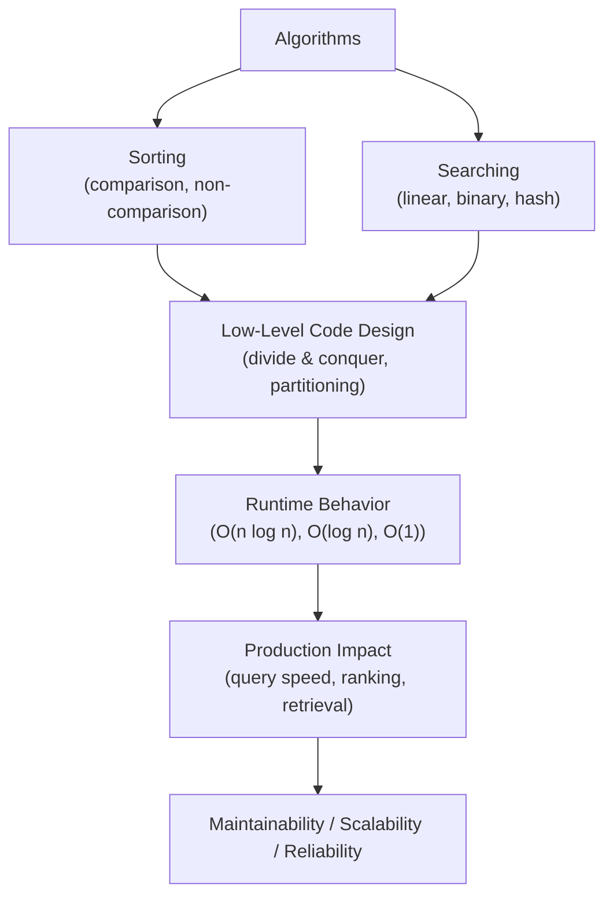
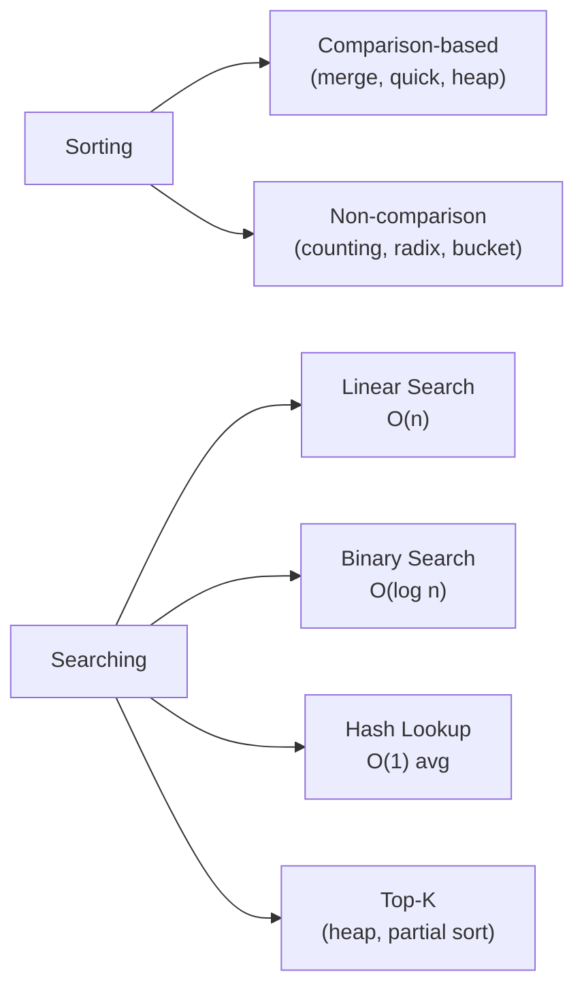

# Algorithms (Sorting, Searching) in Python

## Overview

**Algorithms** are step-by-step procedures for solving computational problems. **Sorting** and **searching** are the two most fundamental algorithm categories — they appear in every production system, from database query optimization to AI ranking and retrieval. Understanding their time/space complexity, trade-offs, and Python implementations is essential for writing efficient code and passing technical interviews.

> **Core idea:** Algorithm choice determines performance. Choosing O(n log n) sort over O(n²) sort, or binary search over linear scan, can mean the difference between milliseconds and minutes at scale.

---

## Why It Matters

| Algorithm | Time Complexity | Use Case |
|---|---|---|
| Bubble Sort | O(n²) | Educational only |
| Merge Sort | O(n log n) | Stable sort, linked lists |
| Quick Sort | O(n log n) avg | In-place, cache-friendly |
| Tim Sort | O(n log n) | Python's built-in sort |
| Linear Search | O(n) | Unsorted data |
| Binary Search | O(log n) | Sorted data |
| Hash Lookup | O(1) avg | Key-value lookup |

Algorithms are used in:
- **Database query optimization** — sort-merge join, index scan
- **RAG retrieval** — vector similarity ranking, BM25 scoring
- **AI agent tool selection** — priority-based selection
- **Log analysis** — sorting and searching large log files
- **Recommendation systems** — top-k retrieval
- **Data pipelines** — sorting, deduplication, merging

---

## Concept Map





---

## Simple Example

```python
from typing import List, TypeVar, Callable, Optional
import bisect

T = TypeVar("T")

# --- Sorting algorithms ---

def merge_sort(arr: List[int]) -> List[int]:
    """Stable O(n log n) sort — divide and conquer."""
    if len(arr) <= 1:
        return arr
    mid = len(arr) // 2
    left = merge_sort(arr[:mid])
    right = merge_sort(arr[mid:])
    return _merge(left, right)

def _merge(left: List[int], right: List[int]) -> List[int]:
    result, i, j = [], 0, 0
    while i < len(left) and j < len(right):
        if left[i] <= right[j]:
            result.append(left[i]); i += 1
        else:
            result.append(right[j]); j += 1
    return result + left[i:] + right[j:]


def quick_sort(arr: List[int], low: int = 0, high: int = None) -> List[int]:
    """In-place O(n log n) avg sort — partition around pivot."""
    if high is None:
        arr = arr[:]
        high = len(arr) - 1
    if low < high:
        pivot_idx = _partition(arr, low, high)
        quick_sort(arr, low, pivot_idx - 1)
        quick_sort(arr, pivot_idx + 1, high)
    return arr

def _partition(arr: List[int], low: int, high: int) -> int:
    pivot = arr[high]
    i = low - 1
    for j in range(low, high):
        if arr[j] <= pivot:
            i += 1
            arr[i], arr[j] = arr[j], arr[i]
    arr[i+1], arr[high] = arr[high], arr[i+1]
    return i + 1


# --- Searching algorithms ---

def linear_search(arr: List, target) -> int:
    """O(n) — works on unsorted data."""
    for i, val in enumerate(arr):
        if val == target:
            return i
    return -1


def binary_search(arr: List[int], target: int) -> int:
    """O(log n) — requires sorted data."""
    low, high = 0, len(arr) - 1
    while low <= high:
        mid = (low + high) // 2
        if arr[mid] == target:
            return mid
        elif arr[mid] < target:
            low = mid + 1
        else:
            high = mid - 1
    return -1


# --- Python built-ins ---
data = [5, 2, 8, 1, 9, 3, 7, 4, 6]

# Python's built-in sort (TimSort — O(n log n), stable)
print(sorted(data))           # [1, 2, 3, 4, 5, 6, 7, 8, 9]
print(sorted(data, reverse=True))  # [9, 8, 7, 6, 5, 4, 3, 2, 1]

# Sort by key
words = ["banana", "apple", "cherry", "date"]
print(sorted(words, key=len))  # ['date', 'apple', 'banana', 'cherry']

# bisect for binary search on sorted lists
sorted_data = sorted(data)
idx = bisect.bisect_left(sorted_data, 5)
print(f"Position of 5: {idx}")  # 4

# Custom implementations
print(merge_sort(data))   # [1, 2, 3, 4, 5, 6, 7, 8, 9]
print(quick_sort(data))   # [1, 2, 3, 4, 5, 6, 7, 8, 9]
print(binary_search(sorted_data, 7))  # 6
```

**Expected Output:**
```
[1, 2, 3, 4, 5, 6, 7, 8, 9]
[9, 8, 7, 6, 5, 4, 3, 2, 1]
['date', 'apple', 'banana', 'cherry']
Position of 5: 4
[1, 2, 3, 4, 5, 6, 7, 8, 9]
[1, 2, 3, 4, 5, 6, 7, 8, 9]
6
```

---

## Intermediate Example

```python
import heapq
import bisect
from typing import List, Tuple, Dict, Any, Callable, Optional
from dataclasses import dataclass, field


# --- Top-K algorithms ---

def top_k_largest(arr: List[int], k: int) -> List[int]:
    """O(n log k) — min-heap of size k."""
    return heapq.nlargest(k, arr)

def top_k_smallest(arr: List[int], k: int) -> List[int]:
    """O(n log k) — max-heap of size k."""
    return heapq.nsmallest(k, arr)

def top_k_with_heap(arr: List[int], k: int) -> List[int]:
    """Manual O(n log k) implementation."""
    heap = arr[:k]
    heapq.heapify(heap)  # O(k)
    for val in arr[k:]:
        if val > heap[0]:
            heapq.heapreplace(heap, val)  # O(log k)
    return sorted(heap, reverse=True)


# --- Counting sort (non-comparison, O(n+k)) ---
def counting_sort(arr: List[int], max_val: int = None) -> List[int]:
    """O(n+k) — for integers in range [0, max_val]."""
    if not arr:
        return []
    max_val = max_val or max(arr)
    count = [0] * (max_val + 1)
    for val in arr:
        count[val] += 1
    result = []
    for val, cnt in enumerate(count):
        result.extend([val] * cnt)
    return result


# --- Sorted search with bisect ---
class SortedSearchIndex:
    """Maintains a sorted index for O(log n) search."""

    def __init__(self):
        self._keys: List[float] = []
        self._values: List[Any] = []

    def insert(self, key: float, value: Any) -> None:
        idx = bisect.bisect_left(self._keys, key)
        self._keys.insert(idx, key)
        self._values.insert(idx, value)

    def search(self, key: float) -> Optional[Any]:
        idx = bisect.bisect_left(self._keys, key)
        if idx < len(self._keys) and self._keys[idx] == key:
            return self._values[idx]
        return None

    def range_search(self, low: float, high: float) -> List[Any]:
        left = bisect.bisect_left(self._keys, low)
        right = bisect.bisect_right(self._keys, high)
        return self._values[left:right]


# --- Ranking with multiple criteria ---
@dataclass
class SearchResult:
    doc_id: str
    bm25_score: float
    vector_score: float
    recency_score: float

    def hybrid_score(self, alpha: float = 0.5, beta: float = 0.3, gamma: float = 0.2) -> float:
        return alpha * self.bm25_score + beta * self.vector_score + gamma * self.recency_score


def rank_results(
    results: List[SearchResult],
    alpha: float = 0.5,
    beta: float = 0.3,
    gamma: float = 0.2,
    top_k: int = 10,
) -> List[SearchResult]:
    """Rank search results by hybrid score — O(n log k)."""
    return heapq.nlargest(
        top_k,
        results,
        key=lambda r: r.hybrid_score(alpha, beta, gamma),
    )


# --- Usage ---
data = [64, 34, 25, 12, 22, 11, 90, 45, 78, 3]

print(f"Top-3 largest: {top_k_largest(data, 3)}")   # [90, 78, 64]
print(f"Top-3 smallest: {top_k_smallest(data, 3)}")  # [3, 11, 12]
print(f"Counting sort: {counting_sort(data)}")

# Sorted index
index = SortedSearchIndex()
for score, doc in [(0.9, "doc1"), (0.7, "doc2"), (0.95, "doc3"), (0.8, "doc4")]:
    index.insert(score, doc)
print(f"Range [0.8, 0.95]: {index.range_search(0.8, 0.95)}")

# Ranking
results = [
    SearchResult("d1", 0.8, 0.9, 0.7),
    SearchResult("d2", 0.9, 0.7, 0.8),
    SearchResult("d3", 0.7, 0.95, 0.6),
]
ranked = rank_results(results, top_k=2)
print(f"Top-2 results: {[r.doc_id for r in ranked]}")
```

---

## Advanced / Architect-Level Example

### Problem Context

In a **production RAG retrieval system**, documents must be ranked by hybrid scores (BM25 + vector similarity + recency), deduplicated, and returned in milliseconds. An efficient retrieval engine uses multiple algorithms together.

```python
from __future__ import annotations
import heapq
import bisect
import time
from typing import Any, Dict, List, Optional, Tuple
from dataclasses import dataclass, field
from functools import lru_cache


@dataclass
class Document:
    doc_id: str
    content: str
    embedding: List[float]
    timestamp: float = field(default_factory=time.time)
    metadata: Dict[str, Any] = field(default_factory=dict)


@dataclass
class RankedResult:
    doc_id: str
    score: float
    rank: int
    document: Document


class RetrievalEngine:
    """
    Production retrieval engine with:
    - BM25 scoring (keyword search)
    - Vector similarity (semantic search)
    - Hybrid ranking (weighted combination)
    - Top-K retrieval (heap-based)
    - Deduplication
    - Sorted index for range queries
    """

    def __init__(self, bm25_weight: float = 0.4, vector_weight: float = 0.6):
        self._documents: Dict[str, Document] = {}
        self._bm25_weight = bm25_weight
        self._vector_weight = vector_weight
        self._sorted_timestamps: List[float] = []
        self._timestamp_to_id: Dict[float, str] = {}

    def add_document(self, doc: Document) -> None:
        self._documents[doc.doc_id] = doc
        idx = bisect.bisect_left(self._sorted_timestamps, doc.timestamp)
        self._sorted_timestamps.insert(idx, doc.timestamp)
        self._timestamp_to_id[doc.timestamp] = doc.doc_id

    def _bm25_score(self, query: str, doc: Document) -> float:
        """Simplified BM25 scoring."""
        query_terms = set(query.lower().split())
        doc_terms = doc.content.lower().split()
        doc_len = len(doc_terms)
        avg_len = 100  # Simplified
        k1, b = 1.5, 0.75

        score = 0.0
        term_freq = {}
        for term in doc_terms:
            term_freq[term] = term_freq.get(term, 0) + 1

        for term in query_terms:
            tf = term_freq.get(term, 0)
            idf = 1.0  # Simplified
            numerator = tf * (k1 + 1)
            denominator = tf + k1 * (1 - b + b * doc_len / avg_len)
            score += idf * numerator / denominator

        return score

    def _cosine_similarity(self, a: List[float], b: List[float]) -> float:
        """Cosine similarity between two vectors."""
        if not a or not b or len(a) != len(b):
            return 0.0
        dot = sum(x * y for x, y in zip(a, b))
        norm_a = sum(x * x for x in a) ** 0.5
        norm_b = sum(x * x for x in b) ** 0.5
        return dot / (norm_a * norm_b) if norm_a and norm_b else 0.0

    def _recency_score(self, doc: Document) -> float:
        """Score based on document recency (0-1)."""
        if not self._sorted_timestamps:
            return 1.0
        min_ts = self._sorted_timestamps[0]
        max_ts = self._sorted_timestamps[-1]
        if max_ts == min_ts:
            return 1.0
        return (doc.timestamp - min_ts) / (max_ts - min_ts)

    def retrieve(
        self,
        query: str,
        query_embedding: List[float],
        top_k: int = 10,
        deduplicate: bool = True,
    ) -> List[RankedResult]:
        """
        Retrieve top-k documents by hybrid score.
        O(n log k) using a min-heap.
        """
        # Score all documents
        scored: List[Tuple[float, str]] = []
        for doc_id, doc in self._documents.items():
            bm25 = self._bm25_score(query, doc)
            vector = self._cosine_similarity(query_embedding, doc.embedding)
            recency = self._recency_score(doc)
            hybrid = (
                self._bm25_weight * bm25 +
                self._vector_weight * vector +
                0.1 * recency
            )
            scored.append((hybrid, doc_id))

        # Top-K using heap — O(n log k)
        top = heapq.nlargest(top_k * 2 if deduplicate else top_k, scored)

        # Deduplicate by content similarity
        if deduplicate:
            seen_embeddings: List[List[float]] = []
            deduped = []
            for score, doc_id in top:
                doc = self._documents[doc_id]
                is_duplicate = any(
                    self._cosine_similarity(doc.embedding, seen) > 0.95
                    for seen in seen_embeddings
                )
                if not is_duplicate:
                    deduped.append((score, doc_id))
                    seen_embeddings.append(doc.embedding)
                if len(deduped) >= top_k:
                    break
            top = deduped

        return [
            RankedResult(
                doc_id=doc_id,
                score=score,
                rank=rank + 1,
                document=self._documents[doc_id],
            )
            for rank, (score, doc_id) in enumerate(top[:top_k])
        ]

    def get_recent_documents(self, n: int = 10) -> List[Document]:
        """Get n most recent documents using sorted timestamp index."""
        recent_timestamps = self._sorted_timestamps[-n:]
        return [
            self._documents[self._timestamp_to_id[ts]]
            for ts in reversed(recent_timestamps)
            if ts in self._timestamp_to_id
        ]

    def range_query(self, start_time: float, end_time: float) -> List[Document]:
        """Get documents in a time range using binary search."""
        left = bisect.bisect_left(self._sorted_timestamps, start_time)
        right = bisect.bisect_right(self._sorted_timestamps, end_time)
        return [
            self._documents[self._timestamp_to_id[ts]]
            for ts in self._sorted_timestamps[left:right]
            if ts in self._timestamp_to_id
        ]


# --- Usage ---
engine = RetrievalEngine(bm25_weight=0.4, vector_weight=0.6)

docs = [
    Document("d1", "Python sorting algorithms merge sort quick sort", [0.8, 0.2, 0.1, 0.9], time.time() - 100),
    Document("d2", "Binary search tree BST algorithms", [0.7, 0.3, 0.2, 0.8], time.time() - 50),
    Document("d3", "Graph algorithms BFS DFS Dijkstra", [0.6, 0.4, 0.3, 0.7], time.time() - 10),
    Document("d4", "Python data structures linked list heap", [0.9, 0.1, 0.05, 0.95], time.time()),
]

for doc in docs:
    engine.add_document(doc)

query = "Python sorting algorithms"
query_embedding = [0.85, 0.15, 0.1, 0.9]

results = engine.retrieve(query, query_embedding, top_k=3)
print("=== Retrieval Results ===")
for r in results:
    print(f"  Rank {r.rank}: {r.doc_id} (score={r.score:.3f}): {r.document.content[:40]}")

recent = engine.get_recent_documents(2)
print(f"\nMost recent: {[d.doc_id for d in recent]}")
```

**Explanation:**
- `heapq.nlargest()` implements O(n log k) top-K retrieval — much faster than full sort for large n.
- `bisect` maintains a sorted timestamp index — O(log n) range queries.
- Deduplication uses cosine similarity — prevents near-duplicate results.
- Hybrid scoring combines BM25, vector similarity, and recency.

---

## Common Mistakes

### 1. Using `list.sort()` When `sorted()` Is Needed
```python
# ❌ list.sort() modifies in-place — original lost
original = [3, 1, 2]
sorted_list = original.sort()  # Returns None!
print(sorted_list)  # None

# ✅ sorted() returns a new list
sorted_list = sorted(original)
```

---

### 2. Not Using `key=` for Custom Sorting
```python
# ❌ Comparing complex objects directly
items = [{"score": 0.9, "id": "a"}, {"score": 0.7, "id": "b"}]
items.sort()  # TypeError!

# ✅ Use key=
items.sort(key=lambda x: x["score"], reverse=True)
```

---

### 3. Linear Search on Sorted Data
```python
# ❌ O(n) linear search on sorted list
if target in sorted_list:  # O(n)
    ...

# ✅ O(log n) binary search
import bisect
idx = bisect.bisect_left(sorted_list, target)
if idx < len(sorted_list) and sorted_list[idx] == target:
    ...
```

---

### 4. Using `heapq` for Max-Heap
```python
# ❌ heapq is a min-heap — negate for max-heap
heap = [3, 1, 4, 1, 5]
heapq.heapify(heap)
max_val = heapq.heappop(heap)  # Returns 1 (min), not 5 (max)!

# ✅ Negate values for max-heap
heap = [-x for x in [3, 1, 4, 1, 5]]
heapq.heapify(heap)
max_val = -heapq.heappop(heap)  # Returns 5
```

---

### 5. Sorting Stability Assumptions
```python
# Python's sort IS stable — equal elements maintain relative order
# But don't rely on this for correctness — make sort keys unique
items = [("Alice", 30), ("Bob", 25), ("Carol", 30)]
items.sort(key=lambda x: x[1])
# Alice and Carol (both 30) maintain original order — stable
```

---

## Best Practices

1. **Use Python's built-in `sorted()` and `list.sort()`** — TimSort is highly optimized.
2. **Use `key=` for custom sorting** — cleaner than `cmp` functions.
3. **Use `bisect`** for binary search on sorted lists — O(log n).
4. **Use `heapq.nlargest`/`nsmallest`** for top-K — O(n log k).
5. **Use counting/radix sort** for integer data in a known range — O(n).
6. **Profile before optimizing** — Python's built-in sort is often fast enough.
7. **Use `operator.itemgetter`/`attrgetter`** instead of lambdas for performance.
8. **Avoid O(n²) algorithms** on large data — merge sort or quick sort instead.
9. **Use `functools.lru_cache`** for memoized recursive algorithms.
10. **Test edge cases** — empty arrays, single elements, duplicates, already-sorted data.

---

## Performance Considerations

| Algorithm | Time | Space | Stable | Notes |
|---|---|---|---|---|
| TimSort (Python) | O(n log n) | O(n) | Yes | Best for real-world data |
| Merge Sort | O(n log n) | O(n) | Yes | Good for linked lists |
| Quick Sort | O(n log n) avg | O(log n) | No | Cache-friendly |
| Heap Sort | O(n log n) | O(1) | No | In-place |
| Counting Sort | O(n+k) | O(k) | Yes | Integers only |
| Binary Search | O(log n) | O(1) | — | Sorted data only |
| `heapq.nlargest` | O(n log k) | O(k) | — | Top-K |

- **Python's `sorted()`**: Uses TimSort — O(n log n) worst case, O(n) for nearly-sorted data.
- **`bisect`**: Pure Python — fast for small arrays. For large arrays, consider `numpy.searchsorted`.
- **`heapq`**: Pure Python — for high-performance, use `sortedcontainers.SortedList`.
- **`numpy.sort`**: 10-100x faster than Python sort for numeric arrays.

---

## Testing Strategy

```python
# test_algorithms.py
import pytest
import random
from your_module import (
    merge_sort, quick_sort, binary_search, linear_search,
    top_k_largest, counting_sort, RetrievalEngine, Document
)
import time


# --- Sorting ---
@pytest.mark.parametrize("arr,expected", [
    ([3, 1, 2], [1, 2, 3]),
    ([1], [1]),
    ([], []),
    ([5, 5, 5], [5, 5, 5]),
    ([9, 8, 7, 6, 5], [5, 6, 7, 8, 9]),
])
def test_merge_sort(arr, expected):
    assert merge_sort(arr) == expected

def test_quick_sort():
    arr = [3, 6, 8, 10, 1, 2, 1]
    assert quick_sort(arr) == sorted(arr)

def test_counting_sort():
    arr = [4, 2, 2, 8, 3, 3, 1]
    assert counting_sort(arr) == sorted(arr)

def test_sort_stability():
    items = [("Alice", 30), ("Bob", 25), ("Carol", 30)]
    sorted_items = sorted(items, key=lambda x: x[1])
    assert sorted_items[1][0] == "Alice"  # Alice before Carol (stable)
    assert sorted_items[2][0] == "Carol"


# --- Searching ---
def test_binary_search_found():
    arr = [1, 3, 5, 7, 9, 11]
    assert binary_search(arr, 7) == 3

def test_binary_search_not_found():
    arr = [1, 3, 5, 7, 9]
    assert binary_search(arr, 4) == -1

def test_linear_search():
    arr = [5, 3, 8, 1, 9]
    assert linear_search(arr, 8) == 2
    assert linear_search(arr, 99) == -1


# --- Top-K ---
def test_top_k_largest():
    arr = [3, 1, 4, 1, 5, 9, 2, 6]
    assert top_k_largest(arr, 3) == [9, 6, 5]

def test_top_k_empty():
    assert top_k_largest([], 3) == []


# --- RetrievalEngine ---
def test_retrieval_engine_basic():
    engine = RetrievalEngine()
    doc = Document("d1", "Python algorithms sorting", [0.8, 0.2, 0.1, 0.9])
    engine.add_document(doc)
    results = engine.retrieve("Python sorting", [0.8, 0.2, 0.1, 0.9], top_k=1)
    assert len(results) == 1
    assert results[0].doc_id == "d1"

def test_retrieval_engine_ranking():
    engine = RetrievalEngine()
    docs = [
        Document("d1", "Python sorting algorithms", [0.9, 0.1, 0.0, 0.9]),
        Document("d2", "Java sorting algorithms", [0.1, 0.9, 0.0, 0.1]),
    ]
    for d in docs: engine.add_document(d)
    results = engine.retrieve("Python sorting", [0.9, 0.1, 0.0, 0.9], top_k=2)
    assert results[0].doc_id == "d1"  # Python doc ranked first


# --- Performance ---
def test_sort_performance():
    arr = list(range(10000, 0, -1))
    start = time.time()
    sorted(arr)
    elapsed = time.time() - start
    assert elapsed < 0.1  # Should be fast

def test_binary_search_performance():
    import bisect
    arr = list(range(1000000))
    start = time.time()
    for _ in range(1000):
        bisect.bisect_left(arr, 500000)
    elapsed = time.time() - start
    assert elapsed < 0.1
```

---

## Debugging Tips

1. **Sort not working as expected** — check the `key=` function. Print `key(item)` for a few items to verify.

2. **Binary search returning wrong index** — verify the array is sorted. Use `assert arr == sorted(arr)` before searching.

3. **`heapq` returning minimum instead of maximum** — Python's `heapq` is a min-heap. Negate values for max-heap.

4. **Sorting is slow** — check if you're using O(n²) algorithm. Profile with `cProfile`. Use Python's built-in `sorted()`.

5. **`bisect` returning wrong position** — use `bisect_left` for "first occurrence" and `bisect_right` for "after last occurrence".

6. **Merge sort stack overflow** — deep recursion on large arrays. Increase `sys.setrecursionlimit()` or use iterative merge sort.

---

## Interview Questions

### Beginner

**Q1: What is the time complexity of Python's built-in `sorted()`?**  
A: O(n log n) — uses TimSort, which is a hybrid of merge sort and insertion sort.

**Q2: What is the difference between `list.sort()` and `sorted()`?**  
A: `list.sort()` sorts in-place and returns `None`. `sorted()` returns a new sorted list and works on any iterable.

**Q3: What is binary search and when can you use it?**  
A: O(log n) search algorithm that requires sorted data. Repeatedly halves the search space by comparing the target to the middle element.

**Q4: What is a stable sort?**  
A: A sort that preserves the relative order of equal elements. Python's TimSort is stable.

**Q5: What is the time complexity of linear search?**  
A: O(n) — must check every element in the worst case.

---

### Intermediate

**Q6: What is TimSort?**  
A: Python's built-in sort algorithm — a hybrid of merge sort and insertion sort. O(n log n) worst case, O(n) for nearly-sorted data. Stable.

**Q7: How do you implement top-K retrieval efficiently?**  
A: Use `heapq.nlargest(k, arr)` — O(n log k). Faster than full sort O(n log n) when k << n.

**Q8: What is counting sort and when is it faster than comparison sorts?**  
A: O(n+k) sort for integers in range [0, k]. Faster than O(n log n) when k is small relative to n.

**Q9: How does `bisect` work?**  
A: Uses binary search to find the insertion point in a sorted list. `bisect_left` returns the leftmost position; `bisect_right` returns the rightmost. O(log n).

**Q10: What is the difference between `heapq.nlargest` and `sorted(arr, reverse=True)[:k]`?**  
A: `heapq.nlargest` is O(n log k) — faster when k << n. `sorted()[:k]` is O(n log n) — sorts the entire array.

---

### Advanced / Architect-Level

**Q11: How would you implement a hybrid retrieval ranking system?**  
A: Score documents with BM25 (keyword) and cosine similarity (vector). Combine with weighted sum. Use `heapq.nlargest` for O(n log k) top-K. Deduplicate with cosine similarity threshold. Use `bisect` for sorted timestamp index.

**Q12: How does Python's TimSort achieve O(n) for nearly-sorted data?**  
A: TimSort detects "runs" (already-sorted subsequences) and merges them. For nearly-sorted data, runs are long — few merges needed. For random data, runs are short — full merge sort behavior.

**Q13: How would you sort 1 billion records that don't fit in memory?**  
A: External merge sort: split into chunks that fit in memory, sort each chunk, write to disk, then merge sorted chunks using a k-way merge with a min-heap.

**Q14: How would you implement a real-time leaderboard with O(log n) updates?**  
A: Use a balanced BST (e.g., `sortedcontainers.SortedList`) for O(log n) insert/delete/rank. Or use a Fenwick tree (Binary Indexed Tree) for O(log n) rank queries.

**Q15: What is the difference between comparison-based and non-comparison-based sorting?**  
A: Comparison-based sorts (merge, quick, heap) have O(n log n) lower bound. Non-comparison sorts (counting, radix, bucket) can achieve O(n) by exploiting the structure of the data (integers, fixed-length strings).

---

## Key Takeaways

- Python's `sorted()` uses TimSort — O(n log n), stable, highly optimized.
- Use `key=` for custom sorting — cleaner and faster than comparison functions.
- Binary search requires sorted data — use `bisect` for O(log n) search.
- `heapq.nlargest`/`nsmallest` for top-K — O(n log k), faster than full sort.
- Counting/radix sort for integers — O(n), faster than comparison sorts.
- Always track visited nodes in graph traversal — prevent infinite loops.
- Use `operator.itemgetter`/`attrgetter` instead of lambdas for performance.
- Profile before optimizing — Python's built-in sort is often fast enough.
- Test edge cases — empty arrays, single elements, duplicates, already-sorted data.
- Mastering sorting and searching is essential for algorithm design, system optimization, and technical interviews.

---

## Mini Project Idea

### Goal
Build a **Hybrid Search Engine** — a retrieval system that combines BM25 keyword search, vector similarity, and recency scoring to rank documents, with efficient top-K retrieval and deduplication.

### Features
- `BM25Scorer` — keyword relevance scoring.
- `VectorScorer` — cosine similarity scoring.
- `HybridRanker` — weighted combination of scores.
- `TopKRetriever` — O(n log k) heap-based retrieval.
- `Deduplicator` — removes near-duplicate results.
- `SortedIndex` — bisect-based sorted index for range queries.
- CLI: `python search.py --query "Python algorithms" --top-k 5`.

### Suggested Folder Structure
```
hybrid_search/
├── scoring/
│   ├── bm25.py
│   ├── vector.py
│   └── hybrid.py
├── retrieval/
│   ├── top_k.py
│   └── deduplicator.py
├── index/
│   └── sorted_index.py
├── tests/
│   └── test_search.py
├── cli.py
└── README.md
```

### Extension Ideas
- Add FAISS for approximate nearest neighbor search.
- Add Elasticsearch integration for distributed search.
- Add A/B testing for ranking weights.
- Benchmark different ranking strategies.

---

## Final Summary

Mastering sorting and searching algorithms is mastering the foundation of computational efficiency. These algorithms appear in every production system — from database query optimization to AI retrieval ranking. For a Python architect, the key skills are: knowing when to use Python's built-in `sorted()` (almost always), when to use `bisect` for binary search, when to use `heapq` for top-K retrieval, and when non-comparison sorts (counting, radix) outperform comparison sorts. In AI systems, efficient ranking and retrieval are critical — the difference between O(n log k) and O(n log n) top-K retrieval can mean 10x faster response times at scale. Understanding these algorithms deeply — including their time/space complexity, stability, and Python implementations — is what enables you to build systems that are both correct and efficient.
