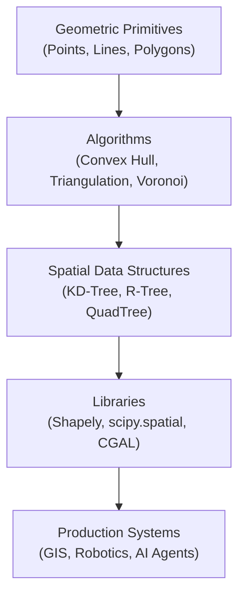
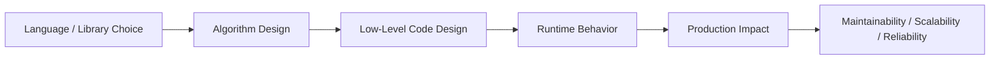

# Computational Geometry in Python

## Overview

Computational Geometry is the branch of computer science that studies algorithms and data structures for solving geometric problems. In Python, it underpins spatial indexing, GIS systems, robotics path planning, computer graphics, collision detection, and AI-driven spatial reasoning.

Mastering computational geometry equips architects to build systems that reason about space, proximity, shape, and topology — critical in geospatial AI, autonomous systems, and data-intensive backend services.

---

## Conceptual Flow





---

## Simple Example

### Point-in-Polygon Test (Ray Casting)

```python
def point_in_polygon(point: tuple, polygon: list[tuple]) -> bool:
    """
    Ray casting algorithm to determine if a point is inside a polygon.
    """
    x, y = point
    n = len(polygon)
    inside = False

    px, py = polygon[0]
    for i in range(1, n + 1):
        cx, cy = polygon[i % n]
        if ((py > y) != (cy > y)) and (x < (cx - px) * (y - py) / (cy - py) + px):
            inside = not inside
        px, py = cx, cy

    return inside


# Define a square polygon
square = [(0, 0), (4, 0), (4, 4), (0, 4)]

print(point_in_polygon((2, 2), square))   # True  — inside
print(point_in_polygon((5, 5), square))   # False — outside
print(point_in_polygon((0, 0), square))   # False — on vertex (edge case)
```

**Explanation:**
- A ray is cast from the test point horizontally to the right.
- Each time the ray crosses a polygon edge, the inside/outside state toggles.
- An even number of crossings means outside; odd means inside.

**Expected Output:**
```
True
False
False
```

---

## Intermediate Example

### Convex Hull with `scipy.spatial`

```python
import numpy as np
import matplotlib.pyplot as plt
from scipy.spatial import ConvexHull

# Generate random 2D points
rng = np.random.default_rng(42)
points = rng.random((30, 2)) * 100

# Compute convex hull
hull = ConvexHull(points)

# Plot
fig, ax = plt.subplots()
ax.scatter(points[:, 0], points[:, 1], color="blue", label="Points")

for simplex in hull.simplices:
    ax.plot(points[simplex, 0], points[simplex, 1], "r-")

ax.set_title("Convex Hull")
ax.legend()
plt.tight_layout()
plt.savefig("convex_hull.png")
print(f"Hull vertices: {hull.vertices}")
print(f"Hull area: {hull.volume:.2f}")   # In 2D, .volume = area
```

**Explanation:**
- `ConvexHull` computes the smallest convex polygon enclosing all points.
- `hull.simplices` gives pairs of indices forming the hull edges.
- `hull.volume` in 2D returns the enclosed area.

**Expected Output:**
```
Hull vertices: [array of indices]
Hull area: ~some float
```

---

## Advanced / Architect-Level Example

### Spatial Indexing for a RAG Document Retrieval System

**Problem Context:**
In a Retrieval-Augmented Generation (RAG) pipeline, documents are embedded into high-dimensional vectors. For geospatial AI applications (e.g., location-aware document retrieval), you need to efficiently find the nearest documents to a query point in 2D or 3D geographic space using a KD-Tree.

```python
from __future__ import annotations
import numpy as np
from scipy.spatial import KDTree
from dataclasses import dataclass, field
from typing import List, Tuple


@dataclass
class GeoDocument:
    doc_id: str
    content: str
    lat: float
    lon: float


class GeoSpatialIndex:
    """
    Production-grade spatial index for geospatial document retrieval.
    Supports nearest-neighbor queries using a KD-Tree.
    """

    def __init__(self) -> None:
        self._documents: List[GeoDocument] = []
        self._tree: KDTree | None = None

    def add_documents(self, docs: List[GeoDocument]) -> None:
        self._documents.extend(docs)
        coords = np.array([[d.lat, d.lon] for d in self._documents])
        self._tree = KDTree(coords)

    def query_nearest(
        self, lat: float, lon: float, k: int = 3
    ) -> List[Tuple[float, GeoDocument]]:
        if self._tree is None:
            raise RuntimeError("Index is empty. Add documents first.")
        distances, indices = self._tree.query([lat, lon], k=k)
        return [(dist, self._documents[i]) for dist, i in zip(distances, indices)]


# --- Usage ---
docs = [
    GeoDocument("doc1", "Central Park info",       40.785091, -73.968285),
    GeoDocument("doc2", "Times Square info",       40.758896, -73.985130),
    GeoDocument("doc3", "Brooklyn Bridge info",    40.706005, -73.996944),
    GeoDocument("doc4", "Statue of Liberty info",  40.689247, -74.044502),
    GeoDocument("doc5", "Empire State Building",   40.748817, -73.985428),
]

index = GeoSpatialIndex()
index.add_documents(docs)

query_lat, query_lon = 40.750, -73.990
results = index.query_nearest(query_lat, query_lon, k=3)

print(f"Nearest documents to ({query_lat}, {query_lon}):")
for dist, doc in results:
    print(f"  [{dist:.4f} deg] {doc.doc_id}: {doc.content}")
```

**Explanation:**
- `KDTree` partitions the coordinate space for O(log n) nearest-neighbor queries.
- `GeoSpatialIndex` wraps the tree with a clean domain API.
- Documents are indexed by (lat, lon) and queried by proximity.

**Design Trade-offs:**
| Approach | Pros | Cons |
|---|---|---|
| KD-Tree (scipy) | Fast, in-memory, simple | Doesn't scale to billions of points |
| R-Tree (rtree lib) | Better for bounding-box queries | Requires C extension |
| PostGIS / pgvector | Production-grade, persistent | Requires DB infrastructure |
| FAISS (vector search) | GPU-accelerated, high-dim | Overkill for 2D geo |

---

## Common Mistakes

### 1. Ignoring Floating-Point Precision
- **Problem:** Geometric predicates (e.g., collinearity tests) fail silently due to floating-point rounding.
- **Better Approach:** Use robust predicates from libraries like `shapely` or add epsilon tolerances.

```python
# Fragile
def collinear(p1, p2, p3):
    return (p2[1]-p1[1])*(p3[0]-p2[0]) == (p3[1]-p2[1])*(p2[0]-p1[0])

# Robust
EPSILON = 1e-9
def collinear_robust(p1, p2, p3):
    cross = (p2[1]-p1[1])*(p3[0]-p2[0]) - (p3[1]-p2[1])*(p2[0]-p1[0])
    return abs(cross) < EPSILON
```

### 2. Reinventing the Wheel
- **Problem:** Hand-rolling convex hull, triangulation, or Voronoi from scratch introduces bugs.
- **Better Approach:** Use `scipy.spatial`, `shapely`, or `trimesh` for production code.

### 3. Not Handling Degenerate Cases
- **Problem:** Algorithms break on collinear points, duplicate coordinates, or empty inputs.
- **Better Approach:** Validate inputs and handle edge cases explicitly.

### 4. Using Euclidean Distance for Geographic Coordinates
- **Problem:** Lat/lon are spherical; Euclidean distance is inaccurate over large distances.
- **Better Approach:** Use the Haversine formula or `geopy.distance`.

```python
from geopy.distance import geodesic
dist = geodesic((40.785091, -73.968285), (40.758896, -73.985130)).km
print(f"{dist:.2f} km")
```

### 5. Rebuilding the KD-Tree on Every Query
- **Problem:** `KDTree` construction is O(n log n); rebuilding it per query is wasteful.
- **Better Approach:** Build once, query many times. Rebuild only when the dataset changes.

---

## Best Practices

- **Use `shapely` for 2D geometry:** It provides a clean, Pythonic API for polygons, lines, and spatial operations.
- **Use `scipy.spatial` for numerical geometry:** KD-Trees, Delaunay triangulation, Voronoi diagrams.
- **Validate inputs early:** Check for empty collections, NaN coordinates, and degenerate shapes.
- **Prefer immutable geometry objects:** Avoid mutating polygon vertex lists in-place.
- **Use spatial indexing for large datasets:** Never do O(n) linear scans for proximity queries.
- **Separate geometry logic from business logic:** Keep spatial algorithms in dedicated modules.
- **Document coordinate systems:** Always specify whether coordinates are (lat, lon), (x, y), or projected.

---

## Performance Considerations

| Operation | Naive | Optimized |
|---|---|---|
| Point-in-polygon (n polygons) | O(n·m) | O(log n) with R-Tree |
| Nearest neighbor (n points) | O(n) | O(log n) with KD-Tree |
| Convex hull (n points) | O(n²) | O(n log n) with Graham scan |
| Polygon intersection | O(n·m) | O((n+m) log(n+m)) with sweep line |

- **KD-Trees degrade** in high dimensions (curse of dimensionality). Use for ≤ 20 dimensions.
- **Shapely operations** are backed by GEOS (C library) — fast for 2D.
- **NumPy vectorization** dramatically speeds up batch geometric computations.
- **Avoid Python loops** over large point sets; use NumPy broadcasting instead.

---

## Testing Strategy

```python
import pytest
from shapely.geometry import Point, Polygon


def point_in_polygon_shapely(point: tuple, polygon_coords: list) -> bool:
    p = Point(point)
    poly = Polygon(polygon_coords)
    return poly.contains(p)


# --- Tests ---

def test_point_inside_square():
    square = [(0, 0), (4, 0), (4, 4), (0, 4)]
    assert point_in_polygon_shapely((2, 2), square) is True

def test_point_outside_square():
    square = [(0, 0), (4, 0), (4, 4), (0, 4)]
    assert point_in_polygon_shapely((5, 5), square) is False

def test_point_on_boundary():
    square = [(0, 0), (4, 0), (4, 4), (0, 4)]
    # Shapely: boundary points are NOT "contained" (use .touches or .within)
    p = Point(0, 0)
    poly = Polygon(square)
    assert poly.contains(p) is False
    assert poly.touches(p) is True

def test_empty_polygon_raises():
    with pytest.raises(Exception):
        Polygon([])

def test_convex_hull_area():
    from scipy.spatial import ConvexHull
    import numpy as np
    points = np.array([[0,0],[1,0],[1,1],[0,1],[0.5,0.5]])
    hull = ConvexHull(points)
    assert abs(hull.volume - 1.0) < 1e-9   # unit square area = 1.0
```

---

## Debugging Tips

- **Visualize geometry:** Use `matplotlib` or `shapely`'s `.plot()` to render shapes and verify correctness visually.
- **Print intermediate results:** Log polygon vertices, hull indices, and tree query results during development.
- **Check coordinate order:** Many algorithms assume counter-clockwise (CCW) vertex ordering. Use `shapely`'s `orient()` to normalize.
- **Use `shapely.validation.explain_validity()`** to diagnose invalid polygons (self-intersections, duplicate points).
- **Test with known shapes:** Unit squares, equilateral triangles, and circles have known properties — use them as ground truth.
- **Inspect KD-Tree structure:** Print `tree.data` to verify the indexed coordinates match expectations.

---

## Interview Questions

### Beginner
1. **What is a convex hull?**
   The smallest convex polygon that encloses all given points.

2. **What is the ray casting algorithm used for?**
   Determining whether a point lies inside a polygon.

3. **What is a KD-Tree?**
   A space-partitioning data structure for organizing points in k-dimensional space, enabling efficient nearest-neighbor searches.

4. **What Python library provides polygon operations like union and intersection?**
   `shapely`.

5. **What is the difference between Euclidean distance and geodesic distance?**
   Euclidean is straight-line distance in flat space; geodesic accounts for Earth's curvature.

### Intermediate
1. **What is Delaunay triangulation and why is it useful?**
   A triangulation where no point lies inside the circumcircle of any triangle. It maximizes the minimum angle, avoiding sliver triangles — useful in mesh generation and interpolation.

2. **How does a Voronoi diagram relate to a Delaunay triangulation?**
   They are geometric duals. The Voronoi diagram can be constructed from the Delaunay triangulation by connecting circumcenters.

3. **What is the time complexity of the Graham scan convex hull algorithm?**
   O(n log n) due to the initial sorting step.

4. **How do you handle floating-point precision in geometric predicates?**
   Use epsilon tolerances, exact arithmetic libraries, or robust predicate implementations.

5. **What is a bounding box and how is it used in spatial queries?**
   The smallest axis-aligned rectangle enclosing a shape. Used as a fast pre-filter before expensive exact intersection tests.

### Advanced / Architect-Level
1. **How would you design a scalable geospatial indexing service for millions of documents?**
   Use PostGIS for persistent spatial indexing, R-Trees for bounding-box queries, and a caching layer (Redis with geospatial commands) for hot queries. Partition data by geographic region.

2. **What are the trade-offs between KD-Trees and R-Trees for spatial indexing?**
   KD-Trees are simpler and faster for point queries in low dimensions. R-Trees handle bounding-box queries and dynamic insertions better, making them preferable for polygon-heavy datasets.

3. **How would you integrate computational geometry into a RAG pipeline for location-aware retrieval?**
   Embed documents with geographic metadata, index by (lat, lon) using a KD-Tree or PostGIS, and at query time retrieve the k nearest documents by location before semantic re-ranking.

4. **What is the curse of dimensionality and how does it affect KD-Trees?**
   In high dimensions, all points become approximately equidistant, making KD-Tree partitioning ineffective. For d > 20, approximate methods like FAISS or ball trees are preferred.

5. **How do you ensure correctness of geometric algorithms in a CI/CD pipeline?**
   Use property-based testing (Hypothesis), test with degenerate inputs (collinear points, empty sets), validate against known geometric identities, and use visual regression tests for rendered output.

---

## Key Takeaways

- Computational geometry provides the algorithmic foundation for spatial reasoning in Python.
- `shapely` and `scipy.spatial` are the go-to libraries for 2D geometry and spatial indexing.
- KD-Trees enable O(log n) nearest-neighbor queries — essential for geospatial AI systems.
- Floating-point precision is a persistent challenge; use robust predicates and validated libraries.
- Spatial indexing (KD-Tree, R-Tree, PostGIS) is critical for production-scale geospatial applications.
- Degenerate cases (collinear points, empty inputs, boundary conditions) must be explicitly handled.
- Separate geometric logic from business logic for testability and maintainability.

---

## Mini Project Idea

### Geospatial Document Finder

**Goal:** Build a CLI tool that indexes a set of location-tagged documents and retrieves the nearest ones to a query coordinate.

**Features:**
- Load documents from a JSON file with `lat`, `lon`, `title`, `content` fields.
- Build a KD-Tree spatial index.
- Accept a query `(lat, lon)` and return the top-k nearest documents.
- Display results with distance in kilometers (Haversine).
- Optionally visualize the documents and query point on a map using `folium`.

**Suggested Folder Structure:**
```
geo_finder/
├── data/
│   └── documents.json
├── geo_finder/
│   ├── __init__.py
│   ├── index.py          # GeoSpatialIndex class
│   ├── distance.py       # Haversine formula
│   └── cli.py            # CLI entry point
├── tests/
│   ├── test_index.py
│   └── test_distance.py
├── requirements.txt
└── README.md
```

**Extension Ideas:**
- Add polygon-based filtering (only return documents inside a given region).
- Support dynamic document insertion with incremental index rebuilding.
- Integrate with a vector database for hybrid geo + semantic search.
- Export results as GeoJSON for visualization in QGIS or Leaflet.js.

---

## Final Summary

Computational geometry is a foundational discipline for any Python architect working with spatial data, AI systems, or backend services that reason about location and shape. Mastering algorithms like convex hull, point-in-polygon, and nearest-neighbor search — combined with production libraries like `shapely` and `scipy.spatial` — enables you to build robust, scalable geospatial features. In the context of GenAI and RAG systems, spatial indexing becomes a powerful tool for location-aware retrieval, grounding AI responses in geographic context. A strong grasp of these concepts distinguishes architects who can design systems that are not only functionally correct but also performant and maintainable at scale.
