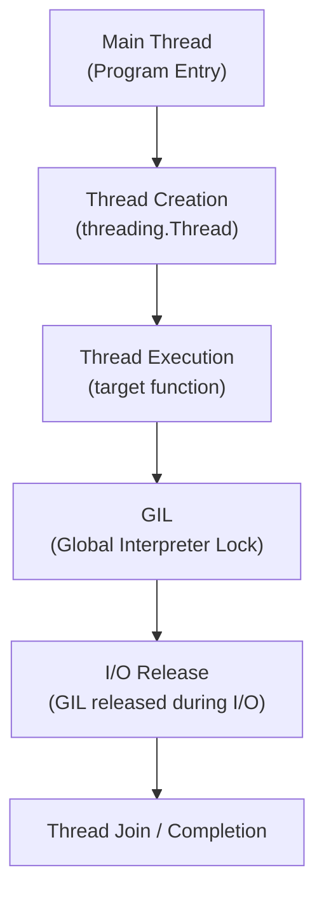

# Threading in Python

## Overview

Threading allows a Python program to run multiple threads (lightweight sub-processes) concurrently within a single process. Threads share the same memory space, making them ideal for I/O-bound tasks such as network requests, file operations, and database queries.

Understanding threading — including the Global Interpreter Lock (GIL), synchronization primitives, and thread safety — is essential for building responsive, concurrent Python applications in production.

---

## Conceptual Flow




---

## Simple Example

### Running Two Threads Concurrently

```python
import threading
import time


def print_numbers(name: str, count: int) -> None:
    for i in range(1, count + 1):
        print(f"[{name}] {i}")
        time.sleep(0.1)


# Create threads
t1 = threading.Thread(target=print_numbers, args=("Thread-A", 5))
t2 = threading.Thread(target=print_numbers, args=("Thread-B", 5))

# Start threads
t1.start()
t2.start()

# Wait for both to finish
t1.join()
t2.join()

print("Both threads completed.")
```

**Explanation:**
- `threading.Thread` creates a new thread with a target function and arguments.
- `.start()` begins execution; `.join()` blocks the main thread until the child thread finishes.
- Both threads run concurrently, interleaving their output.

**Expected Output (interleaved):**
```
[Thread-A] 1
[Thread-B] 1
[Thread-A] 2
[Thread-B] 2
...
Both threads completed.
```

---

## Intermediate Example

### Concurrent HTTP Requests with `ThreadPoolExecutor`

```python
import concurrent.futures
import urllib.request
import time


URLS = [
    "https://httpbin.org/delay/1",
    "https://httpbin.org/delay/1",
    "https://httpbin.org/delay/1",
    "https://httpbin.org/delay/1",
    "https://httpbin.org/delay/1",
]


def fetch(url: str) -> tuple[str, int]:
    with urllib.request.urlopen(url, timeout=10) as response:
        return url, response.status


start = time.perf_counter()

with concurrent.futures.ThreadPoolExecutor(max_workers=5) as executor:
    futures = {executor.submit(fetch, url): url for url in URLS}
    for future in concurrent.futures.as_completed(futures):
        url, status = future.result()
        print(f"  {url} -> HTTP {status}")

elapsed = time.perf_counter() - start
print(f"\nCompleted in {elapsed:.2f}s (sequential would take ~5s)")
```

**Explanation:**
- `ThreadPoolExecutor` manages a pool of worker threads.
- `executor.submit()` schedules each URL fetch as a future.
- `as_completed()` yields futures as they finish, not in submission order.
- 5 requests that each take ~1s complete in ~1s total (concurrent I/O).

**Expected Output:**
```
  https://httpbin.org/delay/1 -> HTTP 200
  ...
Completed in ~1.2s (sequential would take ~5s)
```

---

## Advanced / Architect-Level Example

### Thread-Safe Worker Pool for a RAG Document Ingestion Pipeline

**Problem Context:**
A RAG pipeline needs to ingest thousands of documents concurrently — fetching from remote APIs, parsing, and storing embeddings. A thread-safe worker pool with a shared result queue and graceful shutdown is required.

```python
from __future__ import annotations
import threading
import queue
import time
import logging
from dataclasses import dataclass
from typing import Callable, Any

logging.basicConfig(level=logging.INFO, format="%(threadName)s | %(message)s")
logger = logging.getLogger(__name__)


@dataclass
class WorkItem:
    doc_id: str
    content: str


@dataclass
class ProcessedItem:
    doc_id: str
    embedding: list[float]


def embed_document(item: WorkItem) -> ProcessedItem:
    """Simulate embedding generation (I/O-bound: calls external API)."""
    time.sleep(0.05)  # Simulate network latency
    embedding = [float(ord(c)) for c in item.content[:8]]  # Fake embedding
    return ProcessedItem(doc_id=item.doc_id, embedding=embedding)


class DocumentIngestionPipeline:
    """
    Thread-safe document ingestion pipeline with a bounded work queue.
    """

    def __init__(self, num_workers: int = 4, queue_size: int = 100) -> None:
        self._work_queue: queue.Queue[WorkItem | None] = queue.Queue(maxsize=queue_size)
        self._results: list[ProcessedItem] = []
        self._lock = threading.Lock()
        self._workers: list[threading.Thread] = []
        self._num_workers = num_workers

    def _worker(self) -> None:
        while True:
            item = self._work_queue.get()
            if item is None:  # Poison pill — signal to stop
                self._work_queue.task_done()
                break
            try:
                result = embed_document(item)
                with self._lock:
                    self._results.append(result)
                logger.info(f"Processed {result.doc_id}")
            except Exception as exc:
                logger.error(f"Failed to process {item.doc_id}: {exc}")
            finally:
                self._work_queue.task_done()

    def start(self) -> None:
        for i in range(self._num_workers):
            t = threading.Thread(target=self._worker, name=f"Worker-{i+1}", daemon=True)
            t.start()
            self._workers.append(t)

    def submit(self, item: WorkItem) -> None:
        self._work_queue.put(item)

    def shutdown(self) -> list[ProcessedItem]:
        # Send poison pills to stop all workers
        for _ in range(self._num_workers):
            self._work_queue.put(None)
        self._work_queue.join()
        return self._results


# --- Usage ---
pipeline = DocumentIngestionPipeline(num_workers=4)
pipeline.start()

for i in range(20):
    pipeline.submit(WorkItem(doc_id=f"doc_{i:03d}", content=f"Content of document {i}"))

results = pipeline.shutdown()
print(f"\nIngested {len(results)} documents.")
```

**Explanation:**
- A bounded `queue.Queue` decouples producers (submitters) from consumers (workers).
- The **poison pill pattern** (`None` sentinel) signals workers to stop gracefully.
- A `threading.Lock` protects the shared `_results` list from race conditions.
- `daemon=True` ensures workers don't block program exit if shutdown is skipped.

**Design Trade-offs:**
| Approach | Pros | Cons |
|---|---|---|
| `threading.Thread` + Queue | Fine-grained control | More boilerplate |
| `ThreadPoolExecutor` | Simpler API, futures | Less control over queue |
| `asyncio` | Better for high-concurrency I/O | Requires async-compatible libraries |
| `multiprocessing` | True parallelism (bypasses GIL) | Higher overhead, no shared memory |

---

## Common Mistakes

### 1. Ignoring the GIL for CPU-Bound Tasks
- **Problem:** Threads don't run in true parallel for CPU-bound code due to the GIL. Using threads for heavy computation gives no speedup.
- **Better Approach:** Use `multiprocessing` or `concurrent.futures.ProcessPoolExecutor` for CPU-bound work.

### 2. Race Conditions on Shared State
- **Problem:** Multiple threads modifying a shared variable without synchronization produces unpredictable results.
- **Better Approach:** Use `threading.Lock`, `threading.RLock`, or thread-safe data structures like `queue.Queue`.

```python
# Unsafe
counter = 0
def increment():
    global counter
    counter += 1  # Not atomic!

# Safe
lock = threading.Lock()
def increment_safe():
    global counter
    with lock:
        counter += 1
```

### 3. Not Joining Threads
- **Problem:** Forgetting `.join()` means the main thread may exit before workers finish, causing incomplete work or resource leaks.
- **Better Approach:** Always join threads or use context managers (`ThreadPoolExecutor` as context manager handles this).

### 4. Creating Too Many Threads
- **Problem:** Each thread consumes ~8MB of stack memory. Spawning thousands of threads causes memory exhaustion.
- **Better Approach:** Use a thread pool with a bounded number of workers.

### 5. Using Mutable Default Arguments in Thread Targets
- **Problem:** Shared mutable defaults cause unexpected state sharing between threads.
- **Better Approach:** Pass arguments explicitly via `args=` or `kwargs=`.

### 6. Deadlocks from Nested Locks
- **Problem:** Thread A holds Lock 1 and waits for Lock 2; Thread B holds Lock 2 and waits for Lock 1.
- **Better Approach:** Always acquire locks in a consistent order, or use `threading.RLock` for reentrant locking.

---

## Best Practices

- **Use `ThreadPoolExecutor`** for most I/O-bound concurrency — it handles lifecycle management automatically.
- **Prefer `queue.Queue`** for inter-thread communication — it is thread-safe by design.
- **Use context managers** (`with lock:`) to ensure locks are always released, even on exceptions.
- **Set `daemon=True`** for background threads that should not block program exit.
- **Name your threads** (`name="Worker-1"`) for easier debugging and log tracing.
- **Avoid global mutable state** — design thread functions to work on local data or pass data via queues.
- **Use `threading.Event`** for signaling between threads (e.g., stop signals, ready flags).
- **Profile before optimizing** — measure whether threading actually improves performance for your workload.

---

## Performance Considerations

- **GIL limits CPU-bound parallelism:** Python's GIL allows only one thread to execute Python bytecode at a time. Threading provides no speedup for pure Python CPU-bound tasks.
- **I/O-bound tasks benefit significantly:** The GIL is released during I/O operations (network, disk, sleep), allowing true concurrent execution.
- **Thread creation overhead:** Creating a thread takes ~50–100µs. For short-lived tasks, use a thread pool to amortize this cost.
- **Context switching:** The OS switches between threads, adding overhead. Too many threads increase context-switching costs.
- **Memory:** Each thread has its own stack (~8MB default on Linux). 100 threads = ~800MB stack memory.

**Rule of thumb:** Use threading for I/O-bound work; use `multiprocessing` for CPU-bound work.

---

## Testing Strategy

```python
import threading
import time
import pytest


# --- Code under test ---
class ThreadSafeCounter:
    def __init__(self):
        self._value = 0
        self._lock = threading.Lock()

    def increment(self):
        with self._lock:
            self._value += 1

    @property
    def value(self):
        return self._value


# --- Tests ---

def test_single_thread_increment():
    counter = ThreadSafeCounter()
    for _ in range(1000):
        counter.increment()
    assert counter.value == 1000


def test_concurrent_increments():
    counter = ThreadSafeCounter()
    threads = [threading.Thread(target=counter.increment) for _ in range(1000)]
    for t in threads:
        t.start()
    for t in threads:
        t.join()
    assert counter.value == 1000  # No race condition


def test_thread_completes_within_timeout():
    result = []

    def worker():
        time.sleep(0.05)
        result.append("done")

    t = threading.Thread(target=worker)
    t.start()
    t.join(timeout=1.0)
    assert not t.is_alive(), "Thread did not complete in time"
    assert result == ["done"]
```

---

## Debugging Tips

- **Use thread names:** Set `name=` on threads and include `%(threadName)s` in logging format to trace which thread logs what.
- **`threading.enumerate()`:** Lists all active threads — useful for detecting thread leaks.
- **`threading.current_thread()`:** Identifies the currently executing thread inside a function.
- **Detect deadlocks:** Use `faulthandler.dump_traceback_later(timeout)` to dump all thread stacks if the program hangs.
- **Use `logging` not `print`:** `logging` is thread-safe; `print` can interleave output from multiple threads.
- **Race condition detection:** Run tests multiple times with `pytest-repeat` or use tools like `ThreadSanitizer` (via C extensions).
- **`queue.Queue.join()`:** Blocks until all queued items have been processed — useful for verifying pipeline completion.

```python
import faulthandler
faulthandler.dump_traceback_later(timeout=5)  # Dump stacks if hung for 5s
```

---

## Interview Questions

### Beginner
1. **What is a thread?**
   A thread is the smallest unit of execution within a process. Multiple threads share the same memory space and run concurrently.

2. **What is the GIL in Python?**
   The Global Interpreter Lock is a mutex that allows only one thread to execute Python bytecode at a time, preventing true CPU parallelism in CPython.

3. **How do you create and start a thread in Python?**
   Using `threading.Thread(target=func, args=(...))`, then calling `.start()`.

4. **What does `.join()` do?**
   It blocks the calling thread until the target thread finishes execution.

5. **When should you use threading vs multiprocessing?**
   Threading for I/O-bound tasks; multiprocessing for CPU-bound tasks.

### Intermediate
1. **What is a race condition and how do you prevent it?**
   A race condition occurs when multiple threads access shared state concurrently and the outcome depends on execution order. Prevent it with locks (`threading.Lock`).

2. **What is the difference between `Lock` and `RLock`?**
   `Lock` cannot be acquired twice by the same thread (causes deadlock). `RLock` (reentrant lock) can be acquired multiple times by the same thread.

3. **How does `ThreadPoolExecutor` differ from manually creating threads?**
   `ThreadPoolExecutor` manages a pool of reusable threads, handles futures, and provides a clean context manager interface, reducing boilerplate.

4. **What is the poison pill pattern?**
   Sending a sentinel value (e.g., `None`) to a work queue to signal worker threads to stop gracefully.

5. **How do you share data safely between threads?**
   Use `queue.Queue` for producer-consumer patterns, `threading.Lock` for protecting shared variables, or thread-local storage (`threading.local()`) for per-thread data.

### Advanced / Architect-Level
1. **How would you design a thread-safe singleton in Python?**
   Use a `threading.Lock` in the `__new__` method or use a module-level instance (modules are imported once and are thread-safe).

2. **What are the implications of the GIL for a high-throughput API server?**
   For I/O-bound request handling, the GIL is released during I/O, so threading works well. For CPU-bound processing (e.g., ML inference), use process-based workers (gunicorn with workers) or offload to a task queue.

3. **How do you prevent thread starvation in a thread pool?**
   Use a bounded queue with backpressure, prioritize tasks with `queue.PriorityQueue`, and monitor queue depth with metrics.

4. **What is thread-local storage and when is it useful?**
   `threading.local()` provides per-thread storage. Useful for storing request context (e.g., user ID, trace ID) in web frameworks without passing it through every function call.

5. **How would you implement a circuit breaker pattern using threads?**
   Use a shared state object protected by a lock, tracking failure counts and timestamps. A background thread periodically resets the breaker after a cooldown period.

---

## Key Takeaways

- Python threads are ideal for I/O-bound concurrency; the GIL prevents CPU-bound parallelism.
- Always protect shared mutable state with `threading.Lock` or use thread-safe data structures.
- `ThreadPoolExecutor` is the preferred high-level API for most threading use cases.
- `queue.Queue` is the safest way to communicate between threads.
- The poison pill pattern enables graceful worker shutdown.
- Name threads and use structured logging for effective debugging.
- Understand the GIL deeply — it is the most common source of threading misconceptions in Python.

---

## Mini Project Idea

### Concurrent Web Scraper with Rate Limiting

**Goal:** Build a multi-threaded web scraper that fetches pages concurrently while respecting a rate limit.

**Features:**
- Accept a list of URLs from a file.
- Fetch pages concurrently using a `ThreadPoolExecutor`.
- Implement a rate limiter using a `threading.Semaphore`.
- Save results (URL, status code, content length) to a CSV file.
- Log errors and retries with `logging`.

**Suggested Folder Structure:**
```
scraper/
├── scraper/
│   ├── __init__.py
│   ├── fetcher.py        # HTTP fetch logic
│   ├── rate_limiter.py   # Semaphore-based rate limiter
│   ├── pipeline.py       # ThreadPoolExecutor orchestration
│   └── storage.py        # CSV writer (thread-safe)
├── tests/
│   ├── test_fetcher.py
│   └── test_rate_limiter.py
├── urls.txt
├── requirements.txt
└── README.md
```

**Extension Ideas:**
- Add retry logic with exponential backoff.
- Implement a priority queue to scrape high-priority URLs first.
- Add a dashboard showing live thread activity using `rich`.
- Replace threading with `asyncio` and compare performance.

---

## Final Summary

Threading is a foundational concurrency tool in Python, enabling efficient I/O-bound parallelism in web scrapers, API clients, data pipelines, and backend services. A strong Python architect understands the GIL's implications, designs thread-safe data flows using locks and queues, and chooses the right concurrency model — threading for I/O, multiprocessing for CPU — based on workload characteristics. Mastering threading patterns like worker pools, poison pills, and thread-local storage prepares you to build robust, scalable concurrent systems that perform reliably under production load.
