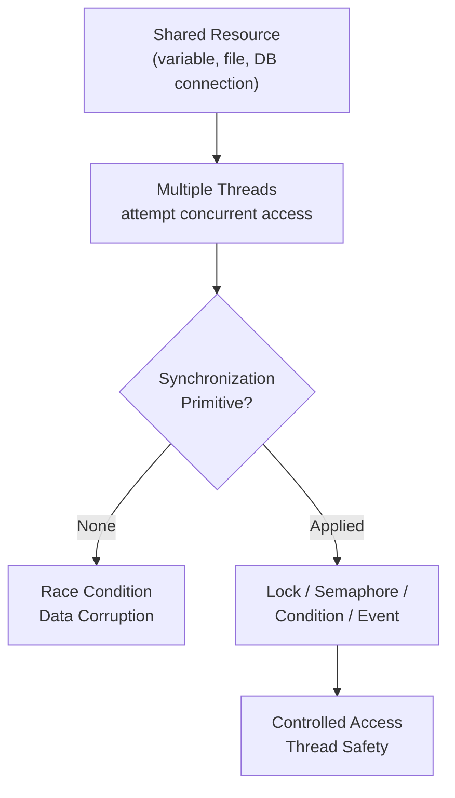

# Synchronization (Locks, Semaphores) in Python

## Overview

Synchronization primitives are the tools that coordinate access to shared resources among concurrent threads or processes. Without synchronization, concurrent programs suffer from race conditions, data corruption, and deadlocks.

Python's `threading` module provides a rich set of synchronization primitives: `Lock`, `RLock`, `Semaphore`, `BoundedSemaphore`, `Event`, `Condition`, and `Barrier`. Mastering these is essential for building correct, safe, and performant concurrent systems.

---

## Conceptual Flow




---

## Synchronization Primitives at a Glance

| Primitive | Purpose | Key Method |
|---|---|---|
| `Lock` | Mutual exclusion (one thread at a time) | `acquire()` / `release()` |
| `RLock` | Reentrant lock (same thread can re-acquire) | `acquire()` / `release()` |
| `Semaphore` | Limit concurrent access to N threads | `acquire()` / `release()` |
| `BoundedSemaphore` | Semaphore that raises on over-release | `acquire()` / `release()` |
| `Event` | Signal between threads (flag-based) | `set()` / `wait()` / `clear()` |
| `Condition` | Complex wait/notify coordination | `wait()` / `notify()` / `notify_all()` |
| `Barrier` | Wait until N threads reach a point | `wait()` |

---

## Simple Example

### `Lock` — Protecting a Shared Counter

```python
import threading

counter = 0
lock = threading.Lock()


def increment(n: int) -> None:
    global counter
    for _ in range(n):
        with lock:          # Acquire lock, release on exit (even on exception)
            counter += 1


threads = [threading.Thread(target=increment, args=(10_000,)) for _ in range(10)]
for t in threads:
    t.start()
for t in threads:
    t.join()

print(f"Final counter: {counter}")   # Always 100000
```

**Explanation:**
- Without the lock, `counter += 1` (read-modify-write) is not atomic and causes race conditions.
- `with lock:` is the idiomatic way to acquire and release a lock safely.
- The `with` statement guarantees release even if an exception occurs inside the block.

**Expected Output:**
```
Final counter: 100000
```

---

## Intermediate Example

### `Semaphore` — Rate-Limiting Concurrent API Calls

```python
import threading
import time
import random

# Allow at most 3 concurrent API calls
semaphore = threading.Semaphore(3)


def call_api(worker_id: int) -> None:
    print(f"Worker {worker_id}: waiting for slot...")
    with semaphore:
        print(f"Worker {worker_id}: calling API")
        time.sleep(random.uniform(0.5, 1.5))   # Simulate API latency
        print(f"Worker {worker_id}: done")


threads = [threading.Thread(target=call_api, args=(i,)) for i in range(8)]
for t in threads:
    t.start()
for t in threads:
    t.join()

print("All API calls completed.")
```

**Explanation:**
- `Semaphore(3)` allows up to 3 threads to be inside the `with` block simultaneously.
- Additional threads block at `with semaphore:` until a slot is released.
- This pattern is essential for rate-limiting external API calls, database connections, or file handles.

**Expected Output:**
```
Worker 0: waiting for slot...
Worker 0: calling API
Worker 1: calling API
Worker 2: calling API
Worker 3: waiting for slot...
...
All API calls completed.
```

---

## Advanced / Architect-Level Example

### Connection Pool with `BoundedSemaphore` and `Condition` for a RAG Pipeline

**Problem Context:**
A RAG pipeline makes concurrent calls to a vector database. The database supports a maximum of 5 simultaneous connections. We need a thread-safe connection pool that blocks when all connections are in use and notifies waiting threads when a connection is returned.

```python
from __future__ import annotations
import threading
import time
import logging
from contextlib import contextmanager
from typing import Generator

logging.basicConfig(level=logging.INFO, format="%(threadName)s | %(message)s")
logger = logging.getLogger(__name__)


class FakeDBConnection:
    def __init__(self, conn_id: int):
        self.conn_id = conn_id
        self.in_use = False

    def query(self, sql: str) -> str:
        time.sleep(0.1)  # Simulate query latency
        return f"Result of '{sql}' from conn {self.conn_id}"


class ConnectionPool:
    """
    Thread-safe connection pool using BoundedSemaphore + Condition.
    """

    def __init__(self, size: int = 5) -> None:
        self._pool: list[FakeDBConnection] = [FakeDBConnection(i) for i in range(size)]
        self._semaphore = threading.BoundedSemaphore(size)
        self._condition = threading.Condition(threading.Lock())

    @contextmanager
    def acquire(self) -> Generator[FakeDBConnection, None, None]:
        self._semaphore.acquire()
        conn = self._get_connection()
        try:
            yield conn
        finally:
            self._return_connection(conn)
            self._semaphore.release()

    def _get_connection(self) -> FakeDBConnection:
        with self._condition:
            while True:
                for conn in self._pool:
                    if not conn.in_use:
                        conn.in_use = True
                        logger.info(f"Acquired connection {conn.conn_id}")
                        return conn
                self._condition.wait()  # Wait for a connection to be returned

    def _return_connection(self, conn: FakeDBConnection) -> None:
        with self._condition:
            conn.in_use = False
            logger.info(f"Released connection {conn.conn_id}")
            self._condition.notify()  # Wake up one waiting thread


# --- Usage ---
pool = ConnectionPool(size=3)


def run_query(query_id: int) -> None:
    with pool.acquire() as conn:
        result = conn.query(f"SELECT * FROM docs WHERE id={query_id}")
        logger.info(f"Query {query_id}: {result}")


threads = [threading.Thread(target=run_query, args=(i,), name=f"Q-{i}") for i in range(9)]
for t in threads:
    t.start()
for t in threads:
    t.join()

print("All queries completed.")
```

**Explanation:**
- `BoundedSemaphore(3)` limits concurrent connections to 3.
- `Condition` coordinates the wait/notify cycle when all connections are busy.
- `@contextmanager` provides a clean `with pool.acquire() as conn:` API.
- `notify()` wakes exactly one waiting thread when a connection is returned.

**Design Trade-offs:**
| Approach | Pros | Cons |
|---|---|---|
| Semaphore only | Simple | No fine-grained connection tracking |
| Semaphore + Condition | Full control, efficient | More complex |
| `queue.Queue` as pool | Simpler, built-in blocking | Less flexible for health checks |
| SQLAlchemy pool | Production-grade, feature-rich | External dependency |

---

## Common Mistakes

### 1. Forgetting to Release a Lock
- **Problem:** If an exception occurs between `lock.acquire()` and `lock.release()`, the lock is never released, causing a deadlock.
- **Better Approach:** Always use `with lock:` (context manager) instead of manual acquire/release.

```python
# Dangerous
lock.acquire()
do_something()   # If this raises, lock is never released!
lock.release()

# Safe
with lock:
    do_something()
```

### 2. Deadlock from Inconsistent Lock Ordering
- **Problem:** Thread A acquires Lock 1 then Lock 2; Thread B acquires Lock 2 then Lock 1. Both block forever.
- **Better Approach:** Always acquire multiple locks in the same global order.

```python
# Safe: always acquire lock_a before lock_b
with lock_a:
    with lock_b:
        ...
```

### 3. Using `Lock` When `RLock` Is Needed
- **Problem:** A function that holds a lock calls another function that tries to acquire the same lock — deadlock.
- **Better Approach:** Use `threading.RLock()` for reentrant scenarios.

### 4. Over-releasing a `Semaphore`
- **Problem:** Calling `release()` more times than `acquire()` inflates the semaphore count, allowing more threads than intended.
- **Better Approach:** Use `BoundedSemaphore` which raises `ValueError` on over-release.

### 5. Busy-Waiting Instead of Using `Event` or `Condition`
- **Problem:** Polling a flag in a loop wastes CPU.
- **Better Approach:** Use `threading.Event.wait()` or `threading.Condition.wait()` for efficient blocking.

```python
# Wasteful
while not ready_flag:
    time.sleep(0.01)

# Efficient
event = threading.Event()
event.wait()   # Blocks until event.set() is called
```

### 6. Holding Locks During I/O
- **Problem:** Holding a lock while doing slow I/O (network, disk) blocks all other threads unnecessarily.
- **Better Approach:** Do I/O outside the lock; only hold the lock for the minimal critical section.

---

## Best Practices

- **Always use context managers** (`with lock:`) for lock acquisition.
- **Minimize lock scope:** Hold locks for the shortest time possible.
- **Use `BoundedSemaphore`** instead of `Semaphore` to catch programming errors.
- **Use `threading.Event`** for simple one-shot signaling between threads.
- **Use `threading.Condition`** for producer-consumer patterns requiring wait/notify.
- **Document lock ownership:** Comment which lock protects which data.
- **Avoid nested locks** unless absolutely necessary; if needed, enforce a strict acquisition order.
- **Prefer `queue.Queue`** over manual locks for inter-thread data transfer.
- **Test for deadlocks** using `faulthandler.dump_traceback_later()` in CI.

---

## Performance Considerations

- **Lock contention is the primary bottleneck:** If many threads compete for the same lock, throughput degrades to near-sequential.
- **Fine-grained locking:** Use multiple locks for different data segments to reduce contention.
- **Read-write locks:** Python's `threading` module lacks a built-in RWLock, but `threading.Condition` can implement one. For high-read workloads, consider `rwlock` or `readerwriterlock` packages.
- **Semaphore overhead:** Semaphore operations involve OS-level synchronization — avoid acquiring/releasing in tight loops.
- **Lock-free alternatives:** For simple counters, `collections.deque` (thread-safe for `append`/`popleft`) or `queue.Queue` can avoid explicit locking.
- **GIL interaction:** The GIL provides some implicit protection for simple operations, but never rely on it — always use explicit synchronization.

---

## Testing Strategy

```python
import threading
import time
import pytest


# --- Code under test ---
class RateLimitedResource:
    def __init__(self, max_concurrent: int):
        self._semaphore = threading.Semaphore(max_concurrent)
        self._active = 0
        self._lock = threading.Lock()
        self.max_observed = 0

    def use(self, duration: float = 0.05) -> None:
        with self._semaphore:
            with self._lock:
                self._active += 1
                self.max_observed = max(self.max_observed, self._active)
            time.sleep(duration)
            with self._lock:
                self._active -= 1


# --- Tests ---

def test_semaphore_limits_concurrency():
    resource = RateLimitedResource(max_concurrent=3)
    threads = [threading.Thread(target=resource.use) for _ in range(10)]
    for t in threads:
        t.start()
    for t in threads:
        t.join()
    assert resource.max_observed <= 3, f"Exceeded limit: {resource.max_observed}"


def test_lock_prevents_race_condition():
    counter = 0
    lock = threading.Lock()

    def increment():
        nonlocal counter
        for _ in range(10_000):
            with lock:
                counter += 1

    threads = [threading.Thread(target=increment) for _ in range(5)]
    for t in threads:
        t.start()
    for t in threads:
        t.join()
    assert counter == 50_000


def test_event_signals_correctly():
    event = threading.Event()
    results = []

    def waiter():
        event.wait(timeout=2.0)
        results.append("signaled")

    t = threading.Thread(target=waiter)
    t.start()
    time.sleep(0.1)
    event.set()
    t.join(timeout=1.0)
    assert results == ["signaled"]
```

---

## Debugging Tips

- **`faulthandler.dump_traceback_later(5)`:** Dumps all thread stacks after 5 seconds — invaluable for diagnosing deadlocks.
- **`threading.enumerate()`:** Lists all live threads; unexpected threads indicate leaks.
- **Log lock acquisition/release:** Add logging around critical sections during development to trace contention.
- **Use `timeout` on `acquire()`:** `lock.acquire(timeout=5)` returns `False` if the lock isn't acquired in 5 seconds — helps detect deadlocks in tests.
- **`threading.Condition` spurious wakeups:** Always re-check the condition predicate after `wait()` returns (use `while not condition:` not `if not condition:`).
- **Visualize thread states:** Tools like `py-spy` or `viztracer` can show thread activity and lock contention in production.

```python
import faulthandler
faulthandler.dump_traceback_later(timeout=5)
# ... run potentially deadlocking code ...
faulthandler.cancel_dump_traceback_later()
```

---

## Interview Questions

### Beginner
1. **What is a race condition?**
   A race condition occurs when the outcome of a program depends on the relative timing of thread execution, leading to unpredictable results.

2. **What is a `Lock` in Python threading?**
   A mutual exclusion primitive that allows only one thread to execute a critical section at a time.

3. **What is the difference between `Lock` and `RLock`?**
   `Lock` cannot be re-acquired by the thread that holds it (causes deadlock). `RLock` (reentrant lock) can be acquired multiple times by the same thread.

4. **What is a `Semaphore` used for?**
   Limiting the number of threads that can access a resource concurrently (e.g., max 5 DB connections).

5. **What is a deadlock?**
   A situation where two or more threads are each waiting for a lock held by the other, causing all to block forever.

### Intermediate
1. **What is the difference between `Semaphore` and `BoundedSemaphore`?**
   `BoundedSemaphore` raises `ValueError` if `release()` is called more times than `acquire()`, preventing programming errors that inflate the semaphore count.

2. **When would you use `threading.Event` vs `threading.Condition`?**
   `Event` is for simple one-shot or flag-based signaling. `Condition` is for complex wait/notify patterns where threads need to wait for a specific state change.

3. **How do you avoid deadlocks when acquiring multiple locks?**
   Always acquire locks in a consistent global order across all threads.

4. **What is a spurious wakeup and how do you handle it?**
   A thread wakes from `Condition.wait()` without being notified. Handle it by re-checking the condition in a `while` loop, not an `if` statement.

5. **How does `queue.Queue` provide thread safety without explicit locks?**
   `queue.Queue` internally uses a `threading.Condition` to protect its internal deque, providing thread-safe `put()` and `get()` operations.

### Advanced / Architect-Level
1. **How would you implement a read-write lock in Python?**
   Use a `threading.Condition` with a counter for active readers. Writers wait until all readers finish; readers wait if a writer is active.

2. **What is lock-free programming and when is it applicable in Python?**
   Lock-free programming uses atomic operations instead of locks. In Python, the GIL provides some atomicity for simple operations, but true lock-free structures (like `collections.deque`) rely on C-level atomicity.

3. **How would you design a rate limiter for a multi-threaded API client?**
   Use a `BoundedSemaphore` to limit concurrent requests, combined with a token bucket algorithm (using `threading.Timer` to replenish tokens) for time-based rate limiting.

4. **What are the implications of holding a lock across an I/O operation in a high-throughput service?**
   It serializes all threads waiting for that lock during the I/O wait, dramatically reducing throughput. The fix is to do I/O outside the lock and only lock the minimal state update.

5. **How do you test for deadlocks in a CI/CD pipeline?**
   Use `lock.acquire(timeout=N)` in tests to detect hangs, run stress tests with many threads, use `faulthandler` to dump stacks on timeout, and use tools like `ThreadSanitizer` for C-extension code.

---

## Key Takeaways

- Synchronization primitives prevent race conditions and ensure thread safety for shared resources.
- `Lock` provides mutual exclusion; always use `with lock:` to guarantee release.
- `Semaphore` limits concurrent access to N threads — ideal for connection pools and rate limiting.
- `BoundedSemaphore` adds safety by preventing over-release.
- `Event` enables simple thread signaling; `Condition` enables complex wait/notify coordination.
- Deadlocks arise from inconsistent lock ordering or forgetting to release locks.
- Minimize lock scope and avoid holding locks during I/O for maximum throughput.

---

## Mini Project Idea

### Thread-Safe Connection Pool

**Goal:** Build a reusable, thread-safe connection pool that manages a fixed number of database connections.

**Features:**
- Pool of N fake (or real) DB connections.
- `acquire()` context manager that blocks when all connections are in use.
- `BoundedSemaphore` to enforce the connection limit.
- Health check: periodically test connections and replace broken ones.
- Metrics: track wait time, active connections, and total queries.

**Suggested Folder Structure:**
```
connection_pool/
├── pool/
│   ├── __init__.py
│   ├── connection.py      # FakeDBConnection / real DB wrapper
│   ├── pool.py            # ConnectionPool with Semaphore + Condition
│   └── metrics.py         # Thread-safe metrics collector
├── tests/
│   ├── test_pool.py
│   └── test_concurrency.py
├── requirements.txt
└── README.md
```

**Extension Ideas:**
- Add connection timeout with `acquire(timeout=N)`.
- Implement connection health checks using a background thread.
- Add a `max_overflow` parameter (allow temporary extra connections under load).
- Expose Prometheus metrics for pool utilization.

---

## Final Summary

Synchronization is the cornerstone of correct concurrent programming. A Python architect who deeply understands `Lock`, `RLock`, `Semaphore`, `Event`, and `Condition` can design systems that are both thread-safe and performant. The key insight is that synchronization is not just about preventing bugs — it is about designing clear ownership and access patterns for shared resources. Mastering these primitives enables you to build production-grade connection pools, rate limiters, worker pipelines, and event-driven systems that scale reliably under concurrent load.
