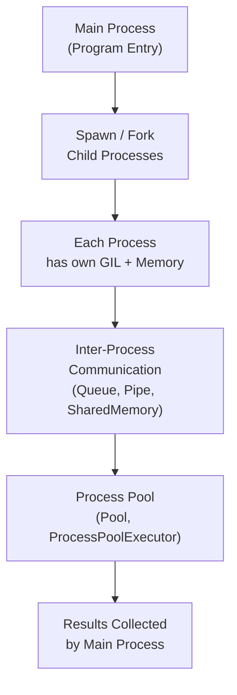

# Multiprocessing in Python

## Overview

Multiprocessing allows Python programs to run multiple processes in parallel, each with its own memory space and Python interpreter. Unlike threading, multiprocessing bypasses the Global Interpreter Lock (GIL), enabling true CPU parallelism for compute-intensive tasks.

Python's `multiprocessing` module provides processes, pools, queues, pipes, shared memory, and synchronization primitives — making it the go-to solution for CPU-bound workloads in production systems.

---

## Conceptual Flow




---

## Threading vs Multiprocessing vs Asyncio

| Aspect | Threading | Multiprocessing | Asyncio |
|---|---|---|---|
| GIL bypass | No | Yes | No |
| Best for | I/O-bound | CPU-bound | I/O-bound (high concurrency) |
| Memory | Shared | Separate | Shared |
| Overhead | Low | High (process spawn) | Very low |
| Communication | Shared memory | Queue / Pipe / SharedMemory | Coroutines / queues |

---

## Simple Example

### Running Functions in Parallel Processes

```python
import multiprocessing
import time


def compute_square(n: int) -> int:
    """CPU-bound computation."""
    time.sleep(0.5)   # Simulate heavy computation
    return n * n


if __name__ == "__main__":
    numbers = [1, 2, 3, 4, 5]

    # Sequential
    start = time.perf_counter()
    results = [compute_square(n) for n in numbers]
    print(f"Sequential: {results} in {time.perf_counter() - start:.2f}s")

    # Parallel
    start = time.perf_counter()
    with multiprocessing.Pool(processes=5) as pool:
        results = pool.map(compute_square, numbers)
    print(f"Parallel:   {results} in {time.perf_counter() - start:.2f}s")
```

**Explanation:**
- `multiprocessing.Pool` creates a pool of worker processes.
- `pool.map()` distributes the iterable across workers and collects results in order.
- The `if __name__ == "__main__":` guard is required on Windows to prevent recursive process spawning.

**Expected Output:**
```
Sequential: [1, 4, 9, 16, 25] in 2.50s
Parallel:   [1, 4, 9, 16, 25] in 0.51s
```

---

## Intermediate Example

### Parallel Document Processing with `ProcessPoolExecutor`

```python
from __future__ import annotations
import concurrent.futures
import hashlib
import time
from pathlib import Path


def process_document(doc: dict) -> dict:
    """
    Simulate CPU-bound document processing:
    tokenization, hashing, feature extraction.
    """
    content = doc["content"]
    # Simulate heavy CPU work
    tokens = content.lower().split()
    word_count = len(tokens)
    content_hash = hashlib.sha256(content.encode()).hexdigest()
    unique_words = len(set(tokens))
    return {
        "doc_id": doc["doc_id"],
        "word_count": word_count,
        "unique_words": unique_words,
        "hash": content_hash[:16],
    }


if __name__ == "__main__":
    documents = [
        {"doc_id": f"doc_{i}", "content": f"The quick brown fox jumps over the lazy dog {i} times."}
        for i in range(20)
    ]

    start = time.perf_counter()
    with concurrent.futures.ProcessPoolExecutor(max_workers=4) as executor:
        futures = [executor.submit(process_document, doc) for doc in documents]
        results = [f.result() for f in concurrent.futures.as_completed(futures)]

    elapsed = time.perf_counter() - start
    print(f"Processed {len(results)} documents in {elapsed:.3f}s")
    for r in sorted(results, key=lambda x: x["doc_id"])[:3]:
        print(f"  {r['doc_id']}: {r['word_count']} words, hash={r['hash']}")
```

**Explanation:**
- `ProcessPoolExecutor` is the high-level, `concurrent.futures`-compatible API for multiprocessing.
- Each document is processed in a separate process — true CPU parallelism.
- `as_completed()` yields futures as they finish, enabling streaming result processing.

**Expected Output:**
```
Processed 20 documents in 0.XXXs
  doc_0: 11 words, hash=...
  doc_1: 11 words, hash=...
  doc_10: 11 words, hash=...
```

---

## Advanced / Architect-Level Example

### Parallel Embedding Generation for a RAG Pipeline

**Problem Context:**
A RAG pipeline needs to generate embeddings for 10,000 documents. Embedding generation is CPU-bound (local model inference). We use `multiprocessing` with a shared work queue, progress tracking, and graceful error handling.

```python
from __future__ import annotations
import multiprocessing
import multiprocessing.queues
import time
import logging
import hashlib
from dataclasses import dataclass
from typing import Optional

logging.basicConfig(level=logging.INFO, format="%(processName)s | %(message)s")
logger = logging.getLogger(__name__)


@dataclass
class Document:
    doc_id: str
    content: str


@dataclass
class EmbeddingResult:
    doc_id: str
    embedding: list[float]
    error: Optional[str] = None


def embed_worker(
    work_queue: multiprocessing.Queue,
    result_queue: multiprocessing.Queue,
) -> None:
    """Worker process: reads from work_queue, writes to result_queue."""
    while True:
        item = work_queue.get()
        if item is None:   # Poison pill
            logger.info("Worker shutting down.")
            break
        doc: Document = item
        try:
            # Simulate CPU-bound embedding (e.g., local sentence-transformer)
            time.sleep(0.01)
            embedding = [float(b) / 255.0 for b in hashlib.md5(doc.content.encode()).digest()]
            result_queue.put(EmbeddingResult(doc_id=doc.doc_id, embedding=embedding))
        except Exception as exc:
            result_queue.put(EmbeddingResult(doc_id=doc.doc_id, embedding=[], error=str(exc)))


class ParallelEmbeddingPipeline:
    def __init__(self, num_workers: int = 4) -> None:
        self._num_workers = num_workers
        self._work_queue: multiprocessing.Queue = multiprocessing.Queue(maxsize=200)
        self._result_queue: multiprocessing.Queue = multiprocessing.Queue()
        self._workers: list[multiprocessing.Process] = []

    def start(self) -> None:
        for i in range(self._num_workers):
            p = multiprocessing.Process(
                target=embed_worker,
                args=(self._work_queue, self._result_queue),
                name=f"EmbedWorker-{i+1}",
                daemon=True,
            )
            p.start()
            self._workers.append(p)
        logger.info(f"Started {self._num_workers} worker processes.")

    def process(self, documents: list[Document]) -> list[EmbeddingResult]:
        # Submit work
        for doc in documents:
            self._work_queue.put(doc)

        # Send poison pills
        for _ in range(self._num_workers):
            self._work_queue.put(None)

        # Collect results
        results = []
        for _ in documents:
            results.append(self._result_queue.get())

        # Wait for workers to exit
        for p in self._workers:
            p.join()

        return results


if __name__ == "__main__":
    docs = [Document(doc_id=f"doc_{i:04d}", content=f"Document content number {i}") for i in range(50)]

    pipeline = ParallelEmbeddingPipeline(num_workers=4)
    pipeline.start()
    results = pipeline.process(docs)

    successful = [r for r in results if not r.error]
    failed = [r for r in results if r.error]
    print(f"\nEmbedded: {len(successful)} | Failed: {len(failed)}")
    print(f"Sample: {successful[0].doc_id} -> {successful[0].embedding[:4]}")
```

**Explanation:**
- `multiprocessing.Queue` is used for IPC (inter-process communication) — it is process-safe.
- The poison pill pattern signals workers to stop gracefully.
- Each worker process has its own memory — no shared state issues.
- `daemon=True` ensures workers are killed if the main process exits unexpectedly.

**Design Trade-offs:**
| Approach | Pros | Cons |
|---|---|---|
| `multiprocessing.Pool.map` | Simple, ordered results | Blocks until all done |
| `ProcessPoolExecutor` | Futures API, streaming | Less control over IPC |
| Manual Process + Queue | Full control, streaming | More boilerplate |
| Celery / RQ | Distributed, persistent | External infrastructure |
| Ray | Distributed, scalable | Heavy dependency |

---

## Common Mistakes

### 1. Missing `if __name__ == "__main__":` Guard
- **Problem:** On Windows, `multiprocessing` uses `spawn` (not `fork`), which re-imports the module. Without the guard, child processes recursively spawn more processes.
- **Better Approach:** Always wrap multiprocessing code in `if __name__ == "__main__":`.

### 2. Passing Non-Picklable Objects
- **Problem:** `multiprocessing` serializes arguments via `pickle`. Lambda functions, local functions, and many objects are not picklable.
- **Better Approach:** Use module-level functions as worker targets. Use `multiprocessing.pool.Pool` with `initializer` for shared state.

```python
# Fails: lambda is not picklable
pool.map(lambda x: x*2, [1,2,3])

# Works: module-level function
def double(x): return x * 2
pool.map(double, [1,2,3])
```

### 3. Using `multiprocessing` for I/O-Bound Tasks
- **Problem:** Process creation overhead (~50ms) makes multiprocessing wasteful for fast I/O tasks.
- **Better Approach:** Use `threading` or `asyncio` for I/O-bound work.

### 4. Ignoring Process Exit Codes
- **Problem:** Worker processes may crash silently. Not checking exit codes hides failures.
- **Better Approach:** Check `process.exitcode` after `join()`. Use `result_queue` to propagate errors.

### 5. Sharing Large Data via Queue
- **Problem:** Serializing large objects (e.g., NumPy arrays) through a `Queue` is slow due to pickling overhead.
- **Better Approach:** Use `multiprocessing.shared_memory` or `multiprocessing.Array` for large shared data.

### 6. Not Terminating Zombie Processes
- **Problem:** Processes that finish but are never joined become zombies, consuming OS resources.
- **Better Approach:** Always call `process.join()` or use `Pool` as a context manager.

---

## Best Practices

- **Always use `if __name__ == "__main__":`** to guard multiprocessing entry points.
- **Use `ProcessPoolExecutor`** for most use cases — it integrates with `concurrent.futures` and handles lifecycle.
- **Use `multiprocessing.Queue`** for IPC; avoid shared mutable state between processes.
- **Use `multiprocessing.shared_memory`** for large read-only data (e.g., NumPy arrays) to avoid serialization overhead.
- **Set `maxtasksperchild`** in `Pool` to recycle workers and prevent memory leaks in long-running pools.
- **Handle errors explicitly:** Wrap worker functions in try/except and return error results via the result queue.
- **Use `daemon=True`** for background workers that should not block program exit.
- **Profile first:** Measure whether multiprocessing actually improves performance — process overhead can negate gains for small tasks.

---

## Performance Considerations

- **Process creation overhead:** Spawning a process takes ~50–100ms. Use pools to amortize this cost.
- **Serialization (pickling) overhead:** Arguments and results are pickled/unpickled. Large objects are expensive to transfer.
- **`shared_memory` for large arrays:** `multiprocessing.shared_memory.SharedMemory` allows zero-copy sharing of large NumPy arrays between processes.
- **`chunksize` in `pool.map()`:** Batching tasks reduces IPC overhead. Use `chunksize=N` to send N tasks per IPC call.
- **CPU affinity:** On NUMA systems, binding processes to specific CPU cores can improve cache performance.
- **Memory usage:** Each process has its own memory. 8 workers × 500MB model = 4GB RAM. Plan accordingly.

```python
# Efficient: use chunksize for large iterables
with multiprocessing.Pool() as pool:
    results = pool.map(process_item, large_list, chunksize=100)
```

---

## Testing Strategy

```python
import multiprocessing
import pytest
import time


def square(x: int) -> int:
    return x * x


def failing_worker(x: int) -> int:
    if x == 3:
        raise ValueError(f"Cannot process {x}")
    return x * x


# --- Tests ---

def test_pool_map_basic():
    with multiprocessing.Pool(processes=2) as pool:
        results = pool.map(square, [1, 2, 3, 4, 5])
    assert results == [1, 4, 9, 16, 25]


def test_pool_map_error_propagation():
    with multiprocessing.Pool(processes=2) as pool:
        with pytest.raises(ValueError, match="Cannot process 3"):
            pool.map(failing_worker, [1, 2, 3, 4, 5])


def test_process_completes():
    result_queue = multiprocessing.Queue()

    def worker(q):
        q.put("done")

    p = multiprocessing.Process(target=worker, args=(result_queue,))
    p.start()
    p.join(timeout=5)
    assert p.exitcode == 0
    assert result_queue.get(timeout=1) == "done"


def test_pool_executor_futures():
    import concurrent.futures
    with concurrent.futures.ProcessPoolExecutor(max_workers=2) as executor:
        futures = [executor.submit(square, i) for i in range(5)]
        results = [f.result() for f in futures]
    assert sorted(results) == [0, 1, 4, 9, 16]
```

> **Note:** Multiprocessing tests must be run with `pytest` from the command line (not in interactive notebooks) and require the `if __name__ == "__main__":` guard in scripts.

---

## Debugging Tips

- **`process.exitcode`:** `0` = success, negative = killed by signal, positive = exception. Check after `join()`.
- **Logging in worker processes:** Use `multiprocessing.log_to_stderr()` to enable logging from worker processes.
- **`multiprocessing.current_process().name`:** Identifies the current process in logs.
- **Deadlock detection:** If `queue.get()` hangs, the worker may have crashed. Use `queue.get(timeout=N)` to detect this.
- **`Pool.terminate()` vs `Pool.close()`:** `close()` waits for workers to finish; `terminate()` kills them immediately. Use `terminate()` only in error recovery.
- **Pickling errors:** Wrap `pool.map()` calls in try/except and print the full traceback — pickling errors often have unhelpful messages.
- **`faulthandler`:** Enable in worker processes to get stack traces on crashes.

```python
import multiprocessing
logger = multiprocessing.log_to_stderr()
logger.setLevel(multiprocessing.SUBDEBUG)
```

---

## Interview Questions

### Beginner
1. **What is the difference between multiprocessing and threading in Python?**
   Multiprocessing creates separate processes with independent memory and GIL, enabling true CPU parallelism. Threading shares memory within one process but is limited by the GIL for CPU-bound tasks.

2. **Why is `if __name__ == "__main__":` required for multiprocessing on Windows?**
   Windows uses `spawn` to create processes, which re-imports the module. Without the guard, child processes recursively spawn more processes.

3. **What is `multiprocessing.Pool`?**
   A pool of worker processes that can execute tasks in parallel using `map()`, `apply()`, `starmap()`, etc.

4. **How do processes communicate in Python's multiprocessing?**
   Via `multiprocessing.Queue`, `multiprocessing.Pipe`, `multiprocessing.shared_memory`, or `multiprocessing.Manager` objects.

5. **What types of tasks benefit most from multiprocessing?**
   CPU-bound tasks: numerical computation, image processing, ML inference, data transformation.

### Intermediate
1. **What is the difference between `Pool.map()` and `Pool.imap()`?**
   `map()` blocks until all results are ready and returns a list. `imap()` returns an iterator, yielding results lazily — better for large iterables.

2. **Why can't you pass lambda functions to `Pool.map()`?**
   `multiprocessing` uses `pickle` to serialize arguments. Lambda functions and locally-defined functions are not picklable.

3. **What is `multiprocessing.shared_memory` and when should you use it?**
   It provides a shared memory block accessible by multiple processes without serialization. Use it for large NumPy arrays or read-only data shared across workers.

4. **What is `maxtasksperchild` in `Pool`?**
   It limits the number of tasks a worker process handles before being replaced. Useful for preventing memory leaks in long-running pools.

5. **How do you handle exceptions in worker processes?**
   Exceptions in `pool.map()` are re-raised in the main process. For `Pool.apply_async()`, use the `error_callback` parameter or check `AsyncResult.get()`.

### Advanced / Architect-Level
1. **How would you design a distributed document processing pipeline using multiprocessing?**
   Use a `ProcessPoolExecutor` with a bounded work queue, shared memory for large read-only data (e.g., model weights), result aggregation via a `Queue`, and a monitoring thread tracking progress and errors.

2. **What are the trade-offs between `multiprocessing` and Celery for background task processing?**
   `multiprocessing` is in-process, low-latency, and requires no infrastructure. Celery is distributed, persistent, supports retries and scheduling, but requires a broker (Redis/RabbitMQ) and adds operational complexity.

3. **How do you share a large NumPy array across processes without copying?**
   Use `multiprocessing.shared_memory.SharedMemory` to allocate a shared buffer, then create NumPy arrays backed by that buffer in each process.

4. **What is the `spawn` vs `fork` vs `forkserver` start method and when does each apply?**
   `fork` (Linux default): fast, copies parent memory. `spawn` (Windows/macOS default): safe, starts fresh interpreter. `forkserver`: uses a server process to fork, avoiding fork-safety issues with threads.

5. **How would you implement backpressure in a multiprocessing pipeline?**
   Use a bounded `multiprocessing.Queue(maxsize=N)`. Producers block when the queue is full, naturally throttling input to match worker throughput.

---

## Key Takeaways

- Multiprocessing bypasses the GIL, enabling true CPU parallelism in Python.
- Use `multiprocessing` for CPU-bound tasks; use `threading` or `asyncio` for I/O-bound tasks.
- `ProcessPoolExecutor` is the preferred high-level API for most use cases.
- `multiprocessing.Queue` and `Pipe` are the safe ways to communicate between processes.
- Always use `if __name__ == "__main__":` to guard multiprocessing entry points.
- Pickling is the primary constraint — only picklable objects can be passed between processes.
- `shared_memory` eliminates serialization overhead for large data shared across processes.

---

## Mini Project Idea

### Parallel Log Analyzer

**Goal:** Build a CLI tool that analyzes large log files in parallel, extracting error counts, response times, and top endpoints.

**Features:**
- Split a large log file into chunks.
- Process each chunk in a separate process using `ProcessPoolExecutor`.
- Aggregate results (error counts, avg response time, top-10 endpoints) in the main process.
- Display a summary report with `rich`.
- Benchmark sequential vs parallel processing time.

**Suggested Folder Structure:**
```
log_analyzer/
├── analyzer/
│   ├── __init__.py
│   ├── parser.py          # Log line parser
│   ├── worker.py          # Chunk processing function
│   ├── aggregator.py      # Result aggregation
│   └── cli.py             # CLI entry point
├── tests/
│   ├── test_parser.py
│   └── test_worker.py
├── sample.log
├── requirements.txt
└── README.md
```

**Extension Ideas:**
- Add support for multiple log formats (nginx, Apache, JSON).
- Stream results progressively using `imap_unordered`.
- Add anomaly detection (spike in error rate) using statistical analysis.
- Export results to a SQLite database for historical comparison.

---

## Final Summary

Multiprocessing is the definitive solution for CPU-bound parallelism in Python. By spawning independent processes, it bypasses the GIL and leverages all available CPU cores — essential for data processing pipelines, ML inference, scientific computing, and any workload where computation, not I/O, is the bottleneck. A Python architect who masters multiprocessing — including process pools, IPC patterns, shared memory, and error handling — can design systems that scale horizontally across cores and, combined with tools like Celery or Ray, across machines. This knowledge is foundational for building high-performance, production-grade Python backends.
