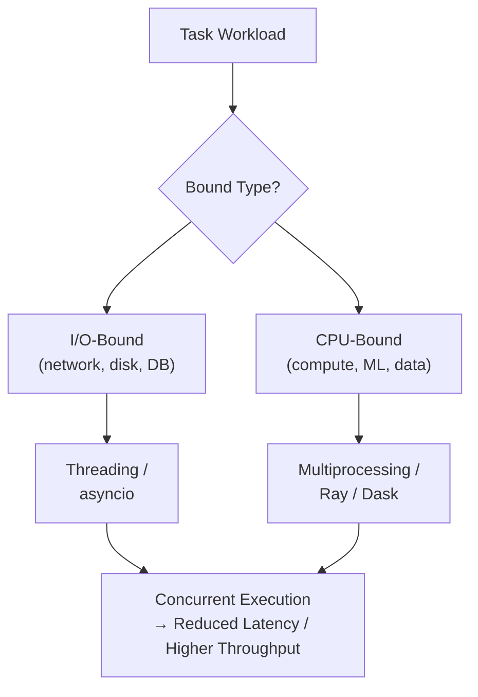

# Parallel Processing in Python

## Overview

Parallel processing is the technique of executing multiple computations simultaneously to reduce total execution time. In Python, it encompasses threading (I/O-bound concurrency), multiprocessing (CPU-bound parallelism), and distributed computing frameworks. Choosing the right parallelism model is one of the most impactful architectural decisions in production Python systems.

---

## Conceptual Flow




---

## Parallelism Models in Python

| Model | Module | Best For | GIL Bypass |
|---|---|---|---|
| Threading | `threading`, `concurrent.futures` | I/O-bound | No |
| Multiprocessing | `multiprocessing`, `concurrent.futures` | CPU-bound | Yes |
| Async I/O | `asyncio` | High-concurrency I/O | No |
| Distributed | `Ray`, `Dask`, `Celery` | Large-scale, multi-machine | Yes |
| GPU Parallelism | `cupy`, `numba`, `torch` | Tensor/array computation | Yes (GPU) |

---

## Simple Example

### `concurrent.futures` — Unified API for Threads and Processes

```python
import concurrent.futures
import time
import math


def is_prime(n: int) -> bool:
    """CPU-bound: primality test."""
    if n < 2:
        return False
    for i in range(2, int(math.sqrt(n)) + 1):
        if n % i == 0:
            return False
    return True


numbers = list(range(10_000, 10_100))

# Sequential
start = time.perf_counter()
seq_results = [is_prime(n) for n in numbers]
print(f"Sequential: {time.perf_counter() - start:.3f}s")

# Parallel (ProcessPoolExecutor for CPU-bound)
start = time.perf_counter()
with concurrent.futures.ProcessPoolExecutor() as executor:
    par_results = list(executor.map(is_prime, numbers))
print(f"Parallel:   {time.perf_counter() - start:.3f}s")

assert seq_results == par_results
print(f"Primes found: {sum(par_results)}")
```

**Explanation:**
- `ProcessPoolExecutor` distributes CPU-bound work across all available cores.
- `executor.map()` preserves input order and returns results as a list.
- The `concurrent.futures` API is identical for `ThreadPoolExecutor` and `ProcessPoolExecutor` — swap one for the other based on workload type.

**Expected Output:**
```
Sequential: 0.XXXs
Parallel:   0.XXXs  (faster on multi-core)
Primes found: N
```

---

## Intermediate Example

### Parallel Data Transformation with `multiprocessing.Pool` and `chunksize`

```python
from __future__ import annotations
import multiprocessing
import time
import hashlib
from typing import Any


def transform_record(record: dict[str, Any]) -> dict[str, Any]:
    """
    CPU-bound transformation: normalize, hash, and enrich a data record.
    """
    content = record["text"].lower().strip()
    tokens = content.split()
    content_hash = hashlib.sha256(content.encode()).hexdigest()[:12]
    return {
        "id": record["id"],
        "token_count": len(tokens),
        "unique_tokens": len(set(tokens)),
        "hash": content_hash,
        "normalized": content[:50],
    }


if __name__ == "__main__":
    # Generate synthetic dataset
    dataset = [
        {"id": i, "text": f"The quick brown fox jumps over the lazy dog {i} times repeatedly."}
        for i in range(10_000)
    ]

    cpu_count = multiprocessing.cpu_count()
    print(f"Using {cpu_count} CPU cores")

    start = time.perf_counter()
    with multiprocessing.Pool(processes=cpu_count) as pool:
        # chunksize=500: send 500 records per IPC call to reduce overhead
        results = pool.map(transform_record, dataset, chunksize=500)
    elapsed = time.perf_counter() - start

    print(f"Transformed {len(results)} records in {elapsed:.3f}s")
    print(f"Sample: {results[0]}")
```

**Explanation:**
- `chunksize=500` batches 500 tasks per IPC call, reducing serialization overhead.
- `multiprocessing.cpu_count()` returns the number of available CPU cores.
- Each worker process independently transforms its chunk of records.

**Expected Output:**
```
Using N CPU cores
Transformed 10000 records in X.XXXs
Sample: {'id': 0, 'token_count': 12, ...}
```

---

## Advanced / Architect-Level Example

### Parallel RAG Document Embedding with Ray

**Problem Context:**
A production RAG system needs to embed 100,000 documents using a local sentence-transformer model. The model is large (~500MB) and must be loaded once per worker, not once per task. Ray's actor model enables stateful workers that hold the model in memory.

```python
# pip install ray sentence-transformers (for real use)
# This example uses a mock embedder for demonstration

from __future__ import annotations
import time
import hashlib
from dataclasses import dataclass
from typing import List

# --- Mock Ray-style implementation (no Ray dependency required to run) ---
# In production, replace with: import ray; @ray.remote

@dataclass
class Document:
    doc_id: str
    content: str

@dataclass
class EmbeddingResult:
    doc_id: str
    embedding: List[float]


class EmbeddingActor:
    """
    Stateful worker that loads the model once and processes many documents.
    In production: @ray.remote class EmbeddingActor
    """

    def __init__(self, model_name: str = "mock-model") -> None:
        self.model_name = model_name
        self._load_model()

    def _load_model(self) -> None:
        """Simulate expensive model loading (done once per worker)."""
        time.sleep(0.1)
        print(f"[{self.model_name}] Model loaded.")

    def embed(self, doc: Document) -> EmbeddingResult:
        """Embed a single document."""
        # Simulate inference
        raw = hashlib.md5(doc.content.encode()).digest()
        embedding = [b / 255.0 for b in raw]
        return EmbeddingResult(doc_id=doc.doc_id, embedding=embedding)

    def embed_batch(self, docs: List[Document]) -> List[EmbeddingResult]:
        return [self.embed(doc) for doc in docs]


class ParallelEmbeddingService:
    """
    Orchestrates parallel embedding using multiple stateful actors.
    """

    def __init__(self, num_actors: int = 4) -> None:
        self._actors = [EmbeddingActor(f"actor-{i}") for i in range(num_actors)]

    def embed_all(self, documents: List[Document], batch_size: int = 50) -> List[EmbeddingResult]:
        # Split documents into batches
        batches = [documents[i:i+batch_size] for i in range(0, len(documents), batch_size)]

        # Distribute batches across actors (round-robin)
        import concurrent.futures
        results: List[EmbeddingResult] = []

        with concurrent.futures.ThreadPoolExecutor(max_workers=len(self._actors)) as executor:
            futures = []
            for i, batch in enumerate(batches):
                actor = self._actors[i % len(self._actors)]
                futures.append(executor.submit(actor.embed_batch, batch))

            for future in concurrent.futures.as_completed(futures):
                results.extend(future.result())

        return results


if __name__ == "__main__":
    docs = [Document(doc_id=f"doc_{i:05d}", content=f"Document content {i}") for i in range(200)]

    service = ParallelEmbeddingService(num_actors=4)

    start = time.perf_counter()
    results = service.embed_all(docs, batch_size=50)
    elapsed = time.perf_counter() - start

    print(f"\nEmbedded {len(results)} documents in {elapsed:.3f}s")
    print(f"Sample: {results[0].doc_id} -> {results[0].embedding[:4]}")
```

**Explanation:**
- The actor pattern loads the model once per worker, avoiding repeated expensive initialization.
- Batching reduces per-task overhead and improves GPU/CPU utilization.
- In production with Ray: replace `EmbeddingActor` with `@ray.remote` class and use `actor.embed_batch.remote(batch)`.

**Design Trade-offs:**
| Approach | Pros | Cons |
|---|---|---|
| `ProcessPoolExecutor` | Simple, built-in | Model reloaded per task |
| `Pool` with `initializer` | Model loaded once per worker | Less flexible |
| Ray actors | Stateful, distributed, scalable | External dependency |
| Dask | DataFrame-native, lazy evaluation | Different API paradigm |
| Celery | Persistent, distributed, retries | Broker infrastructure needed |

---

## Common Mistakes

### 1. Using Multiprocessing for I/O-Bound Tasks
- **Problem:** Process creation overhead (~100ms) makes multiprocessing wasteful for fast I/O.
- **Better Approach:** Use `asyncio` or `ThreadPoolExecutor` for I/O-bound work.

### 2. Not Accounting for Amdahl's Law
- **Problem:** Expecting linear speedup from parallelism. If 20% of code is sequential, max speedup is 5× regardless of core count.
- **Better Approach:** Profile to identify the parallel fraction. Optimize the sequential bottleneck first.

### 3. Serialization Overhead Negating Parallelism Gains
- **Problem:** Passing large objects between processes via `Queue` or `pool.map()` incurs heavy pickling overhead.
- **Better Approach:** Use `shared_memory` for large arrays, or restructure to minimize IPC data transfer.

### 4. Creating Too Many Workers
- **Problem:** More workers than CPU cores causes context-switching overhead and memory pressure.
- **Better Approach:** Use `os.cpu_count()` as the default worker count for CPU-bound tasks.

### 5. Ignoring Worker Failures
- **Problem:** A crashed worker silently drops tasks, causing incomplete results.
- **Better Approach:** Use futures with `.result()` (raises exceptions), or implement retry logic.

### 6. Mixing Parallelism Models Incorrectly
- **Problem:** Using `ThreadPoolExecutor` for CPU-bound tasks (GIL prevents parallelism) or `ProcessPoolExecutor` for fast I/O tasks (process overhead dominates).
- **Better Approach:** Profile the workload and choose the appropriate model.

---

## Best Practices

- **Profile before parallelizing:** Measure sequential performance first. Parallelism adds complexity — only apply it where it provides measurable benefit.
- **Use `concurrent.futures`** as the default API — it works with both threads and processes and integrates with `asyncio`.
- **Set `max_workers` explicitly:** Don't rely on defaults; tune based on workload and hardware.
- **Use `chunksize`** in `pool.map()` for large iterables to reduce IPC overhead.
- **Use `initializer` in `Pool`** to load expensive resources (models, DB connections) once per worker.
- **Implement graceful shutdown:** Handle `KeyboardInterrupt` and ensure workers are joined or terminated.
- **Monitor worker health:** Track task completion rates, error rates, and queue depths in production.
- **Use structured logging** with process/thread names for traceability.

---

## Performance Considerations

- **Amdahl's Law:** Speedup is limited by the sequential fraction. `Speedup = 1 / (S + (1-S)/N)` where S is the sequential fraction and N is the number of processors.
- **Gustafson's Law:** As problem size grows, the parallel fraction typically increases — larger datasets benefit more from parallelism.
- **IPC overhead:** `multiprocessing.Queue` serializes via pickle. For 1MB objects, pickling takes ~1ms. For 100MB arrays, use `shared_memory`.
- **Memory:** Each process duplicates the parent's memory (on fork). 4 workers × 2GB process = 8GB RAM.
- **NumPy with multiprocessing:** NumPy releases the GIL for many operations, making it partially thread-safe for CPU-bound array work.
- **GPU parallelism:** For ML workloads, GPU parallelism (PyTorch, CuPy) vastly outperforms CPU multiprocessing.

---

## Testing Strategy

```python
import concurrent.futures
import multiprocessing
import time
import pytest


def cpu_task(n: int) -> int:
    return sum(range(n))


def io_task(delay: float) -> str:
    time.sleep(delay)
    return f"done after {delay}s"


# --- Tests ---

def test_process_pool_correctness():
    with concurrent.futures.ProcessPoolExecutor(max_workers=2) as executor:
        results = list(executor.map(cpu_task, [100, 200, 300]))
    assert results == [4950, 19900, 44850]


def test_thread_pool_io_concurrency():
    start = time.perf_counter()
    with concurrent.futures.ThreadPoolExecutor(max_workers=5) as executor:
        futures = [executor.submit(io_task, 0.1) for _ in range(5)]
        results = [f.result() for f in futures]
    elapsed = time.perf_counter() - start
    assert elapsed < 0.5, f"Expected concurrent execution, took {elapsed:.2f}s"
    assert all("done" in r for r in results)


def test_executor_exception_propagation():
    def failing_task(x):
        if x == 3:
            raise ValueError("bad input")
        return x

    with concurrent.futures.ProcessPoolExecutor(max_workers=2) as executor:
        futures = [executor.submit(failing_task, i) for i in range(5)]
        results = []
        errors = []
        for f in concurrent.futures.as_completed(futures):
            try:
                results.append(f.result())
            except ValueError as e:
                errors.append(str(e))

    assert len(errors) == 1
    assert "bad input" in errors[0]


def test_worker_count_matches_cpu():
    cpu_count = multiprocessing.cpu_count()
    assert cpu_count >= 1
```

---

## Debugging Tips

- **`concurrent.futures.Future.exception()`:** Returns the exception raised by a task without re-raising it — useful for error inspection.
- **`executor.map()` vs `as_completed()`:** `map()` raises the first exception immediately; `as_completed()` lets you handle each future's exception individually.
- **Process hangs:** Use `faulthandler.dump_traceback_later(timeout=10)` to dump all thread/process stacks if the program hangs.
- **`multiprocessing.active_children()`:** Lists all active child processes — useful for detecting process leaks.
- **Logging in workers:** Use `multiprocessing.log_to_stderr()` or pass a logging queue to workers.
- **`py-spy`:** A sampling profiler that works on running Python processes — attach to a worker to profile CPU usage.
- **`viztracer`:** Records a timeline of all threads/processes — invaluable for visualizing parallel execution.

```python
# Inspect future results safely
for future in concurrent.futures.as_completed(futures):
    exc = future.exception()
    if exc:
        print(f"Task failed: {exc}")
    else:
        print(f"Result: {future.result()}")
```

---

## Interview Questions

### Beginner
1. **What is the difference between concurrency and parallelism?**
   Concurrency is about managing multiple tasks at once (interleaving). Parallelism is about executing multiple tasks simultaneously on multiple cores.

2. **When should you use `ThreadPoolExecutor` vs `ProcessPoolExecutor`?**
   `ThreadPoolExecutor` for I/O-bound tasks; `ProcessPoolExecutor` for CPU-bound tasks.

3. **What is `concurrent.futures.as_completed()`?**
   A function that yields futures as they complete, regardless of submission order — useful for processing results as soon as they are available.

4. **What is Amdahl's Law?**
   It states that the maximum speedup from parallelism is limited by the sequential fraction of the program.

5. **What is a `Future` in `concurrent.futures`?**
   An object representing the result of an asynchronous computation. Call `.result()` to get the value (blocks until ready).

### Intermediate
1. **How do you handle exceptions in parallel tasks with `concurrent.futures`?**
   Exceptions are stored in the `Future` object and re-raised when `.result()` is called. Use try/except around `.result()` or check `.exception()`.

2. **What is `chunksize` in `Pool.map()` and why does it matter?**
   It controls how many tasks are sent to each worker per IPC call. Larger chunks reduce IPC overhead but may cause load imbalance.

3. **How do you load a large model once per worker in a `ProcessPool`?**
   Use the `initializer` and `initargs` parameters of `multiprocessing.Pool` to run initialization code once per worker process.

4. **What is the difference between `map()` and `imap_unordered()` in `multiprocessing.Pool`?**
   `map()` blocks and returns ordered results. `imap_unordered()` returns an iterator yielding results as they complete, in any order.

5. **How does Ray differ from Python's built-in multiprocessing?**
   Ray supports distributed computing across multiple machines, stateful actors, object store for zero-copy data sharing, and automatic fault tolerance.

### Advanced / Architect-Level
1. **How would you design a parallel document processing pipeline for a RAG system at scale?**
   Use Ray actors for stateful model workers, a distributed task queue (Ray or Celery) for work distribution, shared object store for large embeddings, and a vector database for storage. Monitor with Prometheus and Grafana.

2. **What is the actor model and how does it differ from a process pool?**
   Actors are stateful, long-lived workers that process messages sequentially. Process pools are stateless workers that process independent tasks. Actors are better for stateful resources (models, connections); pools for stateless transformations.

3. **How do you implement backpressure in a parallel pipeline?**
   Use bounded queues between pipeline stages. Producers block when the queue is full, naturally throttling input to match downstream throughput.

4. **What are the trade-offs between Dask and Ray for parallel data processing?**
   Dask is DataFrame/array-native with lazy evaluation — ideal for data science workflows. Ray is more general-purpose, supports actors, and scales better for ML serving. Choose based on workload type.

5. **How do you ensure exactly-once processing in a parallel pipeline?**
   Use idempotent task functions, assign unique task IDs, track completion in a persistent store (Redis, DB), and implement deduplication at the result aggregation stage.

---

## Key Takeaways

- Parallel processing in Python spans threading, multiprocessing, asyncio, and distributed frameworks.
- Choose the model based on workload: I/O-bound → threading/asyncio; CPU-bound → multiprocessing/Ray.
- `concurrent.futures` provides a unified, high-level API for both threading and multiprocessing.
- Amdahl's Law limits speedup — profile and optimize the sequential bottleneck first.
- Serialization overhead is the primary cost of multiprocessing IPC — minimize data transfer between processes.
- The actor model (Ray) is ideal for stateful parallel workers like ML model servers.
- Always implement graceful shutdown, error handling, and monitoring in production parallel systems.

---

## Mini Project Idea

### Parallel Image Processing Pipeline

**Goal:** Build a CLI tool that applies image transformations (resize, grayscale, blur) to a directory of images in parallel.

**Features:**
- Scan a directory for image files.
- Apply a configurable transformation pipeline to each image.
- Process images in parallel using `ProcessPoolExecutor`.
- Track progress with `tqdm`.
- Save processed images to an output directory.
- Benchmark sequential vs parallel processing time.

**Suggested Folder Structure:**
```
image_pipeline/
├── pipeline/
│   ├── __init__.py
│   ├── transforms.py      # Image transformation functions
│   ├── worker.py          # Worker function (process one image)
│   ├── executor.py        # ProcessPoolExecutor orchestration
│   └── cli.py             # CLI entry point (argparse)
├── tests/
│   ├── test_transforms.py
│   └── test_executor.py
├── images/                # Input images
├── output/                # Processed images
├── requirements.txt
└── README.md
```

**Extension Ideas:**
- Add GPU acceleration using `torchvision` transforms.
- Implement a streaming pipeline with `imap_unordered` for large directories.
- Add a web UI using FastAPI to upload and process images.
- Integrate with a cloud storage backend (S3) for input/output.

---

## Final Summary

Parallel processing is a defining capability of production Python systems. A Python architect who understands the full spectrum — from `ThreadPoolExecutor` for I/O concurrency to `ProcessPoolExecutor` for CPU parallelism to Ray for distributed scale — can design systems that fully utilize available hardware. The key architectural insight is that parallelism is not a silver bullet: it adds complexity, introduces failure modes, and is bounded by Amdahl's Law. Mastering parallel processing means knowing not just how to parallelize, but when to parallelize, how to measure the benefit, and how to build systems that remain correct, observable, and maintainable under concurrent load.
